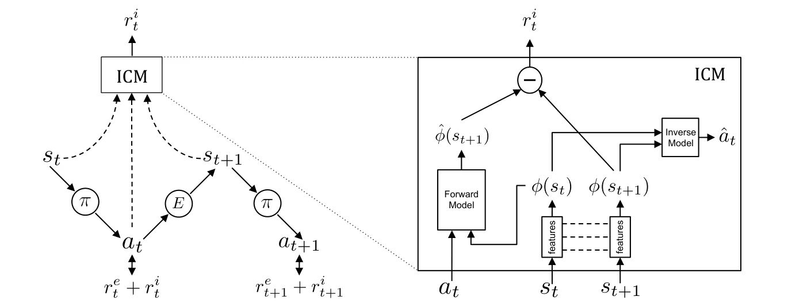
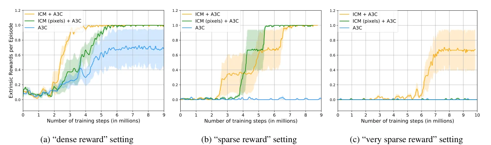
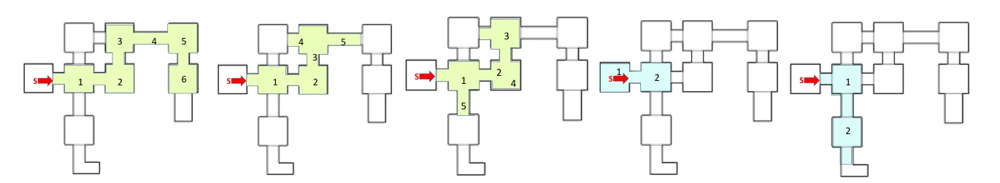

> - **논문**: Curiosity-driven Exploration by Self-supervised Prediction
> - **저자**: Deepak Pathak, Pulkit Agrawal, Alexei A. Efros, Trevor Darrell (UC Berkeley)
> - **학회**: ICML 2017 · [arXiv:1705.05363](https://arxiv.org/abs/1705.05363)
{: .prompt-tip }

> [Count-Based Exploration]()이 "얼마나 자주 봤는가"로 새로움을 쟀다면, **ICM(Intrinsic Curiosity Module)**은 "**내 행동의 결과를 얼마나 잘 예측하지 못하는가**"를 호기심으로 삼는다.

## 1. Intrinsic Reward를 설계하는 두 방향

현실 세계의 보상은 대부분 sparse해서 무작위 탐험으로는 학습이 어렵다. 그래서 extrinsic reward를 보완하는 intrinsic reward가 필요한데, 설계 방법은 크게 둘로 나뉜다.

1. **새로운 상태를 탐험하도록 격려** (Novelty): 상태 분포의 통계 모델이 필요 → count-based 방법
2. **자기 행동의 결과를 예측하는 능력의 오차를 줄이도록 격려** (Prediction error): 상태 $$s_t$$와 행동 $$a_t$$로 다음 상태를 예측하는 **환경 동역학 모델**이 필요

2번에는 두 가지 어려움이 있다.

- 이미지 같은 **고차원 raw sensory input**의 다음 프레임을 픽셀 단위로 예측하기는 매우 어렵다.
- 환경이 **확률적**이면 원래 예측할 수 없는 상태에 계속 끌린다. 대표적인 예가 **Noisy TV 문제**이다. 화면에 무작위 노이즈가 나오는 TV가 있으면, 예측 오차가 항상 커서 에이전트는 TV 앞에서 영원히 떠나지 않는다.

따라서 "학습 가능한 것만 예측하게" 만드는 것이 중요하다.

## 2. 무엇을 예측해야 하나

관측에 영향을 주는 요소를 세 가지로 나눌 수 있다.

1. 에이전트가 **제어할 수 있는** 것 (자기 몸의 움직임)
2. 제어할 수는 없지만 **에이전트에게 영향을 주는** 것 (Freeway의 자동차, Montezuma의 해골)
3. 제어할 수도 없고 **영향도 주지 않는** 것 (바람에 흔들리는 나뭇잎, Noisy TV)

좋은 호기심용 특징 공간은 1과 2를 모델링하고 3에는 영향을 받지 않아야 한다. ICM은 픽셀이 아니라 **에이전트의 행동과 관련된 정보만 담은 특징 공간**에서 예측하고, 이 특징 공간을 **자기지도 학습**으로 배운다.

### Contribution

- Intrinsic motivation을 이미지 같은 **고차원 연속 상태 공간**으로 확장
- 픽셀을 예측하는 어려운 문제를 **피함**
- 에이전트에 영향을 주지 않는 예측 불가능한 환경 요소에 **흔들리지 않는** intrinsic reward

## 3. ICM의 구조

에이전트는 두 부분으로 구성된다.

- **Reward generator (ICM)**: intrinsic reward $$r^i_t$$를 만듦
- **Policy**: 기존 RL처럼 보상의 합을 최대화 (논문은 A3C 사용)

$$
r_t = r^e_t + r^i_t
$$


_Figure 2. 왼쪽: 정책 $$\pi$$는 환경 보상 $$r^e_t$$와 ICM이 만든 호기심 보상 $$r^i_t$$의 합을 최대화한다. 오른쪽: ICM 내부. 두 상태를 같은 encoder로 특징 $$\phi$$로 바꾸고, inverse model은 행동 $$\hat{a}_t$$를, forward model은 다음 특징 $$\hat{\phi}(s_{t+1})$$을 예측한다. 그 오차가 $$r^i_t$$이다. (출처: Pathak et al., 2017)_

### Feature Encoder $$\phi$$

상태 $$s_t$$를 특징 벡터 $$\phi(s_t)$$로 바꾸는 CNN이다. 아래 두 모델이 이 encoder를 공유한다.

### Inverse Dynamics Model

연속된 두 상태의 특징 $$\phi(s_t), \phi(s_{t+1})$$로 그 사이에 한 행동 $$\hat{a}_t$$를 예측한다.

$$
\hat{a}_t = g\big(\phi(s_t), \phi(s_{t+1});\ \theta_I\big),\qquad \mathcal{L}_I = \text{CE}(\hat{a}_t, a_t)
$$

행동을 맞히는 데 필요한 정보만 특징에 담기게 되므로, 행동과 무관한 나뭇잎이나 TV 노이즈는 특징 공간에서 자연스럽게 걸러진다. ICM의 설계는 이 성질에 기대고 있다.

### Forward Dynamics Model

현재 특징과 행동으로 **다음 특징**을 예측한다.

$$
\hat{\phi}(s_{t+1}) = f\big(\phi(s_t), a_t;\ \theta_F\big),\qquad \mathcal{L}_F = \frac{1}{2}\big\lVert\hat{\phi}(s_{t+1}) - \phi(s_{t+1})\big\rVert_2^2
$$

### Intrinsic Reward

Forward model의 **예측 오차가 호기심 보상**이다.

$$
r^i_t = \frac{\eta}{2}\big\lVert\hat{\phi}(s_{t+1}) - \phi(s_{t+1})\big\rVert_2^2
$$

($$\eta$$: scaling factor)

처음 보는 상황에서는 예측이 틀려서 보상이 크고, 익숙해지면 예측이 맞아 보상이 줄어든다. 에이전트는 계속 예측하기 어려운(새로운) 곳으로 이끌린다.

### 전체 목적 함수

$$
\min_{\theta_P, \theta_I, \theta_F}\Big[-\lambda\,\mathbb{E}_{\pi(s_t; \theta_P)}\Big[\sum_t r_t\Big] + (1 - \beta)\,\mathcal{L}_I + \beta\,\mathcal{L}_F\Big]
$$

- $$\lambda$$: 정책 학습과 intrinsic reward 학습 사이의 중요도 (0.1)
- $$\beta$$: inverse model과 forward model loss의 비중 (0.2)

```python
import torch
import torch.nn as nn
import torch.nn.functional as F

class ICM(nn.Module):
    def __init__(self, encoder, feat_dim, n_actions, eta=0.01, beta=0.2):
        super().__init__()
        self.enc, self.n_actions, self.eta, self.beta = encoder, n_actions, eta, beta
        self.inverse = nn.Sequential(nn.Linear(2 * feat_dim, 256), nn.ReLU(), nn.Linear(256, n_actions))
        self.forward_model = nn.Sequential(nn.Linear(feat_dim + n_actions, 256), nn.ReLU(), nn.Linear(256, feat_dim))

    def forward(self, s, s_next, a):
        phi, phi_next = self.enc(s), self.enc(s_next)
        a_logits = self.inverse(torch.cat([phi, phi_next], dim=1))
        a_onehot = F.one_hot(a, self.n_actions).float()
        phi_pred = self.forward_model(torch.cat([phi.detach(), a_onehot], dim=1))

        loss_inv = F.cross_entropy(a_logits, a)
        loss_fwd = 0.5 * (phi_pred - phi_next.detach()).pow(2).sum(1).mean()
        r_int = self.eta * 0.5 * (phi_pred - phi_next).pow(2).sum(1).detach()
        return r_int, (1 - self.beta) * loss_inv + self.beta * loss_fwd

# Atari처럼 4프레임을 쌓은 42x42 흑백 관측이라고 가정한 예
torch.manual_seed(0)
encoder = nn.Sequential(nn.Flatten(), nn.Linear(4 * 42 * 42, 288), nn.ELU())   # 실제로는 CNN
icm = ICM(encoder, feat_dim=288, n_actions=4)
s, s_next = torch.randn(8, 4, 42, 42), torch.randn(8, 4, 42, 42)
a = torch.randint(0, 4, (8,))
r_int, loss = icm(s, s_next, a)
loss.backward()
print(r_int.shape, r_int.requires_grad)   # torch.Size([8]) False → 보상은 상수로 정책 학습에 전달
```

`r_int`를 `detach()`하는 이유는, 정책이 보상을 키우려고 ICM 자체를 바꾸는 일을 막기 위해서이다. 보상은 정책 학습에서 상수로 쓰이고, ICM은 자기 loss로만 학습된다. 또 위 구현에서는 forward model 입력의 `phi`와 정답 `phi_next`를 detach해서 **특징 공간은 inverse loss로만** 학습되게 했다. forward loss까지 encoder로 흘리면, encoder가 모든 상태를 비슷한 특징으로 뭉개 예측 오차를 줄이는 쪽으로 끌려갈 수 있기 때문이다.

참고로 저자들의 공식 TensorFlow 구현(pathak22/noreward-rl)은 detach 없이 **forward loss도 encoder까지 흘려보낸다.** 대신 $$\beta = 0.2$$로 forward loss의 비중을 작게 두고 inverse loss(비중 0.8)가 "행동을 맞히려면 정보를 담아야 한다"고 특징 공간을 붙잡아 주므로 붕괴가 일어나지 않는다. 어느 쪽을 택해도 되지만, 논문 결과를 그대로 재현하려면 공식 구현처럼 두는 편이 안전하다.

## 4. 구현 디테일

| 항목 | 값 |
|---|---|
| 입력 | RGB를 흑백으로 바꾸고 42×42로 축소, 현재 프레임과 이전 3프레임을 쌓아 상태 $$s_t$$로 사용 |
| Action repeat | 학습 시 VizDoom 4, Mario 6 (추론 때는 repeat 없이 매 프레임 샘플링) |
| 정책 (A3C) | conv 4층(각 32 filter, 3×3, stride 2, padding 1, ELU) → LSTM 256 → 가치·행동 FC 각각 |
| ICM encoder $$\phi$$ | 정책과 같은 형태의 conv 4층, 출력 288차원 |
| Inverse model | $$[\phi(s_t), \phi(s_{t+1})]$$ → FC 256 → FC (행동 수) |
| Forward model | $$[\phi(s_t), a_t]$$ → FC 256 → FC 288 |
| 손실 가중치 | $$\beta = 0.2$$, $$\lambda = 0.1$$ |
| Optimizer | Adam (worker끼리 optimizer 파라미터는 공유하지 않음), lr $$10^{-3}$$ |
| 병렬 학습 | A3C 방식, 비동기 worker 20개 |
| 행동 공간 | VizDoom 4개(전진, 좌, 우, 정지), Mario 14개 |

논문에는 보상 스케일 $$\eta$$의 값이 적혀 있지 않다(위 코드의 `eta=0.01`은 예시 값이다). Mario에서 큰 파이프나 넓은 구멍을 넘으려면 같은 행동을 최대 12번 연속으로 골라야 해서, 긴 시간 의존성이 있는 어려운 게임이라고 설명한다.

## 5. 실험

**VizDoom**(3D 미로에서 조끼 찾기, `DoomMyWayHome-v0`)과 **Super Mario Bros**에서 실험했다. VizDoom 지도는 복도로 연결된 방 9개이고, 조끼를 찾으면 +1, 아니면 0인 종료 보상만 있다. 에피소드는 조끼를 찾거나 2,100 step이 지나면 끝난다. Mario 실험은 모두 게임 보상 없이 호기심만으로 학습했다.

### Sparse Extrinsic Reward

VizDoom에서 시작 위치에 따라 난이도를 나눴다.

- **Dense**: 지도 곳곳의 17개 위치 중 무작위로 시작 (목표 근처에서 시작할 때도 있어 ε-greedy로도 꽤 도달함)
- **Sparse / Very sparse**: 최적 정책으로도 각각 270 step, 350 step 떨어진 방(13번, 17번)에서 항상 시작

비교 대상은 baseline **A3C**(ε-greedy 탐험), inverse model 없이 픽셀 공간에서 다음 관측을 예측하는 **ICM-pixels**(deconvolution 층을 붙인 forward model), TRPO로 학습한 **VIME**이다.


_Figure 5. 왼쪽부터 dense, sparse, very sparse. 주황색이 ICM + A3C, 초록색이 ICM-pixels + A3C, 파란색이 A3C. 3번 실행의 평균과 표준오차. (출처: Pathak et al., 2017)_

- 모든 설정에서 ICM이 A3C보다 좋았고, sparse와 very sparse에서 A3C는 전혀 학습하지 못했다.
- Very sparse에서는 ICM-pixels도 한 번도 성공하지 못했고, ICM은 무작위 실행의 **66%에서 만점**을 냈다. 위 Figure 5 오른쪽에서 ICM 평균 보상이 0.66 근처에 머무는 이유이다.
- Dense에서 ICM-pixels가 ICM보다 느렸던 이유를 저자들은 텍스처가 서로 다른 17개 방 중 하나에서 매번 시작하기 때문으로 추측한다. 텍스처 종류가 많을수록 픽셀 예측 모델을 학습하기 어렵다. 시작 방이 고정된 sparse에서는 두 방법의 수렴 속도가 비슷했다.

같은 sparse 설정에서 TRPO 계열과 비교한 결과이다(수렴 시 점수의 평균, 괄호는 중앙값).

| 방법 | Sparse 설정 점수 |
|---|---|
| TRPO | 26.0% (0.0%) |
| A3C | 0.0% (0.0%) |
| VIME + TRPO | 46.1% (27.1%) |
| **ICM + A3C** | **100.0% (100.0%)** |

TRPO는 A3C보다 샘플 효율이 좋은 편인데도 ICM이 수렴 속도와 정확도 모두에서 앞섰다. 또 호기심 네트워크를 uniform, Gaussian, Laplacian 무작위 노이즈로 바꿔 보상으로 주는 sanity check에서는 어떤 설정도 목표에 도달하지 못했다. ICM의 성공이 엉뚱한 해에서 나온 것은 아님을 확인한 결과이다.

### 통제할 수 없는 노이즈에 대한 강건성

Noisy TV 상황을 직접 만들기 위해, sparse 설정에서 관측 이미지의 **40%를 고정 영역의 white noise**로 바꿨다. ICM은 여전히 만점에 도달했지만, 노이즈가 없을 때 sparse를 풀었던 ICM-pixels는 크게 무너졌다. 행동과 무관한 변화를 특징 공간에서 걸러낸다는 2장의 주장을 실험으로 확인한 셈이다.

### 보상이 전혀 없을 때

Extrinsic reward 없이 호기심만으로 학습해 봤다.

- VizDoom에서 2,100 step 에피소드 안에, 최적 경로로도 250 step 넘게 떨어진 **가장 먼 방**까지 탐험하는 경우가 많았다. 무작위로 탐험하는 에이전트는 벽에 막혀 움직이지 못하는 등 탐험 범위가 훨씬 좁았다(아래 Figure 7).


_Figure 7. 각 지도는 에피소드 하나(최대 2,100 step)에서 방문한 방을 칠한 것이다. 왼쪽 세 개(노랑)는 호기심만으로 학습한 에이전트, 오른쪽 두 개(하늘색)는 무작위 탐험 에이전트. (출처: Pathak et al., 2017)_
- Mario에서는 보상 없이 **1단계의 30% 이상**을 진행했다. 적을 피하고 구멍을 뛰어넘는 행동을 스스로 익힌 것이다(죽으면 처음으로 돌아가 다시 익숙한 장면을 보게 되므로, 호기심 관점에서 죽음은 손해이다).

### 새로운 환경으로의 일반화

Mario 1단계에서 호기심만으로 학습한 정책을 다른 단계에 옮겨 봤다.

1. **그대로 적용**: 1단계와 같은 낮 배경인 3단계에서는 점수가 높았지만, 밤 배경으로 시각적으로 크게 다른 2단계에서는 낮았다.
2. **호기심만으로 fine-tuning**: 2단계는 같은 반복 수로 처음부터 학습한 것보다 좋아졌지만, 3단계는 그대로 적용했을 때보다 오히려 나빠졌다. 저자들은 2단계에서는 1단계의 지식을 활용했고, 특정 지점을 넘기 어려운 3단계에서는 그 전까지의 환경을 이미 다 알아 호기심 보상이 거의 0이 되면서(**curiosity blockade**) 정책이 퇴화했다고 설명한다. 지루해서 탐험을 그만두는 것과 비슷하다고 비유한다.
3. **Extrinsic reward로 fine-tuning**: VizDoom에서 텍스처가 다른 학습용 지도에서 호기심만으로 사전학습한 모델을, 테스트 지도의 very sparse 목표로 fine-tuning하자 처음부터 학습한 ICM 모델보다 빨리 배우고 보상도 높았다. ICM-pixels는 이 테스트 환경에 일반화되지 못했다.

Mario 결과는 이동 거리로 평가했다(Table 1, 평균 ± 표준오차).

| 단계 | 설정 | 반복 수 | 평균 이동 거리 | 거리 > 200 비율 | 거리 > 400 비율 |
|---|---|---|---|---|---|
| Level-1 | 처음부터 | 1.5M | 711 ± 59.3 | 50.0% | 35.0% |
| Level-2 | 그대로 적용 | 0 | 31.9 ± 4.2 | 0% | 0% |
| Level-2 | **fine-tuning** | 1.5M | **466 ± 37.9** | 64.2% | 63.6% |
| Level-2 | 처음부터 | 1.5M | 399.7 ± 22.5 | 88.2% | 33.2% |
| Level-2 | 처음부터 | 3.5M | 455.5 ± 33.4 | 69.6% | 51.9% |
| Level-3 | **그대로 적용** | 0 | **319.3 ± 9.7** | 50.0% | 8.4% |
| Level-3 | fine-tuning | 1.5M | 97.5 ± 17.4 | 1.5% | 0% |
| Level-3 | 처음부터 | 1.5M | 11.8 ± 3.3 | 0% | 0% |
| Level-3 | 처음부터 | 5.0M | 42.2 ± 6.4 | 0% | 0% |

Level-2에서는 사전학습 1.5M + fine-tuning 1.5M이 처음부터 3.5M 학습한 것보다도 평균 이동 거리가 길다. 저자들은 어려운 2단계에서 이동·점프·적 처치 같은 기본기를 처음부터 배우는 것보다, 비교적 안전한 1단계에서 먼저 익히는 편이 일종의 curriculum이 된다고 해석한다. Level-3은 처음부터 5M을 학습해도 42 정도밖에 못 가는데, 1단계 정책을 그대로 쓰면 319를 간다.

호기심만으로도 환경에 대한 이해를 얻을 수 있고, 이것이 새 환경에 일반화된다는 것을 보여 줬다.

### 한계 (세미나 정리)

- 일반화 실험들이 서로 같은 조건으로 설계되지 않음
- Sparse와 very sparse를 나누는 기준이 다소 주관적
- Baseline 반복 실험이나, 보상이 전혀 없는 설정의 정량적 결과가 더 있었으면 좋았을 것

## 6. 정리

| 구성 요소 | 역할 |
|---|---|
| Encoder $$\phi$$ | 상태를 특징으로 |
| Inverse model | 행동 예측 → **행동과 관련된 정보만** 특징에 남김 |
| Forward model | 다음 특징 예측 |
| Intrinsic reward | Forward model의 **예측 오차** |

ICM은 픽셀 대신 학습된 특징 공간에서 예측해 Noisy TV 문제를 상당 부분 줄였다. 하지만 **예측 대상 자체가 확률적인** 경우(동전 던지기 결과처럼 행동과 관련 있지만 본질적으로 무작위인 것)에는 여전히 약하다. 다음 글 [RND]()는 이를 **결정적인 예측 문제**로 바꿔 해결한다.

## References

- Pathak et al., "Curiosity-driven Exploration by Self-supervised Prediction," ICML 2017. [arXiv:1705.05363](https://arxiv.org/abs/1705.05363)
- Burda et al., "Large-Scale Study of Curiosity-Driven Learning," ICLR 2019.
- Schmidhuber, "A possibility for implementing curiosity and boredom in model-building neural controllers," 1991.
