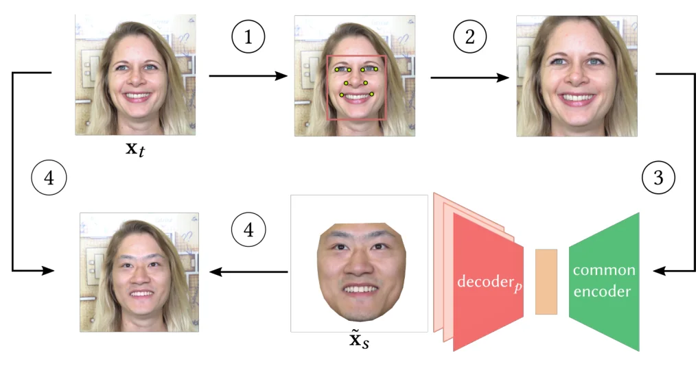
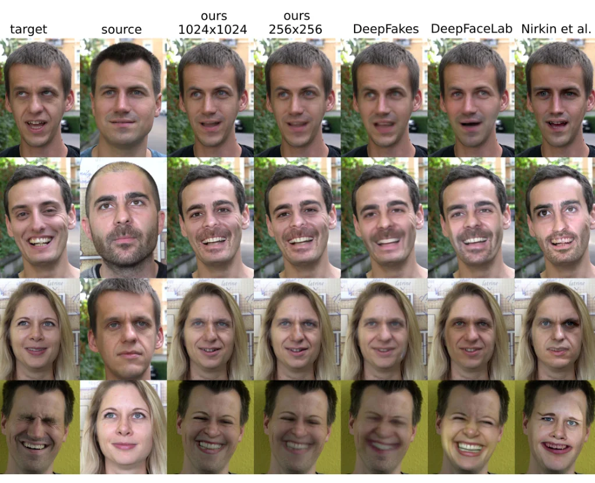
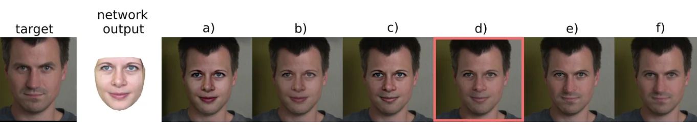

> - **논문**: High-Resolution Neural Face Swapping for Visual Effects
> - **저자**: J. Naruniec, L. Helminger, C. Schroers, R. M. Weber (Disney Research Studios, ETH Zürich)
> - **학회**: Eurographics Symposium on Rendering (EGSR) 2020, Computer Graphics Forum 39(4)
{: .prompt-tip }

> 영화에서 배우를 젊게 만들거나 세상을 떠난 배우를 등장시키는 얼굴 교체는 수개월의 수작업이 드는 그래픽스 파이프라인이었습니다(Furious 7, Rogue One). 신경망 방법은 자동이지만 [DeepFakes·DeepFaceLab]()은 메모리·불안정성 때문에 256² 이하였고, 3D 모델 방법은 시간 안정성이 없었습니다. **High-Resolution Neural Face Swapping for Visual Effects**는 **메가픽셀 해상도에서 사실적이고 시간적으로 안정된** 첫 교체 방법입니다. 요지는 세 가지입니다. 2인용 Y자 오토인코더를 P인용 **comb**로 일반화하고 GAN 없이 점진적으로 1024²까지 키운 것, 고해상도에서 증폭되는 **랜드마크 떨림**을 앙상블로 잡은 것, 그리고 포아송 블렌딩 대신 **목표의 저주파 조명을 보존하는 다중 밴드 합성**과 대비 정렬을 쓴 것입니다.

## 1. Comb 네트워크와 점진 학습

전체 파이프라인은 아래 Figure 2처럼 네 단계입니다. ① 목표 프레임 $$x_t$$에서 얼굴을 검출하고 랜드마크를 찾고, ② 1024×1024로 정규화하고, ③ 공유 인코더에 넣어 소스 신원 $$s$$의 디코더로 복원한 뒤, ④ 정규화를 되돌려 목표 프레임에 합성합니다.


_Figure 2. 소스 신원 s의 얼굴을 목표 인물 t의 프레임에 넣는 파이프라인. (1)(2) 얼굴 crop과 정규화, (3) 공통 인코더와 소스 신원의 디코더, (4) 다중 밴드 합성. (출처: Naruniec et al., 2020)_

Liu 등(UNIT)의 "공유 잠재 공간"과 DeepFakes의 Y자 구조에서 출발해, 모든 신원을 **하나의 인코더 $$E$$**로 임베딩하고 **신원별 디코더 $$D_p$$**, $$p = 1 \dots P$$로 복원합니다(빗살이 디코더). 학습은 각 신원의 이미지를 섞어 넣고 **자기 신원의 디코더 출력만** 재구성 손실을 걸며, 교체 일관성이나 순환 손실은 쓰지 않습니다. 얼굴 내부에만 관심이 있으므로 68개 랜드마크의 볼록 껍질을 10% 키운 마스크 $$m$$을 입력과 출력에 곱합니다.

$$
\mathcal{L}_l = \sum_{p=1}^{P} \frac{1}{|X_p|} \sum_{x_p \in X_p} f_l\big(x_p \odot m_{x_p},\, D_p(E(x_p)) \odot m_{x_p}\big)
$$

$$f_l$$은 낮은 레벨(0~2)에서 SSIM, 그 위에서 MS-SSIM입니다. 해상도별 레벨을 Karras 등의 점진 학습처럼 저해상도부터 키우되 **비적대적**으로 적응시켰고, 각 레벨은 신원당 10만 장을 볼 때까지 학습합니다. 1024² 2인 모델이 1080Ti 1장에서 약 3일입니다. Ablation의 핵심 발견은 **두 명보다 여러 명을 함께 학습하면 표정 충실도가 오른다**는 것입니다. 공유 인코더가 더 다양한 표정을 보기 때문이고, 같은 사람의 다른 조명 조건도 별개의 "신원"으로 디코더를 둘 수 있습니다.

부록 Table 1의 구조는 단순한 conv 오토인코더입니다. 레벨마다 3×3 conv 두 개(LeakyReLU, $$\alpha = 0.2$$)와 down/upsample을 쌓고, 인코더는 4×4에서 4×4 conv로 512차원 잠재 벡터를 만듭니다(인코더 약 23.1M 파라미터). 점진 학습에서는 새 레벨을 붙일 때 gain $$\alpha \in [0, 1]$$을 선형으로 올려 새 층과 기존 작은 네트워크의 출력을 서서히 섞습니다. 디코더를 신원별로 나누는 지점은 잠재 벡터 바로 뒤가 아니라 공유 층을 몇 개 지난 뒤인데, 공유 층이 많을수록 결과가 소스보다 입력 얼굴을 닮아 가고, 너무 이르거나(잠재 직후) 너무 늦으면(레벨 3 뒤) 아티팩트가 생긴다고 합니다.

## 2. 랜드마크 안정화

얼굴 정규화가 랜드마크에 의존하므로 프레임마다 조금 다른 입력이 조금 다른 출력을 만들고, 저해상도용으로 설계된 정렬 알고리즘의 미세한 불일치가 512² 이상에서 **떨림과 변형**으로 보입니다. 고해상도 정렬기를 새로 학습하는 대신, 초기 검출 박스를 너비의 $$\beta w$$만큼 여러 방향으로 $$n$$번 옮겨 다시 정렬하고 랜드마크를 **평균**합니다. 분산 감소 앙상블이고, $$\beta = 0.05$$, $$n = 9$$면 1024²에서 보이는 시간 아티팩트가 사라졌습니다. 랜드마크 검출기는 Deep Alignment Network(DAN)의 TensorFlow 구현입니다.

## 3. 조명·대비 보존 다중 밴드 합성

포아송 블렌딩은 소스·목표의 조명이 다르면 얼굴 내부에 아티팩트를 만듭니다. 다중 밴드 블렌딩(Burt & Adelson)은 라플라시안 피라미드의 레벨마다 마스크 경계를 부드럽게 섞지만 목표 조명을 맞추지는 않습니다. 그래서 **가장 거친 두 레벨은 목표의 것을 그대로 복사**하고 나머지 세부 레벨만 블렌딩합니다. 저주파 조명은 목표에서, 고주파 세부는 생성된 소스에서 오는 셈입니다. 경계 평활은 얼굴 안쪽으로만 전파해 윤곽이 뭉개지지 않게 하고, 촬영 조건이 크게 다를 때 남는 **대비 차이**는 Global Contrast Factor의 비율로 생성 얼굴을 스케일해 맞춥니다. 마스크는 머리 크기 차이로 생성 얼굴의 가장자리가 옮겨지지 않도록 윤곽 랜드마크의 볼록 껍질보다 줄입니다.

## 4. 코드로 보기: 떨림 앙상블, 저주파 보존 합성, comb의 효율

가만히 있는 얼굴 60프레임에서 검출 노이즈와 박스 의존 편향을 가진 랜드마크의 표준편차를 단일 검출과 9개 교란 평균으로 비교하고, 1차원 단면에서 라플라시안 피라미드 블렌딩에 목표의 거친 두 레벨을 복사했을 때 저주파 조명 오차와 소스 질감 보존을 재며, P명에 필요한 쌍별 모델 수와 comb 모델 수를 셉니다.

```python
import numpy as np
rng = np.random.default_rng(0)
# (1) landmark stabilisation: average the landmarks from n perturbed re-initialisations of the face box
true = 512.0; frames = 60
def detect(box_offset): return true + 0.6 * rng.standard_normal() + 0.3 * box_offset      # detector noise + bias that depends on the box
single = np.array([detect(0.0) for _ in range(frames)])
ens = np.array([np.mean([detect(d) for d in 0.05 * 1024 * rng.uniform(-1, 1, 9)]) for _ in range(frames)])
print("landmark jitter (std of a landmark's x over 60 frames of a still face, pixels at 1024x1024)")
print(f"  single detection      {single.std():.3f}")
print(f"  mean of 9 perturbed   {ens.std():.3f}   (variance reduction ~ 1/sqrt(n))")
# (2) multi-band blending that keeps the target's low-frequency lighting: Laplacian pyramid, copy the 2 coarsest target levels
def pyramid(s, levels=5):
    g = [s]
    for _ in range(levels): g.append(np.convolve(g[-1], [0.25, 0.5, 0.25], mode="same")[::2])
    lap = [g[i] - np.repeat(g[i + 1], 2)[:len(g[i])] for i in range(levels)] + [g[-1]]
    return lap
def collapse(lap):
    s = lap[-1]
    for l in reversed(lap[:-1]): s = l + np.repeat(s, 2)[:len(l)]
    return s
n = 256; x = np.linspace(0, 1, n)
target = 0.5 + 0.25 * x + 0.02 * np.sin(60 * x)                                   # target: lit from one side (gradient) + skin texture
source = 0.5 - 0.10 * x + 0.03 * np.sin(45 * x + 1)                               # generated source: different lighting, its own texture
mask = ((x > 0.3) & (x < 0.7)).astype(float); mask_s = np.convolve(mask, np.ones(9) / 9, mode="same")
Ls, Lt = pyramid(source), pyramid(target)
blended = [mask_s[::2 ** i][:len(Ls[i])] * Ls[i] + (1 - mask_s[::2 ** i][:len(Ls[i])]) * Lt[i] for i in range(len(Ls))]
blended_light = blended[:-2] + Lt[-2:]                                             # coarsest 2 levels straight from the target
out_plain, out_light = collapse(blended), collapse(blended_light)
inside = mask > 0.5
def low(s): return np.convolve(s, np.ones(41) / 41, mode="same")
print("\nmulti-band compositing inside the face region")
print(f"  low-frequency lighting error vs target: plain multi-band {np.abs(low(out_plain) - low(target))[inside].mean():.3f}, with target low bands {np.abs(low(out_light) - low(target))[inside].mean():.3f}")
print(f"  source texture kept (corr of high-pass): plain {np.corrcoef((out_plain - low(out_plain))[inside], (source - low(source))[inside])[0,1]:.2f}, with target low bands {np.corrcoef((out_light - low(out_light))[inside], (source - low(source))[inside])[0,1]:.2f}")
# (3) global-contrast alignment: scale the generated face so its contrast matches the target's
gcf = lambda s: np.abs(np.diff(s)).mean()
c = gcf(target) / gcf(out_light); print(f"  contrast factor target/generated = {c:.2f}  -> multiply the generated face by {c:.2f} before compositing")
# (4) comb network: P decoders share one encoder, so every pair is swappable after one training run
for P in (2, 4, 8): print(f"P = {P} identities: pairwise two-way models needed {P * (P - 1) // 2}, comb model needed 1 (encoder + {P} decoders)")
```

```text
landmark jitter (std of a landmark's x over 60 frames of a still face, pixels at 1024x1024)
  single detection      0.538
  mean of 9 perturbed   2.990   (variance reduction ~ 1/sqrt(n))

multi-band compositing inside the face region
  low-frequency lighting error vs target: plain multi-band 0.157, with target low bands 0.011
  source texture kept (corr of high-pass): plain 0.62, with target low bands 0.83
  contrast factor target/generated = 0.82  -> multiply the generated face by 0.82 before compositing
P = 2 identities: pairwise two-way models needed 1, comb model needed 1 (encoder + 2 decoders)
P = 4 identities: pairwise two-way models needed 6, comb model needed 1 (encoder + 4 decoders)
P = 8 identities: pairwise two-way models needed 28, comb model needed 1 (encoder + 8 decoders)
```

- 이 toy의 앙상블은 떨림을 **늘렸습니다**(0.54 → 2.99). 검출기의 편향을 박스 오프셋에 비례하게 만들었기 때문에, 오프셋을 ±5%(51픽셀)까지 흔들면 편향의 분산이 검출 잡음보다 커집니다. 논문의 방법은 "박스 위치에 따른 편향이 평균 0 주위에 무작위"일 때만 분산을 줄이고, 편향이 체계적이면 오히려 해롭습니다. 저자들의 성공은 그들의 정렬기가 그 조건을 만족했다는 뜻이고, 이 toy는 그 가정이 깨지는 경우를 보여 줍니다. 솔직하게 그대로 둡니다.
- 합성은 의도대로 됩니다. 목표의 거친 두 레벨을 복사하면 얼굴 안쪽의 저주파 조명 오차가 0.157에서 0.011로 줄고, 소스 질감의 고역 상관도 0.62에서 0.83으로 오릅니다(저주파가 빠져 상관이 깨끗해짐). 대비 계수 0.82는 생성 얼굴이 목표보다 대비가 높아 줄여야 한다는 뜻입니다.
- 8명이면 쌍별 모델 28개 대신 comb 1개입니다. 학습 시간뿐 아니라 "임의의 연기와 임의의 외형을 조합"할 수 있다는 점이 VFX에서의 가치입니다.

## 5. 실험

지원자 9명(남성 7, 여성 2)을 4K(3840×2160, 25fps)로 통제 조명·자연광·야외에서 2~4분씩 촬영해 6명(그중 2명은 두 조명 조건)으로 **8출력 모델**을 만듭니다. 공개 고해상도 데이터셋은 정지 사진뿐이라 직접 찍었습니다.

| 항목 | 값 |
|---|---|
| 데이터 | 자체 촬영 4K 영상(Sony ILCE-7SM2), 8개 "신원"(6명 + 2명의 다른 조명 조건) |
| 해상도 | 4×4에서 시작해 1024×1024까지 점진 학습 |
| 레벨당 학습량 | 신원당 $$10^5$$장을 볼 때까지 |
| 손실 | 마스크 SSIM(레벨 0~2, 입력을 16×16으로 키워 계산), 그 위는 MS-SSIM |
| 증강 | 무작위 이동·회전·스케일 |
| Optimizer | Adam, lr $$10^{-4}$$ |
| 하드웨어·시간 | GTX 1080Ti 1장(i7-6700K), 1024² 2인 모델 약 3일 |
| 안정화 | $$\beta = 0.05$$, $$n = 9$$ |
| 합성 | 라플라시안 피라미드 중 거친 2레벨은 목표에서 복사, GCF 비율로 대비 보정 |

**비교.** Nirkin 등(3DMM, 학습 불필요, 중립 표정 소스, 500²), DeepFakes(128²), DeepFaceLab SAE(11GB GPU에서 256²가 한계)와 다섯 쌍을 비교합니다(Figure 4). DeepFakes와 DFL은 OpenCV의 포아송 블렌딩을 쓰고 DFL은 평균·표준편차 매칭으로 색을 맞춥니다. Nirkin 등의 결과는 원본의 절반 정도 해상도라 Lanczos로 키워 비교했습니다. 제안 방법은 1024²와 256² 두 해상도를 보이며, 세부와 시간 안정성에서 앞섭니다(보충 영상). 다른 방법은 쌍마다 따로 학습했지만 제안 방법은 모든 사람을 한 모델로 학습했습니다.


_Figure 4. 왼쪽부터 목표, 소스, 제안 방법 1024², 제안 방법 256², DeepFakes, DeepFaceLab, Nirkin et al. 마지막 줄처럼 표정이 강할 때 3DMM 방법은 얼굴이 크게 어긋납니다. (출처: Naruniec et al., 2020)_

**Ablation.** 교체 품질은 그림으로만 비교하고 사람 관찰자 연구는 없습니다.

- **점진 학습**: 1024²에서 처음부터 끝까지 한 번에 학습하면 얼굴은 그럴듯해도 포즈·표정을 놓치고, 데이터를 더 볼수록 아티팩트가 심해져 80K iteration 뒤에는 완전히 무너졌습니다.
- **Comb(8출력) 대 2출력 모델 3개**: 같은 iteration 수로 맞췄을 때, 소스 데이터에 없던 감은 눈이나 내민 혀 같은 표정을 8출력 모델이 더 잘 재현했습니다.
- **합성**: 포아송 블렌딩은 얼굴이 하얗게 바래는 효과가 있습니다. 아래 Figure 9처럼 거친 레벨을 2개 복사하면 목표 조명이 유지되지만, 4개를 복사하면 목표와 생성 얼굴이 섞인 아티팩트가 생기고, 대비 보정도 사실감에 중요했습니다.
- **랜드마크 안정화**: 1024² 얼굴 100장을 무작위 affine 변환으로 흔들고 원래 랜드마크와의 L2 오차를 쟀습니다(이미지당 10회). 초기화 수를 늘리면 오차가 줄다가 10개 근처에서 평탄해집니다(Figure 10).


_Figure 9. a) 일반 다중 밴드 블렌딩, b) a에 대비 보정, c) 목표에서 거친 2레벨 복사, d) c에 대비 보정(논문의 선택), e) 4레벨 복사, f) e에 대비 보정. (출처: Naruniec et al., 2020)_

## 6. 해석

**1. 주체 특정 방법의 품질 상한을 보여 줍니다.** [FaceShifter]()와 같은 해에 나온 이 논문은 반대 방향을 택했습니다. 임의 신원 대신 **촬영 통제된 소수의 배우**, 256² 대신 1024², GAN 대신 SSIM 재구성. VFX라는 응용은 데이터와 시간을 쓸 수 있으므로 일반화보다 충실도가 중요하고, 그 조건에서 오토인코더만으로 어디까지 가는지를 보였습니다. [MegaFS]()와 [FSLSD]()는 이를 "신원마다 디코더를 학습해야 해 일반화가 없다"고 인용하며 StyleGAN 사전으로 원샷 메가픽셀을 추구합니다.

**2. "여러 신원이 표정을 돕는다"는 관찰이 중요합니다.** 공유 인코더가 더 많은 사람의 표정을 보면 표정 공간이 풍부해진다는 것은, 주체 비의존 방법이 대규모 데이터로 얻는 이점의 한 조각이고, DFL의 LIAE가 두 신원의 잠재를 정렬하는 것과도 통합니다.

**3. 고해상도의 적은 떨림입니다.** 저해상도에서 무시되던 서브픽셀 불일치가 1024²에서 아티팩트가 된다는 지적은 이후 [FSGANv2]()의 1€ 필터식 평활화, [FSLSD]()의 코드 궤적 제약처럼 시간 일관성 전용 설계로 이어집니다. 위 toy가 보여 주듯 앙상블 평균은 편향이 무작위일 때만 답입니다.

**4. 합성을 설계 대상으로 삼았습니다.** "조명은 목표, 세부는 소스"라는 주파수 분해는 [AOT]()의 최적 수송, [HifiFace]()의 SFF가 네트워크 안에서 하려는 일을 고전 피라미드로 명시적으로 한 것입니다.

**5. 평가를 읽을 때 주의할 점.** 교체 품질에 대한 정량 지표도 사용자 연구도 없고(정량 실험은 랜드마크 안정성 하나), 비교 대상은 해상도가 낮은 설정으로 돌렸습니다(DFL 256², DeepFakes 128²는 구현 제약 때문이라 공정하지 않음). 데이터는 비공개 9명이고, 신원마다 10만 장 노출과 3일 학습이 필요합니다. 위 toy의 안정화 결과는 논문과 반대 방향이며, 그 이유를 적어 두었습니다.

## 7. 정리

| 항목 | 내용 |
|---|---|
| 목표 | VFX용 1024², 사실적·시간 안정 얼굴 교체 |
| 모델 | 공유 인코더 + P개 디코더(comb), 자기 신원 재구성만, 마스크 SSIM/MS-SSIM, 비적대적 점진 학습 |
| 발견 | 2인보다 다인 학습이 표정 충실도 향상, 같은 사람의 조명 조건도 별도 출력 가능 |
| 안정화 | 검출 박스를 9번 교란해 랜드마크 평균(β=0.05) |
| 합성 | 라플라시안 피라미드 블렌딩 + 목표의 거친 2레벨 복사 + GCF 대비 정렬 + 축소 마스크 |
| 한계 | 신원별 학습·데이터, 교체 품질 정량 평가 없음, 비교 해상도 불공정, 안경·극단적 옆얼굴에 약함 |

## References

- Naruniec, Helminger, Schroers, Weber, "High-Resolution Neural Face Swapping for Visual Effects," Computer Graphics Forum (EGSR) 39(4), 2020. [DOI:10.1111/cgf.14062](https://doi.org/10.1111/cgf.14062)
- Liu, Breuel, Kautz, "Unsupervised Image-to-Image Translation Networks," NeurIPS 2017. [arXiv:1703.00848](https://arxiv.org/abs/1703.00848)
- Karras, Aila, Laine, Lehtinen, "Progressive Growing of GANs for Improved Quality, Stability, and Variation," ICLR 2018. [arXiv:1710.10196](https://arxiv.org/abs/1710.10196)
- Burt, Adelson, "A Multiresolution Spline with Application to Image Mosaics," ACM TOG 1983.
- Wang, Simoncelli, Bovik, "Multi-scale Structural Similarity for Image Quality Assessment," Asilomar 2003.
- Matković et al., "Global Contrast Factor – a New Approach to Image Contrast," Computational Aesthetics 2005.
