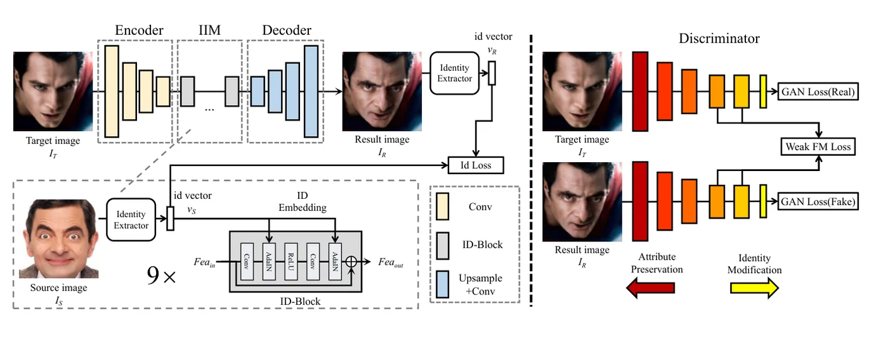
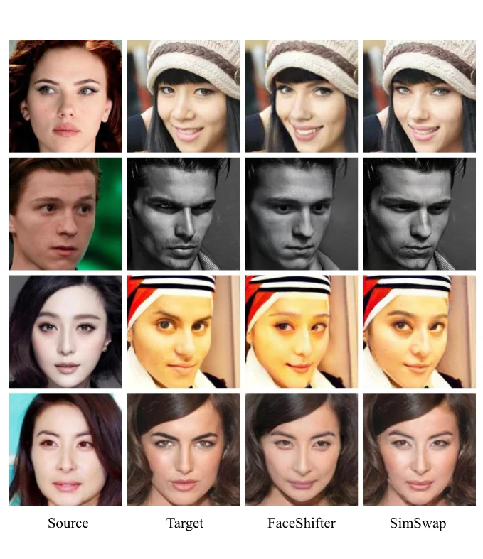
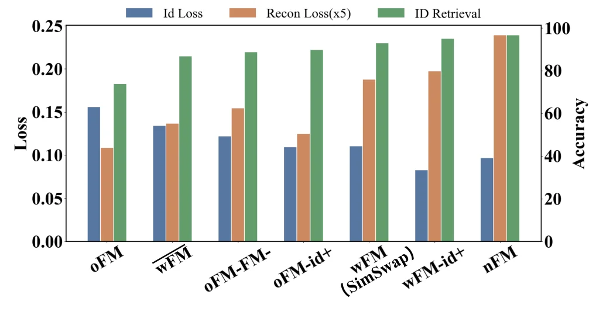

> - **논문**: SimSwap: An Efficient Framework For High Fidelity Face Swapping
> - **저자**: Renwang Chen, Xuanhong Chen, Bingbing Ni, Yanhao Ge (Shanghai Jiao Tong University, Tencent)
> - **학회**: ACM Multimedia (MM) 2020 · [arXiv:2106.06340](https://arxiv.org/abs/2106.06340) · [DOI](https://doi.org/10.1145/3394171.3413630) · [코드](https://github.com/neuralchen/SimSwap)
{: .prompt-tip }

> 얼굴 교체는 두 갈래이다. **소스 지향**([FSGAN](), Nirkin 등)은 소스 얼굴에 목표의 표정·포즈를 입혀 붙이므로 소스의 포즈·조명에 민감하고 표정 재현이 부정확하다. **목표 지향**(DeepFakes, IPGAN, [FaceShifter]())은 목표의 특징을 수정하므로 소스 변화에 강하지만, 신원 수정에 치우쳐 표정·시선이 어긋나곤 했다. **SimSwap**은 목표 지향의 가장 단순한 형태를 찾는다. DeepFakes가 한 쌍에만 되는 이유를 분석해 **ID 주입 모듈** 하나로 임의 신원으로 넓히고, 속성 보존은 속성마다 손실을 설계하는 대신 **약한 특징 매칭** 하나로 암묵적으로 걸었다. 이름 그대로 "Simple Swap"이다.

## 1. DeepFakes의 한계

공유 인코더 $$Enc$$와 신원별 디코더 $$Dec_S$$, $$Dec_T$$. 학습은 워핑된 소스를 $$Enc$$-$$Dec_S$$로 복원하고 목표도 마찬가지이다. 테스트에서 목표를 $$Enc$$-$$Dec_S$$에 넣으면 "워핑된 소스"로 착각해 소스 신원 + 목표 속성을 낸다. 이때 인코더 특징에는 목표의 신원과 속성이 모두 있는데 $$Dec_S$$가 그것을 소스 신원 이미지로 바꾸므로, 소스 신원 정보가 $$Dec_S$$의 가중치 안에 들어 있는 셈이다. 그래서 디코더는 한 신원에만 쓸 수 있다([DeepFaceLab]()의 구조 분석과 같은 진단).

## 2. ID 주입 모듈


_Figure 2. SimSwap의 전체 구조. 생성기는 Encoder, ID Injection Module(IIM, ID-Block 9개), Decoder로 이루어지고, 오른쪽 판별기의 뒤쪽 층 특징으로 Weak FM Loss를 계산한다. (출처: Chen et al., 2020)_

신원을 디코더에서 떼어 내기 위해 인코더와 디코더 사이에 **IIM**을 둔다. 목표 특징 $$Fea_T$$에서 신원과 속성은 얽혀 있어 나눌 수 없으므로, **특징 전체를 수정**하되 손실이 어디를 바꾸고 어디를 남길지 암묵적으로 배우게 한다. 소스에서는 ArcFace로 신원 벡터 $$v_S$$만 뽑고, 잔차 블록의 BN을 [AdaIN]()으로 바꾼 **ID-Block** 9개가 $$v_S$$에서 FC로 만든 $$\sigma_S, \mu_S$$로 특징을 변조한다.

$$
\text{AdaIN}(Fea, v_S) = \sigma_S \frac{Fea - \mu(Fea)}{\sigma(Fea)} + \mu_S
$$

학습에 여러 신원의 소스가 섞이므로 디코더 가중치는 특정 신원과 무관해지고, 신원 수정은 IIM이, 복원은 디코더가 맡는다. 신원 손실 $$1 - \cos(v_R, v_S)$$만 있으면 네트워크가 목표 속성을 다 버리고 소스 신원의 정면 얼굴만 내는 과적합이 생기므로, patchGAN 판별기의 적대 손실로 막는다.

## 3. 약한 특징 매칭

속성을 하나씩 명시적으로 제약하려면 속성마다 네트워크가 필요해 비현실적이다. pix2pixHD의 특징 매칭 $$\sum_{i=1}^{M} \frac{1}{N_i}\lVert D^{(i)}(I_R) - D^{(i)}(I_{GT}) \rVert_1$$은 정답이 있을 때 학습 안정화를 위한 것인데, 교체에는 정답이 없으므로 **목표 이미지 $$I_T$$를 정답 자리에** 넣고, **앞의 몇 층을 빼고 마지막 몇 층만** 쓴다.

$$
\mathcal{L}_{wFM}(D) = \sum_{i=m}^{M} \frac{1}{N_i} \lVert D^{(i)}(I_R) - D^{(i)}(I_T) \rVert_1
$$

얕은 층은 질감이라 픽셀 수준에서 결과를 목표에 묶어 신원 수정을 방해하고, 깊은 층은 의미(포즈, 표정, 조명 같은 속성)라 그것만 맞추면 속성이 암묵적으로 보존된다. 다중 스케일 판별기 둘에 모두 적용한다. 총 손실은 $$10\mathcal{L}_{Id} + 10\mathcal{L}_{Recon} + \mathcal{L}_{Adv} + 10^{-5}\mathcal{L}_{GP} + 10\mathcal{L}_{wFM}$$이고, 재구성 손실은 같은 신원 쌍에서만 켠다.

| 항목 | 값 |
|---|---|
| 학습 데이터 | VGGFace2, 250×250보다 작은 이미지 제거, 224×224로 정렬·crop |
| 신원 추출기 | 사전학습 ArcFace |
| 판별기 | patchGAN, 다중 스케일 2개, hinge 적대 손실 + gradient penalty |
| 손실 가중치 | $$\lambda_{Id} = 10$$, $$\lambda_{Recon} = 10$$, $$\lambda_{GP} = 10^{-5}$$, $$\lambda_{wFM} = 10$$ |
| Optimizer | Adam, $$\beta_1 = 0$$, $$\beta_2 = 0.999$$ |
| 배치 구성 | 같은 신원 쌍 배치와 다른 신원 쌍 배치를 번갈아 |
| 학습 길이 | 500 epoch 이상 |

학습률, 배치 크기, 하드웨어는 논문에 나와 있지 않다.

## 4. 코드로 보기: 어느 층을 맞추느냐가 신원 변화를 결정한다

무작위 고정 4층 "판별기"에서, 목표 이미지(blob 위치 = 포즈, 입 크기 = 표정, 줄무늬 주파수 = 신원)를 신원 손실로 소스 신원 쪽으로 최적화하되 (a) 4층 모두, (b) 깊은 2층만, (c) 매칭 없음으로 특징 매칭을 걸고 신원 점수와 포즈·입 보존을 비교한다.

```python
import torch, torch.nn as nn, torch.nn.functional as F
torch.manual_seed(0); torch.set_num_threads(1)
# a fixed random 'discriminator' with 4 layers; shallow layers see texture, deep layers see coarse layout (pose/expression)
D = nn.Sequential(nn.Conv2d(1, 8, 3, padding=1), nn.LeakyReLU(0.2), nn.Conv2d(8, 16, 4, stride=2, padding=1), nn.LeakyReLU(0.2),
                  nn.Conv2d(16, 32, 4, stride=2, padding=1), nn.LeakyReLU(0.2), nn.Conv2d(32, 32, 4, stride=2, padding=1)).eval()
for p in D.parameters(): p.requires_grad_(False)
def layers(img):
    outs, h = [], img
    for m in D:
        h = m(h)
        if isinstance(m, nn.Conv2d): outs.append(h)
    return outs
yy, xx = torch.meshgrid(torch.linspace(-1, 1, 32), torch.linspace(-1, 1, 32), indexing="ij")
def face(pose, mouth, tex_freq):           # layout = blob position + mouth size (attributes); texture = stripe frequency (identity)
    return torch.exp(-((xx - pose) ** 2 + yy ** 2) * 3) + mouth * torch.exp(-((xx - pose) ** 2 + (yy - 0.5) ** 2) * 20) + 0.25 * torch.sin(tex_freq * xx + 2 * yy)
target = face(0.2, 0.6, 4.0)[None, None]; source_id = 11.0
id_feat = lambda img: torch.stack([(img * torch.sin(source_id * xx + 2 * yy)).mean(), (img * torch.sin(4.0 * xx + 2 * yy)).mean()])   # a toy 'ArcFace': responds to the stripe frequency
def attr_err(img):                          # attribute error: blob centre and mouth energy vs the target
    w = img[0, 0].clamp(min=0); cx = (w * xx).sum() / w.sum(); m = (img[0, 0] * torch.exp(-((xx - 0.2) ** 2 + (yy - 0.5) ** 2) * 20)).mean()
    return (cx - 0.2).abs().item(), m.item()
tl = layers(target)
for name, start in (("full feature matching (all 4 layers)", 0), ("weak feature matching (last 2 layers)", 2), ("no feature matching", 4)):
    img = target.clone().requires_grad_(True); opt = torch.optim.Adam([img], 0.02)
    for s in range(400):
        f = id_feat(img); id_loss = 1 - F.cosine_similarity(f, torch.tensor([1.0, 0.0]), dim=0)     # pull towards the source identity
        fm = sum(F.l1_loss(a, b) for a, b in zip(layers(img)[start:], tl[start:])) if start < 4 else torch.tensor(0.0)
        loss = 10 * id_loss + 10 * fm; opt.zero_grad(); loss.backward(); opt.step()
    f = id_feat(img.detach()); cx_err, mouth = attr_err(img.detach())
    print(f"{name:<40} identity score {f[0].item() / (f.norm().item() + 1e-8):5.2f}   pose error {cx_err:.3f}   mouth energy {mouth:.3f} (target {attr_err(target)[1]:.3f})")
print("-> shallow-layer matching pins the pixels and blocks the identity change; deep-layer-only matching keeps layout (pose, mouth) while letting texture move")
```

```text
full feature matching (all 4 layers)     identity score  1.00   pose error 0.124   mouth energy 0.033 (target 0.035)
weak feature matching (last 2 layers)    identity score  1.00   pose error 0.140   mouth energy 0.027 (target 0.035)
no feature matching                      identity score  1.00   pose error 0.145   mouth energy 0.023 (target 0.035)
-> shallow-layer matching pins the pixels and blocks the identity change; deep-layer-only matching keeps layout (pose, mouth) while letting texture move
```

- 이 toy에서는 세 설정 모두 신원 점수가 1.00에 도달했고 포즈 오차도 0.12~0.15로 비슷하다. 논문의 효과(얕은 층 매칭이 신원 변화를 막음)가 **재현되지 않았다.** 무작위 합성곱의 얕은 특징은 줄무늬 주파수 변화를 거의 구분하지 못해 픽셀을 묶는 힘이 약했고, 학습된 판별기의 얕은 층이 질감에 민감하다는 전제가 성립하지 않기 때문이다. 입 에너지는 매칭이 많을수록 목표(0.035)에 가까워(0.033 → 0.027 → 0.023) 방향은 맞지만 차이가 작다.
- 논문의 표 1이 보여 주는 실제 차이는 전체 매칭(SimSwap-oFM)의 ID 검색이 가장 낮고(73.64%) 포즈 오차도 가장 작으며(1.22), 매칭 없음(nFM)이 FaceShifter 수준으로 ID 검색이 높고(96.57%) 포즈 오차가 커지며(2.47), 약한 매칭이 그 중간(92.83%, 1.53)에 놓인다는 것이다. 이 toy로는 그 정량적 그림을 보일 수 없음을 그대로 적는다.

## 5. 실험

**정성.** 영화 장면 8장의 목표 × 인터넷 10장의 소스(모두 학습 외)의 얼굴 행렬(Figure 3)에서 과장된 표정, 얼굴의 줄무늬, 큰 회전에도 신원을 바꾸면서 표정·시선·포즈·조명을 지킨다. 소스는 신원 벡터만 쓰므로 정면·무표정일 필요가 없다.

**비교.** FaceForensics++에서 DeepFakes는 조명·포즈 불일치, FaceShifter는 결과가 좋지만 표정과 시선이 목표를 완전히 따르지 않는다(Figure 4, 5의 가늘게 뜬 눈). FaceShifter는 얼굴 형태를 소스 쪽으로 바꾸는 강한 신원 수정 능력이 있지만 신원에 치우쳤다는 것이 저자들의 평가이고, 조명도 SimSwap이 약간 낫다(FaceShifter는 2단계가 있는데도). FaceShifter는 코드가 공개되지 않아 FaceShifter 논문의 그림을 잘라 비교했다. FSGAN은 표정·시선 재현에 실패하고 조명이 다르며, 소스 얼굴의 그림자를 결과에 끌어온다(Figure 6).


_Figure 5. FaceShifter와의 추가 비교. 둘째 줄처럼 목표가 눈을 가늘게 뜬 표정을 SimSwap은 따라가고, 셋째·넷째 줄에서는 조명도 목표에 더 가깝다. (출처: Chen et al., 2020)_

**정량(FF++, FaceShifter 프로토콜).** 각 FF++ 영상에서 무작위 10프레임을 골라 FF++와 같은 소스-목표 쌍으로 교체하고, 다른 얼굴 인식 네트워크로 가장 가까운 원본 프레임이 올바른 소스 영상에서 왔는지(ID 검색), 포즈 추정기로 포즈 L2 거리를 잰다(Table 1).

| 방법 | ID 검색 ↑ | 포즈 ↓ |
|---|---|---|
| DeepFakes | 77.65% | 4.59 |
| FaceShifter | **97.38%** | 2.96 |
| SimSwap-oFM (전체 특징 매칭) | 73.64% | **1.22** |
| **SimSwap (약한 특징 매칭)** | 92.83% | 1.53 |
| SimSwap-nFM (특징 매칭 없음) | 96.57% | 2.47 |

SimSwap은 FaceShifter보다 ID 검색이 4.55%p 낮고 포즈 오차는 절반 수준이다. 포즈 오차가 가장 작은 것은 얕은 층까지 맞추는 oFM이지만, 대신 ID 검색이 DeepFakes보다도 낮아진다. 표정은 유효한 재현이 없어 비교하지 않았다.

**신원-속성 균형 ablation.** 특징 매칭 방식과 $$\lambda_{Id}$$를 바꾼 7개 모델을 CelebAMask-HQ에서 비교했다. 서로 다른 신원 1,000쌍의 평균 신원 손실(신원 변경 능력)과, 같은 이미지를 소스·목표로 넣은 자기 교체 1,000장의 재구성 손실(속성 손실)을 함께 본다.


_Figure 7. 7개 변형의 신원 손실(파랑), 재구성 손실 ×5(주황), ID 검색(초록). oFM은 원래 특징 매칭, 윗줄이 그어진 wFM은 얕은 층만 남긴 매칭, oFM-FM-은 특징 매칭 가중치 5, id+는 신원 가중치 20, nFM은 특징 매칭 없음이다. (출처: Chen et al., 2020)_

- 얕은 층을 남긴 변형(oFM, 얕은 층만 쓰는 wFM, oFM-FM-, oFM-id+)은 모두 SimSwap보다 ID 검색이 낮다. 신원 변경을 막는 것은 얕은 층 매칭이라는 해석이다.
- nFM은 ID 검색이 가장 높지만 재구성 손실도 가장 커서 시선 등 속성이 어긋난다.
- wFM-id+($$\lambda_{Id} = 20$$)는 신원 손실은 더 작지만 ID 검색과 육안 비교로는 nFM보다 신원이 약해, 신원 손실에 과적합한 것으로 본다. 소스의 머리카락까지 끌어오는 경향도 있어 최종 모델은 $$\lambda_{Id} = 10$$인 SimSwap이다.

## 6. 해석

**1. 소스 지향 대 목표 지향이라는 분류를 정착시켰다.** 이 논문의 2절 분류는 이후 [HifiFace](), [E4S](), [FlowFace]()가 자신을 위치시키는 좌표가 된다. 소스의 포즈·조명에 민감하다는 소스 지향의 약점과, 신원·속성의 얽힘이라는 목표 지향의 약점이 한 문단에 정리되어 있다.

**2. 가장 많이 쓰인 이유는 "단순함"이다.** 공개 코드와 사전학습 모델 덕에 SimSwap은 FaceShifter(비공개) 대신 가장 흔한 비교 기준이자 [MobileFaceSwap]()의 교사 모델이 됐다. 구조는 인코더-IIM-디코더 하나, 손실은 다섯 개뿐이고 특수 모듈이 없다. [Smooth-Swap]()이 추구한 "손수 만든 부품 없는 설계"의 선례이다.

**3. 신원과 속성의 트레이드오프를 손실 하나로 조절한다.** 약한 특징 매칭의 시작 층 $$m$$이 다이얼 역할을 한다. 깊은 층만 쓰면 신원이 강하고, 얕은 층까지 쓰면 속성이 강하다. 이후 연구는 SimSwap을 "속성은 잘 지키지만 신원·얼굴 형태가 약하다"(HifiFace, [RAFSwap]())고 평가하는데, 이는 설계의 선택이지 결함이 아니다. [FaceInpainter]()는 이 손실이 쌍 데이터용 지각 손실과 비슷해 결과가 목표를 닮는다고 지적한다.

**4. 한계는 명시적 분리가 없다는 점이다.** 특징 전체를 변조하므로 신원 벡터에 섞인 소스의 속성(머리, 안경, 조명)이 새고, 신원 강도를 올릴수록 속성이 무너진다. [InfoSwap]()의 정보 병목, FaceShifter의 공간 마스크는 이 얽힘을 다른 방식으로 푼다. 이마·뺨의 경계 아티팩트도 보고된다(FaceInpainter Figure 7).

**5. 평가를 읽을 때 주의할 점.** FaceShifter와의 비교는 논문에서 잘라 온 이미지로 이루어졌고, 표정 지표는 생략됐다. ID 검색 92.83은 FaceShifter 97.38보다 분명히 낮으며, 공개 모델은 논문의 모델과 달라 MobileFaceSwap이 재측정한 교사 수치(95.94)와 차이가 난다. 위 toy는 논문이 보인 효과를 재현하지 못했고 그 이유를 적어 두었다.

## 7. 정리

| 항목 | 내용 |
|---|---|
| 진단 | DeepFakes의 신원 특정성 = 신원이 디코더 가중치에 내장 |
| ID 주입 모듈 | ArcFace 벡터 → FC → AdaIN 파라미터로 목표 특징을 변조하는 ID-Block 9개, 디코더는 신원 무관 |
| 약한 특징 매칭 | 판별기의 **깊은 층**만 목표 이미지와 L1로 맞춰 속성을 암묵 보존 |
| 손실 | ID(10) + 같은 신원 재구성(10) + 힌지 적대 + GP + wFM(10), 다중 스케일 판별기 |
| 결과 | FF++ 포즈 오차 1.53(DeepFakes 4.59, FaceShifter 2.96), ID 검색 92.83%(FaceShifter 97.38%), 표정·시선·조명 보존 우수 |
| 한계 | 신원·얼굴 형태 약함, 소스 속성 누출, 경계 아티팩트, 107M 파라미터 |

## References

- Chen, Chen, Ni, Ge, "SimSwap: An Efficient Framework For High Fidelity Face Swapping," ACM MM 2020. [arXiv:2106.06340](https://arxiv.org/abs/2106.06340) · [DOI:10.1145/3394171.3413630](https://doi.org/10.1145/3394171.3413630)
- Li, Bao, Yang, Chen, Wen, "FaceShifter," CVPR 2020. [arXiv:1912.13457](https://arxiv.org/abs/1912.13457)
- Wang et al., "pix2pixHD," CVPR 2018. [arXiv:1711.11585](https://arxiv.org/abs/1711.11585)
- Huang, Belongie, "Arbitrary Style Transfer in Real-time with Adaptive Instance Normalization," ICCV 2017. [arXiv:1703.06868](https://arxiv.org/abs/1703.06868)
- Deng et al., "ArcFace," CVPR 2019. [arXiv:1801.07698](https://arxiv.org/abs/1801.07698)
- Cao et al., "VGGFace2: A dataset for recognising faces across pose and age," FG 2018. [arXiv:1710.08092](https://arxiv.org/abs/1710.08092)
