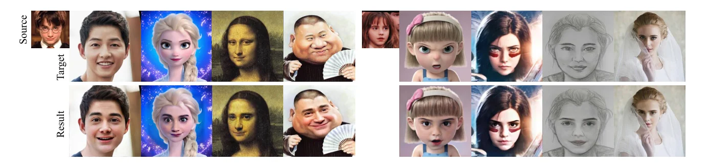
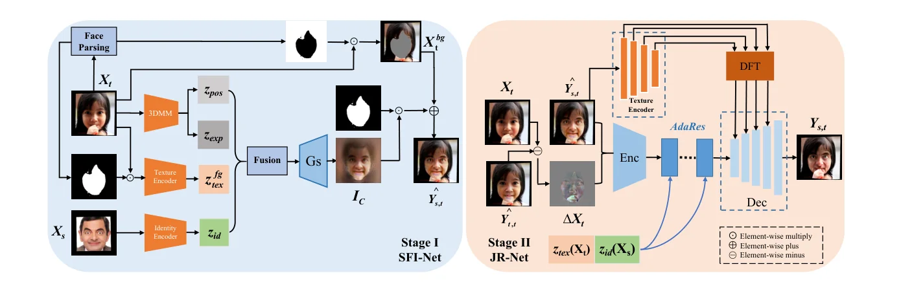
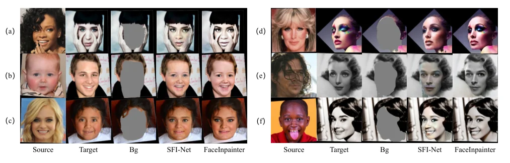

> - **논문**: FaceInpainter: High Fidelity Face Adaptation to Heterogeneous Domains
> - **저자**: Jia Li, Zhaoyang Li, Jie Cao, Xingguang Song, Ran He (CASIA, University of Chinese Academy of Sciences)
> - **학회**: CVPR 2021
{: .prompt-tip }

> [FaceShifter]()는 신원을 너무 많이 가져와 소스의 머리카락·눈썹이 새어 들어오고, [SimSwap]()은 속성을 너무 많이 지켜 결과가 목표를 닮으며, 3D 기반 FaceSwap은 비사실적 그림에서 저해상도와 경계 아티팩트를 냅니다(Figure 2). **FaceInpainter**는 문제를 **신원 유도 얼굴 인페인팅(IGFI)**으로 다시 씁니다. 목표의 배경(머리, 옷, 장면)은 그대로 두고 전경(얼굴과 목)만 새 신원으로 채우되, 그 전경이 유화·연필화·3D 만화·과장 드로잉 같은 **이질 도메인**에도 맞아야 합니다. 1단계는 분해된 코드들을 하나로 묶어 StyleGAN 생성기로 전경을 그리고, 2단계는 경계·가림·해상도를 함께 다듬습니다. 이질 도메인 교체를 처음 다룬 논문입니다.


_Figure 1. 소스(왼쪽 위 작은 사진)의 신원을 사진, 3D 만화, 유화, 과장 드로잉, 연필화 목표에 넣은 결과. 아랫줄이 FaceInpainter의 출력입니다. (출처: Li et al., 2021)_

## 1. 1단계: SFI-Net


_Figure 3. 왼쪽 Stage I(SFI-Net)은 목표의 3DMM 포즈·표정 코드, 전경 질감 코드, 소스 신원 코드를 융합해 StyleGAN으로 전경을 그리고 목표 배경과 합칩니다. 오른쪽 Stage II(JR-Net)는 가림 잔차 맵과 AdaIN 잔차 블록, DFT 초해상도로 결과를 다듬습니다. (출처: Li et al., 2021)_

목표 $$X_t$$에서 세 가지를 뽑습니다. 3DMM(3DDFA v2)으로 **포즈 $$z_{pos}$$**(스케일, 회전, 이동, 12차원)와 **표정 $$z_{exp}$$**(10차원), 얼굴 파싱으로 분리한 전경 $$X_t^{fg}$$를 VGG19에 넣은 **질감 $$z_{tex}$$**(피부색과 조명). 소스에서는 얼굴 인식 모델의 **신원 $$z_{id}(X_s)$$**. 3DMM의 신원 계수 대신 인식 임베딩을 쓰는 이유는 선형·비선형 3DMM 모두 신원과 표정 기저가 얽혀 있기 때문입니다. 네 코드 $$C = [z_{id}, z_{exp}, z_{pos}, z_{tex}]$$를 FC 하나로 융합해 스타일 코드 $$z_C$$를 만들고 StyleGAN에 다중 스케일 AdaIN으로 주입합니다.

생성 결과 $$I_C$$는 배경 마스크로 목표와 합칩니다. $$\hat Y_{s,t} = X_t \odot M_{bg} + I_C \odot (1 - M_{bg})$$. 인식 임베딩에는 머리 스타일 같은 소스 배경 정보가 섞여 있어 그냥 두면 목표 배경이 흔들리므로, 배경을 **직접 더하는** 것입니다.

손실은 신원 코사인, 표정·포즈 코드의 L1 일관성, 적대, 같은 신원일 때의 재구성, StyleGAN2의 경로 길이 정규화, 그리고 **컨텍스추얼 손실** $$-\log CX(F^l_{vgg}(\hat Y), F^l_{vgg}(X_t))$$(relu3_2, 4_2)입니다. 컨텍스추얼 손실은 정렬되지 않은 특징 사이의 유사도를 재므로, 얼굴 **형태가 바뀌어도** 질감 왜곡만 벌하고 변형은 허용합니다. FaceShifter의 정렬된 속성 손실이 목표의 얼굴 형태를 결과에 끌어오는 것(Figure 6)과 대비되는 선택입니다.

## 2. 2단계: JR-Net

1단계는 파싱 오류로 가림을 놓치고, 저해상도 장면과 경계 아티팩트가 남습니다. JR-Net은 FaceShifter의 휴리스틱 오차처럼 **$$\Delta X_t = X_t - \hat Y_{t,t}$$**(같은 이미지를 소스·목표로 넣은 재구성과의 잔차, 랜드마크로 워핑해 가림에 집중)를 가림 표현으로 받고, 소스 신원 임베딩과 VGG conv4_1의 512차원 질감 코드를 융합해 **AdaIN 잔차 블록 8개**로 $$\{\hat Y_{s,t}, \Delta X_t\}$$의 특징을 변조합니다. 여기에 DFDNet식 **부품 사전 특징 전이(DFT)**로 눈·코·입의 고품질 사전을 AdaIN으로 변조해 SFT 층으로 주입하는 초해상도를 더해 512×512를 냅니다. 손실은 컨텍스추얼, 신원, 재구성, 지각(같은 신원), 적대입니다.


_Figure 9. 목표, 배경(Bg), 1단계 SFI-Net, 최종 FaceInpainter 비교. (a)(d)(e)처럼 1단계에서 지워진 손·가림과 경계, 얼굴형, 피부색, 해상도 문제를 2단계가 고칩니다. (출처: Li et al., 2021)_

## 3. 코드로 보기: 컨텍스추얼 손실과 형태 변화의 빈틈

16×16×8의 부드러운 특징 맵에 대해 같은 질감을 1~2픽셀 옮긴 경우(형태 변화)와 다른 질감의 경우에 정렬 L2와 컨텍스추얼 손실을 비교하고, 목표보다 가는 소스 얼굴을 목표의 구멍에 넣을 때 몇 픽셀의 배경을 새로 만들어야 하는지 셉니다.

```python
import numpy as np
rng = np.random.default_rng(0)
# feature maps 16x16x8 of a face; the swapped face has the SAME texture but a slightly different shape (features shifted by 1-2 px)
H = W = 16; C = 8
base = rng.standard_normal((H, W, C)); base = np.cumsum(np.cumsum(base, 0), 1) / 8          # smooth-ish features
def shift(f, dy, dx): return np.roll(np.roll(f, dy, 0), dx, 1)
def l2(a, b): return np.mean((a - b) ** 2)
def contextual(a, b, h=0.1):                 # Mechrez et al.: each feature in a finds its nearest neighbour in b, normalised by the min distance
    A, B = a.reshape(-1, C), b.reshape(-1, C)
    A = A - A.mean(0); B = B - B.mean(0)
    d = 1 - (A @ B.T) / (np.linalg.norm(A, axis=1)[:, None] * np.linalg.norm(B, axis=1)[None] + 1e-8)
    dn = d / (d.min(1, keepdims=True) + 1e-5); w = np.exp((1 - dn) / h); cx = w / w.sum(1, keepdims=True)
    return -np.log(cx.max(1).mean())
other = np.cumsum(np.cumsum(rng.standard_normal((H, W, C)), 0), 1) / 8                     # a different face's texture
print(f"{'comparison':<42} {'aligned L2':>10} {'contextual':>11}")
for name, f in (("same features, no shift", base), ("same features, shifted 1 px (shape change)", shift(base, 1, 0)),
                ("same features, shifted 2 px", shift(base, 2, 1)), ("different texture, aligned", other)):
    print(f"{name:<42} {l2(base, f):10.3f} {contextual(base, f):11.3f}")
print("-> L2 punishes a shape deformation as much as a texture change; the contextual loss ignores WHERE a feature is and only asks whether it exists")
# why FaceInpainter masks the neck too: face-shape change leaves a gap between the new face and the old neck/background boundary
n = 64; yy, xx = np.mgrid[0:n, 0:n]
old_face = ((xx - 32) ** 2 / 300 + (yy - 32) ** 2 / 500) < 1; new_face = ((xx - 32) ** 2 / 200 + (yy - 32) ** 2 / 500) < 1   # thinner source face
gap = old_face & ~new_face
print(f"\nthinner source face in the target's hole: {int(gap.sum())} background pixels must be hallucinated (the 'inpainting' in identity-guided face inpainting)")
```

```text
comparison                                 aligned L2  contextual
same features, no shift                         0.000      -0.000
same features, shifted 1 px (shape change)      0.260      -0.000
same features, shifted 2 px                     0.645      -0.000
different texture, aligned                      1.888       0.516
-> L2 punishes a shape deformation as much as a texture change; the contextual loss ignores WHERE a feature is and only asks whether it exists

thinner source face in the target's hole: 230 background pixels must be hallucinated (the 'inpainting' in identity-guided face inpainting)
```

- 같은 특징을 1픽셀 옮기면 L2는 0.26, 2픽셀이면 0.65로 다른 질감(1.89)의 1/3 수준까지 커지지만, 컨텍스추얼 손실은 세 경우 모두 0.000이고 다른 질감에서만 0.516입니다. "어디에 있는가"를 묻지 않고 "그 특징이 있는가"만 묻는 손실이라, 소스 신원이 요구하는 얼굴 형태 변형을 벌하지 않습니다. FaceInpainter가 SimSwap보다 신원(얼굴 형태)을 더 바꾸면서 질감은 지키는 기제입니다.
- 가는 얼굴을 넓은 구멍에 넣으면 230픽셀의 배경을 채워야 합니다. 얼굴 형태를 소스에서 가져오는 순간 교체는 필연적으로 **인페인팅** 문제가 된다는 것이 제목의 뜻이고, 얼굴과 함께 **목**까지 마스크하는 이유입니다.

## 4. 실험

구현 설정은 다음과 같습니다(optimizer, 학습률, 학습 시간, 하드웨어는 논문에 없습니다).

| 항목 | 값 |
|---|---|
| 학습 데이터 | CelebA-HQ, FFHQ, VGGFace (5점 랜드마크로 정렬·crop) |
| 해상도 | SFI-Net 256×256, JR-Net 512×512 |
| 코드 차원 | $$z_{exp}$$ 10, $$z_{pos}$$ 12, $$z_{id}$$·$$z_{tex}$$ 512, 융합 모듈 출력 1024 |
| 3DMM | 3DDFA v2 |
| JR-Net | AdaIN 잔차 블록 8개, downsampling 3개·upsampling 4개, $$\hat Y_{t,t}$$는 목표 랜드마크로 워핑 |
| 손실 가중치 | $$\lambda_{id} = 20$$, 나머지 10 |
| 증강 | crop, flip, 회전, blur, 밝기·채도·대비, color jitter |
| 평가 | ID 검색은 CosFace, 포즈는 별도 포즈 추정기의 L2 거리, 표정은 다른 3DMM의 계수 |

**정성.** DeepFill v1/v2, Zheng 등의 일반 인페인팅은 신원 유도 완성을 못 합니다(Figure 4). FF++에서 FaceShifter는 눈썹·눈·안경·머리 같은 소스 스타일을 통제 없이 가져오고, DeepFakes·FaceSwap도 비슷한 아티팩트를 보이며, FaceInpainter는 신원과 속성의 균형이 낫습니다(Figure 5). FSGAN·FaceShifter와의 추가 비교(Figure 6)에서 시선 방향과 피부색을 더 잘 지키고, SimSwap(Figure 7)보다 이마·뺨 경계 아티팩트가 적고 시선·표정 추적이 정확합니다.

**정량(FF++, Table 1).** FaceShifter·SimSwap과 같은 프로토콜입니다. SimSwap 행은 SimSwap 논문의 수치를 옮긴 것이라 표정·SMD2가 비어 있습니다.

| 방법 | ID 검색 ↑ | 포즈 ↓ | 표정 ↓ | SMD2 ↑ |
|---|---|---|---|---|
| DeepFakes | 81.96 | 4.14 | 0.187 | 8.84 |
| FaceSwap | 54.19 | 2.51 | 0.148 | 9.57 |
| FaceShifter | 97.38 | 2.96 | 0.136 | 8.48 |
| SimSwap | 92.83 | **1.53** | - | - |
| SFI-Net(1단계) | **97.93** | 1.68 | **0.117** | 8.41 |
| FaceInpainter | 97.63 | 2.21 | 0.141 | **11.71** |

SMD2(회색 차이 계수의 합)는 선명도입니다. 1단계만으로 FaceShifter보다 신원·포즈·표정이 좋고, 2단계는 선명도를 크게 올리며 포즈·표정은 조금 양보합니다. 그 결과 최종 모델의 표정 오차(0.141)는 FaceShifter(0.136)보다 약간 나쁩니다.

**Ablation(Table 1 아래쪽).**

| 설정 | ID 검색 ↑ | 포즈 ↓ | 표정 ↓ | SMD2 ↑ |
|---|---|---|---|---|
| SFI-Net (전체) | 97.93 | 1.68 | 0.117 | 8.41 |
| 질감 코드 $$z_{tex}$$ 제거 | 97.23 | 2.10 | 0.121 | 8.50 |
| 표정 코드 $$z_{exp}$$ 제거 | 98.43 | 1.93 | 0.161 | 8.66 |
| 포즈 코드 $$z_{pos}$$ 제거 | 97.93 | 4.97 | 0.140 | 8.43 |
| 컨텍스추얼 손실 제거 | 98.13 | 2.31 | 0.135 | 8.60 |
| 3D 코드 대신 학습형 속성 인코더 $$C'$$ | 0.10 | 29.57 | 0.273 | 9.20 |
| JR-Net, DFT 없음 | 98.43 | 2.18 | 0.139 | 8.77 |
| JR-Net, 잔차 맵·DFT 없음 | 98.30 | 2.13 | 0.134 | 8.65 |
| JR-Net, AdaRes·DFT 없음 | 97.68 | 1.85 | 0.123 | 8.79 |
| FaceInpainter (전체) | 97.63 | 2.21 | 0.141 | 11.71 |

- 포즈 코드를 빼면 포즈 오차가 1.68 → 4.97, 표정 코드를 빼면 표정 오차가 0.117 → 0.161로 각 코드가 맡은 지표가 가장 크게 나빠집니다. 표정 코드나 컨텍스추얼 손실을 빼면 오히려 ID 검색은 조금 오릅니다(속성 제약이 줄어든 만큼 신원을 더 바꿈).
- 3DMM 코드 대신 학습형 속성 인코더를 쓰면($$C'$$) ID 검색 0.10으로 완전히 실패합니다.
- JR-Net 쪽에서 수치로 분명한 것은 DFT의 선명도(SMD2 8.77 → 11.71)이고, 잔차 맵과 AdaRes는 지표 차이가 작아 효과를 주로 Figure 9 같은 정성 결과로 보여 줍니다.

**사용자 연구(Table 4).** FF++ 1,000장을 10명이 1~100점으로 평가(총 10,000건)했습니다.

| 방법 | 신원 | 속성 | 경계 | 가림 | 사실감 |
|---|---|---|---|---|---|
| DeepFakes | 43.96 | 34.14 | 22.57 | 44.11 | 20.56 |
| FaceSwap | 31.64 | 41.22 | 50.55 | 42.25 | 47.89 |
| FaceShifter | 93.64 | 81.22 | 84.34 | **94.11** | 85.66 |
| SFI-Net | 90.83 | 71.53 | 55.78 | 40.22 | 50.58 |
| FaceInpainter | **95.83** | **89.53** | **88.34** | 93.67 | **92.50** |

1단계만으로는 경계(55.78)와 가림(40.22) 점수가 낮고, JR-Net이 이를 각각 88.34, 93.67로 끌어올립니다. 가림 점수는 FaceShifter가 근소하게 높습니다.

**이질 도메인(Table 3).** IIIT-CFW(만화, 1,000장)와 CUHK(스케치, 606장)에서 $$i$$번째 목표에 $$N-i$$번째 얼굴의 신원을 넣었습니다. 다른 방법은 코드가 비공개이거나 이미지 시퀀스가 필요해 FaceSwap과만 비교했습니다(표 2).

| 데이터셋 | 방법 | ID 검색 ↑ | 포즈 ↓ | 표정 ×10 ↓ | FID ×0.1 ↓ | SMD2 ×0.1 ↑ |
|---|---|---|---|---|---|---|
| IIIT-CFW | FaceSwap | 59.00 | 3.66 | 2.93 | 7.236 | 1.705 |
| IIIT-CFW | **FaceInpainter** | **89.13** | **1.90** | 3.01 | **3.646** | **2.802** |
| CUHK | FaceSwap | 86.10 | 1.15 | 2.13 | 2.407 | 1.581 |
| CUHK | **FaceInpainter** | **88.36** | **0.99** | 2.23 | **2.148** | **2.843** |

만화에서는 ID 검색이 30%p 넘게 오르고 FID가 절반 수준으로 줄지만, 스케치에서는 차이가 작고(ID +2.3%p, FID 소폭 감소) 표정 오차는 두 데이터셋 모두 FaceSwap보다 약간 큽니다. CelebA-HQ에서 정면·극단 측면 목표로의 교체도 가능합니다(Figure 8).

## 5. 해석

**1. "교체 = 인페인팅"이라는 재정의가 핵심입니다.** 배경을 고정하고 전경을 채운다는 관점은 얼굴 형태 변화와 가림을 자연스럽게 포함하고, [E4S]()의 "editing for swapping"과 마스크 기반 설계로 이어집니다. 가림을 잔차 맵으로 찾는 것은 FaceShifter의 HEAR-Net을 계승한 것입니다.

**2. 분해된 코드를 StyleGAN에 넣는 설계는 StyleGAN 기반 교체의 과도기입니다.** 3DMM 코드로 포즈·표정을 명시적으로 제어하는 것은 DiscoFaceGAN·StyleRig 계열이고, [StyleIPSB]()가 "3DMM → StyleGAN 기저 좌표"로 더 밀고 나갑니다. 반면 [MegaFS]()·[FSLSD]()는 사전학습 StyleGAN을 고정하고 역변환으로 갑니다.

**3. 컨텍스추얼 손실의 선택이 트레이드오프를 옮깁니다.** 정렬 손실(FaceShifter의 속성 손실, SimSwap의 특징 매칭)은 목표 형태를 끌어오고, 비정렬 손실은 형태 변화를 허용합니다. 위 toy가 보여 주듯 이것은 손실의 성질 자체에서 나오며, 이후 [HifiFace]()·[FlowFace]()는 형태를 3D로 **명시적으로** 옮기는 쪽을 택합니다.

**4. 이질 도메인은 새 문제이지만 평가는 얇습니다.** 비교 대상이 FaceSwap뿐이고 데이터도 두 개입니다. 그래도 "사진으로 학습한 신원 코드를 그림에 넣는다"는 설정은 이후 스타일화된 얼굴 편집의 선행 사례입니다.

**5. 평가를 읽을 때 주의할 점.** 2단계는 선명도(SMD2)를 올리지만 포즈·표정 오차를 키우고, 논문 표에 함께 실린 종합 점수(Overall, ID 검색 − 포즈 − 표정 + SMD2)는 저자들이 정의한 임의 합산입니다. SimSwap의 표정 수치는 비어 있습니다. 이질 도메인 비교의 ID 검색에서는 얼굴 인식기가 그림에서 얼마나 믿을 만한지가 불분명합니다. 위 toy의 컨텍스추얼 손실은 특징이 부드러운 합성 맵이라 실제 VGG 특징보다 이동 불변성이 과장됐을 수 있습니다.

## 6. 정리

| 항목 | 내용 |
|---|---|
| 재정의 | 신원 유도 얼굴 인페인팅: 목표 배경 고정, 전경(얼굴+목)을 새 신원으로 채움, 이질 도메인 포함 |
| 1단계 SFI-Net | $$[z_{id}(소스), z_{exp}, z_{pos}, z_{tex}(목표)]$$ → FC → StyleGAN AdaIN, 배경 직접 합성, 컨텍스추얼 손실 |
| 2단계 JR-Net | 가림 잔차 맵 $$X_t - \hat Y_{t,t}$$, 신원·질감 코드의 AdaIN 잔차 블록 8개, 부품 사전 초해상도(DFT) → 512² |
| 결과 | FF++ ID 97.63/97.93, 포즈 1.68(1단계), SMD2 11.7; CFW ID 59→89, CUHK 86→88 |
| 핵심 기제 | 비정렬 컨텍스추얼 손실이 형태 변형을 허용하고 질감만 지킴 |
| 한계 | 2단계의 포즈·표정 양보, 이질 도메인 비교 대상 하나, 임의 종합 점수 |

## References

- Li, Li, Cao, Song, He, "FaceInpainter: High Fidelity Face Adaptation to Heterogeneous Domains," CVPR 2021. [DOI:10.1109/CVPR46437.2021.00505](https://doi.org/10.1109/CVPR46437.2021.00505)
- Mechrez, Talmi, Zelnik-Manor, "The Contextual Loss for Image Transformation with Non-Aligned Data," ECCV 2018. [arXiv:1803.02077](https://arxiv.org/abs/1803.02077)
- Li et al., "Blind Face Restoration via Deep Multi-scale Component Dictionaries" (DFDNet), ECCV 2020. [arXiv:2008.00418](https://arxiv.org/abs/2008.00418)
- Guo et al., "Towards Fast, Accurate and Stable 3D Dense Face Alignment" (3DDFA v2), ECCV 2020. [arXiv:2009.09960](https://arxiv.org/abs/2009.09960)
- Deng et al., "Disentangled and Controllable Face Image Generation via 3D Imitative-Contrastive Learning" (DiscoFaceGAN), CVPR 2020. [arXiv:2004.11660](https://arxiv.org/abs/2004.11660)
- Karras et al., "Analyzing and Improving the Image Quality of StyleGAN," CVPR 2020. [arXiv:1912.04958](https://arxiv.org/abs/1912.04958)
