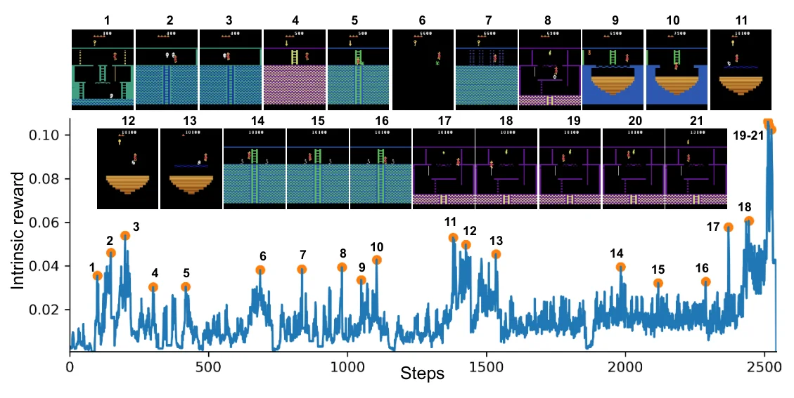
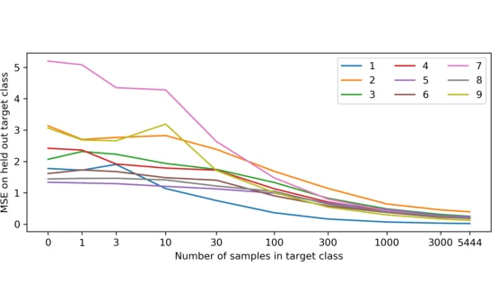
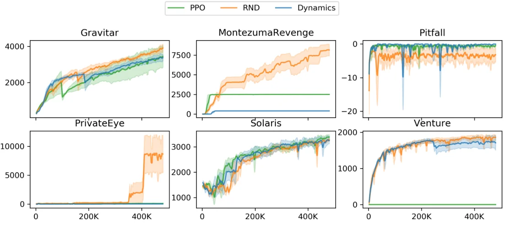

> - **논문**: Exploration by Random Network Distillation
> - **저자**: Yuri Burda, Harrison Edwards, Amos Storkey, Oleg Klimov (OpenAI, University of Edinburgh)
> - **학회**: ICLR 2019 · [arXiv:1810.12894](https://arxiv.org/abs/1810.12894)
{: .prompt-tip }

> [ICM]()은 다음 상태를 예측하는 오차를 호기심으로 썼지만, 결과 자체가 무작위인 상황에서는 오차가 영원히 줄지 않는 문제가 있었습니다. **RND(Random Network Distillation)**는 예측 대상을 **무작위로 초기화한 고정 네트워크의 출력**으로 바꿔 이 문제를 깔끔하게 피합니다. 그리고 Montezuma's Revenge에서 사람의 시연이나 게임 내부 상태 없이 처음으로 **사람 평균 점수를 넘었습니다.**

## 1. 기존 방법의 문제

### 확률적인 transition에 끌린다

예측 오차를 최대화하는 에이전트는, 예측해야 할 정답이 **입력의 확률적 함수**인 transition에 쉽게 끌립니다. 대표적인 것이 Noisy TV입니다. 다음 관측을 예측할 때 TV 화면은 무엇을 해도 맞힐 수 없으니, 에이전트는 TV 앞을 떠나지 않습니다.

### 확장성

Information gain이나 count, pseudo-count 기반 방법은 **수많은 병렬 환경**으로 확장하기 어렵습니다(밀도 모델이나 동역학 모델을 함께 학습해야 하므로 비효율적).

### RND의 목표

- 구현이 **간단**하고
- **고차원 관측**에서 잘 동작하며
- **어떤 정책 최적화 알고리즘**과도 쓸 수 있고
- **forward pass 한 번**으로 계산되는 효율적인 exploration bonus

## 2. 아이디어: 정답이 결정적인 예측 문제

신경망은 **학습한 데이터와 비슷한 입력에서는 예측 오차가 작고**, 처음 보는 입력에서는 오차가 큽니다. 이 성질 자체를 새로움의 척도로 씁니다. 다만 예측할 정답이 **입력의 결정적 함수**여야 확률성 문제가 생기지 않습니다.

두 개의 네트워크를 둡니다.

- **Target network** $$f$$: 무작위로 초기화한 뒤 **영원히 고정**. 관측 $$o$$를 특징 벡터로 바꿈
- **Predictor network** $$\hat{f}$$: 에이전트가 모은 데이터로 학습하며 target의 출력을 따라 함

$$
\mathcal{L}(\theta) = \big\lVert\hat{f}(o; \theta) - f(o)\big\rVert_2^2,\qquad r^i_t = \big\lVert\hat{f}(o_{t+1}; \theta) - f(o_{t+1})\big\rVert_2^2
$$

자주 본 관측은 predictor가 잘 따라 해서 보상이 작고, 처음 보는 관측은 따라 하지 못해 보상이 큽니다. Target이 결정적 함수이므로 **Noisy TV 같은 확률성이 원천적으로 없습니다.**

```python
import torch
import torch.nn as nn

def make_net(out_dim=512):
    return nn.Sequential(nn.Conv2d(1, 32, 8, 4), nn.LeakyReLU(), nn.Conv2d(32, 64, 4, 2), nn.LeakyReLU(),
                         nn.Conv2d(64, 64, 3, 1), nn.LeakyReLU(), nn.Flatten(), nn.LazyLinear(out_dim))

class RND(nn.Module):
    def __init__(self):
        super().__init__()
        self.target, self.predictor = make_net(), make_net()
        for p in self.target.parameters():
            p.requires_grad = False                  # target은 고정

    def forward(self, obs):                          # obs: 정규화된 다음 관측 (B, 1, 84, 84)
        err = (self.predictor(obs) - self.target(obs).detach()).pow(2).sum(1)
        return err.detach(), err.mean()              # intrinsic reward, predictor loss

torch.manual_seed(0)
rnd = RND()
opt = torch.optim.Adam(rnd.predictor.parameters(), lr=1e-4)
seen = torch.randn(64, 1, 84, 84)                 # 에이전트가 반복해서 본 관측
new = torch.randn(64, 1, 84, 84)                  # 처음 보는 관측
for _ in range(200):
    _, loss = rnd(seen)
    opt.zero_grad(); loss.backward(); opt.step()
print(rnd(seen)[0].mean().item())                 # 약 5e-07 → 익숙한 관측은 보상이 거의 0
print(rnd(new)[0].mean().item())                  # 약 0.54  → 처음 보는 관측은 보상이 큼
```

예측 대상이 고정된 함수라서, predictor가 본 관측에서는 오차가 거의 0까지 내려가고 처음 보는 관측에서는 크게 남습니다. 무작위 노이즈 관측이라도 **같은 관측에 대한 정답은 항상 같으므로**, Noisy TV처럼 "아무리 학습해도 줄지 않는 오차"가 생기지 않습니다. (논문은 target과 predictor 모두 DQN(Mnih et al., 2015)과 같은 conv encoder 뒤에 dense 층을 붙였다고만 적고, 정확한 구조는 공개 코드로 미룹니다.)

실제 게임에서 이 보상이 어떻게 움직이는지는 아래 Figure 1에 잘 드러납니다. Montezuma's Revenge 첫 에피소드에서 목숨을 잃거나, 적을 아슬아슬하게 피하거나, 물건을 줍는 순간마다 intrinsic reward가 튀고, 처음 횃불을 만지는 마지막 순간(19~21)에 가장 크게 튑니다.


_Figure 1. 첫 에피소드 동안의 RND 탐험 보너스. 에이전트는 17개 방을 지나 횃불(19~21)까지 도달하며, 보상이 튀는 지점마다 해당 화면을 붙여 놓았습니다. (출처: Burda et al., 2019)_

### Predictor가 target을 완벽히 외우면?

Predictor가 학습하다가 target을 **모든 입력에서 완벽히 모방**해 버리면 보상이 의미 없어집니다. MNIST로 확인한 결과, 숫자 0과 특정 숫자 하나를 섞어 학습했을 때(전체 학습 데이터 수는 고정하고 비율만 바꿈) **학습 데이터에 그 숫자가 적을수록, 처음 보는 그 숫자 이미지에 대한 오차가 컸습니다.** 지나친 일반화(overgeneralize)는 일어나지 않았습니다.


_Figure 2. 가로축은 학습 데이터에 들어간 목표 숫자의 개수(로그 축), 세로축은 처음 보는 목표 숫자 이미지에서의 MSE. 많이 본 숫자일수록 오차가 줄어듭니다. (출처: Burda et al., 2019)_

## 3. 예측 오차의 원인 분석

예측 오차는 일반적으로 네 가지 요인에서 생깁니다.

1. **학습 데이터의 양**: predictor가 비슷한 예시를 적게 봤을수록 오차가 큼 → **탐험에 필요한 바로 그 신호**
2. **확률성(stochasticity)**: 정답 자체가 무작위 (forward dynamics의 Noisy TV)
3. **모델 명세 오류(model misspecification)**: 모델이 정답 함수를 표현하기에 너무 제한적
4. **학습 동역학(learning dynamics)**: 최적화가 정답 근사를 찾지 못함

1번이 우리가 원하는 신호이고, 2·3번은 Noisy TV 같은 문제를 일으킵니다. RND는 target을 결정적 함수로 두어 **2번을 없애고**, predictor를 target을 충분히 표현할 수 있는 구조(같은 구조이거나 그보다 큰 구조)로 만들어 3번을 피합니다(target을 표현할 수 있다면 이론적으로 완벽히 따라 할 수 있음).

### 불확실성 추정과의 관계

Bayesian 관점에서 보면, 사전분포(prior)에서 뽑은 무작위 함수를 데이터에 맞춰 보정하는 것은 **posterior의 불확실성을 추정**하는 방법(randomized prior functions)과 연결됩니다. Bayesian 신경망이 파라미터를 하나의 값이 아니라 분포로 다뤄 출력의 불확실성을 주듯, RND의 예측 오차는 "**이 관측에 대해 얼마나 모르는가**"를 근사합니다.

## 4. Intrinsic Return과 Extrinsic Return 합치기

### Episodic vs Non-episodic

새로운 상태는 **에피소드를 넘어서도** 생길 수 있습니다. 실험해 보니 intrinsic return은 **non-episodic**(에피소드가 끝나도 이어서 계산)으로 다루는 편이 탐험이 더 잘됐습니다. 사람이 게임을 하다 죽어도 "다음엔 저 방에 가 봐야지"라는 호기심은 이어지는 것과 같습니다.

반면 extrinsic return까지 non-episodic으로 하면, 에이전트가 시작 지점의 쉬운 보상을 다시 얻으려고 **일부러 게임을 끝내는** 행동을 반복할 수 있습니다.

### 두 개의 Value Head

그래서 **intrinsic은 non-episodic, extrinsic은 episodic**으로 각각 return을 계산하고, PPO의 가치 함수에 **두 개의 head** $$V_E, V_I$$를 둡니다. 두 return은 서로 다른 discount도 씁니다($$\gamma_E = 0.999$$, $$\gamma_I = 0.99$$). Advantage는 두 head의 advantage를 선형 결합합니다.

$$
A = A_E + c\,A_I
$$

(논문 실험에서는 extrinsic 쪽에 2, intrinsic 쪽에 1을 곱해 $$A = 2A_E + A_I$$로 결합했습니다.)

### 정규화

- **Reward normalization**: 환경과 시간에 따라 intrinsic reward의 크기가 크게 달라지므로, intrinsic return의 **표준편차로 나눠** 일관된 크기를 유지
- **Observation normalization**: 고정된 무작위 target 네트워크는 입력 스케일에 민감해서, 정규화하지 않으면 임베딩의 분산이 극도로 작아집니다. 관측의 각 차원을 running mean/std로 정규화한 뒤 **[-5, 5]로 clipping**하고, predictor와 target에 같은 정규화를 씁니다(정책 네트워크에는 쓰지 않음). 정규화 통계는 학습 전에 무작위 행동 에이전트로 환경을 몇 step 돌려 초기화합니다.

```python
# 관측 정규화 (target, predictor 공통)
obs_n = ((obs - obs_rms.mean) / (obs_rms.var.sqrt() + 1e-8)).clamp(-5, 5)
r_int, rnd_loss = rnd(obs_n)
r_int = r_int / (int_return_rms.var.sqrt() + 1e-8)        # intrinsic reward 정규화
adv = 2.0 * adv_ext + 1.0 * adv_int                         # 두 value head의 advantage 결합 (논문 계수)
```

## 5. 구현 디테일

논문 부록(Table 2~5)의 기본 설정입니다. 본문 실험에서 따로 밝힌 경우만 이 값과 다릅니다.

| 항목 | 값 |
|---|---|
| 정책 최적화 | PPO, Adam, lr 0.0001, $$\lambda = 0.95$$, entropy 계수 0.001, clip range [0.9, 1.1] |
| Rollout | 병렬 환경 128개 × 길이 128, 환경당 30K rollout (총 약 19.7억 프레임) |
| 최적화 | minibatch 4개, epoch 4 |
| Discount | $$\gamma_E = 0.999$$, $$\gamma_I = 0.99$$ |
| Advantage 계수 | extrinsic 2, intrinsic 1 |
| Predictor 학습 데이터 | 경험의 25%만 사용 (32개 환경일 때와 같은 유효 batch 유지) |
| 정책 구조 | 기본은 CNN (DQN conv encoder), RNN 정책은 GRU 추가 |
| 환경 전처리 | 흑백, 84×84, frame skip 4, sticky action 확률 0.25, 에피소드당 최대 18K 프레임, 목숨 잃어도 종료 아님 |
| 보상 | extrinsic은 [-1, 1] clipping, intrinsic은 clipping 없음 |
| 입력 | 정책: 4프레임 stack, $$x/255$$ / target·predictor: 1프레임, $$\text{clip}((x-\mu)/\sigma, [-5, 5])$$ |

병렬 환경을 256개, 1,024개로 늘린 실험에서는 predictor에 넣는 경험을 각각 0.125, 0.03125 확률로만 남겨, 환경 수가 늘어도 intrinsic reward가 줄어드는 속도가 같게 맞췄습니다.

## 6. 실험

비교 baseline은 두 가지입니다.

- 탐험 보너스 없는 **PPO**
- **Forward dynamics 오차**를 보너스로 쓰는 PPO (ICM 계열). 공정한 비교를 위해 predictor가 "현재 관측과 행동으로 다음 관측의 무작위 특징"을 예측하도록 loss만 바꾸고, 두 value head·non-episodic intrinsic return·정규화 등 나머지는 RND와 똑같이 맞췄습니다.

### Ablation (Montezuma's Revenge)

| 실험 | 결과 |
|---|---|
| 순수 탐험 (extrinsic reward 없음) | non-episodic이 episodic보다 더 많은 방을 탐험. $$\gamma_I = 0.999$$의 한 run은 21개 방, 5 run 중 4 run의 최고 return이 6,700 |
| episodic vs non-episodic intrinsic ($$\gamma_I = \gamma_E = 0.99$$) | non-episodic이 탐험한 방 수는 더 많고 평균 return은 비슷. episodic 설정에서 value head 2개는 1개보다 이득이 없었지만, 성격이 다른 보상을 합치려면 필요해서 이후 실험은 모두 2개 사용 |
| discount | $$\gamma_E$$를 0.99 → 0.999로 올리면 성능이 크게 오르고, $$\gamma_I$$까지 0.999로 올리면 오히려 떨어짐 |
| 병렬 환경 수 | 환경이 많을수록 평균 return이 높음. RNN·32개 환경을 오래 돌리면 16억 프레임에서 평균 7,570, 그중 한 run은 24개 방을 모두 방문하고 첫 레벨을 통과해 최고 17,500점. RNN·1,024개 환경은 학습 끝 평균 10,070 |
| autoencoder 복원 오차를 보너스로 (부록) | RND보다 나쁘지만 PPO보다는 좋음 |

### RNN vs CNN 정책

Montezuma's Revenge처럼 **부분 관측** 환경에서는 과거 기억이 중요하니 RNN 정책이 더 좋을 것으로 예상했지만, 실제로는 $$\gamma_E = 0.99$$ 설정에서 **CNN 정책이 더 좋았습니다.** (다만 $$\gamma_E = 0.999$$에서는 모든 환경 수에서 RNN 정책이 더 좋았고, 6게임 전체로 봐도 RNN이 CNN을 이기는 경우가 더 많았습니다.)

### 결과 (Table 1, RNN 정책)


_Figure 7. RNN 정책으로 학습한 RND(주황), forward dynamics 보너스(파랑), PPO(초록)의 평균 에피소드 return. 음영은 seed 3개의 표준오차입니다. (출처: Burda et al., 2019)_

| 게임 | **RND** | PPO | Dynamics | 기존 SOTA | 사람 평균 |
|---|---|---|---|---|---|
| Gravitar | **3,906** | 3,426 | 3,371 | 2,209 | 3,351 |
| Montezuma's Revenge | **8,152** | 2,497 | 400 | 3,700 | 4,753 |
| Pitfall! | -3 | 0 | 0 | 0 | 6,464 |
| Private Eye | 8,666 | 105 | 33 | 15,806 | 69,571 |
| Solaris | 3,282 | 3,387 | 3,246 | 12,380 | 12,327 |
| Venture | **1,859** | 0 | 1,712 | 1,813 | 1,188 |

- **세 게임(Gravitar, Montezuma's Revenge, Venture)에서 당시 SOTA**를 넘었고, 이 세 게임 모두 사람 평균 점수도 넘었습니다. Montezuma's Revenge에서는 PPO의 약 3.3배입니다.
- Private Eye는 PPO(105)보다 훨씬 높지만 기존 SOTA에는 못 미치고, Solaris는 PPO와 비슷합니다.
- **Pitfall!**처럼 보상이 극도로 드물고 함정이 많은 게임에서는 RND와 PPO 모두 양수 보상을 한 번도 찾지 못했습니다.
- Dynamics 보너스는 Montezuma's Revenge에서 400점에 그쳤습니다. 수렴한 에이전트를 보니 두 방 사이 경계를 오가고 있었는데, sticky action 때문에 경계에서 한 걸음 더 갔을 때 방을 넘어갈지 말지가 무작위라 예측 오차가 줄지 않습니다. 실제 게임에서 나타난 **Noisy TV 문제**입니다.

RND 에이전트는 얻을 수 있는 extrinsic reward를 다 얻고 나면 움직이는 해골을 앞뒤로 뛰어넘거나 사라지는 다리를 오르내리는 등 **위험한 물체 근처에서 노는** 행동을 보였습니다. 위험한 상태는 도달하기 어려워 경험에 드물게 남고, 그래서 계속 새롭게 느껴지기 때문으로 봅니다.

## 7. 정리

| | ICM (Forward dynamics) | RND |
|---|---|---|
| 예측 대상 | 다음 상태의 특징 | 고정 무작위 네트워크의 출력 |
| 정답의 성질 | 환경에 따라 **확률적**일 수 있음 | 항상 **결정적** |
| Noisy TV | 영향 있음 | 원천적으로 없음 |
| 계산 | forward + inverse model 학습 | predictor 하나 학습, forward pass 1회 |
| Montezuma's Revenge (같은 PPO 설정) | 400 | 8,152 |

RND는 단순함 덕분에 이후 탐험 연구의 표준 baseline이 됐고, [NGU]()와 [Agent57]()에서도 **life-long novelty** 모듈로 쓰입니다.

## References

- Burda et al., "Exploration by Random Network Distillation," ICLR 2019. [arXiv:1810.12894](https://arxiv.org/abs/1810.12894)
- Osband et al., "Randomized Prior Functions for Deep Reinforcement Learning," NeurIPS 2018.
- Pathak et al., "Curiosity-driven Exploration by Self-supervised Prediction," ICML 2017.
- OpenDILab, DI-engine RND documentation
