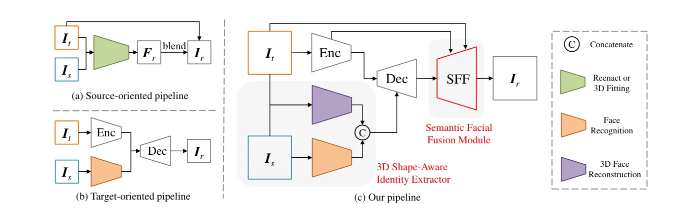
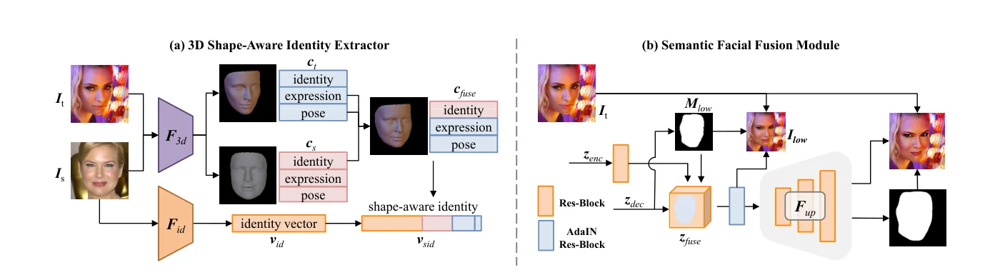
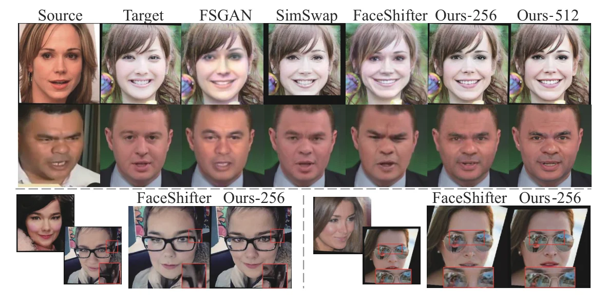

> - **논문**: HifiFace: 3D Shape and Semantic Prior Guided High Fidelity Face Swapping
> - **저자**: Yuhan Wang, Xu Chen, Junwei Zhu, Wenqing Chu, Ying Tai, Chengjie Wang, Jilin Li, Yongjian Wu, Feiyue Huang, Rongrong Ji (Tencent Youtu Lab, Zhejiang University, Xiamen University)
> - **학회**: IJCAI 2021 · [arXiv:2106.09965](https://arxiv.org/abs/2106.09965) · [프로젝트 페이지](https://johann.wang/HifiFace)
{: .prompt-tip }

> 사람이 신원을 알아보는 데 얼굴 **형태**는 큰 부분인데, GAN 기반 교체는 대부분 이를 바꾸지 못했다. 소스 지향 방법([FSGAN]())은 블렌딩 마스크가 목표 윤곽에 묶여 있고, 목표 지향 방법([FaceShifter](), [SimSwap]())은 얼굴 인식 네트워크가 질감에 집중해 기하 구조에 둔감하기 때문이다. 조명·가림은 포아송 블렌딩(고스팅)이나 별도 단계(FaceShifter의 HEAR-Net, [AOT]())로 다뤄 복잡했다. **HifiFace**는 두 가지로 답한다. 3DMM의 기하 감독으로 신원 벡터에 형상 정보를 더한 **3D 형상 인식 신원**, 그리고 인코더·디코더 특징을 학습된 마스크로 재조합하고 팽창 마스크로 블렌딩해 조명·가림·배경을 한 단계에서 처리하는 **SFF(Semantic Facial Fusion)** 모듈이다.


_Figure 2. (a) 소스 지향: 3D 피팅·재연으로 얼굴 영역을 만들어 목표에 블렌딩. (b) 목표 지향: 얼굴 인식 벡터를 디코더에서 속성 특징과 융합. (c) HifiFace: 인식 네트워크 자리에 3D 형상 인식 신원 추출기를 두고, 디코더 뒤에 SFF 모듈을 붙임. (출처: Wang et al., 2021)_

## 1. 3D 형상 인식 신원 추출기

3D 복원 모델 $$F_{3d}$$(Deng 등)로 소스·목표의 3DMM 계수(신원 $$\alpha$$, 표정 $$\beta$$, 포즈)를 회귀하고, **소스의 신원 + 목표의 표정·포즈**로 $$c_{fuse}$$를 만든다. 질감·조명 계수는 복원이 아직 불만족스러워 쓰지 않는다. $$c_{fuse}$$를 인식 모델 $$F_{id}$$(CurricularFace)의 벡터 $$v_{id}$$와 이어 붙인 것이 $$v_{sid}$$이다. 디코더는 AdaIN 잔차 블록으로 이 벡터를 인코더의 속성 특징과 융합한다.


_Figure 3. (a) $$F_{3d}$$가 소스·목표의 3DMM 계수를 회귀하고, 소스 신원 + 목표 표정·포즈로 $$c_{fuse}$$를 만들어 인식 벡터 $$v_{id}$$와 이어 붙인다. (b) SFF는 $$M_{low}$$로 인코더·디코더 특징을 재조합하고, 업샘플 모듈 $$F_{up}$$ 뒤 $$M_r$$로 최종 블렌딩한다. (출처: Wang et al., 2021)_

**SID 손실**은 형상과 신원 두 부분으로 이루어진다. 메시 렌더러로 $$c_{fuse}$$의 3D 얼굴을 만들어 랜드마크 정점을 투영한 $$q^{fuse}$$와, 결과 $$I_r$$(및 저해상도 보조 출력 $$I_{low}$$)에서 다시 회귀한 3D 얼굴의 랜드마크 $$q^r, q^{low}$$의 L1이 **형상 손실**이고, 신원 손실은 코사인이다. $$\lambda_{shape} = 0.5$$, $$\lambda_{id} = 5$$. 포즈 계수는 형상을 정하지 않지만 랜드마크 위치에 영향을 주므로 포함한다.

## 2. SFF 모듈

**특징 수준.** 저수준 인코더 특징 $$z_{enc}$$(1/4 해상도)에는 공간·질감 정보가 풍부하지만 목표의 신원도 들어 있다. 디코더 특징 $$z_{dec}$$가 1/4 크기일 때 얼굴 마스크 $$M_{low}$$를 예측하고,

$$
z_{fuse} = M_{low} \odot z_{dec} + (1 - M_{low}) \odot \sigma(z_{enc})
$$

로 섞는다. 여기서 $$\sigma$$는 잔차 블록 하나이다. 얼굴 영역은 소스 신원이 든 디코더 특징을, 비얼굴 영역은 신원 주입에 손상된 디코더 특징 대신 깨끗한 인코더 특징을 쓴다. 이후 4배 업샘플 모듈 $$F_{up}$$을 거치며, 잔차 블록 하나를 더하면 512²도 된다.

**이미지 수준.** 3채널 $$I_{out}$$과 1채널 $$M_r$$을 예측해 $$I_r = M_r \odot I_{out} + (1 - M_r) \odot I_t$$로 목표와 합친다. 목표 마스크를 그대로 쓰면 형태 변화를 막으므로, HRNet 분할을 **팽창**한 $$M_{tar}$$로 $$M_{low}$$, $$M_r$$을 감독해 형태 변화를 허용하고 예측 마스크 윤곽 주변을 인페인팅하게 한다. Figure 9가 보여 주듯 목표 마스크(Blend-T)는 넓은 소스 얼굴을 자르고, 팽창 마스크(Blend-DT)나 결과 마스크(Blend-R)는 가림을 못 다루거나 이중 얼굴을 만드는데, SFF는 둘 다 피한다.

손실은 SID + 사실성(적대, 분할 100, 같은 신원 재구성 20, 순환 1, LPIPS 5). **순환 손실** $$\lVert I_t - G(I_r, I_t) \rVert_1$$은 결과를 다시 소스로 쓰면 목표가 복원되어야 한다는 조건이다. 적대 손실은 StarGAN v2의 목적 함수를 따른다.

## 3. 구현 디테일

| 항목 | 값 |
|---|---|
| 학습 데이터 | VGGFace2 + Asian-Celeb, 한 변이 256 미만인 이미지 제거 |
| 전처리 | 5점 랜드마크로 정렬해 256×256 크롭(얼굴 전체와 배경 일부 포함) |
| 512² 모델 | 초상화 향상 네트워크(Li et al., 2020)로 학습 이미지를 512²로 키워 감독, $$F_{up}$$에 잔차 블록 1개 추가 |
| 같은 신원 쌍 비율 | 50% |
| 3D 복원 / 인식 모델 | Deng et al.(2019) / CurricularFace, 마스크 감독은 HRNet 분할 |
| 생성기 구조 | 인코더는 IN 잔차 블록(256→8 해상도, 최대 512채널), 디코더는 AdaIN 잔차 블록, 활성화 LeakyReLU |
| Optimizer | Adam, $$\beta_1 = 0$$, $$\beta_2 = 0.99$$, lr 1e-4 |
| 학습 | batch 32, 200K step, V100 4장 |
| 손실 가중치 | $$\lambda_{shape} = 0.5$$, $$\lambda_{id} = 5$$, 분할 100, 재구성 20, 순환 1, LPIPS 5 |

## 4. 코드로 보기: 인식 임베딩은 형상을 못 움직인다

2D 윤곽 랜드마크의 toy 3DMM(평균 + 넓이·길이 기저 + 턱 표정 기저)과 질감만 보는 toy 인식기에서, 생성 결과의 (형상 계수, 질감)을 신원 코사인 손실만으로, 그리고 재조합 3D 얼굴의 랜드마크 손실을 더해 최적화할 때 결과 형상이 소스·목표 중 어디에 가는지 보고, SFF의 특징 융합이 배경 특징을 어떻게 지키는지 확인한다.

```python
import torch, torch.nn.functional as F
torch.manual_seed(0); torch.set_num_threads(1)
# a toy 3DMM: 2-D contour landmarks = mean + B_id a + B_exp b ; a toy 'ArcFace' that only looks at texture, not shape
L = 20; ang = torch.linspace(0, 2 * torch.pi, L)
mean = torch.stack([torch.cos(ang), 0.8 * torch.sin(ang)], 1)
B_id = torch.stack([torch.stack([0.3 * torch.cos(ang), torch.zeros(L)], 1), torch.stack([torch.zeros(L), 0.3 * torch.sin(ang)], 1)])   # wider / taller
B_exp = torch.stack([torch.stack([torch.zeros(L), -0.2 * torch.sin(ang).clamp(max=0)], 1)])                                           # open jaw
def shape(a, b): return mean + (a[:, None, None] * B_id).sum(0) + (b[:, None, None] * B_exp).sum(0)
a_src, a_tgt, b_tgt = torch.tensor([0.9, -0.6]), torch.tensor([-0.7, 0.5]), torch.tensor([0.8])
tex_src, tex_tgt = torch.tensor([1.0, 0.0, 0.3]), torch.tensor([0.0, 1.0, -0.2])
# the 'generator' output is parameterised directly by (shape coefficients a, expression b, texture t)
def swap(use_shape_loss):
    a = a_tgt.clone().requires_grad_(True); t = tex_tgt.clone().requires_grad_(True); opt = torch.optim.Adam([a, t], 0.05)
    for _ in range(300):
        loss = 1 - F.cosine_similarity(t, tex_src, dim=0)                                  # identity loss through a texture-only recogniser
        if use_shape_loss: loss = loss + 0.5 * (shape(a, b_tgt) - shape(a_src, b_tgt)).abs().mean()   # landmarks of the recombined 3-D face
        loss = loss + 0.1 * (shape(a, b_tgt) - shape(a_tgt, b_tgt)).abs().mean()            # a reconstruction-like pull towards the target
        opt.zero_grad(); loss.backward(); opt.step()
    return a.detach(), t.detach()
for flag in (False, True):
    a, t = swap(flag)
    print(f"{'with' if flag else 'without'} the 3D shape-aware identity (landmark) loss: shape error to the SOURCE {(a - a_src).norm():.3f}, to the target {(a - a_tgt).norm():.3f}; texture id cosine {F.cosine_similarity(t, tex_src, dim=0):.3f}")
print("-> a recognition embedding is insensitive to geometry, so the identity loss alone never moves the face shape; the 3DMM landmark loss does")
# SFF feature-level fusion: a learned mask replaces decoder features outside the face by clean encoder features
yy, xx = torch.meshgrid(torch.linspace(-1, 1, 32), torch.linspace(-1, 1, 32), indexing="ij"); face = ((xx ** 2 + yy ** 2 / 1.5) < 0.5).float()
enc_feat = torch.sin(5 * xx) * 0.5 + 0.1 * torch.randn(32, 32)                                # target encoder feature (background detail)
dec_feat = enc_feat + 0.6 * torch.randn(32, 32) * (1 - face) + 0.3 * face                      # decoder feature: identity inside, damaged outside
fused = face * dec_feat + (1 - face) * enc_feat
print(f"\nSFF: background feature error vs the clean encoder feature: decoder only {((dec_feat - enc_feat) ** 2 * (1 - face)).sum() / (1 - face).sum():.3f}, fused {((fused - enc_feat) ** 2 * (1 - face)).sum() / (1 - face).sum():.3f}; face-region identity signal kept {((fused - enc_feat) * face).sum() / face.sum():.2f}")
```

```text
without the 3D shape-aware identity (landmark) loss: shape error to the SOURCE 1.942, to the target 0.000; texture id cosine 1.000
with the 3D shape-aware identity (landmark) loss: shape error to the SOURCE 0.011, to the target 1.935; texture id cosine 1.000
-> a recognition embedding is insensitive to geometry, so the identity loss alone never moves the face shape; the 3DMM landmark loss does

SFF: background feature error vs the clean encoder feature: decoder only 0.343, fused 0.000; face-region identity signal kept 0.30
```

- 질감만 보는 인식기의 신원 손실은 질감을 소스에 정확히 맞추지만(코사인 1.000) 형상 계수는 목표에 그대로 남는다(소스와의 오차 1.94). 신원 손실의 기울기가 형상 방향으로 0이기 때문이다. 랜드마크 손실을 더하면 형상 오차가 0.011로 소스와 일치한다. 논문의 ablation(Ours-n3D는 형태를 거의 못 바꾸거나 아티팩트)을 가장 작은 형태로 재현한 것이다.
- SFF 융합은 배경의 특징 오차를 0.343에서 0으로 없애면서 얼굴 영역의 신원 신호는 유지한다. "얼굴 밖은 인코더, 안은 디코더"라는 마스크 재조합을 산술로 확인한 결과이다.

## 5. 실험


_Figure 4. 위 두 줄: 소스, 목표, FSGAN, SimSwap, FaceShifter, HifiFace-256, HifiFace-512. 아래: 가림(안경·선글라스 반사)이 있는 목표에서 FaceShifter와 HifiFace-256 비교. (출처: Wang et al., 2021)_

**정성.** 위 Figure 4에서 FSGAN은 목표의 얼굴 형태와 조명을 그대로 두고, SimSwap은 특징 매칭 때문에 형태를 포함한 신원이 약하며, FaceShifter는 신원이 강하지만 피부색·표정·가림 복원이 완벽하지 않고 2단계이다. AOT는 조명 전용이라 신원이 약하고, DeeperForensics(DF-VAE)는 스타일 불일치를 줄였지만 신원이 약하다. HifiFace는 소스 형태·목표 속성·고화질·가림을 함께 보이며, 512² 모델은 더 선명하다.

**정량(FF++, Table 1).** FaceSwap·FaceShifter는 FF++ 영상마다 10프레임씩 뽑은 1만 장, SimSwap과 HifiFace는 같은 소스·목표 쌍으로 직접 생성한 결과이다. ID retrieval과 포즈 오차는 FaceShifter·SimSwap과 같은 방식으로 잰다.

| 방법 | ID retrieval ↑ | 포즈 ↓ | 형상 ↓ | MAC ↓ | FPS(V100) ↑ |
|---|---|---|---|---|---|
| FaceSwap | 54.19 | 2.51 | 0.610 | - | - |
| FaceShifter | 97.38 | 2.96 | 0.511 | 121.79 | 22.34 |
| SimSwap | 92.83 | **1.53** | 0.540 | 55.69 | 31.17 |
| HifiFace-256 | **98.48** | 2.63 | **0.437** | 102.39 | 25.29 |

형상 오차는 다른 3D 복원 모델(RingNet)로 회귀한 신원 계수의 L2 거리(결과 vs 소스)이다. 형상 차이가 큰 200쌍을 뽑으면 95%에서 FaceShifter보다 형상 오차가 작다(Figure 6). FaceShifter보다 빠르고 품질이 높다.

**탐지(Table 2).** FF++와 DFDC로 학습된 탐지 모델에 방법별로 교체 얼굴 1만 장 + 실제 얼굴 1만 장을 넣어 잰다. 낮을수록 탐지하기 어렵다는 뜻이다.

| 방법 | FF++ AUC ↓ | FF++ AP ↓ | DFDC AUC ↓ | DFDC AP ↓ |
|---|---|---|---|---|
| FaceSwap | 66.83 | 65.99 | 92.30 | 92.54 |
| FaceShifter | 41.62 | 42.92 | 77.18 | 76.50 |
| SimSwap | 76.44 | 72.63 | 78.80 | 78.44 |
| HifiFace-256 | **38.97** | **41.54** | **62.29** | **59.99** |

FaceShifter와의 차이는 FF++에서는 2.65로 작고 DFDC에서는 14.89로 크다. 저자들은 이 결과가 탐지 연구에 "날카로운 창"이 된다고 표현한다.

**Ablation.** 형상 인식 신원을 빼면(Ours-n3D) 형태가 거의 안 바뀌거나 아티팩트가 생기고, SFF를 빼면(Bare) 배경·가림이 망가지며, 특징 융합을 빼면(Blend) 선명도가 떨어지고, 연결로 바꾸면(Concat) 신원이 약해진다. SFF 단계별 차이 맵(Figure 10)은 예측 마스크 윤곽 주변에 집중되어 형태가 바뀐 곳을 인페인팅하고 있음을 보여 준다.

## 6. 해석

**1. "신원 = 인식 임베딩"의 한계를 처음 수치로 공격했다.** 인식기는 분류용이라 형태에 둔감하다는 진단은 이후 [E4S]()("인식 모델과 3DMM은 생성용이 아니라 중간 효과를 낸다"), [FlowFace]()(명시적 형상 워핑), [Smooth-Swap]()(판별적 임베딩의 비매끄러움)의 공통 출발점이다. 위 toy의 "기울기가 0"이 그 진단을 가장 단순하게 보여 준다.

**2. 3D는 감독으로만 쓰고 렌더링하지 않는다.** 3DMM의 질감·조명은 믿지 않고 랜드마크 기하만 손실로 쓰는 절충이 깔끔하다. 3D 기반 방법의 비사실적 질감 문제를 피하면서 기하 정보는 얻는다. 다만 FlowFace는 "형상을 잠재에 주입하면 디코더가 정확히 복원하기 어렵다"며 픽셀 공간 워핑을 택한다.

**3. SFF는 FaceShifter의 AAD와 2단계를 하나로 합친 것이다.** 학습된 마스크로 "어디는 신원, 어디는 속성"을 정하는 점은 AAD와 같고, 인코더의 저수준 특징을 직접 쓰는 점은 U-Net 스킵과 같으며, 팽창 마스크 블렌딩은 HEAR-Net의 역할을 한다. 이후 [RAFSwap]()의 FMP, [StyleSwap]()의 마스크 브랜치가 같은 발상을 StyleGAN 안에서 구현한다.

**4. 탐지 난이도를 성능 지표로 쓰는 관행이 굳어진다.** "탐지기 AUC가 낮을수록 좋은 교체"라는 평가는 FaceShifter·AOT·HifiFace로 이어지며, 생성과 탐지가 서로를 밀어 올리는 구도를 명시한다.

**5. 평가를 읽을 때 주의할 점.** FaceShifter·FaceSwap은 FF++에 수록된 교체 영상에서 프레임을 뽑아 쓴 반면 SimSwap과 HifiFace는 직접 생성해 조건이 다르다. 포즈 오차는 SimSwap이 더 좋다. 512² 모델은 향상 네트워크로 키운 학습 데이터를 쓴 것이라 진짜 고해상도 데이터가 아니다. 위 toy의 인식기는 설계상 질감만 보지만, 실제 ArcFace도 형태 정보를 "조금은" 담고 있어 완전한 0은 아니다.

## 7. 정리

| 항목 | 내용 |
|---|---|
| 문제 | 인식 임베딩 기반 교체는 얼굴 형태를 못 바꾸고, 조명·가림은 별도 단계가 필요 |
| 형상 인식 신원 | 3DMM 계수(소스 신원 + 목표 표정·포즈) ∥ 인식 벡터, 재조합 3D 얼굴의 랜드마크 L1 손실 |
| SFF | 1/4 해상도에서 마스크로 디코더(얼굴)·인코더(배경) 특징 융합, 팽창 분할 마스크로 블렌딩, 4배 업샘플 |
| 손실 | 형상 0.5 + ID 5 + 적대 + 분할 100 + 재구성 20 + 순환 1 + LPIPS 5 |
| 결과 | FF++ ID 98.48, 형상 오차 0.437(최저), 25 FPS, 탐지 AUC 최저(38.97) |
| 한계 | 포즈 오차는 SimSwap이 우세, 잠재 주입 형상은 FlowFace가 한계 지적, 512²는 향상 데이터 |

## References

- Wang et al., "HifiFace: 3D Shape and Semantic Prior Guided High Fidelity Face Swapping," IJCAI 2021. [arXiv:2106.09965](https://arxiv.org/abs/2106.09965)
- Deng et al., "Accurate 3D Face Reconstruction with Weakly-Supervised Learning: From Single Image to Image Set," CVPRW 2019. [arXiv:1903.08527](https://arxiv.org/abs/1903.08527)
- Huang et al., "CurricularFace: Adaptive Curriculum Learning Loss for Deep Face Recognition," CVPR 2020. [arXiv:2004.00288](https://arxiv.org/abs/2004.00288)
- Sanyal, Bolkart, Feng, Black, "Learning to Regress 3D Face Shape and Expression from an Image without 3D Supervision" (RingNet), CVPR 2019. [arXiv:1905.06817](https://arxiv.org/abs/1905.06817)
- Sun et al., "High-Resolution Representations for Labeling Pixels and Regions" (HRNet), arXiv 2019. [arXiv:1904.04514](https://arxiv.org/abs/1904.04514)
- Zhang et al., "The Unreasonable Effectiveness of Deep Features as a Perceptual Metric" (LPIPS), CVPR 2018. [arXiv:1801.03924](https://arxiv.org/abs/1801.03924)
