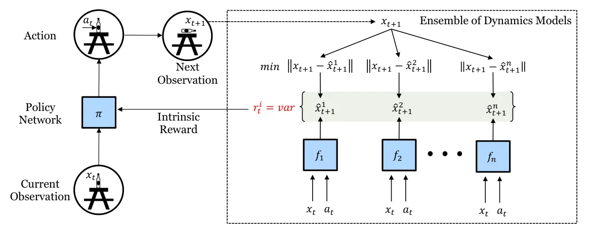
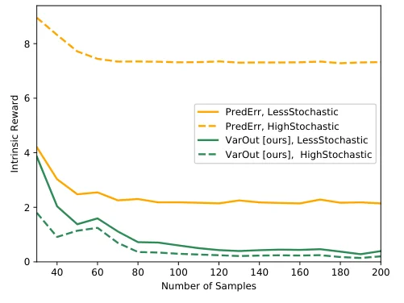
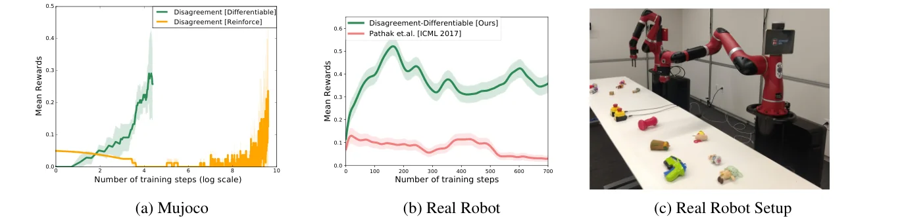

> - **논문**: Self-Supervised Exploration via Disagreement
> - **저자**: Deepak Pathak, Dhiraj Gandhi, Abhinav Gupta (UC Berkeley, CMU, Facebook AI Research)
> - **학회**: ICML 2019 · [arXiv:1906.04161](https://arxiv.org/abs/1906.04161) · [프로젝트·코드](https://pathak22.github.io/exploration-by-disagreement/)
{: .prompt-tip }

> [ICM]()의 예측 오차는 확률적인 환경에서 줄어들지 않고, [RND]()는 정답을 결정적으로 바꿔 이를 피했습니다. **Self-Supervised Exploration via Disagreement**는 또 다른 해법을 냅니다. **여러 모델이 서로 다르게 예측하는 정도(불일치)**를 호기심으로 삼으면, 확률성에도 강하고 **보상을 미분**할 수도 있습니다.

## 1. 예측 기반 탐험의 두 가지 과제

### (1) 확률성(Stochasticity)에 취약하다

Intrinsic reward를 만들려면 예측 모델이 필요한데, 에이전트와 환경 사이에는 여러 종류의 확률성이 있습니다.

- **관측 노이즈**: Noisy TV
- **행동 실행의 노이즈**: 미끄러짐(slipping) 등
- **행동 결과 자체의 무작위성**: 동전 던지기(coin flip)

이런 곳에서는 아무리 학습해도 예측 오차가 줄지 않아 에이전트가 갇힙니다.

### (2) Policy gradient는 샘플 효율이 낮다

기존 intrinsic reward는 다음 상태가 나와야 계산되므로 **행동에 대해 미분할 수 없습니다.** 그래서 보상을 블랙박스로 보고 강화학습(policy gradient)으로 최적화해야 하는데, 이는 샘플이 많이 필요합니다. 실제 로봇처럼 데이터 수집이 비싼 환경에서는 큰 문제입니다.

## 2. 아이디어: Query-by-Committee

**Active learning**의 Query-by-Committee에서 착안했습니다. 여러 모델(위원회)을 학습시켰을 때 **예측이 크게 엇갈리는 데이터는 불확실성이 높으니** 중요한 데이터로 봅니다.

## 3. Exploration by Disagreement

### 구성

1. **Forward model 앙상블** $$\{f_{\theta_1}, \dots, f_{\theta_K}\}$$: 각 모델이 현재 상태와 행동으로 **다음 상태의 특징**을 예측. 모델마다 초기화를 다르게 하고, 모은 데이터에서 복원 추출한 서로 다른 부분집합(bootstrap)으로 학습해 다양성을 유지
2. **정책**: intrinsic reward를 최대화하는 행동 출력


_Figure 1. 정책이 $$x_t$$에서 행동 $$a_t$$를 고르면, 앙상블의 각 forward model이 다음 상태를 예측하고 그 예측들의 분산이 intrinsic reward $$r^i_t$$가 됩니다. 실제로는 $$x$$ 대신 임베딩 $$\phi(x)$$에서 예측합니다. (출처: Pathak et al., 2019)_

### Disagreement를 Intrinsic Reward로

$$
r^i_t = \operatorname{Var}\big\{f_{\theta_k}(x_t, a_t)\big\}_{k=1}^{K} = \frac{1}{K}\sum_{k}\Big\lVert f_{\theta_k}(x_t, a_t) - \frac{1}{K}\sum_{j}f_{\theta_j}(x_t, a_t)\Big\rVert^2
$$

에이전트가 **충분히 탐험한 상태**에서는 모든 모델이 같은 데이터로 학습했으니 예측이 **일치(agreement, 낮은 분산)**합니다. 아직 덜 본 상태에서는 모델마다 다르게 일반화해서 **불일치(disagreement, 높은 분산)**가 커집니다.

### 확률적 환경에서 왜 강한가

Noisy TV 앞에서 각 모델은 무작위인 다음 관측을 맞히지 못하지만, 충분히 학습하면 **모두 같은 평균(running mean)**을 예측하게 됩니다.

- **예측 오차 기반**(ICM 등): 예측은 평균에 수렴해도 실제 관측과의 **오차는 계속 큼** → 보상이 영원히 높음
- **Disagreement 기반**: 모델들이 같은 평균으로 수렴하면 **분산이 0으로** → 보상이 사라짐

즉, 정답 자체의 무작위성이 아니라 **모델이 아직 모르는 정도(epistemic uncertainty)**만 측정합니다.

```python
import torch
import torch.nn as nn

class DisagreementEnsemble(nn.Module):
    def __init__(self, feat_dim, act_dim, K=5):
        super().__init__()
        self.models = nn.ModuleList([
            nn.Sequential(nn.Linear(feat_dim + act_dim, 256), nn.ReLU(), nn.Linear(256, feat_dim))
            for _ in range(K)])

    def forward(self, phi, a):
        x = torch.cat([phi, a], dim=-1)
        preds = torch.stack([m(x) for m in self.models])          # (K, B, feat_dim)
        return preds

    def intrinsic_reward(self, phi, a):
        preds = self.forward(phi, a)
        return preds.var(dim=0).mean(-1)                           # 앙상블 분산 = 불일치

    def loss(self, phi, a, phi_next):
        preds = self.forward(phi, a)
        return ((preds - phi_next.detach().unsqueeze(0)) ** 2).mean()   # 각자 다음 상태 예측
```

위 클래스로 Noisy TV 상황을 흉내 내 볼 수 있습니다. 상태 0~1 구간에서는 다음 상태가 **완전히 무작위**이고, 3~4 구간은 한 번도 가 보지 않았다고 하겠습니다.

```python
torch.manual_seed(0)
ens = DisagreementEnsemble(feat_dim=1, act_dim=1, K=5)
opt = torch.optim.Adam(ens.parameters(), lr=1e-3)
for step in range(3000):                                   # "Noisy TV" 구간만 계속 관찰
    phi = torch.rand(256, 1)                               # 상태 0~1 구간
    a = torch.zeros(256, 1)
    phi_next = torch.randn(256, 1)                         # 다음 상태가 완전히 무작위
    loss = ens.loss(phi, a, phi_next)
    opt.zero_grad(); loss.backward(); opt.step()

with torch.no_grad():
    phi_tv, a0 = torch.rand(1000, 1), torch.zeros(1000, 1)
    err = ((ens(phi_tv, a0).mean(0) - torch.randn(1000, 1)) ** 2).mean().item()
    print(f"Noisy TV 구간  예측 오차 {err:.3f}  불일치 {ens.intrinsic_reward(phi_tv, a0).mean().item():.6f}")
    phi_new = torch.rand(1000, 1) + 3.0                    # 한 번도 안 가 본 3~4 구간
    print(f"처음 보는 구간 불일치 {ens.intrinsic_reward(phi_new, a0).mean().item():.4f}")
```

```text
Noisy TV 구간  예측 오차 1.010  불일치 0.000001
처음 보는 구간 불일치 0.0325
```

Noisy TV 구간에서 **예측 오차는 1 근처에서 전혀 줄지 않지만**(ICM이라면 계속 높은 보상), 다섯 모델은 모두 평균 0을 예측하도록 수렴해 **불일치는 사실상 0**입니다. 반대로 한 번도 안 가 본 구간에서는 모델마다 다르게 외삽해 불일치가 수만 배 큽니다. 에이전트는 TV가 아니라 새로운 곳으로 가게 됩니다.

## 4. 미분 가능한 탐험

Disagreement는 **다음 상태 관측 없이** 현재 상태와 행동만으로 계산됩니다. 그리고 앙상블은 신경망이므로 보상이 **행동에 대해 미분 가능**합니다.

$$
\nabla_a\,r^i(x_t, a) = \nabla_a\,\operatorname{Var}\big\{f_{\theta_k}(x_t, a)\big\}
$$

그래서 보상을 블랙박스로 두고 policy gradient로 최적화할 필요 없이, 정책 출력에 대해 **직접 경사 상승**을 할 수 있습니다. 특히 한 step짜리 짧은 상호작용 문제(로봇 팔이 물체를 건드리는 동작 등)에서 샘플 효율이 크게 오릅니다.

한 step 문제에서는 두 목적 함수를 번갈아 최적화합니다. 정책을 고정하고 앙상블의 예측 오차를 줄인 뒤, 앙상블을 고정하고 정책 $$a_t = \pi(x_t; \theta_P)$$가 만든 행동에서의 분산을 키웁니다. 둘 다 지도학습처럼 gradient로 학습하므로 효율적입니다. 여러 step으로 늘리려면 forward model을 재귀적으로 펼쳐야 하는데, 긴 horizon 예측 모델은 학습이 어려워 논문은 짧은 horizon만 다루고 multi-step은 향후 과제로 남깁니다.

```python
action = policy(phi)                                  # 미분 가능한 정책 출력
r_int = ensemble.intrinsic_reward(phi, action)        # 앙상블 파라미터는 고정한 채
policy_loss = -r_int.mean()                           # 불일치가 큰 행동 쪽으로 직접 업데이트
policy_loss.backward()
```

## 5. 구현 세부

- 픽셀 공간에서 예측하는 것보다 **특징 공간**에서 forward model로 예측하는 편이 일반화가 좋았습니다(Burda et al., Pathak et al.의 선행 결과).
- 그래서 모든 실험에서 **embedding** $$\phi(x)$$로 상태를 바꾼 뒤 그 공간에서 예측합니다. 환경별 특징 공간과 설정은 아래와 같습니다.

| 항목 | 값 |
|---|---|
| 앙상블 크기 | $$K = 5$$ |
| 특징 공간 | 비디오 게임·3D 내비게이션: 무작위 네트워크 특징 / MNIST: 분류 네트워크 특징 / 실제 로봇: ImageNet으로 사전학습한 ResNet-18 특징 |
| 정책 최적화 | 기본은 PPO, 미분 가능 버전은 보상을 직접 최적화 |
| 행동 샘플링을 통과하는 gradient | 연속 행동: 결정적 정책 + epsilon-greedy / 이산 행동: straight-through estimator |
| 로봇 행동 공간 | 224×224 위치 × (grasp 16방향 + push 16방향) = 224×224×32, 입력은 224×224 RGBD |

## 6. 실험

### Baseline 비교

| Baseline | 내용 |
|---|---|
| Pathak et al. (ICM) | inverse model 특징 공간에서의 forward model 예측 오차 |
| Burda et al. | 무작위 초기화한 특징 공간에서 forward dynamics 예측 오차 |
| Pred-Error Variance | 모델 출력이 아니라 예측 오차의 분산을 보상으로 |
| Bayesian Disagreement | 앙상블 대신 Dropout 신경망(Gal & Ghahramani)으로 불확실성 추정 |

### 확률성이 거의 없는 Atari (sanity check)

외부 보상 없이 intrinsic reward만으로 학습하고, 게임 점수는 탐험의 질을 재는 용도로만 썼습니다. Disagreement는 대부분의 게임에서 기존 방법과 비슷하거나 약간 좋았습니다. Pred-Error Variance는 크게 나빴는데, 모델들의 예측 오차 크기가 비슷하다고 해서 다음 상태 예측까지 일치하는 것은 아니라서 탐험을 너무 일찍 멈출 수 있기 때문입니다.

### 확률적 환경

**Noisy MNIST**는 한 step짜리 장난감 환경입니다. 숫자 0 이미지는 항상 다른 0 이미지로, 숫자 1 이미지는 2~9 중 무작위 숫자 이미지로 넘어갑니다. 충분히 보고 나면 두 경우의 보상이 같아져야 이상적입니다.


_Figure 3. 예측 오차(PredErr, 주황)는 확률성이 큰 전이(점선)에 끝까지 약 7 이상의 높은 보상을 주지만, 앙상블 분산(VarOut, 초록)은 두 경우 모두 0 근처로 수렴합니다. (출처: Pathak et al., 2019)_

위 토이 코드의 결과(예측 오차는 1 근처에 머물고 불일치는 0으로)와 같은 현상이 실제 이미지에서도 나타납니다.

- **3D 내비게이션 (Unity)**: VizDoom MyWayHome을 Unity로 옮긴 미로에서 목표 도달 시 +1의 드문 보상을 받습니다. 벽에 리모컨으로 채널을 바꿀 수 있는 TV(누르면 무작위 이미지)가 있는 버전도 있습니다. TV가 없을 때는 Burda et al.과 비슷했고, **TV가 있을 때는 Disagreement가 더 좋았습니다.**
- **Sticky action Atari**: 매 step 50% 확률로 직전 행동이 반복되는 확률적 Atari에서 기존 방법보다 좋았습니다. Pong에서는 Burda et al.보다 출발이 약간 느렸지만 최종 점수는 더 높았습니다. Dropout 기반 Bayesian Disagreement는 앙상블보다 못했는데, dropout이 불확실성을 잘 잡지 못하는 것으로 봅니다.

### 샘플 효율과 실제 로봇

- **Enduro**: PPO에 미분 가능한 최적화를 함께 쓰면 PPO만 쓸 때보다 학습이 빨랐습니다. RL은 긴 horizon을, 미분 가능한 목적 함수는 짧은 horizon을 맡는 구성입니다.
- **시뮬레이션 grasping·pushing (MuJoCo)**: 탐험의 질을 보기 위해 에이전트가 물체와 상호작용(터치)한 빈도를 측정했습니다(학습 신호로는 쓰지 않음). 물체가 하나뿐이라 무작위로는 건드리기 어려운 설정에서, **미분 가능한 Disagreement**가 REINFORCE로 최적화한 Disagreement보다 자릿수 단위로 빠르게 학습했습니다.
- **실제 로봇 팔**: 7-DOF Sawyer 팔과 KinectV2 RGBD 카메라로 같은 과제를 했습니다. 매 run 물체 3개를 두고, 물체 30개 중 20개는 학습, 10개는 테스트용입니다. 1,000번이 안 되는 상호작용만에 물체를 건드리는 법을 익혔습니다.


_Figure 7. 학습 step에 따른 물체 상호작용 비율. (a) MuJoCo(가로축 로그 스케일), (b) 실제 로봇에서 ICM(Pathak et al., 2017)과 비교, (c) 실제 로봇 환경. (출처: Pathak et al., 2019)_

700번 상호작용 후의 체크포인트로 처음 보는 테스트 물체 앞에서 80 step을 평가한 결과입니다.

| 정책 | 처음 보는 물체와 상호작용한 비율 |
|---|---|
| **Disagreement (미분 가능)** | **약 67%** |
| 무작위 정책 | 17% |
| REINFORCE로 학습한 curiosity (ICM) | 1% (정책이 붕괴) |

외부 보상 없이 물체를 건드리고 미는 행동을 스스로 익힌 것입니다.

## 7. 정리

| | 예측 오차 (ICM) | RND | Disagreement |
|---|---|---|---|
| 측정 | 실제와 예측의 차이 | 고정 네트워크 모방 오차 | **모델 간 예측 분산** |
| 확률적 환경 | 약함 | 강함 | 강함 |
| 보상 미분 | 불가 (다음 상태 필요) | 불가 | **가능** |
| 비용 | 모델 1개 | 모델 1개 | 앙상블 $$K$$개 |

다음 글에서는 절차적으로 생성되는 환경에서 "**상태를 크게 바꾸는 행동**"에 보상을 주는 [RIDE]()를 다룹니다.

## References

- Pathak, Gandhi & Gupta, "Self-Supervised Exploration via Disagreement," ICML 2019. [arXiv:1906.04161](https://arxiv.org/abs/1906.04161)
- Seung et al., "Query by Committee," COLT 1992.
- Lakshminarayanan et al., "Simple and Scalable Predictive Uncertainty Estimation using Deep Ensembles," NeurIPS 2017.
- Burda et al., "Large-Scale Study of Curiosity-Driven Learning," ICLR 2019.
