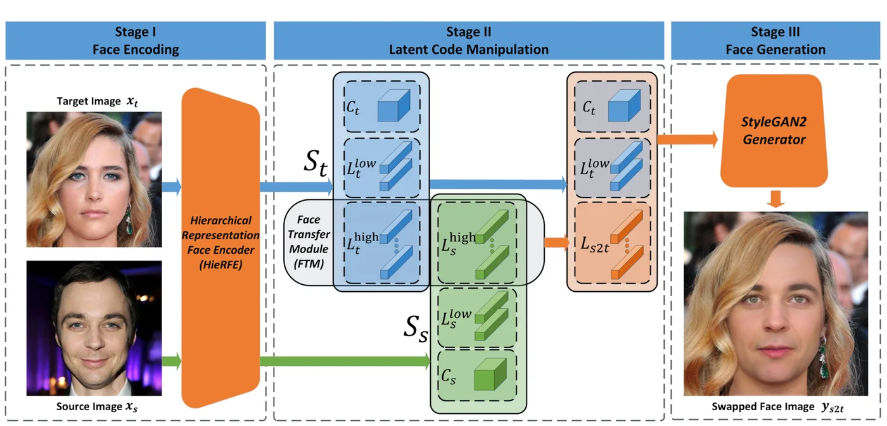
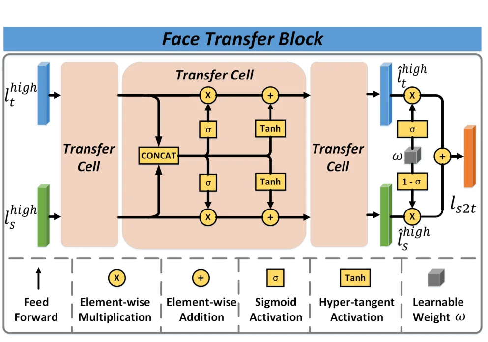
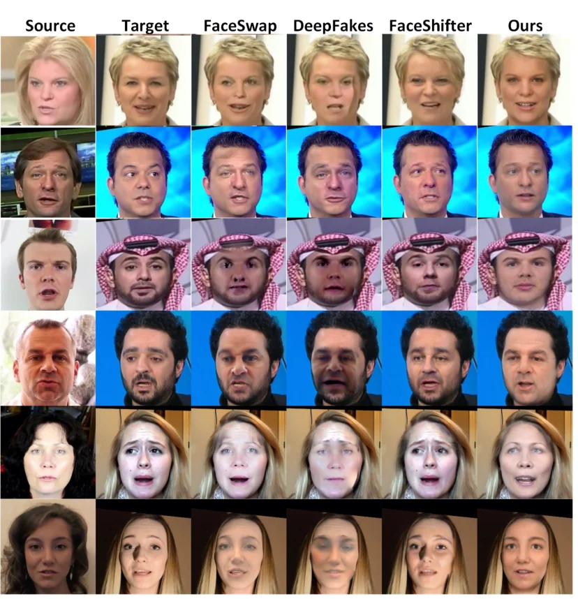

> - **논문**: One Shot Face Swapping on Megapixels
> - **저자**: Yuhao Zhu, Qi Li, Jian Wang, Chengzhong Xu, Zhenan Sun (CASIA CRIPAC·NLPR, University of Macau, UCAS)
> - **학회**: CVPR 2021 · [arXiv:2105.04932](https://arxiv.org/abs/2105.04932)
{: .prompt-tip }

> 고해상도 교체는 세 가지 때문에 어려웠다. 종단간 프레임워크([FaceShifter](), [SimSwap]())의 압축된 표현은 고품질 생성에 정보가 부족하고, 적대 학습이 불안정해 256²에 묶였으며, GPU 메모리 때문에 배치가 작아져 붕괴가 잦았다. [Disney]()는 1024²를 달성했지만 신원마다 디코더를 학습해야 했다. **MegaFS**는 세 장벽을 각각 다른 도구로 넘는다. 정보 손실은 GAN 역변환의 확장 잠재 공간으로, 불안정성은 고정된 사전학습 StyleGAN2를 디코더로 써서(판별기 없음), 메모리는 세 부분을 따로 학습해서 해결한다. 소스와 목표 각 한 장만으로(원샷) 1024² 교체를 하는 첫 방법이고, 첫 메가픽셀 교체 데이터셋을 공개한다.

## 1. 세 단계


_Figure 2. Stage I에서 HieRFE가 두 얼굴을 $$\mathcal{W}++$$로 역변환하고(상수 $$C$$, 저수준 $$L^{low}$$, 고수준 $$L^{high}$$), Stage II에서 FTM이 두 고수준 코드로 $$L_{s2t}$$를 만들며, Stage III에서 고정 StyleGAN2가 목표의 $$C_t$$, $$L^{low}_t$$와 $$L_{s2t}$$로 결과를 생성한다. (출처: Zhu et al., 2021)_

**얼굴 인코딩: HieRFE와 W++.** StyleGAN의 $$\mathcal{W} \in \mathbb{R}^{512}$$보다 층마다 다른 코드를 주는 $$\mathcal{W}+ \in \mathbb{R}^{18 \times 512}$$가 재구성이 좋다는 것이 역변환 연구의 결론이었다. MegaFS는 여기에 StyleGAN2의 **상수 입력** $$C \in \mathbb{R}^{4 \times 4 \times 512}$$까지 예측 대상에 넣은 $$\mathcal{W}++$$를 제안한다. HieRFE는 ResNet50 백본 + FPN 특징 피라미드 + 18개의 비선형 매핑 네트워크(다운샘플·conv·BN·LeakyReLU 반복 후 풀링)로 구성되고, 백본에서 $$C$$를, 가장 작은 특징 맵에서 저수준 코드 4개 $$L^{low}$$(둘을 합쳐 위상 정보)를, 나머지에서 고수준 코드 14개 $$L^{high}$$(의미 정보)를 예측한다. 손실은 픽셀 L2, LPIPS, ArcFace 신원, 랜드마크 L2(포즈·표정 제어용)이고 가중치는 1, 0.8, 1, 1000이다.

**잠재 조작: FTM.** 14개 고수준 코드마다 **Face Transfer Block**을 두고, 각 블록은 동일한 전이 셀 3개로 되어 있다. 소스·목표 코드를 이은 $$l_c$$에 대해

$$
T(l_c, l_s) = T_2(l_c, T_1(l_c, l_s)), \quad T_1(a, b) = \text{sigmoid}(K_1(a)) \times b, \quad T_2(a, b) = \tanh(K_2(a)) + b
$$

$$K_1, K_2$$는 선형층 하나씩이다.


_Figure 4. Face Transfer Block 하나는 같은 전이 셀 3개로 이루어진다. 셀마다 두 코드를 이어 붙여 sigmoid 게이트(곱)와 tanh 이동(덧셈)을 소스·목표 양쪽에 적용하고, 마지막에 학습 가중치 $$\omega$$로 두 결과를 섞어 $$l_{s2t}$$를 낸다. (출처: Zhu et al., 2021)_

첫 단계는 (0,1) 게이트로 신원 외의 의미를 버리고, 둘째 단계는 작은 이동으로 목표 의미를 조금 받아들인다. 목표 코드도 병렬로 처리해 목표 신원을 버리고, 최종적으로 $$l_{s2t} = \sigma(\omega)\hat l_t + (1 - \sigma(\omega))\hat l_s$$처럼 학습 가능한 가중치 $$\omega \in \mathbb{R}^{1\times 512}$$로 섞는다. 선형 의미 방향(InterFaceGAN)이 한 번에 한 속성만 바꾸는 것과 달리 **비선형 궤적**으로 여러 속성을 동시에 제어하고, 명시적 분리가 없다.

**생성.** 소스의 $$C_s$$, $$L^{low}_s$$는 신원 정보가 적어 버리고, 목표의 $$C_t$$, $$L^{low}_t$$와 $$L_{s2t}$$를 고정 StyleGAN2에 넣는다. 잠재 공간에서 전역적으로 조작하므로 특징 맵의 국소 왜곡이 없고, 판별기가 없어 학습이 단순하다. FTM 손실은 소스·목표 재구성, 목표와의 LPIPS, 소스 신원, 목표 랜드마크, 그리고 학습을 안정시키는 $$\lVert L^{high}_s - L_{s2t} \rVert_2$$ 정규화이며, 가중치는 순서대로 8, 32, 24, 100000, 32이다. HieRFE와 FTM은 차례로 따로 학습하고 StyleGAN2는 건드리지 않는다.

### 구현 디테일

| 항목 | 값 |
|---|---|
| 인코더 | ResNet50 + FPN + 비선형 매핑망 18개, 코드 $$l \in \mathbb{R}^{1\times 512}$$ |
| 디코더 | 사전학습 StyleGAN2 생성기(고정, 판별기 미사용) |
| Optimizer | Adam, lr 0.01 |
| 손실 가중치 | HieRFE $$\lambda_{1..4}$$ = 1, 0.8, 1, 1000 / FTM $$\phi_{1..5}$$ = 8, 32, 24, 100000, 32 |
| 보조 데이터 | StyleGAN2로 무작위 생성한 얼굴 200,000장 |
| FF++ 실험용 학습 | CelebA + CelebA-HQ + FFHQ + 보조 데이터, HieRFE·FTM 합쳐 10 epoch |
| CelebA-HQ 실험용 학습 | FFHQ + 보조 데이터, 합쳐 17 epoch |
| 하드웨어 | Tesla V100 3장, 약 5일 |

## 2. 코드로 보기: 어느 층을 바꾸면 무엇이 바뀌나

18개 스타일 벡터의 저(1~4)·중(5~10)·고(11~18) 층 평균이 각각 배치, 얼굴 형태·눈 간격, 피부톤·조명을 정하는 toy 생성기에서, 소스 코드를 층 집합별로 바꿔 넣었을 때 네 속성이 어떻게 바뀌는지 보고, FTM 셀의 게이트·이동이 코드 노름을 어떻게 바꾸는지 본다.

```python
import torch
torch.manual_seed(0)
# a toy coarse-to-fine generator in the spirit of StyleGAN2: 18 style vectors; the first 4 (low) set layout, 5-10 shape/parts, 11-18 colour/texture
yy, xx = torch.meshgrid(torch.linspace(-1, 1, 32), torch.linspace(-1, 1, 32), indexing="ij")
def G(codes):                                      # codes: [18, 4]
    low, mid, high = codes[:4].mean(0), codes[4:10].mean(0), codes[10:].mean(0)
    cx, cy = 0.3 * torch.tanh(low[0]), 0.3 * torch.tanh(low[1])                          # layout: where the face is
    w, h = 0.6 + 0.2 * torch.tanh(mid[0]), 0.8 + 0.2 * torch.tanh(mid[1])                 # shape: face width/height (identity)
    eye = 0.2 + 0.1 * torch.tanh(mid[2])                                                  # part: eye spacing (identity)
    face = torch.exp(-(((xx - cx) / w) ** 2 + ((yy - cy) / h) ** 2) * 3)
    eyes = torch.exp(-(((xx - cx - eye) ** 2 + (yy - cy + 0.2) ** 2) * 60)) + torch.exp(-(((xx - cx + eye) ** 2 + (yy - cy + 0.2) ** 2) * 60))
    tone = 0.5 + 0.3 * torch.tanh(high[0]); light = 0.3 * torch.tanh(high[1]) * xx          # texture/colour: skin tone, lighting
    return face * (tone + light) - 0.5 * eyes
src, tgt = torch.randn(18, 4), torch.randn(18, 4)
def describe(codes):
    low, mid, high = codes[:4].mean(0), codes[4:10].mean(0), codes[10:].mean(0)
    return dict(layout=(0.3 * torch.tanh(low[0])).item(), width=(0.6 + 0.2 * torch.tanh(mid[0])).item(), eyes=(0.2 + 0.1 * torch.tanh(mid[2])).item(), tone=(0.5 + 0.3 * torch.tanh(high[0])).item())
ds, dt = describe(src), describe(tgt)
print(f"source: layout {ds['layout']:+.2f} width {ds['width']:.2f} eyes {ds['eyes']:.3f} tone {ds['tone']:.2f}")
print(f"target: layout {dt['layout']:+.2f} width {dt['width']:.2f} eyes {dt['eyes']:.3f} tone {dt['tone']:.2f}")
print("\nlatent code replacement (which layers take the SOURCE code):")
for name, sel in (("low 1-4 (layout)", slice(0, 4)), ("mid 5-10 (shape, parts)", slice(4, 10)), ("high 11-18 (colour)", slice(10, 18)), ("MegaFS: high-level 5-18, keep target C + low", slice(4, 18))):
    c = tgt.clone(); c[sel] = src[sel]; d = describe(c)
    print(f"  {name:<44} layout {d['layout']:+.2f} width {d['width']:.2f} eyes {d['eyes']:.3f} tone {d['tone']:.2f}")
print("-> swapping only the mid codes moves identity (shape, eye spacing) and keeps the target's layout and skin tone;")
print("   taking ALL high-level codes from the source also drags the source's colour/lighting along, the attribute leak MegaFS's FTM has to learn to suppress")
# FTM transfer cell: a sigmoid gate discards irrelevant semantics, then a tanh shift admits a little target information
l_s, l_t = src[6], tgt[6]; K1 = torch.randn(8, 4); K2 = torch.randn(8, 4)
l_c = torch.cat([l_s, l_t]); step1 = torch.sigmoid(K1.T @ l_c) * l_s; step2 = torch.tanh(K2.T @ l_c) + step1
print(f"\nFTM cell on layer 7: |l_s| {l_s.norm():.2f} -> after gate {step1.norm():.2f} -> after shift {step2.norm():.2f}; a two-step NON-LINEAR trajectory instead of a straight line between l_s and l_t")
```

```text
source: layout +0.01 width 0.64 eyes 0.219 tone 0.48
target: layout +0.00 width 0.59 eyes 0.179 tone 0.66

latent code replacement (which layers take the SOURCE code):
  low 1-4 (layout)                             layout +0.01 width 0.59 eyes 0.179 tone 0.66
  mid 5-10 (shape, parts)                      layout +0.00 width 0.64 eyes 0.219 tone 0.66
  high 11-18 (colour)                          layout +0.00 width 0.59 eyes 0.179 tone 0.48
  MegaFS: high-level 5-18, keep target C + low layout +0.00 width 0.64 eyes 0.219 tone 0.48
-> swapping only the mid codes moves identity (shape, eye spacing) and keeps the target's layout and skin tone;
   taking ALL high-level codes from the source also drags the source's colour/lighting along, the attribute leak MegaFS's FTM has to learn to suppress

FTM cell on layer 7: |l_s| 0.98 -> after gate 0.39 -> after shift 1.74; a two-step NON-LINEAR trajectory instead of a straight line between l_s and l_t
```

- 중간 층만 소스로 바꾸면 얼굴 너비(0.59 → 0.64)와 눈 간격(0.179 → 0.219)이 소스로 가고 배치·피부톤은 목표에 남는다. 고층만 바꾸면 피부톤만 소스가 된다. MegaFS처럼 고수준 코드 14개(5~18)를 모두 소스에서 가져오면 신원과 함께 소스의 **피부톤(0.48)**까지 따라온다. 이것이 FSLSD·RAFSwap이 지적한 MegaFS의 약점(목표의 피부색·조명을 못 지킴)의 구조적 이유이고, FTM의 게이트와 목표 코드 혼합이 이를 학습으로 억제해야 한다.
- FTM 셀은 소스 코드 노름을 게이트로 0.98 → 0.39로 줄였다가 이동으로 1.74로 바꾼다. 두 코드 사이의 직선이 아닌 궤적이며, 논문은 이것이 선형 잠재 편집보다 여러 속성을 동시에 다룬다고 주장한다.

## 3. 실험


_Figure 5. FF++에서 FaceSwap, DeepFakes, FaceShifter와의 비교. FaceSwap·DeepFakes는 블렌딩 불일치와 왜곡이 보이고, FaceShifter는 소스의 표정을 가져오거나 목표의 수염을 남기는 경우가 있다. (출처: Zhu et al., 2021)_

**FF++(FaceShifter 프로토콜, Table 1).** 원본 영상마다 10프레임을 뽑아 MTCNN으로 정렬한 1만 장을 손으로 검수하고, 같은 인물이 여러 영상에 나오는 경우(예: 푸틴, 오바마)를 묶어 889개 신원으로 정리했다. ID 검색은 top-1 매칭률, 포즈·표정은 공개 포즈 추정기와 3D 얼굴 모델로 뽑은 벡터의 L2 거리이다.

| 방법 | ID 검색 ↑ | 포즈 ↓ | 표정 ↓ |
|---|---|---|---|
| DeepFakes | 88.39 | 4.64 | 3.33 |
| FaceSwap | 72.69 | 2.58 | 2.89 |
| Face2Face (재연기) | - | 2.68 | 2.09 |
| Neural Textures (재연기) | - | **2.21** | **1.64** |
| FaceShifter | 90.68 | 2.55 | 2.82 |
| MegaFS | **90.83** | 2.64 | 2.96 |

(재계산한 FaceShifter 수치는 원 논문의 97.38과 다르다.) 신원은 최고이지만 포즈(2.64)는 FaceSwap·FaceShifter·Neural Textures보다, 표정(2.96)은 FaceSwap·FaceShifter와 두 재연기 방법보다 나쁘다. 이유로 학습 이미지가 50만 장뿐이라는 점(FaceShifter는 포즈·표정이 다양한 VGGFace를 포함해 270만 장)과 FFHQ로 학습된 StyleGAN2의 **웃는 얼굴 편향**을 든다. 정성적으로 FaceShifter는 소스의 표정(사나움, 공포)을 가져오거나 목표의 수염을 남기는 반면 MegaFS는 신원을 더 잘 옮긴다(Figure 5).

**CelebA-HQ 1024²(Table 2).** 무작위 30만 쌍을 교체해 ID 유사도 0.5014(CosFace 코사인, 30만 장 × 3만 장 검색이 너무 비싸 검색 대신 유사도를 씀), 포즈 3.58, 표정 2.87, FID 10.16(CelebA-HQ 대비)을 이후 연구의 기준선으로 제시한다. 주름, 홍채 색, 눈썹·코 모양이 소스에서 유지된다(Figure 6).

**Ablation 1: 잠재 공간(Table 3·4, CelebA-HQ).** 같은 구조의 인코더를 $$\mathcal{W}+$$로 학습해 비교한다.

| 잠재 공간 | 역변환 LPIPS ↓ | 역변환 MSE ↓ | 복원 실패율 ↓ | 교체 ID 유사도 ↑ | 포즈 ↓ | 표정 ↓ |
|---|---|---|---|---|---|---|
| $$\mathcal{W}+$$ | 0.2486 | 0.0672 | 1.28% | 0.5438 | 4.0640 | 1.7467 |
| $$\mathcal{W}++$$ | **0.2335** | **0.0563** | **0.65%** | **0.5816** | **3.8179** | **1.6489** |

$$\mathcal{W}+$$는 쉬운 얼굴은 잘 복원하지만 선글라스·안경·시선·복잡한 조명을 복원하지 못한다(논문 Figure 7).

**Ablation 2: 잠재 조작 방법(Table 5, 각 30만 쌍).**

| 방법 | ID 유사도 ↑ | 포즈 ↓ | 표정 ↓ | FID ↓ |
|---|---|---|---|---|
| LCR (고수준 코드를 소스 것으로 단순 교체) | 0.3997 | 5.04 | 3.43 | **9.64** |
| ID Injection (SPADE ResBlk을 벡터용으로 바꾼 신원 주입) | 0.4447 | 3.67 | **2.82** | 10.32 |
| FTM | **0.5014** | **3.58** | 2.87 | 10.16 |

LCR은 FID가 가장 좋지만 소스의 피부색·눈 상태까지 가져와 목표 속성을 잃는다. 저자들은 이 결과에서 신원 정보가 대부분 $$L^{high}$$에 있다고 보고 $$C_s$$, $$L^{low}_s$$를 버린다. ID Injection은 목표 위상을 지켜 표정 오차가 가장 낮지만 신원과 세부(입술색, 수염)를 잃는다. FTM이 신원·포즈에서 가장 좋고 표정·FID는 중간이다.

## 4. 해석

**1. "StyleGAN 사전으로 교체" 계열을 열었다.** 고정 생성기 + 역변환 인코더 + 잠재 조작이라는 틀은 [FSLSD]()(층별 의미 분리), [RAFSwap]()(영역 토큰), [E4S]()(영역별 역변환), [StyleIPSB]()(신원 보존 기저)로 이어지며, 이들은 모두 MegaFS를 "흐리고, 경계가 보이고, 목표 조명을 못 지키는" 기준선으로 인용한다. 위 toy의 피부톤 누출이 그 지적과 맞닿아 있고, [StyleSwap]()은 아예 생성기를 다시 학습해 이 문제를 피한다.

**2. 세 장벽을 세 도구로 분리한 논증이 명확하다.** 정보 손실 → 확장 잠재 공간, 불안정성 → 판별기 없는 고정 디코더, 메모리 → 단계별 학습. 각각은 역변환·GAN 편집 연구에서 빌려온 것이지만 교체에 조합한 것이 기여이고, "원샷 메가픽셀"이라는 수식어가 그 결과이다.

**3. 트레이드오프는 고정 생성기의 분포이다.** FFHQ StyleGAN2가 만들 수 있는 얼굴만 만들 수 있어 웃는 얼굴 편향, 극단 포즈·조명의 실패, 배경·가림의 손실이 생긴다. 후처리 마스크 블렌딩이 경계 아티팩트를 남긴다는 것이 RAFSwap의 지적이고, FSLSD는 생성기 특징을 목표 특징과 다중 스케일로 합쳐 해결한다.

**4. 데이터셋 공개가 실용적 기여이다.** MegaFS로 만든 첫 메가픽셀 교체 데이터베이스를 위조 탐지·얼굴 편집 연구용으로 공개했고, CelebA-HQ 30만 쌍으로 1024²에서의 ID·FID 기준선을 처음 제공했다.

**5. 평가를 읽을 때 주의할 점.** FF++의 FaceShifter 수치를 재계산하면서 신원 기준이 바뀌어(889 신원) 원 논문과 비교할 수 없고, MegaFS의 우위는 0.15%p 차이이다. 포즈·표정 열세의 설명(데이터 양, 생성기 편향)은 검증되지 않은 가설이다. 위 toy는 층별 역할을 손으로 정한 생성기이고, 실제 StyleGAN의 층별 의미는 그렇게 깨끗이 나뉘지 않는다.

## 5. 정리

| 항목 | 내용 |
|---|---|
| 장벽과 해법 | 압축 표현 → $$\mathcal{W}++$$ 역변환 / 불안정 GAN → 고정 StyleGAN2(판별기 없음) / 메모리 → 3부분 별도 학습 |
| HieRFE | ResNet50 + FPN + 18 매핑망, 상수 $$C$$ + 저수준 4 + 고수준 14 코드, 픽셀·LPIPS·ID·랜드마크 손실 |
| FTM | 14 블록 × 셀 3개, sigmoid 게이트(버림) → tanh 이동(수용), 학습 가중치로 소스·목표 혼합 |
| 생성 | 목표의 $$C$$, 저수준 코드 + $$L_{s2t}$$ → 고정 StyleGAN2, 1024² |
| 결과 | FF++ ID 90.83(최고), 포즈·표정은 열세; CelebA-HQ 1024² ID 0.50, FID 10.16; $$\mathcal{W}++$$가 $$\mathcal{W}+$$보다 우수 |
| 한계 | 소스 색·조명 누출, 흐림, 경계, 생성기 분포 편향, 배경·가림 |

## References

- Zhu, Li, Wang, Xu, Sun, "One Shot Face Swapping on Megapixels," CVPR 2021. [arXiv:2105.04932](https://arxiv.org/abs/2105.04932)
- Karras et al., "Analyzing and Improving the Image Quality of StyleGAN," CVPR 2020. [arXiv:1912.04958](https://arxiv.org/abs/1912.04958)
- Abdal, Qin, Wonka, "Image2StyleGAN: How to Embed Images Into the StyleGAN Latent Space?," ICCV 2019. [arXiv:1904.03189](https://arxiv.org/abs/1904.03189)
- Richardson et al., "Encoding in Style: a StyleGAN Encoder for Image-to-Image Translation" (pSp), CVPR 2021. [arXiv:2008.00951](https://arxiv.org/abs/2008.00951)
- Shen, Gu, Tang, Zhou, "Interpreting the Latent Space of GANs for Semantic Face Editing" (InterFaceGAN), CVPR 2020. [arXiv:1907.10786](https://arxiv.org/abs/1907.10786)
- Abdal et al., "StyleFlow: Attribute-conditioned Exploration of StyleGAN-Generated Images using Conditional Continuous Normalizing Flows," ACM TOG 2021. [arXiv:2008.02401](https://arxiv.org/abs/2008.02401)
