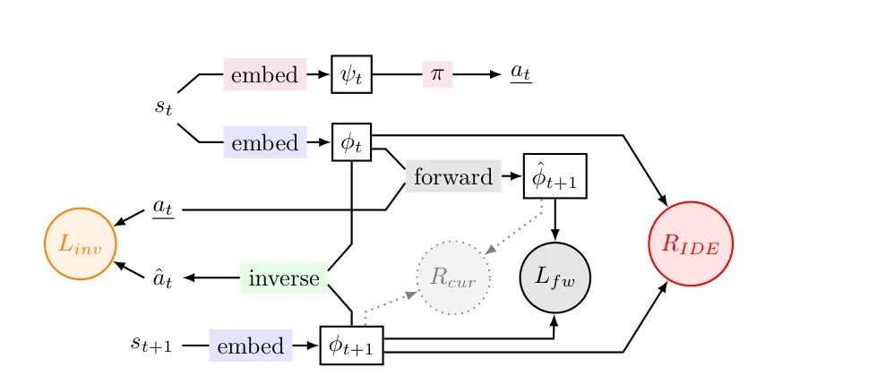
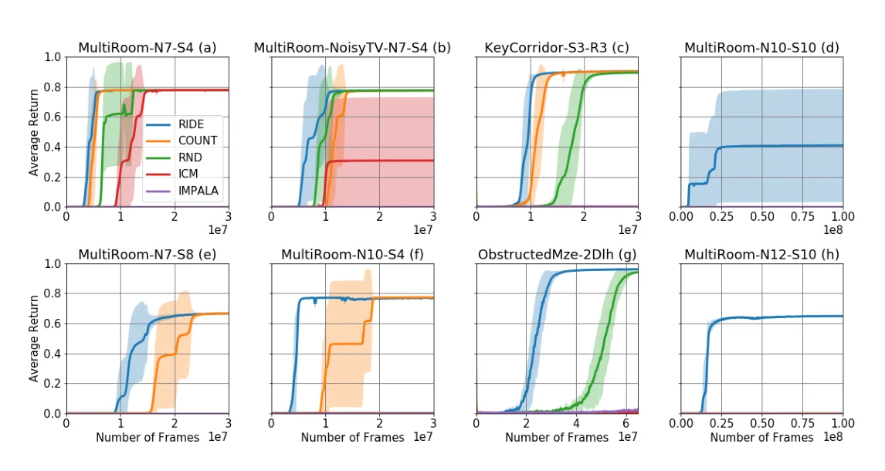
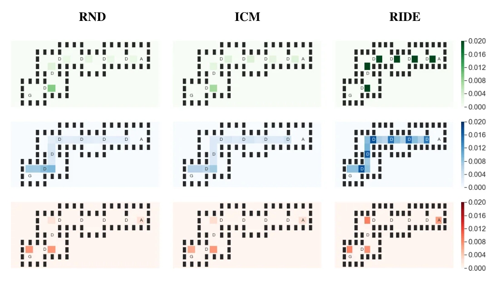

> - **논문**: RIDE: Rewarding Impact-Driven Exploration for Procedurally-Generated Environments
> - **저자**: Roberta Raileanu, Tim Rocktäschel (Facebook AI Research, New York University, University College London)
> - **학회**: ICLR 2020 · [arXiv:2002.12292](https://arxiv.org/abs/2002.12292) · [코드](https://github.com/facebookresearch/impact-driven-exploration)
{: .prompt-tip }

> 지금까지의 탐험 방법은 주로 Atari처럼 매번 같은 맵에서 평가됐다. 하지만 에피소드마다 맵이 새로 만들어지는 환경에서는 "새로운 상태"가 너무 흔해서 기존 방법이 잘 동작하지 않는다. **RIDE(Rewarding Impact-Driven Exploration)**는 "얼마나 새로운가" 대신 "**내 행동이 상태를 얼마나 크게 바꿨는가**"에 보상을 준다.

## 1. 두 종류의 환경

### Singleton Environment

- 상태 공간이 제한적이고 상태 간 유사도를 재기 쉬움
- 에피소드 사이에 환경이 바뀌지 않아, 학습과 평가에 **같은 환경**을 씀
- Montezuma's Revenge, Pitfall! 등 Atari 게임 대부분

### Procedurally-Generated Environment

- 맵 레이아웃, 물체 위치 등이 **에피소드마다 무작위로** 생성되어 상태 공간이 사실상 무한
- 같은 상태로 되돌아가거나 리셋할 수 없음
- MiniGrid의 **MultiRoom-NX-SY**, **KeyCorridor**, **ObstructedMaze** 등

Hard exploration task에서 효과적이었던 기존 방법들이 procedurally-generated 환경에서는 좋은 성과를 내지 못했다.

## 2. 기존 방법의 한계

### Count-based (Count, Pseudo-count, RND)

방문 횟수를 표(tabular)로 세다가, 신경망으로 근사하는 방식으로 발전했다. 하지만 과제와 무관하게 텍스처나 배치만 바뀌어도 새로운 상태로 간주한다. 매번 맵이 바뀌는 환경에서는 모든 것이 새로워서 보상이 의미를 잃는다.

### Curiosity-driven (ICM 등)

상태의 잠재 표현을 학습해 다음 상태를 예측한다. 하지만 학습이 진행될수록 예측이 정확해져 **intrinsic reward가 점점 0으로 수렴**한다. 아직 탐험이 끝나지 않았는데도 동기가 사라지는 문제가 있다.

## 3. ICM 복습

RIDE는 [ICM]()의 특징 학습 방식을 그대로 가져온다.

- **Inverse dynamics model**: $$\phi(s_t), \phi(s_{t+1})$$로 행동 $$a_t$$를 예측 (cross entropy) → 행동과 관련된 정보만 담는 특징 공간
- **Forward dynamics model**: $$\phi(s_t), a_t$$로 $$\phi(s_{t+1})$$을 예측 (MSE) → 특징 공간을 예측 가능하게

차이는 intrinsic reward를 무엇으로 정의하느냐이다.

## 4. Impact-Driven Intrinsic Reward

RIDE의 보상은 **연속된 두 상태 표현의 변화량**이다.

$$
r^i_t(s_t, a_t) = \frac{\big\lVert\phi(s_{t+1}) - \phi(s_t)\big\rVert_2}{\sqrt{N_{ep}(s_{t+1})}}
$$


_Figure 1. 임베딩 $$\phi$$는 ICM처럼 forward loss $$L_{fw}$$와 inverse loss $$L_{inv}$$로 학습한다. ICM의 보상 $$R_{cur}$$(예측 오차, 회색 점선) 대신, 연속된 두 임베딩의 차이 $$R_{IDE}$$를 보상으로 쓴다. 정책은 별도 임베딩 $$\psi_t$$를 쓴다. (출처: Raileanu & Rocktäschel, 2020)_

### 분자: 상태 변화의 크기 (Impact)

행동 후 상태 표현이 크게 바뀔수록 보상이 크다. 특징 공간이 inverse model로 학습되어 **행동으로 제어할 수 있는 요소**를 담고 있으므로, 이 변화는 "내 행동이 환경에 미친 영향"을 뜻한다.

- 그냥 걸어 다니는 것보다 문을 열거나, 열쇠를 줍거나, 상자를 옮기는 행동이 표현을 크게 바꾼다.
- 텍스처가 무작위로 바뀌어도 행동과 무관하면 표현에 담기지 않으니 보상이 커지지 않는다.
- 예측 오차가 아니라 표현의 차이이므로, 학습이 진행돼도 0으로 수렴하지 않는다.

### 분모: Episodic Count

같은 에피소드 안에서 **같은 상태를 반복 방문하면 페널티**를 준다. 그렇지 않으면 문을 열었다 닫았다 하며 큰 변화를 반복하는 식으로 보상을 얻을 수 있기 때문이다. $$N_{ep}$$는 에피소드마다 초기화되는 방문 횟수(고차원 관측에서는 pseudo-count)이며, [NGU]()의 episodic novelty 모듈과 같은 역할이다.

### 학습 목적 함수

$$
\min_{\theta_\pi, \theta_{inv}, \theta_{fw}, \theta_{emb}}\Big[\omega_\pi\,\mathcal{L}_{RL}(\theta_\pi) + \omega_{fw}\,\mathcal{L}_{fw}(\theta_{fw}, \theta_{emb}) + \omega_{inv}\,\mathcal{L}_{inv}(\theta_{inv}, \theta_{emb})\Big]
$$

($$\theta_\pi, \theta_{inv}, \theta_{fw}, \theta_{emb}$$: 정책·가치 네트워크, inverse model, forward model, embedding 네트워크. $$\omega$$는 각 loss의 비중)

구현에서 중요한 점이 하나 있다. **embedding·forward·inverse 네트워크는 RL loss로 업데이트하지 않고**, 정책도 이 embedding을 쓰지 않고 자기 표현 $$\psi_t$$를 따로 학습한다(Figure 1 위쪽 경로). RL 신호가 embedding에 흘러가면, 에이전트가 상태들끼리 멀리 떨어지도록 표현을 만들어 보상을 인위적으로 키울 수 있기 때문이다. 실제 보상은 $$r_t = r^e_t + \omega_{ir}\,r^i_t$$로 extrinsic reward와 가중합한다.

```python
import torch
from collections import defaultdict

class RIDEReward:
    def __init__(self, embed):
        self.embed = embed                  # ICM 방식(inverse/forward loss)으로 학습되는 encoder
        self.ep_count = defaultdict(int)

    def reset_episode(self):
        self.ep_count.clear()

    def __call__(self, s, s_next, key_next):
        """key_next: 다음 상태를 셀 수 있게 만든 해시 키 (MiniGrid는 관측을 그대로 사용)"""
        self.ep_count[key_next] += 1
        with torch.no_grad():
            impact = (self.embed(s_next) - self.embed(s)).norm(p=2, dim=-1)
        return impact / self.ep_count[key_next] ** 0.5

# 특징 = 관측 그대로라고 가정한 장난감 예: 한 칸 걷기 vs 문 열기
ride = RIDEReward(embed=lambda x: x)
door_closed, door_open = torch.tensor([0.0, 0.0]), torch.tensor([0.0, 3.0])
print(float(ride(door_closed, door_closed + torch.tensor([0.1, 0.0]), "walk")))   # 0.1
print([round(float(ride(door_closed, door_open, "open")), 3) for _ in range(3)])   # [3.0, 2.121, 1.732]
```

상태를 크게 바꾸는 행동(문 열기)은 단순 이동보다 30배 큰 보상을 받는다. 하지만 같은 에피소드에서 문을 열었다 닫았다 반복하면 분모의 count 때문에 3.0 → 2.12 → 1.73으로 줄어들어, "같은 큰 변화를 반복해서 보상을 뽑아내는" 꼼수를 막는다.

## 5. 구현 디테일

모든 방법이 같은 RL 알고리즘과 정책 구조를 쓰고, intrinsic reward 정의만 다르다.

| 항목 | 값 |
|---|---|
| RL 알고리즘 | IMPALA (Küttler et al. 구현), optimizer RMSProp (momentum 0, $$\epsilon$$ 0.01) |
| 정책·가치 네트워크 | conv 3층(MiniGrid) 또는 4층(Mario·VizDoom), 32 filter, 3×3, stride 2, ELU → LSTM 256 → FC head 2개 |
| 공통 하이퍼파라미터 | lr 0.0001 (0까지 선형 감소), batch 32, unroll 100, discount 0.99, gradient norm clip 40 |
| RIDE 보상 계수 / entropy 계수 | 쉬운 과제(MultiRoomN7S4, NoisyTV, N10S4, KeyCorridorS3R3) 0.1 / 0.0005, 어려운 과제(N7S8, N10S10, N12S10, ObstructedMaze2Dlh) 0.5 / 0.001 |
| baseline 보상 계수 | ICM·RND 0.1, Count 0.005 (entropy 0.0001), 모두 grid search로 선택 |
| MiniGrid 관측 | 자기 중심 7×7 칸, 칸마다 (물체 종류, 색, 문 열림 여부) 3개 정수. RGB 이미지가 아님 |
| Mario·VizDoom 관측 | 흑백 42×42, 4프레임 stack, 학습 중 action repeat 4 |
| 평가 | seed 5개, 최근 100 에피소드 평균 return |

## 6. 실험

### Procedurally-Generated 환경

MiniGrid의 **부분 관측** 과제들로 실험했다. 행동은 좌회전·우회전·전진·줍기·내려놓기·toggle(문 열기)·done 7가지이다.

| 과제 | 내용 |
|---|---|
| MultiRoom-NX-SY | 크기가 최대 Y인 X개의 무작위 방을 지나 가장 먼 방의 목표로 |
| KeyCorridorS3R3 | 다른 방에 숨겨진 열쇠를 찾아 잠긴 문 뒤의 물체 줍기 |
| ObstructedMaze2Dlh | 상자 속 열쇠, 잠긴 문, 문 앞을 막는 공을 처리하며 3×3 미로 구석의 물체 줍기 |


_Figure 3. RIDE(파랑), Count(주황), RND(초록), ICM(빨강), IMPALA(보라)의 평균 return. 오른쪽 위 MultiRoom-N10-S10과 오른쪽 아래 N12-S10은 RIDE만 풀었다. (출처: Raileanu & Rocktäschel, 2020)_

- 기반 알고리즘인 **IMPALA**는 intrinsic reward 없이는 탐험이 부족해 어떤 과제도 학습하지 못했다.
- RIDE는 Count, RND, ICM보다 **모든 MiniGrid 과제에서 샘플 효율이 높았고**, 과제가 어려울수록 차이가 커졌다. MultiRoomN10S10, N12S10처럼 가장 어려운 과제는 다른 방법이 1억 frame 넘게 학습해도 보상을 한 번도 얻지 못했고 RIDE만 풀었다.
- MultiRoomN7S4에 특정 행동을 하면 색이 무작위로 바뀌는 공(**noisy TV**)을 넣으면, ICM은 이 공에 끌려 성능이 떨어졌고 Count도 학습이 느려졌다.

### 무엇에 보상을 주나

MultiRoomN7S4에서 intrinsic reward를 지도 위에 heatmap으로 그리고, 행동 종류별 intrinsic reward를 100개 에피소드에 걸쳐 평균 냈다.


_Figure 4. 왼쪽부터 RND, ICM, RIDE. 위에서부터 문 열기(초록), 전진(파랑), 회전(빨강) 행동에 준 보상. A는 시작 위치, G는 목표, D는 문이다. (출처: Raileanu & Rocktäschel, 2020)_

| 모델 | 문 열기 | 좌·우회전 | 전진 |
|---|---|---|---|
| **RIDE** | **0.0490** | 0.0071 | 0.0181 |
| RND | 0.0032 | 0.0031 | 0.0026 |
| ICM | 0.0055 | 0.0052 | 0.0056 |

(Table 1, 행동별 평균 intrinsic reward. 표준편차는 생략)

- RND와 ICM은 행동 종류와 상관없이 보상을 거의 고르게 줬다.
- RIDE는 문 열기에 전진의 약 2.7배, 회전의 약 7배 보상을 줬다. heatmap을 보면 새 방에 들어서거나 갈림길에서 방향을 트는 지점에도 보상이 몰린다.

### 보상이 사라지지 않는다

- MultiRoomN12S10에서 Count, RND, ICM의 intrinsic reward는 학습 초반에 **매우 낮은 값으로 수렴**했지만, RIDE는 1억 frame을 학습한 뒤에도 더 높은 값을 유지했다.
- 같은 ObstructedMaze2Dlh를 매 에피소드 똑같은 맵(singleton)으로 학습하면 Count, RND, 심지어 IMPALA도 풀었다. 절차적 생성 버전이 훨씬 어려운 과제라는 뜻이다.

### 보상 없이 탐험만 할 때

MultiRoomN10S6에서 extrinsic reward 없이 intrinsic reward만으로 5천만 frame 동안 학습한 뒤, 에피소드당 200 step 동안 방문한 상태를 heatmap으로 그렸다.

| 설정 | Count | RND | ICM | RIDE |
|---|---|---|---|---|
| Singleton 맵 (도달한 방) | 9번째 | 9번째 | 6번째 | **10번째** |
| 절차적 생성 맵 (도달한 방) | 4번째 | 3번째 | 2번째 | **모든 방** |

맵이 고정이면 모든 방법이 꽤 멀리 가지만, 맵이 매번 바뀌면 기존 방법은 앞쪽 몇 개 방에 머물고 RIDE만 끝까지 간다. (무작위 정책은 200 step 안에 두 번째 방에도 가지 못했다.)

### Ablation: episodic count가 필요한가

| 변형 | 결과 |
|---|---|
| OnlyEpisodicCounts (impact 없이 $$1/\sqrt{N_{ep}}$$만) | 어떤 과제도 못 품 |
| NoEpisodicCounts (impact만) | 쉬운 과제는 풀지만 더 오래 걸리고, 가장 어려운 과제는 실패 |
| NoEntropyNoEpisodicCounts | 나쁜 정책에 수렴하거나 완전히 실패 |

NoEpisodicCounts는 MultiRoomN12S10에서 에피소드당 방문 상태가 계속 10개 이하였다. 임베딩 거리가 먼 두 상태 사이를 왔다 갔다 하는 것이다. RIDE는 학습이 진행될수록 방문 상태 수가 늘어 최적 정책에서 약 100개로 수렴한다. 위 토이 코드에서 본 "같은 큰 변화를 반복하는 꼼수"가 실제로 일어나고, 분모의 count가 이를 막는다는 것을 보여 준다.

### Singleton 환경 (Mario, VizDoom)

- **Mario 1레벨**: intrinsic reward 없는 IMPALA를 포함해 모든 방법이 100만 frame 만에 비슷하게 좋은 정책을 배워, 생각보다 어려운 환경이 아니었다. 다만 extrinsic과 intrinsic reward를 함께 쓰면 ICM은 오히려 학습이 늦고 낮은 값에 수렴했고, RIDE는 그렇지 않았다.
- **VizDoom (MyWayHome, sparse)**: RIDE는 ICM과 비슷한 성능을 냈고, 나머지 baseline은 같은 학습량으로 좋은 정책을 배우지 못했다.

## 7. 정리

| | Count / RND | ICM | RIDE |
|---|---|---|---|
| 보상 | 방문 빈도의 역수 | 예측 오차 | **표현 변화량 / episodic count** |
| 매번 바뀌는 맵 | 모든 게 새로워 보임 | 학습되면 보상 소멸 | 행동의 **영향**만 측정 |
| 보상 지속성 | 학습 초반에 매우 낮아짐 | 0 근처로 수렴 | 유지 |
| 가장 어려운 MiniGrid (N12S10) | 실패 | 실패 | 해결 |

RIDE는 episodic count를 함께 쓰는데, 이후 연구는 "사실 이 **episodic** 부분이 핵심이 아닐까?"라는 질문을 던진다. 이 질문은 [Revisiting Intrinsic Reward]()에서 다룬다.

## References

- Raileanu & Rocktäschel, "RIDE: Rewarding Impact-Driven Exploration for Procedurally-Generated Environments," ICLR 2020. [arXiv:2002.12292](https://arxiv.org/abs/2002.12292)
- Chevalier-Boisvert et al., "Minimalistic Gridworld Environment for OpenAI Gym (MiniGrid)," 2018. (현재는 Farama Foundation의 [Minigrid](https://minigrid.farama.org/)로 관리되며 Gymnasium API를 쓴다.)
- Espeholt et al., "IMPALA: Scalable Distributed Deep-RL with Importance Weighted Actor-Learner Architectures," ICML 2018.
- Pathak et al., "Curiosity-driven Exploration by Self-supervised Prediction," ICML 2017.
