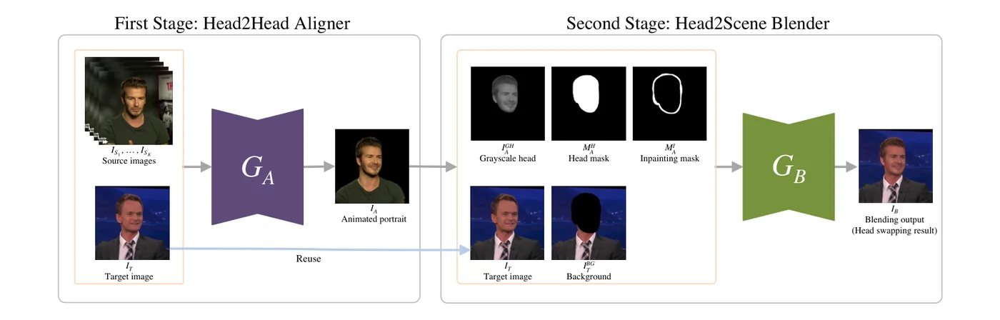
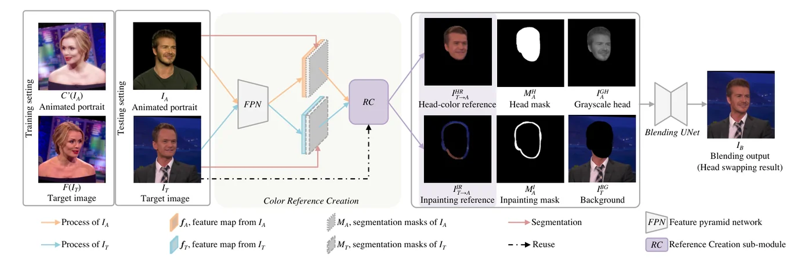
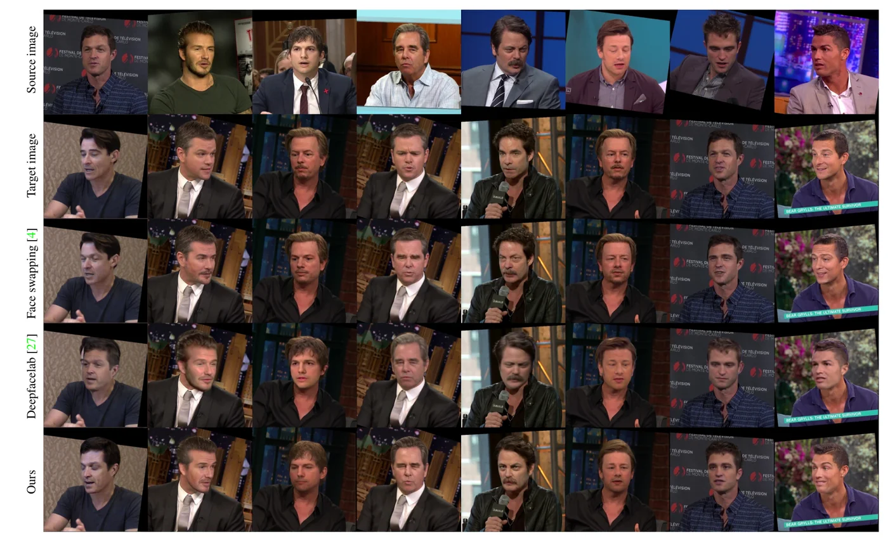

> - **논문**: Few-Shot Head Swapping in the Wild
> - **저자**: Changyong Shu, Hemao Wu, Hang Zhou, Jiaming Liu, Zhibin Hong, Changxing Ding, Junyu Han, Jingtuo Liu, Errui Ding, Jingdong Wang (Baidu VIS, South China University of Technology)
> - **학회**: CVPR 2022 · [arXiv:2204.13100](https://arxiv.org/abs/2204.13100) · [프로젝트 페이지](https://jmliu88.github.io/HeSer)
{: .prompt-tip }

> 사람이 신원을 인식할 때 얼굴 구조만큼 **머리 형태와 머리 모양**도 봅니다. 그런데 얼굴 교체는 머리카락과 머리 윤곽을 목표의 것으로 고정하므로 전체 인상의 유사도에 한계가 있습니다. **헤드 스와핑**은 소스의 머리 전체를 목표의 몸에 올리는 과제이고, [DeepFaceLab]()은 많은 수작업과 대량의 소스 데이터가 필요하고, StylePoseGAN은 목표의 몸 피부색과 배경까지 바꿔 버리며, 둘 다 few-shot·실제 장면을 다루지 못했습니다. **HeSer**가 꼽는 세 난점은 (1) 신원뿐 아니라 머리 구조와 비강체인 머리카락을 모델링해야 하고, (2) 머리 형태·머리 모양이 바뀌면 머리 가장자리와 배경 사이에 **큰 빈틈**이 생기며(얼굴 교체에는 없는 문제), (3) 피부색 차이를 처리해야 한다는 것입니다. 두 모듈이 각각 (1)과 (2)+(3)을 맡습니다.


_Figure 2. 1단계 Head2Head Aligner $$G_A$$가 $$K$$장의 소스와 목표 한 장으로 목표 포즈·표정의 애니메이션 초상 $$I_A$$를 만들고, 2단계 Head2Scene Blender $$G_B$$가 회색조 머리, 머리 마스크, 인페인팅 마스크, 목표 이미지, 배경을 받아 최종 결과 $$I_B$$를 냅니다. (출처: Shu et al., 2022)_

## 1. Head2Head Aligner

소스 $$K$$장($$K$$-shot)과 목표 한 장에서, 목표의 포즈·표정에 정렬된 소스의 **애니메이션 초상** $$I_A$$를 먼저 만듭니다. 네 인코더를 씁니다. 소스에서 **초상 인코더** $$E_{por}$$가 머리·머리카락의 전역 구조를, 사전학습 인식 모델인 **신원 인코더** $$E_{id}$$(ArcFace)가 중앙 크롭의 신원을 뽑아 각각 $$K$$장 평균을 냅니다. 목표에서는 증강 $$A$$를 거친 뒤 **포즈 인코더** $$E_{pose}$$가 신원 무관 포즈를, 중앙 크롭에서 **표정 인코더** $$E_{exp}$$가 세부 표정을 뽑습니다. 네 벡터를 이어 [AdaIN]()으로 스타일 기반 생성기에 주입합니다.

$$
I_A = G(\bar f_{por}, \bar f_{id}, f_{pose}, f_{exp})
$$

학습은 같은 영상에서 $$K+1$$프레임을 뽑아 $$K$$장을 소스, 1장을 목표로 쓰는 자기 재구성이고(LPD와 같은 L1 재구성, VGG-19·ArcFace·판별기 특징의 지각 손실, hinge 적대 손실, 신원 손실), 테스트에서는 다른 사람의 영상입니다. 소스·목표가 같은 사람이므로 분리는 인코더 설계(증강, 중앙 크롭)에 의존합니다. 주체별 미세조정으로 신원·포즈 일관성을 더 올릴 수 있습니다.

## 2. Head2Scene Blender


_Figure 5. 테스트 때는 $$I_A$$와 $$I_T$$의 FPN 특징과 분할 마스크로 RC 서브모듈이 머리 색 참조 $$I^{HR}_{T\to A}$$와 인페인팅 참조 $$I^{IR}_{T\to A}$$를 만들고, Blending UNet이 이를 머리 마스크·회색조 머리·인페인팅 마스크·배경과 함께 받아 $$I_B$$를 생성합니다. 학습 때는 같은 이미지에 색 증강 $$C'$$와 좌우 반전 $$F$$를 가해 씁니다. (출처: Shu et al., 2022)_

$$I_A$$의 머리를 목표의 몸·배경에 이어 붙입니다. 두 문제를 하나의 서브모듈로 풉니다. 머리 형태가 다르므로 원래 머리 영역 중 새 머리가 덮지 않는 **빈틈을 채워야** 하고, 머리 피부색이 목표의 목·몸 피부와 **일치**해야 합니다.

**전처리.** 파싱으로 $$I_A$$와 $$I_T$$의 머리 마스크 $$M^H_A, M^H_T$$를 얻고, 애니메이션 머리를 **회색조** $$I^{GH}_A$$로 바꿉니다(색을 옮기는 대신 회색 머리를 다시 칠하는 문제로 바꾸는 것이 쉽습니다). 목표 머리 마스크를 팽창한 것과의 차이가 목표 인페인팅 마스크, 두 머리 마스크의 합집합을 팽창한 것에서 $$M^H_A$$를 뺀 것이 애니메이션 인페인팅 마스크 $$M^I_A$$, 그 밖이 배경 $$I^{BG}_T$$입니다(목표 이미지에서 팽창한 합집합 마스크 영역을 지운 것).

**의미 유도 색 참조 생성(RC).** 참조는 목표 영역과 공간적으로 맞고 픽셀별 색 안내를 줘야 하므로, FPN 특징의 상관으로 목표 색을 **질의**해 만듭니다. 이전 방법들은 모든 위치 쌍의 상관을 계산해 $$O(wh \cdot wh)$$의 메모리를 썼지만, 라벨이 다른 픽셀은 거의 기여하지 않으므로 **같은 의미 영역 안에서만** 계산합니다. 부록의 누적 attention 시각화에서도 다른 라벨 픽셀의 기여는 거의 0이고, 512×512 학습에서 GPU 메모리를 평균 약 9GB 아낍니다. 영역 $$r \in \{\text{face, hair, eye, nose, lip, tooth, inpainting}\}$$마다 채널 중심화 특징의 코사인 상관 $$\Gamma^r \in \mathbb{R}^{N^r_A \times N^r_T}$$를 구하고 softmax(온도 $$\tau$$)로 목표 픽셀 색을 가중합합니다. 머리 색 참조 $$I^{HR}_{T \to A}$$는 얼굴·머리카락·눈·코·입·치아 영역에서, 인페인팅 참조 $$I^{IR}_{T \to A}$$는 목표 인페인팅 마스크에서 만듭니다. 쌍 데이터가 없으므로 학습은 같은 이미지에 색 증강 $$C'$$와 좌우 반전 $$F$$를 가해 "같은 위치 복사"를 막습니다.

**블렌딩 U-Net.** 두 참조, 머리 마스크, 배경, 인페인팅 마스크, 회색 머리를 채널로 이어 넣어 최종 $$I_B$$를 냅니다. 재구성·지각·적대 손실에, 참조가 의미 있는 대응을 배우도록 **순환 손실**(목표 → 애니메이션 → 목표로 되돌린 색 참조가 목표와 같아야 함)과 다른 이미지 $$I'_T$$를 쓴 변형을 더합니다. RC 서브모듈과 U-Net은 함께 학습하고, 판별기에는 머리 마스크와 인페인팅 마스크를 조건으로 이어 붙입니다.

### 구현 디테일 (부록 C)

| 항목 | 값 |
|---|---|
| 데이터 | VoxCeleb2 URL로 1080p 영상을 다시 받아 랜드마크 정렬 후 512×512(기존보다 넓은 크롭), 학습 28,367개 영상·5,478명(LPD 학습셋 145,569개 영상·5,994명보다 적음), 테스트 805개 영상·86명 |
| Aligner 인코더 | 초상 ResNeXt-50, 포즈·표정 MobileNetV2, 신원 ArcFace(고정) |
| 임베딩 크기 | 초상 512, 신원 512, 포즈 256, 표정 256 |
| Aligner 생성기 | LPD의 생성기 + 512×512용 업샘플 잔차 블록, AdaIN 파라미터는 2층 MLP(중간 768, spectral norm) |
| Aligner 학습 | batch 6, V100 32GB 6장, 약 3주 |
| Blender | 특징 추출 VGG-19, Blending UNet은 7층 잔차 U-Net, 512×512, RTX8000 48GB 2장으로 5일 |
| Optimizer | Adam($$\beta_1 = 0.9$$, $$\beta_2 = 0.999$$), lr 생성기 1e-4 / 판별기 4e-4, 모든 연산에 spectral norm |
| 표준 few-shot 설정 | 32장 입력 + 주체별 미세조정 600 iteration |

## 3. 코드로 보기: 영역별 대응의 비용과 정확도

64×64 합성 파싱 맵(피부·머리카락·눈·입술·인페인팅 영역)에서 전체 상관 행렬과 영역별 상관 행렬의 원소 수를 세고, 영역 고유 서명 + 잡음의 특징에서 전역 최근접 매칭이 다른 의미 영역으로 새는 비율을 재며, 회색 머리를 참조 톤으로 다시 칠했을 때 평균과 질감 표준편차를 봅니다.

```python
import numpy as np
rng = np.random.default_rng(0)
# semantic-guided colour reference: correlate features only within the same semantic region, not across the whole image
H = W = 64; regions = {"skin": 0, "hair": 1, "eyes": 2, "lips": 3, "inpaint": 4}
yy, xx = np.mgrid[0:H, 0:W]
seg = np.zeros((H, W), int); seg[(xx - 32) ** 2 / 300 + (yy - 36) ** 2 / 500 < 1] = 0; seg[yy < 14] = 1
seg[((xx - 22) ** 2 + (yy - 30) ** 2 < 9) | ((xx - 42) ** 2 + (yy - 30) ** 2 < 9)] = 2; seg[(xx - 32) ** 2 / 40 + (yy - 48) ** 2 / 6 < 1] = 3
seg[((xx - 32) ** 2 / 400 + (yy - 36) ** 2 / 650 < 1) & ~((xx - 32) ** 2 / 300 + (yy - 36) ** 2 / 500 < 1) & (yy >= 14)] = 4
counts = {k: int((seg == v).sum()) for k, v in regions.items()}
print("pixels per semantic region:", counts)
full = (H * W) ** 2; per_region = sum(c * c for c in counts.values())
print(f"correlation matrix entries: whole image {full:,}  vs  per-region {per_region:,}  ({full / per_region:.1f}x fewer)")
# features: a region-specific signature + noise; a pixel's best match is the most similar pixel in the OTHER image
C = 16; proto = rng.standard_normal((5, C))
def feats(seg): return proto[seg] + 0.8 * rng.standard_normal((H, W, C))
fA, fT = feats(seg), feats(np.roll(seg, 3, 1))                                            # the target is slightly shifted
segT = np.roll(seg, 3, 1)
A, T = fA.reshape(-1, C), fT.reshape(-1, C); A = A - A.mean(1, keepdims=True); T = T - T.mean(1, keepdims=True)
A /= np.linalg.norm(A, axis=1, keepdims=True); T /= np.linalg.norm(T, axis=1, keepdims=True)
sample = rng.choice(H * W, 600, replace=False)
corr = A[sample] @ T.T
best_global = corr.argmax(1); wrong_global = np.mean(segT.reshape(-1)[best_global] != seg.reshape(-1)[sample])
wrong_region = 0.0
for k, v in regions.items():
    idx = np.where(segT.reshape(-1) == v)[0]; mine = sample[seg.reshape(-1)[sample] == v]
    if len(idx) and len(mine): wrong_region += 0.0                                        # by construction every match stays in its region
print(f"\nbest-match pixel lands in a different semantic region: global correlation {wrong_global * 100:.1f}%  vs  semantic-guided {wrong_region * 100:.1f}%")
print("-> restricting the correspondence to the same label (skin->skin, hair->hair) is both cheaper and avoids colouring skin from hair pixels")
# re-colouring a grey head: the reference gives per-pixel colour, the head keeps its own luminance pattern
grey = 0.5 + 0.2 * np.sin(xx / 3.0) * (seg == 0); ref_tone = np.where(seg == 0, 0.35, 0.0)           # darker target skin
recol = np.where(seg == 0, grey - grey[seg == 0].mean() + ref_tone, grey)
print(f"skin mean after re-colouring {recol[seg == 0].mean():.2f} (target {0.35}), skin texture std kept {recol[seg == 0].std():.3f} (source {grey[seg == 0].std():.3f})")
```

```text
pixels per semantic region: {'skin': 2768, 'hair': 896, 'eyes': 50, 'lips': 49, 'inpaint': 333}
correlation matrix entries: whole image 16,777,216  vs  per-region 8,580,430  (2.0x fewer)

best-match pixel lands in a different semantic region: global correlation 0.8%  vs  semantic-guided 0.0%
-> restricting the correspondence to the same label (skin->skin, hair->hair) is both cheaper and avoids colouring skin from hair pixels
skin mean after re-colouring 0.35 (target 0.35), skin texture std kept 0.140 (source 0.140)
```

- 이 toy에서 영역별 상관은 전체의 2배만 절약합니다. 피부 영역이 전체의 68%를 차지해 $$N^2$$의 대부분을 혼자 내기 때문입니다. 논문의 $$O(wh \cdot wh) \to O(N^r_A \cdot N^r_T)$$ 절감은 영역이 고르게 나뉠수록 크고, 논문은 512×512 학습에서 평균 약 9GB의 GPU 메모리를 아꼈다고 보고합니다.
- 정확도 쪽이 더 중요합니다. 전역 매칭은 0.8%의 픽셀을 다른 의미 영역에서 가져오고(잡음이 큰 눈·입술 같은 작은 영역이 피부로 새는 식), 영역별 매칭은 정의상 0%입니다. 피부를 머리카락 색으로 칠하는 오류가 구조적으로 불가능해집니다.
- 회색 머리의 평균을 참조 톤 0.35로 옮기면 질감 표준편차 0.140이 그대로 유지됩니다. 색은 목표에서, 음영 구조는 소스에서 온다는 분해입니다.

## 4. 실험

### 헤드 스와핑: 사용자 연구 (Table 1)

VoxCeleb2 테스트셋에서 소스 25그룹 × 목표 10장 = 250개 결과를 방법마다 만들고, 20명(일반 15, 전문가 5)이 항목마다 무작위 25개 결과를 보고 신원 보존, 표정·포즈 일치, 피부색 일관성, 인페인팅 매끄러움, 전체 품질을 순위 매겨 0~5점으로 환산합니다. 비교 대상은 얼굴 교체 [SimSwap]()(32장 중 한 장이 소스)과 DeepFaceLab(같은 32프레임)입니다.

| 방법 | 신원 ↑ | 표정 ↑ | 피부색 ↑ | 인페인팅 ↑ | 전체 ↑ |
|---|---|---|---|---|---|
| 얼굴 교체(SimSwap) | 1.22 | **3.02** | **3.36** | - | 1.42 |
| DeepFaceLab | 2.16 | 1.47 | 1.53 | 0.05 | 2.26 |
| HeSer | **4.12** | 3.01 | 2.61 | **4.95** | **3.82** |


_Figure 7. 위에서부터 소스, 목표, 얼굴 교체(SimSwap), DeepFaceLab, HeSer. 얼굴 교체는 머리 모양과 윤곽이 목표 그대로이고, HeSer는 소스의 머리 모양까지 옮깁니다. (출처: Shu et al., 2022)_

HeSer가 신원(4.12), 인페인팅(4.95), 전체 품질(3.82)에서 큰 차이로 1위입니다. 표정은 얼굴 교체와 사실상 같고(3.02 대 3.01) 피부색은 얼굴 교체가 앞서는데(3.36 대 2.61), 신원을 목표 이미지에 직접 주입하는 방식이라 얼굴 구조와 피부색을 자연스럽게 유지하기 때문입니다. 얼굴 교체는 수염이 조금 옮겨지지만 머리 형태·머리 모양이 그대로라 인상의 유사도가 낮고, DeepFaceLab은 비슷한 포즈의 소스가 없으면 애니메이션이 나쁘며 빈 픽셀을 채우지 못하고(인페인팅 0.05) 색 정렬도 열세입니다.

### Head2Head Aligner: 재연기 정량 비교 (Table 2)

Aligner만 떼어 재연기(reenactment) 방법들과 비교합니다. $$E_{ID}$$는 얼굴 임베딩 코사인 기반 신원 오차, $$E_P$$는 포즈 재구성 오차입니다. FOMM과 Siarohin et al.은 few-shot·미세조정을 지원하지 않아 one-shot 설정에서만 비교하고, 32-shot + 미세조정 설정은 LPD와만 비교합니다.

| 방법 | $$E_{ID}$$ ↓ | $$E_P$$ ↓ | SSIM ↑ | LPIPS ↓ | PSNR ↑ |
|---|---|---|---|---|---|
| FOMM (one-shot) | **0.49** | 0.275 | 0.76 | **0.18** | 30.92 |
| LPD (one-shot) | 0.71 | 0.063 | 0.52 | 0.50 | 28.84 |
| Siarohin et al. (one-shot) | 0.71 | 0.137 | 0.73 | 0.20 | 30.01 |
| HeSer Aligner (one-shot) | 0.53 | **0.026** | **0.77** | 0.19 | **31.33** |
| LPD (32-shot + 미세조정) | 0.23 | **0.024** | 0.62 | 0.36 | 29.46 |
| HeSer Aligner (32-shot + 미세조정) | **0.22** | **0.024** | **0.89** | **0.12** | **33.26** |

One-shot에서는 신원 오차와 LPIPS만 FOMM이 조금 낫고 나머지는 HeSer가 앞섭니다. 32-shot + 미세조정에서는 신원·포즈 오차가 LPD와 거의 같아지지만 SSIM·LPIPS·PSNR은 크게 앞서며, 저자들은 LPD 학습 데이터의 약 1/5만 썼다는 점과 표정 재현이 더 낫다는 점(논문 Figure 8)을 강조합니다.

## 5. 해석

**1. 과제 정의가 기여입니다.** "머리 형태와 머리카락도 신원"이라는 전제에서 얼굴 교체와 헤드 스와핑의 차이를 세 난점으로 명확히 했고, 특히 **배경 빈틈**은 얼굴 형태를 소스에 맞추려는 [HifiFace]()·[FaceInpainter]()가 작은 규모로 마주친 문제의 극단입니다. 인페인팅을 피할 수 없다는 점에서 교체는 결국 장면 합성 문제가 됩니다.

**2. "의미끼리만 대응"은 재사용 가능한 설계입니다.** 전역 상관 대신 라벨별 상관은 비용과 오류를 함께 줄이며, [AOT]()가 위치·법선을 수송 벡터에 붙인 것, [RAFSwap]()의 영역 토큰, [E4S]()의 영역별 스타일 코드와 같은 방향입니다. 위 toy의 0.8% → 0%가 그 효과의 작은 예입니다.

**3. 회색조로 바꾼 뒤 다시 칠하는 분해가 영리합니다.** 색 전이를 "소스 색을 목표 색으로 매핑"이 아니라 "소스의 음영에 목표의 색을 입히기"로 바꾸면 메이크업 전이의 기법을 빌릴 수 있고, 배경 색이 바뀌는 PSGAN류의 문제를 피합니다.

**4. 한계는 few-shot 정렬기의 분리와 평가입니다.** 같은 영상의 프레임으로만 학습하므로 소스·목표가 다른 사람일 때 신원·포즈 분리는 증강에 기댑니다. 헤드 스와핑 전체에 대한 평가는 사용자 연구뿐이고(정량 지표는 Aligner 단독의 재연기 비교에만 있음), 비교 대상 둘 중 하나(얼굴 교체)는 과제가 다릅니다. 저자들이 부록에서 밝힌 한계도 있습니다. 감정·포즈가 맞는 머리를 얻으려면 여전히 주체별 미세조정이 필요하고, 목표 영상의 모든 프레임에 분할 마스크가 필요해 시간적 일관성과 계산량 문제가 있으며, 머리카락 끝 분할이 부정확해 긴 머리에 약합니다.

**5. 평가를 읽을 때 주의할 점.** 사용자 20명, 각 25개 결과의 순위 기반 점수라 통계적 힘이 약하고, 표정·피부색에서 얼굴 교체에 진다는 점은 저자들도 인정합니다. 위 toy는 특징이 영역 서명 + 잡음인 합성이라 실제 FPN 특징의 의미 혼동 정도를 보여 주지 않습니다.

## 6. 정리

| 항목 | 내용 |
|---|---|
| 과제 | few-shot 헤드 스와핑: 머리 형태·머리카락 포함 머리 전체를 목표 몸에, 실제 장면 |
| 난점 | 머리 구조·비강체 머리카락 모델링, 머리 가장자리-배경 빈틈, 피부색 차이 |
| Head2Head Aligner | 초상·신원(소스 K장 평균) + 포즈·표정(목표) → AdaIN 스타일 생성기, 자기 재구성 학습 |
| Head2Scene Blender | 회색 머리 + 의미 영역별 상관으로 만든 머리 색·인페인팅 참조 + 블렌딩 U-Net, 순환 손실 |
| 결과 | 사용자 연구 신원 4.12·인페인팅 4.95·전체 3.82로 1위, 표정(3.01 대 3.02)·피부색(2.61 대 3.36)은 얼굴 교체 우세; Aligner 32-shot+미세조정 PSNR 33.26(LPD 29.46) |
| 한계 | 같은 영상 기반 학습의 분리, 헤드 스와핑 전체는 사용자 연구로만 평가, 프레임별 분할 필요, 긴 머리에 약함 |

## References

- Shu et al., "Few-Shot Head Swapping in the Wild," CVPR 2022. [arXiv:2204.13100](https://arxiv.org/abs/2204.13100)
- Chen, Chen, Ni, Ge, "SimSwap: An Efficient Framework for High Fidelity Face Swapping," ACM MM 2020.
- Burkov, Pasechnik, Grigorev, Lempitsky, "Neural Head Reenactment with Latent Pose Descriptors" (LPD), CVPR 2020. [arXiv:2004.12000](https://arxiv.org/abs/2004.12000)
- Zhang et al., "Deep Exemplar-based Video Colorization," CVPR 2019. [arXiv:1906.09909](https://arxiv.org/abs/1906.09909)
- Jiang et al., "PSGAN: Pose and Expression Robust Spatial-Aware GAN for Customizable Makeup Transfer," CVPR 2020. [arXiv:1909.06956](https://arxiv.org/abs/1909.06956)
- Sarkar et al., "Style and Pose Control for Image Synthesis of Humans from a Single Monocular View" (StylePoseGAN), 2021. [arXiv:2102.11263](https://arxiv.org/abs/2102.11263)
- Chung, Nagrani, Zisserman, "VoxCeleb2: Deep Speaker Recognition," Interspeech 2018. [arXiv:1806.05622](https://arxiv.org/abs/1806.05622)
