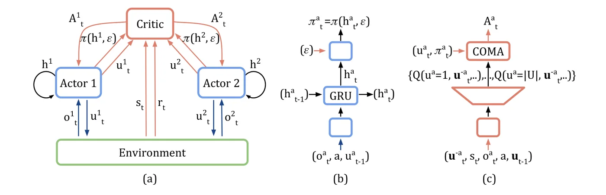
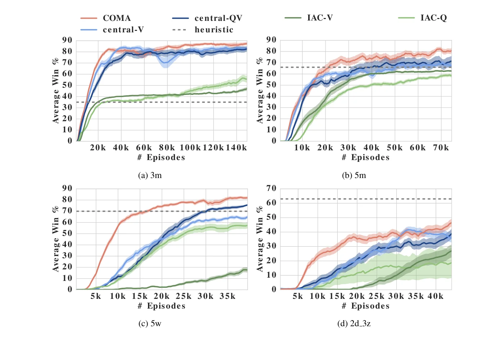

> - **논문**: Counterfactual Multi-Agent Policy Gradients
> - **저자**: Jakob N. Foerster, Gregory Farquhar, Triantafyllos Afouras, Nantas Nardelli, Shimon Whiteson (University of Oxford)
> - **학회**: AAAI 2018 · [arXiv:1705.08926](https://arxiv.org/abs/1705.08926)
{: .prompt-tip }

> [QMIX]()가 Q-Learning 기반으로 멀티에이전트 협력을 다뤘다면, **COMA**는 **Actor-Critic** 기반이다. 팀 전체가 하나의 보상을 받을 때 "그 보상에 내가 얼마나 기여했는가"를, 내 행동만 바꿔 보는 **반사실적(counterfactual)** 비교로 계산한다.

## 1. 멀티에이전트 환경의 특징

- **부분 관측**: 각 에이전트는 전체가 아니라 자기 주변만 봄
- **관측 공유 없음**: 에이전트끼리 관측을 공유하지 않음
- **팀 보상**: 보상은 개인이 아니라 **팀 단위**로 하나만 주어짐
- **Joint action**: 에이전트가 $$n$$명이고 각자 행동이 $$\lvert U\rvert$$개면 조합은 $$\lvert U\rvert^n$$개. 예: 상·하·좌·우 4개 행동, 에이전트 5명이면 1,024개

### Credit Assignment 문제

팀이 승리해 보상을 받았을 때, 공격한 에이전트와 가만히 있던 에이전트가 **같은 보상**을 받는다. 그러면 각자는 자기 행동이 좋았는지 나빴는지 알 수 없다. 특히 자신을 희생해 팀을 돕는 행동의 가치를 계산하기 어렵다.

## 2. 이전 방법

### IQL (Independent Q-Learning)

각 에이전트가 자기 부분 관측으로 독립적으로 Q-learning을 한다. 에이전트 수가 많거나, 역할이 복잡하거나, 에이전트끼리 역할이 다를 때 **충돌**이 생긴다. 다른 에이전트도 같이 학습하며 변하므로 환경이 non-stationary해진다.

### IAC (Independent Actor-Critic)

각 에이전트가 독립적인 actor-critic을 가진다. **파라미터를 공유**하면 학습 속도가 빨라지지만, critic이 **자기 행동만** 보고 joint action을 보지 않아 에이전트 간 정보 공유가 어렵다.

## 3. Actor-Critic 복습

- **Critic만 쓰는 방식(critic-only)**: Q-learning처럼 가치 함수를 최적화하고, 정책(ε-greedy 등)은 critic에서 바로 유도
- **Actor만 쓰는 방식(actor-only)**: Policy gradient처럼 가치 함수 없이 정책 확률을 직접 학습. 가치는 Monte Carlo로 추정
- **Actor-Critic**: 둘을 동시에 학습
  - **Actor**: 정책 $$\pi(u \mid \tau)$$ — 상태에서 행동을 결정
  - **Critic**: 가치 함수 — 상태(와 행동)에서 보상을 추정

## 4. COMA의 세 가지 아이디어

1. **Centralised Critic, Decentralised Actors**
2. **Counterfactual Baseline**
3. Counterfactual baseline을 **한 번의 forward pass**로 효율적으로 계산하는 critic 구조

### (1) Centralised Critic & Decentralised Policy

- **Actor(정책)**: 각 에이전트는 자기 관측 이력 $$\tau^a$$만 보고 행동 $$\pi^a(u^a \mid \tau^a)$$. 실행할 때 필요한 것은 이것뿐
- **Critic**: 학습할 때만 쓰므로, **전역 상태 $$s$$와 모든 에이전트의 joint action $$\mathbf{u}$$**를 볼 수 있음

$$
Q(s, \mathbf{u})
$$

[QMIX]()와 같은 **CTDE**(Centralised Training, Decentralised Execution) 틀이다.


_Figure 1. (a) 분산 actor, 환경, centralised critic 사이의 정보 흐름. 빨간 부분은 학습 때만 필요하다. (b) actor: 자기 관측·에이전트 id·직전 행동을 GRU로 처리해 정책을 낸다. (c) critic: 다른 에이전트의 행동 $$\mathbf{u}^{-a}$$, 상태, 관측 등을 받아 에이전트 $$a$$의 모든 행동에 대한 Q를 한 번에 내고, 이를 정책과 함께 COMA advantage로 바꾼다. (출처: Foerster et al., 2018)_

### (2) Counterfactual Baseline

#### 단순한 방법의 문제

Centralised critic의 TD error로 각 actor를 업데이트하면 모든 에이전트가 **같은 학습 신호**를 받아, credit assignment가 해결되지 않는다.

#### Difference Reward

"내가 기본 행동(default action) $$c^a$$를 했다면 팀 보상이 얼마였을까?"와 비교하는 아이디어이다.

$$
D^a = r(s, \mathbf{u}) - r\big(s, (\mathbf{u}^{-a}, c^a)\big)
$$

($$\mathbf{u}^{-a}$$: 에이전트 $$a$$를 제외한 나머지의 행동)

하지만 두 가지 문제가 있다.

- **기본 행동을 무엇으로 정할지** 사람이 정해야 함
- 반사실적 보상을 구하려면 **추가 시뮬레이션**이 필요함

#### COMA의 해결

Critic $$Q(s, \mathbf{u})$$를 학습해 두면, 시뮬레이션 없이 **critic으로** 반사실적 가치를 계산할 수 있다. 그리고 기본 행동 하나 대신 **내 정책의 모든 행동에 대한 기댓값**을 baseline으로 쓴다.

$$
A^a(s, \mathbf{u}) = Q(s, \mathbf{u}) - \sum_{u'^a}\pi^a(u'^a \mid \tau^a)\,Q\big(s, (\mathbf{u}^{-a}, u'^a)\big)
$$

- 앞 항: **실제로 한 행동**의 가치
- 뒤 항: 다른 에이전트의 행동은 **그대로 두고**, 나만 행동을 바꿨을 때의 **평균 가치**

이 차이가 "다른 에이전트가 한 일과 별개로 **내 행동이 팀에 더한 가치**"이다. 각 에이전트는 이 advantage로 정책을 업데이트한다.

$$
g = \mathbb{E}_\pi\Big[\sum_a\nabla_\theta\log\pi^a(u^a \mid \tau^a)\,A^a(s, \mathbf{u})\Big]
$$

Baseline이 자기 행동에 의존하지 않으므로, 기울기의 **기댓값은 바뀌지 않고 분산만 줄어든다.** 논문은 이를 근거로, 호환 가능한 TD(1) critic을 쓰는 단일 에이전트 actor-critic의 수렴 조건 아래에서 COMA도 국소 최적 정책으로 수렴한다는 보조정리를 증명한다.

### (3) 한 번의 Forward Pass로 계산

Baseline을 구하려면 에이전트 $$a$$의 모든 행동 $$u'^a$$에 대해 Q를 계산해야 한다. Joint action 전체를 입력으로 받으면 $$\lvert U\rvert$$번 forward해야 하니, critic 구조를 바꾼다.

- **입력**: 전역 상태, 에이전트 $$a$$의 관측, **다른 에이전트들의 행동** $$\mathbf{u}^{-a}$$, 에이전트 id, 직전 시점의 joint action
- **출력**: 에이전트 $$a$$의 **각 행동에 대한 Q 값** $$\lvert U\rvert$$개

그러면 한 번의 forward로 $$Q(s, (\mathbf{u}^{-a}, u'^a))$$를 모든 $$u'^a$$에 대해 얻는다. 출력 노드도 joint action 전체인 $$\lvert U\rvert^n$$개가 아니라 $$\lvert U\rvert$$개로 줄어든다.

```python
import torch

def coma_advantage(critic, policy_probs, state, obs_a, u_minus_a, agent_id, u_a):
    """critic: (state, obs_a, u_minus_a, agent_id) -> (B, |U|) 각 행동의 Q
    policy_probs: (B, |U|) = π^a(·|τ^a)"""
    q_all = critic(state, obs_a, u_minus_a, agent_id)              # 한 번의 forward
    q_taken = q_all.gather(1, u_a.unsqueeze(1)).squeeze(1)         # Q(s, u)
    baseline = (policy_probs * q_all).sum(1)                       # Σ π(u'^a) Q(s, (u^{-a}, u'^a))
    return (q_taken - baseline).detach()

# actor loss (에이전트마다, 파라미터 공유):
# loss = -(log_prob(u_a) * coma_advantage(...)).mean()

# 숫자로 확인: 다른 에이전트 행동이 고정됐을 때 내 행동 3개의 Q가 [2, 5, 1]이고
# 내 정책이 [0.2, 0.5, 0.3]이라면 baseline = 0.2*2 + 0.5*5 + 0.3*1 = 3.2
q_table = torch.tensor([[2.0, 5.0, 1.0]])
critic = lambda *args: q_table                                   # 위 Q를 내놓는 가짜 critic
probs = torch.tensor([[0.2, 0.5, 0.3]])
for a in range(3):
    print(a, round(coma_advantage(critic, probs, None, None, None, None, torch.tensor([a])).item(), 2))
# 0 -1.2 / 1 1.8 / 2 -2.2
```

팀 보상이 같더라도, 실제로 고른 행동이 "내 평소 정책의 평균(3.2)"보다 좋았는지에 따라 에이전트마다 다른 학습 신호를 받는다. 1번 행동을 고른 에이전트는 +1.8로 강화되고, 2번을 고른 에이전트는 −2.2로 약화된다.

## 5. 실험 설정: StarCraft Micromanagement

- 맵: 3m(마린 3 vs 3), 5m(마린 5 vs 5), 5w(레이스 5 vs 5), 2d_3z(드라군 2 + 질럿 3). 상대는 StarCraft 내장 AI
- 행동: **이동(방향 지정), 공격(적 id 지정), 정지, no-op**
- **부분 관측**: 시야를 원거리 유닛의 사거리로 제한한다. 그래서 사거리 안에 있어야만 공격할 수 있고(내장 attack-move 매크로를 쓸 수 없음), 죽은 적과 시야 밖 적을 구분하지 못해 무효한 공격 명령을 내릴 수 있다. 같은 휴리스틱(앞으로 달려가 한 명씩 집중 사격)이 전체 시야 5m에서는 98% 이기지만 이 설정에서는 66%에 그친다.
- **팀 보상**: 매 step 모든 에이전트가 같은 보상을 받는다. 적에게 준 피해 − 받은 피해의 절반, 적 처치 시 +10, 승리 시 남은 체력 합 + 200
- **관측·상태 특징**: actor는 시야 안 유닛의 거리·상대 x·y·유닛 종류·실드, critic은 맵 전체 유닛의 특징(맵 중심 기준 좌표)에 체력·쿨다운을 더하고, 평가 대상 에이전트의 관측을 이어 붙인다.

비교 대상(ablation)은 세 가지 질문에 맞춰 골랐다.

| 방법 | critic | advantage | 확인하려는 것 |
|---|---|---|---|
| IAC-V / IAC-Q | 분산(actor와 같은 입력, 마지막 층 전까지 파라미터 공유) | TD error / Q | critic 중앙화의 효과 |
| central-V | 중앙 $$V(s)$$ | TD error | Q 대신 V를 배우면? |
| central-QV | 중앙 $$Q$$와 $$V$$ | $$Q - V$$ | counterfactual baseline 대신 $$V$$를 쓰면? |
| COMA | 중앙 $$Q$$ | counterfactual baseline | |

### 구현 디테일

| 항목 | 값 |
|---|---|
| Actor | 128차원 GRU, 입·출력은 완전연결층, 에이전트 간 파라미터 공유 |
| 행동 분포 | $$P(u) = (1-\epsilon)\,\text{softmax}(z)_u + \epsilon/\lvert U\rvert$$, $$\epsilon$$을 750 episode 동안 0.5 → 0.02로 선형 감소 |
| Critic | ReLU 피드포워드 네트워크, TD($$\lambda$$) 학습, $$\lambda = 0.8$$(가장 민감한 하이퍼파라미터) |
| Target network | 중앙 critic은 150 step마다, IAC critic은 50 step마다 갱신 |
| Optimizer | RMSProp, lr 0.0005, alpha 0.99, weight decay 없음 |
| Batch | 30 episode 단위로 수집 → critic 학습 → actor 학습(이 한 사이클이 그래프의 1 episode) |
| 그 외 | $$\gamma = 0.99$$, frame skip 7, 하이퍼파라미터는 5m에서 대략 맞춘 뒤 모든 맵에 사용, TorchCraft + Torch7 |

## 6. 실험 결과


_Figure 3. 네 맵에서 학습 episode에 따른 평균 승률(35회 독립 시행 평균 ± 1 표준편차). 빨간색이 COMA, 파란 계열이 중앙 critic 변형, 초록 계열이 IAC, 점선이 휴리스틱이다. (출처: Foerster et al., 2018)_

**Table 1.** 마지막 1,000번 평가 episode의 평균 승률(%)이고 괄호는 95% 신뢰구간이다. 오른쪽 세 열은 비교용으로, **전체 시야와 중앙 제어, attack-move 매크로**를 쓴 설정의 휴리스틱과 기존 발표 결과(Usunier et al., 2016)이다.

| 맵 | 휴리스틱 | IAC-V | IAC-Q | central-V | central-QV | COMA 평균 | COMA 최고 | (전체 시야) 휴리스틱 | DQN | GMEZO |
|---|---|---|---|---|---|---|---|---|---|---|
| 3m | 35 | 47 (3) | 56 (6) | 83 (3) | 83 (5) | **87 (3)** | 98 | 74 | - | - |
| 5m | 66 | 63 (2) | 58 (3) | 67 (5) | 71 (9) | **81 (5)** | 95 | 98 | 99 | 100 |
| 5w | 70 | 18 (5) | 57 (5) | 65 (3) | 76 (1) | **82 (3)** | 98 | 82 | 70 | 74 |
| 2d_3z | **63** | 27 (9) | 19 (21) | 36 (6) | 39 (5) | 47 (5) | 65 | 68 | 61 | 90 |

(5w의 DQN·GMEZO는 더 큰 맵에서 학습해 5w에서 시험한 수치이다.)

- **학습 방법 중에서는** COMA가 네 맵 모두 평균 승률이 가장 높다. 다만 가장 어려운 2d_3z에서는 손으로 짠 휴리스틱(63%)이 COMA(47%)보다 높다.
- **Counterfactual baseline의 효과**: COMA는 central-QV(같은 중앙 Q critic에 baseline만 $$V$$)를 모든 맵에서 학습 속도와 최종 성능 모두 앞선다(3m 87 대 83, 5m 81 대 71, 5w 82 대 76, 2d_3z 47 대 39). Credit assignment가 실제로 중요하다는 증거이다.
- **중앙 critic의 효과**: 중앙 critic 변형이 IAC보다 확실히 좋다. 5w에서 IAC-V는 18%에 그친다. IAC는 actor와 앞단 층을 공유해 학습이 빠를 것 같지만, 전역 상태로 정책 평가가 정확해지는 이득이 더 크다.
- **central-V와 비교**: 최종 성능은 COMA가 더 좋고 보통 더 빨리 좋은 정책에 도달하며, 정책이 greedy해질수록 COMA 기울기가 0으로 가서 학습도 더 안정적이다.
- **최고 성능 비교**: COMA의 최고 에이전트(98, 95, 98, 65)는 분산 정책·제한 시야라는 불리한 조건에서도 전체 시야 중앙 제어기의 발표 결과와 대체로 비슷하다. 2d_3z에서는 GMEZO(90)에 크게 못 미친다.

저자들은 확장성의 병목이 critic의 중앙화보다 **멀티에이전트 탐색의 어려움**이었다고 적고, 에이전트 단위로 분해한 critic은 향후 과제로 남긴다.

## 7. 정리

| 구성 | 역할 |
|---|---|
| Decentralised actor | 각자 자기 관측으로만 행동 (실행 시) |
| Centralised critic | 전역 상태 + joint action으로 $$Q(s, \mathbf{u})$$ (학습 시) |
| Counterfactual baseline | 나만 행동을 바꿨을 때의 평균 Q → **나의 기여도** |
| Critic 구조 | 다른 에이전트 행동을 입력, 내 모든 행동의 Q를 한 번에 출력 |
| 결과 | StarCraft 제한 시야 4개 맵에서 학습 방법 중 최고(3m 87%, 5m 81%, 5w 82%, 2d_3z 47%), central-QV 대비 모든 맵에서 우세 |

COMA는 이후 QMIX 같은 가치 분해 방법과 함께 MARL의 대표 baseline이 됐다.

> 다만 이후 표준 벤치마크가 된 SMAC(StarCraft II)에서는 COMA가 QMIX 같은 가치 분해 방법보다 성능이 낮게 나왔다(Samvelyan et al., 2019). on-policy actor-critic이라 샘플 효율이 낮고, joint action을 입력으로 받는 critic을 정확히 학습하기 어렵기 때문으로 해석된다. 반면 "반사실적 baseline으로 기여도를 나눈다"는 아이디어 자체는 이후 여러 MARL 연구에서 계속 쓰인다.
{: .prompt-info }

다음 글에서는 협력하는 다중 로봇의 **경로 찾기**를 강화학습과 모방학습으로 푼 [PRIMAL]()을 다룬다.

## References

- Foerster et al., "Counterfactual Multi-Agent Policy Gradients," AAAI 2018. [arXiv:1705.08926](https://arxiv.org/abs/1705.08926)
- Samvelyan et al., "The StarCraft Multi-Agent Challenge," AAMAS 2019. [arXiv:1902.04043](https://arxiv.org/abs/1902.04043)
- Wolpert & Tumer, "Optimal Payoff Functions for Members of Collectives (difference rewards)," 2001.
- Rashid et al., "QMIX," ICML 2018.
- Usunier et al., "Episodic Exploration for Deep Deterministic Policies: An Application to StarCraft Micromanagement Tasks," 2016. [arXiv:1609.02993](https://arxiv.org/abs/1609.02993)
- <https://github.com/jk96491/SMAC>
