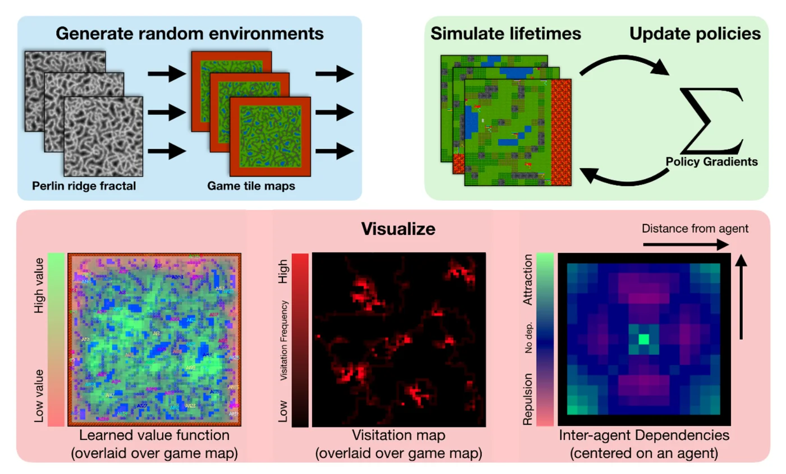
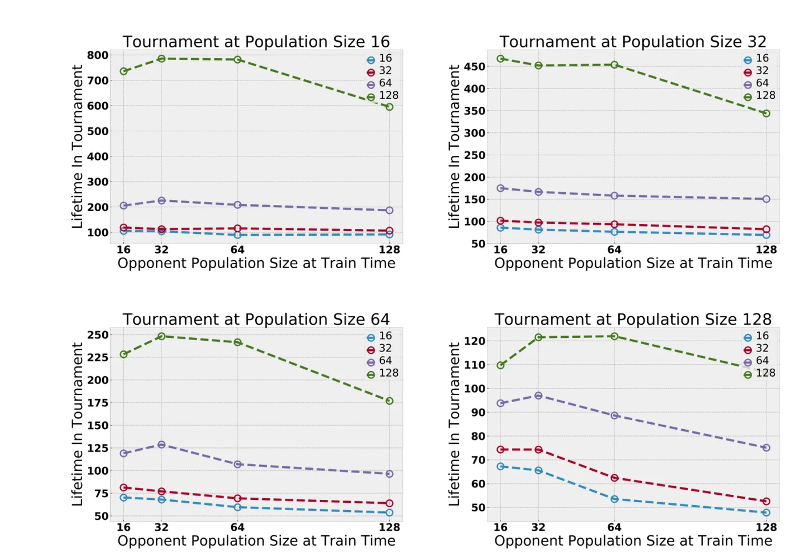
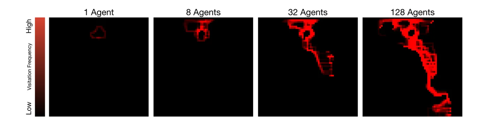
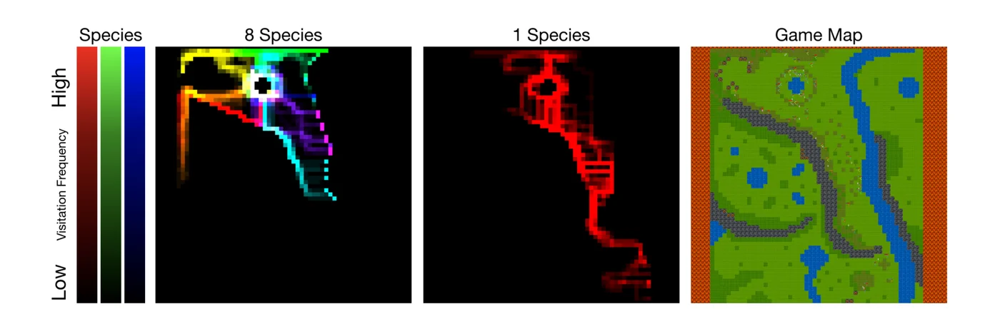

> - **논문**: Neural MMO: A Massively Multiagent Game Environment for Training and Evaluating Intelligent Agents
> - **저자**: Joseph Suarez, Yilun Du, Phillip Isola, Igor Mordatch (OpenAI 인턴십으로 수행)
> - **발표**: arXiv 2019 (프리프린트) · [arXiv:1903.00784](https://arxiv.org/abs/1903.00784)
{: .prompt-tip }

> 게임을 벤치마크로 삼은 강화학습은 Go, DOTA 2, Quake 3 CTF까지 왔지만, 이 게임들은 참가자가 2~12명이고 한 판이 한 시간 정도인 에피소드형이라 지속성이 없다. 지구의 생명은 그렇지 않다. 끝나지 않는 환경에서 무한히 많은 참가자가 유한한 자원을 두고 경쟁하며 새 능력이 계속 등장한다. **Neural MMO**는 이 설정을 축소해 담은 플랫폼이다. 장르 이름 그대로 MMORPG를 본떠 절차적으로 생성되는 타일 지도 위에서 많고 가변적인 수의 에이전트가 채집하고 싸우며 살아남아야 한다. 기본 실험의 결론은 두 가지이다. **개체 수가 많을수록 탐험이 넓어지고, 가중치를 공유하지 않는 종이 많을수록 서로 다른 영역으로 갈라진다.**

## 1. 문제: 기존 벤치마크에는 없는 세 가지

- **지속성**: 에피소드가 끝나지 않고 환경이 계속 유지된다.
- **가변적이고 큰 규모**: 참가자 수가 고정되지 않고 수백 명까지 늘어난다.
- **열린 결말**: 명시적 목표 대신 생존이라는 압력만 있어, 어떤 행동이 "좋은지"가 다른 에이전트에 의해 결정된다.

인공 생명 연구가 오래 다룬 주제이지만, 심층 RL과 결합한 환경은 2~10명의 복잡한 과제(OpenAI Five 등)나 수십 명에서 백만 명 이상까지의 단순 과제(MAgent 등)로 나뉘어 있었다. Neural MMO는 큰 개체 수와 복잡한 환경을 함께 가지려 한다.

## 2. 환경


_Figure 1. Perlin 릿지 프랙탈로 무작위 타일 지도를 만들고(왼쪽 위), 100개 월드에서 생애를 시뮬레이션해 정책 경사로 갱신하며(오른쪽 위), 학습된 가치 함수·방문 지도·에이전트 간 의존성을 시각화하는 도구를 함께 제공한다(아래). (출처: Suarez et al., 2019)_

### 지도와 타일

Perlin 릿지 프랙탈을 임계값으로 잘라 만든 절차적 80×80 타일 지도이다. 타일은 풀(통과 가능), 숲(밟으면 식량 5 회복 후 덤불로 바뀜), 덤불(매 틱 2.5% 확률로 숲으로 재생), 돌(통과 불가), 물(옆에 서면 물 5 회복, 무한), 용암(즉사)이다. 식량은 **유한하고 재생되며**, 물은 무한하지만 위치가 고정되어 있어 에이전트는 둘 사이를 오가며 경쟁해야 한다. 에이전트는 식량 32, 물 32, 체력 10으로 시작하고 식량·물은 매 틱 1씩 줄며, 둘 중 하나가 0이면 체력이 틱당 1씩(둘 다 0이면 2씩) 깎인다. 혼자라면 생존은 쉽지만, 숲 타일 수가 수용 한계를 만들어 경쟁자가 있으면 영리한 탐험이 필요하다.

### 에이전트

여러 서버(환경 인스턴스) 중 하나에 접속해 지도 가장자리의 무작위 위치에 스폰된다. 매 틱 15×15 시야의 타일 종류와 점유 에이전트의 속성(체력, 식량, 물, 위치 등)을 관측하고, 이동(동서남북·정지)과 공격 하나씩을 낸다. 공격은 근접(사거리 1, 피해 10), 원거리(사거리 1~2, 피해 2), 마법(사거리 1~3, 피해 1 + 2틱 동안 이동 불가) 세 가지이고, 준 피해 1당 상대의 식량·물 1을 빼앗아 와 전투의 동기가 된다. 스폰 직후 15틱 동안은 무적이라 "스폰 킬"을 막는다. 체력이 0이면 죽고, 보상은 **살아 있는 매 틱 $$r_t = 1$$**뿐이다. 100코어로 1주일에 1억 개의 궤적(생애)을 돌릴 수 있고, 모든 수치는 설정 파일에서 바꿀 수 있다.

### 정책과 학습

지역 관측을 임베딩해 평탄화한 뒤 선형층과 이동·공격 헤드를 둔 작은 네트워크이다. 타일은 7차원으로 임베딩하고, 보이는 다른 에이전트의 속성은 32차원으로 사영한 뒤 max pooling으로 가변 개수를 처리한다. 가치·이동·공격 헤드를 합쳐 5만~10만 파라미터 수준이다. 가치 함수는 보상이 늘 1이므로 **사망까지 남은 할인 시간**을 추정하는 셈이다. 가치 기준선을 쓴 정책 경사와 Adam, $$\gamma = 0.99$$. 100개 월드에서 경험 버퍼가 차면 한 번씩 갱신한다. 사람 MMO처럼 모든 에이전트가 독립 네트워크면 표본 복잡도가 집단 수에 비례하므로, **최대 16명씩 가중치를 공유**하는 집단(종)으로 묶는다.

| 항목 | 값 (논문 Table 1) |
|---|---|
| 학습 알고리즘 | 정책 경사(REINFORCE) + 가치 함수 기준선 |
| Optimizer | Adam, lr 1e-3(나머지 PyTorch 기본값) |
| Weight decay | 1e-5 (학습 안정성이 이 값에 민감) |
| Entropy bonus | 1e-2 |
| 할인율 | $$\gamma = 0.99$$ (할인 없이도 되지만 덜 안정적) |
| 월드 수 | 실험마다 100개, 월드마다 스폰 상한을 $$1..C$$에서 균등 추출, 매 틱 한 명씩 스폰 |
| 연산 | 네트워크가 작아 역전파도 CPU에서 수행, 환경과 에이전트를 같은 코어에 고정 |

## 3. 코드로 보기: 경쟁이 탐험을 넓힌다

학습 없이 "가장 가까운 식량으로 간다"는 고정 탐욕 정책만 쓰는 축소판 환경에서, 에이전트 수에 따라 지도 방문 비율과 생존율이 어떻게 변하는지 본다.

```python
import numpy as np
S = 40                                                     # map size
def run(n_agents, ticks=400, seed=0):
    rng = np.random.default_rng(seed)
    food = rng.random((S, S)) < 0.08                       # forest tiles
    scrub = np.zeros((S, S), bool)                         # eaten forest, regrows with p = 0.025 per tick
    pos = np.stack([rng.integers(0, S, n_agents), np.zeros(n_agents, int)], 1)   # spawn along one edge
    hunger = np.full(n_agents, 20); alive = np.ones(n_agents, bool); visited = np.zeros((S, S), bool)
    for t in range(ticks):
        regrow = scrub & (rng.random((S, S)) < 0.025); food |= regrow; scrub &= ~regrow
        for i in np.flatnonzero(alive):
            y, x = pos[i]; visited[y, x] = True
            ys, xs = np.nonzero(food)                      # greedy: step toward the nearest food
            if len(ys):
                d = np.abs(ys - y) + np.abs(xs - x); j = np.argmin(d)
                ty, tx = ys[j], xs[j]
                if abs(ty - y) >= abs(tx - x): y += np.sign(ty - y)
                else: x += np.sign(tx - x)
            else: y = (y + rng.integers(-1, 2)) % S; x = (x + rng.integers(-1, 2)) % S
            pos[i] = (np.clip(y, 0, S - 1), np.clip(x, 0, S - 1))
            if food[pos[i][0], pos[i][1]]:
                food[pos[i][0], pos[i][1]] = False; scrub[pos[i][0], pos[i][1]] = True; hunger[i] = 20
            else: hunger[i] -= 1
            if hunger[i] <= 0: alive[i] = False
    return visited.mean(), alive.mean()
print("competition for regrowing food with a fixed greedy policy (no learning): more agents -> wider exploration")
print("agents   map coverage   survivors")
for n in (1, 4, 16, 64):
    cov, surv = np.mean([run(n, seed=s) for s in range(3)], 0)
    print(f"{n:>6}   {cov*100:10.1f}%   {surv*100:7.1f}%")
```

```text
competition for regrowing food with a fixed greedy policy (no learning): more agents -> wider exploration
agents   map coverage   survivors
     1         14.7%     100.0%
     4         33.8%      75.0%
    16         55.6%      37.5%
    64         62.2%       8.9%
```

- 같은 정책인데도 에이전트가 1명에서 64명으로 늘면 지도 방문 비율이 15%에서 62%로 커진다. 가까운 식량을 먼저 온 에이전트가 먹어 버리므로 나머지는 더 멀리 가야 하기 때문이다. 논문이 말한 "개체 수가 탐험을 증폭한다"의 메커니즘이 학습 없이도 재현된다.
- 대신 생존율은 100%에서 9%로 떨어진다. 유한한 재생 자원 위의 경쟁 압력이 바로 이것이고, 논문에서는 이 압력이 큰 집단에서 학습된 정책을 더 견고하게 만든다.

## 4. 실험

**서버 병합 토너먼트.** 집단 수 $$N_{pop} \in \{1, 2, 4, 8\}$$, 동시 에이전트 상한 $$16 \times N_{pop} \in \{16, 32, 64, 128\}$$로 네 실험을 각각 집단당 같은 궤적 수만큼 학습한다. 평균 수명은 환경 난이도가 집단에 따라 달라 실험 간 비교가 안 되므로, 실제 MMO의 서버 병합처럼 **여러 실험의 에이전트를 한 서버에 합쳐** 경쟁시킨다.


_Figure 3. 두 실험의 집단을 합쳐 정해진 개체 수(16, 32, 64, 128)에서 겨룬 토너먼트 수명. 선 색은 학습 때의 최대 개체 수, 가로축은 상대가 학습한 개체 수이다. 어느 조합에서든 큰 집단에서 학습한 쪽(초록, 128)이 더 오래 산다. (출처: Suarez et al., 2019)_

결과는 일관된다. **큰 집단에서 학습한 에이전트가 작은 집단에서 학습한 에이전트를 항상 이긴다.** 그래프에서 대략 읽으면, 개체 수 16 토너먼트에서 128명 환경 출신은 약 600~790틱을 사는 반면 16명 환경 출신은 약 100틱이다. 전투를 켜고 학습한 집단은, 전투가 켜진 토너먼트에서 채집만 학습한 집단을 모두 압도한다.

**$$N_{ent}$$: 개체 수가 탐험을 증폭.** 고정 지도에서 동시 개체 수를 늘리면 지도 커버리지가 늘어난다(아래 Figure 4). 다른 에이전트의 존재가 탐험의 유일한 동기이다.


_Figure 4. 같은 지도에서 동시 에이전트 1, 8, 32, 128명으로 학습했을 때의 방문 빈도 지도. 개체 수가 늘수록 경쟁을 피해 더 넓게 퍼진다. (출처: Suarez et al., 2019)_

**$$N_{pop}$$: 종 수가 틈새 형성을 증폭.** 가중치를 공유하지 않는 집단이 많을수록 각 집단의 방문 지도가 지도의 서로 다른 영역으로 갈라진다. 한 집단은 깊은 탐험 경로 하나를 만들고, 여덟 집단은 얕은 경로 여럿으로 퍼진다(Figure 5).


_Figure 5. 8개 종(색이 종을 나타냄)과 1개 종의 방문 지도, 그리고 실제 게임 지도. 종이 여럿이면 서로 다른 방향의 얕은 경로로 갈라지고, 하나면 깊은 경로 하나를 만든다. (출처: Suarez et al., 2019)_
 같은 가중치의 에이전트끼리는 서로를 이길 수 없으므로 자기 집단을 부양할 만한 자원이 있는 영역을 찾아간다는 해석이다.

**무작위 지도.** 지도를 무작위화하면 모든 집단 크기가 비슷하게 탐험한다. 커버리지는 쉬운 문제이고, 어려운 것은 **견고한 정책**이다. 작은 집단의 정책은 경쟁 압력이 큰 상황으로 옮기면 무너진다.

**에이전트 간 의존성.** 한 에이전트를 중심에 두고 다른 에이전트가 각 위치에 있을 때의 가치 함수 변화를 그리면, 학습 몇 분 만에 "피하라"는 과녁 모양이 나타나고, 표적 선택까지 학습하는 실험적 설정에서는 중심의 작은 사각형, 즉 공격 사거리 안의 상대에 집중하는 패턴이 나타난다. 정책이 다른 에이전트의 정책에 의존하도록 학습된 것이다.

**전투 패턴.** 근접 공격(피해 10, 체력 10인 상대를 한 방에 쓰러뜨림)을 의도적으로 과하게 강하게 두자 "먼저 때리는 쪽이 이기므로 거리를 두라"는 행동이 학습된다. 자동 표적 설정의 에이전트는 근접 공격을 효과적으로 쓴다. 표적 선택을 학습하게 하면 의존성 지도가 크게 달라지는 예비 결과도 있다.

## 5. 해석

**1. "멀티에이전트 경쟁은 커리큘럼 증폭기이지 커리큘럼 자체가 아니다."** 논문에서 가장 중요한 문장이다. 환경이 복잡한 상호작용을 지원하지 않으면 경쟁만으로 흥미로운 행동이 나오지 않는다. 정글이 사막보다 다양한 생물을 만들듯 초기 조건이 중요하고, MMO 장르를 고른 이유는 그것이 사람 플레이어로 검증된 "복잡성을 지원하는 환경"이기 때문이다.

**2. 평가 방법이 기여의 절반이다.** 지속적이고 규모가 변하는 환경에서는 평균 수명 같은 지표가 실험 간 비교에 쓸모없다. 서버 병합 토너먼트는 [MAPPO]()나 [QMIX]()가 쓰는 고정 과제 승률과 다른, 열린 환경에 맞는 상대 평가이다.

**3. 틈새 형성은 가중치 공유의 부작용에서 나온다.** 같은 가중치의 에이전트는 서로를 이길 수 없어 집단 단위로 영역을 나눈다. 이것은 종 분화의 비유이기도 하지만, 파라미터 공유라는 공학적 선택이 행동 다양성을 만든다는 관찰이기도 하다. [COMA]()처럼 협력 보상을 설계하지 않아도 집단 구조만으로 분업 비슷한 것이 나온다.

**4. 위 toy가 보여 주듯 "탐험 증가"의 상당 부분은 학습이 아니라 자원 고갈의 역학이다.** 논문도 무작위 지도에서는 커버리지 차이가 흐려진다고 인정하며, 진짜 차이는 토너먼트에서 드러나는 정책의 견고성이라고 본다. 탐험 지표를 읽을 때 환경 역학과 학습 효과를 구분해야 한다.

**5. 평가를 읽을 때 주의할 점.** 기본 정책은 매우 단순하고(선형층 하나), 표적 선택은 "체력이 가장 낮은 상대"로 고정되어 있다. 배치 크기는 고정하고 경험을 종끼리 나누므로 종이 많은 실험일수록 유효 배치가 작아지는데도 이겼다는 점은 고무적이지만, 궤적 수를 맞춘 비교가 공정한지는 논쟁의 여지가 있다(저자들은 이를 가장 공정한 기준으로 본다). 2019년 초고 기준이며, 이후 공개된 Neural MMO 1.x/2.0은 기술·거래·NPC 등을 추가해 환경이 크게 달라졌다.

## 6. 정리

| 항목 | 내용 |
|---|---|
| 환경 | 절차적 80×80 타일 지도, 유한·재생 식량(재생 2.5%/틱)과 고정 물, 3종 전투(근접·원거리·마법), 가변적 대규모 에이전트, 지속적 서버 |
| 보상 | 생존 틱당 1(명시적 목표 없음), 가치 함수 = 남은 수명 |
| 학습 | 지역 15×15 관측, 정책 경사 + 가치 기준선(Adam lr 1e-3, entropy 1e-2), 최대 16명 가중치 공유 집단, 100개 월드 |
| 평가 | 서버 병합 토너먼트(실험 간 에이전트를 한 서버에 합침) |
| 관찰 | 개체 수 ↑ → 탐험 ↑, 큰 집단 출신이 항상 승리; 종 수 ↑ → 영역 분화(틈새 형성); 전투 집단 > 채집 집단 |
| 교훈 | 경쟁은 커리큘럼 증폭기, 환경이 복잡성을 지원해야 함 |

## References

- Suarez, Du, Isola, Mordatch, "Neural MMO: A Massively Multiagent Game Environment for Training and Evaluating Intelligent Agents," 2019. [arXiv:1903.00784](https://arxiv.org/abs/1903.00784)
- Jaderberg et al., "Human-level performance in first-person multiplayer games with population-based deep reinforcement learning," Science 2019. [arXiv:1807.01281](https://arxiv.org/abs/1807.01281)
- Zheng et al., "MAgent: A Many-Agent Reinforcement Learning Platform for Artificial Collective Intelligence," AAAI 2018. [arXiv:1712.00600](https://arxiv.org/abs/1712.00600)
- Bansal et al., "Emergent Complexity via Multi-Agent Competition," ICLR 2018. [arXiv:1710.03748](https://arxiv.org/abs/1710.03748)
- Stanley, Lehman, Soros, "Open-endedness: The last grand challenge you've never heard of," 2017.
