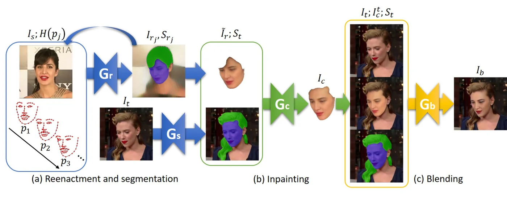
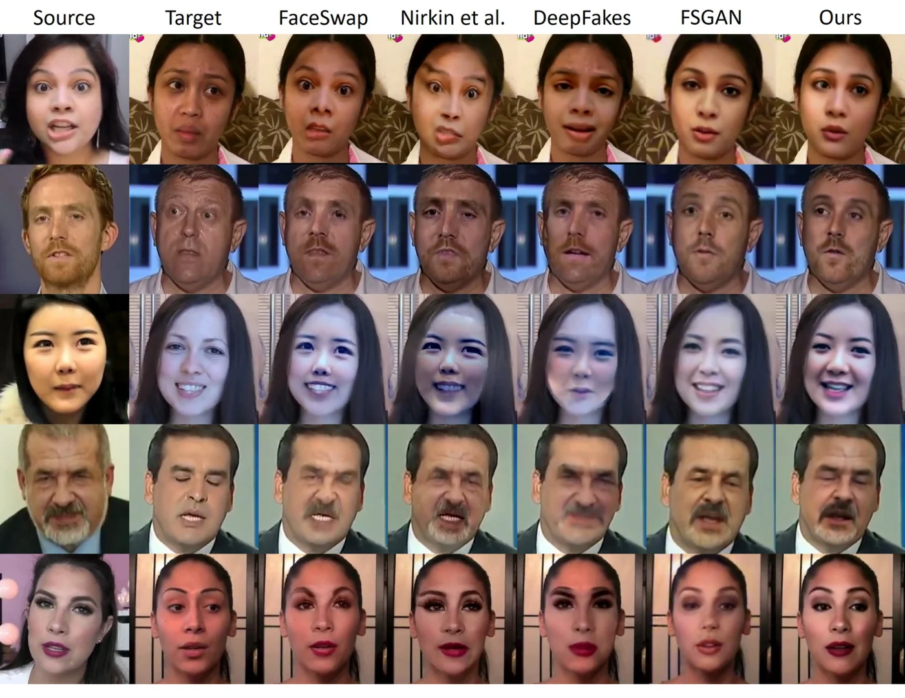
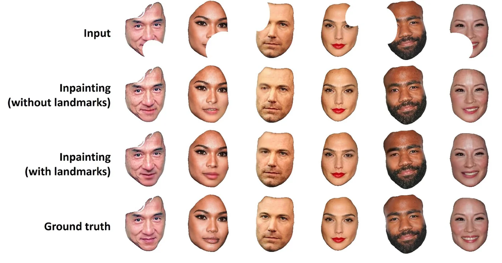

> - **논문**: FSGANv2: Improved Subject Agnostic Face Swapping and Reenactment
> - **저자**: Yuval Nirkin, Yosi Keller, Tal Hassner (Bar-Ilan University)
> - **학회**: IEEE TPAMI (ICCV 2019 FSGAN의 저널 확장판) · [arXiv:2202.12972](https://arxiv.org/abs/2202.12972)
{: .prompt-tip }

> [FSGAN]()은 주체 비의존 교체·재연기를 열었지만 두 가지 눈에 띄는 아티팩트가 있었다. 프레임 사이의 **떨림**(jitter)과 블렌딩의 **포화**이다. 떨림은 검출 박스와 랜드마크가 서브픽셀 정확도가 아니어서 연속 프레임마다 조금씩 다르기 때문에 생기고, 단순 시간 평균은 떨림을 줄이지만 지연(lag)을 만든다. **FSGANv2**는 구조를 유지한 채 전처리·후처리와 두 생성기를 개선한 저널 확장판이다. 바뀐 점은 3D 없이 랜드마크를 보간하는 랜드마크 트랜스포머, 모션에 따라 평균 창을 조절하는 1€ 필터식 평활화, 서브픽셀 히트맵, 대칭·랜드마크를 단서로 쓰는 인페인팅, 포즈 전용 재연기라는 새 용례, 그리고 표정 비교를 위한 새 지표이다. 이 글은 원 논문과 겹치는 부분은 짧게 하고 바뀐 부분에 집중한다.


_Figure 2. (a) 재연기 생성기 $$G_r$$가 중간 랜드마크 $$p_1, p_2, \dots$$를 따라 소스 얼굴을 반복적으로 목표 포즈·표정에 맞추고, 분할 네트워크 $$G_s$$가 목표의 얼굴·머리카락 마스크를 낸다. (b) 인페인팅 생성기 $$G_c$$가 가려진 부분을 채우고, (c) 블렌딩 생성기 $$G_b$$가 목표 이미지에 합친다. (출처: Nirkin et al., 2022)_

## 1. 검출·추적·평활화

얼굴 검출을 SFD에서 더 정확한 **DSFD**로 바꾸고, 연속 프레임의 검출을 IoU > 0.75로 묶어 시퀀스를 만든다. 랜드마크는 WFLW로 학습한 **98점** 2D 검출기(원 논문은 68점 2D/3D)이다.

최신 검출기도 서브픽셀 정확도가 아니라 떨림이 남는데, 시간 평균은 지연을 만든다. 사람은 작은 움직임의 떨림과 큰 움직임의 지연에 각각 민감하다는 Casiez 등의 1€ 필터 관찰을 빌려, 추정한 속도를 프레임별 가중치로 쓰는 1차원 시간 평균을 쓴다. 움직임이 클수록 평균을 덜 한다. 박스는 중심과 크기를, 랜드마크는 얼굴 부위별로 따로 평활화한다.

## 2. 재연기 개선

**랜드마크 트랜스포머.** 원 논문은 3D 랜드마크와 기하 변환으로 중간 랜드마크를 만들었다. v2는 98점 2D 랜드마크 $$p_s$$와 목표 포즈 $$\theta_t$$(랜드마크 없는 포즈 추정기의 오일러 각)에서 목표 랜드마크 $$p_t$$를 회귀하는 네트워크 $$T$$를 같은 영상의 프레임 쌍으로 MSE 학습한다. 선형층 12개로 이루어지고 마지막 층을 뺀 각 층 뒤에 BatchNorm과 ReLU가 붙는다. 중간 단계는 $$p_i = T(p_s, (1 - \frac{i}{n})\theta_s + \frac{i}{n}\theta_t)$$로 포즈를 선형 보간해 만든다. 3D 정보 없이 보간이 된다.

**서브픽셀 히트맵.** 랜드마크 네트워크의 출력 $$A$$에서 채널별 argmax를 찍던 부호화를, $$A$$를 [0,1]로 정규화하고 0.5 미만을 0으로 둔 뒤 **기댓값** $$p_c = \sum_{x,y} A(C,y,x)(x + 0.5, y + 0.5)$$로 바꾼다. 복호화도 점을 찍고 가우시안 블러하던 것을 거리 기반 연속 함수 $$H(p) = \max\big(\frac{\tilde H(p)^8 - t}{1 - t}, 0\big)$$, $$t = 0.8$$로 바꾼다. 양쪽 다 서브픽셀이라 시간 일관성이 좋아진다. 생성기는 pix2pixHD 설계를 따르되 전역 U-Net에 병목 블록(연결 대신 합, 더 작은 채널)과 bilinear 업샘플을 쓴다. 재연기·인페인팅 생성기는 $$\text{Enhancer}(\text{Global}(2,2,3), 2)$$, 블렌딩은 $$\text{Enhancer}(\text{Global}(1,1,1), 1)$$이다. 지각 손실의 VGG-19는 ImageNet 대신 얼굴 인식(VGGFace2)·속성 분류(CelebA) 데이터로 학습한 것을 쓴다. 뷰 보간(외형 맵)은 원 논문과 같다.

## 3. 인페인팅 개선과 새 용례

가려진 소스 얼굴을 목표 마스크 전체로 완성하는 과제에는 두 강한 단서가 있다. 완성될 얼굴의 **표정이 주어져 있고**(랜드마크), 얼굴은 **대칭**이다. 원 논문은 둘 다 쓰지 않았다. v2의 인페인팅 생성기는 재연기 이미지와 분할에 더해 랜드마크 히트맵과 좌우 반전 입력을 받아 이 단서를 활용한다. 학습 때는 머리카락에 의한 가림을 흉내 내 마스크 가장자리에서 크기·비율이 다른 타원을 무작위로 지운다.

**후처리.** 원 논문의 최종 결과는 목표보다 살짝 포화되어 있어 그대로 붙이면 박스 경계가 보였다. v2는 목표 분할 마스크에 soft erosion을 걸어 얼굴에서 배경으로 부드럽게 넘어가게 섞은 뒤 원본 크기로 되돌려 붙인다.

**새 용례와 지표.** 랜드마크 트랜스포머 덕분에 목표 얼굴 없이 오일러 각만으로 소스 얼굴을 돌리는 포즈 전용 재연기(사용자가 마우스·키보드로 각도를 조절)가 가능하다. 입 부분 랜드마크만 바꿔 넣는 표정 전용 재연기도 Face2Face·FSGAN과 정성 비교한다. 표정 비교에는 새 지표 **FEC**를 쓴다. FEC 데이터셋(이미지 156K장, 사람이 표시한 삼중항 500K개)으로 triplet loss를 써서 16차원 표정 임베딩을 학습하고, 그 거리로 표정 일치도를 잰다. 소수의 표정 클래스로 분류하던 기존 평가보다 사람의 지각에 가깝다는 것이 저자들의 설명이다.

## 4. 코드로 보기: 적응 평활화, 서브픽셀 복호화, 대칭 단서

정지 100프레임 뒤 빠른 머리 회전이 오는 합성 랜드마크 궤적에 검출 잡음을 더해 원시·고정 9프레임 평균·모션 적응 평균의 정지 구간 떨림과 회전 구간 지연을 비교하고, 가우시안 히트맵에서 argmax와 임계값 기대값의 랜드마크 오차를 재며, 한쪽 가림을 좌우 반전으로 채운 오차를 본다.

```python
import numpy as np
rng = np.random.default_rng(0)
# (1) motion-adaptive temporal smoothing of landmarks: a still phase (jitter matters) then a fast head turn (lag matters)
T = 200; t = np.arange(T); true = np.where(t < 100, 100.0, 100.0 + 60.0 * (1 - np.exp(-(t - 100) / 8.0)))
meas = true + 1.2 * rng.standard_normal(T)
def fixed_average(m, k=9): return np.convolve(np.pad(m, (k - 1, 0), mode="edge"), np.ones(k) / k, mode="valid")
def one_euro_like(m, beta=0.08, k_max=9):
    out = np.zeros_like(m); hist = []
    for i, v in enumerate(m):
        hist.append(v); speed = abs(v - out[i - 1]) if i else 0.0
        k = max(1, int(round(k_max / (1 + beta * speed ** 2))))                      # large motion -> less averaging
        out[i] = np.mean(hist[-k:])
    return out
for name, est in (("raw detections", meas), ("fixed 9-frame average", fixed_average(meas)), ("motion-adaptive average", one_euro_like(meas))):
    jitter = np.std(np.diff(est[20:100])); lag = np.abs(est[100:140] - true[100:140]).mean()
    print(f"{name:<26} jitter in the still phase {jitter:.3f}   lag during the turn {lag:.2f} px")
print("-> averaging kills jitter but lags behind fast motion; weighting by motion keeps both small, the 1-euro idea")
# (2) sub-pixel landmark decoding from a heatmap: argmax vs expectation over the thresholded activation
n = 32; g = np.arange(n); true_x, true_y = 13.37, 18.71
heat = np.exp(-((g[None, :] - true_x) ** 2 + (g[:, None] - true_y) ** 2) / (2 * 1.5 ** 2)) + 0.02 * rng.standard_normal((n, n))
am = np.unravel_index(heat.argmax(), heat.shape); err_argmax = np.hypot(am[1] - true_x, am[0] - true_y)
A = np.clip(heat / heat.max(), 0, 1); A[A < 0.5] = 0; A /= A.sum()
ex, ey = (A * g[None, :]).sum(), (A * g[:, None]).sum(); err_soft = np.hypot(ex - true_x, ey - true_y)
print(f"\nlandmark decoding error: argmax {err_argmax:.2f} px, soft (expectation over A >= 0.5) {err_soft:.2f} px  -> sub-pixel accuracy, less frame-to-frame snapping")
# (3) a symmetric-face cue for inpainting: a horizontally mirrored copy fills most of a one-sided occlusion
face = np.cos(np.linspace(-1.2, 1.2, n))[None, :] * np.ones((n, 1)); occl = (g[None, :] > 22) & (g[:, None] > 8) & (g[:, None] < 26)
mirror = face[:, ::-1]; filled = np.where(occl, mirror, face)
print(f"one-sided occlusion: {int(occl.sum())} px missing; error of the mirrored fill {np.abs(filled - face)[occl].mean():.3f} (face is near-symmetric, so the mirror is a strong prior)")
```

```text
raw detections             jitter in the still phase 1.616   lag during the turn 0.99 px
fixed 9-frame average      jitter in the still phase 0.192   lag during the turn 6.02 px
motion-adaptive average    jitter in the still phase 0.257   lag during the turn 2.03 px
-> averaging kills jitter but lags behind fast motion; weighting by motion keeps both small, the 1-euro idea

landmark decoding error: argmax 0.47 px, soft (expectation over A >= 0.5) 0.17 px  -> sub-pixel accuracy, less frame-to-frame snapping
one-sided occlusion: 153 px missing; error of the mirrored fill 0.000 (face is near-symmetric, so the mirror is a strong prior)
```

- 고정 평균은 떨림을 1.62에서 0.19로 줄이지만 회전 중 지연이 6.0픽셀이고, 모션 적응 평균은 떨림 0.26에 지연 2.0픽셀이다. "작은 움직임엔 평균을 많이, 큰 움직임엔 적게"라는 1€ 필터의 원리가 두 아티팩트를 함께 잡는다. 저자들이 이를 박스와 부위별 랜드마크에 적용한 이유이다.
- 같은 히트맵에서 argmax는 0.47픽셀, 임계값 기댓값은 0.17픽셀 오차이다. 정수 격자에 스냅되는 argmax는 프레임마다 0.5픽셀씩 튈 수 있고, 이것이 고해상도에서 떨림의 한 원인이다. [Disney]()가 앙상블로 풀었던 문제를 복호화 방식으로 푼 것이다.
- 좌우 대칭인 toy 얼굴의 한쪽 가림 153픽셀은 반전 복사로 오차 0에 채워진다. 실제 얼굴은 완전 대칭이 아니지만, 반전 입력이 강한 사전이라는 점은 분명하다.

## 5. 학습 설정

| 항목 | 값 |
|---|---|
| 재연기 학습 데이터 | IJB-C 영상 11,000개 중 HD 5,500개, 너무 비슷한 시점·모션 블러 프레임 제거, 얼굴 픽셀 15% 미만 프레임 제거, dlib로 인물별로 묶어 인물당 최대 100프레임 |
| 분할 데이터 | Nirkin et al.(2018)의 약 1만 장 + LFW Parts 약 3천 장(목 제거) + Figaro 머리카락 1천 장 |
| 지각 손실 VGG-19 | VGGFace2(330만 장, 9,131명) 얼굴 인식 + CelebA(202,599장) 속성 분류로 학습 |
| Optimizer | Adam($$\beta_1 = 0.5$$, $$\beta_2 = 0.999$$), lr 0.0002, 10 epoch마다 절반 |
| 손실 가중치 | $$\lambda_{perc} = 1$$, $$\lambda_{pixel} = 0.1$$, $$\lambda_{adv} = 0.001$$, $$\lambda_{seg} = 0.1$$, $$\lambda_{rec} = 1$$, $$\lambda_{stepwise} = 1$$ |
| 해상도 | $$G_s$$를 뺀 생성기는 128×128에서 256×256으로 점진적 다중 스케일 학습 |
| 하드웨어 | V100 8장, $$G_s$$ 6시간, 나머지 2일 |
| 추론 속도 | V100 1장, 재연기 1회 기준 재연기 약 30fps, 얼굴 교체 약 10fps |
| 주체별 미세조정 | 선택 사항, 400 iteration이면 치아 같은 세부가 좋아짐(기본 실험은 미세조정 없음) |

## 6. 실험

FaceForensics++ 영상에서, FaceForensics++가 쓴 것과 같은 소스-목표 쌍으로 실행한다. 지표는 ArcFace 코사인 신원 유사도(id), FID, L1(색 보존), 오일러 각 거리(도), 랜드마크 거리(픽셀), FEC 표정 거리이다. id는 무작위 소스 프레임과, 나머지는 대응하는 목표 프레임과 비교한다.

**얼굴 교체 비교(Table 2).**

| 방법 | FID ↓ | id ↑ | L1 ↓ | 오일러 ↓ | 랜드마크 ↓ | FEC ↓ |
|---|---|---|---|---|---|---|
| Nirkin et al. (2018) | 0.67 | 0.45 ± 0.06 | 0.38 ± 0.03 | 3.28 ± 1.34 | 42.1 ± 9.19 | 0.37 ± 0.18 |
| FaceSwap | **0.37** | 0.38 ± 0.05 | 0.44 ± 0.02 | 2.43 ± 0.85 | 36.9 ± 7.35 | 0.34 ± 0.17 |
| DeepFakes | 0.38 | 0.45 ± 0.04 | 0.44 ± 0.02 | 4.05 ± 1.13 | 53.1 ± 8.32 | 0.45 ± 0.14 |
| FSGAN (2019) | 0.46 | 0.36 ± 0.06 | 0.25 ± 0.01 | 2.37 ± 1.29 | 30.8 ± 11.2 | 0.34 ± 0.14 |
| FaceShifter | 0.40 | **0.60 ± 0.03** | 0.42 ± 0.11 | 2.33 ± 0.8 | 45.51 ± 11.36 | 0.29 ± 0.11 |
| FSGANv2 (미세조정) | 0.50 | 0.44 ± 0.04 | 0.22 ± 0.01 | 2.40 ± 0.77 | 28.7 ± 5.76 | 0.30 ± 0.11 |
| FSGANv2 | 0.53 | 0.37 ± 0.05 | **0.21 ± 0.0** | **2.07 ± 0.68** | **21.6 ± 5.25** | **0.28 ± 0.10** |


_Figure 10. FaceForensics++에서 FaceSwap, Nirkin et al., DeepFakes(영상마다 따로 학습), FSGAN, FSGANv2의 결과. FSGAN과 FSGANv2는 처음 보는 얼굴에 그대로 적용한 것이다. (출처: Nirkin et al., 2022)_

색·포즈·표정 보존(L1, 오일러, 랜드마크, FEC)은 v2가 모두 가장 좋다. 신원은 FaceShifter(0.60)가 압도적이고 v2(0.37)는 원 FSGAN(0.36)과 비슷하며, 미세조정하면 0.44까지 오른다. FID는 소스 텍스처를 직접 와핑하는 FaceSwap이 가장 좋다. 저자들은 "소스 신원 보존과 목표 속성(색·포즈·표정) 보존 사이의 트레이드오프"라고 정리한다.

**인페인팅 ablation(Table 1).** FaceForensics++ 앞 500개 영상의 첫 100프레임에서 얼굴에 무작위 타원을 지우고 복원해 원본과 비교한다.

| 방법 | FID ↓ | id ↑ | L1 ↓ | 오일러 ↓ | 랜드마크 ↓ | FEC ↓ |
|---|---|---|---|---|---|---|
| FSGAN (2019) | 2.64 | 0.36 ± 0.07 | 0.46 ± 0.01 | 1.77 ± 0.92 | 34.8 ± 15.0 | 0.15 ± 0.09 |
| $$G_c$$, 랜드마크 없음 | 0.74 | 0.64 ± 0.11 | 0.31 ± 0.02 | 1.20 ± 0.75 | 19.4 ± 7.5 | **0.11 ± 0.09** |
| $$G_c$$, 랜드마크 + 좌우 반전 | **0.62** | 0.64 ± 0.10 | **0.16 ± 0.01** | **1.04 ± 0.52** | **17.9 ± 3.8** | 0.12 ± 0.07 |


_Figure 9. 위에서부터 타원을 지운 입력, 랜드마크 없이 복원, 랜드마크를 넣어 복원, 정답. 랜드마크를 넣으면 입 모양 같은 표정과 얼굴 형태가 더 잘 복원된다. (출처: Nirkin et al., 2022)_

새 구조는 두 변형 모두 원 FSGAN을 모든 지표에서 크게 앞서고(FID 2.64 → 0.62), 랜드마크·반전 단서를 넣은 쪽은 L1이 0.31에서 0.16으로 절반가량 줄어든다. 저자들은 이 변형이 id를 빼고 모든 지표에서 낫다고 쓰지만, 표의 FEC는 랜드마크 없는 쪽이 0.11로 근소하게 낮다.

**파이프라인 ablation(Table 3).**

| 구성 | FID ↓ | id ↑ | L1 ↓ | 오일러 ↓ | 랜드마크 ↓ | FEC ↓ |
|---|---|---|---|---|---|---|
| FSGAN의 $$G_r$$ | 0.72 | 0.44 ± 0.06 | 0.26 ± 0.01 | 2.93 ± 1.11 | 32.9 ± 8.46 | 0.36 ± 0.13 |
| v2 $$G_r$$ | 0.71 | **0.45 ± 0.07** | 0.22 ± 0.01 | 2.93 ± 0.91 | 31.8 ± 5.66 | 0.30 ± 0.11 |
| v2 $$G_r + G_c$$ | 0.67 | 0.41 ± 0.06 | 0.21 ± 0.01 | 2.57 ± 0.83 | 23.2 ± 4.95 | 0.29 ± 0.10 |
| v2 $$G_r + G_b$$ | 0.54 | 0.41 ± 0.06 | **0.20 ± 0.01** | 2.40 ± 0.79 | 28.0 ± 5.17 | 0.29 ± 0.11 |
| v2 전체 $$G_r + G_c + G_b$$ | **0.53** | 0.37 ± 0.06 | 0.21 ± 0.0 | **2.07 ± 0.68** | **21.6 ± 5.25** | **0.28 ± 0.10** |

새 재연기 생성기(랜드마크 트랜스포머 포함)는 이전 $$G_r$$보다 모든 지표가 같거나 좋고, 전체 파이프라인이 FID·포즈·표정에서 가장 좋다. 단계를 더할수록 id는 0.45에서 0.37로 조금씩 내려간다. 서브픽셀 히트맵이나 시간 평활화만 따로 떼어 본 정량 ablation은 없고, 떨림 감소는 영상으로 보여 준다.

**한계(저자 서술).** 목표와의 각도 차가 클수록 신원과 텍스처 품질이 떨어지고, 재연기를 너무 여러 번 반복하면 텍스처가 흐려진다. 텍스처를 이미지에서 직접 와핑하는 3DMM 방법과 달리 학습 데이터 해상도에 묶이고, 희소 랜드마크로는 표정의 복잡함을 다 담지 못한다.

## 7. 해석

**1. 시간 일관성을 전처리·후처리의 문제로 다룬 드문 논문이다.** 대부분의 교체 논문은 프레임 단위 품질을 재고 영상은 보충 자료로 보낸다. v2는 떨림의 원인(비서브픽셀 검출·부호화)을 지목하고 각각을 고쳤다. 이후 [FSLSD]()는 잠재 공간에서, [MobileFaceSwap]()은 마스크 예측으로 같은 문제를 다룬다.

**2. 3D 제거의 완성.** 2018 방법이 "3D 추정은 불필요"를 보이고 FSGAN이 3D 형상을 버렸다면, v2는 중간 랜드마크 생성에 남아 있던 3D 랜드마크까지 학습된 트랜스포머로 대체한다. 소스 지향 파이프라인이 완전히 2D 랜드마크와 포즈 각도만으로 돌아간다.

**3. 인페인팅에 문제 구조를 넣었다.** 일반 인페인팅과 달리 얼굴 완성은 표정이 주어지고 대칭이라는 점을 입력으로 명시한 것은 작지만 정확한 개선이고, [E4S]()가 마스크로 가림을 "피부 라벨 채우기"로 환원하는 것과 다른 길이다.

**4. 남은 한계는 소스 지향의 구조적 한계이다.** 얼굴 형태가 목표에 묶이고, 조명·해상도는 블렌딩 생성기에 의존하며, 무겁다. [HifiFace]()·[FaceShifter]()의 비교에서 FSGAN 계열이 받는 평가는 v2에서도 크게 바뀌지 않는다.

**5. 평가를 읽을 때 주의할 점.** FaceShifter와는 같은 표에서 직접 비교하지만, 신원(id)에서 크게 지고 색·포즈·표정에서 이기는 구도라 "어느 쪽이 더 좋은 교체인가"는 지표의 가중치에 달려 있다. SimSwap 등 다른 최신 방법은 비교에 없다. 서브픽셀 부호화·평활화의 효과는 정량 ablation 없이 영상으로만 제시되고, 1€ 필터 변형의 파라미터도 본문에 없다. 위 toy의 적응 평활화는 논문 구현과 다른 간단한 형태이고, 수치는 잡음 모델에 따라 달라진다.

## 8. 정리

| 항목 | 내용 |
|---|---|
| 목표 | FSGAN의 떨림·포화 아티팩트 감소, 3D 의존 제거, 추가 실험 |
| 전처리 | DSFD 검출, 98점 랜드마크, IoU 시퀀스 묶기, 모션 적응(1€ 필터식) 시간 평활화 |
| 재연기 | 2D 랜드마크 + 포즈 → 목표 랜드마크 회귀(랜드마크 트랜스포머, 12층 선형), 서브픽셀 히트맵 부호화·복호화 |
| 인페인팅 | 랜드마크(표정)·좌우 반전(대칭) 단서 입력, 포화 감소 후처리 |
| 새 내용 | 포즈 전용 재연기, FEC 표정 지표, 인페인팅·파이프라인 ablation |
| 결과 | FF++에서 L1 0.21·오일러 2.07·랜드마크 21.6·FEC 0.28로 최고, id 0.37(FaceShifter 0.60) |
| 한계 | 소스 지향의 형태·조명 한계는 유지, 신원 보존은 FaceShifter에 크게 뒤짐, 큰 각도 차에서 품질 저하 |

## References

- Nirkin, Keller, Hassner, "FSGANv2: Improved Subject Agnostic Face Swapping and Reenactment," TPAMI 2022. [arXiv:2202.12972](https://arxiv.org/abs/2202.12972)
- Nirkin, Keller, Hassner, "FSGAN," ICCV 2019. [arXiv:1908.05932](https://arxiv.org/abs/1908.05932)
- Casiez, Roussel, Vogel, "1€ Filter: A Simple Speed-based Low-pass Filter for Noisy Input in Interactive Systems," CHI 2012.
- Li et al., "DSFD: Dual Shot Face Detector," CVPR 2019. [arXiv:1810.10220](https://arxiv.org/abs/1810.10220)
- Wu et al., "Look at Boundary: A Boundary-Aware Face Alignment Algorithm" (WFLW), CVPR 2018. [arXiv:1805.10483](https://arxiv.org/abs/1805.10483)
- Ha, Kersner, Kim, Seo, Kim, "MarioNETte: Few-shot Face Reenactment Preserving Identity of Unseen Targets," AAAI 2020. [arXiv:1911.08139](https://arxiv.org/abs/1911.08139)
