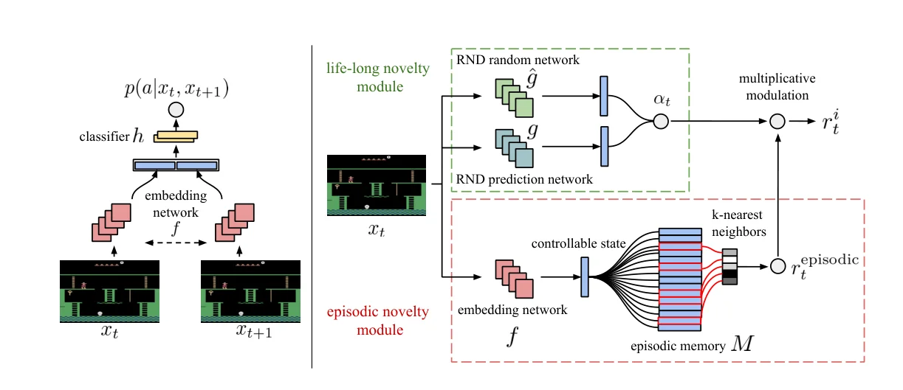
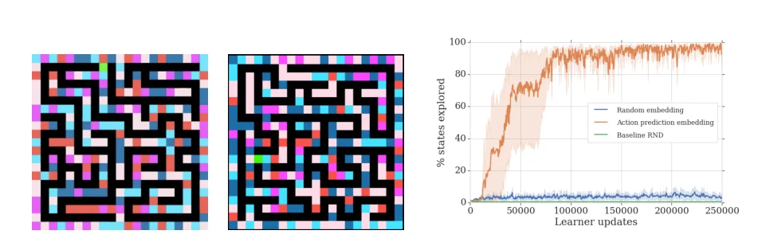
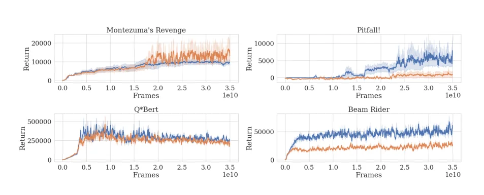

> - **논문**: Never Give Up: Learning Directed Exploration Strategies
> - **저자**: Adrià Puigdomènech Badia, Pablo Sprechmann, Alex Vitvitskyi, Daniel Guo, Bilal Piot, Steven Kapturowski, Olivier Tieleman, Martín Arjovsky, Alexander Pritzel, Andrew Bolt, Charles Blundell (DeepMind)
> - **학회**: ICLR 2020 · [arXiv:2002.06038](https://arxiv.org/abs/2002.06038)
{: .prompt-tip }

> 지금까지의 intrinsic reward는 한 번 새로움이 사라지면 더 이상 탐험할 이유를 주지 못했습니다. **NGU(Never Give Up)**는 이름 그대로 **탐험을 포기하지 않도록**, 한 에피소드 안의 새로움(episodic)과 학습 전체에 걸친 새로움(life-long)을 결합하고, 탐험 정도가 다른 **여러 정책을 동시에** 학습합니다.

## 1. 기존 탐험 방법의 한계

### 새로움이 사라지면 다시 오지 않는다

[Pseudo-count]()처럼 상태의 새로움을 수치화하는 방법은, 방문 횟수를 정확히 세는 대신 이미 방문한 상태와의 차이로 새로움을 계산합니다. 하지만 어떤 상태의 **새로움이 한 번 사라지고 나면**, 그 상태가 이후 학습(downstream)에 중요하더라도 에이전트는 **다시 방문할 이유가 없습니다.**

### 예측 오차 기반의 문제

[ICM]()처럼 forward dynamics 모델의 예측 오차를 쓰는 방법은

- 관측으로 동역학 모델을 만드는 비용이 크고
- Noisy TV 같은 노이즈의 영향을 받으며
- 임의의 환경으로 일반화하기 어렵습니다.

또 새로움 신호가 없어지면 **방향성 없는 탐험**으로 돌아가 지역 최적해에 머무릅니다. 즉, **포기(give up)**해 버립니다.

## 2. NGU의 핵심 아이디어

1. **탐험 정책과 활용 정책을 동시에 학습**
   - Exploitative policy: extrinsic reward 최대화에 집중
   - Exploratory policy: 방향성 없는 탐험으로 축소되지 않고 **계속 탐험** (never give up)
2. **Episodic novelty와 Life-long novelty를 결합**
   - Episodic: 한 에피소드 안에서는 **같은 상태를 다시 방문하지 않도록** 빠르게 억제. 하지만 에피소드가 바뀌면 다시 리셋되므로, 익숙하지만 완전히 탐험하지는 않은 상태를 **주기적으로 다시 찾아가게** 함
   - Life-long: 여러 에피소드에 걸쳐 많이 방문한 상태의 보상을 **천천히 줄임**

### NGU Intrinsic Reward의 세 가지 성질

- 같은 에피소드 안에서 같은 상태를 재방문하는 것을 **빠르게** 억제
- 여러 에피소드에 걸쳐 많이 방문한 상태를 **천천히** 억제
- 상태의 개념이 **에이전트의 행동이 영향을 주지 않는 요소를 무시**

## 3. Intrinsic Reward의 구성

$$
r^i_t = r^{episodic}_t \cdot \min\big\{\max\{\alpha_t, 1\},\ L\big\}
$$

세 부분으로 나눠 보겠습니다. 전체 구조는 아래 Figure 1과 같습니다.


_Figure 1. 왼쪽: 연속된 두 관측으로 행동을 맞히도록 embedding network $$f$$를 학습하는 구조. 오른쪽: NGU의 보상 생성기. 아래(빨강)가 episodic novelty 모듈, 위(초록)가 RND 기반 life-long novelty 모듈이고, 두 값을 곱해 $$r^i_t$$를 만듭니다. (출처: Badia et al., 2020)_

### ① Embedding Network: 제어 가능한 특징만

먼저 상태를 비교할 공간을 만듭니다. **Siamese 구조**(두 입력이 가중치를 공유하는 CNN을 통과)의 embedding network $$f$$를 두고, 연속된 두 관측 $$x_t, x_{t+1}$$의 embedding으로 **그 사이의 행동** $$a_t$$를 예측하도록 학습합니다(ICM의 inverse dynamics와 같은 방식). $$h$$는 hidden layer 1개짜리 MLP + softmax이고, $$f$$와 $$h$$를 maximum likelihood로 함께 학습합니다.

$$
p(a_t \mid x_t, x_{t+1}) = h\big(f(x_t), f(x_{t+1})\big)
$$

그러면 Noisy TV나 화면 속 많은 사람의 움직임처럼 **에이전트 행동과 무관한 요소(meaningless state)**는 embedding에서 무시되고, **제어 가능한 상태**만 남습니다.

### ② Episodic Novelty Module

**Episodic memory** $$M$$에 이번 에피소드에서 본 embedding $$\{f(x_0), \dots, f(x_{t-1})\}$$을 저장합니다. 현재 embedding과 가장 가까운 **$$k$$개의 이웃** $$N_k$$를 찾아, 이웃이 가깝고 많을수록 "이미 비슷한 곳에 와 봤다"고 판단합니다.

$$
r^{episodic}_t = \frac{1}{\sqrt{\sum_{f_i \in N_k}K\big(f(x_t), f_i\big)} + c}
$$

$$
K(x, y) = \frac{\epsilon}{\dfrac{d^2(x, y)}{d_m^2} + \epsilon}
$$

- $$K$$: 가까울수록 1에 가까운 커널 (Dirac delta를 부드럽게 근사한 것). 분모의 합이 **pseudo-count** 역할
- $$d_m^2$$: $$k$$-최근접 이웃까지의 제곱 거리의 running average (과제마다 embedding 거리 스케일이 달라서 정규화)
- $$c$$: 최소 pseudo-count를 보장하는 상수 (0.001)
- 메모리는 **에피소드마다 초기화**. 용량은 30,000이고 넘치면 오래된 것부터 지우는 ring buffer

커널 $$K$$가 Dirac delta라면 정확한 방문 횟수가 되지만, 그러면 비슷한 상태 사이에 일반화가 전혀 없어 큰 상태 공간에서 쓸 수 없습니다.

현재 상태와 이전에 방문한 상태들의 **유사도**로 보상이 정해집니다.

### ③ Life-long Novelty Module

여러 에피소드에 걸친 새로움은 [RND]()로 측정합니다. RND의 예측 오차 $$\text{err}(x_t)$$를 정규화해 **life-long curiosity factor** $$\alpha_t$$를 만듭니다.

$$
\alpha_t = 1 + \frac{\text{err}(x_t) - \mu_e}{\sigma_e}
$$

($$\mu_e, \sigma_e$$: 오차의 running mean과 표준편차)

### 결합

$$\alpha_t$$를 $$[1, L]$$로 잘라서($$L = 5$$) episodic reward에 **곱합니다.**

- 여러 에피소드에서 익숙해진 상태는 $$\alpha_t \to 1$$이 되어 **배율 효과가 사라지고**
- 새로운 상태는 최대 $$L$$배까지 보상이 커집니다.
- 하지만 $$\alpha_t$$가 1 아래로 내려가지는 않으므로, life-long 새로움이 사라져도 **episodic 보상은 남습니다.** 이것이 "포기하지 않는" 이유입니다.

최종 보상은 extrinsic과 intrinsic의 가중합입니다.

$$
r_t = r^e_t + \beta\,r^i_t
$$

```python
import torch

def episodic_reward(emb, memory, k=10, eps=1e-3, c=1e-3, dm2_running=None):
    """emb: (D,), memory: (M, D) — 이번 에피소드의 embedding들"""
    if len(memory) == 0:
        return 1.0 / c
    d2 = ((memory - emb) ** 2).sum(-1)                     # 제곱 거리
    d2_k, _ = d2.topk(min(k, len(d2)), largest=False)      # k-최근접
    dm2 = dm2_running if dm2_running is not None else d2_k.mean()
    kernel = eps / (d2_k / (dm2 + 1e-8) + eps)
    return 1.0 / (kernel.sum().sqrt() + c)

def ngu_reward(r_episodic, rnd_err, mu, sigma, L=5.0):
    alpha = 1 + (rnd_err - mu) / (sigma + 1e-8)
    return r_episodic * min(max(alpha, 1.0), L)

torch.manual_seed(0)
memory = torch.randn(50, 8)                       # 이번 에피소드에서 본 50개 상태의 embedding
d2_all = ((memory[:, None] - memory[None]) ** 2).sum(-1)
dm2 = d2_all.topk(11, largest=False).values[:, 1:].mean()   # k-NN 거리의 평균 (running average 대용)
revisit = memory[0] + 0.01 * torch.randn(8)       # 거의 같은 곳을 다시 방문
new = torch.randn(8) * 3                          # 멀리 떨어진 새 상태
print(float(episodic_reward(revisit, memory, dm2_running=dm2)))   # 약 1.04
print(float(episodic_reward(new, memory, dm2_running=dm2)))       # 약 15.4
print(ngu_reward(0.5, rnd_err=3.0, mu=1.0, sigma=0.5))   # α=5 → 0.5 × 5 = 2.5
print(ngu_reward(0.5, rnd_err=0.2, mu=1.0, sigma=0.5))   # α<1 → 1로 잘림 → 0.5 그대로
```

같은 에피소드에서 이미 와 본 곳 근처는 보상이 약 1, 처음 가는 곳은 약 15로 열 배 넘게 차이 납니다. 그리고 마지막 줄처럼 life-long 새로움이 다 사라져도(RND 오차가 평균보다 작아도) 배율이 1에서 잘릴 뿐 **episodic 보상 0.5는 그대로 남습니다.** "포기하지 않는" 성질이 이 `max(α, 1)` 한 줄에서 나옵니다.

## 4. NGU 에이전트

- **여러 정책을 하나의 네트워크로**: intrinsic reward 계수 $$\beta_j$$와 discount $$\gamma_j$$가 다른 $$N$$개의 쌍 $$\{(\beta_j, \gamma_j)\}_{j=0}^{N-1}$$을 정하고, 네트워크가 $$j$$를 입력으로 받아 $$Q(x, a, j)$$를 출력합니다([UVFA]() 방식).
  - $$\beta_0 = 0$$: 순수하게 extrinsic만 보는 **활용 정책**
  - $$\beta$$가 클수록 **탐험 정책**, $$\gamma$$가 작을수록 짧은 시야. 활용 정책 $$\beta_0$$에 가장 큰 $$\gamma_0 = 0.997$$, 가장 탐험적인 $$\beta_{N-1} = 0.3$$에 가장 작은 $$\gamma_{N-1} = 0.99$$를 짝짓습니다. intrinsic reward는 촘촘하고 값의 범위가 작아서 짧은 시야로도 충분하고, 활용 정책은 할인 없는 return에 최대한 가깝게 최적화하려는 것입니다.
- **R2D2 기반**: LSTM을 쓰는 분산 강화학습 에이전트 R2D2(dueling 구조)를 backbone으로, 256개 actor가 각자 고정된 $$\beta_j$$ 하나로 별도 환경에서 데이터를 모읍니다. 네트워크 입력에는 관측과 함께 $$\beta_j$$의 one-hot, 직전 행동, 직전 intrinsic·extrinsic reward를 넣습니다. 보상이 정책에 따라 변해 문제가 POMDP처럼 되는 것을 줄이려는 장치입니다.
- **활용 정책이 탐험 덕을 보는 경로는 데이터가 아니라 공유 가중치**입니다. 기본 NGU는 각 $$\beta_j$$를 자기 actor가 모은 데이터로만 학습합니다(Cross Mixture Ratio 0). 다른 $$\beta$$의 데이터를 반씩 섞는 설정(CMR 0.5)은 hard exploration 게임 평균을 오히려 약간 떨어뜨렸습니다. 탐험 정책들이 배운 표현과 기술이 같은 네트워크를 통해 활용 정책으로 전해지는 셈입니다.

## 5. 구현 디테일

| 항목 | 값 |
|---|---|
| 정책 수 $$N$$ / 최대 $$\beta$$ | 32 / 0.3 |
| Discount | $$\gamma_{max} = 0.997$$, $$\gamma_{min} = 0.99$$ (그 사이는 $$1-\gamma$$가 로그 스케일로 고르게) |
| RL loss | transformed Retrace double Q-learning, Retrace $$\lambda = 0.95$$ |
| Optimizer | Adam (R2D2 lr 0.0001, RND·행동 예측 lr 0.0005, $$\epsilon$$ 0.0001, clip norm 40) |
| Batch | 길이 80 sequence 64개, replay period 40, replay capacity 5e6, priority exponent 0.9 |
| Episodic memory | 용량 30,000, $$k = 10$$, $$c = 0.001$$, $$L = 5$$ |
| 보조 네트워크 학습 | 샘플한 sequence의 마지막 5 frame만으로 행동 예측 네트워크와 RND predictor 학습 |
| 분산 학습 | GPU learner 1개(초당 약 5회 업데이트), actor 256개(actor당 초당 약 260 step), 총 350억 frame |
| Atari 전처리 | 표준 R2D2 설정에서 frame stacking만 뺌, action repeat 4 |

커널 $$\epsilon$$은 본문(식 3)에는 $$10^{-3}$$, 부록 하이퍼파라미터 표에는 0.0001로 적혀 있어 논문 안에서도 값이 다릅니다. 위 코드는 본문 값을 썼습니다.

## 6. 실험

### Random Disco Maze: 제어 가능한 상태가 왜 필요한가

21×21 무작위 미로에서 **벽 색이 매 step 다섯 가지 중 무작위로 바뀌는** 환경입니다. 화면은 매번 새롭지만 실제로 의미 있는 상태는 미로 위치뿐입니다. 외부 보상 없이 정책 하나($$N = 1$$)로 탐험만 시켰습니다.


_Figure 2. 왼쪽·가운데: Random Disco Maze 화면(초록이 에이전트, 검정이 길). 오른쪽: 미로 위치 중 방문한 비율. 행동 예측으로 학습한 embedding(주황)만 거의 100%를 탐험합니다. (출처: Badia et al., 2020)_

학습한 embedding을 쓴 에이전트는 깊이 우선 탐색처럼 한 갈래를 끝까지 가 본 뒤 되돌아오는 전략을 익혔습니다. 무작위 projection embedding과 RND baseline은 벽에 부딪히지 않는 법만 배우고, 두 칸을 왔다 갔다 해도 벽 색 때문에 매번 "새 상태"가 되므로 더 탐험하지 않았습니다.

### Hard exploration 게임 (Table 1)

R2D2와 같은 데이터 양(350억 frame)과 설정으로 학습했고, seed 3개 평균입니다. "기존 최고"는 R2D2, DQN+PixelCNN, DQN+CTS, RND, PPO+CoEx 중 게임별 최고값입니다.

| 게임 | 사람 | 기존 최고 | R2D2+RND | R2D2(Retrace) | NGU(N=1)-RND | NGU(N=1) | **NGU(N=32)** |
|---|---|---|---|---|---|---|---|
| Gravitar | 3.4k | 15.7k | 15.6k | 13.3k | 12.4k | 11.0k | 14.1k |
| Montezuma's Revenge | 4.8k | 11.6k | 10.4k | 2.3k | 3.0k | 8.7k | 10.4k |
| Pitfall! | 6.5k | 0.0 | -0.5 | -3.5 | **15.2k** | 9.4k | 8.4k |
| Private Eye | 69.6k | 11k | 19.5k | 32.5k | 40.6k | 60.6k | **100.0k** |
| Solaris | 12.3k | 5.5k | 4.3k | **6.0k** | 5.7k | 5.9k | 4.9k |
| Venture | 1.2k | 2.0k | **2.7k** | 2.0k | 46.4 | 876.3 | 1.7k |

- **Pitfall!**에서 시연 데이터나 사람이 만든 특징 없이 **처음으로 양수 점수**를 얻었습니다. NGU(N=32)가 평균 8.4k, RND를 뺀 NGU(N=1)가 15.2k로 가장 높았습니다. NGU(N=32)는 에피소드당 평균 46개 방을 탐험하고, 첫 extrinsic reward를 받기 전에 14개 방을 지났습니다.
- Pitfall!에서는 RND를 빼는 편이 오히려 나았습니다. 논문은 방들이 서로 비슷하게 생겨 새 방 발견 보상이 크지 않고, 화면의 타이머가 가짜 새로움을 만들며, RND 에이전트가 위험한 물체 근처에서 노는 경향이 함정이 많은 Pitfall!에서 특히 해롭다는 가설을 듭니다. 반대로 Montezuma's Revenge에서는 RND가 NGU(N=32)를 크게 개선했습니다.
- 6게임 중 4게임에서 NGU(N=32)가 NGU(N=1)보다 크게 좋았습니다. 사람 정규화 점수의 평균·중앙값 모두 기존 방법보다 높습니다.

### Ablation (8개 게임)

dense reward 게임 5개와 hard exploration 게임 3개(Montezuma's Revenge, Pitfall!, Private Eye)로 설계 선택을 검증했습니다.

| 실험 | 결과 (hard exploration 게임 평균 기준) |
|---|---|
| CMR 0 → 0.5 (다른 $$\beta$$ 데이터 섞기) | 약간 나빠짐 |
| 정책 수 $$N$$ 늘리기 | 평균적으로 좋아짐 |
| 최대 $$\beta$$: 0.2 / **0.3** / 0.5 | 0.3이 최선. 0.2는 탐험이 부족하고 0.5는 탐험 쪽으로 너무 치우침 |
| RND 배율 $$\alpha_t$$ 사용 | 평균적으로 크게 도움 (단, Pitfall!은 위 Table 1처럼 RND 없는 쪽이 더 좋음) |
| extrinsic reward 제거 | dense 게임 5개에서도 평균적으로 사람 이상 |

dense reward 게임에서는 extrinsic reward 제거를 빼면 어떤 설정도 거의 영향이 없었습니다. 보상이 촘촘하면 intrinsic reward의 상대적 비중이 자연히 작아지기 때문입니다.

### 활용 정책과 탐험 정책은 실제로 다르게 행동하나


_Figure 6. NGU(N=32)를 활용 정책 $$\beta_0$$(파랑)와 가장 탐험적인 $$\beta_{31}$$(주황)로 평가한 학습 곡선. Pitfall!·Beam Rider는 두 정책이 확연히 다르게 행동하고, Montezuma's Revenge는 오히려 탐험 정책이 점수가 높습니다. (출처: Badia et al., 2020)_

Q*Bert처럼 많은 게임에서는 $$\beta$$와 상관없이 정책들이 활용 정책 쪽으로 수렴합니다. Pitfall!에서는 활용 정책이 탐험 정책이 배운 것을 이용해, R2D2가 한 번도 못 얻은 양수 점수를 냅니다. Montezuma's Revenge에서 탐험 정책이 더 높은 이유는 16k점을 넘으려면 2레벨로 가야 하고, 그 과정에 당장 손해인 행동과 되돌릴 수 없는 행동이 많아 활용 정책이 아주 긴 credit assignment를 해내야 하기 때문입니다.

### Dense reward 게임 (Table 2)

| 게임 | 사람 | R2D2 | NGU(N=32) |
|---|---|---|---|
| Pong | 14.6 | 21.0 | 19.6 |
| QBert | 13.4k | 408.8k | 465.8k |
| Breakout | 30.5 | 837.7 | 532.8 |
| Space Invaders | 1.6k | 43.2k | 44.6k |
| Beam Rider | 16.9k | 188.2k | 68.7k |

- Pong, QBert, Space Invaders 같은 **dense reward 게임에서는 성능을 거의 잃지 않았습니다.** 다만 Breakout, Beam Rider에서는 R2D2에 못 미쳐, intrinsic 신호로 배운 표현이 활용 정책의 학습을 약간 방해하는 것으로 보입니다.

### Atari 57개 게임

- 57개 중 **51개 게임에서 사람 점수를 넘었습니다.**
- 사람 정규화 점수의 **중앙값**은 1354.4%로 R2D2(1920.6%), R2D2(Retrace)(1451.8%)보다는 낮고 IMPALA(191.8%), Nature DQN(95%)보다는 훨씬 높습니다. (초록에는 1344.0%로 적혀 있어 본문과 약간 다릅니다.)

### 한계

- 350억 frame, 며칠의 wall-clock 시간이 드는 **데이터 비효율**
- 행동의 결과가 두 step 이상 지나야 보이는 환경에서는 inverse dynamics로 배운 "제어 가능한 상태"가 맞는 신호가 아닐 수 있음
- 탐험·활용 정책이 거의 적대적인 게임(Surround, Ice Hockey)에서는 하나의 네트워크로 함께 표현하기 어려움
- $$\beta$$가 extrinsic reward 스케일에 의존해 환경마다 조정이 필요할 수 있음 → 이후 [Agent57]()이 meta-controller로 이 문제를 다룹니다.

## 7. 정리

| 구성 요소 | 역할 | 사라지는 속도 |
|---|---|---|
| Embedding network | 제어 가능한 특징만 추출 (inverse dynamics) | - |
| Episodic novelty | $$k$$-NN pseudo-count, 에피소드마다 리셋 | **빠름** (한 에피소드 안) |
| Life-long novelty | RND 오차로 배율 $$\alpha_t \in [1, L]$$ | **느림** (학습 전체) |
| 정책 가족 | $$(\beta_j, \gamma_j)$$별 탐험·활용 정책 동시 학습 | - |
| 결과 | Pitfall! 첫 양수 점수(평균 8.4k), 57게임 중 51개 사람 이상, 중앙값 1354.4% | - |

NGU의 남은 문제는 "모든 정책을 똑같이 학습한다"는 점이었습니다. 이를 **meta-controller**로 해결해 Atari 57개 게임 **전부**에서 사람을 넘은 것이 [Agent57]()입니다.

## References

- Badia et al., "Never Give Up: Learning Directed Exploration Strategies," ICLR 2020. [arXiv:2002.06038](https://arxiv.org/abs/2002.06038)
- Kapturowski et al., "Recurrent Experience Replay in Distributed Reinforcement Learning (R2D2)," ICLR 2019.
- Burda et al., "Exploration by Random Network Distillation," ICLR 2019.
- Schaul et al., "Universal Value Function Approximators," ICML 2015.
