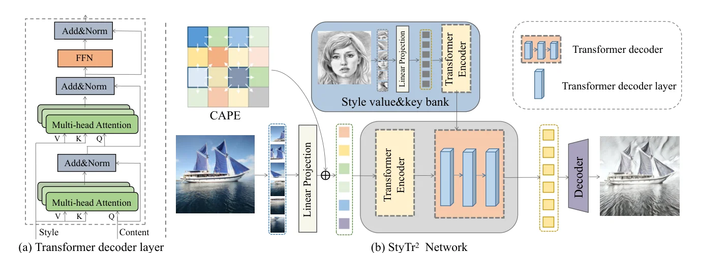
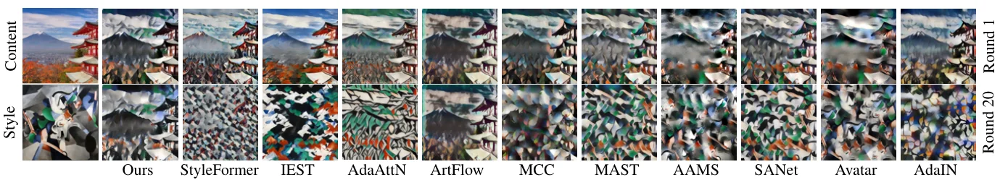
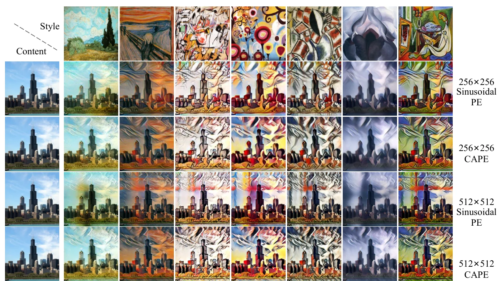

> - **논문**: StyTr²: Image Style Transfer with Transformers
> - **저자**: Yingying Deng, Fan Tang, Weiming Dong, Chongyang Ma, Xingjia Pan, Lei Wang, Changsheng Xu (UCAS·CASIA NLPR, Jilin University, Kuaishou Technology, CIPUC)
> - **학회**: CVPR 2022 · [arXiv:2105.14576](https://arxiv.org/abs/2105.14576) · [코드](https://github.com/diyiiyiii/StyTR-2)
{: .prompt-tip }

> [AdaIN]() 이후 임의 스타일 전이는 인코더-전이-디코더 구조에서 2차 통계를 맞추거나 attention으로 콘텐츠와 스타일 특징을 섞는 방향으로 발전했습니다. 그런데 모두 CNN 위에 있어서 **수용 영역이 제한**되고, 깊게 쌓으면 해상도와 세부가 사라집니다. An 등은 같은 스타일화를 여러 번 반복하면 콘텐츠 구조가 무너지는 **content leak**을 시각화해 CNN 스타일 전이가 콘텐츠 표현에서 편향되어 있음을 보였습니다. **StyTr²**는 이미지를 패치 열로 보고 **순수 Transformer**로 스타일 전이를 풉니다. 콘텐츠와 스타일에 별도 인코더를 두고, 디코더의 교차 attention으로 콘텐츠 열을 스타일 열에 따라 변환하며, 해상도가 바뀌어도 변하지 않는 **콘텐츠 인식 위치 인코딩(CAPE)**을 제안합니다.

## 1. 문제: CNN의 지역성이 콘텐츠를 잃게 한다

합성곱은 국소 연산이라 장거리 의존성을 잡으려면 층을 쌓아야 하고, 그러면 특징 해상도와 세부가 떨어집니다. 스타일 전이에서는 이것이 콘텐츠 구조 보존 실패와 스타일 표현 부족으로 나타납니다. Figure 1에서 VGG 기반 특징은 층이 깊어질수록 세부를 잃지만, Transformer 디코더의 중간 층은 층마다 비슷한 구조 정보를 유지합니다. Transformer는 self-attention으로 **매 층에서 전역 정보**를 보고, 입력 형태의 관계를 모델링하므로 정확한 콘텐츠 표현에 유리하다는 것이 출발점입니다.

## 2. 방법


_Figure 2. (a) Transformer 디코더 층: 아래 MSA는 콘텐츠에서 Q, 스타일에서 K·V를 받습니다. (b) 전체 구조: 콘텐츠 패치 열에 CAPE를 더해 콘텐츠 인코더로, 스타일 패치 열은 스타일 인코더로 보낸 뒤 디코더에서 섞고 CNN 디코더로 이미지를 복원합니다. (출처: Deng et al., 2022)_

### 패치 열과 두 개의 인코더

위 Figure 2처럼 콘텐츠 $$I_c$$와 스타일 $$I_s$$를 $$8 \times 8$$ 패치로 자르고 선형 투영해 길이 $$L = HW/64$$, 차원 $$C$$의 임베딩 열을 만듭니다. 자연 이미지와 회화라는 **두 도메인**이 입력이므로 인코더를 둘로 나눕니다. 콘텐츠 인코더는 CAPE를 더한 열에 표준 MSA + FFN 층을 적용하고, 스타일 인코더는 **위치 인코딩 없이** 같은 구조를 씁니다(스타일 이미지의 구조는 출력에 남길 필요가 없으므로).

### Transformer 디코더

NLP의 자기회귀 디코더와 달리 모든 패치를 한 번에 입력해 출력을 예측합니다. 각 층은 MSA 둘과 FFN 하나이며, **쿼리는 콘텐츠 열, 키·값은 스타일 열**에서 만듭니다.

$$
Q = \hat Y_c W_q, \quad K = Y_s W_k, \quad V = Y_s W_v, \qquad
X'' = \text{MSA}(Q, K, V) + Q, \quad X' = \text{MSA}(X'' + P_{CA}, K, V) + X'', \quad X = \text{FFN}(X') + X'
$$

즉 콘텐츠 패치가 스타일 패치들에 attention해 스타일을 끌어오는 교차 attention이 스타일 전이의 본체입니다. 출력 열은 3층 CNN 디코더(3×3 conv + ReLU + 2배 업샘플)를 거쳐 원래 해상도로 복원합니다.

### CAPE: 콘텐츠 인식 위치 인코딩

사인 위치 인코딩에서 두 패치의 위치 관계 $$P(x_i, y_i)^\top P(x_j, y_j)$$는 **공간 거리에만** 의존합니다. 저자들은 두 가지를 문제 삼습니다. (1) 이미지 패치는 논리적 순서의 문장과 달리 **내용**으로 조직되므로, 같은 내용의 패치는 거리가 달라도 비슷하게 스타일화되어야 합니다. (2) 해상도를 키우면 같은 이미지 위치의 패치 간 거리가 바뀌어 위치 인코딩이 크게 달라지고, 학습 해상도와 다른 크기에서 세로 줄무늬 아티팩트가 생깁니다. CAPE는 $$n \times n$$($$n = 18$$)의 학습 가능한 위치 인코딩을 두고, 임베딩 열을 $$n \times n$$으로 평균 풀링한 뒤 1×1 합성곱 $$\mathcal{F}_{pos}$$로 위치 인코딩을 **내용에 조건부로** 만든 다음, 이것을 실제 패치 격자 $$H/m \times W/m$$로 보간합니다.

$$
P_L = \mathcal{F}_{pos}(\text{AvgPool}_{n \times n}(E)), \qquad P_{CA}(x, y) = \sum_{k, l} a_{kl} P_L(x_k, y_l)
$$

고정 격자를 리스케일하므로 이미지 크기가 바뀌어도 두 패치의 공간 관계가 변하지 않고, 내용에 따라 달라지므로 반복 패턴이 있는 이미지에서 일관된 스타일화가 됩니다.

### 손실

VGG19 특징의 콘텐츠 지각 손실 $$\mathcal{L}_c$$, 평균·분산 기반 스타일 손실 $$\mathcal{L}_s$$, 그리고 같은 이미지 둘을 넣었을 때 입력이 재구성되어야 한다는 **항등 손실** 두 개($$\mathcal{L}_{id1}$$ 픽셀, $$\mathcal{L}_{id2}$$ 특징). 가중치는 10, 7, 50, 1입니다.

$$
\mathcal{L} = \lambda_c \mathcal{L}_c + \lambda_s \mathcal{L}_s + \lambda_{id1} \mathcal{L}_{id1} + \lambda_{id2} \mathcal{L}_{id2}, \qquad (\lambda_c, \lambda_s, \lambda_{id1}, \lambda_{id2}) = (10, 7, 50, 1)
$$

### 구현 디테일

| 항목 | 값 |
|---|---|
| 데이터 | 콘텐츠 MS-COCO, 스타일 WikiArt |
| 학습 해상도 | 256×256 랜덤 크롭 (테스트는 임의 해상도) |
| 패치 크기 | $$m = 8$$, 열 길이 $$L = HW/64$$ |
| 위치 인코딩 | CAPE 격자 $$n = 18$$, 1×1 conv $$\mathcal{F}_{pos}$$, 식 (2)의 차원 $$d = 512$$ |
| CNN 디코더 | 3층, 각 층 3×3 conv + ReLU + 2배 업샘플 |
| 손실 가중치 | $$\lambda_c, \lambda_s, \lambda_{id1}, \lambda_{id2}$$ = 10, 7, 50, 1 (VGG19 특징) |
| Optimizer | Adam, lr 0.0005, warm-up 스케줄 |
| Batch / 반복 | 8 / 160,000 iteration |
| 하드웨어 | Tesla P100 2장 + RTX 3090 2장, 약 하루 |

인코더·디코더 층 수와 head 수는 본문에 적혀 있지 않습니다.

## 3. 코드로 보기: 사인 위치 인코딩의 스케일 의존성과 CAPE

256×256과 512×512 이미지에서 "이미지 중앙 패치와 그 오른쪽 1/4 지점 패치"의 위치 인코딩 내적을 사인 PE와 CAPE로 각각 계산하고, 패치 크기 8에서 해상도별 토큰 수와 attention 행렬 크기를 셉니다.

```python
import torch, math
def sinusoidal_pe(h, w, d=64):            # standard 2-D sinusoidal PE (half the channels for y, half for x)
    pe = torch.zeros(h, w, d)
    div = torch.exp(torch.arange(0, d // 2, 2) * (-math.log(10000.0) / (d // 2)))
    y = torch.arange(h).float()[:, None, None]; x = torch.arange(w).float()[None, :, None]
    pe[..., 0:d // 2:2] = torch.sin(y * div); pe[..., 1:d // 2:2] = torch.cos(y * div)
    pe[..., d // 2::2] = torch.sin(x * div); pe[..., d // 2 + 1::2] = torch.cos(x * div)
    return pe
def cape(h, w, n=18, d=64, seed=0):       # content-aware PE: a fixed n x n learnable grid resized to h x w
    g = torch.Generator().manual_seed(seed)
    grid = torch.randn(1, d, n, n, generator=g)
    return torch.nn.functional.interpolate(grid, size=(h, w), mode="bilinear", align_corners=False)[0].permute(1, 2, 0)

def rel(pe, a, b): return float(pe[a] @ pe[b])
# patch grids for a 256x256 image (32x32 patches of 8 px) and the same image at 512x512 (64x64 patches)
small, large = sinusoidal_pe(32, 32), sinusoidal_pe(64, 64)
print("sinusoidal PE: positional relation between the patch at the image centre and the patch a quarter image to its right")
print(f"  256x256 image: <P(16,16), P(16,24)> = {rel(small, (16,16), (16,24)):7.2f}")
print(f"  512x512 image: <P(32,32), P(32,48)> = {rel(large, (32,32), (32,48)):7.2f}   (same image locations, different relation)")
cs, cl = cape(32, 32), cape(64, 64)
print("CAPE (fixed 18x18 grid, interpolated to the patch grid):")
print(f"  256x256 image: <P(16,16), P(16,24)> = {rel(cs, (16,16), (16,24)):7.2f}")
print(f"  512x512 image: <P(32,32), P(32,48)> = {rel(cl, (32,32), (32,48)):7.2f}   (scale-invariant by construction)")

# sequence length and attention cost for patch size 8
print()
print("resolution  tokens(L)   LxL attention entries")
for r in (256, 512, 1024):
    L = (r // 8) ** 2; print(f"{r:>8}    {L:>6}      {L*L/1e6:8.1f} M")
```

```text
sinusoidal PE: positional relation between the patch at the image centre and the patch a quarter image to its right
  256x256 image: <P(16,16), P(16,24)> =   26.52
  512x512 image: <P(32,32), P(32,48)> =   23.92   (same image locations, different relation)
CAPE (fixed 18x18 grid, interpolated to the patch grid):
  256x256 image: <P(16,16), P(16,24)> =   -4.63
  512x512 image: <P(32,32), P(32,48)> =   -1.37   (scale-invariant by construction)

resolution  tokens(L)   LxL attention entries
     256      1024           1.0 M
     512      4096          16.8 M
    1024     16384         268.4 M
```

- 같은 이미지 위치의 두 패치인데도 사인 PE의 관계값은 해상도에 따라 26.5에서 23.9로 바뀝니다. 격자 간격이 두 배가 되어 패치 인덱스 차이가 8에서 16으로 커졌기 때문입니다. CAPE는 18×18 격자를 리스케일해 같은 이미지 위치를 거의 같은 격자 좌표로 보내지만, 이 toy에서는 값이 -4.63에서 -1.37로 바뀌어 사인 PE보다 변화가 오히려 큽니다. 두 해상도의 보간 지점이 약 0.14칸 어긋나고, 무작위 격자는 이웃 칸끼리 값이 크게 달라 이 작은 어긋남도 내적을 크게 바꾸기 때문입니다. 따라서 이 출력만으로는 CAPE의 스케일 불변성이 확인되지 않으며, 세로 줄무늬 아티팩트가 사라진다는 것은 논문 Figure 7의 관찰입니다.
- 토큰 수가 해상도의 제곱으로 늘어 1024×1024에서는 attention 행렬 원소가 2.7억 개입니다. 패치 크기 8의 순수 Transformer가 고해상도에서 비싼 이유이고, 표 1의 추론 시간이 512에서 0.66초로 CNN 방법보다 훨씬 느린 배경입니다.

## 4. 실험

**정성.** AdaIN은 평균·분산만 맞춰 스타일 패턴이 부족하고 균열 아티팩트가 있으며, AAMS는 주요 구조에만 집중하고, 패치 교환 방법은 흐릿하며, MCC는 비선형 제한이 없어 경계에서 오버플로가 생기고, ArtFlow는 플로우 모델의 표현력 한계로 스타일이 약하고 경계 패턴이 생기며, AdaAttN은 점별 정규화로 스타일이 퇴화하고, IEST는 품질은 좋지만 스타일 일관성이 떨어지며, StyleFormer는 CNN 인코더-디코더 위에 있어 세부가 사라집니다. StyTr²는 콘텐츠 구조와 스타일 패턴을 함께 보존한다는 것이 저자들의 평가입니다.

**정량(Table 2, 40 스타일 × 20 콘텐츠 = 800장).** 출력과 입력 사이의 VGG 콘텐츠 손실(식 9)과 스타일 손실(식 10)을 평균한 값입니다.

| 방법 | 콘텐츠 손실 $$\mathcal{L}_c$$ ↓ | 스타일 손실 $$\mathcal{L}_s$$ ↓ |
|---|---|---|
| **StyTr²** | **1.91** | 1.47 |
| StyleFormer | 2.86 | 2.91 |
| IEST | 1.97 | 3.47 |
| AdaAttN | 2.29 | 2.45 |
| ArtFlow | 2.13 | 3.08 |
| MCC | 2.38 | 1.56 |
| MAST | 2.46 | 1.55 |
| AAMS | 2.44 | 3.18 |
| SANet | 2.44 | **1.18** |
| Avatar | 2.84 | 2.86 |
| AdaIN | 2.34 | 1.91 |

콘텐츠 손실은 StyTr²가 최저이고 IEST가 2위, 스타일 손실은 SANet(1.18)과 StyTr²(1.47)가 앞섭니다. IEST는 콘텐츠는 좋지만 스타일 손실이 가장 높습니다.

**Content leak.** 같은 스타일화를 20회 반복하면 CNN 기반 방법의 콘텐츠 구조는 1회부터 손상되고 20회에는 흐릿해지는 반면, StyTr²는 20회 후에도 구조가 또렷합니다(아래 Figure 5). 가역 네트워크인 ArtFlow도 구조는 유지하지만 스타일 효과가 약합니다.


_Figure 5. 같은 스타일화를 반복한 결과. 위: 1회, 아래: 20회. 맨 왼쪽 Ours(StyTr²)는 20회 뒤에도 산과 탑의 구조가 남아 있지만 CNN 기반 방법은 구조가 무너집니다. (출처: Deng et al., 2022)_

**CAPE.** 반복 패턴 이미지나 같은 이미지를 4장 이어 붙인 입력에서 사인 PE는 영역마다 다르게 스타일화되지만 CAPE는 일관됩니다. 학습 해상도의 두 배(512)에서 사인 PE는 세로 줄무늬가 생기고, CAPE는 임의 해상도를 지원합니다(Figure 7). CAPE를 시각화하면 학습 PE·사인 PE처럼 대각선·주기 패턴이 나타나 위치 정보를 실제로 담습니다.


_Figure 7. 256×256(학습 해상도)과 512×512에서 사인 PE와 CAPE를 비교한 결과. 512×512 사인 PE 줄에서 세로 줄무늬가 보이고, CAPE 줄에는 없습니다. (출처: Deng et al., 2022)_

**사용자 연구(Table 3).** 100명(남 52, 여 48, 19~45세)이 StyTr² 결과와 무작위로 고른 다른 방법의 결과를 쌍으로 보고 세 기준에서 고릅니다. 한 명당 40회 비교, 질문마다 4,000표입니다. 아래 수치는 **다른 방법이 StyTr²보다 낫다고 뽑힌 비율**이라 50% 미만이면 StyTr²가 이긴 것입니다.

| 기준 | AdaAttN | ArtFlow | MCC | AAMS | AdaIN |
|---|---|---|---|---|---|
| 전체 품질 | 44.8% | 25.7% | 25.5% | 18.2% | 23.5% |
| 콘텐츠 보존 | 45.7% | 28.3% | 20.6% | 19.4% | 31.7% |
| 스타일 일관성 | 23.6% | 16.7% | 27.8% | 14.8% | 13.5% |

모든 칸이 50% 미만이지만, AdaAttN과의 비교는 전체 품질 44.8%, 콘텐츠 보존 45.7%로 거의 반반입니다.

**시간(Table 1, Tesla P100 1장, 초).**

| 해상도 | StyTr² | StyleFormer | IEST | AdaAttN | ArtFlow | MCC | MAST | AAMS | SANet | Avatar | AdaIN |
|---|---|---|---|---|---|---|---|---|---|---|---|
| 256×256 | 0.116 | 0.013 | 0.065 | 0.104 | 0.142 | 0.013 | 0.030 | 2.074 | 0.015 | 0.260 | 0.007 |
| 512×512 | 0.661 | 0.026 | 0.092 | 0.213 | 0.418 | 0.015 | 0.096 | 2.173 | 0.019 | 0.470 | 0.008 |

AdaIN이나 SANet보다 훨씬 느리고, 해상도를 두 배로 늘리면 시간이 약 5.7배가 됩니다. AAMS, Avatar보다는 빠릅니다.

## 5. 해석

**1. 진단(content leak)과 처방(Transformer)의 연결이 설득력 있습니다.** 20회 반복 스타일화는 콘텐츠 표현의 편향을 증폭해 보여 주는 좋은 진단 도구이고, 층마다 구조를 유지하는 Transformer가 그 편향을 줄인다는 주장은 Figure 1과 5로 뒷받침됩니다. 다만 "CNN이라서"인지 "수용 영역이 전역이라서"인지는 분리되지 않았습니다.

**2. CAPE는 비전 Transformer의 위치 인코딩 문제에 대한 실용적 답입니다.** [ViT]()가 해상도를 바꿀 때 위치 임베딩을 2D 보간하는 것과 같은 문제를 "고정 격자 + 보간"으로 처음부터 설계에 넣고, 내용 조건부로 확장했습니다. 다만 고정 격자를 보간하는 것만으로 스케일 불변이 정확히 보장되지는 않는다는 점은 위 실험에서 보았습니다.

**3. 비용이 큽니다.** 패치 8의 순수 Transformer는 AdaIN보다 약 17~83배 느리고 학습에 GPU 4장으로 하루가 듭니다. 실시간이 목표였던 [Perceptual Losses]()와 AdaIN의 계보에서 보면 품질을 위해 속도를 되돌린 선택입니다. 이후 연구가 윈도우 attention이나 더 큰 패치로 비용을 줄입니다.

**4. 두 도메인에 두 인코더라는 설계는 일반적 교훈입니다.** 자연 이미지와 회화의 분포가 다르므로 공유 인코더보다 도메인별 인코더가 낫다는 판단은, 이후 교차 도메인 생성(이미지-텍스트, 이미지-스케치)에서도 반복됩니다. 스타일 인코더에서 위치 인코딩을 빼는 작은 결정도 "스타일은 어디에 있는지가 중요하지 않다"는 AdaIN의 통찰과 같습니다.

**5. 평가를 읽을 때 주의할 점.** 정량 지표가 VGG 콘텐츠·스타일 손실이라 학습 손실과 같은 양을 재는 셈이고, 사용자 연구는 쌍별 선호 비율만 있어 가장 가까운 AdaAttN과는 44~46% 대 54~56% 정도로 차이가 작습니다. content leak 실험은 반복 적용이라는 인위적 설정입니다. 위 toy의 CAPE는 무작위 격자라 "내용 인식" 부분은 보여 주지 못하고, 보간 격자의 어긋남 때문에 스케일 불변성도 확인하지 못했습니다.

## 6. 정리

| 항목 | 내용 |
|---|---|
| 문제 | CNN 스타일 전이의 제한된 수용 영역과 content leak(반복 스타일화 시 구조 붕괴) |
| 구조 | 8×8 패치 열 → 콘텐츠 인코더(CAPE) / 스타일 인코더(PE 없음) → 교차 attention 디코더(Q 콘텐츠, K·V 스타일) → 3층 CNN 업샘플 |
| CAPE | 18×18 학습 PE를 평균 풀링한 내용으로 조건화하고 패치 격자로 보간, 스케일 불변 |
| 손실 | VGG 콘텐츠 + 평균·분산 스타일 + 항등 손실 2종(10, 7, 50, 1) |
| 결과 | 콘텐츠 손실 최저(1.91), 스타일 손실 2위(1.47), 20회 반복에도 구조 유지, 사용자 연구에서 5개 방법 모두에 우세 |
| 비용 | 512²에 0.66초(AdaIN 0.008초), GPU 4장 1일 학습 |

## References

- Deng et al., "StyTr²: Image Style Transfer with Transformers," CVPR 2022. [arXiv:2105.14576](https://arxiv.org/abs/2105.14576)
- An et al., "ArtFlow: Unbiased Image Style Transfer via Reversible Neural Flows," CVPR 2021. [arXiv:2103.16877](https://arxiv.org/abs/2103.16877)
- Liu et al., "AdaAttN: Revisit Attention Mechanism in Arbitrary Neural Style Transfer," ICCV 2021. [arXiv:2108.03647](https://arxiv.org/abs/2108.03647)
- Park, Lee, "Arbitrary Style Transfer with Style-Attentional Networks," CVPR 2019. [arXiv:1812.02342](https://arxiv.org/abs/1812.02342)
- Dosovitskiy et al., "An Image is Worth 16x16 Words," ICLR 2021. [arXiv:2010.11929](https://arxiv.org/abs/2010.11929)
