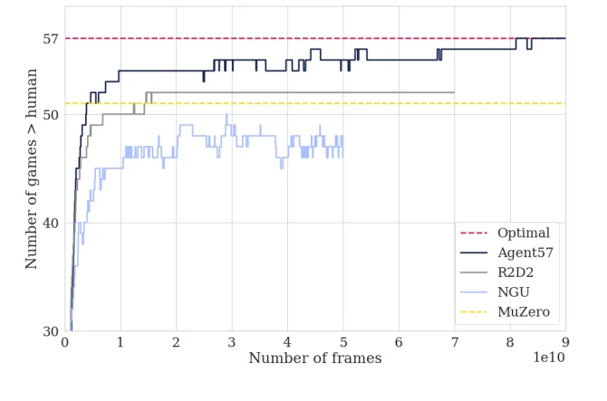
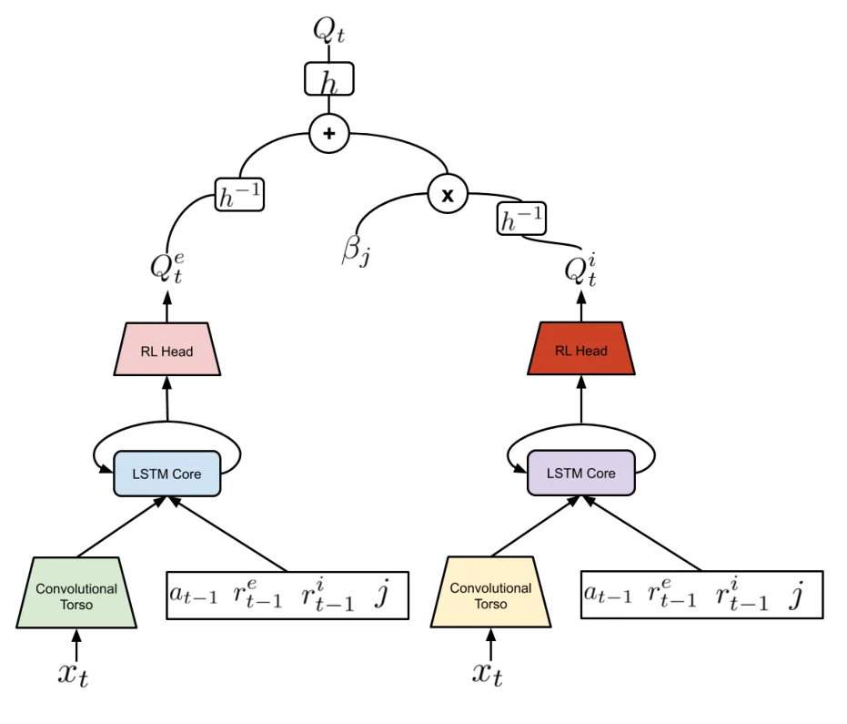
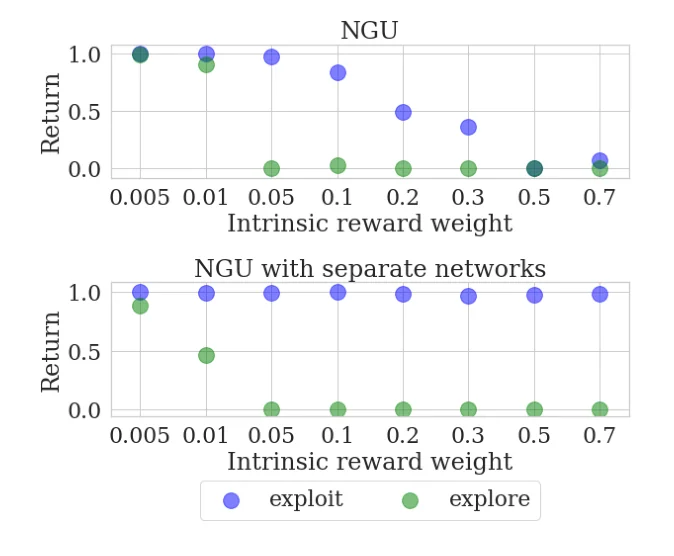

> - **논문**: Agent57: Outperforming the Atari Human Benchmark
> - **저자**: Adrià Puigdomènech Badia, Bilal Piot, Steven Kapturowski, Pablo Sprechmann, Alex Vitvitskyi, Daniel Guo, Charles Blundell (DeepMind)
> - **학회**: ICML 2020 · [arXiv:2003.13350](https://arxiv.org/abs/2003.13350)
{: .prompt-tip }

> [NGU]()는 Atari 57개 게임 중 51개에서 사람을 넘었지만, 평균·중앙값 점수는 R2D2에 못 미쳤습니다. **Agent57**은 NGU의 두 가지 약점을 고쳐, Atari 57개 게임 **전부**에서 사람 기준 점수를 넘은 첫 에이전트가 됐습니다.

## 1. 배경: 지금까지의 성과

| 알고리즘 | 사람 점수를 넘은 게임 수 (57개 중) |
|---|---|
| MuZero | 51 |
| NGU | 51 |
| R2D2 | 52 |
| R2D2 + bandit meta-controller | 54 |
| **Agent57** | **57** |

(Agent57 논문 본문과 Table 1 기준)

여러 알고리즘이 평균 점수는 높였지만, 몇몇 게임은 계속 넘지 못했습니다. 이런 알고리즘들은 많은 게임에서 사람의 1000% 넘는 점수를 내면서도, 못 푸는 게임에서는 아예 학습에 실패하는 경우가 많았습니다.


_Figure 1. 학습 frame에 따라 사람 기준을 넘은 게임 수. Agent57(남색)만 57개(빨간 점선)에 도달합니다. (출처: Badia et al., 2020)_

### Atari(ALE)의 두 가지 난제

- **Long-term credit assignment**: 지금 받은 보상이 **한참 전의 어떤 행동** 덕분인지 알아내 credit을 나누기 어렵습니다. 예: Skiing은 게임이 끝날 때 걸린 시간에 비례한 점수가 한 번에 나오고, 놓친 깃발마다 5초 벌점이 붙습니다. 초반에 깃발을 놓친 행동이 손해였다는 것을 끝에 가서야 알 수 있습니다.
- **고차원 상태 공간의 탐험**: Montezuma's Revenge, Pitfall!처럼 보상이 드문 게임에서는 보상을 적게 받더라도 **꾸준히 탐험**해야 합니다.

### Contribution

1. **Q 함수 분해**: intrinsic과 extrinsic 보상에 대한 가치 함수를 **분리**하는 새로운 parameterization
2. **Meta-controller**: 탐험 정도와 discount가 다른 정책들 중, 학습 과정에 따라 **어떤 정책에 우선순위를 줄지 적응적으로 선택**

## 2. NGU 복습

NGU는 탐험을 장려하는 intrinsic reward를 episodic novelty와 life-long novelty의 결합으로 정의했습니다.

- **Episodic novelty**: 한 에피소드 안에서 빠르게 사라짐 → 에피소드 내 탐험 장려
- **Life-long novelty**: 학습이 진행되며 천천히 사라짐 → 에피소드 간 탐험 장려

그리고 $$N$$개의 서로 다른 보상 $$r_{j,t} = r^e_t + \beta_j\,r^i_t$$를 만들어, 각각의 최적 가치 함수 $$Q^*_{r_j}$$를 하나의 네트워크로 학습했습니다.

- $$\beta_j$$: 탐험 속도. 클수록 탐험 정책, 작을수록 활용 정책
- $$\gamma_j$$: discount. 클수록 먼 미래까지(long-term credit assignment), 작을수록 짧은 시야

## 3. 개선 1: State-Action Value Function 분해

### NGU의 문제

NGU는 하나의 네트워크가 $$r^e + \beta_j r^i$$의 합을 학습합니다. 그런데 extrinsic과 intrinsic 보상은 **크기와 변화 양상이 전혀 다릅니다.** $$\beta$$가 크면 intrinsic 보상이 신호를 지배해서, 네트워크가 extrinsic 보상을 제대로 학습하지 못합니다.

### Agent57의 해결

Q 함수를 **두 개의 네트워크**로 나눕니다.

$$
Q(x, a, j;\ \theta) = Q(x, a, j;\ \theta^e) + \beta_j\,Q(x, a, j;\ \theta^i)
$$

- $$Q(\cdot;\theta^e)$$: **extrinsic** 보상으로만 학습
- $$Q(\cdot;\theta^i)$$: **intrinsic** 보상으로만 학습
- 두 네트워크는 **같은 구조**지만 별개의 파라미터로 따로 최적화
- 정책은 둘을 합친 $$Q$$에 대해 greedy (같은 정책을 목표로 함)
- 같은 replay sequence로 두 개의 transformed Retrace loss를 각각 계산합니다. optimizer 상태도 따로 둡니다.

논문은 이렇게 나눠서 학습하는 것이 (단순 gradient descent라는 조건하에) NGU처럼 하나의 네트워크로 합친 보상을 학습하는 것과 **같은 목적 함수**를 최적화한다는 것을 보였습니다. 목적은 같아도 각 네트워크가 자기 보상의 스케일과 분산에 맞춰 학습되므로 훨씬 안정적입니다.


_Figure 9. extrinsic $$Q^e$$와 intrinsic $$Q^i$$를 같은 구조(conv torso → LSTM → head)의 별도 네트워크로 두고 $$\beta_j$$로 합칩니다. 입력에는 직전 행동, 직전 두 보상, 정책 번호 $$j$$가 들어갑니다. 그림은 변환 $$h$$를 쓰는 일반형이고, 실험에서는 $$h$$를 항등 함수로 둔 단순 합을 썼습니다. (출처: Badia et al., 2020)_

```python
import torch.nn as nn

class SplitQ(nn.Module):
    def __init__(self, make_net):
        super().__init__()
        self.q_ext, self.q_int = make_net(), make_net()     # 같은 구조, 별도 파라미터

    def forward(self, x, j_onehot, beta_j):
        return self.q_ext(x, j_onehot) + beta_j * self.q_int(x, j_onehot)

# 학습: q_ext는 r_ext로, q_int는 r_int로 각각 TD 학습 (Retrace 등)
```

## 4. 개선 2: Meta-Controller로 정책 선택

### NGU의 문제

NGU는 하나의 네트워크로 탐험 수준이 다른 정책들을 함께 학습했습니다. 하지만 **학습에 대한 기여도와 상관없이 모든 정책을 똑같이** 학습했습니다. 탐험이 중요한 게임과 활용이 중요한 게임, 학습 초반과 후반에 필요한 정책이 다른데도 말입니다.

### Agent57의 해결

**Meta-controller**가 $$\{(\beta_j, \gamma_j)\}$$ 쌍 중 하나를 고릅니다. 각 actor가 에피소드를 시작할 때 어떤 $$j$$로 행동할지 정하고, 그 에피소드의 **extrinsic return**을 보상으로 받습니다. 이는 **multi-armed bandit** 문제이고, 논문은 환경 변화에 대응하기 위해 최근 결과만 보는 **sliding-window UCB**를 씁니다.

$$
j_k = \arg\max_j\left[\hat{\mu}_{k-1}(j) + \beta\sqrt{\frac{1}{N_{k-1}(j)}}\right]
$$

($$\hat{\mu}$$: 최근 window 안에서 $$j$$의 평균 return, $$N$$: 선택 횟수)

bandit의 보상은 그 에피소드의 **할인하지 않은 extrinsic return**입니다. 실제로는 확률 $$\epsilon_{UCB}$$로 무작위 arm을 고르고, 나머지 경우에 위 식을 씁니다. meta-controller는 전역 하나가 아니라 **actor마다 독립적으로** 둡니다. actor마다 $$\epsilon_l$$-greedy의 $$\epsilon_l$$이 달라 최적 arm도 다를 수 있기 때문입니다.

- 학습 초반 탐험이 필요할 때는 **큰 $$\beta$$, 작은 $$\gamma$$**를 고르고
- 학습이 진행될수록 반대 쌍(작은 $$\beta$$, 큰 $$\gamma$$)을 고르게 될 것으로 기대합니다.
- 평가할 때는 $$\beta = 0$$(순수 활용)에 과제에 맞는 $$\gamma$$를 고를 수 있어 **일반성**이 크게 좋아집니다.

```python
import numpy as np

class SlidingWindowUCB:
    def __init__(self, n_arms, window=90, beta=1.0, eps=0.5):
        self.n, self.w, self.beta, self.eps = n_arms, window, beta, eps
        self.history = []                                   # (arm, return)

    def select(self):
        recent = self.history[-self.w:]
        counts, sums = np.zeros(self.n), np.zeros(self.n)
        for arm, ret in recent:
            counts[arm] += 1; sums[arm] += ret
        if (counts == 0).any():
            return int(np.argmin(counts))                   # 안 해본 arm 먼저
        if np.random.rand() < self.eps:
            return np.random.randint(self.n)
        ucb = sums / counts + self.beta * np.sqrt(1.0 / counts)
        return int(np.argmax(ucb))

    def update(self, arm, extrinsic_return):
        self.history.append((arm, extrinsic_return))

# 정책 3개의 평균 return이 학습 도중(300번째 에피소드)에 뒤바뀌는 상황
np.random.seed(0)
bandit = SlidingWindowUCB(n_arms=3, window=90, beta=1.0, eps=0.5)
means, picks = [0.2, 0.5, 0.8], []
for k in range(600):
    if k == 300:
        means = [0.8, 0.5, 0.2]
    arm = bandit.select()
    picks.append(arm)
    bandit.update(arm, np.random.normal(means[arm], 0.1))
picks = np.array(picks)
print(np.bincount(picks[200:300], minlength=3) / 100)   # [0.14 0.15 0.71] → 2번 정책 위주
print(np.bincount(picks[500:600], minlength=3) / 100)   # [0.69 0.15 0.16] → 0번 정책으로 이동
```

최적 정책이 바뀌자 최근 90개 결과만 보는 window 덕분에 선택이 새로운 최적 정책으로 옮겨 갑니다. 전체 기록을 다 보는 일반 UCB라면 과거 300번의 기록에 묶여 훨씬 늦게 반응합니다. 학습이 진행되며 "좋은 정책"이 계속 바뀌는 RL에서 sliding window를 쓰는 이유입니다. ($$\epsilon = 0.5$$의 무작위 선택이 섞여 있어 최적 arm 비율이 70% 안팎에 머무릅니다.)

### 그 밖의 변경

- Backbone인 R2D2의 **backprop through time 길이를 80에서 160으로 두 배** 늘려 긴 시간 의존성을 학습
- Discount $$\gamma_j$$의 범위를 NGU의 0.99~0.997에서 **0.99~0.9999**로 넓혀 매우 긴 credit assignment에 대응

## 5. 구현 디테일

나머지 하이퍼파라미터와 Atari 전처리는 NGU와 같습니다.

| 항목 | 값 |
|---|---|
| 정책 수 $$N$$ / 최대 $$\beta$$ | 32 / 0.3 ($$\beta_j$$는 0과 0.3 사이를 sigmoid 모양으로 배치) |
| Discount | $$\gamma_j \in [0.99, 0.9999]$$, 탐험적인 정책일수록 작은 $$\gamma$$ |
| Q 네트워크 | extrinsic·intrinsic 각각 conv torso + LSTM + RL head, 분리 방식은 단순 합 |
| RL loss | transformed Retrace (extrinsic·intrinsic 따로), $$\lambda = 0.95$$ |
| Optimizer | Adam (R2D2 lr 0.0001, RND·행동 예측 lr 0.0005, clip norm 40) |
| Batch | 64 sequence, trace 길이 160, replay period 80, replay capacity 5e6 |
| Bandit (부록 Table 3) | window 90, UCB $$\beta = 1$$, $$\epsilon_{UCB} = 0.5$$ |
| Bandit (본문 4장) | actor: window 160 에피소드, $$\epsilon = 0.5$$ / evaluator: window 3,600 에피소드, $$\epsilon = 0.01$$ |
| 평가 | seed 6개(baseline은 3개) 평균, 최근 50 에피소드 이동 평균의 학습 중 최댓값 |

bandit window 크기는 본문과 부록 표가 서로 다릅니다(부록의 탐색 범위도 {160, 224, 320, 640}). 위 코드는 부록 Table 3의 값(90, 1, 0.5)을 썼습니다.

## 6. 실험 결과

### Atari 57개 게임 전체 (Table 1)

| 지표 | 의미 |
|---|---|
| Mean / Median HNS | 사람 대비 정규화 점수 $$\frac{\text{Agent} - \text{Random}}{\text{Human} - \text{Random}}$$의 평균 / 중앙값 |
| **Capped HNS** | 게임별 HNS를 [0, 100%]로 잘라 평균. 사람 수준에 못 미치는 게임을 강조해 "**모든 게임을 고르게 하는가**"를 반영 |

| 지표 (%) | **Agent57** | R2D2 (bandit) | NGU | R2D2 (Retrace) | R2D2 | MuZero |
|---|---|---|---|---|---|---|
| Capped mean | **100.00** | 96.93 | 95.07 | 94.20 | 94.33 | 89.92 |
| 사람 넘은 게임 수 | **57** | 54 | 51 | 52 | 52 | 51 |
| Mean | 4766.25 | 5461.66 | 3421.80 | 3518.36 | 4622.09 | **5661.84** |
| Median | 1933.49 | 2357.92 | 1359.78 | 1457.63 | 1935.86 | **2381.51** |
| 20th percentile | **324.78** | 303.61 | 226.43 | 267.25 | 215.31 | 171.39 |
| 10th percentile | **184.35** | 116.82 | 107.78 | 116.03 | 115.33 | 75.74 |
| 5th percentile | **116.67** | 93.25 | 64.10 | 48.32 | 50.27 | 0.03 |

- **MuZero**는 평균·중앙값이 가장 높았지만 **capped 점수는 가장 낮았습니다.** Beam Rider에서 27469%를 내는 반면, Venture에서는 무작위 정책과 같은 점수를 받는 등 일부 게임을 전혀 풀지 못했기 때문입니다. 5th percentile이 0.03%인 것이 이를 보여 줍니다.
- **R2D2(bandit)**: 같은 Retrace loss를 쓰는 R2D2(Retrace)에 meta-controller만 붙여도 평균·중앙값·capped 모두 크게 올랐습니다.
- **Agent57**은 평균·중앙값이 NGU·R2D2보다 높고 **capped mean이 100%**입니다. 하위 20% 게임까지는 모든 방법 중 가장 좋고, 상위 percentile에서만 R2D2(bandit)에 약간 밀립니다. 평균·중앙값 자체는 MuZero, R2D2(bandit)보다 낮다는 점도 같이 봐야 합니다.

### 마지막까지 어려웠던 게임들

- 50억 frame 시점에 51개 게임에서 사람을 넘었고, 그 뒤에 Montezuma's Revenge, Pitfall!, Private Eye 같은 어려운 탐험 게임을 포함해 6개 게임이 남았습니다.
- 마지막으로 **Skiing**을 약 **780억 frame**에서 넘어, 57개 게임 **모두**를 정복했습니다. Skiing은 높은 discount를 써야 해서 return 분산이 커 데이터가 많이 듭니다. 게다가 사람 기준 점수(-4336.9)가 무작위(-17098.1)보다 최적(-3272)에 훨씬 가까워 넘기 어려운 기준입니다.

### Ablation

Ablation은 hard exploration 6게임과 긴 credit assignment가 필요한 게임을 묶은 10개 "challenging set"(Beam Rider, Freeway, Montezuma's Revenge, Pitfall!, Pong, Private Eye, Skiing, Solaris, Surround, Venture)의 capped HNS로 봅니다. NGU에 개선을 하나씩 더할 때마다 최종 성능이 올랐고, 셋을 모두 넣어야 100%에 안정적으로 도달했습니다.

**Q 함수 분해**: Random Coin(15×15 빈 방, 무작위 위치의 동전을 밟으면 보상 1을 받고 종료, 최대 200 step)에서 1.5억 frame 학습 후 extrinsic return을 비교했습니다. 활용 정책은 동전으로 직진해야 하고(return 1), 탐험 정책은 동전을 피해 다른 칸을 다 돌아다녀야 해서(return 0) 두 정책이 아주 다릅니다.


_Figure 5. 가로축은 intrinsic reward 가중치 $$\beta$$. 위: NGU, 아래: 분리 네트워크를 쓴 NGU. 파랑은 활용 정책($$\beta_0 = 0$$), 초록은 가장 탐험적인 정책의 extrinsic return입니다. (출처: Badia et al., 2020)_

- NGU는 $$\beta$$가 커질수록 **활용 정책조차 동전을 못 먹게** 됩니다($$\beta = 0.2$$에서 약 0.5, 0.5 이상에서 거의 0). 하나의 네트워크가 $$\beta_j$$에 따라 크기가 전혀 다른 값을 표현해야 하기 때문입니다.
- 분리 네트워크를 쓰면 모든 $$\beta$$에서 활용 정책의 return이 1 근처로 유지됩니다.
- challenging set에서도 일반적인 개선이었고(10게임 중 나빠진 게임 없음), 가장 큰 개선은 Surround였습니다. NGU는 무작위 정책 수준이었지만 분리 네트워크로 거의 최적 점수에 도달했습니다. Agent57에서 분리 네트워크를 빼면 성능이 20% 넘게 떨어집니다.

**Backprop 길이 80 → 160**: R2D2와 Agent57 모두 초반에는 느리지만 더 안정적이고 최종 점수가 약간 높았습니다. Solaris에서 차이가 가장 컸습니다.

**Meta-controller**: R2D2에 붙이면 challenging set의 capped HNS가 **약 20%** 올랐습니다. 분리 네트워크를 쓴 NGU에 붙였을 때는 이득이 더 작았는데, bandit이 intrinsic·extrinsic 스케일 차이가 클 때 작은 $$\beta$$를 골라 주는 역할이 분리 네트워크와 일부 겹치기 때문으로 봅니다. 또 $$\gamma = 0.9999$$로 고정한 R2D2는 Skiing에서 사람을 넘지만 전체 게임에서는 불안정해 성능이 떨어졌습니다. meta-controller는 이 값을 게임별로 고를 수 있어 이런 절충이 필요 없습니다.

**게임별 선택 패턴**: meta-controller가 고르는 $$(\beta, \gamma)$$의 추세가 게임마다 달랐습니다. Skiing은 학습이 시작되자 곧 높은 discount를 고르고, Hero는 내내 높은 $$\beta$$와 낮은 $$\gamma$$를 선호했습니다. Gravitar, Crazy Climber, Beam Rider, Jamesbond는 초반에 탐험적이고 discount가 낮은 정책을 고르다가, 학습이 진행되며 discount가 높고 활용적인 정책으로 옮겨 갔습니다.

## 7. 정리

| NGU의 문제 | Agent57의 해결 |
|---|---|
| Extrinsic·intrinsic 보상을 하나의 Q로 학습 → 큰 $$\beta$$에서 extrinsic 학습 실패 | **Q를 두 네트워크로 분리** |
| 모든 정책을 똑같이 학습 | **Meta-controller(sliding-window UCB)**로 정책 우선순위 적응 |
| 긴 credit assignment | 더 큰 $$\gamma$$(최대 0.9999), backprop 길이 80 → 160 |
| 결과 | 57게임 모두 사람 이상, capped mean 100% (평균·중앙값은 MuZero보다 낮음) |

Agent57은 [Count-based]()에서 시작한 intrinsic motivation 계보가 RND, NGU를 거쳐 도달한 하나의 결론입니다. Exploration 카테고리는 여기까지이고, 다음은 Model-Based 계열의 [Diffuser]()로 넘어갑니다.

## References

- Badia et al., "Agent57: Outperforming the Atari Human Benchmark," ICML 2020. [arXiv:2003.13350](https://arxiv.org/abs/2003.13350)
- Badia et al., "Never Give Up: Learning Directed Exploration Strategies," ICLR 2020.
- Kapturowski et al., "Recurrent Experience Replay in Distributed Reinforcement Learning (R2D2)," ICLR 2019.
- Garivier & Moulines, "On Upper-Confidence Bound Policies for Switching Bandit Problems," ALT 2011.
