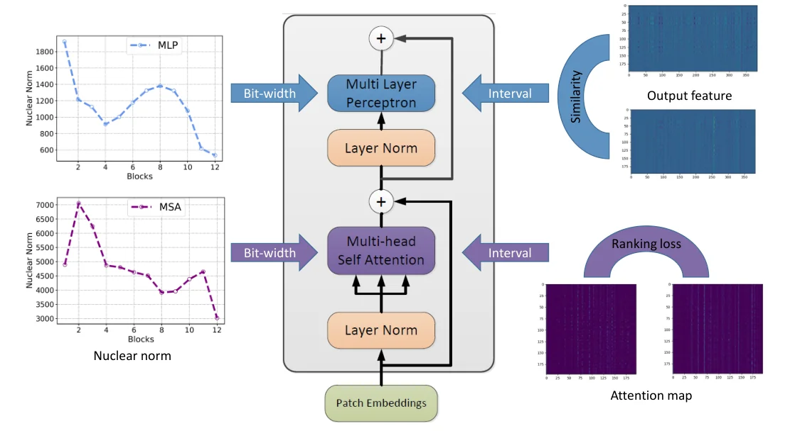

> - **논문**: Post-Training Quantization for Vision Transformer
> - **저자**: Zhenhua Liu, Yunhe Wang, Kai Han, Wei Zhang, Siwei Ma, Wen Gao (Peking University, Huawei Noah's Ark Lab, Peng Cheng Laboratory)
> - **학회**: NeurIPS 2021 · [arXiv:2106.14156](https://arxiv.org/abs/2106.14156) · [코드(MindSpore)](https://gitee.com/mindspore/models/tree/master/research/cv/VT-PTQ)
{: .prompt-tip }

> [FQ-ViT]()가 LayerNorm과 Softmax까지 양자화하는 데 집중했다면, 이 논문은 **재학습 없이** 선형 층과 attention의 양자화 구간을 어떻게 정할 것인가를 다룬다. 세 가지 장치를 쓴다. 양자화 전후 출력 특징의 Pearson 유사도를 최대화하는 구간 탐색, attention 맵의 상대적 순위를 보존하는 손실, 그리고 **핵 노름(nuclear norm)**으로 층별 민감도를 추정해 비트를 배정하는 혼합 정밀도이다. DeiT-B를 약 8비트 혼합 정밀도로 81.29%(FP 81.8%)까지 복원했다.

## 1. 문제: ViT의 PTQ는 CNN과 다르다

ViT-L은 307M 파라미터, 64 GFLOPs로 모바일에는 무겁고, 학습 데이터 전체로 재학습하는 양자화 인식 학습(QAT)은 비용이 크다. 소량의 보정 데이터만으로 하는 **post-training quantization(PTQ)**이 필요한데, CNN용 PTQ(percentile, EasyQuant, Bit-Split 등)를 ViT에 그대로 쓰면 정확도가 크게 떨어진다. 이유는 둘이다.

- 선형 층의 양자화 오차가 **출력 특징의 분포**를 바꾸고, 이것이 다음 층의 attention을 흔든다. 가중치의 MSE만 줄이는 기준으로는 부족하다.
- attention 맵을 양자화하면 **점수의 상대적 순서**가 바뀔 수 있다. Softmax 후 어떤 토큰이 더 중요한지가 바뀌면 출력이 크게 달라진다.

## 2. 방법


_Figure 1. 선형 층(MLP 등)은 출력 특징의 유사도로, MSA는 attention 맵의 순위 손실로 양자화 구간(Interval)을 정하고, 블록별 비트 수(Bit-width)는 왼쪽의 핵 노름 곡선으로 정한다. (출처: Liu et al., 2021)_

양자화 대상은 $$W^Q, W^K, W^V, W^O, W^1, W^2$$와 패치 임베딩 $$W^E$$, 그리고 모든 선형 층·행렬곱의 입력이다. Softmax와 LayerNorm은 파라미터가 적고 양자화하면 정확도가 크게 떨어진다는 이유로 양자화하지 않는다(Figure 1).

### 유사도 인식 구간 탐색

대칭 균일 양자화 $$\Psi_\Delta(X) = \text{clip}(\text{round}(X / \Delta), -2^{b-1}, 2^{b-1} - 1)$$에서 구간 $$\Delta$$를 정해야 한다. 이 논문은 가중치 자체가 아니라 **양자화 전후 출력 특징 사이의 Pearson 상관**을 기준으로 삼는다.

$$
\max_{\Delta_W, \Delta_X} \; \frac{1}{N} \sum_{i} \Gamma\!\left(O_i, \hat O_i\right), \qquad \Gamma(a, b) = \frac{\sum (a - \bar a)(b - \bar b)}{\sqrt{\sum (a - \bar a)^2}\sqrt{\sum (b - \bar b)^2}}
$$

여기서 $$O = X W$$, $$\hat O = \Psi(X)\Psi(W)$$이다. 구간은 가중치·입력의 최댓값으로 초기화하고, 후보 $$\Delta$$는 그 $$[\alpha, \beta] = [0.5, 1.2]$$ 배 구간을 $$C$$개로 선형 분할해 만든다. 입력 구간을 고정하고 가중치 구간을 고르고, 다시 가중치 구간을 고정하고 입력 구간을 고르는 식으로 번갈아 탐색해 수렴하거나 최대 반복(기본 20회)에 이르면 멈춘다. 저자들이 든 Pearson의 장점은 평균을 빼므로 양자화 전후 특징 분포의 유사도를 더 잘 나타낸다는 것이다.

### 순위 인식 손실

attention 맵 $$A = \text{softmax}(QK^\top / \sqrt{d})$$의 양자화에는 순서 보존 항을 더한다. 같은 행 안의 두 점수 $$(A_i, A_j)$$에 대해

$$
\mathcal{L}_{\text{rank}} = \sum_{i, j} \Phi\!\left(\, (\hat A_i - \hat A_j) \cdot \text{sign}(A_i - A_j)\, \right), \qquad \Phi(p) = (\theta - p)_+
$$

로, 양자화 후에도 원래 큰 쪽이 여전히 크도록(마진 $$\theta$$만큼) 요구하는 hinge 손실이다. 최종 목적은 $$\Gamma$$ 최대화와 $$\mathcal{L}_{\text{rank}}$$ 최소화를 $$\gamma$$로 섞은 것이고, 구간 탐색은 같은 방식으로 한다.

$$
\min_{\Delta_W, \Delta_X} \; \gamma \cdot \mathcal{L}_{\text{rank}} - \frac{1}{N} \sum_{i=1}^{N} \Gamma\!\left(O_i, \hat O_i\right)
$$

### 편향 보정

양자화 오차의 기댓값 $$\mathbb{E}[\hat O - O]$$를 보정 데이터로 추정해 출력 편향에서 빼 준다. 단순하지만 분포의 평균 이동을 제거해 효과가 있다.

### 핵 노름 기반 혼합 정밀도

층마다 민감도가 다르므로 비트를 다르게 배정한다. 하드웨어 구현을 고려해 한 MSA 모듈 또는 MLP 모듈 안의 연산은 모두 같은 비트를 쓴다. 민감도 지표로 각 층의 **attention 맵(MSA)과 출력 특징(MLP)의 핵 노름**, 즉 특이값의 합을 쓴다. 핵 노름이 크면 특징이 다양하고 정보가 많아 양자화에 민감하다고 본다. 핵 노름이 큰 층에 높은 비트를 주는 방향으로 탐색 공간을 줄이고, HAWQ-V2의 Pareto frontier 방식을 따라 핵 노름으로 가중한 양자화 섭동이 최소인 비트 설정을 목표 모델 크기 안에서 고른다.

$$
\Omega = \sum_{i=1}^{L_{MSA}} \text{tr}(A_i) \cdot \lVert \hat A_i - A_i \rVert_2^2 + \sum_{j=1}^{L_{MLP}} \text{tr}(O_j) \cdot \lVert \hat O_j - O_j \rVert_2^2
$$

여기서 $$\text{tr}(\cdot)$$는 핵 노름이다. 후보 비트는 목표가 6비트면 $$\{4, 5, 6, 7, 8\}$$, 8비트면 $$\{6, 7, 8, 9, 10\}$$이다. Hessian 기반 민감도(HAWQ)와 비교하면 계산 시간이 754.6초에서 53.1초로 줄면서 정확도는 비슷하다.

## 3. 코드로 보기: 구간 탐색 기준과 순위 손실

4비트 활성값에 대해 세 가지 기준(입력 MSE, 출력 MSE, 출력 Pearson)으로 구간을 고르고, attention 맵에서 순위 손실이 상위 키의 순서를 얼마나 지켜 주는지 본다.

```python
import numpy as np
rng = np.random.default_rng(0)

def quant(x, alpha, bits, signed=True):
    if signed:
        qmax = 2 ** (bits - 1) - 1; delta = alpha * np.abs(x).max() / qmax
        return np.clip(np.round(x / delta), -qmax - 1, qmax) * delta
    qmax = 2 ** bits - 1; delta = alpha * x.max() / qmax
    return np.clip(np.round(x / delta), 0, qmax) * delta

def pearson(a, b):
    a, b = a.ravel() - a.mean(), b.ravel() - b.mean()
    return float(a @ b / (np.linalg.norm(a) * np.linalg.norm(b) + 1e-12))

# --- (1) interval search for 4-bit activations (post-GELU, skewed) feeding a linear layer
W = rng.standard_normal((256, 256)) * 0.05
Z = rng.standard_normal((128, 256)) @ (rng.standard_normal((256, 256)) * 0.1 + np.eye(256))   # correlated features
X = Z * (1 / (1 + np.exp(-1.702 * Z)))                                                        # GELU
O = X @ W
alphas = np.linspace(0.05, 1.0, 96)
rows = []
for a in alphas:
    Xq = quant(X, a, 4); Oq = Xq @ W
    rows.append((a, np.mean((X - Xq) ** 2), np.mean((O - Oq) ** 2), pearson(O, Oq), np.linalg.norm(O - Oq) / np.linalg.norm(O)))
rows = np.array(rows)
print("4-bit activation quantization, clipping interval = alpha * max|X|")
print("criterion                 alpha   output rel.err   output Pearson")
for name, i in [("input MSE (naive)", np.argmin(rows[:, 1])), ("output MSE", np.argmin(rows[:, 2])), ("output Pearson (paper)", np.argmax(rows[:, 3]))]:
    print(f"{name:<24}  {rows[i,0]:>5.2f}   {rows[i,4]:>13.4f}   {rows[i,3]:>13.5f}")
print(f"alpha = 1.0 (no clipping, min-max): rel.err {rows[-1,4]:.4f}, Pearson {rows[-1,3]:.5f}")

# --- (2) ranking loss on attention: keep the ORDER of attention scores, not just their values
def rank_loss(a, aq, margin=0.002):
    order = np.sign(a[:, None] - a[None, :])
    return np.mean(np.maximum(0, -order * (aq[:, None] - aq[None, :]) + margin * np.abs(order)))
scores = rng.standard_normal((16, 64)) * 2.0
attn = np.exp(scores) / np.exp(scores).sum(-1, keepdims=True)
def top3_kept(a, aq): return np.mean([len(set(np.argsort(-r)[:3]) & set(np.argsort(-q)[:3])) / 3 for r, q in zip(a, aq)])
res = []
for a in np.linspace(0.1, 1.0, 37):
    aq = quant(attn, a, 4, signed=False)
    res.append((a, np.mean((attn - aq) ** 2), np.mean([rank_loss(r, q) for r, q in zip(attn, aq)]), top3_kept(attn, aq)))
res = np.array(res)
print()
print("attention map, unsigned 4-bit: objective = MSE + lambda * ranking loss")
print("lambda   chosen alpha   MSE        top-3 keys kept")
for lam in (0.0, 0.5, 2.0):
    i = np.argmin(res[:, 1] + lam * res[:, 2])
    print(f"{lam:>6}   {res[i,0]:>12.3f}   {res[i,1]:.2e}   {res[i,3]:>15.3f}")

# --- (3) nuclear norm of a layer's attention map / output as a sensitivity proxy for mixed precision
print()
print("layer  nuclear norm   assigned bits")
norms = []
for l in range(6):
    rank = [2, 64, 8, 32, 4, 16][l]
    A = rng.standard_normal((64, rank)) @ rng.standard_normal((rank, 64))
    norms.append(np.linalg.norm(A, "nuc"))
order = np.argsort(norms)
bits = {int(order[i]): [4, 4, 6, 6, 8, 8][i] for i in range(6)}
for l in range(6): print(f"{l:>5}  {norms[l]:>12.1f}   {bits[l]:>13}")
```

```text
4-bit activation quantization, clipping interval = alpha * max|X|
criterion                 alpha   output rel.err   output Pearson
input MSE (naive)          0.59          0.1350         0.99084
output MSE                 0.60          0.1349         0.99086
output Pearson (paper)     0.60          0.1349         0.99086
alpha = 1.0 (no clipping, min-max): rel.err 0.1915, Pearson 0.98192

attention map, unsigned 4-bit: objective = MSE + lambda * ranking loss
lambda   chosen alpha   MSE        top-3 keys kept
   0.0          0.900   3.24e-05             0.875
   0.5          0.675   6.24e-05             0.938
   2.0          0.125   9.27e-04             0.750

layer  nuclear norm   assigned bits
    0         147.2               4
    1        3077.7               8
    2         467.7               6
    3        1783.7               8
    4         254.5               4
    5         952.7               6
```

- 구간 탐색 자체는 효과가 크다. 최댓값에 맞추는 min-max($$\alpha = 1$$)보다 $$\alpha \approx 0.6$$으로 **잘라 내는 쪽이 출력 오차를 19%에서 13.5%로** 줄인다. 다만 이 toy(GELU 뒤 선형층 하나)에서는 입력 MSE, 출력 MSE, Pearson이 거의 같은 구간을 고른다. 논문은 기준끼리 직접 비교한 ablation을 싣지 않았고(표 3의 ViT-B 75.42 → 76.98은 순위 손실·편향 보정·혼합 정밀도를 더한 효과이다), Pearson 기준의 이점은 실제 ViT의 특징 분포와 뒤따르는 LayerNorm·Softmax에서 나올 것이라 장난감 분포로는 재현되지 않았다.
- 순위 손실의 효과는 뚜렷하다. MSE만 쓰면 큰 값을 살리느라 $$\alpha = 0.9$$를 고르고 상위 3개 키의 보존율이 87.5%인데, 순위 손실을 $$\lambda = 0.5$$로 더하면 $$\alpha = 0.675$$에서 **93.8%**로 오른다. $$\lambda$$가 너무 크면(2.0) 작은 값들의 순서를 지키느라 구간을 지나치게 좁혀 보존율이 떨어진다. 논문의 $$\gamma$$ 균형이 필요한 이유이다.
- 핵 노름은 행렬의 유효 랭크를 반영하므로, 랭크가 높은 층에 높은 비트가 배정된다.

## 4. 실험

### 구현 디테일

| 항목 | 값 |
|---|---|
| 보정 데이터 | 학습셋에서 무작위로 CIFAR-10·100은 100장, ImageNet·COCO2017은 1,000장 |
| 구간 탐색 | 후보 범위 $$[\alpha, \beta] = [0.5, 1.2]$$ × 최댓값, 교대 탐색 최대 20회 |
| 혼합 정밀도 후보 | 목표 6비트: $$\{4..8\}$$, 목표 8비트: $$\{6..10\}$$, MSA·MLP 모듈 단위 배정 |
| 양자화하지 않는 것 | Softmax, LayerNorm |
| 모델 | ViT-B(12층, 12 head, 768차원), ViT-L(24층, 16 head, 1024차원), DeiT-S(12층, 6 head, 384차원), DeiT-B(12층, 12 head, 768차원), DETR(ResNet-50) |
| 비교 방법 | Percentile, EasyQuant, Bit-Split을 저자들이 ViT에 맞춰 직접 구현 |

### ImageNet 분류 (Table 1 일부)

| 모델 | 방법 | W/A 비트 | 모델 크기(MB) | Top-1 |
|---|---|---|---|---|
| ViT-B (FP 77.91) | Percentile | 6/6 | 64.5 | 71.58 |
| | Ours | 6 MP / 6 MP | 64.8 | 75.26 |
| | Percentile | 8/8 | 86.2 | 74.10 |
| | Ours | 8 MP / 8 MP | 86.5 | 76.98 |
| ViT-L (FP 76.53) | Percentile | 8/8 | 307 | 75.17 |
| | Ours | 8 MP / 8 MP | 306.4 | 76.41 |
| DeiT-S (FP 79.8) | EasyQuant | 6/6 | 16.5 | 73.26 |
| | Bit-Split | 6/6 | 16.5 | 74.04 |
| | Ours | 6/6 | 16.5 | 74.58 |
| | EasyQuant | 8/8 | 22.0 | 76.59 |
| | Bit-Split | 8/8 | 22.0 | 77.06 |
| | Ours | 8/8 | 22.0 | 77.47 |
| | Ours | 8 MP / 8 MP | 22.2 | 78.09 |
| DeiT-B (FP 81.8) | Bit-Split | 6/6 | 64.5 | 76.39 |
| | Ours | 6/6 | 64.5 | 77.02 |
| | Bit-Split | 8/8 | 86.0 | 79.42 |
| | Ours | 8/8 | 86.0 | 80.48 |
| | Ours | 8 MP / 8 MP | 86.8 | 81.29 |
| | Ours | 4 MP / 4 MP | 43.6 | 75.94 |

고정 비트에서도 EasyQuant, Bit-Split보다 높고, 혼합 정밀도를 더하면 DeiT-B 8비트는 FP 대비 약 0.5%p 손실까지 좁혀진다. ViT-B에서는 6비트 모델(75.26)이 percentile의 8비트 모델(74.10)보다 낫다. 저자들은 이를 두고 기존 PTQ보다 메모리 약 25%, 연산 약 44%를 아낄 수 있다고 말한다. ViT-L은 ViT-B보다 양자화 손실이 작은데, 중복이 많아서라고 해석한다. CIFAR-10에서는 ViT-L 8 MP가 97.90으로 FP(97.86)보다 오히려 높다.

### 검출 (Table 2, DETR, COCO2017)

| 방법 | 6/6 mAP | 8/8 mAP |
|---|---|---|
| FP (42.0) | - | - |
| Percentile | 37.5 | 38.6 |
| EasyQuant | 39.0 | 40.4 |
| Bit-Split | 38.9 | 40.6 |
| Ours | 40.1 | 41.2 |
| Ours (MP) | 40.5 | 41.7 |

8비트 혼합 정밀도에서 FP 42.0 대비 0.3 mAP 손실이다.

### Ablation (Table 3, ViT-B, ImageNet, 8비트)

| 유사도 | 순위 손실 | 편향 보정 | 혼합 정밀도 | Top-1 |
|---|---|---|---|---|
| ✓ | | | | 75.42 |
| ✓ | ✓ | | | 75.94 |
| ✓ | | ✓ | | 75.81 |
| ✓ | ✓ | ✓ | | 76.49 |
| ✓ | | | ✓ | 76.26 |
| ✓ | | ✓ | ✓ | 76.61 |
| ✓ | ✓ | | ✓ | 76.53 |
| ✓ | ✓ | ✓ | ✓ | **76.98** |

- 유사도 기준 탐색만 쓴 75.42%에서 순위 손실이 +0.52%p, 편향 보정이 +0.39%p, 혼합 정밀도가 +0.84%p를 보탠다. 모든 행에 유사도 탐색이 들어 있어 유사도 기준 자체의 기여(예: MSE 기준 탐색과의 비교)는 이 표로 알 수 없다.
- 핵 노름 혼합 정밀도와 Hessian 기반 혼합 정밀도(Table 4)를 비교하면 Top-1은 76.98 대 77.01로 비슷하고, 계산 시간은 53.1초 대 754.6초이다.

## 5. 해석

**1. "무엇을 보존할 것인가"를 바꾼 논문이다.** 가중치의 MSE가 아니라 출력 특징의 상관을, 절댓값이 아니라 순위를 보존 대상으로 삼았다. [DIST]()가 지식 증류에서 KL 대신 Pearson 상관으로 "관계"를 옮긴 것과 같은 발상이 양자화에 적용된 셈이다.

**2. 순위 손실은 attention의 성질에 맞춘 장치이다.** Softmax 뒤의 attention 맵은 값의 범위가 좁고 대부분이 0 근처라, 균일 양자화는 작은 값들을 뭉개 순서를 뒤섞기 쉽다. 위 실험에서 보듯 순위를 지키려면 구간을 좁혀야 하고, 그 대가로 큰 값의 정밀도가 떨어지므로 균형 계수가 필요하다. [FQ-ViT]()의 log2 양자화는 같은 문제를 비균일 격자로 푼 것이다.

**3. 핵 노름은 싸고 그럴듯한 민감도 대리 지표이다.** Hessian 계산보다 14배 빠르면서 비슷한 정확도를 냈다는 점이 실용적이다. 다만 "핵 노름이 크면 민감하다"는 가정은 경험적이고, 랭크가 높지만 양자화에 둔감한 층이 있을 수 있다.

**4. PTQ 연구의 중간 지점에 있다.** 이 논문은 선형 층과 attention 맵만 다루고 LayerNorm, Softmax, GELU는 부동소수점으로 둔다. 완전 정수 추론을 위해서는 FQ-ViT의 Power-of-Two Factor와 log2 양자화, 혹은 이후의 RepQ-ViT 같은 후속 연구가 필요하다. [양자화 기초]()와 함께 읽으면 PTQ의 설계 공간이 보인다.

**5. 평가를 읽을 때 주의할 점.** 혼합 정밀도의 "8 MP"는 평균 비트가 8에 가깝다는 뜻이고 논문 표 1의 모델 크기 열(예: ViT-B ImageNet 8 MP 86.5MB, 8비트 Percentile 86.2MB)에서 확인해야 한다. 비교 대상 중 percentile 등은 저자들이 ViT에 맞춰 구현한 것이다. 위 toy에서 구간 탐색 기준 간 차이가 나지 않은 것은 toy의 한계일 수도, Pearson 기준의 이점이 특정 분포에서만 나타난다는 신호일 수도 있어 실제 모델로 확인해야 한다.

## 6. 정리

| 항목 | 내용 |
|---|---|
| 문제 | 재학습 없는 ViT 양자화에서 CNN용 PTQ가 크게 실패 |
| 구간 탐색 | 양자화 전후 출력 특징의 Pearson 유사도 최대화, 가중치·입력 구간 교대 탐색 |
| attention | 순위 보존 hinge 손실 $$\sum \Phi((\hat A_i - \hat A_j)\,\text{sign}(A_i - A_j))$$ 추가 |
| 편향 보정 | 양자화 오차 기댓값을 출력 편향에서 제거 |
| 혼합 정밀도 | attention 맵·출력 특징의 핵 노름으로 층별 비트 배정(목표 6비트는 $$\{4..8\}$$, 8비트는 $$\{6..10\}$$), Hessian보다 14배 빠름 |
| 결과 | DeiT-B 8 MP 81.29%(FP 81.8), ViT-B 8 MP 76.98%(percentile 74.10), DETR 8 MP 41.7 mAP(FP 42.0) |

## References

- Liu, Wang, Han, Zhang, Ma, Gao, "Post-Training Quantization for Vision Transformer," NeurIPS 2021. [arXiv:2106.14156](https://arxiv.org/abs/2106.14156)
- Lin et al., "FQ-ViT: Post-Training Quantization for Fully Quantized Vision Transformer," IJCAI 2022. [arXiv:2111.13824](https://arxiv.org/abs/2111.13824)
- Wu et al., "EasyQuant: Post-training Quantization via Scale Optimization," 2020. [arXiv:2006.16669](https://arxiv.org/abs/2006.16669)
- Wang et al., "Towards Accurate Post-training Network Quantization via Bit-Split and Stitching," ICML 2020.
- Dong et al., "HAWQ: Hessian AWare Quantization of Neural Networks with Mixed-Precision," ICCV 2019. [arXiv:1905.03696](https://arxiv.org/abs/1905.03696)
