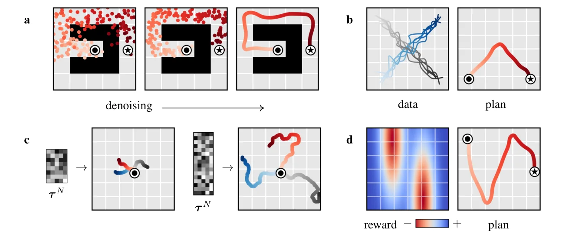
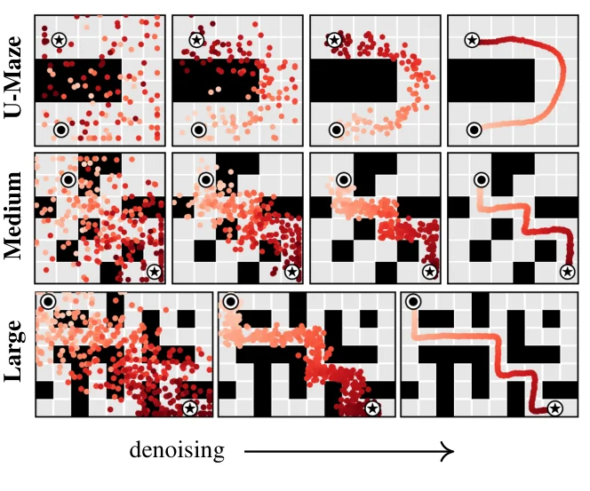

> - **논문**: Planning with Diffusion for Flexible Behavior Synthesis
> - **저자**: Michael Janner, Yilun Du, Joshua B. Tenenbaum, Sergey Levine (UC Berkeley, MIT)
> - **학회**: ICML 2022 · [arXiv:2205.09991](https://arxiv.org/abs/2205.09991) · [프로젝트 페이지](https://diffusion-planning.github.io) · [코드](https://github.com/jannerm/diffuser)
{: .prompt-tip }

> [Trajectory Transformer]()가 궤적을 **한 토큰씩** 생성하며 계획했다면, **Diffuser**는 [Diffusion 모델]()로 궤적 **전체를 한꺼번에** 노이즈에서 생성한다. 모델 학습과 계획(planning)을 하나로 합쳐, "계획 = 샘플링"이 되게 만든 것이다.

## 1. 배경

### 문제 설정: Trajectory Optimization

이산 시간 동역학 $$s_{t+1} = f(s_t, a_t)$$에서, 보상의 합을 최대화하는 행동 시퀀스를 찾는 문제이다.

$$
a^*_{0:T} = \arg\max_{a_{0:T}} \mathcal{J}(s_0, a_{0:T}) = \arg\max_{a_{0:T}}\sum_{t=0}^{T} r(s_t, a_t)
$$

### Diffusion 모델 복습

데이터에 노이즈를 조금씩 더하는 forward 과정 $$q(\tau^i \mid \tau^{i-1})$$과, 노이즈에서 조금씩 복원하는 reverse 과정 $$p_\theta(\tau^{i-1} \mid \tau^i)$$로 데이터를 생성한다. Reverse 과정은 평균 $$\mu_\theta$$와 공분산 $$\Sigma^i$$를 갖는 가우시안이며, 음의 로그 우도의 **변분 상한(variational bound)**을 최소화해 학습한다. ($$\tau^N \sim \mathcal{N}(0, I)$$에서 시작)

> 이 글에서 위첨자 $$i$$는 **diffusion step**, 아래첨자 $$t$$는 **궤적의 시점**이다.

## 2. 기존 Model-Based 방식의 문제

기존 방식은 모델을 먼저 학습하고, 그 위에 고전적인 계획 알고리즘(MPC, CEM 등)을 얹는다.

- 계획 알고리즘은 환경 동역학 $$f$$를 정확히 안다고 가정하고 설계됐는데, **학습된 모델은 실제 동역학과 다르다.**
- 그래서 계획기는 학습된 모델의 오차를 이용하는 궤적, 즉 모델을 속이는 **adversarial example**을 찾아내기 쉽다. 모델 안에서는 보상이 높아 보이지만 실제 환경에서는 실패하는 계획이다.
- 한 step씩 예측하는 모델은 오차가 누적돼 **long-horizon** 계획이 부정확하다.

## 3. Diffuser의 아이디어

**모델과 계획을 하나로** 합친다. 궤적 전체의 분포를 diffusion 모델로 학습하고, 계획은 이 모델에서 **샘플링**하는 것으로 대신한다.

$$
\tilde{p}_\theta(\tau) \propto p_\theta(\tau)\,h(\tau)
$$

- $$p_\theta(\tau)$$: **사전 증거(prior evidence)**. 데이터에서 학습한 "물리적으로 그럴듯한 궤적"의 분포
- $$h(\tau)$$: **원하는 결과(desired outcome)**. 높은 보상, 목표 도달, 제약 조건 등

"그럴듯하면서(physically realistic) 보상도 높은(high reward)" 궤적을 뽑는 것이 곧 계획이다. 한 step의 정확도보다 궤적 전체의 일관성이 중요해진다.

## 4. 궤적을 어떻게 표현하나

### 궤적 = 2D 배열

상태와 행동을 시점별로 쌓아 **이미지처럼** 다룬다.

$$
\tau = \begin{bmatrix} s_0 & s_1 & \cdots & s_T \\ a_0 & a_1 & \cdots & a_T \end{bmatrix}
$$

가로축은 시간(planning horizon), 세로축은 상태와 행동의 차원이다. 상태와 행동을 동시에 예측한다.

### 시간 순서 (Temporal Ordering)

동역학 예측은 **인과적(causal)**이다. 과거가 미래를 결정한다. 하지만 의사결정은 **반인과적(anti-causal)**이다. 미래의 목표가 지금의 행동을 결정한다. 그래서 상태를 autoregressive하게 앞에서부터 예측하지 않고, 계획 전체를 동시에(concurrently) 예측한다.

### 시간 지역성 (Temporal Locality)

각 diffusion step에서는 가까운 시점들끼리만 일관되게 맞춘다(local receptive field). 이를 여러 번 반복하면 국소적인 일관성이 쌓여 전체 궤적의 일관성이 생긴다. 그래서 **1D 시간축 convolution으로 이루어진 U-Net**(temporal U-Net)을 쓴다. 이미지 diffusion의 U-Net에서 2D 공간 convolution을 1D 시간 convolution으로 바꾼 구조로, residual block 6개, 각 block은 temporal conv 2개 + group norm + Mish이고 diffusion step 임베딩은 FC 층 하나로 만들어 첫 conv 출력에 더한다(부록 C).

- Non-autoregressive 예측
- 시간적으로 국소적인 denoising
- Planning horizon이 하나의 추가 차원이 됨

학습은 DDPM의 단순화된 목적 그대로이다. 노이즈를 섞은 궤적 $$\tau^i$$에서 노이즈 $$\epsilon$$을 맞히고, reverse 과정의 공분산 $$\Sigma^i$$는 cosine schedule을 따른다.

$$
\mathcal{L}(\theta) = \mathbb{E}_{i, \epsilon, \tau^0}\big[\lVert \epsilon - \epsilon_\theta(\tau^i, i) \rVert^2\big], \qquad i \sim \mathcal{U}\{1, \dots, N\}
$$

부록에 따르면 $$\epsilon$$ 대신 깨끗한 궤적 $$\tau^0$$를 예측해도 제어 성능은 크게 다르지 않았다.

## 5. 보상으로 유도하기: Guided Sampling

강화학습에서는 높은 보상을 원한다. 시점 $$t$$가 최적이면 1인 이진 변수 $$\mathcal{O}_t$$를 $$p(\mathcal{O}_t = 1) = \exp(r(s_t, a_t))$$로 두고 $$h(\tau) = p(\mathcal{O}_{1:T} = 1 \mid \tau)$$로 놓는다. 그러면 reverse 과정을 다음처럼 근사할 수 있다.

$$
p_\theta(\tau^{i-1} \mid \tau^i, \mathcal{O}_{1:T}) \approx \mathcal{N}\big(\tau^{i-1};\ \mu + \Sigma g,\ \Sigma\big),\qquad g = \nabla_\tau \mathcal{J}_\phi(\mu)
$$

- $$\mathcal{J}_\phi$$: 노이즈가 섞인 궤적에서 **return을 예측**하도록 따로 학습한 네트워크
- denoising step마다 평균을 **return이 커지는 방향**으로 조금 밀어 줌

Classifier guidance와 같은 원리이다. Diffusion 모델 자체는 보상을 모르고 데이터만 학습하므로, 같은 모델에 다른 return 함수를 붙이면 다른 과제를 풀 수 있다.

## 6. 목표로 유도하기: Inpainting

"시작 상태는 $$s_0$$이고 목표 상태는 $$s_T$$"처럼 특정 지점의 조건만 만족하면 되는 문제는 더 간단하다. diffusion step마다 그 위치의 값을 조건값으로 덮어쓴다.

$$
h(\tau) = \delta_{c_t}(s_t)
$$

이미지 inpainting에서 알려진 픽셀을 고정하고 나머지를 채우는 것과 같다. 시작과 끝을 고정하면 그 사이를 그럴듯한 경로로 채워 준다.

```python
import torch

@torch.no_grad()
def diffuser_plan(model, value_fn, s0, horizon, n_steps, guide_scale=0.1, goal=None):
    """tau: (B, horizon, state_dim + action_dim), 앞쪽 state_dim이 상태"""
    tau = torch.randn(1, horizon, model.transition_dim)
    for i in reversed(range(n_steps)):
        tau[:, 0, :model.state_dim] = s0                      # 시작 상태 inpainting
        if goal is not None:
            tau[:, -1, :model.state_dim] = goal               # 목표 상태 inpainting
        mean, var = model.p_mean_variance(tau, i)
        if value_fn is not None:                              # return 쪽으로 guidance
            with torch.enable_grad():
                x = mean.detach().requires_grad_(True)
                grad = torch.autograd.grad(value_fn(x, i).sum(), x)[0]
            mean = mean + guide_scale * var * grad
        tau = mean + (var.sqrt() * torch.randn_like(tau) if i > 0 else 0)
    tau[:, 0, :model.state_dim] = s0
    return tau[:, 0, model.state_dim:]                        # 첫 행동을 실행 (receding horizon)
```

실제로는 계획한 궤적의 첫 행동만 실행하고, 다음 상태에서 다시 계획한다(receding horizon control).

> 위 코드는 흐름을 보여 주기 위한 의사 코드에 가깝다. `model.p_mean_variance(tau, i)`는 학습된 diffusion 모델이 diffusion step $$i$$에서 reverse 분포의 평균과 분산을 돌려준다고 가정하고, `value_fn(x, i)`는 노이즈가 섞인 궤적의 return을 예측하는 네트워크이다. 실제 구현은 공식 저장소(jannerm/diffuser)를 참고하면 된다.
{: .prompt-info }

<details markdown="1">
<summary>더 알아보기: 계획 한 번에 드는 비용</summary>

Diffuser는 행동 하나를 고르기 위해 denoising을 $$N$$번(논문 설정에서 locomotion 20번, 블록 쌓기 100번) 반복하고, 매번 temporal U-Net 전체와 guidance를 위한 역전파를 계산한다. 환경 step마다 다시 계획하므로, 한 step에 신경망 한 번만 통과하는 model-free 정책보다 훨씬 느리다. 논문 자체도 직전 계획에 노이즈를 조금만 다시 섞어 몇 step만 denoising하는 warm-start를 제안하고, Walker2d Medium-Expert에서 denoising step을 10분의 1로 줄여도 성능이 조금만 떨어진다고 보고한다(Figure 7). 이 비용을 줄이려고 이후 연구들은 denoising step 수를 줄이거나([LCM]()과 같은 증류 아이디어), 계획을 몇 step에 한 번만 다시 하는 방식을 쓴다.
</details>

## 7. Diffusion Planner의 성질


_Figure 3. (a) 희소 보상에서도 긴 계획 생성, (b) 직선 궤적만 학습하고 V자 경로를 조합, (c) 입력 노이즈 길이로 계획 길이 조절, (d) 학습 때 없던 보상 함수로 계획. 동그라미가 시작, 별이 목표이다. (출처: Janner et al., 2022)_

### Learned Long-Horizon Planning

Single-step 모델은 환경 동역학 $$f$$의 대리(proxy)로 쓰이고 그 위에서 따로 계획해야 한다. Diffuser는 계획이 diffusion 모델이 생성할 수 있는 것(affordance)과 직접 연결되어 있어, **long-horizon에서 효율적**이다. 보상이 드물고 긴 계획이 필요한 Maze2D에서 특히 강했다.

### Temporal Compositionality

Single-step 모델은 Markov 성질 덕분에, 데이터에 있는 짧은 transition들을 이어 붙여 데이터에 없는 새로운 궤적으로 일반화한다. Diffuser도 국소적인 일관성만 학습하므로, 학습 데이터의 부분 궤적들을 **조합해** 처음 보는 경로를 만들어 낸다. Figure 3b는 직선으로만 움직이는 궤적으로 학습한 모델이 두 직선의 교차점에서 이어 붙여 V자 경로를 만드는 예이다.

### Variable-Length Plans

계획 길이가 모델 구조로 고정되지 않는다. **입력 노이즈의 길이**를 바꾸면 계획 길이도 바뀐다.

### Task Compositionality / Test-Time Flexibility

환경 동역학과 행동의 그럴듯함은 diffusion 모델이, 과제는 guide 함수가 담당한다. 그래서 **학습 때 보지 못한 보상 함수**도 테스트 때 guide만 바꿔 풀 수 있다. 블록 쌓기 실험에서 "이 블록을 저 블록 위에" 같은 새로운 조건을 테스트 시점에 줘도 동작했다.

## 8. 실험

### Maze2D: 긴 horizon 계획 (Table 1)

목표에 도달할 때만 보상 1을 주는 희소 보상 미로이다. 목표까지 수백 step이 걸려 model-free 방법은 credit assignment에 어려움을 겪는다. Diffuser는 시작과 목표를 inpainting으로 고정해 계획을 뽑고, 그 궤적을 open-loop로 따라간다(Figure 4). Multi2D는 에피소드마다 목표 위치를 바꾸는 multi-task 설정이다.


_Figure 4. Maze2D U-Maze, Medium, Large에서 시작(동그라미)과 목표(별)를 고정하고 나머지 상태를 denoising으로 채워 계획을 만드는 과정. (출처: Janner et al., 2022)_

| 환경 | MPPI | CQL | IQL | Diffuser |
|---|---|---|---|---|
| Maze2D U-Maze | 33.2 | 5.7 | 47.4 | **113.9** ±3.1 |
| Maze2D Medium | 10.2 | 5.0 | 34.9 | **121.5** ±2.7 |
| Maze2D Large | 5.1 | 12.5 | 58.6 | **123.0** ±6.4 |
| Single-task 평균 | 16.2 | 7.7 | 47.0 | **119.5** |
| Multi2D U-Maze | 41.2 | - | 24.8 | **128.9** ±1.8 |
| Multi2D Medium | 15.4 | - | 12.1 | **127.2** ±3.4 |
| Multi2D Large | 8.0 | - | 13.9 | **132.1** ±5.8 |
| Multi-task 평균 | 21.5 | - | 16.9 | **129.4** |

- 모든 미로에서 100을 넘어 기준 전문가 정책보다 높다. 같은 모델을 재학습 없이 조건(목표)만 바꿔 Multi2D에 쓰고도 성능이 유지되는 반면, 가장 강한 model-free 기준선 IQL(목표 조건 + hindsight relabeling)은 47.0에서 16.9로 떨어진다.
- MPPI는 **실제 동역학**을 쓰는 계획기인데도 낮다. 예측 오차가 없어도 긴 horizon 계획 자체가 어렵다는 뜻이다.

### 블록 쌓기: 테스트 시점 유연성 (Table 3)

PDDLStream으로 만든 시연 궤적 10,000개로 학습한 Diffuser 하나를 세 과제에 그대로 쓰고 $$h(\tau)$$만 바꾼다. 조건부 쌓기와 재배치에서는 "최종 상태가 목표 배치와 맞는가"를 판정하는 분류기와 "로봇 팔과 블록이 접촉하는가"를 요구하는 접촉 제약 두 가지를 함께 건다. 100점이 완벽한 수행, 0점이 무작위 정책이다.

| 과제 | BCQ | CQL | Diffuser |
|---|---|---|---|
| Unconditional Stacking | 0.0 | 24.4 | **58.7** ±2.5 |
| Conditional Stacking | 0.0 | 0.0 | **45.6** ±3.1 |
| Rearrangement | 0.0 | 0.0 | **58.9** ±3.4 |
| 평균 | 0.0 | 8.1 | **54.4** |

### D4RL Offline RL (Table 2)

보상 예측기 $$\mathcal{J}_\phi$$의 guidance로 높은 보상 쪽 궤적을 뽑고, 현재 상태는 inpainting으로 고정한다. Diffuser 점수는 계획 seed 150개의 평균과 표준오차이다.

| 데이터 | 환경 | BC | CQL | IQL | DT | TT | MOReL | MBOP | Diffuser |
|---|---|---|---|---|---|---|---|---|---|
| Medium-Expert | HalfCheetah | 55.2 | 91.6 | 86.7 | 86.8 | 95.0 | 53.3 | 105.9 | 88.9 |
| Medium-Expert | Hopper | 52.5 | 105.4 | 91.5 | 107.6 | 110.0 | 108.7 | 55.1 | 103.3 |
| Medium-Expert | Walker2d | 107.5 | 108.8 | 109.6 | 108.1 | 101.9 | 95.6 | 70.2 | 106.9 |
| Medium | HalfCheetah | 42.6 | 44.0 | 47.4 | 42.6 | 46.9 | 42.1 | 44.6 | 42.8 |
| Medium | Hopper | 52.9 | 58.5 | 66.3 | 67.6 | 61.1 | 95.4 | 48.8 | 74.3 |
| Medium | Walker2d | 75.3 | 72.5 | 78.3 | 74.0 | 79.0 | 77.8 | 41.0 | 79.6 |
| Medium-Replay | HalfCheetah | 36.6 | 45.5 | 44.2 | 36.6 | 41.9 | 40.2 | 42.3 | 37.7 |
| Medium-Replay | Hopper | 18.1 | 95.0 | 94.7 | 82.7 | 91.5 | 93.6 | 12.4 | 93.6 |
| Medium-Replay | Walker2d | 26.0 | 77.2 | 73.9 | 66.6 | 82.6 | 49.8 | 9.7 | 70.6 |
| **평균** | | 51.9 | 77.6 | 77.0 | 74.7 | **78.9** | 72.9 | 47.8 | 77.5 |

(MOPO 평균 42.1은 생략했다.) 평균 77.5로 MOReL·MBOP·DT보다 높고 CQL·IQL·TT와 비슷한 수준이며, 단일 과제 성능만 노린 최상위 offline RL 방법을 넘지는 못한다. Diffuser를 단순히 동역학 모델로 쓰고 MPPI 같은 기존 계획기를 붙이면 무작위 정책보다 나을 게 없었다는 결과도 있다. 성능이 예측 정확도가 아니라 **모델과 계획의 결합**에서 나온다는 근거이다.

### 구현 디테일 (부록 C)

| 항목 | 값 |
|---|---|
| 구조 | temporal U-Net, residual block 6개 (temporal conv 2개 + GroupNorm + Mish), 시간 임베딩은 FC 1층 |
| 학습 | Adam, lr $$4 \times 10^{-5}$$, batch 32, 500k step, $$\epsilon$$ 예측 |
| 공분산 | cosine schedule |
| Diffusion step $$N$$ | locomotion 20, 블록 쌓기 100 |
| Planning horizon $$T$$ | locomotion 32, 블록 쌓기 128, Maze2D/Multi2D U-Maze 128, Medium 265, Large 384 |
| Guide scale $$\alpha$$ | 0.1 (hopper-medium-expert만 0.0001) |
| 보상 예측기 $$\mathcal{J}_\phi$$ | U-Net 앞 절반 + 선형층, 할인율 0.997 |

horizon을 줄이면 guide scale도 낮춰야 했다고 한다(예: halfcheetah에서 horizon 4일 때 0.001).

## 9. 정리

| | 기존 Model-Based | Diffuser |
|---|---|---|
| 구성 | 모델 학습 → 별도 계획기 | **모델 = 계획기** |
| 예측 | 한 step씩, 인과적으로 | 궤적 전체를 **동시에** |
| 보상 반영 | 계획기가 탐색 | **Guided sampling** |
| 목표 조건 | 별도 처리 | **Inpainting** |
| 약점 | 모델 오차 이용, 누적 오차 | 샘플링이 느림 (여러 denoising step) |

다음 글에서는 Diffuser가 학습 데이터에 없는 과제에 약하다는 점을, 스스로 만든 데이터로 다시 학습해 해결한 [AdaptDiffuser]()를 다룬다.

## References

- Janner, Du, Tenenbaum & Levine, "Planning with Diffusion for Flexible Behavior Synthesis," ICML 2022. [arXiv:2205.09991](https://arxiv.org/abs/2205.09991) / [공식 코드](https://github.com/jannerm/diffuser)
- Ho et al., "Denoising Diffusion Probabilistic Models," NeurIPS 2020.
- Dhariwal & Nichol, "Diffusion Models Beat GANs on Image Synthesis (classifier guidance)," NeurIPS 2021.
- Janner et al., "Offline Reinforcement Learning as One Big Sequence Modeling Problem," NeurIPS 2021.
