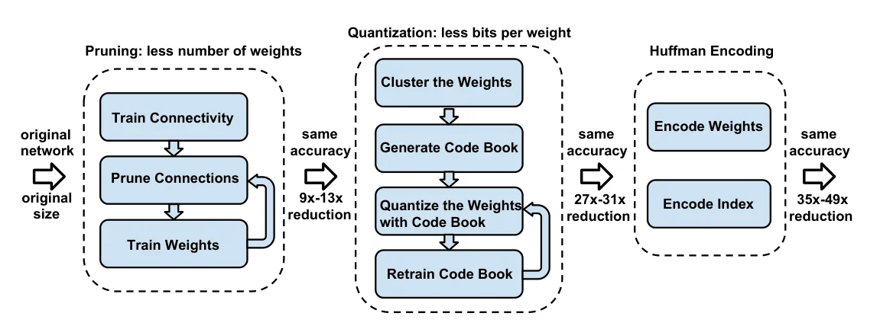
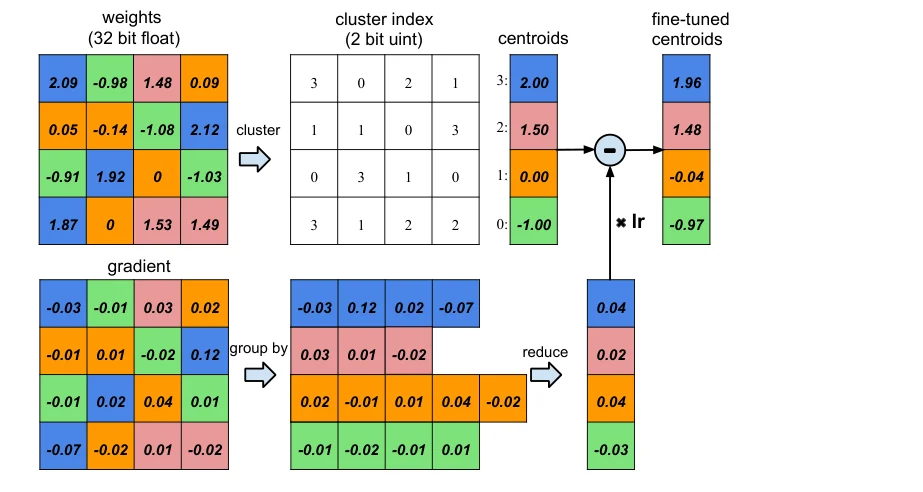
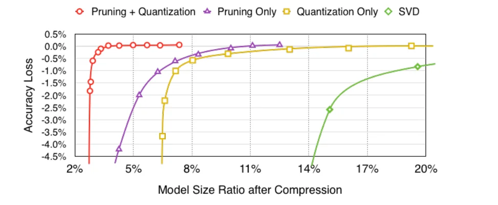

> - **논문**: Deep Compression: Compressing Deep Neural Networks with Pruning, Trained Quantization and Huffman Coding
> - **저자**: Song Han, Huizi Mao, William J. Dally (Stanford University, Tsinghua University, NVIDIA)
> - **학회**: ICLR 2016 · [arXiv:1510.00149](https://arxiv.org/abs/1510.00149)
{: .prompt-tip }

> [가지치기와 양자화 입문]()에서 다룬 두 기법을 하나의 파이프라인으로 묶고 끝까지 밀어붙인 논문이다. **Deep Compression**(ICLR 2016 best paper)은 연결을 9~13배 줄이는 가지치기, 가중치당 비트를 32에서 5로 줄이는 학습된 양자화(가중치 공유), 그리고 치우친 분포를 이용하는 허프만 코딩을 차례로 적용해 AlexNet을 **35배**, VGG-16을 **49배** 압축하면서 정확도를 유지했다. 목표는 모델을 off-chip DRAM이 아니라 on-chip SRAM에 넣는 것이다.

## 1. 문제: 저장 용량과 에너지

AlexNet Caffemodel은 240MB, VGG-16은 552MB이다. 앱 스토어는 100MB 이상 앱의 셀룰러 다운로드를 막고, 더 중요하게는 **에너지**가 메모리 접근에 지배된다. 45nm 공정에서 32비트 덧셈은 0.9pJ, SRAM 접근은 5pJ, DRAM 접근은 640pJ이다. 10억 연결 네트워크를 20fps로 돌리면 DRAM 접근만으로 12.8W가 필요해 모바일의 전력 한계를 넘는다. 모델을 몇 MB로 줄여 SRAM 캐시에 올리면 접근당 에너지가 100배 넘게 줄어든다.

## 2. 방법: 3단계 파이프라인


_Figure 1. 가지치기(9~13배) → 양자화(27~31배) → 허프만 코딩(35~49배). 각 단계 뒤에도 정확도는 그대로이고, 압축률에는 희소 표현의 메타데이터가 포함된다. (출처: Han et al., 2016)_

### 가지치기

일반 학습으로 연결성을 배우고, 임계값 이하의 작은 가중치를 제거한 뒤, 남은 희소 연결로 재학습한다(Han et al., NeurIPS 2015). AlexNet 9배, VGG-16 13배 연결 감소이다. 희소 구조는 CSR/CSC로 저장하되 절대 위치 대신 **인덱스 차이**를 저장한다. conv 층은 8비트, FC 층은 5비트로 차이를 인코딩하고, 차이가 표현 범위를 넘으면 0 가중치를 채워 넣어 넘어간다. 실제 AlexNet 실험에서는 상대 인덱스를 4비트로 인코딩했다(Table 4).

### 학습된 양자화와 가중치 공유

층마다 가중치를 k-means로 $$k$$개 클러스터로 묶고, 한 클러스터의 모든 연결이 **같은 중심값을 공유**한다. 저장하는 것은 중심값 코드북과 연결마다 $$\log_2 k$$비트의 인덱스이다. 압축률은

$$
r = \frac{n b}{n \log_2 k + k b}
$$

로, 4×4 가중치를 4개 클러스터로 묶으면 $$16 \times 32 / (4 \times 32 + 2 \times 16) = 3.2$$배이다. conv 층은 8비트(256개), FC 층은 5비트(32개)로 정확도 손실이 없었다.

클러스터링 뒤에는 **중심값을 미세 조정**한다. 아래 Figure 3처럼 각 가중치의 기울기를 클러스터(색)별로 모아 합하고, 그 합에 학습률을 곱해 공유 중심값에서 뺀다. 클러스터링은 층마다 따로 하고 층 사이에는 공유하지 않는다.


_Figure 3. 위: 4×4 가중치를 4개 클러스터로 묶어 2비트 인덱스와 중심값 코드북으로 저장. 아래: 기울기를 클러스터별로 모아 더한 뒤 중심값을 갱신. (출처: Han et al., 2016)_

$$
\frac{\partial L}{\partial C_k} = \sum_{i,j} \frac{\partial L}{\partial W_{ij}} \mathbb{1}(I_{ij} = k)
$$

중심값 초기화가 중요하다. 무작위(Forgy)나 밀도 기반 초기화는 가중치가 몰린 두 봉우리 근처에 중심을 두어 수는 적지만 중요한 큰 가중치를 제대로 표현하지 못한다. $$[\min, \max]$$를 균등 분할하는 **선형 초기화**가 큰 가중치를 보존해 가장 좋았다.

### 허프만 코딩

양자화된 가중치 인덱스와 희소 인덱스 차이는 모두 분포가 치우쳐 있다(가중치는 두 봉우리, 인덱스 차이는 대부분 20 이하). 허프만 코딩으로 20~30%를 더 줄인다. 학습이 필요 없고 오프라인에서 적용한다.

## 3. 코드로 보기: 세 단계를 직접 돌려 보기

합성 10클래스 데이터로 작은 MLP를 학습한 뒤, 90% 가지치기 → 재학습 → 5비트 k-means(선형 초기화) → 중심값 미세 조정 → 허프만 코딩을 차례로 적용하고, 단계마다 정확도와 저장 용량(상대 인덱스 5비트, 코드북 포함)을 계산한다.

```python
import torch, torch.nn as nn, numpy as np, heapq
from collections import Counter
torch.manual_seed(0); np.random.seed(0); torch.set_num_threads(1)
# synthetic 10-class data in 64 dims
means = torch.randn(10, 64) * 1.5
def batch(n):
    y = torch.randint(0, 10, (n,)); return means[y] + 2.0 * torch.randn(n, 64), y
Xtr, Ytr = batch(4000); Xte, Yte = batch(2000)
net = nn.Sequential(nn.Linear(64, 128), nn.ReLU(), nn.Linear(128, 10))
def acc(): return (net(Xte).argmax(1) == Yte).float().mean().item() * 100
def train(steps, masks=None):
    opt = torch.optim.Adam(net.parameters(), 1e-3)
    for _ in range(steps):
        loss = nn.functional.cross_entropy(net(Xtr), Ytr); opt.zero_grad(); loss.backward(); opt.step()
        if masks is not None:
            with torch.no_grad():
                for (n, p), m in zip(net.named_parameters(), masks):
                    if m is not None: p.mul_(m)
train(600)
print(f"dense model:            acc {acc():5.1f}%")

# --- stage 1: prune 90% of each weight matrix by magnitude, retrain with masks
masks = []
for n, p in net.named_parameters():
    if p.dim() == 2:
        thr = p.abs().flatten().kthvalue(int(0.9 * p.numel())).values
        m = (p.abs() > thr).float(); masks.append(m)
        with torch.no_grad(): p.mul_(m)
    else: masks.append(None)
print(f"after 90% pruning:      acc {acc():5.1f}%  (no retraining)")
train(400, masks)
print(f"pruned + retrained:     acc {acc():5.1f}%")

# --- stage 2: k-means weight sharing (5 bits = 32 centroids, linear init), fine-tune centroids
bits = 5; k = 2 ** bits
codebooks, indices = [], []
for (n, p), m in zip(net.named_parameters(), masks):
    if m is None: codebooks.append(None); indices.append(None); continue
    w = p.detach()[m.bool()]
    c = torch.linspace(w.min(), w.max(), k)
    for _ in range(30):
        idx = (w[:, None] - c[None, :]).abs().argmin(1)
        for j in range(k):
            if (idx == j).any(): c[j] = w[idx == j].mean()
    codebooks.append(nn.Parameter(c)); indices.append(idx)
def rebuild():
    with torch.no_grad():
        for (n, p), m, c, idx in zip(net.named_parameters(), masks, codebooks, indices):
            if m is not None: p[m.bool()] = c[idx]
rebuild(); print(f"+ 5-bit weight sharing: acc {acc():5.1f}%  (no fine-tuning)")
opt = torch.optim.Adam([c for c in codebooks if c is not None] + [p for p in net.parameters() if p.dim() == 1], 1e-3)
for _ in range(200):
    rebuild()
    loss = nn.functional.cross_entropy(net(Xtr), Ytr); opt.zero_grad(); loss.backward()
    with torch.no_grad():                                   # group the weight gradients by centroid index
        for (n, p), m, c, idx in zip(net.named_parameters(), masks, codebooks, indices):
            if m is not None: c.grad = torch.zeros_like(c).index_add_(0, idx, p.grad[m.bool()])
    opt.step()
rebuild(); print(f"+ centroid fine-tuning: acc {acc():5.1f}%")

# --- storage accounting
def huffman_bits(symbols):
    cnt = Counter(symbols); heap = [[f, [s, ""]] for s, f in cnt.items()]; heapq.heapify(heap)
    if len(heap) == 1: return len(symbols)
    while len(heap) > 1:
        lo, hi = heapq.heappop(heap), heapq.heappop(heap)
        for pair in lo[1:]: pair[1] = "0" + pair[1]
        for pair in hi[1:]: pair[1] = "1" + pair[1]
        heapq.heappush(heap, [lo[0] + hi[0]] + lo[1:] + hi[1:])
    code = {s: len(c) for s, c in heap[0][1:]}
    return sum(code[s] * f for s, f in cnt.items())
n_total = sum(p.numel() for p in net.parameters() if p.dim() == 2)
raw = 32 * n_total
nz = idx_bits = idx_huff = w_bits = w_huff = book = 0
for (n, p), m, c, idx in zip(net.named_parameters(), masks, codebooks, indices):
    if m is None: continue
    pos = torch.nonzero(m.flatten()).flatten().numpy(); diff = np.diff(np.concatenate([[-1], pos])) - 1
    rel = []                                                # relative index in 5 bits, filler zeros when gap > 31
    for g in diff:
        while g > 31: rel.append(31); g -= 32
        rel.append(int(g))
    nz += len(pos); idx_bits += 5 * len(rel); idx_huff += huffman_bits(rel)
    w_bits += bits * len(pos); w_huff += huffman_bits(idx.tolist()); book += 32 * k
print()
print(f"weights: {n_total:,} -> {nz:,} non-zero ({100*nz/n_total:.1f}%)")
print(f"dense fp32:                 {raw/8/1024:8.1f} KB   1.0x")
print(f"pruned (fp32 + 5-bit idx):  {(32*nz + idx_bits)/8/1024:8.1f} KB   {raw/(32*nz + idx_bits):.1f}x")
print(f"pruned + 5-bit shared:      {(w_bits + idx_bits + book)/8/1024:8.1f} KB   {raw/(w_bits + idx_bits + book):.1f}x")
print(f"pruned + shared + Huffman:  {(w_huff + idx_huff + book)/8/1024:8.1f} KB   {raw/(w_huff + idx_huff + book):.1f}x")
```

```text
dense model:            acc  99.9%
after 90% pruning:      acc  75.2%  (no retraining)
pruned + retrained:     acc  98.9%
+ 5-bit weight sharing: acc  98.9%  (no fine-tuning)
+ centroid fine-tuning: acc  98.8%

weights: 9,472 -> 948 non-zero (10.0%)
dense fp32:                     37.0 KB   1.0x
pruned (fp32 + 5-bit idx):       4.3 KB   8.6x
pruned + 5-bit shared:           1.4 KB   25.9x
pruned + shared + Huffman:       1.3 KB   28.2x
```

- 90%를 잘라 내면 정확도가 75%로 떨어지지만 **마스크를 유지한 재학습**으로 98.9%까지 돌아온다. 논문 파이프라인의 "가지치기 → 재학습"이 필수인 이유이다.
- 5비트 가중치 공유는 재학습 없이도 정확도를 유지했고, 중심값 미세 조정은 이 작은 문제에서는 차이를 만들지 못했다(98.9 → 98.8%). 논문에서 미세 조정이 중요한 것은 수천만 가중치를 32개 값으로 뭉갤 때이다.
- 저장 용량은 가지치기만으로 8.6배(인덱스 비용 때문에 10배가 아님), 양자화를 더하면 25.9배, 허프만을 더하면 28.2배이다. 논문의 AlexNet 9배 → 27배 → 35배와 같은 구조로, 허프만의 몫이 가장 작고 가지치기와 양자화가 서로 간섭하지 않고 곱해진다는 점이 중요하다.

## 4. 실험

Caffe로 구현했다. 가지치기는 blob에 마스크를 씌워 잘린 연결의 갱신을 막고, 가중치 공유는 코드북 구조를 두고 층의 기울기를 계산한 뒤 인덱스별로 모아 갱신한다. 허프만 코딩은 학습이 끝난 뒤 오프라인으로 적용한다. ImageNet 기준 모델은 Caffe model zoo의 AlexNet(6,100만 파라미터, top-1 57.2%, top-5 80.3%)과 VGG-16이다.

### 전체 결과 (Table 1)

| 네트워크 | Top-1 오류 | Top-5 오류 | 크기 | 압축률 |
|---|---|---|---|---|
| LeNet-300-100 | 1.64% → 1.58% | - | 1070KB → 27KB | 40× |
| LeNet-5 | 0.80% → 0.74% | - | 1720KB → 44KB | 39× |
| AlexNet | 42.78% → 42.78% | 19.73% → 19.70% | 240MB → 6.9MB | 35× |
| VGG-16 | 31.50% → 31.17% | 11.32% → 10.91% | 552MB → 11.3MB | 49× |

### AlexNet 층별 압축 (Table 4)

| 층 | 가중치 수 | 가지치기 후 남은 비율 | 가중치 비트 (P+Q → +H) | 인덱스 비트 (P+Q → +H) | 원래 대비 크기 (P+Q → +H) |
|---|---|---|---|---|---|
| conv1 | 35K | 84% | 8 → 6.3 | 4 → 1.2 | 32.6% → 20.53% |
| conv2 | 307K | 38% | 8 → 5.5 | 4 → 2.3 | 14.5% → 9.43% |
| conv3 | 885K | 35% | 8 → 5.1 | 4 → 2.6 | 13.1% → 8.44% |
| conv4 | 663K | 37% | 8 → 5.2 | 4 → 2.5 | 14.1% → 9.11% |
| conv5 | 442K | 37% | 8 → 5.6 | 4 → 2.5 | 14.0% → 9.43% |
| fc6 | 38M | 9% | 5 → 3.9 | 4 → 3.2 | 3.0% → 2.39% |
| fc7 | 17M | 9% | 5 → 3.6 | 4 → 3.7 | 3.0% → 2.46% |
| fc8 | 4M | 25% | 5 → 4 | 4 → 3.2 | 7.3% → 5.85% |
| **합계** | 61M | 11% (9×) | 5.4 → 4 | 4 → 3.2 | 3.7% (27×) → 2.88% (35×) |

P는 가지치기, Q는 양자화, H는 허프만 코딩이다. 파라미터 대부분이 FC 층에 있고 FC 층이 가장 많이 잘린다. 첫 conv 층은 84%가 남아 압축이 가장 덜 된다. 허프만은 AlexNet에서 22%를 더 줄인다.

VGG-16은 가중치 7.5%(13×)만 남고, 양자화 후 31배, 허프만 후 49배이다. 가장 큰 두 FC 층(fc6, fc7)은 가지치기로 4%만 남고, 양자화까지 거치면 원래 크기의 1.6% 이하가 된다. conv 층은 8비트, FC는 5비트이다. 코드북 오버헤드는 무시할 수준이고, 가중치 비트와 인덱스 비트가 대략 반반을 차지한다(Figure 11).

### 다른 압축 방법과 비교 (Table 7, AlexNet)

| 방법 | Top-1 오류 | Top-5 오류 | 크기 | 압축률 |
|---|---|---|---|---|
| 기준 Caffemodel | 42.78% | 19.73% | 240MB | 1× |
| Fastfood-32-AD | 41.93% | - | 131MB | 2× |
| Fastfood-16-AD | 42.90% | - | 64MB | 3.7× |
| Collins & Kohli | 44.40% | - | 61MB | 4× |
| SVD | 44.02% | 20.56% | 47.6MB | 5× |
| Pruning (Han et al., 2015) | 42.77% | 19.67% | 27MB | 9× |
| Pruning + Quantization | 42.78% | 19.70% | 8.9MB | 27× |
| **Pruning + Quantization + Huffman** | **42.78%** | **19.70%** | **6.9MB** | **35×** |

### 가지치기와 양자화의 상호작용


_Figure 6. AlexNet의 압축 후 모델 크기 비율(가로)과 정확도 손실(세로). 빨간색이 가지치기 + 양자화, 보라색이 가지치기만, 노란색이 양자화만, 초록색이 SVD이다. (출처: Han et al., 2016)_

Figure 6처럼 각각 따로 쓰면 원래 크기의 8% 아래에서 정확도가 급락하지만, 함께 쓰면 **3%까지 손실 없이** 내려간다. 양자화 비트를 줄여 갈 때 정확도가 떨어지기 시작하는 지점이 가지치기 여부와 무관해서(Figure 7), 가지치기가 양자화를 방해하지 않는다. 가지친 네트워크는 양자화할 가중치가 6천만이 아니라 670만이라 같은 중심값 수에서 오차가 오히려 작다. conv 층은 4비트 아래에서, FC 층은 2비트 아래에서 급락해 conv가 더 많은 비트를 필요로 한다.

| conv 비트 / FC 비트 | Top-1 오류 | Top-5 오류 | Top-1 증가 | Top-5 증가 |
|---|---|---|---|---|
| 32 / 32 | 42.78% | 19.73% | - | - |
| 8 / 5 | 42.78% | 19.70% | 0.00%p | -0.03%p |
| 8 / 4 | 42.79% | 19.73% | 0.01%p | 0.00%p |
| 4 / 2 | 44.77% | 22.33% | 1.99%p | 2.60%p |

(Table 6, AlexNet) 8/5비트는 무손실, 하드웨어에 더 편한 8/4비트는 0.01%p 손실, 4/2비트까지 밀면 top-1 약 2%p 손실이다.

**초기화.** 2~8비트 전 구간에서 선형 초기화가 밀도 기반·무작위보다 낫다(3비트만 예외, Figure 8).

### 속도와 에너지

AlexNet과 VGG-16의 FC6~FC8 층을 배치 1(실시간 처리)로 측정했다. 하드웨어는 GTX Titan X, Core i7-5930K, Tegra K1(Jetson TK1)이고, dense는 cuBLAS/MKL GEMV, 가지친 층은 CSR 형식의 cuSPARSE/MKL CSRMV를 쓴다. 가지친 FC 층은 평균 CPU 3배, GPU 3.5배, 모바일 GPU 4.2배 빠르고 에너지는 7배, 3.3배, 4.2배 적다. 행렬-벡터 곱은 메모리 바운드라 작은 메모리 풋프린트가 바로 속도로 이어지기 때문이다.

| VGG-16 FC6, 시간(μs) | dense, 배치 1 | 가지친 층, 배치 1 | dense, 배치 64 | 가지친 층, 배치 64 |
|---|---|---|---|---|
| Titan X | 1467.8 | 167.0 | 53.6 | 121.5 |
| Core i7-5930K | 35022.8 | 3774.3 | 1056.0 | 1780.3 |
| Tegra K1 | 35427.0 | 4377.2 | 2001.4 | 8024.8 |

(부록 Table 8, 입력 1개당 평균 시간) 배치를 64로 키우면 행렬-행렬 곱이 되어 dense가 더 빨라지고 이점이 사라진다. 양자화 모델은 당시 BLAS 라이브러리가 간접 조회와 상대 인덱스를 지원하지 않아 벤치마크하지 못했고, 이것이 이후 EIE 가속기로 이어진다.

## 5. 해석

**1. 세 기법의 직교성이 이 논문의 주된 발견이다.** 각각은 알려진 기법이었지만, "가지치기는 몇 개를 저장할지, 양자화는 몇 비트로 저장할지, 허프만은 분포의 치우침을" 다루므로 서로 간섭하지 않고 압축률이 곱해진다. 위 toy의 8.6 → 25.9 → 28.2배가 이 구조를 그대로 보여 준다.

**2. 에너지 숫자가 설계 목표를 정했다.** 640pJ 대 5pJ라는 한 줄이 "몇 MB까지 줄여야 하는가"의 답을 준다. 이 관점은 [Edge AI 하드웨어]()의 SRAM·PIM 논의로 바로 이어지고, 압축률 경쟁이 아니라 **캐시에 들어가는가**가 기준이 된다.

**3. 압축과 가속은 다르다.** 비정형 희소성은 저장은 줄이지만 일반 BLAS로는 빨라지지 않고, 배치 추론에서는 이점이 사라진다. 그래서 [필터 가지치기]()처럼 구조적 희소성을 택하거나, EIE처럼 희소·양자화 구조를 직접 순회하는 하드웨어를 만들게 된다. 저자들도 "future work"에서 이것을 분명히 적었다.

**4. 학습된 양자화는 비균일 양자화의 원형이다.** k-means 중심값을 미세 조정하는 방식은 이후의 코드북 기반 양자화(PQ, 최근 LLM의 가중치 양자화)로 이어진다. 선형 초기화가 큰 가중치를 보존해야 한다는 관찰은 outlier 처리가 중요한 LLM 양자화에서도 반복된다.

**5. 평가를 읽을 때 주의할 점.** 압축률은 가중치 저장만 세고 활성값은 포함하지 않는다. 재학습 비용(가지치기 반복과 미세 조정)은 원래 학습의 몇 배가 될 수 있고, 논문에 총 학습 시간이 명시되어 있지 않다. 속도 벤치마크는 FC 층, 배치 1에 한정된다. 위 toy는 과제가 쉬워 정확도 손실이 거의 없으니 비율의 구조만 참고해야 한다.

## 6. 정리

| 항목 | 내용 |
|---|---|
| 동기 | DRAM 접근 640pJ vs SRAM 5pJ, 모델을 캐시에 넣어야 함 |
| 1단계 가지치기 | 크기 기반 제거 + 재학습, 9~13배, CSR + 상대 인덱스(conv 8비트, FC 5비트) |
| 2단계 양자화 | 층별 k-means 가중치 공유(conv 8비트, FC 5비트), 선형 초기화, 중심값 미세 조정 |
| 3단계 허프만 | 치우친 인덱스·코드 분포로 20~30% 추가 |
| 결과 | AlexNet 35×(240 → 6.9MB), VGG-16 49×(552 → 11.3MB), 정확도 손실 없음 |
| 핵심 관찰 | 가지치기와 양자화는 서로 간섭하지 않고 3% 크기까지 무손실 |

## References

- Han, Mao, Dally, "Deep Compression: Compressing Deep Neural Networks with Pruning, Trained Quantization and Huffman Coding," ICLR 2016. [arXiv:1510.00149](https://arxiv.org/abs/1510.00149)
- Han, Pool, Tran, Dally, "Learning both Weights and Connections for Efficient Neural Networks," NeurIPS 2015. [arXiv:1506.02626](https://arxiv.org/abs/1506.02626)
- Han et al., "EIE: Efficient Inference Engine on Compressed Deep Neural Network," ISCA 2016. [arXiv:1602.01528](https://arxiv.org/abs/1602.01528)
- Chen et al., "Compressing Neural Networks with the Hashing Trick," ICML 2015. [arXiv:1504.04788](https://arxiv.org/abs/1504.04788)
- Gong, Liu, Yang, Bourdev, "Compressing Deep Convolutional Networks using Vector Quantization," 2014. [arXiv:1412.6115](https://arxiv.org/abs/1412.6115)
