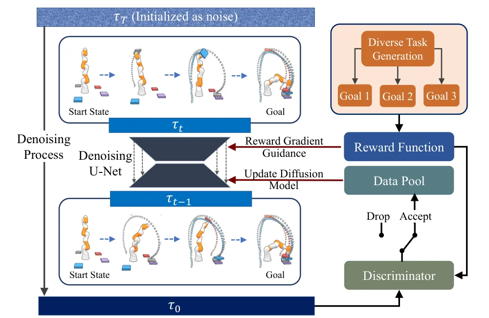
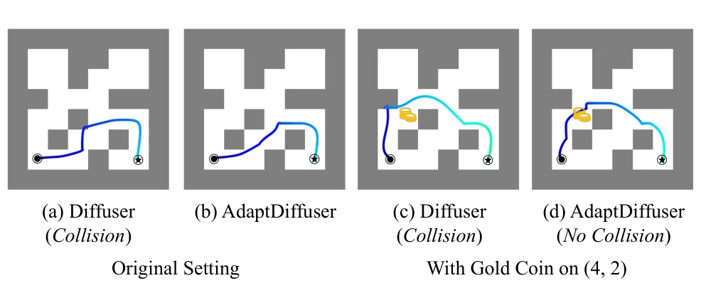

> - **논문**: AdaptDiffuser: Diffusion Models as Adaptive Self-evolving Planners
> - **저자**: Zhixuan Liang, Yao Mu, Mingyu Ding, Fei Ni, Masayoshi Tomizuka, Ping Luo (The University of Hong Kong, UC Berkeley, Tianjin University, Shanghai AI Laboratory)
> - **학회**: ICML 2023 · [arXiv:2302.01877](https://arxiv.org/abs/2302.01877)
{: .prompt-tip }

> [Diffuser]()는 guide 함수만 바꾸면 새 과제도 풀 수 있다고 했지만, 실제로는 **학습 데이터에서 많이 벗어난 과제**에서 품질이 크게 떨어졌다. **AdaptDiffuser**는 보상으로 유도해 스스로 전문가 궤적을 생성하고, 그중 좋은 것만 골라 다시 학습하는 방식으로 planner를 **자기 진화(self-evolving)**시킨다.

## 1. Contribution

- **적응 능력**: 학습 때 보지 못한 과제에도 적응할 수 있는 diffusion planner
- **고품질 합성 데이터 생성**: 보상 유도로 합성 전문가 데이터를 만들어 모델을 fine-tuning
- **효율적인 학습**: 사전학습된 Diffuser를 기반으로 새 데이터에서 fine-tuning만 해서 학습을 빠르게
- **자기 진화**: 기존 과제와 처음 보는 과제 모두에서 성능 향상

## 2. 배경 복습

### Trajectory Optimization

이산 시간 시스템 $$s_{t+1} = f(s_t, a_t)$$에서 시점별 보상 $$r(s_t, a_t)$$의 합인 목적 함수 $$\mathcal{J}$$를 최대화하는 행동 시퀀스 $$a^*_{0:T}$$를 찾는 문제이다.

### 시퀀스 데이터를 생성하는 Diffusion

생성 과정은 반복적인 denoising $$p_\theta(\tau^{i-1} \mid \tau^i)$$이고, 궤적 분포는 각 step 조건부 확률의 곱으로 표현된다.

$$
p_\theta(\tau^0) = \int p(\tau^N)\prod_{i=1}^{N}p_\theta(\tau^{i-1} \mid \tau^i)\,d\tau^{1:N}
$$

$$p(\tau^N)$$은 표준 정규분포, $$\tau^0$$은 원래 궤적이다. 파라미터는 $$p_\theta(\tau^0)$$의 음의 로그 우도에 대한 **ELBO**를 최적화해 학습하며, 실제로는 노이즈 예측 loss로 단순화된다.

$$
\mathcal{L}_{denoise} = \mathbb{E}_{i, \tau^0, \epsilon}\big[\lVert\epsilon - \epsilon_\theta(\tau^i, i)\rVert^2\big]
$$

$$\epsilon_\theta$$에서 reverse 과정의 평균 $$\mu_\theta$$로 가는 변환이 닫힌 형태라, 이는 평균을 예측하는 것과 같다.

### 과제 지향 생성 (Diffuser 방식)

궤적에 대한 정보 $$y(\tau)$$(reward-to-go $$\mathcal{J}(\tau^0)$$, 만족해야 할 제약 조건 등)를 조건으로 생성한다.

- **보상 최대화 과제**: 시점별 최적성 변수 $$\mathcal{O}_t$$(최적이면 1)를 두면, 특정 Lipschitz 조건 아래에서 조건부 reverse transition이 평균을 보상 기울기 방향으로 이동한 가우시안으로 근사된다.

  $$
  p_\theta(\tau^{i-1} \mid \tau^i, \mathcal{O}) \approx \mathcal{N}\big(\mu + \Sigma g,\ \Sigma\big),\qquad g = \nabla_\tau \log p(\mathcal{O} \mid \tau)\big|_{\tau = \mu}
  $$

- **특정 지점 조건 과제**(목표 상태 등): 모든 diffusion step에서 해당 값을 조건값으로 덮어써서 단순화한다(inpainting).

## 3. 문제: Guidance만으로는 부족하다

생성된 궤적의 품질은 guide 기울기 $$g$$뿐 아니라, **무조건부 diffusion 모델이 학습한 평균 $$\mu_\theta$$와 공분산 $$\Sigma$$**에 크게 의존한다.

- 학습된 $$\mu_\theta$$가 최적 궤적에서 멀리 떨어져 있으면, guidance를 아무리 세게 줘도 결과가 편향되고 품질이 낮다.
- $$\mu_\theta$$의 품질은 학습 데이터에 달려 있는데, 처음 보는 과제에 맞는 데이터는 학습 세트에 거의 없다.

그래서 기존 diffusion planner는 데이터가 부족한 과제에서 성능이 제한되고 적응 능력이 낮았다.

## 4. Self-Evolved Planning

해결책은 간단하다. **모델이 부족한 데이터를 스스로 만들게** 한다.


_Figure 2. 여러 목표(Goal 1~3)의 보상 함수로 guidance를 주며 사전학습된 denoising U-Net으로 궤적을 생성하고, discriminator가 기준을 통과한 궤적만 data pool에 넣어 diffusion 모델을 다시 학습한다. (출처: Liang et al., 2023)_

1. 사전학습된 Diffuser로, 목표 과제의 보상으로 유도해 **다양한 궤적을 생성**
2. **Discriminator**로 품질이 좋고 물리적으로 일관된 궤적만 골라냄
3. 골라낸 궤적을 **합성 전문가 데이터**로 데이터셋에 추가
4. 이 데이터로 diffusion 모델을 **fine-tuning**
5. 1~4를 반복 → 모델이 점점 목표 과제에 맞게 진화

$$k$$번째 반복을 식으로 쓰면 다음과 같다. $$\mathcal{G}$$는 보상 guidance를 준 샘플링, $$\mathcal{D}$$는 discriminator이고 $$\hat\tau^0$$는 원래 데이터셋이다.

$$
\theta^*_k = \arg\min_\theta -\mathbb{E}_{\hat\tau^k}\big[\log p_\theta(\hat\tau^k \mid y(\hat\tau^k))\big], \quad
\tau^{k+1} = \mathcal{G}\big(\mu_{\theta^*_k}, \Sigma, \nabla_\tau \mathcal{J}(\mu_{\theta^*_k})\big), \quad
\hat\tau^{k+1} = \big[\hat\tau^k, \mathcal{D}(\tilde R(\tau^{k+1}))\big]
$$

### Dynamics Consistency 문제와 Discriminator

보상이 최대가 되도록 생성된 행동은 상태 변화와 맞지 않을 수 있다(dynamics consistency 문제). 생성된 상태 시퀀스는 그럴듯해도, 함께 생성된 행동으로는 실제로 그 상태들에 갈 수 없는 경우이다.

그래서 **inverse dynamics model** $$I$$로 생성된 연속 상태 사이의 실제 행동을 다시 계산한다.

$$
\tilde{a}_t = I(s_t, s_{t+1})
$$

그리고 이 행동으로 시뮬레이션(또는 학습된 동역학)했을 때의 상태가 생성된 상태와 크게 다르지 않은(MSE가 작은) 궤적만 남긴다. 동시에 새 행동으로 다시 계산한 보상이 기준을 넘는 궤적만 통과시킨다. 학습하는 네트워크가 아니라 **규칙 기반** discriminator이다. inverse dynamics는 전통적 제어기여도, 신경망이어도 된다. MuJoCo에서는 생성된 행동으로 굴린 상태가 생성 상태와 거의 같아서 생성된 보상을 그대로 썼다.

```python
def select_expert_trajectories(trajs, inverse_dyn, step_fn, reward_fn, max_dev=0.1, min_reward=None):
    """trajs: 생성된 상태 시퀀스 목록"""
    selected = []
    for states in trajs:
        actions = [inverse_dyn(states[t], states[t + 1]) for t in range(len(states) - 1)]
        sim, ok = states[0], True
        for t, a in enumerate(actions):
            sim = step_fn(sim, a)                                  # 실제(또는 모델) 동역학
            if ((sim - states[t + 1]) ** 2).sum() > max_dev:       # 생성 상태와 너무 다르면 탈락
                ok = False
                break
        if ok and (min_reward is None or reward_fn(states, actions) >= min_reward):
            selected.append((states, actions))
    return selected

import numpy as np

step_fn = lambda s, a: s + np.clip(a, -0.1, 0.1)          # 한 step에 최대 0.1만 움직일 수 있는 점
inverse_dyn = lambda s, s_next: s_next - s
reward_fn = lambda states, actions: -np.linalg.norm(states[-1] - np.array([1.0, 1.0]))  # 목표 (1, 1)

good = [np.array([0.1 * t, 0.1 * t]) for t in range(11)]                # 0.1씩 이동: 가능한 궤적
bad = [np.array([0.0, 0.0]), np.array([0.5, 0.5]), np.array([1.0, 1.0])]  # 한 번에 0.5씩: 불가능
selected = select_expert_trajectories([good, bad], inverse_dyn, step_fn, reward_fn,
                                      max_dev=0.01, min_reward=-0.1)
print(len(selected))     # 1 → 두 궤적 모두 목표에 도달하지만, 물리적으로 가능한 good만 남음
```

`bad` 궤적도 목표 (1, 1)에 도달하므로 보상만 보면 좋은 궤적이다. 하지만 이 점은 한 step에 0.1까지만 움직일 수 있어서, inverse dynamics로 구한 행동을 실제로 실행하면 생성된 상태를 따라가지 못하고 탈락한다.

## 5. 보상 유형별 합성 데이터 생성

### Continuous Reward

MuJoCo처럼 **연속적인 보상 함수**가 있는 과제는, 보상을 최적성 확률로 바꿔 위의 guided sampling을 그대로 쓴다.

### Sparse Reward

목표 상태 $$s_g$$에 도달할 때만 보상이 1인 **계단 함수** 형태의 보상은, 미분하면 **Dirac delta**라서 기울기를 쓸 수 없다. 그래서 생성된 궤적의 마지막 상태를 목표 상태로 고정하는 inpainting으로 처리한다.

### 복합 보상

현실적인 과제에는 여러 보상이 섞여 있다. 예를 들어 "미로를 탈출(주 과제)하면서 금화를 줍기(부 과제)". Sparse 보상으로는 부 과제 지점을 몇 번째 시점에 지나야 하는지 정하기 어렵다. 그래서 금화 위치 $$s_c$$까지의 거리로 보조 guide 함수를 만들어 연속 보상처럼 기울기 guidance에 넣고, 끝 상태 조건은 inpainting으로 고정한다.

$$
\mathcal{J}(\tau) = \sum_{t=0}^{T} \lVert s_t - s_c \rVert_p
$$

논문은 $$p = 2$$를 쓴다. 이렇게 생성한 궤적 중 discriminator 기준을 통과한 것만 합성 전문가 데이터로 데이터 기록에 보관한다.

## 6. 실험

| 환경 | 내용 |
|---|---|
| **Maze2D** | 미로에서 목표까지 이동 (기존 과제) |
| **Maze2D + Gold Coin** | 금화를 주워 가며 목표까지 (학습 때 보지 못한 과제) |
| **MuJoCo** | Hopper, Walker2d, HalfCheetah locomotion (D4RL) |
| **KUKA Robot** | 블록 쌓기 데이터만으로 집어서 옮기기(pick-and-place) 과제에 적응 |

### 기존 과제: Maze2D (Table 1)

| 환경 | MPPI | CQL | IQL | Diffuser | AdaptDiffuser |
|---|---|---|---|---|---|
| U-Maze | 33.2 | 5.7 | 47.4 | 113.9 | **135.1** ±5.8 |
| Medium | 10.2 | 5.0 | 34.9 | 121.5 | **129.9** ±4.6 |
| Large | 5.1 | 12.5 | 58.6 | 123.0 | **167.9** ±5.0 |
| 평균 | 16.2 | 7.7 | 47.0 | 119.5 | **144.3** |

평균 119.5에서 144.3으로 오른다(논문 표현으로 20.8% 향상). 가장 긴 경로를 계획해야 하는 Maze2D-Large에서 차이가 가장 크고, 논문은 Diffuser가 아예 경로를 못 만드는 어려운 사례에서 AdaptDiffuser가 가능한 경로를 만드는 예(Figure 3)도 보여 준다.

### 기존 과제: MuJoCo (Table 2, 3 seed 평균)

| 데이터 | 환경 | IQL | DT | TT | Diffuser | AdaptDiffuser |
|---|---|---|---|---|---|---|
| Med-Expert | HalfCheetah | 86.7 | 86.8 | 95.0 | 88.9 | 89.6 |
| Med-Expert | Hopper | 91.5 | 107.6 | 110.0 | 103.3 | 111.6 |
| Med-Expert | Walker2d | 109.6 | 108.1 | 101.9 | 106.9 | 108.2 |
| Medium | HalfCheetah | 47.4 | 42.6 | 46.9 | 42.8 | 44.2 |
| Medium | Hopper | 66.3 | 67.6 | 61.1 | 74.3 | **96.6** |
| Medium | Walker2d | 78.3 | 74.0 | 79.0 | 79.6 | **84.4** |
| Med-Replay | HalfCheetah | 44.2 | 36.6 | 41.9 | 37.7 | 38.3 |
| Med-Replay | Hopper | 94.7 | 82.7 | 91.5 | 93.6 | 92.2 |
| Med-Replay | Walker2d | 73.9 | 66.6 | 82.6 | 70.6 | **84.7** |
| **평균** | | 77.0 | 74.7 | 78.9 | 77.5 | **83.4** |

평균 77.5에서 83.4로 오른다(7.5% 향상). 원래 데이터 품질이 낮은 Medium 데이터셋(Hopper 74.3 → 96.6)에서 효과가 크고, 이미 데이터가 좋은 Medium-Expert HalfCheetah에서는 거의 차이가 없다. 모든 과제에서 오르는 것은 아니어서 Med-Replay Hopper는 93.6에서 92.2로 조금 낮다. 부록의 동시대 연구 Decision Diffuser(평균 81.8)와 비교해도 평균은 더 높다.

### 처음 보는 과제: 금화 줍기 미로와 KUKA pick-and-place


_Figure 4. (a)(b) 금화가 없을 때의 경로, (c)(d) (4, 2)에 금화를 두었을 때의 경로. Diffuser는 금화 쪽으로 경로를 바꾸지만 벽과 충돌하고, AdaptDiffuser는 충돌 없이 금화를 지난다. (출처: Liang et al., 2023)_

금화 줍기 미로는 Figure 4 같은 정성 결과만 있고 수치 표는 없다. 두 planner 모두 guidance로 금화를 지나는 경로를 만들지만, Diffuser는 벽과 충돌하고 AdaptDiffuser는 충돌 없는 경로를 만든다. 저자들도 금화가 최적 경로에서 멀어 되돌아가야 하는 극단적인 경우에는 성공률이 낮다고 부록에서 인정한다.

KUKA pick-and-place는 무작위로 놓인 블록 4개를 정해진 목표 위치로 옮기는 과제이고, 이 과제의 전문가 데이터는 주지 않는다. 설정 1은 블록이 바닥에 흩어져 있고, 설정 2는 한곳에 쌓여 있다(Table 3).

| 설정 | Diffuser | AdaptDiffuser |
|---|---|---|
| Pick and Place 설정 1 | 28.16 ±2.0 | **36.03** ±2.1 |
| Pick and Place 설정 2 | 35.25 ±1.4 | **39.00** ±1.3 |
| 평균 | 31.71 | **37.52** |

초록의 "27.9% 향상"은 설정 1 기준(28.16 → 36.03)이고, 두 설정 평균으로는 약 18%이다.

### Ablation

| 반복 단계 (Table 4, MuJoCo) | 1단계 | 2단계 |
|---|---|---|
| Medium Hopper | 95.4 | 96.6 |
| Medium Walker2d | 83.2 | 84.4 |
| Med-Expert Hopper | 110.7 | 111.6 |
| 6개 과제 평균 | 88.4 | 89.1 |

| 전문가 데이터 양 (Table 5, Maze2D-Large) | 20% | 50% | 100% |
|---|---|---|---|
| Diffuser | 105.0 | 107.9 | 123.0 |
| AdaptDiffuser | 112.5 | 123.8 | 167.9 |

- 두 번째 반복은 첫 번째보다 이득이 작다. 성능이 어느 수준에 이르면 반복의 효과가 줄어든다.
- 20%·50% 열은 데이터를 줄이고 학습 step도 25%만 쓴 설정이다. AdaptDiffuser는 데이터 50%, 학습 25%만으로 완전히 학습한 Diffuser(123.0)보다 높다(123.8).

논문은 부록 G에서 ChatGPT로 더 다양한 미로 레이아웃을 만드는 방법도 제시하고, 향후 과제로 프롬프트만으로 미로 설정을 생성해 합성 데이터 생성을 돕는 방향을 언급한다.

### 구현 디테일 (부록 C, D)

| 항목 | 값 |
|---|---|
| 모델 | temporal U-Net, residual block 6개 (Diffuser와 같은 구조) |
| 파라미터 수 | MuJoCo 3.96M, Maze2D 3.68M, KUKA 64.9M |
| 학습 | Adam, lr $$2 \times 10^{-4}$$, batch 32 |
| 학습 step | MuJoCo 1M, Maze2D 2M, KUKA 0.7M (fine-tuning은 사전학습 Diffuser에서 출발해 약 1/4 step) |
| Planning horizon | locomotion 32, KUKA pick-and-place 128, Maze2D U-Maze 128, Medium 192, Large 384 |
| Diffusion step | locomotion 100, KUKA 1000, Maze2D U-Maze 64, Medium 128, Large 256 |
| Guide scale $$\alpha$$ | {1, 5, 10, 50, 100} 중 과제별 선택 |
| 반복당 합성 데이터 | MuJoCo 50,000, Maze2D 10⁶, KUKA pick-and-place 11,000 (생성 1,000 + 쌓기 과제 궤적 10,000) |
| Discriminator 기준 | MuJoCo는 보상 임계값(예: Medium Hopper 3211 → 3225), Maze2D는 궤적 길이와 보상, KUKA는 4번 중 2번 이상 성공 |
| 시간 (RTX 3090 1장) | 행동 1개 추론 시간은 Diffuser와 거의 같음(MuJoCo 약 1.5초), 전체 학습은 평균 약 54시간(Diffuser 41시간) |

<details markdown="1">
<summary>더 알아보기: 자기 데이터로 다시 학습할 때의 위험</summary>

모델이 만든 데이터로 그 모델을 다시 학습하면, 모델이 원래 가진 편향이 데이터를 통해 스스로 강화될 수 있다. 생성 모델 분야에서는 이렇게 반복할수록 다양성이 줄어드는 현상을 model collapse라고 부른다. AdaptDiffuser에서는 discriminator가 이 위험을 줄이는 주요 장치이다. 보상 기준과 동역학 일관성이라는 **모델 바깥의 기준**으로 데이터를 걸러서, 틀린 궤적이 학습 데이터로 다시 들어가는 것을 막는다. 그 대신 생성 → 선별 → fine-tuning을 여러 번 반복해야 하므로 학습 비용이 Diffuser보다 크다. 논문 부록 기준으로 MuJoCo에서 전체 학습 시간은 평균 약 54시간으로 Diffuser의 41시간보다 길다.
</details>

## 7. 정리

| | Diffuser | AdaptDiffuser |
|---|---|---|
| 새 과제 대응 | Guide 함수만 교체 | Guide로 생성 → **선별 → 재학습** 반복 |
| 품질 한계 | 학습 데이터의 $$\mu_\theta$$에 묶임 | 합성 데이터로 $$\mu_\theta$$ 자체를 이동 |
| 일관성 보장 | - | Inverse dynamics 기반 discriminator |
| Sparse reward | Inpainting | Inpainting + 복합 보상 처리 |
| 결과 | Maze2D 119.5, MuJoCo 77.5, KUKA 31.71 | Maze2D 144.3, MuJoCo 83.4, KUKA 37.52 |

## References

- Liang et al., "AdaptDiffuser: Diffusion Models as Adaptive Self-evolving Planners," ICML 2023. [arXiv:2302.01877](https://arxiv.org/abs/2302.01877)
- Janner et al., "Planning with Diffusion for Flexible Behavior Synthesis," ICML 2022.
- Ajay et al., "Is Conditional Generative Modeling all you need for Decision-Making? (Decision Diffuser)," ICLR 2023.
- Fu et al., "D4RL: Datasets for Deep Data-Driven Reinforcement Learning," 2020.
