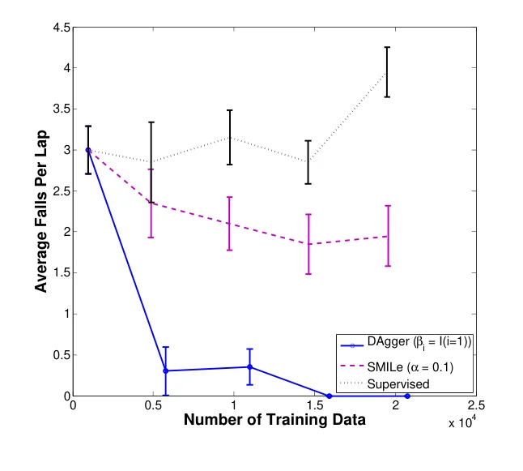
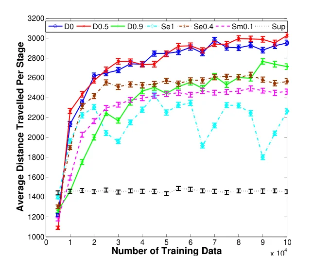

> - **논문**: A Reduction of Imitation Learning and Structured Prediction to No-Regret Online Learning
> - **저자**: Stéphane Ross, Geoffrey J. Gordon, J. Andrew Bagnell (Carnegie Mellon University)
> - **학회**: AISTATS 2011 · [arXiv:1011.0686](https://arxiv.org/abs/1011.0686)
{: .prompt-tip }

> Imitation Learning 카테고리의 첫 글입니다. **DAgger(Dataset Aggregation)**는 전문가를 따라 하는 모방학습에서 생기는 **오차 누적 문제**를, 학습자가 실제로 가게 되는 상태에서 전문가의 정답을 **계속 모으는** 방식으로 해결합니다. 모방학습에서 이론적으로 가장 잘 정립된 방법 중 하나입니다.

## 1. Imitation Learning이란

**전문가(expert)의 행동을 따라 하며 학습**하는 머신러닝 분야입니다. 보상을 설계하기 어려운 운전, 로봇 조작 같은 문제에서, 사람이 시연한 데이터를 정답으로 씁니다.

가장 단순한 방법은 **Behavior Cloning(BC)**입니다. 전문가가 방문한 상태 $$s$$와 그때의 행동 $$\pi^*(s)$$를 모아 **지도학습**으로 정책을 학습합니다.

모방학습에는 이 밖에도 시연에서 보상 자체를 추정하는 **IRL**(Inverse RL, Abbeel & Ng 2004 등) 흐름이 DAgger 이전부터 있었고, 이후에는 시연 데이터를 강화학습에 직접 섞는 DeepMind의 **DQfD**(Deep Q-learning from Demonstrations, 2018) 같은 방법도 나왔습니다. DAgger는 이 중 "전문가에게 계속 물어볼 수 있다"는 가정 아래 BC의 약점을 정면으로 고친 방법입니다.

## 2. 문제: 순차적 결정에서의 분포 이동

모방학습은 일반 지도학습과 다른 점이 있습니다. **지금의 행동이 미래의 관측에 영향을 줍니다.**

- BC는 **전문가가 방문한 상태**에서만 학습합니다.
- 하지만 학습자가 실행할 때는 **작은 실수 하나로 전문가가 가 본 적 없는 상태**에 들어갑니다.
- 그런 상태에서는 무엇을 해야 할지 배운 적이 없으니 또 실수하고, 더 낯선 상태로 갑니다.

운전을 배울 때 차선 한가운데로만 달리는 시연만 봤다면, 조금 벗어났을 때 **돌아오는 법을 모르는** 것과 같습니다. 데이터가 i.i.d.라는 지도학습의 가정이 깨지는 것입니다.

결과적으로 전문가 상태 분포에서의 오차율이 $$\epsilon$$이라도, 길이 $$T$$의 과제에서 BC의 총 비용은 $$J(\hat{\pi}_{sup}) \le J(\pi^*) + T^2\epsilon$$까지 커질 수 있습니다. 실수가 시간에 따라 **제곱으로** 누적됩니다. 논문은 이 상한이 실제로 달성되는(tight) 예가 있다는 점도 짚습니다.

## 3. 준비: 기호와 목표

| 기호 | 의미 |
|---|---|
| $$T$$ | 과제의 horizon (step 수) |
| $$d^t_\pi$$ | 정책 $$\pi$$를 1부터 $$t-1$$까지 실행했을 때 시점 $$t$$의 상태 분포 |
| $$d_\pi = \frac{1}{T}\sum_t d^t_\pi$$ | $$\pi$$가 유도하는 평균 상태 분포 |
| $$C(s, a) \in [0, 1]$$ | 상태 $$s$$에서 행동 $$a$$의 즉각 비용 |
| $$J(\pi) = T\,\mathbb{E}_{s \sim d_\pi}[C_\pi(s)]$$ | $$\pi$$의 총 비용 (cost-to-go) |

모방학습에서는 실제 과제의 비용을 관찰할 필요가 없습니다. 대신 **전문가 행동과 얼마나 다른지**를 재는 **대리 손실(surrogate loss)** $$\ell(s, \pi)$$(예: 전문가 행동과 다르면 1)를 씁니다.

**목표**는 **자기 자신이 유도한 상태 분포** 아래에서 대리 손실을 최소화하는 정책을 찾는 것입니다.

$$
\hat{\pi} = \arg\min_{\pi \in \Pi}\ \mathbb{E}_{s \sim d_\pi}\big[\ell(s, \pi)\big]
$$

문제는 $$d_\pi$$가 **학습할 정책 자체에 의존**한다는 것입니다. 시스템 동역학이 복잡하니 이 분포를 식으로 구할 수 없고, 정책을 **실제로 실행해서 샘플링**해야 합니다.

## 4. DAgger 알고리즘

1. 데이터셋 $$\mathcal{D}$$를 빈 집합으로 두고, 첫 정책 $$\hat{\pi}_1$$을 임의의 정책으로 초기화
2. $$i = 1, \dots, N$$ 반복
   1. 섞인 정책 $$\pi_i = \beta_i\,\pi^* + (1 - \beta_i)\,\hat{\pi}_i$$로 궤적을 생성
   2. 그 궤적에서 **방문한 상태들에 대해 전문가에게 정답 행동을 물어** $$\mathcal{D}_i = \{(s, \pi^*(s))\}$$
   3. **데이터를 합침(aggregate)**: $$\mathcal{D} \leftarrow \mathcal{D} \cup \mathcal{D}_i$$
   4. 전체 $$\mathcal{D}$$에서 전문가를 가장 잘 모방하는 정책 $$\hat{\pi}_{i+1}$$을 학습
3. 검증 성능이 가장 좋은 $$\hat{\pi}_i$$를 반환

핵심은 **학습자가 실제로 가게 되는 상태**에서 정답을 모은다는 것입니다. 차선에서 벗어난 상태를 학습자가 만들어 내면, 전문가가 "여기서는 이렇게 돌아와라"라고 알려 줍니다.

### 섞는 비율 $$\beta_i$$

- 첫 반복($$i = 1$$)에서는 $$\beta_1 = 1$$, 즉 **전문가 정책만** 따릅니다. 그래서 초기 정책 $$\hat{\pi}_1$$을 따로 정할 필요가 없습니다.
- 가장 단순한 버전은 $$\beta_i = I(i = 1)$$, 즉 첫 반복만 전문가로 돌고 이후는 학습자만 쓰는 것입니다. 하이퍼파라미터가 없고, 논문은 이 버전이 실제로 가장 좋은 경우가 많다고 말합니다.
- 다른 선택으로 $$\beta_i = p^{\,i-1}$$처럼 지수적으로 줄일 수도 있습니다(Mario 실험에서는 $$p$$를 0.1~0.9에서 골랐습니다). 초반 정책은 데이터가 적어 실수가 많고, 나중에는 쓸모없어질 상태를 방문하기 쉬워서 전문가를 조금 섞는 것입니다.
- 이론이 요구하는 조건은 평균 $$\frac{1}{N}\sum_{i=1}^{N}\beta_i \to 0$$ 하나뿐입니다. **반복이 진행될수록 학습자 정책의 비중이 커져**, 결국 학습자 자신의 상태 분포에서 데이터를 모으게 됩니다.

```python
import random

def dagger(env, expert, learner, train_fn, n_iters=10, n_rollouts=5, p=0.5):
    """env: Gymnasium API (reset → (obs, info), step → (obs, r, terminated, truncated, info))"""
    D = []
    for i in range(1, n_iters + 1):
        beta = 1.0 if i == 1 else p ** (i - 1)
        for _ in range(n_rollouts):
            s, _ = env.reset()
            done = False
            while not done:
                D.append((s, expert(s)))                         # 방문한 상태에 전문가 정답 라벨
                a = expert(s) if random.random() < beta else learner(s)   # 섞인 정책으로 실행
                s, _, terminated, truncated, _ = env.step(a)
                done = terminated or truncated
        learner = train_fn(learner, D)                           # 누적된 전체 데이터로 학습
    return learner
```

> 예전 OpenAI Gym 코드는 `env.step()`이 `(obs, reward, done, info)` 4개를 돌려주지만, 현재 표준인 **Gymnasium**(0.26 이후)은 `terminated`(과제 종료)와 `truncated`(시간 제한 등으로 중단)를 나눠 5개를 돌려줍니다. 둘을 구분하는 이유는, 시간 제한으로 끊긴 경우에는 다음 상태의 가치를 0으로 두면 안 되기 때문입니다.
{: .prompt-info }

## 5. 왜 동작하나: No-Regret Online Learning

논문은 모방학습을 **online learning** 문제로 바꿔 분석합니다.

- **Online learning**: 반복마다 정책을 내놓고, 그 정책으로 생긴 손실을 관찰한 뒤, 다음 반복의 새 정책을 내놓는 학습 방식
- **No-regret**: 시간이 지날수록, 내가 고른 정책들의 평균 손실과 **사후적으로 본 최적 정책**의 손실 차이가 0으로 수렴. 데이터가 i.i.d.가 아니어도 시간이 지나면 합리적인 결정을 하게 됨

DAgger는 "지금까지 모은 모든 데이터에서 가장 좋은 정책을 고르는" **Follow-The-Leader** 방식이라 (손실이 strongly convex일 때) no-regret 성질을 가집니다. 반복 $$i$$의 손실을 $$\ell_i(\pi) = \mathbb{E}_{s \sim d_{\pi_i}}[\ell(s, \pi)]$$, 즉 **그 반복의 정책이 만든 상태 분포에서의 손실**로 두면 모방학습이 그대로 online learning이 됩니다. 분석에 쓰는 것은 no-regret 성질뿐이라, 다른 no-regret 알고리즘을 써도 같은 보장이 나옵니다.

주요 결과는 다음과 같습니다. $$\epsilon_N$$은 지금까지의 분포들에서 사후적으로 가장 좋은 정책의 손실입니다.

- **Theorem 3.1**: 반복 수 $$N$$이 $$\tilde{O}(T)$$면, $$\hat{\pi}_{1:N}$$ 중에 $$\mathbb{E}_{s \sim d_{\hat{\pi}}}[\ell(s, \hat{\pi})] \le \epsilon_N + O(1/T)$$인 정책이 있습니다. **자기 분포에서** 손실이 작은 정책을 찾는다는 뜻입니다.
- **Theorem 3.2**: $$N$$이 $$\tilde{O}(uT)$$면 $$J(\hat{\pi}) \le J(\pi^*) + uT\epsilon_N + O(1)$$. 여기서 $$u$$는 한 번 실수했을 때 전문가가 이후 비용을 얼마나 손해 보는지의 상한이고, 전문가가 실수에서 몇 step 안에 회복할 수 있는 환경이면 $$O(1)$$입니다.
- **유한 샘플**: 반복마다 궤적 $$m = O(1)$$개, $$N = O(T^2\log(1/\delta))$$ 반복이면 확률 $$1 - \delta$$로 같은 꼴의 보장이 성립합니다.

정리하면 $$u$$가 상수인 경우 추가 비용이 horizon에 **선형**으로만 늘어납니다. 비슷한 보장을 주던 이전 방법들은 Forward Training이 step마다 다른 정책을 $$T$$개 학습해야 하고, SMILe가 여러 정책을 확률적으로 섞은 정책을 쓰며 $$O(T^2\log T)$$번 반복해야 했던 반면, DAgger는 **하나의 결정적·정상(stationary) 정책**을 더 적은 반복으로 학습합니다.

| 방법 | 학습 데이터 분포 | $$J(\pi^*)$$ 대비 추가 비용 |
|---|---|---|
| Behavior Cloning | 전문가의 상태 분포 | $$T^2\epsilon$$ |
| **DAgger** | **학습자 자신의 상태 분포** | $$uT\epsilon_N + O(1)$$ ($$u = O(1)$$이면 $$O(\epsilon T)$$) |

## 6. 실험

세 실험 모두 학습자는 단순한 선형 모델이고, 20번 반복했습니다.

| 항목 | Super Tux Kart | Super Mario Bros. | 필기체 인식 (OCR) |
|---|---|---|---|
| 입력 | 800×600 화면을 25×19로 줄인 각 픽셀의 LAB 색 값 | 마리오 주변 22×22 격자, 칸마다 14개 이진 특징, 최근 4프레임 + 최근 6개 행동 + 마리오 상태 (총 27,152개 희소 이진 특징) | 8×16 이진 픽셀(128개) + 직전에 예측한 글자(26개) |
| 전문가 | 사람의 조향 (아날로그 조이스틱, [-1, 1]) | 게임 내부 상태를 다 보는 거의 최적의 planner | 정답 글자 |
| 학습자 | ridge regression 선형 제어기 ($$\lambda = 10^{-3}$$), 5Hz | 이진 행동 4개({왼쪽, 오른쪽, 점프, 가속})마다 독립 선형 SVM ($$\lambda = 10^{-4}$$, SGD), 5Hz | 다중 클래스 선형 SVM (all-pairs) |
| 반복당 데이터 | 1바퀴(약 1,000개) | 5,000개 (스테이지 하나 완주 시 약 150개) | 9 fold 학습, 1 fold 테스트 |
| 평가 | 한 바퀴당 트랙에서 떨어진 평균 횟수 | 난이도 1, 제한 시간 60초 스테이지에서 이동한 평균 거리 (스테이지 길이 약 4,200~4,300) | 테스트 fold 글자 정확도 |

### Super Tux Kart (레이싱)

허공에 떠 있는 Star Track 트랙에서 일정한 속도로 달리며 조향만 학습합니다. DAgger는 $$\beta_i = I(i = 1)$$, SMILe는 $$\alpha = 0.1$$을 썼습니다.


_Figure 2. 모은 학습 데이터 양에 따른 한 바퀴당 평균 낙하 횟수(95% 신뢰구간). Supervised(BC)는 데이터를 늘려도 나아지지 않고, DAgger(파랑)는 15번째 반복부터 0번입니다. (출처: Ross et al., 2011)_

- BC는 시연 데이터를 늘려도 계속 트랙에서 떨어졌습니다. 시연 바퀴들이 서로 비슷해서 **실수에서 회복하는 법**을 배울 데이터가 늘지 않기 때문입니다.
- SMILe는 조금 나아졌지만 20번 반복 후에도 한 바퀴에 약 2번 떨어졌습니다. 확률적으로 섞인 정책이 가끔 나쁜 행동을 고르는 탓도 있습니다.
- DAgger는 5번 반복만으로도 거의 떨어지지 않았고, **15번 반복 후에는 한 번도 떨어지지 않는** 정책을 학습했습니다. 주행도 SMILe보다 부드러웠습니다.

### Super Mario Bros.

DAgger는 $$\beta_i = I(i = 1)$$(D0)과 $$\beta_i = p^{\,i-1}$$($$p = 0.1, \dots, 0.9$$)을, SEARN은 $$\alpha = 0.1, \dots, 1$$을 모두 시험했습니다.


_Figure 4. 학습 데이터 양에 따른 스테이지당 평균 이동 거리. D는 DAgger, Se는 SEARN, Sm은 SMILe, Sup은 BC이고 뒤의 숫자는 $$p$$ 또는 $$\alpha$$입니다. (출처: Ross et al., 2011)_

| 방법 | 20번 반복 후 결과 (그림에서 읽은 대략값 포함) |
|---|---|
| **DAgger, $$p = 0.5$$ (D0.5)** | **약 3,030** (최고) |
| DAgger, $$\beta_i = I(i = 1)$$ (D0) | 약 2,980 |
| DAgger, $$p = 0.9$$ (D0.9) | 수렴이 느려 20번째에도 계속 오르는 중 |
| SEARN, 최적 $$\alpha = 0.4$$ | DAgger보다 낮음 (그림상 약 2,550) |
| SEARN, $$\alpha = 1$$ (순수 policy iteration) | 크게 출렁이며 불안정 |
| SMILe, $$\alpha = 0.1$$ | DAgger보다 낮음 (그림상 약 2,450) |
| Supervised (BC) | 데이터를 늘려도 약 1,450에 정체 |

- BC가 낮은 이유는 마리오가 장애물 바로 앞에 **끼어서** 움직이지 못하는 일이 많아서입니다. 전문가는 항상 멀리서 장애물을 뛰어넘으니, 장애물에 붙은 상황에서 빠져나오는 법을 시연에서 볼 수 없습니다. 반복형 방법들은 나중 반복에서 그런 상황을 직접 겪으며 빠져나오는 법을 배웁니다.
- D0.5가 D0보다 약간 좋은 것은, 초반에 학습자만 쓰면 같은 곳에 끼인 데이터가 많이 쌓이는 반면, 전문가를 조금 섞으면 그 상황도 보면서 빠져나와 더 다양한 데이터를 모으기 때문으로 봅니다.

### 필기체 인식 (구조적 예측)

단어를 왼쪽부터 한 글자씩, 직전에 예측한 글자를 입력으로 써서 예측하는 문제도 "동역학이 아주 단순한 모방학습"으로 볼 수 있습니다. 약 6,600단어(52,000자 이상) 데이터셋에서 greedy 한 번 디코딩으로 비교했습니다.

| 방법 | 테스트 글자 정확도 |
|---|---|
| 구조 없음 (글자마다 독립 SVM) | 82% |
| Supervised (직전 글자는 항상 정답으로 학습) | 83.6% |
| **DAgger** | **85.5%** |

SEARN($$\alpha = 1$$, $$\alpha = 0.8$$)도 DAgger와 비슷하게 좋았는데, 현재 정책이 영향을 주는 입력이 직전 글자 하나뿐이라 일반 모방학습만큼 불안정하지 않기 때문입니다. SEARN·SMILe($$\alpha = 0.1$$)는 DAgger보다 확연히 낮았습니다.

## 7. 정리

| | Behavior Cloning | DAgger |
|---|---|---|
| 데이터 | 전문가 궤적만 | 학습자가 방문한 상태 + 전문가 라벨 |
| 분포 이동 | 무방비 | 반복적으로 보정 |
| 오차 누적 | $$O(\epsilon T^2)$$ | $$O(\epsilon T)$$ (회복 비용 $$u$$가 상수일 때) |
| 요구 사항 | 시연 데이터 | **언제든 정답을 알려 줄 전문가** (상호작용 필요) |
| 실험 | Tux Kart 약 3~4회 낙하/바퀴, Mario 약 1,450 | Tux Kart 0회, Mario 3,030, OCR 85.5% |

DAgger의 한계는 전문가가 **학습 중에 계속 라벨을 달아 줘야** 한다는 점입니다. 사람이 전문가라면 비용이 큽니다. 또 학습자가 위험한 상태로 가도 그대로 두고 라벨만 다는 방식이라, 실제 자동차처럼 실패 비용이 큰 환경에서는 쓰기 어렵습니다. 이를 보완하려고 전문가가 위험할 때만 개입하는 HG-DAgger(Kelly et al., 2019) 같은 변형이 나왔습니다.

다음 글에서는 행동뿐 아니라 **사람의 생각(언어)까지 모방**하는 [Thought Cloning]()을 다룹니다.

## References

- Ross, Gordon & Bagnell, "A Reduction of Imitation Learning and Structured Prediction to No-Regret Online Learning," AISTATS 2011. [arXiv:1011.0686](https://arxiv.org/abs/1011.0686)
- Kelly et al., "HG-DAgger: Interactive Imitation Learning with Human Experts," ICRA 2019. [arXiv:1810.02890](https://arxiv.org/abs/1810.02890)
- [Gymnasium – Env.step](https://gymnasium.farama.org/api/env/#gymnasium.Env.step)
- Ross & Bagnell, "Efficient Reductions for Imitation Learning (SMILe)," AISTATS 2010.
- Hester et al., "Deep Q-learning from Demonstrations (DQfD)," AAAI 2018.
