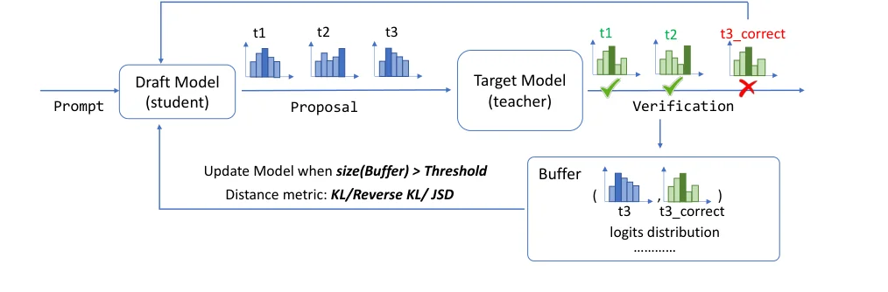
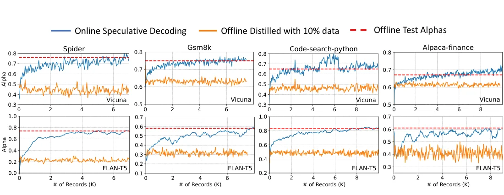
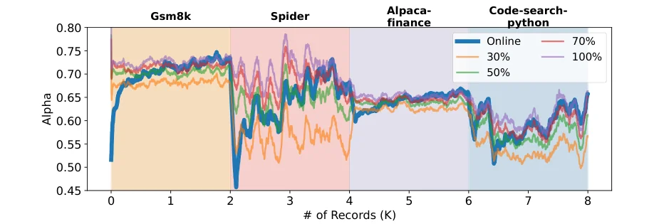

> - **논문**: Online Speculative Decoding
> - **저자**: Xiaoxuan Liu, Lanxiang Hu, Peter Bailis, Ion Stoica, Zhijie Deng, Alvin Cheung, Hao Zhang (UC Berkeley, UCSD, Sisu Data, SJTU)
> - **학회**: arXiv preprint 2023 · [arXiv:2310.07177](https://arxiv.org/abs/2310.07177) · [코드](https://github.com/LiuXiaoxuanPKU/OSD)
{: .prompt-tip }

> [Speculative Decoding]()의 가속은 전적으로 수락률 $$\alpha$$, 즉 draft 모델이 target 모델을 얼마나 잘 흉내 내는지에 달려 있다. 그런데 draft는 작고, 사용자 질의는 다양하다. **Online Speculative Decoding**(OSD)은 이 문제를 "draft를 배포 후에도 계속 학습시키자"로 푼다. speculative decoding이 거절한 토큰 자리에는 target의 정답 분포가 공짜로 따라오므로, 그것을 증류 데이터로 쓰고 서빙 클러스터의 **남는 FLOPs**로 학습하면 비용이 거의 들지 않는다.

## 1. 문제: draft가 못 맞히면 가속은 없다

speculative decoding의 기대 속도 향상은 [원 논문]()의 식 그대로이다.

$$
\mathbb{E}(\text{speedup}) = \frac{1 - \alpha^{k+1}}{(1 - \alpha)(kc + 1)}
$$

$$\alpha$$가 낮으면 가속이 1배 아래로 떨어질 수도 있고(draft가 큰 경우 특히), 반대로 $$\alpha$$와 속도의 관계는 **초선형**이어서 수락률을 두 배로 올리면 속도는 두 배 이상 오른다. 그러나 다양한 입력 앞에서 작은 draft의 정확도는 높지 않고, 더 큰 draft를 쓰면 지연이 늘어 본말이 뒤집힌다.

논문은 세 가지 관찰로 돌파구를 찾는다.

1. **특정 LLM 서비스의 질의는 도메인별로 분포가 단순하다.** 모든 입력을 잘 맞히기는 어렵지만, 그 서비스에 들어오는 비슷한 입력만 잘 맞히게 만드는 것은 가능하다. 언어나 주제별로 draft를 여러 개 두고 골라 쓸 수도 있다.
2. **LLM 추론은 메모리 대역폭에 묶여 있어 클러스터에 연산 여유가 크다.** 특히 트래픽이 적은 시간대에 그렇다. 이 "spare FLOPs"로 draft를 재학습하면 비용이 거의 0이다.
3. **온라인으로 학습하면 질의 분포가 바뀌어도 따라간다.**

그리고 관찰이 하나 더 있다. speculative decoding은 그 자체로 **draft의 오답과 target의 정답을 함께 알려 준다.** 거절된 자리의 입력 $$[x, y_{<a+1}]$$과 target 분포 $$p(y \mid x, y_{<a+1})$$가 그대로 학습 쌍이 된다.

## 2. 지식 증류로 draft 맞추기

target LLM $$p(\cdot \mid x)$$와 draft $$q_\theta(\cdot \mid x)$$를 각각 교사와 학생으로 두는 지식 증류이다. 손실은 입력 배치에 대한 분포 간 거리의 평균이다.

$$
\ell(\theta) = \frac{1}{n_B} \sum_{x^{(i)} \in B} D\big(p(\cdot \mid x^{(i)}) \,\|\, q_\theta(\cdot \mid x^{(i)})\big)
$$

### 거리 척도

토큰마다 분포가 categorical이므로 forward KL, reverse KL, 그리고 둘을 섞은 JSD를 쓴다.

$$
\ell_{KL} = D_{KL}(p \,\|\, q_\theta),\qquad \ell_{RKL} = D_{KL}(q_\theta \,\|\, p),\qquad \ell_{JSD[\beta]} = \beta D_{KL}(p \,\|\, p^\beta_\theta) + (1 - \beta) D_{KL}(q_\theta \,\|\, p^\beta_\theta)
$$

$$p^\beta_\theta = \beta p + (1 - \beta) q_\theta$$이다. 기존 speculative decoding 연구가 썼던 **라벨 기반 미세조정**(target이 생성한 토큰을 정답으로 학습)과 달리 분포 전체를 맞추므로 정보가 많고, 수렴이 빠르며, calibration도 좋아진다. reverse KL은 mode-seeking 성질이 있어 draft처럼 작은 모델에 유리할 수 있지만, 실제로는 작업과 모델 쌍에 따라 최적 척도가 달랐다.

### 샘플링과 기울기

분포 간 거리의 기댓값은 시퀀스를 따라 재귀적으로 펼쳐지므로 Monte Carlo로 근사한다. $$q_\theta$$에서 샘플링하면서 그 과정까지 미분하면 policy gradient 꼴의 추정량이 되어 분산이 크다. 대신 **샘플링 과정은 미분하지 않고** 뽑힌 시퀀스 $$y$$를 손실에 그대로 꽂는다.

$$
\ell(x, \theta) \approx \sum_{j=1}^{|y|+1} D\big(p(y \mid x, y_{<j}) \,\|\, q_\theta(y \mid x, y_{<j})\big)
$$

이러면 샘플링과 거리 척도가 분리되어, $$y$$를 교사에서 뽑든 학생에서 뽑든 둘을 섞어 뽑든($$y_j \sim \beta p + (1 - \beta) q_\theta$$) 어떤 척도든 쓸 수 있다. 교사 샘플은 일관성이 있지만 작은 학생이 따라가기 어렵고, 학생 샘플은 구조가 없거나 무의미할 수 있어 섞는 것이 절충안이다.

## 3. 온라인 알고리즘


_Figure 1. draft(학생)가 토큰을 제안하고 target(교사)이 검증한다. 거절된 위치(t3)의 draft 분포와 target의 정답 분포(`t3_correct`)를 버퍼에 모았다가, 버퍼가 일정 크기를 넘으면 KL·reverse KL·JSD 중 하나로 draft를 갱신한다. (출처: Liu et al., 2023)_

위 Figure 1의 흐름을 Algorithm 1로 풀어 쓰면 다음과 같다.

```text
준비     warmup 데이터로 q_θ를 p에 맞춰 증류
서빙     요청 x가 들어올 때마다
            <EOS>까지 speculative decoding으로 응답 생성
                draft가 k개 제안 → target이 k+1개 확률을 병렬 계산 → a개 수락 + 1개 재샘플
                거절된 위치의 인덱스와 target 분포 p(y | x, y_<a+1)를 임시 버퍼 R에 기록
            (x, R)을 replay 버퍼 Q에 추가
            요청 I개마다 Q로 q_θ를 갱신하고 Q를 비움
```

- **replay 버퍼 Q**는 어떤 정보를 얼마나 오래 둘지 자유롭게 정할 수 있다. 논문은 중간에 아무 쌍도 내보내지(evict) 않고 모두 쌓아 두었다가 갱신할 때마다 버퍼를 통째로 비웠다.
- **갱신 간격 I**는 동적으로 조절한다. 트래픽이 몰리지 않을 때, 즉 spare FLOPs가 있을 때만 기울기 갱신을 하면 서빙 지연을 가리는 효과가 난다.

### 비용은 얼마나 드나

**지연.** 수락률이 $$\alpha_1$$에서 $$\alpha_2$$로 오르면 기존 speculative decoding 대비 속도 향상은 다음과 같다.

$$
\frac{1 + \alpha_2 + \alpha_2^2 + \cdots + \alpha_2^k}{1 + \alpha_1 + \alpha_1^2 + \cdots + \alpha_1^k}
$$

아래 Table 1의 수락률(원본 → 교사 샘플링 증류)을 $$k = 5$$로 넣으면, 기존 speculative decoding 대비 기대 가속은 다음과 같다.

| target (draft) | Spider | GSM8K | Code-Python | Alpaca-finance |
|---|---|---|---|---|
| Vicuna-7B (LLaMA-160M) | 2.42× | 1.43× | 1.64× | 1.22× |
| Flan-T5-XL 3B (T5-small 80M) | 3.06× | 1.76× | 2.72× | 1.55× |

논문은 네 값을 데이터셋 이름 없이 나열하는데, Table 1 순서대로 식에 넣어 계산하면 위 값과 맞는다(예: Vicuna Spider $$\alpha$$ 0.28 → 0.76이면 2.42×).

**FLOPs.** 학습은 추론의 약 3배(파라미터당 6 FLOPs 대 2 FLOPs)라는 추정으로 요청 $$I$$개를 처리하는 총 연산을 쓰면, target 대비 draft(추론 + 갱신)의 FLOPs 비율은 $$\frac{(k+1) F_{p}}{(k + 3a) F_{q}}$$이다. 여기서 $$a$$는 target 한 번 실행당 기대 생성 길이이다. 평균 수락률 0.71인 (LLaMA-160M, Vicuna-7B)는 $$a \approx 3$$으로 $$\frac{6 \times 7\text{B}}{14 \times 160\text{M}} = 18.75$$, 평균 수락률 0.76인 (T5-small, Flan-T5-XL)는 $$a \approx 4.3$$으로 12.6이어서 draft 갱신 비용은 target 추론에 묻힌다. 게다가 공개된 LMSYS-Chat-1M 트레이스(125일, 요청 100만 개, 요청당 평균 2,000토큰 미만)로 30B 모델을 A100 8장으로 서빙하는 경우를 추정하면 연산 활용률이 1%에도 못 미친다. 논문 부록(A.3)은 이 값을 "초당 5.5 GFLOPs"로 적었지만, 같은 식(초당 약 185토큰 × 30B × 2)을 다시 계산하면 초당 약 11 TFLOPs이다. 그래도 A100 8장의 용량 8 × 312 = 2,496 TFLOPs의 0.5% 미만이라 결론은 같다.

## 4. 코드로 보기: 거절 기록으로 배우면 α가 오르고, 분포가 바뀌어도 따라간다

target을 두 도메인(A, B)의 조건부 분포표로, draft를 학습 가능한 logit 표로 두고 OSD를 재현했다. 요청 400개까지는 도메인 A, 그다음 400개는 도메인 B가 들어온다. 요청 8개마다 거절 기록으로 forward KL 증류를 한 스텝 한다.

```python
import torch
import torch.nn.functional as F

torch.manual_seed(0)
V, C, K = 64, 20, 5                                     # 어휘 크기, 문맥(직전 토큰) 종류, 추측 길이

# 1) 목표 모델: 두 질의 분포(도메인 A, B)마다 다른 다음 토큰 분포를 가진 표
target = {d: torch.softmax(torch.randn(C, V) * 2.5, dim=-1) for d in "AB"}
# draft 모델: 학습 가능한 logit 표 하나. 처음에는 목표와 느슨하게만 닮게 초기화한다(일반 코퍼스로 사전학습한 작은 모델)
draft_logits = torch.nn.Parameter(torch.log(target["A"]) * 0.3 + torch.randn(C, V))
opt = torch.optim.Adam([draft_logits], lr=0.05)

def serve_request(domain, length=40):
    """speculative decoding으로 응답을 만들며, 거절된 위치의 (문맥, 목표 분포)를 버퍼에 모은다."""
    p, buf, ctx, accepted, proposed = target[domain], [], torch.randint(C, (1,)).item(), 0, 0
    with torch.no_grad():
        while length > 0:
            q_tab = torch.softmax(draft_logits, dim=-1)
            c, guesses = ctx, []
            for _ in range(K):                              # draft가 K개 제안
                x = torch.multinomial(q_tab[c], 1).item(); guesses.append((c, x)); c = x % C
            for c, x in guesses:                            # target이 병렬 검증(여기서는 표 조회)
                proposed += 1
                if torch.rand(1).item() <= min(1.0, p[c][x] / q_tab[c][x]):
                    accepted += 1; ctx = x % C; length -= 1
                else:
                    buf.append((c, p[c])); ctx = torch.multinomial(p[c], 1).item() % C; length -= 1
                    break
            else:
                ctx = torch.multinomial(p[ctx], 1).item() % C; length -= 1
    return accepted / proposed, buf

def update(buffer):
    """버퍼에 쌓인 (문맥, 목표 분포)로 forward KL을 줄이는 지식 증류 한 스텝"""
    ctxs = torch.tensor([c for c, _ in buffer]); ps = torch.stack([p for _, p in buffer])
    loss = F.kl_div(F.log_softmax(draft_logits[ctxs], dim=-1), ps, reduction="batchmean")
    opt.zero_grad(); loss.backward(); opt.step()

replay, I = [], 8                                          # 요청 8개마다 draft를 갱신
for mode in ["static", "online"]:
    torch.manual_seed(1)
    saved = draft_logits.data.clone()
    print(f"[{mode}] 요청 1~400은 도메인 A, 401~800은 도메인 B")
    alphas = []
    for i in range(1, 801):
        a, buf = serve_request("A" if i <= 400 else "B")
        alphas.append(a); replay += buf
        if mode == "online" and i % I == 0 and replay:
            update(replay); replay = []
        if i % 100 == 0:
            print(f"  요청 {i:3d}까지 최근 100개 평균 수락률 α = {sum(alphas[-100:]) / 100:.2f}")
    draft_logits.data = saved; replay = []
```

```text
[static] 요청 1~400은 도메인 A, 401~800은 도메인 B
  요청 100까지 최근 100개 평균 수락률 α = 0.34
  요청 200까지 최근 100개 평균 수락률 α = 0.36
  요청 300까지 최근 100개 평균 수락률 α = 0.34
  요청 400까지 최근 100개 평균 수락률 α = 0.34
  요청 500까지 최근 100개 평균 수락률 α = 0.18
  요청 600까지 최근 100개 평균 수락률 α = 0.18
  요청 700까지 최근 100개 평균 수락률 α = 0.19
  요청 800까지 최근 100개 평균 수락률 α = 0.17
[online] 요청 1~400은 도메인 A, 401~800은 도메인 B
  요청 100까지 최근 100개 평균 수락률 α = 0.42
  요청 200까지 최근 100개 평균 수락률 α = 0.59
  요청 300까지 최근 100개 평균 수락률 α = 0.76
  요청 400까지 최근 100개 평균 수락률 α = 0.86
  요청 500까지 최근 100개 평균 수락률 α = 0.13
  요청 600까지 최근 100개 평균 수락률 α = 0.25
  요청 700까지 최근 100개 평균 수락률 α = 0.39
  요청 800까지 최근 100개 평균 수락률 α = 0.56
```

고정된 draft는 도메인 A에서 0.34에 머물고, 도메인 B로 바뀌자 0.18로 떨어진 채 회복하지 못한다. 온라인 갱신을 켜면 A에서 400개 요청 만에 0.86까지 오르고, B로 바뀌는 순간 0.13으로 급락했다가 다시 올라간다. 논문 Figure 4에서 2K, 4K, 6K 요청의 분포 경계마다 $$\alpha$$가 꺾였다가 회복하는 모양과 같다. 갱신에 쓴 데이터는 서빙 중 거절된 자리의 target 분포뿐이고, 따로 모은 학습 데이터는 없다.

## 5. 실험

target은 Vicuna-7B(draft LLaMA-160M)와 Flan-T5-XL 3B(draft T5-small 80M), 데이터셋은 Text-to-SQL(Spider), 수학(GSM8K), Python 코드(Code-search-Python), 금융 QA(Alpaca-finance)이다. 제안 토큰 수는 5, 온라인 갱신 간격 $$I = 8$$이다.

### 오프라인: 증류 방식 비교

질의 분포가 고정되어 있고 학습 데이터를 모두 볼 수 있는 상한 설정이다. 학습 데이터로 두 epoch 증류한 뒤의 테스트 수락률이다(Table 1).

| 모델 | 작업 | 원본 | 라벨 FT | 교사 샘플 | 학생 샘플 | 혼합 샘플 |
|---|---|---|---|---|---|---|
| Vicuna-7B | Spider | 0.28 | 0.74 | **0.76** | 0.62 | 0.70 |
| Vicuna-7B | GSM8K | 0.58 | 0.74 | **0.75** | 0.67 | 0.73 |
| Vicuna-7B | Code-Python | 0.38 | 0.65 | **0.65** | 0.51 | 0.61 |
| Vicuna-7B | Alpaca-finance | 0.57 | **0.68** | 0.67 | 0.63 | 0.65 |
| Flan-T5-XL | Spider | 0.13 | 0.33 | **0.78** | 0.67 | 0.70 |
| Flan-T5-XL | GSM8K | 0.29 | 0.50 | **0.62** | 0.51 | 0.55 |
| Flan-T5-XL | Code-Python | 0.28 | 0.44 | **0.81** | 0.67 | 0.78 |
| Flan-T5-XL | Alpaca-finance | 0.39 | 0.56 | **0.63** | 0.59 | 0.60 |

(모두 forward KL)

교사 샘플링이 가장 좋았고, Vicuna에서는 라벨 미세조정도 꽤 좋았지만 Flan-T5에서는 증류와 차이가 크다. reverse KL과 JSD는 forward KL과 비슷하거나 못했다.

### 온라인: 얼마나 빨리 오르나

10%의 데이터로 오프라인 증류한 고정 draft를 기준선으로 두고, 데이터셋의 프롬프트를 요청 스트림으로 흘려보냈다. 최근 50개 요청의 평균 $$\alpha$$를 보면, OSD는 처음에는 기준선보다 낮지만 데이터가 쌓이며 빠르게 올라 **오프라인 상한에 도달**하고, 때로는 넘어선다(최근 50개의 이동 평균이라 좁은 부분 분포에서는 더 높을 수 있음).


_Figure 3. 처리한 요청 수(K)에 따른 수락률(최근 50개 평균). 파랑이 OSD, 주황이 10% 데이터로 오프라인 증류한 고정 draft, 빨간 점선이 오프라인 증류 상한(Table 1)이다. 위는 Vicuna-7B, 아래는 Flan-T5-XL. (출처: Liu et al., 2023)_

Figure 3에서 고정 draft는 Vicuna Spider 0.4~0.5, Flan-T5 Spider 0.2 근처에 머무는 반면, OSD는 수천 개 요청 안에 빨간 점선 근처까지 올라간다.

**분포 이동.** 네 데이터셋을 2K개씩 이어 붙여 흘리면 경계마다 $$\alpha$$가 떨어졌다가 회복한다. 각 구간에서 OSD는 처음에는 데이터의 30%로 오프라인 증류한 모델과 비슷하거나 약간 낮다가, 곧 70~100%로 증류한 모델에 맞먹었다. 비교용 정적 모델은 온라인 평가와 겹치지 않는 샘플 0.6K, 1K, 1.4K, 2K개(온라인 구간 크기의 30, 50, 70, 100%)로 증류했다.


_Figure 4. GSM8K → Spider → Alpaca-finance → Code-search-Python 순으로 2K개씩 흘린 스트림에서의 수락률(최근 100개 평균). 굵은 파랑이 OSD, 나머지는 각 비율의 데이터로 미리 증류한 정적 draft이다. (출처: Liu et al., 2023)_

**실제 트래픽.** 4개월치 LMSYS-Chat 대화에서 영어를 뺀 상위 5개 언어마다 독립된 LLaMA-160M draft를 두니 2K개 미만의 데이터로 수락률이 0.1~0.2 올랐다(일본어가 가장 쉽고 포르투갈어가 가장 어려웠음). 영어를 주제별로 나누면 모든 주제에서 0.6 이상, Social과 Computer는 0.8 근처였다.

**망각은 없었나.** GSM8K 2K개로만 갱신한 뒤 Alpaca-finance 2K개로만 갱신했을 때, 후반에 GSM8K의 수락률이 유지되었다.

### 무엇을 배우나

Spider에서 target이 가장 자주 내는 상위 100개 토큰(전체 등장의 72.2%)의 정밀도와 재현율이 증류 후 크게 올랐다. 가장 많이 좋아진 토큰은 데이터 분포와 맞아떨어진다. Spider에서는 `SELECT`, `WHERE`, `COUNT`, GSM8K에서는 `<<`, `>>`, `=`, `+`, 코드에서는 `python`, `import`, `def`이다.

### 실험 설정

| 항목 | 값 |
|---|---|
| target / draft | Vicuna-7B / LLaMA-160M, Flan-T5-XL 3B / T5-small 80M |
| 데이터셋 | Spider, GSM8K, Code-search-Python, Alpaca-finance |
| 제안 토큰 수 $$k$$ | 5 |
| 갱신 간격 $$I$$ | 8 (온라인 실험 전체 고정) |
| replay 버퍼 | 쌍을 내보내지 않고 모두 쌓았다가 갱신 후 비움 |
| 오프라인 증류 | 학습 데이터로 2 epoch, forward KL |
| 온라인 기준선 | 데이터의 10%로 오프라인 증류 후 고정 |
| 수락률 집계 | 최근 50개(Figure 3) 또는 100개(Figure 4, 실제 트래픽) 요청 평균 |
| 분포 이동 | 데이터셋마다 프롬프트 2K개를 이어 붙임 |
| 실제 트래픽 | LMSYS-Chat-1M에서 무작위 10K개, Vicuna 대화만. 주제 분류는 distilled BERT, 주제당 최대 5K |

학습 하드웨어, optimizer, learning rate는 논문에 적혀 있지 않다.

## 6. 해석

**1. speculative decoding은 자기 자신의 학습 데이터를 만든다.** 이 논문의 가장 좋은 관찰은 거절이 곧 라벨이라는 점이다. target이 어차피 $$k + 1$$개 위치의 분포를 계산하므로, 거절된 자리의 정답 분포는 추가 비용 없이 손에 들어온다. [DAgger]()가 학습자가 실제로 가는 상태에서 전문가에게 정답을 묻듯, OSD는 draft가 실제로 틀리는 자리에서 target에게 정답을 받는다.

**2. 범용 draft를 포기하고 서비스별 draft를 택했다.** 모든 입력을 잘 맞히는 작은 모델은 없지만, 한 서비스의 질의는 좁다. 수락률을 0.1~0.65 올린 것은 이 선택 덕분이다. 위 예제에서도 도메인 하나로 좁히자 표 하나짜리 draft가 0.86까지 올랐다. 언어별, 주제별로 draft를 여러 개 두는 것은 같은 생각의 연장이다.

**3. 비용 분석이 설득력 있다.** draft 갱신 FLOPs가 target 추론의 1/12~1/19이고, 실제 서빙 클러스터의 연산 활용률이 1% 미만이라는 두 수치를 합치면 "공짜"라는 주장이 성립한다. 다만 LMSYS Arena가 효율적인 서비스가 아닐 수 있다는 점은 논문도 인정하고, 위에서 본 것처럼 활용률 계산의 중간값(5.5 GFLOPs)에도 단위 오류가 있다. 결론(1% 미만)은 바뀌지 않는다.

**4. 증류 척도의 선택은 아직 열려 있다.** forward KL과 교사 샘플링이 대체로 좋았지만 모델 쌍과 작업에 따라 달랐고, 논문은 최적 조합을 향후 과제로 남겼다. reverse KL의 mode-seeking이 작은 모델에 유리하다는 직관(Gu et al., 2023)이 여기서는 확인되지 않았다.

**5. 평가를 읽을 때 주의할 점.** 보고된 가속(1.22~3.06배)은 수락률 변화를 식에 넣은 **이론값**이고, 벽시계 시간을 잰 것이 아니다. 갱신으로 인한 지연도 "spare FLOPs가 있을 때만 하면 가릴 수 있다"는 가정 아래 생략했다. 온라인 실험은 데이터셋을 요청 스트림으로 재생한 시뮬레이션이고, 실제 트래픽 실험도 LMSYS 데이터의 10K 샘플이다.

## 7. 정리

| 항목 | 내용 |
|---|---|
| 목표 | speculative decoding의 수락률 $$\alpha$$를 배포 후에도 계속 올리기 |
| 방법 | 거절된 위치의 (입력, target 분포)를 버퍼에 모아 주기적으로 draft를 지식 증류 |
| 손실 | forward KL이 대체로 최선. 샘플링 과정은 미분하지 않고 뽑힌 시퀀스를 손실에 대입 |
| 비용 | draft 갱신 FLOPs는 target 추론의 1/12~1/19. 서빙 클러스터의 남는 연산으로 처리 |
| 결과 | 수락률 0.1~0.65 상승, 이론상 지연 1.22~3.06배 단축. 분포 이동 시 빠르게 회복, 망각 없음 |
| 한계 | 가속은 이론값, 갱신 지연은 가려진다고 가정, 최적 증류 척도는 미정 |

## References

- Liu et al., "Online Speculative Decoding," 2023. [arXiv:2310.07177](https://arxiv.org/abs/2310.07177)
- Leviathan, Kalman, Matias, "Fast Inference from Transformers via Speculative Decoding," ICML 2023. [arXiv:2211.17192](https://arxiv.org/abs/2211.17192)
- Agarwal et al., "GKD: Generalized Knowledge Distillation for Auto-regressive Sequence Models," 2023. [arXiv:2306.13649](https://arxiv.org/abs/2306.13649)
- Gu et al., "Knowledge Distillation of Large Language Models," 2023. [arXiv:2306.08543](https://arxiv.org/abs/2306.08543)
- Miao et al., "SpecInfer: Accelerating Generative LLM Serving with Speculative Inference and Token Tree Verification," 2023. [arXiv:2305.09781](https://arxiv.org/abs/2305.09781)
- Zheng et al., "LMSYS-Chat-1M: A Large-Scale Real-World LLM Conversation Dataset," 2023. [arXiv:2309.11998](https://arxiv.org/abs/2309.11998)
