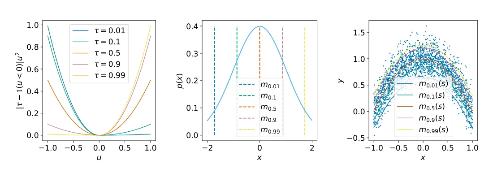
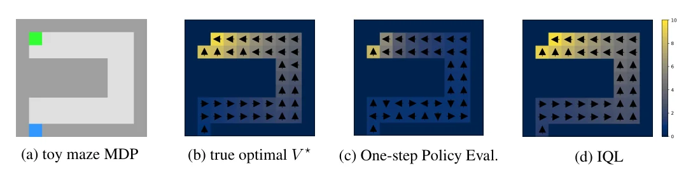
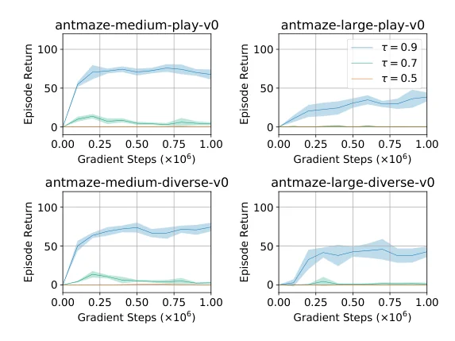

> - **논문**: Offline Reinforcement Learning with Implicit Q-Learning
> - **저자**: Ilya Kostrikov, Ashvin Nair, Sergey Levine (UC Berkeley)
> - **학회**: ICLR 2022 · [arXiv:2110.06169](https://arxiv.org/abs/2110.06169) · [코드](https://github.com/ikostrikov/implicit_q_learning)
{: .prompt-tip }

> Offline RL 카테고리의 첫 글입니다. **IQL(Implicit Q-Learning)**은 offline RL의 핵심 문제인 **분포 밖 행동의 과대평가**를, 아예 **데이터셋에 없는 행동의 가치를 한 번도 계산하지 않는** 방식으로 피합니다.

## 1. Offline RL이란

- **Online RL**: 환경과 상호작용하며 데이터를 모으고 정책을 업데이트
- **Offline RL**: 환경과 상호작용 **없이**, 이미 모아 둔 **고정된 데이터셋**만으로 정책을 학습

의료, 자율주행처럼 탐험 자체가 위험하거나 비싼 분야에서 중요합니다.

### Trade-off

Offline RL은 두 목표 사이의 균형을 맞춰야 합니다.

- **데이터를 모은 정책(behavior policy)보다 개선**: 그러려면 데이터 분포를 어느 정도 **벗어나야** 함
- **분포에서 너무 벗어나지 않게 규제**: 데이터에 없는 행동은 가치를 잘못 추정하기 쉬우므로 억제해야 함

목표는 **데이터셋에 있는 행동들 안에서** 가장 좋은 정책을 학습하는 것입니다.

### Extrapolation Error

Q-learning의 target에는 $$\max_{a'}Q(s', a')$$가 있습니다. 이 max가 고르는 $$a'$$는 **데이터셋에 없는 행동**일 수 있고, 그런 행동의 Q 값은 학습된 적이 없어 엉뚱하게 크게 추정됩니다(extrapolation). Online이라면 그 행동을 실제로 해 보고 바로잡겠지만, offline에서는 바로잡을 방법이 없어 오차가 누적됩니다.

기존 방법들은 behavior policy와의 거리를 규제하거나(BCQ, BRAC), 데이터에 없는 행동에 낮은 가치를 주는(CQL) 등으로 대응했지만, 여전히 **학습 중에 분포 밖 행동의 Q 값을 계산**해야 해서 extrapolation을 완전히 피하지 못했습니다.

## 2. 두 극단: Single-step vs Multi-step DP

- **Single-step dynamic programming** (예: Onestep RL): behavior policy의 Q 함수 $$Q^{\beta}$$를 SARSA로 학습한 뒤 **한 번만** 정책을 개선. 분포 밖 행동을 묻지 않아 안전하지만, 개선 폭이 제한적
- **Multi-step dynamic programming** (예: Q-learning 계열): 개선을 반복해 behavior policy보다 크게 나은 정책을 얻을 수 있지만, 분포 밖 행동을 묻게 됨

IQL은 **분포 밖 행동을 묻지 않으면서도 multi-step 개선**의 효과를 냅니다.

## 3. 핵심 아이디어: Upper Expectile

$$\max_{a'}Q(s', a')$$를 직접 계산하지 않고, **데이터셋에 있는 행동들의 Q 값 분포의 상위 기댓값(upper expectile)**으로 근사합니다. SARSA 형태의 TD 학습을 조금 수정해서, 평균이 아니라 **상위 쪽**을 추정하게 만듭니다.

### Expectile Regression

$$\tau \in (0, 1)$$에 대한 비대칭 제곱 손실입니다.

$$
L_2^\tau(u) = \big\lvert\tau - \mathbf{1}(u < 0)\big\rvert\,u^2
$$

- $$\tau = 0.5$$: 일반 MSE → **평균**
- $$\tau > 0.5$$: 양의 오차(예측이 작을 때)에 더 큰 가중치 → 분포의 **위쪽**을 추정
- $$\tau \to 1$$: 데이터에 있는 값들의 **최댓값**에 가까워짐


_Figure 1. 왼쪽: $$\tau$$별 비대칭 제곱 손실. 가운데: 정규분포의 expectile. 오른쪽: 2차원 분포에서 $$x$$마다 $$y$$의 조건부 expectile을 회귀한 예로, $$\tau \approx 1$$이면 분포 안에 있는 $$y$$의 최댓값을 따라갑니다. (출처: Kostrikov et al., 2022)_

위 Figure 1 오른쪽이 IQL이 하려는 일의 축소판입니다. $$x$$를 상태, $$y$$를 그 상태에서 데이터에 있는 행동들의 Q 값이라고 보면, upper expectile 곡선은 "상태마다 데이터 안에서 가장 좋은 행동의 가치"를 근사합니다. 논문은 이 성질을 정리로도 보입니다. $$\tau$$가 커질수록 $$V_\tau$$는 단조 증가하고, $$\tau \to 1$$의 극한에서 **데이터 support 안으로 제한한 최적 Q의 max**와 같아집니다(Lemma 1, Theorem 3). 즉 $$\tau = 0.5$$는 SARSA, $$\tau \to 1$$은 Q-learning이고, 그 사이를 $$\tau$$ 하나로 조절합니다.

```python
import torch

def expectile_loss(diff, tau=0.7):
    """diff = target - prediction"""
    weight = torch.where(diff > 0, tau, 1 - tau)
    return (weight * diff ** 2).mean()

# 한 상태에서 데이터셋 행동 5개의 Q 값이 아래와 같을 때, τ에 따라 V가 어디로 가는지
q_values = torch.tensor([1.0, 2.0, 3.0, 4.0, 10.0])
for tau in [0.5, 0.7, 0.9, 0.99]:
    v = torch.zeros(1, requires_grad=True)
    opt = torch.optim.Adam([v], lr=0.05)
    for _ in range(3000):
        loss = expectile_loss(q_values - v, tau)
        opt.zero_grad(); loss.backward(); opt.step()
    print(tau, round(v.item(), 3))
# 0.5 4.0 / 0.7 5.263 / 0.9 7.692 / 0.99 9.709
```

$$\tau = 0.5$$에서는 평균(4.0)이고, $$\tau$$를 키울수록 데이터 속 최댓값(10)에 다가갑니다. 중요한 점은 $$V$$가 **10을 넘지 않는다**는 것입니다. 데이터에 없는 행동이 아무리 커 보여도 $$V$$는 데이터에 있는 행동의 Q 값들 범위 안에서만 움직이므로, extrapolation으로 부풀려진 값이 target에 끼어들 수 없습니다. 반대로 $$\tau$$를 1에 너무 가깝게 두면 운 좋게 크게 추정된 소수의 Q 값에 끌려가므로, 과제마다 적절한 값(0.7, 0.9 등)을 고릅니다.

## 4. 방법

순서는 **① 가치 함수 학습 → ② 정책 추출**입니다. 가치 함수 학습 단계에는 정책이 전혀 등장하지 않습니다.

### ① Value Function: Expectile Regression

상태 가치 $$V(s)$$가, 데이터셋 행동들의 Q 값 분포에서 upper expectile이 되도록 학습합니다.

$$
\mathcal{L}_V(\psi) = \mathbb{E}_{(s, a) \sim \mathcal{D}}\Big[L_2^\tau\big(Q_{\hat{\theta}}(s, a) - V_\psi(s)\big)\Big]
$$

$$(s, a)$$는 **데이터셋에서만** 뽑습니다. 그래서 $$V(s)$$는 "이 상태에서 데이터에 있는 행동 중 좋은 쪽의 가치"가 됩니다.

### Q Function

Q 함수는 다음 상태의 **$$V$$로 bootstrap**합니다. max가 없습니다.

$$
\mathcal{L}_Q(\theta) = \mathbb{E}_{(s, a, s') \sim \mathcal{D}}\Big[\big(r(s, a) + \gamma V_\psi(s') - Q_\theta(s, a)\big)^2\Big]
$$

$$V$$가 이미 "데이터 안에서의 max"를 근사하고 있으므로, 이 반복은 **데이터에 있는 행동만으로 multi-step 개선**을 하는 것과 같습니다. 그리고 계산 어디에서도 **데이터에 없는 행동의 Q 값을 묻지 않습니다.** 이것이 "implicit"의 의미입니다.

$$V$$를 따로 두는 이유는, $$Q(s', a')$$에 expectile을 바로 적용하면 다음 상태 전이의 **확률성(운 좋은 전이)**까지 상위 쪽으로 평가하게 되기 때문입니다. $$V$$는 행동에 대해서만 expectile을 취합니다. Q는 **double Q-learning**처럼 두 개를 두고 작은 값을 씁니다.

### ② Policy Extraction: Advantage Weighted Regression

가치 함수가 학습되면, 정책은 **데이터셋 행동을 advantage로 가중해서 모방**합니다(AWR).

$$
\mathcal{L}_\pi(\phi) = -\mathbb{E}_{(s, a) \sim \mathcal{D}}\Big[\exp\big(\beta\,(Q_{\hat{\theta}}(s, a) - V_\psi(s))\big)\log\pi_\phi(a \mid s)\Big]
$$

- Advantage $$Q - V$$가 큰(좋은) 행동일수록 강하게 모방
- 여기서도 **데이터셋의 행동만** 사용
- $$\beta$$가 0이면 behavior cloning, 크면 가장 좋은 행동만 모방

```python
def iql_update(batch, q1, q2, q_target1, q_target2, v, policy, tau=0.7, beta=3.0, gamma=0.99):
    s, a, r, s_next, done = batch
    with torch.no_grad():
        q_t = torch.min(q_target1(s, a), q_target2(s, a))
    v_loss = expectile_loss(q_t - v(s), tau)                       # ① V: upper expectile

    with torch.no_grad():
        target = r + gamma * (1 - done) * v(s_next)                # max 없이 V로 bootstrap
    q_loss = ((q1(s, a) - target) ** 2).mean() + ((q2(s, a) - target) ** 2).mean()

    with torch.no_grad():
        w = torch.exp(beta * (q_t - v(s))).clamp(max=100.0)        # ② AWR 가중치
    pi_loss = -(w * policy.log_prob(s, a)).mean()
    return v_loss, q_loss, pi_loss
```

## 5. 실험

### 간단한 미로

U자 미로에서 출발점 하나, 목표 하나를 둡니다. 목표에 들어가면 보상 10, 나머지는 0이고, 25% 확률로 의도와 상관없이 무작위 칸으로 이동합니다. 데이터셋은 **최적 궤적 1개와 무작위 행동 궤적 99개**입니다($$\gamma = 0.9$$).


_Figure 2. (a) 미로 MDP, (b) 실제 최적 가치 $$V^\star$$, (c) one-step policy evaluation, (d) IQL($$\tau = 0.95$$). 색은 가치, 화살표는 정책입니다. (출처: Kostrikov et al., 2022)_

Figure 2 (c)처럼 single-step 방법(Onestep RL)은 behavior policy, 즉 거의 무작위 정책의 가치를 배우므로 목표에서 조금만 멀어져도 가치가 0 근처로 떨어지고, 먼 칸의 정책은 noise에 가깝습니다. IQL은 데이터 안에서 반복적으로 DP를 하므로 (d)처럼 가치가 출발점까지 전파되어 (b)의 최적 가치와 거의 같아집니다.

### D4RL

D4RL normalized score입니다(Table 1, locomotion은 10 seed × 10 에피소드 평균, AntMaze는 100 에피소드 평균). 일부 열만 옮겼습니다.

| 데이터셋 | BC | DT | Onestep RL | TD3+BC | CQL | **IQL** |
|---|---|---|---|---|---|---|
| locomotion-v2 합계 (9개) | 466.7 | 672.6 | 684.6 | 677.4 | **698.5** | 692.4 |
| antmaze-umaze-v0 | 54.6 | 59.2 | 64.3 | 78.6 | 74.0 | **87.5** |
| antmaze-medium-play-v0 | 0.0 | 0.0 | 0.3 | 10.6 | 61.2 | **71.2** |
| antmaze-medium-diverse-v0 | 0.0 | 0.0 | 0.0 | 3.0 | 53.7 | **70.0** |
| antmaze-large-play-v0 | 0.0 | 0.0 | 0.0 | 0.2 | 15.8 | **39.6** |
| antmaze-large-diverse-v0 | 0.0 | 0.0 | 0.0 | 0.0 | 14.9 | **47.5** |
| antmaze-v0 합계 (6개) | 100.2 | 112.2 | 125.3 | 163.8 | 303.6 | **378.0** |
| kitchen-v0 합계 | 154.5 | - | - | - | 144.6 | **159.8** |
| adroit-v0 합계 | 104.5 | - | - | - | 93.6 | **118.1** |
| 학습 시간 (1M step) | 10m | 960m | ≈20m | 20m | 80m | 20m |

- **MuJoCo locomotion**: 데이터에 최적에 가까운 궤적이 많이 섞여 있어 single-step 방법도 잘하는 영역입니다. IQL은 합계 692.4로 가장 좋은 CQL(698.5)과 비슷한 수준입니다.
- **AntMaze**: 개미 로봇이 미로를 통과하는 과제로, 데이터에 **완전한 성공 궤적이 거의 또는 전혀 없습니다.** 여러 궤적의 조각을 이어 붙여야(stitching) 하므로 **multi-step DP가 필수**입니다. Onestep RL과 DT는 medium·large에서 거의 0점인데, IQL은 합계 378.0으로 CQL(303.6)도 앞섭니다.
- **Kitchen, Adroit**: 논문은 이 두 도메인에서는 대부분의 RL 방법이 모방 학습과 비슷해 변별력이 낮다고 보고 부록(Table 3)에만 싣습니다. IQL 합계가 BC보다 조금 높은 정도입니다.
- 학습 시간은 같은 JAX 재구현 기준으로, CQL의 약 4분의 1입니다. GTX1080 한 장에서 1M 업데이트가 20분이 안 걸립니다.


_Figure 3. AntMaze 네 과제에서 $$\tau = 0.5, 0.7, 0.9$$의 학습 곡선. stitching이 필요한 과제에서는 큰 expectile이 필수입니다. (출처: Kostrikov et al., 2022)_

Figure 3이 앞의 이론을 그대로 보여 줍니다. $$\tau = 0.5$$(SARSA와 같음)는 네 과제 모두 0점 근처이고, $$\tau = 0.7$$도 거의 오르지 못하며, $$\tau = 0.9$$에서야 medium은 약 70, large는 약 40까지 올라갑니다. 그래서 expectile $$\tau$$는 locomotion에서 0.7, AntMaze에서 0.9처럼 과제에 따라 조정합니다.

### Online Fine-tuning

Offline으로 1M step 학습한 뒤, 환경 step마다 gradient 1번씩 **온라인으로 1M step fine-tuning**한 결과입니다(Table 2, offline 직후 → fine-tuning 후).

| 도메인 | AWAC | CQL | **IQL** |
|---|---|---|---|
| antmaze-v0 합계 | 107.7 → 108.3 | 151.5 → 231.1 | **370.1 → 473.7** |
| hand-v0 합계 (pen, door, relocate) | 46.7 → 103.1 | 31.5 → 9.9 | 38.1 → **124.0** |
| 전체 | 154.4 → 211.4 | 182.8 → 241.0 | **408.2 → 597.7** |

전체 합계로 보면 IQL은 offline 직후(408.2)와 fine-tuning 후(597.7) 모두 가장 높습니다. CQL은 antmaze-medium-play(23.0 → 0.0)와 hand 과제들(31.5 → 9.9)처럼 fine-tuning 뒤 오히려 떨어진 경우가 있었고, AWAC는 offline 초기값이 약해 AntMaze에서 거의 오르지 못했습니다. IQL이 fine-tuning에 잘 맞는 이유로 논문은 좋은 offline 초기값과, 온라인 개선에 유리하다고 알려진 가중 BC 방식의 정책 추출을 듭니다. 단, pen-binary-v0 하나에서는 AWAC(70.3)보다 낮았습니다(60.7).

## 6. 구현 디테일

| 항목 | 값 |
|---|---|
| 네트워크 | 모든 네트워크(Q 2개, V, 정책) 2층 MLP, hidden 256, ReLU |
| 정책 | 상태와 무관한 표준편차를 갖는 Gaussian |
| Optimizer | Adam, lr $$3 \cdot 10^{-4}$$, actor lr은 cosine schedule |
| Target network | soft update, $$\alpha = 0.005$$ |
| Advantage 가중치 | $$\exp(\beta A)$$를 $$(-\infty, 100]$$으로 clip |
| Locomotion | $$\tau = 0.7$$, $$\beta = 3.0$$, 보상을 데이터셋 최고·최저 return 차이로 나눠 정규화 |
| AntMaze | $$\tau = 0.9$$, $$\beta = 10.0$$, 보상에서 1을 뺌 |
| Kitchen, Adroit | $$\tau = 0.7$$, $$\beta = 0.5$$, 정책 네트워크에 dropout 0.1 |
| Fine-tuning (손 조작) | $$\tau = 0.8$$, $$\beta = 3.0$$, offline 25,000 step, 탐험용 Gaussian noise 표준편차 0.03 |
| 구현 | JAX + Flax, GTX1080 1장에서 1M 업데이트 20분 미만 |

V와 Q 업데이트는 한 step 안에서 번갈아 하고(Algorithm 1), 정책은 가치 학습에 전혀 영향을 주지 않으므로 가치 학습 뒤에 따로 추출해도 되고 동시에 학습해도 됩니다. 온라인 fine-tuning에서는 동시 학습을 씁니다.

## 7. 정리

| 단계 | 사용하는 행동 | 핵심 |
|---|---|---|
| V 학습 | 데이터셋 행동만 | Expectile로 "데이터 안의 max" 근사 |
| Q 학습 | 데이터셋 행동만 | $$r + \gamma V(s')$$, max 없음 |
| 정책 추출 | 데이터셋 행동만 | Advantage 가중 회귀 (AWR) |

IQL은 SARSA식 TD에 손실 함수 하나만 바꾼 단순한 구조이고 빠르기까지 해서(1M step 약 20분), 이후 offline RL의 강력한 baseline이 됐습니다. 다만 Figure 3처럼 $$\tau$$는 과제 성격(stitching 필요 여부)에 맞춰 골라야 합니다. 다음 글에서는 탐험 보너스를 **뒤집어서** offline RL에 쓰는 [Anti-Exploration]()을 다룹니다.

## References

- Kostrikov, Nair & Levine, "Offline Reinforcement Learning with Implicit Q-Learning," ICLR 2022. [arXiv:2110.06169](https://arxiv.org/abs/2110.06169)
- Kumar et al., "Conservative Q-Learning for Offline Reinforcement Learning (CQL)," NeurIPS 2020.
- Peng et al., "Advantage-Weighted Regression," 2019.
- Brandfonbrener et al., "Offline RL Without Off-Policy Evaluation (Onestep RL)," NeurIPS 2021.
- Fu et al., "D4RL," 2020.
