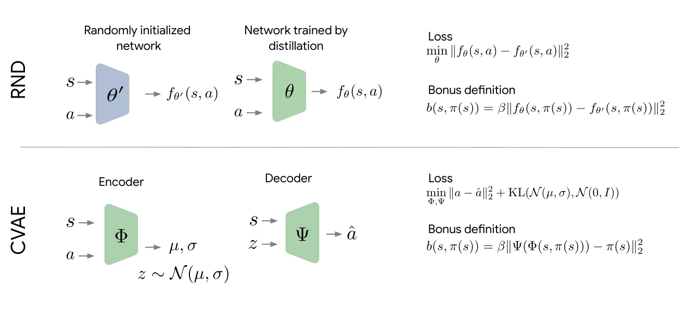
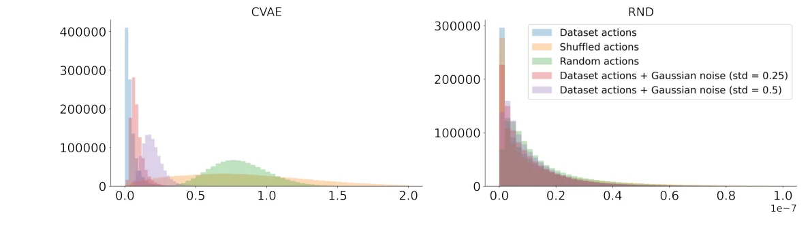

> - **논문**: Offline Reinforcement Learning as Anti-Exploration
> - **저자**: Shideh Rezaeifar, Robert Dadashi, Nino Vieillard, Léonard Hussenot, Olivier Bachem, Olivier Pietquin, Matthieu Geist (University of Geneva, Google Research Brain Team 외)
> - **학회**: AAAI 2022 · [arXiv:2106.06431](https://arxiv.org/abs/2106.06431)
{: .prompt-tip }

> Online RL에서 탐험 보너스는 **불확실한 곳으로 가도록** 보상을 더해 줍니다. 이 논문은 이를 거꾸로 써서, offline RL에서는 **불확실한(데이터에 없는) 행동을 피하도록** 보너스를 **빼 줍니다.** [Exploration 카테고리]()에서 본 보너스 설계를 offline RL로 옮겨 온 연구입니다.

## 1. Offline RL과 Online RL의 차이

- **Online RL**: step이나 episode 단위로 환경과 상호작용해 얻은 샘플로 정책을 업데이트
- **Offline RL**: 상호작용 없이, 미리 모은 샘플로 정책이 수렴할 때까지 학습

### Online의 탐험 보너스를 Offline에서도 쓸 수 있을까?

Offline RL은 정책 최적화에 **고정된 데이터셋**을 씁니다. 불확실한 행동을 해 봐도 결과를 확인할 수 없으니, online처럼 불확실성을 **좇는** 보너스는 의미가 없습니다. 오히려 **불확실성이 높은 행동을 피하도록** 보너스를 정의해야 합니다.

논문은 이를 **Anti-exploration(반탐색)**이라고 정의하고, 이 보너스를 계산하는 새로운 구조를 도입합니다.

## 2. Offline RL이 어려운 이유

- 환경과 상호작용 없이 고정된 데이터로 학습하므로, 테스트 시 상태–행동 분포가 학습 데이터와 크게 다르면 **데이터에 없는 상태–행동 쌍에 비현실적인 가치를 추정**하는 **extrapolation error**가 생깁니다.
- **OOD(Out-Of-Distribution) 행동**이 주된 원인입니다.
- Online이라면 직접 해 보고 Q를 보정할 수 있지만, offline에서는 **누적된 extrapolation error가 가치 함수를 발산**시키는데, 이를 보정할 수 없습니다.

그래서 최근 연구들은 학습된 정책이 **데이터셋 안쪽에 머물도록** 제한합니다. ([IQL]()은 아예 OOD 행동을 묻지 않는 방법이었습니다.)

## 3. Anti-Exploration

### 보너스 기반 탐험 방법을 Offline으로

Count-based든 prediction-based([RND]() 등)든, 보너스 $$b(s, a)$$는 **데이터에서 자주 본 상태–행동일수록 작고, 처음 보는 것일수록 큽니다.** Online에서는 이를 보상에 더하지만, offline의 성격상 더하는 것은 타당하지 않습니다.

### 보상에서 빼면 안 되는 이유

가장 단순한 방법은 보상에서 보너스를 빼는 것($$r - b$$)입니다. 그런데 offline에서는 이것이 거의 효과가 없습니다. TD target $$r - b(s, a) + \gamma \max_{a'} Q(s', a')$$에서 $$(s, a)$$는 **반드시 데이터셋에서 온** 쌍이라 $$b(s, a) \approx 0$$이기 때문입니다. 정작 문제가 되는 것은 bootstrap에 쓰이는 $$a'$$, 즉 정책이 고른 **데이터 밖일 수도 있는 행동**입니다.

### Bootstrap 값과 greedy step에서 빼기

그래서 논문은 보너스를 **bootstrap하는 가치**와 **정책을 고르는 greedy step**에서 뺍니다.

$$
\pi_{k+1} = \arg\max_\pi\ \mathbb{E}_{a \sim \pi}\big[Q_k(s, a) - b(s, a)\big]
$$

$$
Q_{k+1}(s, a) = r(s, a) + \gamma\,\mathbb{E}_{s'}\mathbb{E}_{a' \sim \pi_{k+1}(\cdot \mid s')}\big[Q_k(s', a') - b(s', a')\big]
$$

이렇게 하면 처음 보는 $$(s', a')$$의 가치를 bootstrap할 때 벌점이 들어갑니다. 흥미로운 점은, Q와 정책을 모든 상태–행동에 대해 정확히 계산하는 dynamic programming 관점에서는 이 방식이 $$r - b$$로 보상을 바꾼 value iteration과 **같은 정책 열을 만든다**는 것입니다($$Q' = Q + b$$로 바꿔 쓰면 같은 식이 됩니다). 둘 다 결국 다음 기댓값을 최대화하는 정책으로 수렴합니다.

$$
\mathbb{E}_\pi\Big[\sum_t \gamma^t\big(r(s_t, a_t) - b(s_t, a_t)\big)\Big]
$$

다만 이 동치는 정확한 DP에서만 성립하고, 함수 근사를 쓰는 offline 설정에서는 성립하지 않습니다. 실제 알고리즘은 bootstrap 쪽에 보너스를 넣는 형태를 씁니다. 데이터에서 벗어난 행동일수록 **벌점**을 받으니, 정책은 데이터 근처에서 가장 좋은 행동을 고르게 됩니다.

## 4. Policy Regularization과의 관계

최근의 많은 offline RL 연구는 **behavior policy를 기준으로 정책을 규제**해서 데이터 분포에서 크게 벗어나지 않게 합니다(behavior-regularized offline RL). Behavior policy와 학습된 정책의 차이에 페널티를 주는 방식입니다.

논문은 Anti-exploration도 **policy regularization과 연결**된다는 것을 보입니다. 보너스가 데이터 안에서 낮고 밖에서 높다는 가정만 있으면, 보너스로 "데이터를 흉내 낸" 행동 분포를 만들 수 있습니다. scale $$\beta > 0$$, 온도 $$\tau > 0$$에 대해

$$
\pi_b(\cdot \mid s) = \text{softmax}\Big(-\frac{\beta}{\tau}\, b(s, \cdot)\Big)
$$

로 두고, 이 정책과의 **KL divergence**로 규제하는 value iteration을 생각합니다.

$$
\pi_{k+1} = \arg\max_\pi\ \Big(\mathbb{E}_{a \sim \pi}\big[Q_k(s, a)\big] - \tau\,\text{KL}\big(\pi(\cdot \mid s)\ \|\ \pi_b(\cdot \mid s)\big)\Big)
$$

식을 풀면 이는 $$Q_k - \Delta b$$에 entropy 규제를 더한 형태가 되고, $$\tau \to 0$$이면 $$\Delta b \to \beta\big(b(s, a) - \min_{a'} b(s, a')\big)$$가 됩니다. 잘 학습된 보너스라면 데이터에 있는 상태마다 보너스가 0인 행동이 하나는 있으므로 $$\min_{a'} b = 0$$이고, 결국 앞 절의 anti-exploration 식과 같아집니다.

즉 anti-exploration은 **보너스로 만든 behavior policy 쪽으로 당기는 KL-regularized value iteration에서 온도를 0으로 보낸 극한**이고, 이를 통해 policy regularization 계열 방법들과 연결됩니다. 논문은 이를 regularization 계열과 uncertainty 계열 방법 사이의 다리로 봅니다.

## 5. 실용적인 방법: TD3 + CVAE

보너스로 무엇을 쓸까요? 탐험 문헌에서 가장 자연스러운 후보는 [RND]()지만, 논문 실험에서 RND는 연속 행동 공간에서 데이터 안팎을 잘 구분하지 못했습니다(아래 6장 실험 1). 그래서 논문은 **CVAE(Conditional Variational Autoencoder)**의 **재구성 오차**를 씁니다.


_Figure 1. 위: RND는 고정된 무작위 네트워크의 출력을 다른 네트워크가 따라 하도록 학습하고, 예측 오차를 보너스로 씁니다. 아래: CVAE는 $$(s, a)$$를 잠재 변수로 encoding한 뒤 상태와 함께 행동을 복원하고, 복원 오차를 보너스로 씁니다. (출처: Rezaeifar et al., 2022)_

- 데이터셋의 $$(s, a)$$를 encoder $$\Phi$$로 잠재 표현 $$z$$로 바꾸고
- $$(s, z)$$를 decoder $$\Psi$$로 다시 행동 $$\hat{a}$$로 복원
- 데이터에 있는 행동은 잘 복원되고, 데이터에 없는 행동은 복원 오차가 큼

$$
b(s, a) = \beta\,\big\lVert a - \Psi\big(s, \Phi(s, a)\big)\big\rVert_2^2
$$

$$\beta$$는 보너스 크기를 맞추는 scale입니다. 이 보너스를 **TD3**의 actor loss와 critic target에 넣은 것이 **TD3-CVAE**입니다. 먼저 CVAE를 데이터셋으로 학습해 고정하고(Algorithm 1), 그다음 TD3를 학습하면서 매 batch마다 보너스를 계산합니다(Algorithm 2).

$$
J_{\text{actor}}(\theta) = \hat{\mathbb{E}}_{s \in \mathcal{D}}\Big[Q(s, \mu_\theta(s) + \epsilon) - b(s, \mu_\theta(s) + \epsilon)\Big]
$$

$$
J_{\text{critic}}(\omega) = \hat{\mathbb{E}}_{\mathcal{D}}\Big[\big(r + \gamma\,Q_{\bar\omega}(s', a') - b(s', a') - Q_\omega(s, a)\big)^2\Big],\quad a' \sim \pi_\theta(\cdot \mid s')
$$

실제로는 actor와 critic에 서로 다른 scale $$\beta_a$$, $$\beta_c$$를 씁니다. TD3가 actor와 critic에서 서로 다른 noise를 쓰는 것과 같은 발상으로, 결과가 조금 더 좋았다고 합니다.

```python
import torch
import torch.nn as nn

class CVAEBonus(nn.Module):
    def __init__(self, s_dim, a_dim, z_dim=8, h=256):
        super().__init__()
        self.enc = nn.Sequential(nn.Linear(s_dim + a_dim, h), nn.ReLU(), nn.Linear(h, 2 * z_dim))
        self.dec = nn.Sequential(nn.Linear(s_dim + z_dim, h), nn.ReLU(), nn.Linear(h, a_dim), nn.Tanh())

    def forward(self, s, a):
        mu, logvar = self.enc(torch.cat([s, a], -1)).chunk(2, -1)
        z = mu + torch.randn_like(mu) * (0.5 * logvar).exp()
        a_hat = self.dec(torch.cat([s, z], -1))
        return a_hat, mu, logvar

    def bonus(self, s, a):
        with torch.no_grad():
            mu, _ = self.enc(torch.cat([s, a], -1)).chunk(2, -1)
            a_hat = self.dec(torch.cat([s, mu], -1))
        return ((a - a_hat) ** 2).sum(-1)                      # 재구성 오차 = anti-exploration bonus

# TD3 critic target:  y = r + γ * (min Q_target(s', a') - α * bonus(s', a'))
# TD3 actor loss:     -(Q(s, π(s)) - α * bonus(s, π(s))).mean()
```

보너스가 정말로 "데이터에 없는 행동"에서 커지는지 장난감 데이터로 확인해 볼 수 있습니다. 상태가 행동을 결정하는 behavior policy로 데이터를 만들고 CVAE를 학습한 뒤, 세 종류의 행동에 대한 보너스를 비교합니다.

```python
torch.manual_seed(0)
S = torch.rand(5000, 2) * 2 - 1                       # 상태: 2차원
A = torch.tanh(2 * S[:, :1] - S[:, 1:])               # 행동: 상태로 정해지는 1차원 행동 (behavior policy)

model = CVAEBonus(s_dim=2, a_dim=1)
opt = torch.optim.Adam(model.parameters(), lr=1e-3)
for step in range(3000):
    idx = torch.randint(0, 5000, (256,))
    a_hat, mu, logvar = model(S[idx], A[idx])
    recon = ((a_hat - A[idx]) ** 2).sum(-1).mean()
    kl = -0.5 * (1 + logvar - mu ** 2 - logvar.exp()).sum(-1).mean()
    loss = recon + 0.5 * kl                           # CVAE loss = 재구성 오차 + KL
    opt.zero_grad(); loss.backward(); opt.step()

test = torch.arange(1000)
print(model.bonus(S[test], A[test]).mean().item())                          # 데이터 행동
print(model.bonus(S[test], A[test][torch.randperm(1000)]).mean().item())    # shuffled
print(model.bonus(S[test], torch.rand(1000, 1) * 2 - 1).mean().item())      # random
```

```text
0.00016...   ← 데이터 행동
1.029...     ← shuffled (행동 값 자체는 데이터에 있지만 상태와 짝이 안 맞음)
0.839...     ← random
```

데이터 행동의 보너스는 거의 0이고, OOD 행동은 수천 배 큽니다. 특히 **shuffled**는 행동 값 하나하나는 데이터에 실제로 있는 값인데도 보너스가 큽니다. CVAE가 행동을 **상태에 조건부로** 모델링하기 때문이고, 아래 실험에서 RND가 shuffled를 잘 못 잡은 이유와 같은 맥락입니다.

## 6. 실험

### 실험 환경 (D4RL)

**Locomotion**: Hopper, Walker2D, HalfCheetah에서 이동 거리를 최대화

| 데이터셋 | 수집 정책 |
|---|---|
| Random | 무작위 정책 |
| Medium-replay | SAC 학습 중 replay buffer |
| Medium | 중간 성능의 sub-optimal 정책 |
| Medium-expert | Medium + near-optimal 정책 혼합 |

**Hand manipulation (Adroit)**: 24자유도 로봇 손으로 못 박기(Hammer), 문 열기(Door), 공 옮기기(Relocate), 펜 돌리기(Pen)

| 데이터셋 | 수집 방법 |
|---|---|
| Human | 사람 조작 |
| Cloned | Behavior cloning 정책 |
| Expert | Fine-tuning된 전문가 정책 |

### 1. 어떤 보너스가 OOD를 잘 잡나

Walker2d-medium에서 데이터셋의 $$(s, a)$$로부터 세 종류의 OOD 행동을 만들어, RND와 CVAE 보너스가 이를 얼마나 잘 구분하는지 비교했습니다.

- **Shuffled**: 상태는 그대로 두고 행동 순서를 무작위로 섞음 (상태와 맞지 않는 행동)
- **Random**: 무작위 행동
- **Dataset + noise**: 데이터의 행동에 가우시안 노이즈를 더함


_Figure 2. walker2d-medium 전체 데이터에 대한 보너스 히스토그램. 파랑: 데이터 행동, 주황: shuffled, 초록: random, 빨강·보라: 데이터 행동 + Gaussian noise(표준편차 0.25, 0.5). 왼쪽 CVAE, 오른쪽 RND(가로축 단위 $$10^{-7}$$). (출처: Rezaeifar et al., 2022)_

Figure 2 왼쪽처럼 **CVAE**는 데이터 행동의 보너스가 0 근처에 몰려 있고, shuffled·random 행동은 0.5~2 근처로 확실히 떨어져 있으며, 더한 noise가 클수록 보너스도 커집니다. 오른쪽 **RND**는 다섯 분포가 거의 겹쳐 OOD 행동을 잘 잡지 못했습니다. 상태에 **조건부인** 행동 분포를 모델링하는 것이 중요하다는 뜻입니다. 부록에서는 halfcheetah-medium, hopper-medium에서도 같은 경향을 보입니다.

### 2. D4RL 성능

Locomotion과 hand manipulation의 각 데이터셋에서 model-free offline RL 알고리즘들(BC, BCQ, BEAR, BRAC, AWR, CQL)과 비교했습니다. baseline 수치는 D4RL 논문 값(3 seed)이고, TD3-CVAE는 10 seed × 10 에피소드 평균입니다(Table 1, normalized score 일부).

| 데이터셋 | BC | BEAR | BCQ | CQL | **TD3-CVAE** |
|---|---|---|---|---|---|
| halfcheetah-medium | 36.1 | 41.7 | 40.7 | 44.4 | 43.2 ± 0.4 |
| walker2d-medium | 6.6 | 59.1 | 53.1 | 79.2 | 68.2 ± 18.7 |
| hopper-medium | 29.0 | 52.1 | 54.5 | 58.0 | 55.9 ± 11.4 |
| halfcheetah-med-exp | 35.8 | 53.4 | 64.7 | 62.4 | **86.1 ± 9.7** |
| walker2d-med-exp | 6.4 | 40.1 | 57.5 | **111.0** | 84.9 ± 20.9 |
| hopper-med-exp | **111.9** | 96.3 | 110.9 | 98.7 | 111.6 ± 2.3 |
| **Locomotion 평균 (12개)** | 25.0 | 39.8 | 40.4 | **52.3** | 50.3 ± 8.3 |
| pen-human | 34.4 | -1.0 | **68.9** | 37.5 | 59.2 ± 14.3 |
| door-human | 0.5 | -0.3 | -0.0 | **9.9** | 0.0 ± 0.0 |
| hammer-expert | 125.6 | 127.3 | 107.2 | 86.7 | **128.9 ± 1.5** |
| door-expert | 34.9 | **103.4** | 99.0 | 101.5 | 59.4 ± 34.7 |
| **Hand 평균 (12개)** | 36.7 | 38.3 | 39.6 | 40.3 | **42.6 ± 8.6** |

- Locomotion 평균은 50.3으로 CQL(52.3)과 비슷하고 나머지보다 좋습니다. halfcheetah-med-exp(86.1)에서는 모든 baseline보다 높은 반면, walker2d-med-rep(15.4 vs CQL 26.7)처럼 약한 곳도 있습니다.
- Hand manipulation 평균은 42.6으로 가장 높습니다. 다만 human·cloned 데이터의 hammer, door, relocate는 대부분의 방법이 0 근처라 평균 차이는 주로 expert 데이터와 pen에서 나옵니다. door-expert(59.4 ± 34.7)처럼 seed 간 편차가 큰 과제도 있습니다.
- 논문은 비교 대상이 모두 model-free이고, model-based 방법은 locomotion에서 더 좋은 결과를 낸다고 밝힙니다. anti-exploration 아이디어 자체는 model-based와도 결합할 수 있다고 봅니다.

## 7. 구현 디테일

| 항목 | 값 |
|---|---|
| 보상 전처리 | 환경마다 $$[0, 1]$$로 min-max 정규화 (보너스 scale $$\beta$$를 과제와 덜 무관하게 하려는 목적) |
| CVAE | encoder·decoder 모두 hidden 750 2층, ReLU, latent 12 |
| CVAE 학습 | Adam, lr $$10^{-4}$$, batch 100, 50,000 step, KL 가중치 $$\eta = 0.5$$ |
| TD3 actor·critic | hidden 256 2층 (첫 층 tanh, 둘째 층 elu), 출력 tanh를 행동 범위로 scale |
| TD3 학습 | Adam, lr $$3 \cdot 10^{-4}$$, batch 256, 그 밖에는 TD3 기본값 |
| 보너스 scale 탐색 | $$\beta_a, \beta_c \in \{0.1, 0.5, 1, 5, 10\}$$, 과제마다가 아니라 도메인마다 한 쌍만 고름 |
| 선택된 scale | locomotion $$\beta_a = 5, \beta_c = 1$$, hand $$\beta_a = \beta_c = 10$$ |
| 평가 | 10 seed × 10 에피소드 |

> TD3 학습 step 수는 본문(6장)에는 $$10^6$$ step, 부록 A에는 500,000 step으로 적혀 있어 서로 다릅니다.
{: .prompt-warning }

부록 Figure 4에서는 학습이 진행될수록 actor·critic의 평균 보너스가 부드럽게 줄어듭니다. 정책이 점점 OOD 행동을 피한다는 뜻이고, 동시에 return도 오르므로 단순히 보너스만 줄이는(=BC처럼 행동하는) 것이 아니라 보상도 최대화하고 있음을 보여 줍니다.

## 8. 정리

| | Online 탐험 보너스 | Anti-exploration 보너스 |
|---|---|---|
| 목적 | 불확실한 곳으로 **가게** | 불확실한 행동을 **피하게** |
| 사용 | 보상에 **더함** | 가치(critic/actor)에서 **뺌** |
| 해석 | 탐험 장려 | **KL 기반 policy regularization** |
| 보너스 | count, RND 등 | **CVAE 재구성 오차** (상태 조건부) |

다음 글에서는 정책 자체를 **Diffusion 모델**로 표현해, 가우시안 정책이 표현하지 못하는 여러 봉우리의 행동 분포를 다루는 [Diffusion-QL]()을 다룹니다.

## References

- Rezaeifar et al., "Offline Reinforcement Learning as Anti-Exploration," AAAI 2022. [arXiv:2106.06431](https://arxiv.org/abs/2106.06431)
- Fujimoto et al., "Addressing Function Approximation Error in Actor-Critic Methods (TD3)," ICML 2018.
- Fujimoto et al., "Off-Policy Deep Reinforcement Learning without Exploration (BCQ)," ICML 2019.
- Wu et al., "Behavior Regularized Offline Reinforcement Learning (BRAC)," 2019.
- Sohn et al., "Learning Structured Output Representation using Deep Conditional Generative Models (CVAE)," NeurIPS 2015.
