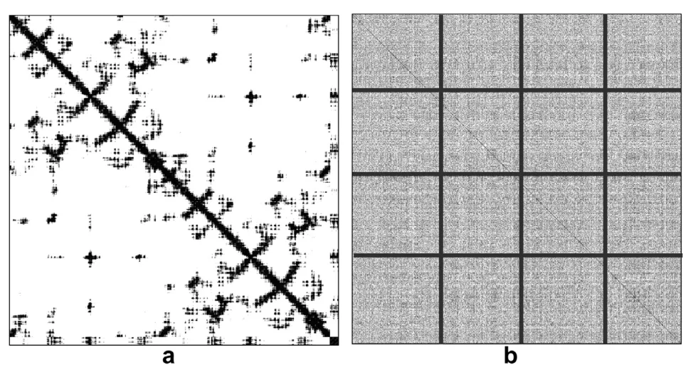
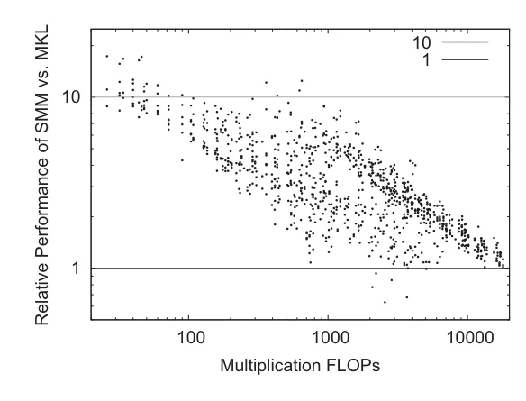
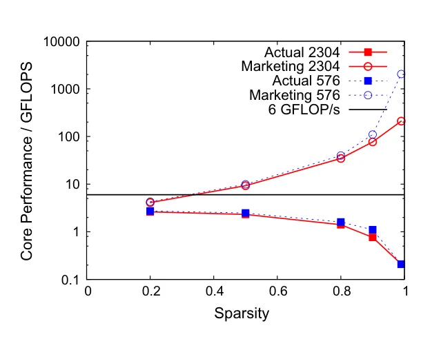

> - **논문**: Sparse matrix multiplication: The distributed block-compressed sparse row library
> - **저자**: Urban Borštnik, Joost VandeVondele, Valéry Weber, Jürg Hutter (University of Zürich, ETH Zürich)
> - **학회**: Parallel Computing 40 (2014) 47–58 · [DOI:10.1016/j.parco.2014.03.012](https://doi.org/10.1016/j.parco.2014.03.012)
{: .prompt-tip }

> 밀집 행렬 곱은 알고리즘이 잘 이해되고 최적화된 구현이 널려 있지만, **희소 행렬 곱**(SpGEMM)은 그렇지 않다. 대부분의 문제가 희소 행렬 벡터 곱으로 풀리기 때문이다. 중요한 예외가 계산화학이다. Kohn-Sham/Hartree-Fock의 자기일관장(SCF) 방정식을 푸는 밀도 행렬은 대각화로 구하면 비용이 $$O(N^3)$$이지만, 계가 커지면 해밀토니안과 밀도 행렬이 희소해지므로 밀도 행렬을 해밀토니안의 행렬 함수(체비셰프 전개, 뉴턴-슐츠 반복)로 직접 계산해 선형 스케일링을 얻을 수 있고, 그 중심 연산이 희소 행렬 **행렬** 곱이다. **DBCSR**(Distributed Block Compressed Sparse Row)은 CP2K 패키지의 이 연산을 위해 만들어진 라이브러리이다. 설계 기준은 두 가지이다. 점유율 10% 수준의 높은 희소성에서도, 100% 밀집에서도 잘 돌아야 하고(밀집이면 최적 밀집 알고리즘과 같아져야 함), 행렬 원소가 **원자 블록**으로 묶이는 구조를 활용해야 한다.

## 1. 저장: 블록 단위 CSR

원소를 원자쌍에 해당하는 블록으로 묶고, 블록 크기는 원자 종류의 기저 함수 수로 정한다(DZVP 기저에서 H는 5, O는 13이므로 5×5, 5×13, 13×5, 13×13 블록). CSR 인덱스는 원소가 아니라 **블록**을 가리키므로 인덱스가 훨씬 작고, 원자 번호로 조회하기도 쉽다. 블록은 $$R \times C$$ 2D 프로세스 격자에 분산되며, 행과 열의 매핑 함수 $$p_r(r), p_c(c)$$는 임의로 정할 수 있다. 대각 근처에 몰린 희소 패턴을 무작위 순열해 프로세스마다 밀도를 고르게 만들고(Figure 1), 대칭 행렬은 상삼각만 저장하되 $$r + c$$가 짝수인 블록을 전치 위치에 두어 균형을 맞춘다.


_Figure 1. (a) 대각 근처에 몰린 원래 희소 행렬, (b) 같은 행렬을 무작위로 순열한 뒤 4×4(16 프로세스) 격자를 겹친 모습. 밀도가 고르게 퍼져 프로세스 간 부하가 균형을 이룬다. (출처: Borštnik et al., 2014)_

## 2. 곱셈

### 통신: 일반화된 Cannon 알고리즘

Cannon 알고리즘은 정사각 격자용이지만, DBCSR은 가상 차원 $$V = \text{lcm}(R, C)$$을 도입해 임의 $$R \times C$$ 격자로 일반화한다. $$A$$는 $$R \times V$$, $$B$$는 $$V \times C$$ 가상 격자에 매핑되고, 정렬 단계 후에는 이웃과만 통신하며 $$V$$번의 행·열 시프트로 모든 $$A(r,k) B(k,c)$$를 만난다. $$C$$는 제자리에 머물고 비동기 MPI로 통신과 계산을 겹친다. 격자가 정사각($$R = C$$)이면 $$V = \sqrt{P}$$로 최소가 되므로 제곱수 프로세스가 최적이다. 이 방식의 장점은 **예측 가능한 한계**이다. 항상 $$\sqrt{P}$$ 단계, 데이터량은 $$O(1/\sqrt{P})$$로 감소, 각 프로세스는 최대 $$O(\sqrt{P})$$개와 통신, 추가 메모리 거의 없음. SRUMMA 등 다른 방식도 시도했지만 모든 시스템에서 일관되게 좋은 것은 Cannon뿐이었다.

### 노드 내 곱셈

블록 크기가 CPU 친화적이지 않은(5, 13) 희소 블록 행렬이라 여러 기법을 합친다.

- **캐시 무관 재귀.** 세 행렬의 인덱스를 큰 차원을 따라 재귀적으로 쪼개어 $$A$$, $$B$$가 각각 512블록 이하가 되면 블록 수준 CSR 곱으로 전환한다.
- **인덱스와 계산의 분리.** 안쪽 루프에서 바로 곱하지 않고 블록 곱의 7개 파라미터를 **스택**(기본 크기 1,000)에 쌓았다가 가득 차면 처리한다. 같은 형태(예: 5×13 × 13×5)만 모은 동질 스택도 만든다. 캐시 재사용이 좋아지고 GPU로 넘기기 쉬워진다. CUDA 구현에서는 CPU가 인덱싱과 스택 채우기를, GPU가 동질·큰 블록 스택을 처리한다.
- **libsmm.** 소형 행렬 곱 자동 튜닝 라이브러리. 선택된 차원 집합 {1, 4, 5, 6, 9, 13, 16, 17, 22, 23}의 $$n_s^3$$ 조합마다, 1단계에서 아주 작은 차원의 모든 루프 순서·언롤 깊이를 생성해 벤치마크하고, 2단계에서 Fortran 루프·MATMUL·BLAS·블록 재귀 변형을 비교해 최선을 고르며, 3단계에서 컴파일·검증한다. 아래 Figure 2처럼 Sandy Bridge에서 MKL과 비교하면 FLOPs가 작은 곱일수록 이득이 커서 대부분 2~10배, 가장 작은 곱 몇 개는 10배를 넘고, FLOPs가 1만 근처로 커지면 1배에 가까워진다. 몇몇 조합은 1배 아래로 내려간다.


_Figure 2. 차원 {1, 4, 5, 6, 9, 13, 16, 17, 22, 23}의 모든 조합에 대한 libsmm의 MKL 대비 상대 성능(세로, 로그 축)과 곱셈 FLOPs(가로). (출처: Borštnik et al., 2014)_
- **OpenMP.** $$C$$와 $$A$$의 행을 스레드에 분할해 스레드 간 동기화 없이 지역 메모리에 쓴다. 밀집에 가까우면 블록을 합쳐 벤더 BLAS를 쓴다.

### 실시간 필터링

곱셈 후 $$\lVert C(i,j) \rVert < \epsilon$$인 블록을 지우는 것에 더해, **곱하기 전에** 기여가 작은 블록 곱을 건너뛴다. $$A$$의 블록 행 $$i$$에 블록이 $$n_i$$개 있으면 $$\epsilon_i = \epsilon / n_i$$로 두고, $$\lVert A(i,k) \rVert \cdot \lVert B(k,j) \rVert \ge \epsilon_i$$일 때만 곱한다. 건너뛴 항의 합은 최대 $$n_i \epsilon_i = \epsilon$$이고, 최종 필터링까지 합치면 계산된 블록은 정확한 블록의 **$$2\epsilon$$ 이내**이다. Frobenius 노름을 쓰며, 실제 행렬에서 최대 300%의 가속을 준다. 결과의 희소 패턴을 미리 알면 기존 블록만 계산하도록 강제할 수도 있다.

## 3. 코드로 보기: 블록 인덱스와 필터링의 오차 한계

원자 120개를 공간에 뿌리고 H형(5)·O형(13) 블록 크기를 주어, 가까운 원자쌍에만 거리에 따라 감쇠하는 블록을 채운 행렬 $$A$$를 만든다. 원소 단위와 블록 단위 CSR 인덱스 크기를 비교하고, $$A \cdot A$$를 여러 $$\epsilon$$으로 실시간 필터링하며 건너뛴 블록 곱의 수와 최대 블록 오차를 $$2\epsilon$$ 한계와 비교한다.

```python
import numpy as np
rng = np.random.default_rng(0)
# an "atomic" block structure: 120 atoms, block size 5 (H-like) or 13 (O-like); blocks are nonzero when atoms are close
atoms = rng.random((120, 3)) * 10
sizes = rng.choice([5, 13], 120, p=[0.67, 0.33]); offs = np.concatenate([[0], np.cumsum(sizes)]); N = offs[-1]
dist = np.linalg.norm(atoms[:, None] - atoms[None], axis=-1)
blocks = dist < 3.0                                              # block sparsity pattern
A = np.zeros((N, N))
for i, j in zip(*np.nonzero(blocks)):
    A[offs[i]:offs[i+1], offs[j]:offs[j+1]] = rng.standard_normal((sizes[i], sizes[j])) * np.exp(-2 * dist[i, j])   # decay with distance
print(f"matrix {N}x{N}, {len(atoms)} atomic blocks; element occupation {np.count_nonzero(A)/A.size*100:.1f}%, block occupation {blocks.mean()*100:.1f}%")
nnz = np.count_nonzero(A); nblk = blocks.sum()
print(f"CSR index integers:   element-wise {nnz + N + 1:>9,}   block-wise {nblk + len(atoms) + 1:>7,}   ({(nnz+N+1)/(nblk+len(atoms)+1):.0f}x smaller index)")

# blocked sparse product with on-the-fly filtering: skip A(i,k)*B(k,j) when ||A(i,k)|| * ||B(k,j)|| < eps_i = eps / n_i
B = A.copy()
norm = np.zeros((len(atoms), len(atoms)))
for i, j in zip(*np.nonzero(blocks)): norm[i, j] = np.linalg.norm(A[offs[i]:offs[i+1], offs[j]:offs[j+1]])
nbr = [np.flatnonzero(blocks[i]) for i in range(len(atoms))]
def bmm(eps):
    C = np.zeros((N, N)); done = skipped = 0
    for i in range(len(atoms)):
        eps_i = eps / max(len(nbr[i]), 1)
        for k in nbr[i]:
            for j in nbr[k]:
                if norm[i, k] * norm[k, j] < eps_i: skipped += 1; continue
                C[offs[i]:offs[i+1], offs[j]:offs[j+1]] += A[offs[i]:offs[i+1], offs[k]:offs[k+1]] @ B[offs[k]:offs[k+1], offs[j]:offs[j+1]]; done += 1
    return C, done, skipped
exact = A @ B
pattern = (blocks.astype(int) @ blocks.astype(int)) > 0
print()
print("eps      block products done   skipped   max block error   bound 2*eps")
for eps in (0.0, 1e-4, 1e-3, 1e-2):
    C, done, skipped = bmm(eps); D = C - exact
    err = max(np.linalg.norm(D[offs[i]:offs[i+1], offs[j]:offs[j+1]]) for i, j in zip(*np.nonzero(pattern)))
    print(f"{eps:<7}  {done:>19,}   {skipped:>7,}   {err:15.2e}   {2*eps:.2e}")
print()
print("processes P   Cannon steps sqrt(P)   data volume per process ~ 1/sqrt(P)")
for P in (16, 64, 256, 1024): print(f"{P:>11}   {int(P**0.5):>20}   {1/P**0.5:>28.3f}")
```

```text
matrix 960x960, 120 atomic blocks; element occupation 7.9%, block occupation 7.9%
CSR index integers:   element-wise    74,025   block-wise   1,265   (59x smaller index)

eps      block products done   skipped   max block error   bound 2*eps
0.0                   12,688         0          1.33e-14   0.00e+00
0.0001                12,688         0          1.33e-14   2.00e-04
0.001                 12,681         7          1.51e-04   2.00e-03
0.01                  11,287     1,401          1.53e-03   2.00e-02

processes P   Cannon steps sqrt(P)   data volume per process ~ 1/sqrt(P)
         16                      4                          0.250
         64                      8                          0.125
        256                     16                          0.062
       1024                     32                          0.031
```

- 블록 인덱스는 원소 인덱스보다 59배 작다. 블록이 평균 7.7×7.7 원소를 담으니 당연한 수치이고, 실제 CP2K 행렬(행당 수만 개의 비영 원소)에서는 이 차이가 인덱스 탐색 시간과 메모리에 직결된다.
- $$\epsilon = 10^{-3}$$에서 7개, $$10^{-2}$$에서 1,401개(11%)의 블록 곱을 건너뛰었고, 최대 블록 오차는 1.5e-4, 1.5e-3으로 모두 $$2\epsilon$$ 한계 안이다. 거리에 따라 감쇠하는 원소 때문에 먼 원자쌍의 곱이 먼저 걸러지는 것이고, 실제 계산에서는 이 비율이 훨씬 높아 300% 가속이 나온다.
- Cannon 통신의 $$\sqrt{P}$$ 단계와 $$1/\sqrt{P}$$ 데이터량은 식 그대로이다. 1024 프로세스에서 각 프로세스는 32단계 동안 행렬의 3%만 받는다.

## 4. 성능

**밀집.** 5120×512와 20480×2048 벡터형 행렬 곱에서 DBCSR 밀집 모드는 ScaLAPACK PDGEMM과 비슷하고, 현실적 블록(13, 5)을 쓰면 최대 절반으로 떨어진다. 인덱싱은 전체의 10% 미만이고 대부분의 손실은 작은 블록 곱의 효율 때문이다.

**희소.** 물 분자 2048개를 나타내는 47104×47104 행렬을 점유율 80%에서 1%까지 바꿔 가며 576·2304 코어로 곱하면(Figure 5), **마케팅 성능**(같은 크기 밀집 곱에 필요한 FLOPs ÷ 시간)이 코어당 6 GFLOP/s의 밀집 최고치를 넘는 교차점은 희소성 약 30%(밀도 70%)이다. 그보다 밀집하면 밀집 곱이 낫고, 희소하면 DBCSR이 훨씬 효율적이다. 실제 성능은 희소성 90%까지 1 GFLOP/s 이상을 유지하다가 급락하지만 마케팅 성능은 계속 오른다. CP2K의 목표 영역(점유율 1~10%)에 맞는다. 실시간 필터링을 쓰면 희소 곱으로 넘어가는 문턱은 더 낮아진다.


_Figure 5. 47104×47104 행렬 곱의 코어당 성능(로그 축). 네모가 실제 성능, 원이 마케팅 성능, 검은 선이 이 기계에서 관찰한 밀집 곱 최고치 6 GFLOP/s이다. 빨강은 2304코어, 파랑 점선은 576코어. (출처: Borštnik et al., 2014)_

**강한 스케일링.** 유기 정공 수송 물질 13,846원자, 133,214차 행렬, 130회 연속 곱, 점유율 최대 18%의 실제 응용에서 512코어 3351s(Cray XK6)/1555s(XC30)가 32768코어에서 154s/63s로 줄어 XC30에서는 **곱 한 번에 0.5초 미만**이다. XK6에서는 스레딩과 MPI 랭크 재배치가 필요했다.

**GPU.** K20 한 장과 Sandy Bridge 12코어에서 23×23 블록(물 분자 하나)으로 CPU 62 GFLOP/s 대 GPU 84 GFLOP/s, 스택을 정렬해 $$C_{ij}$$ 갱신을 모으면 121 GFLOP/s이다. K20 최고치 1 TFLOP/s에 크게 못 미치는 이유는 메모리 대역폭이다. $$n^3$$ FLOPs에 $$8n^2$$ 바이트 전송 4회면 200 GB/s에서 $$12.5n$$ GFLOP/s가 상한이고, 작은 블록일수록 더 메모리 바운드이다.

**선형 스케일링.** 액체 물의 $$S^{1/2}$$, $$S^{-1/2}$$를 뉴턴-슐츠 반복(35회 곱, 필터 $$10^{-6}$$)으로 계산하면 행당 시간이 점유율 20% 이하에서 거의 일정해져 선형 스케일링을 보이고, 가장 큰 계(차원 $$10^6$$ 이상)에서 마케팅 성능이 코어당 27 TFLOP/s에 해당해 밀집으로는 멀티 페타플롭이 필요한 계산이다. 아래는 Table 1에서 일부 행을 옮긴 것이다(1024 MPI × 2 스레드, 곱 한 번당 평균).

| 물 분자 수 | 행렬 차원 | 점유율 | 시간 (s) | 행당 시간 (µs) | 마케팅 GFLOP/s/core | 실제 GFLOP/s/core |
|---|---|---|---|---|---|---|
| 256 | 5,888 | 1.000 | 0.089 | 15.1 | 2 | 1.556 |
| 2,048 | 47,104 | 0.395 | 2.063 | 43.8 | 49 | 1.306 |
| 4,000 | 92,000 | 0.203 | 4.267 | 46.4 | 178 | 1.360 |
| 10,976 | 252,448 | 0.074 | 12.178 | 48.2 | 1,290 | 1.297 |
| 32,000 | 736,000 | 0.025 | 37.921 | 51.5 | 10,267 | 1.235 |
| 55,296 | 1,271,808 | 0.014 | 72.864 | 57.3 | 27,571 | 1.108 |

차원이 216배 커지는 동안 행당 시간은 점유율 20% 아래에서 46~57µs로 거의 일정하고, 실제 FLOP 속도는 코어당 1.1~1.6 GFLOP/s에 머문다.

**한계(5절).** 블록이 작으면(H) FLOP 속도가 낮고, 블록을 합치면 점유율이 올라 역효과가 날 수 있다. 인덱스 정렬·버퍼 성장·재귀 등 부기 작업은 $$O(N \log N)$$이라 결국 $$O(N)$$인 FLOPs를 지배하며, 6×6 블록의 반경험적 물 모델(4,000~250,000 블록, 2048코어, SCF 한 번에 곱 316회)에서 실제로 관찰된다. 저자들이 "가장 중요한 한계"로 꼽는 것은 Cannon 알고리즘 자체이다. 밀집 극한에서는 최적이지만, 문제 크기를 프로세스 수에 비례해 키우는 weak scaling에서는 프로세스당 계산량이 일정한데 통신량은 $$O(N/\sqrt{P})$$로 남아 계산 대 통신 비율이 $$1/\sqrt{P}$$로 나빠진다(코어당 물 분자 128개, 16~2048코어 실험).

### 실험 환경

| 항목 | 값 |
|---|---|
| 밀집·희소 벤치마크 | Cray XE6 (palü, CSCS), GNU gcc 4.5.2, Cray libsci(ScaLAPACK, BLAS), PDGEMM 블록 크기 32 |
| 강한 스케일링 | Cray XK6 (Interlagos, Gemini 네트워크), Cray XC30 (Sandy Bridge, Aries 네트워크) |
| GPU | Kepler K20 1장 + Sandy Bridge E5-2620 2개(6코어, 2 GHz), 23×23 블록 |
| 시간 측정 | 곱셈 서브루틴 진입~종료 전체(가상 토폴로지 매핑, Cannon 정렬, 변환·전치 포함), 여러 번 중 최솟값 |
| 공개 | 2009년 5월부터 CP2K의 일부로 공개, 독립 라이브러리로도 컴파일 가능 |

## 5. 해석

**1. 응용의 구조를 자료 구조에 그대로 넣었다.** "원자 블록"은 화학적으로 자연스러운 단위이면서 인덱스를 수십 배 줄이고, 작은 블록 곱이라는 새 병목을 만든다. 그 병목을 자동 튜닝(libsmm)으로 푸는 흐름은 이후 딥러닝의 [행렬 곱 커널 자동 튜닝]()이나 TVM류 컴파일러와 같은 발상이다.

**2. 실시간 필터링은 "근사해도 되는 계산은 하지 말라"의 모범이다.** 오차 한계 $$2\epsilon$$을 블록 노름의 곱으로 계산 전에 보장하는 설계는, 희소성을 결과에서 발견하는 대신 **만들어 내는** 것이다. 희소 attention이나 [가지치기]()의 중요도 기준이 사후적인 것과 대비된다.

**3. 통신 알고리즘의 "예측 가능성"을 선택 기준으로 삼았다.** 더 빠를 수 있는 RMA 기반 방식 대신 모든 시스템에서 일관된 Cannon을 택하고, 그 한계($$\sqrt{P}$$ 단계, $$1/\sqrt{P}$$ 데이터)를 분석적으로 제시한다. 대규모 분산 학습의 all-reduce 링 알고리즘이 선택된 이유와 같은 논리이다.

**4. 밀집과 희소를 하나의 코드로 다루려는 설계 목표가 중요하다.** 100% 점유율에서 밀집 알고리즘과 같아지도록 만들었기 때문에 CP2K가 행렬 자료 구조를 통일할 수 있었고, 마케팅 성능 교차점(희소성 30%)은 사용자에게 어느 쪽을 쓸지 알려 주는 실용적 지표이다.

**5. 평가를 읽을 때 주의할 점.** 벤치마크 시간은 여러 반복 중 **최솟값**이고, "마케팅 성능"은 실제 FLOP 속도가 아니라 시간 절약의 척도임을 저자들이 명시한다. GPU 결과는 23×23 블록 하나에 손으로 최적화한 커널이며 일반 자동 생성은 미완이다. 2014년 하드웨어(Interlagos, Sandy Bridge, K20) 기준이라 절대 수치는 오래됐고, 읽을 가치는 설계 원리에 있다. 위 toy는 단일 프로세스 numpy라 통신 부분은 식으로만 보였다.

## 6. 정리

| 항목 | 내용 |
|---|---|
| 목적 | CP2K 선형 스케일링 SCF의 희소 행렬 행렬 곱, 점유율 1~10%와 100% 모두 |
| 저장 | 원자 블록 단위 CSR, 2D 프로세스 격자, 무작위 행·열 순열로 부하 균형 |
| 통신 | 가상 차원 $$V = \text{lcm}(R,C)$$로 일반화한 Cannon, $$\sqrt{P}$$ 단계, 데이터량 $$1/\sqrt{P}$$ |
| 노드 내 | 캐시 무관 재귀 + 파라미터 스택 + 자동 튜닝 libsmm(작은 블록에서 MKL 대비 대부분 2~10배) + OpenMP/GPU |
| 필터링 | $$\lVert A_{ik} \rVert \lVert B_{kj} \rVert < \epsilon / n_i$$이면 건너뜀, 블록 오차 $$\le 2\epsilon$$, 최대 300% 가속 |
| 성능 | 133k차 행렬 곱 32768코어에서 0.5초 미만, 희소성 30% 이상에서 밀집보다 효율적 |

## References

- Borštnik, VandeVondele, Weber, Hutter, "Sparse matrix multiplication: The distributed block-compressed sparse row library," Parallel Computing 40 (2014) 47–58. [DOI:10.1016/j.parco.2014.03.012](https://doi.org/10.1016/j.parco.2014.03.012)
- Cannon, "A cellular computer to implement the Kalman filter algorithm," PhD thesis, Montana State University, 1969.
- VandeVondele, Borštnik, Hutter, "Linear Scaling Self-Consistent Field Calculations with Millions of Atoms in the Condensed Phase," JCTC 8 (2012) 3565. [DOI:10.1021/ct200897x](https://doi.org/10.1021/ct200897x)
- Hutter, Iannuzzi, Schiffmann, VandeVondele, "CP2K: atomistic simulations of condensed matter systems," WIREs Comput. Mol. Sci. 4 (2014) 15. [DOI:10.1002/wcms.1159](https://doi.org/10.1002/wcms.1159)
- Frigo, Leiserson, Prokop, Ramachandran, "Cache-Oblivious Algorithms," FOCS 1999.
