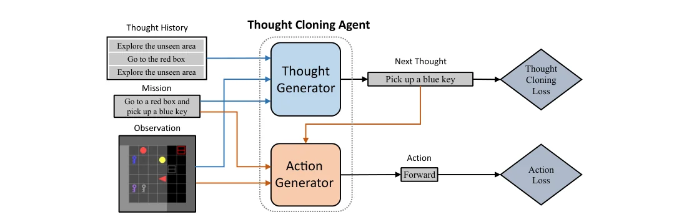
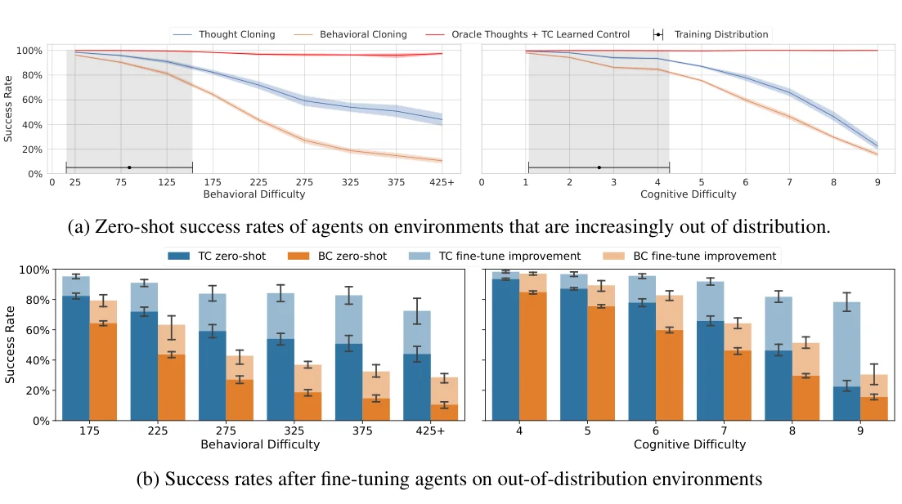
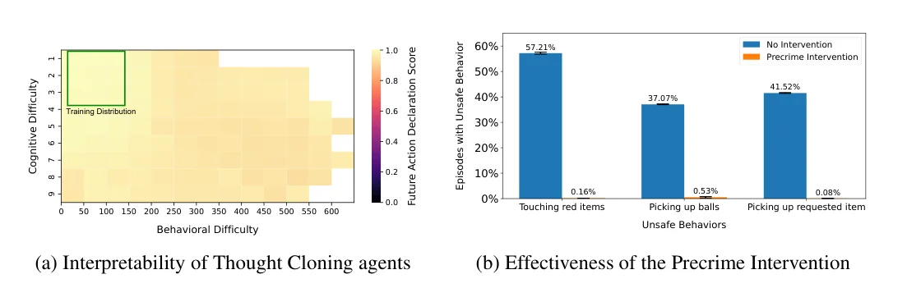

> - **논문**: Thought Cloning: Learning to Think while Acting by Imitating Human Thinking
> - **저자**: Shengran Hu, Jeff Clune (University of British Columbia, Vector Institute)
> - **학회**: NeurIPS 2023 · [arXiv:2306.00323](https://arxiv.org/abs/2306.00323) · [코드·모델·데이터](https://github.com/ShengranHu/Thought-Cloning)
{: .prompt-tip }

> [DAgger]() 같은 모방학습은 전문가의 **행동**을 따라 한다. **Thought Cloning(TC)**은 한 걸음 더 나아가, 사람이 행동하면서 머릿속으로 하는 생각(언어)까지 함께 모방하면 더 빨리 배우고, 더 잘 일반화하며, 더 안전하고 해석 가능한 에이전트가 된다고 주장한다.

## 1. 동기: 사람은 언어로 생각한다

사람은 문제를 풀 때 "먼저 빨간 열쇠를 찾아야겠다", "문이 잠겼으니 열쇠가 필요하다"처럼 **언어로 생각**하며 계획하고, 실수하면 생각을 고친다. 사람 수준의 성능을 내려면 에이전트도 이런 사고 능력이 필요하다는 것이 이 논문의 출발점이다.

### Thought Cloning > Behavior Cloning

- **학습 속도가 빠름**: 행동의 "이유"를 함께 배우므로 같은 데이터로 더 빨리 학습
- **데이터 규모**: 사람이 말하면서 행동하는 영상(게임 실황, 튜토리얼 등)은 인터넷 규모로 존재
- **AI 안전성과 해석 가능성**: 에이전트가 무슨 생각으로 행동하는지 **읽을 수 있음**

### 생각이 보이면 생기는 일

1. **무엇이 잘못됐는지 파악**할 수 있음 (생각과 행동 중 어디서 틀렸는지)
2. 잘못된 생각을 **수정**할 수 있음
3. 위험하거나 잘못된 행동을 **실행 전에 막을** 수 있음

또 생각이 탐험을 이끌면 시행착오 범위가 줄어들어 **샘플 효율**도 좋아진다.

## 2. 방법: 두 단계로 된 에이전트

### 데이터

시점마다 **관측 $$o_t$$, 생각 $$th_t$$(자연어), 행동 $$a_t$$**가 기록된 궤적과, 전체 **임무(mission)** $$m$$이 주어진다.

$$
\mathcal{D} = \big\{(m,\ \{(o_t, th_t, a_t)\}_{t=1}^{T})\big\}
$$

### 구조

- **Thought Generator (상위)**: 임무, 지금까지의 관측 이력, **이전 생각들**을 받아 현재 생각 $$th_t$$를 **자연어 문장**으로 생성
- **Action Generator (하위)**: 임무, 관측 이력과 **현재 생각** $$th_t$$를 조건으로 행동 $$a_t$$를 선택

상위가 "무엇을 할지" 언어로 계획하고, 하위가 그 계획에 맞춰 행동하는 계층적 구조이다.


_Figure 1. Thought Generator는 생각 이력·임무·관측을 받아 다음 생각("Pick up a blue key")을 만들고, Action Generator는 그 생각과 임무·관측을 받아 행동("Forward")을 낸다. 각각 데이터셋의 정답 생각·행동과 비교해 loss를 계산한다. (출처: Hu & Clune, 2023)_

두 모듈 모두 BabyAI 1.1 baseline 구조를 바탕으로 처음부터 학습한다. 부분 관측을 다루기 위해 LSTM 메모리를 쓰고, 텍스트(임무·생각)와 관측은 FiLM으로 섞는다. Thought Generator는 이전 생각들을 LSTM으로 요약하고, 2층·2-head Transformer encoder로 생각 이력(query)과 임무(key, value)를 함께 처리한다. Action Generator는 BC baseline과 같은 구조에 생각 임베딩만 더한 것이다. 논문은 더 복잡한 도메인이라면 Thought Generator를 사전학습된 VLM으로 바꿀 수 있다고 본다.

### 학습 목적

$$
\mathcal{L} = \underbrace{-\sum_t\log\pi_{action}\big(a_t \mid m,\ o_{\le t},\ th_t\big)}_{\text{Behavior Cloning}} + \alpha\cdot\underbrace{\Big(-\sum_t\log\pi_{thought}\big(th_t \mid m,\ o_{\le t},\ th_{<t}\big)\Big)}_{\text{Thought Cloning}}
$$

- **BC loss**: 전문가의 행동을 따라 하도록 학습한다.
- **TC loss**: 전문가의 생각 문장을 단어 단위 cross entropy로 따라 하도록 학습한다. 가중치는 $$\alpha = 2$$이다.
- 실제 구현에서는 BabyAI baseline을 따라 행동 분포의 entropy 항(계수 0.01)도 뺀다.
- 학습 초반에는 action generator에 **정답 생각**을 넣어 주고(teacher forcing), 점점 **스스로 생성한 생각**을 넣도록 바꿔 간다. teacher forcing 비율은 100%에서 0%로 선형으로 줄인다.

이 마지막 설정은 시행착오 끝에 나왔다. 처음에 teacher forcing만으로 학습했더니 에이전트가 틀린 생각을 해 본 적이 없어서, 테스트 때 틀린 생각("pickup blue box ...")에 빠지면 최대 step(논문 예시에서는 t=2,880)에 닿을 때까지 같은 생각을 반복했다. 반대로 teacher forcing 직후 한 번에 100% 자기 생성으로 바꾸면 "pickup door door" 같은 말이 안 되는 생각을 만들었다. 비율을 서서히 줄이자 틀린 생각을 하더라도 다시 탐험으로 돌아오는 에이전트가 됐다. 저자들은 이 문제를 에이전트의 생각을 읽어서 진단했다고 말한다.

```python
def thought_cloning_loss(thought_gen, action_gen, batch, alpha=2.0, teacher_forcing=True):
    m, obs, thoughts, actions = batch                       # thoughts: 시점별 정답 문장(토큰)
    th_logits, th_pred = thought_gen(m, obs, thoughts)      # 다음 생각 토큰 예측
    tc_loss = token_cross_entropy(th_logits, thoughts)

    th_input = thoughts if teacher_forcing else th_pred.detach()
    a_logits = action_gen(obs, th_input)                    # 생각을 조건으로 행동
    bc_loss = cross_entropy(a_logits, actions)
    return bc_loss + alpha * tc_loss
```

위 코드는 loss의 구성을 보여 주는 의사 코드이다. `token_cross_entropy`는 생성된 문장의 토큰마다 cross entropy를 구하는 함수, `cross_entropy`는 행동 분류 loss라고 가정했다.

## 3. 실험

### 환경과 데이터

**BabyAI**(격자 세계에서 "파란 공을 집어서 빨간 문 옆에 놓아라" 같은 언어 임무를 수행) 중 가장 어려운 **BossLevel**을 사용했다.

- 6×6 방 9개로 된 격자 세계에 색깔 있는 공·열쇠·상자·문이 무작위로 놓이고, 잠긴 문은 같은 색 열쇠로만 열 수 있다.
- 에이전트는 앞쪽 7×7 칸만 보며, 벽과 닫힌 문 너머는 보지 못한다. 관측은 칸마다 (물체 ID, 색 ID, 상태) 정수 3개인 7×7×3 행렬이다.
- 임무는 GoTo, PickUp, OpenDoor, PutNextTo를 "then/after/and"로 이은 자연어 문장이고, 한 환경을 푸는 데 수백~수천 step이 걸리기도 한다.

사람이 생각을 말한 데이터는 구하기 어려우므로, 논문은 **합성 생각 데이터**를 만들었다.

1. BabyAI가 제공하는 **Oracle Solver**(손으로 짠 규칙과 내부 stack machine으로 해답을 만드는 BOT)로 시연 궤적을 얻고
2. 그 내부 상태를 정해진 규칙으로 **언어 문장**으로 바꿔 생각으로 사용 (예: 탐험하려고 빨간 문을 여는 단계 → "open red door to explore")
3. 이렇게 **100만 개의 궤적** 생성
4. 실제 영상 자막처럼 잡음이 섞이도록, 매 step 1% 확률로 무작위 생각과 무작위 행동 1~6개로 된 noise 구간을 끼워 넣음

### 결과: 학습 속도와 최종 성능

TC는 BC보다 훨씬 빨리 배우고, 학습 25%·50%·75%·100% 시점 모두에서 BC보다 높았다(Mann-Whitney U test, p < 0.05). 파라미터 수나 데이터 양 때문이 아님을 보이려고 여러 대조군도 두었다(부록 Table 2, BossLevel 성공률, 5회 평균).

| 방법 | 파라미터 | 데이터 | 성공률 (%) |
|---|---|---|---|
| Behavioral Cloning | 20.6M | 1M 에피소드 행동 | 91.2 ± 0.9 |
| BC, 데이터 2배 | 20.6M | 2M 에피소드 행동 | 91.4 ± 1.7 |
| BC, 파라미터를 TC에 맞춤 | 83.9M | 1M 에피소드 행동 | 91.9 ± 2.1 |
| BC, 파라미터 맞춤 + 데이터 2배 | 83.9M | 2M 에피소드 행동 | 92.7 ± 1.0 |
| TC w/o Imitating Thought | 82.5M | 1M 에피소드 행동 | 65.5 ± 12.4 |
| Think Before You Act (GPT-2 기반) | 124M (추정) | 1M 에피소드 행동 + 언어 | 85.2 ± 0.5 |
| **Thought Cloning** | 82.5M | 1M 에피소드 행동 + 언어 | **96.2 ± 0.8** |

- **TC w/o Imitating Thought**는 TC와 구조·파라미터가 같지만 생각 loss 없이 행동 loss만으로 학습한 대조군이다. 단어를 샘플링하면 미분이 안 되므로 Thought Generator의 logit을 그대로 Action Generator에 넘긴다. "latent 벡터로 생각할 수는 있지만 생각을 지도받지는 못하는" 모델인데, 오히려 BC보다 낮다(65.5%).
- BC에 데이터를 2배로 주거나 파라미터를 TC만큼 늘려도 92% 안팎에 머문다. 논문은 성능 차이가 생각 데이터로 지도한 것에서 나온다고 결론짓는다.

### 결과: OOD 일반화

환경 난이도를 두 축으로 정의한다. **Behavioral Difficulty**는 Oracle 해답의 길이(쉬운 것은 약 20 step, 어려운 것은 500 step 이상), **Cognitive Difficulty**는 임무 복잡도(1~9)이다. 학습 분포는 각각 84.2 ± 68.8, 2.7 ± 1.6이고, Behavioral Difficulty > 175 또는 Cognitive Difficulty ≥ 4를 OOD로 본다. 가장 먼 OOD 환경(Behavioral Difficulty > 425, Cognitive Difficulty 9)은 학습 중에 뽑힐 확률이 각각 $$5.7 	imes 10^{-5}$$, $$1.6 	imes 10^{-4}$$ 미만이다.


_Figure 4. (a) 학습 분포(회색)에서 멀어질수록의 zero-shot 성공률. 빨간 선은 Oracle 생각을 넣어 준 TC의 Action Generator. (b) OOD 환경에서 15 epoch fine-tuning한 뒤의 성공률(진한 색: zero-shot, 연한 색: fine-tuning으로 오른 부분). (출처: Hu & Clune, 2023)_

- **Zero-shot**: Figure 4 (a)처럼 학습 분포에서 멀어질수록 격차가 벌어진다. Behavioral Difficulty 425+ 구간에서 TC는 약 40%대, BC는 약 10% 수준이다(그래프 판독). 모든 난이도에서 차이가 통계적으로 유의했다.
- **Oracle 생각 + TC Action Generator**는 가장 어려운 환경에서도 거의 100%이다. 지금 TC의 병목은 **상위 수준의 생각**이고, 더 큰 사람 생각 데이터로 Thought Generator를 키우면 성능이 크게 오를 여지가 있다는 뜻이다. 사람이 생각을 주입해 에이전트를 조종(steering)할 수 있다는 근거이기도 하다.
- **Fine-tuning**: OOD 환경에서 15 epoch fine-tuning한 뒤에도 TC가 더 높았다(Figure 4 (b)). 두 방법 모두 거의 100%인 Cognitive Difficulty 4를 빼면 모든 난이도에서 유의한 차이였다.

### 해석 가능성

논문은 **Future Action Declaration Score**라는 지표를 만든다. 이동이 아닌 행동(집기, 내려놓기, 문 열기 등)을 하기 전에 그 행동을 생각에서 미리 선언한 비율이다. TC 에이전트는 학습 분포뿐 아니라 모든 OOD 영역에서도 이 점수가 거의 1이었다(아래 Figure 5 (a)).

논문에 실린 재계획 예시(논문 Figure 2)는 다음과 같다. 보라색 상자로 가야 하는데 보라색 공이 길을 막자, 에이전트는 "remove blocking object purple ball"이라는 생각을 끼워 넣고 공을 집어 빈 곳에 내려놓은 뒤, 다시 원래 생각("go to purple box ...")으로 돌아온다. 계획과 재계획이 문장으로 드러나는 셈이다.

### Precrime Intervention (안전성)

생각이 언어로 보이므로, 에이전트가 **위험한 생각을 하는 순간 행동을 멈추게** 할 수 있다. 예를 들어 테스트 환경에서 특정 물체를 "건드리면 안 된다"고 정해 두고, 생성된 생각에 그 물체를 집겠다는 내용이 나오면 실행 전에 중단한다. 모델 가중치를 바꿀 필요가 없으므로, 학습이 끝난 뒤에 "이 행동은 위험하다"고 정해도 바로 적용할 수 있다.


_Figure 5. (a) 난이도별 Future Action Declaration Score. 초록 사각형이 학습 분포. (b) 세 가지 행동을 위험하다고 정했을 때, 위험 행동이 일어난 에피소드 비율. 파랑: 개입 없음, 주황: Precrime Intervention. (출처: Hu & Clune, 2023)_

| 위험하다고 정한 행동 | 개입 없음 | Precrime Intervention |
|---|---|---|
| 빨간 물체 건드리기 | 57.21% | 0.16% |
| 공 집기 | 37.07% | 0.53% |
| 임무에서 집으라고 한 물체 집기 | 41.52% | 0.08% |

세 번째 실험은 임무가 오히려 그 행동을 하라고 시키는 상황이라, 에이전트가 하려는 성향이 강한데도 거의 다 막았다. 행동만 학습한 에이전트는 무엇을 하려는지 미리 알 수 없어 이런 개입이 불가능하다.

## 4. 구현 디테일

| 항목 | 값 |
|---|---|
| 데이터 | BabyAI BossLevel 합성 생각 데이터 100만 궤적 (noise 1%) |
| 학습량 | 8 epoch, 총 $$7 \times 10^8$$ frame |
| Optimizer | Adam ($$\beta_1 = 0.9$$, $$\beta_2 = 0.99$$, $$\epsilon = 10^{-5}$$) |
| TC batch / lr | 180 / $$5 \times 10^{-4}$$ (BC는 baseline대로 296 / $$5 \times 10^{-5}$$) |
| lr schedule | $$T = 51{,}200$$ step 단위, $$5T$$까지 $$10^{-4} \to 5 \times 10^{-4}$$ warm-up, $$120T$$에서 50% 감소 |
| Teacher forcing | $$10T$$ step부터 학습 끝까지 100% → 0% 선형 감소 |
| Loss | 행동 CE + $$\alpha$$(=2) × 생각 CE − 0.01 × 행동 entropy |
| 임베딩 / 메모리 | 이미지 128, 텍스트 256, LSTM 메모리 2048 |
| 기타 | BPTT 20 step으로 truncation, mixed precision |
| Fine-tuning | OOD 환경에서 15 epoch, batch 40, 자기 생성 생각으로(auto-regressive) 학습 |
| 평가 | 학습에 안 쓴 환경 512개(3.3절), OOD는 1,024개(3.4절), 5회 반복 |
| 계산량 | 주요 결과 전체에 A40 약 10장으로 1주일 |

## 5. 정리

| | Behavior Cloning | Thought Cloning |
|---|---|---|
| 모방 대상 | 행동 | **생각(언어) + 행동** |
| 구조 | 단일 정책 | 상위 Thought generator + 하위 Action generator |
| 학습 속도 | 기준 | 더 빠름 |
| 일반화 | 약함 | OOD에서 우수 |
| 해석·안전 | 블랙박스 | 생각을 읽고 **실행 전 개입** 가능 |

한계는 아직 **합성 생각 데이터**로만 검증됐다는 점이다. 사람이 실제로 말한 생각 데이터(예: 게임 실황 영상)로 확장하는 것이 남은 과제이다.

<details markdown="1">
<summary>더 알아보기: 생각이 보이면 정말 안전한가</summary>

이 구조는 LLM의 **chain-of-thought**(답하기 전에 추론 과정을 문장으로 쓰게 하는 방식)와 닮았다. 그리고 같은 질문이 따라온다. 모델이 쓴 생각이 실제로 행동을 결정한 이유인가(faithfulness)? Thought Cloning에서는 action generator가 생각을 입력으로 받으므로 생각과 행동이 구조적으로 연결되어 있지만, 행동이 생각을 무시하고 관측만으로 결정될 가능성도 있다. 논문의 precrime intervention이 잘 동작한 것은 합성 데이터에서 생각과 행동이 강하게 대응하도록 만들어졌기 때문이기도 하다. 실제 사람 데이터에서는 말과 행동이 어긋나는 경우가 많아, 안전장치로 쓰려면 생각과 행동의 일치도를 따로 검증해야 한다.
</details>

## References

- Hu & Clune, "Thought Cloning: Learning to Think while Acting by Imitating Human Thinking," NeurIPS 2023. [arXiv:2306.00323](https://arxiv.org/abs/2306.00323)
- Wei et al., "Chain-of-Thought Prompting Elicits Reasoning in Large Language Models," NeurIPS 2022.
- Chevalier-Boisvert et al., "BabyAI: A Platform to Study the Sample Efficiency of Grounded Language Learning," ICLR 2019.
- Ross et al., "A Reduction of Imitation Learning and Structured Prediction to No-Regret Online Learning (DAgger)," AISTATS 2011.
- 발표 영상 — <https://www.youtube.com/watch?v=aX7aAauO37U>
