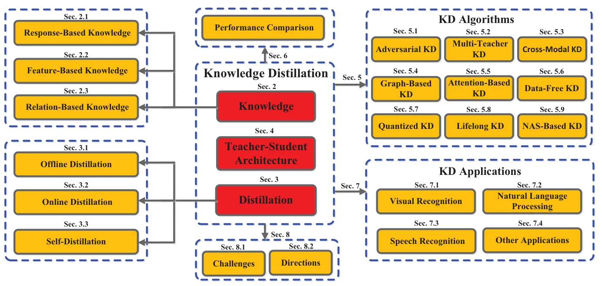
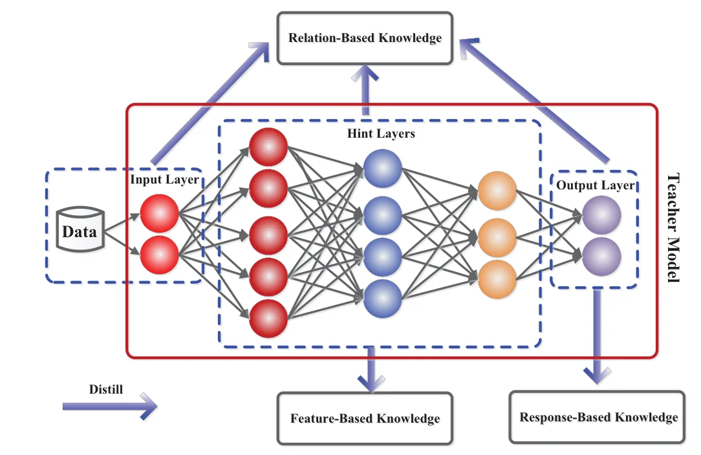
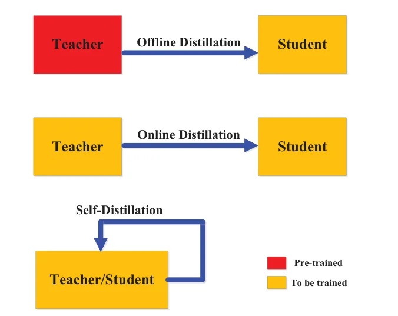

> - **논문**: Knowledge Distillation: A Survey
> - **저자**: Jianping Gou, Baosheng Yu, Stephen J. Maybank, Dacheng Tao (The University of Sydney, Birkbeck College, University of London)
> - **학회**: IJCV 2021 · [arXiv:2006.05525](https://arxiv.org/abs/2006.05525)
{: .prompt-tip }

> 이 블로그에서 [DIST](), [Be Your Own Teacher](), [Auto-KD]()처럼 지식 증류의 개별 변형을 다뤘다. 그 변형들이 전체에서 어디에 놓이는지를 그린 것이 **Knowledge Distillation: A Survey**이다. Buciluǎ 등(2006)의 모델 압축과 Hinton 등(2015)의 "증류" 명명에서 출발해, 증류 시스템을 **지식, 증류 알고리즘, 교사-학생 구조**의 세 요소로 보고 각각을 분류한다. 이 글은 그 분류를 따라가면서, 각 갈래가 어떤 질문에 대한 답인지를 적는다.


_Figure 2. 서베이의 구성. 가운데 세 요소(지식, 증류 방식, 교사-학생 구조)에서 왼쪽의 하위 분류와 오른쪽의 알고리즘·응용으로 뻗어 나간다. (출처: Gou et al., 2021)_

## 1. 왜 증류인가

큰 모델은 과잉 매개변수 덕에 일반화가 좋지만 모바일·임베디드에 올리기 어렵다. 효율화의 두 길은 효율적 빌딩 블록([MobileNet](), ShuffleNet)과 압축·가속(가지치기·양자화·저랭크 분해·전이 가능한 소형 필터·증류)이다. 증류는 큰 교사의 지식을 작은 학생에 옮기는 것이고, 학생이 교사를 흉내 내어 비슷하거나 더 나은 성능을 얻는 것이 목표이다. 이론적 이해는 아직 얇다. Urner 등은 라벨 없는 데이터로의 지식 전이가 PAC 학습 가능함을, Phuong & Lampert는 깊은 선형 분류기에서 증류된 학생의 일반화 경계를, Cho & Hariharan은 **더 큰 교사가 더 좋은 교사가 아닐 수 있다**(용량 격차)는 것을 경험적으로 보였다.

## 2. 지식의 종류

아래 Figure 3처럼 같은 교사 네트워크에서도 어느 위치의 정보를 꺼내느냐에 따라 지식이 셋으로 나뉜다. 출력층에서 꺼내면 응답 기반, 중간의 힌트 층에서 꺼내면 특징 기반, 층·샘플 사이의 관계를 꺼내면 관계 기반이다.


_Figure 3. 교사 모델 안에서 응답 기반(출력층), 특징 기반(힌트 층), 관계 기반 지식이 나오는 위치. (출처: Gou et al., 2021)_

**응답 기반.** 교사의 마지막 층 출력(로짓)을 흉내 낸다. 가장 널리 쓰이는 형태가 온도 $$T$$의 **소프트 타깃** $$p(z_i, T) = \exp(z_i/T)/\sum_j \exp(z_j/T)$$이고, 손실은 보통 교사·학생 소프트 타깃의 KL 발산에 정답 라벨의 교차 엔트로피($$T = 1$$)를 더한다. 소프트 타깃에는 "어떤 오답이 그럴듯한가"라는 **암흑 지식**이 담기며, 라벨 평활화나 정규화와 비슷한 효과로 해석되기도 한다. 검출에서는 박스 오프셋, 자세 추정에서는 히트맵이 응답이다. 한계는 마지막 층만 보므로 중간 수준 감독이 없고, 지도 학습에 한정된다는 점이다.

**특징 기반.** 중간 층의 특징 맵을 지식으로 쓴다. FitNets가 **힌트** 층으로 시작했고, 이후 attention 맵(AT), 뉴런 선택성(NST), 활성 경계(AB), 패러프레이저(FT), 특징 통계(AdaIN 방식) 등 무엇을 어떻게 맞출지가 다양해졌다. 어느 교사 층을 어느 학생 층과 짝지을지, 크기가 다를 때 어떻게 변환할지가 열린 문제이다.

**관계 기반.** 층 사이 또는 샘플 사이의 **관계**를 옮긴다. FSP 행렬(두 층 특징의 내적, Yim 등), 인스턴스 간 유사도(RKD의 거리·각도, SP의 쌍별 유사도), 그래프 기반 관계 등이 있다. 개별 출력이 아니라 구조를 옮기므로 교사·학생의 차원이 달라도 된다.

## 3. 증류 방식

세 방식은 교사가 미리 학습돼 있는지, 교사와 학생이 같은 네트워크인지로 구분된다(Figure 8).


_Figure 8. 오프라인·온라인·자기 증류. 빨간색은 증류 전에 학습된 모델, 노란색은 증류 중에 학습되는 모델이다. (출처: Gou et al., 2021)_

- **오프라인.** 사전학습된 교사 → 학생의 2단계. 단순하고 교사가 캐시될 수 있지만, 큰 교사의 학습 비용을 피할 수 없고 용량 격차가 늘 존재한다.
- **온라인.** 교사와 학생을 **동시에** 학습한다. 좋은 교사가 없을 때 유용하며, 딥 상호 학습(여러 네트워크가 서로 교사), ONE(앙상블 가지), 공동 학습 등이 있다.
- **자기 증류.** 같은 네트워크가 교사이자 학생이다. 깊은 층이 얕은 층을 가르치거나([BYOT]()), 이전 에폭이 현재 에폭을 가르치거나, 같은 클래스의 다른 샘플이 가르친다. 비용이 없고 정규화 효과가 있다.

## 4. 교사-학생 구조

학생은 보통 교사의 얕은 버전(층과 채널 수를 줄임), 양자화 버전(구조는 그대로), 효율적 기본 연산으로 만든 작은 네트워크, 전역 구조를 최적화한 작은 네트워크, 또는 교사와 같은 네트워크의 다섯 가지이다. 용량 격차가 크면 학생이 배우지 못하므로 **교사 조수**(TAKD, 중간 크기 모델을 거쳐 증류)나 학생 구조를 NAS로 찾는 방향이 나왔다. 서베이는 구조 설계가 지식·손실 설계에 비해 덜 연구됐다고 지적한다.

## 5. 증류 알고리즘

| 알고리즘 | 요점 |
|---|---|
| 적대 증류 | GAN으로 학습 데이터를 생성하거나, 판별기가 교사·학생 출력을 구분하게 해 분포를 맞춤 |
| 다중 교사 | 여러 교사의 로짓·특징을 평균·선택·게이팅으로 결합 |
| 교차 모달 | RGB→깊이, 영상→음성처럼 쌍 데이터로 모달 간 지식 전이 |
| 그래프 기반 | 데이터 내부 관계를 그래프로 표현해 전이 |
| attention 기반 | attention 맵을 지식으로 쓰거나 전이에 attention을 활용 |
| 데이터 프리 | 원 데이터 없이 교사에서 합성 데이터를 만들어 증류(프라이버시·보안) |
| 양자화 증류 | 전정밀 교사 → 저비트 학생, 양자화 오차를 증류로 보상 |
| 평생 증류 | 이전 과제의 지식을 보존하며 새 과제 학습(망각 방지) |
| NAS 기반 | 학생 구조를 탐색, 또는 증류를 탐색 목표에 포함([Auto-KD]()) |

## 6. 코드로 보기: 온도, 지식의 정보량, T² 스케일링

교사 로짓 하나에 대해 온도별 소프트 타깃과 엔트로피를 계산하고, 배치 32에서 세 지식 종류가 전달하는 숫자의 개수를 세고, $$T = 4$$에서 KL 기울기의 크기에 $$T^2$$을 곱한 값을 본다.

```python
import numpy as np
z = np.array([6.0, 2.5, 2.0, -1.0, -3.0])           # teacher logits for one image: "cat", with "dog" and "fox" as plausible
def softmax(z, T): e = np.exp((z - z.max()) / T); return e / e.sum()
print("teacher soft targets p_i = exp(z_i/T) / sum exp(z_j/T): the dark knowledge appears as T grows")
print("T     probabilities                         entropy (bits)")
for T in (1, 2, 4, 10):
    p = softmax(z, T); print(f"{T:>2}    {np.round(p, 3)}   {-(p*np.log2(p)).sum():.2f}")
B, C, D = 32, 10, 256
print()
print("knowledge type    what is matched                       numbers per batch of 32")
print(f"response          teacher logits / soft targets         {B*C:>8,}")
print(f"feature           an intermediate feature map (256-d)    {B*D:>8,}")
print(f"relation          pairwise sample similarities (32x32)   {B*B:>8,}")
T = 4; zs = np.array([4.0, 3.0, 2.5, 0.0, -2.0])
grad = (softmax(zs, T) - softmax(z, T)) / T                # d KL / d z_s
print(f"\nKL gradient magnitude at T={T}: {np.abs(grad).sum():.4f}; times T^2: {np.abs(grad).sum()*T*T:.4f}  (Hinton's T^2 rescaling keeps the KD and CE terms comparable)")
```

```text
teacher soft targets p_i = exp(z_i/T) / sum exp(z_j/T): the dark knowledge appears as T grows
T     probabilities                         entropy (bits)
 1    [0.953 0.029 0.017 0.001 0.   ]   0.33
 2    [0.741 0.129 0.1   0.022 0.008]   1.21
 4    [0.485 0.202 0.178 0.084 0.051]   1.94
10    [0.305 0.215 0.204 0.151 0.124]   2.25

knowledge type    what is matched                       numbers per batch of 32
response          teacher logits / soft targets              320
feature           an intermediate feature map (256-d)       8,192
relation          pairwise sample similarities (32x32)      1,024

KL gradient magnitude at T=4: 0.0787; times T^2: 1.2593  (Hinton's T^2 rescaling keeps the KD and CE terms comparable)
```

- $$T = 1$$에서는 정답 확률 0.95에 엔트로피 0.33비트로 원핫과 거의 같다. $$T = 4$$에서 "dog"와 "fox"가 각각 0.2, 0.18로 드러나고 엔트로피는 1.94비트가 된다. 이것이 Hinton의 암흑 지식이고, 온도가 소프트 타깃에 담긴 정보량을 조절하는 손잡이임을 수치로 보여 준다. 너무 높이면($$T = 10$$) 분포가 평평해져 클래스 간 구조가 흐려진다.
- 배치 32에서 응답 기반 지식은 320개, 특징 기반은 8,192개, 관계 기반(32×32 유사도)은 1,024개 숫자이다. 특징 기반이 가장 풍부한 감독을 주지만 교사·학생 차원이 맞아야 하고, 관계 기반은 차원과 무관하게 샘플 간 구조를 옮긴다는 트레이드오프가 숫자에 보인다.
- KL 손실의 기울기는 $$1/T^2$$ 스케일로 줄어든다. Hinton 등이 증류 항에 $$T^2$$을 곱해 교차 엔트로피 항과 크기를 맞춘 이유이고, 이를 빠뜨리면 온도를 바꿀 때마다 가중치를 다시 조정해야 한다.

## 7. 성능 비교와 응용

서베이는 CIFAR-10(Table 5)과 CIFAR-100(Table 6)에서 대표 방법의 분류 정확도를 각 원논문 수치 그대로 모았다. 괄호는 따로 학습한 교사·학생의 기준 정확도, 화살표는 학생 기준선 대비 향상폭(%p)이다. 아래는 CIFAR-100 표에서 방식별로 몇 줄을 고른 것이다.

| 방식 | 방법 (지식) | 교사 (기준) | 학생 (기준) | 증류 후 학생 정확도 (%) |
|---|---|---|---|---|
| 오프라인 | FSP (관계) | ResNet32 (64.06) | ResNet14 (58.65) | 63.33 (+4.68) |
| 오프라인 | RKD, Park 등 (관계·특징) | ResNet50 (77.76) | VGG11 (71.26) | 74.66 (+3.40) |
| 오프라인 | SSKD (관계·응답) | ResNet50 (79.10) | MobileNetV2 (65.79) | 72.57 (+6.78) |
| 오프라인 | SemCKD (특징) | ResNet-32x4 (79.42) | VGG13 (74.82) | 79.43 (+4.61) |
| 온라인 | DML (응답) | MobileNet (73.65) | ResNet32 (68.99) | 76.13, 71.10 (교사, 학생) |
| 온라인 | ONE (응답) | ResNet110+ONE | ResNet110 (74.67) | 78.38 (+3.71) |
| 자기 증류 | Tf-KD (응답) | — | ResNet18 (75.87) | 77.10 (+1.23) |
| 자기 증류 | CS-KD (응답) | — | ResNet18 (75.29) | 78.01 (+2.72) |

DML 행은 온라인 증류를 마친 뒤의 교사·학생 정확도 쌍이다. 실험 조건이 논문마다 달라 행끼리 직접 비교할 수는 없다.

서베이가 표에서 끌어낸 관찰은 다음과 같다. 증류는 다양한 구조에서 동작하고 압축에 효과적이며, 협력 학습 방식의 온라인 증류와 자기 증류도 성능을 뚜렷이 올린다. 또 오프라인 방법은 주로 특징 기반 지식을, 온라인 방법은 주로 응답 기반 지식을 옮긴다는 경향을 짚는다. 응용은 시각 인식(분류, 검출, 분할, 얼굴, 자세, 비디오), NLP(기계 번역, 질의응답, DistilBERT·TinyBERT·MobileBERT 같은 BERT 압축), 음성 인식(음향 모델 압축, 화자 인식), 그 밖에 추천·적대 공격 방어·데이터 증강·데이터셋 증류까지 넓다.

## 8. 과제와 방향

**지식의 질.** 응답·특징·관계 지식이 각각 무엇을 기여하고 어떻게 상보적인지 통일된 틀이 없다. 깊은 힌트 층의 특징 지식은 과잉 정규화를 일으킬 수 있다. **증류 방식.** 모델 복잡도와 방식(오프라인/온라인/자기)의 관계가 더 연구되어야 한다. **구조.** 대부분의 연구가 새 지식이나 손실 함수에 집중해 구조 설계는 덜 다뤄졌다. 용량 격차 때문에 학생이 거의 배우지 못하는 교사가 있고(Zhang 등, Kang 등), 반대로 얕은 네트워크가 깊은 것과 같은 표현을 배울 수 있다는 이론(Ba & Caruana)도 있어, 좋은 학생·교사 설계는 열려 있다. **이론.** 특권 정보 학습으로의 해석, 선형 모델의 분석, 경험적 분석이 있지만 지식의 질이나 구조의 적합성을 측정하는 방법은 없다. 방향으로는 자기지도·반지도와의 결합, 데이터 프리·평생 증류, 그리고 NAS와의 통합을 든다.

## 9. 해석

**1. "지식, 알고리즘, 구조"의 3분법이 유용한 좌표계이다.** 어떤 증류 논문을 읽든 "무엇을 옮기나(지식), 어떻게 옮기나(알고리즘·방식), 누구에게서 누구에게(구조)"로 분해하면 기여가 어디에 있는지 분명해진다. [DIST]()는 응답 기반 지식의 손실을 KL에서 상관으로 바꾼 것, [BYOT]()는 자기 증류 방식, [Auto-KD]()는 알고리즘·구조 탐색이다.

**2. 실무에서는 용량 격차에 대한 지적이 가장 중요하다.** 더 큰 교사가 더 좋은 학생을 만들지 않는다는 Cho & Hariharan의 결과는 "최고 모델에서 증류하라"는 직관을 깨고, 교사 조수·조기 종료 교사·DIST 같은 해법의 동기가 된다. 위 toy의 온도 실험처럼, 교사의 지식이 학생이 소화할 수 있는 형태인지가 관건이다.

**3. 압축을 넘어선 증류를 미리 짚었다.** 데이터 프리 증류(프라이버시), 평생 증류(망각 방지), 데이터셋 증류, 자기지도와의 결합은 "작은 모델 만들기"에서 "지식 전이의 일반 도구"로 증류의 역할이 바뀌는 지점이고, 이후 LLM의 증류(합성 데이터로 작은 모델 학습)가 이 연장선에 있다.

**4. 한계는 서베이의 시점과 성격이다.** 2021년까지라 Transformer·LLM 증류, 디퓨전 증류([ADD](), 일관성 모델)는 없다. 성능 비교표는 논문별 수치를 옮긴 것이라 조건이 통일되지 않았고, 표에서 끌어낸 관찰도 경향 수준이다.

**5. 평가를 읽을 때 주의할 점.** 분류 체계가 넓어서 한 방법이 여러 칸에 걸치는 경우가 많고(attention 기반은 지식이면서 알고리즘), 이론 절은 결과를 열거하는 데 그친다. 위 toy는 로짓 벡터 하나와 숫자 세기라 실제 증류 효과는 보이지 않으며, T² 스케일링도 1차 근사이다.

## 10. 정리

| 축 | 분류 |
|---|---|
| 지식 | 응답(소프트 타깃, 암흑 지식) / 특징(힌트, attention 맵, 통계) / 관계(FSP, 인스턴스 유사도) |
| 방식 | 오프라인(사전학습 교사) / 온라인(동시 학습) / 자기 증류(같은 네트워크) |
| 구조 | 얕은·양자화·효율 블록·소형화 학생, 교사 조수, NAS 학생 |
| 알고리즘 | 적대, 다중 교사, 교차 모달, 그래프, attention, 데이터 프리, 양자화, 평생, NAS |
| 과제 | 지식 종류의 상보성, 용량 격차, 구조 설계, 이론·측정 |
| 응용 | 시각 인식, NLP(BERT 압축), 음성, 추천·보안·데이터셋 증류 |

## References

- Gou, Yu, Maybank, Tao, "Knowledge Distillation: A Survey," IJCV 2021. [arXiv:2006.05525](https://arxiv.org/abs/2006.05525)
- Hinton, Vinyals, Dean, "Distilling the Knowledge in a Neural Network," NeurIPS Workshop 2015. [arXiv:1503.02531](https://arxiv.org/abs/1503.02531)
- Buciluǎ, Caruana, Niculescu-Mizil, "Model Compression," KDD 2006.
- Romero et al., "FitNets: Hints for Thin Deep Nets," ICLR 2015. [arXiv:1412.6550](https://arxiv.org/abs/1412.6550)
- Park, Kim, Lu, Cho, "Relational Knowledge Distillation," CVPR 2019. [arXiv:1904.05068](https://arxiv.org/abs/1904.05068)
- Zhang, Xiang, Hospedales, Lu, "Deep Mutual Learning," CVPR 2018. [arXiv:1706.00384](https://arxiv.org/abs/1706.00384)
- Cho, Hariharan, "On the Efficacy of Knowledge Distillation," ICCV 2019. [arXiv:1910.01348](https://arxiv.org/abs/1910.01348)
- Mirzadeh et al., "Improved Knowledge Distillation via Teacher Assistant," AAAI 2020. [arXiv:1902.03393](https://arxiv.org/abs/1902.03393)
