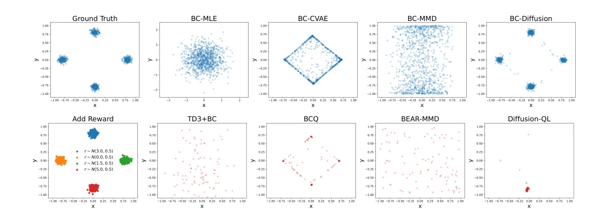
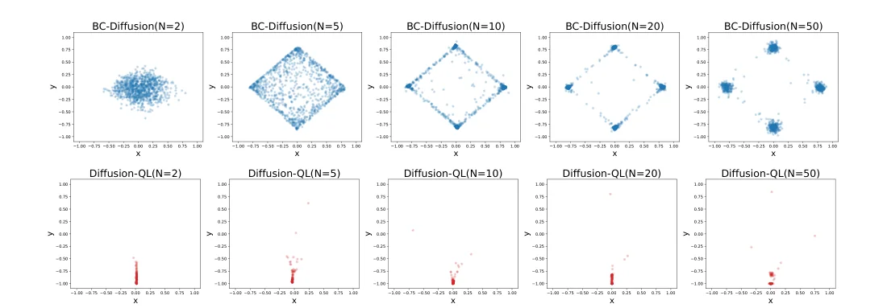

> - **논문**: Diffusion Policies as an Expressive Policy Class for Offline Reinforcement Learning
> - **저자**: Zhendong Wang, Jonathan J Hunt, Mingyuan Zhou (The University of Texas at Austin, Twitter)
> - **학회**: ICLR 2023 · [arXiv:2208.06193](https://arxiv.org/abs/2208.06193) · [코드](https://github.com/Zhendong-Wang/Diffusion-Policies-for-Offline-RL)
{: .prompt-tip }

> Offline RL 정책은 보통 가우시안으로 표현한다. 하지만 데이터 속 행동이 여러 갈래(multi-modal)로 나뉘어 있으면, 가우시안은 그 사이의 어중간한 행동을 고르게 된다. **Diffusion-QL**은 정책을 **조건부 Diffusion 모델**로 바꿔 이 문제를 푼다.

## 1. 기존 방법의 한계

### Policy regularization의 한계

[Anti-Exploration]()에서 본 것처럼 offline RL은 정책이 데이터 분포 밖으로 나가지 않도록 규제한다. 그런데 기존 규제 방법은 성능이 좋지 않은 경우가 많았다. 예를 들어 behavior policy를 가우시안으로 근사한 뒤 그 근처로 제한하면, 실제 데이터 분포와 다른 영역까지 허용하거나 좋은 영역을 막아 **탐색 공간을 잘못 제한**하게 된다.

### 가우시안 정책의 표현력

기존 방법들은 대부분 정책을 가우시안으로 표현한다. 가우시안은 봉우리가 하나뿐이라 **multi-modal한 행동 분포**를 표현하지 못한다. 행동의 여러 성분 사이의 의존 관계도 잘 표현하지 못한다(대각 공분산을 쓰는 경우).

예를 들어 장애물을 피할 때 데이터에 "왼쪽으로 피하기"와 "오른쪽으로 피하기"가 반반 섞여 있으면, 가우시안은 그 평균인 "정면으로 돌진"을 가장 그럴듯한 행동으로 학습할 수 있다.

```python
import numpy as np

rng = np.random.default_rng(0)
actions = np.concatenate([rng.normal(-1, 0.1, 500),      # 왼쪽(-1)으로 피한 시연
                          rng.normal(+1, 0.1, 500)])     # 오른쪽(+1)으로 피한 시연
mu, sigma = actions.mean(), actions.std()                # 가우시안 정책의 최대우도 추정
print(f"평균 {mu:.3f}, 표준편차 {sigma:.3f}")             # 평균 -0.005, 표준편차 1.003
print((np.abs(actions) < 0.3).mean())                    # 0.0 → 데이터에는 a≈0인 행동이 하나도 없음
```

가우시안의 확률이 가장 높은 곳(평균 ≈ 0)은 **데이터에 한 번도 나오지 않은 행동**이다. 정책이 평균 근처를 고르면 장애물에 그대로 부딪치고, 표준편차도 1로 커져 엉뚱한 행동을 자주 샘플링한다.

## 2. Contribution

1. **DDPM 기반 정책**으로 policy regularization과 **Q-learning guidance**를 함께 수행
2. 간단한 **bandit 실험**으로 diffusion 정책의 표현력 확인
3. **D4RL**의 다양한 환경에서 SOTA 달성

## 3. Diffusion 정책

정책 $$\pi_\theta(a \mid s)$$를 **상태를 조건으로 행동을 생성하는 diffusion 모델**로 정의한다. 노이즈 $$a^N \sim \mathcal{N}(0, I)$$에서 시작해, 상태 $$s$$를 조건으로 $$N$$번 denoising해서 행동 $$a^0$$을 얻는다.

$$
\pi_\theta(a \mid s) = p_\theta(a^{0:N} \mid s) = \mathcal{N}(a^N; 0, I)\prod_{i=1}^{N}p_\theta(a^{i-1} \mid a^i, s)
$$

> 두 종류의 시간이 있다. 위첨자 $$i$$는 **denoising step**, 아래첨자 $$t$$는 **궤적의 시점**이다.

각 denoising step은 DDPM처럼 노이즈 예측 모델 $$\epsilon_\theta(a^i, s, i)$$로 평균을 만들고 분산은 $$\beta_i I$$로 고정한다.

$$
a^{i-1} = \frac{a^i}{\sqrt{\alpha_i}} - \frac{\beta_i}{\sqrt{\alpha_i(1 - \bar\alpha_i)}}\,\epsilon_\theta(a^i, s, i) + \sqrt{\beta_i}\,\epsilon,\quad \epsilon \sim \mathcal{N}(0, I)
$$

마지막 step($$i = 1$$)에서는 $$\epsilon = 0$$으로 둔다. Denoising step 수 $$N$$은 이미지 생성(수백~수천)과 달리 **5 정도로 작게** 써도 충분했다. 행동은 이미지보다 차원이 훨씬 낮고, 아래에서 보듯 Q guidance가 함께 걸리기 때문이다. 작은 $$N$$에서도 잘 동작하도록 noise schedule은 VP-SDE에서 유도한 식($$\beta_{min} = 0.1$$, $$\beta_{max} = 10$$)을 쓴다.

## 4. 학습 목적

$$
\mathcal{L}(\theta) = \underbrace{\mathcal{L}_d(\theta)}_{\text{behavior cloning}} + \underbrace{\mathcal{L}_q(\theta)}_{\text{policy improvement}}
$$

### Behavior Cloning 항 (규제 역할)

데이터셋의 $$(s, a)$$로 일반적인 diffusion 노이즈 예측 loss를 쓴다.

$$
\mathcal{L}_d(\theta) = \mathbb{E}_{i, \epsilon, (s, a) \sim \mathcal{D}}\Big[\big\lVert\epsilon - \epsilon_\theta\big(\sqrt{\bar{\alpha}_i}\,a + \sqrt{1 - \bar{\alpha}_i}\,\epsilon,\ s,\ i\big)\big\rVert^2\Big]
$$

정책이 학습 데이터의 행동 분포를 따라가게 한다. 별도의 behavior policy 근사나 거리 계산 없이, 이 항 자체가 **policy regularization** 역할을 한다. Diffusion 모델은 multi-modal 분포도 정확히 학습하므로, 규제가 실제 데이터 분포에 맞게 걸린다.

논문은 이 점을 BCQ·BEAR 같은 **2단계 규제**와 대비한다. 이들은 먼저 CVAE 등으로 behavior policy를 복제하고, 그다음 정책을 그 복제본 근처로 묶는다. 그러면 규제의 질이 복제 품질에 달려 있어서, 복제가 틀리면 개선 단계까지 엉뚱한 곳으로 이끌린다. Diffusion-QL은 데이터와 현재 정책에서 샘플만 뽑으면 되므로 behavior policy를 따로 알 필요도 없다.

### Policy Improvement 항 (Q-learning guidance)

정책이 생성한 행동의 Q 값이 크도록 유도한다.

$$
\mathcal{L}_q(\theta) = -\alpha\cdot\mathbb{E}_{s \sim \mathcal{D},\ a^0 \sim \pi_\theta}\big[Q_\phi(s, a^0)\big]
$$

$$a^0$$은 diffusion 정책의 **reverse chain 전체**를 통과해 샘플링되며, Q의 기울기가 이 chain을 따라 정책 파라미터까지 역전파된다. 그래서 정책이 가치가 높은 행동 쪽으로 샘플을 만들게 된다.

Q 값의 스케일은 환경마다 다르므로, 계수를 $$\alpha = \eta / \mathbb{E}_{(s, a) \sim \mathcal{D}}\big[\lvert Q_\phi(s, a)\rvert\big]$$로 정규화해 $$\eta$$ 하나로 두 항의 균형을 조절한다.

### Critic 학습

Q 함수는 **double Q-learning**으로 학습하고, target의 다음 행동도 diffusion 정책에서 샘플링한다.

$$
\mathcal{L}(\phi) = \mathbb{E}\Big[\Big(r + \gamma\min_{k=1,2}Q_{\phi'_k}(s', a'^0) - Q_{\phi_k}(s, a)\Big)^2\Big],\qquad a'^0 \sim \pi_{\theta'}(\cdot \mid s')
$$

```python
import torch

def diffusion_ql_losses(batch, policy, q1, q2, q1_t, q2_t, policy_t, eta=1.0, gamma=0.99):
    s, a, r, s_next, done = batch

    # Critic: 다음 행동은 target diffusion 정책에서 샘플링
    with torch.no_grad():
        a_next = policy_t.sample(s_next)                       # N번 denoising
        target = r + gamma * (1 - done) * torch.min(q1_t(s_next, a_next), q2_t(s_next, a_next))
    critic_loss = ((q1(s, a) - target) ** 2).mean() + ((q2(s, a) - target) ** 2).mean()

    # Actor: BC(diffusion loss) + Q guidance (reverse chain 통과해 역전파)
    bc_loss = policy.denoising_loss(a, s)                      # ε 예측 MSE
    a_new = policy.sample(s)                                   # gradient가 흐르는 샘플링
    q_new = torch.min(q1(s, a_new), q2(s, a_new))
    alpha = eta / q2(s, a).abs().mean().detach()
    actor_loss = bc_loss - alpha * q_new.mean()
    return critic_loss, actor_loss
```

## 5. 실험

### 2D Bandit: Multi-modal 표현력

행동이 2차원($$a \in [-1, 1]^2$$)인 bandit 문제이다. 데이터는 네 점 $$(0, 0.8), (0.8, 0), (0, -0.8), (-0.8, 0)$$을 중심으로 한 가우시안(표준편차 0.05) 네 개를 똑같이 섞어 만든 행동 10,000개이다. 여러 사람이 서로 다른 방식으로 시연한 데이터를 흉내 낸 것이다.


_Figure 1. 위: behavior cloning만 했을 때 각 정책 클래스가 학습한 분포(BC-Diffusion은 $$N = 50$$). 아래: 클러스터마다 보상 평균을 다르게 주고(아래쪽 빨간 클러스터가 5.0으로 최고) policy improvement까지 했을 때의 결과. (출처: Wang et al., 2023)_

- **BC 단계 (위 줄)**: BC-MLE(가우시안)는 네 봉우리를 큰 가우시안 하나로 덮어서, 오히려 데이터가 없는 가운데가 밀도가 가장 높다. BC-CVAE는 네 봉우리는 잡지만 그 사이를 잇는 마름모에도 밀도를 준다. BEAR가 쓰는 Tanh-Gaussian + MMD는 경계선 쪽으로 퍼진다. BC-Diffusion만 네 봉우리를 정확히 재현한다.
- **개선 단계 (아래 줄)**: 보상은 클러스터마다 평균 0.0, 1.5, 3.0, 5.0(표준편차 0.5)이다. TD3+BC는 최적 클러스터로 수렴하지 못하고, BCQ는 CVAE가 만든 마름모의 네 꼭짓점에 행동을 놓으며, BEAR-MMD는 거의 무작위로 흩어진다. **Diffusion-QL**만 보상이 가장 높은 아래쪽 클러스터로 모인다.

논문은 이 차이를 두 요소의 조합으로 설명한다. ① 정책이 모든 봉우리를 정확히 표현할 수 있어 탐색 영역이 올바르게 잡히고, ② 같은 loss 안에서 Q guidance가 그 영역 안의 최적 행동 쪽으로 끌어당긴다.

### 계산 비용과 표현력의 trade-off


_Figure 2. 위: BC-Diffusion에서 $$N$$을 2, 5, 10, 20, 50으로 바꿨을 때. 아래: 같은 $$N$$으로 Diffusion-QL을 학습했을 때. (출처: Wang et al., 2023)_

Denoising step $$N$$을 늘리면 표현력은 좋아지지만 학습·추론 비용이 늘어난다. Figure 2 위 줄처럼 BC만 할 때는 $$N = 2$$면 가우시안 덩어리 하나, $$N = 5$$면 마름모, $$N = 50$$이 되어야 네 봉우리를 정확히 복원한다. 그런데 아래 줄처럼 Q guidance를 함께 걸면 $$N = 5$$ 정도로도 최적 클러스터를 찾는다. $$N$$이 클수록 규제가 강해져 데이터 밖 행동이 줄어드는 차이는 있다.

$$\mathcal{L}_q$$는 $$N$$단계 reverse chain 전체를 거쳐 역전파하므로, 학습 비용도 $$N$$에 따라 늘어난다. D4RL Gym 세 과제에서 $$N \in \{2, 5, 10, 20\}$$을 비교하면, $$N$$이 클수록 수렴이 빠르고 안정적이었지만 $$N = 5$$면 충분했다(논문 Figure 3). 논문은 $$N = 5$$를 기본으로 썼고, 이때 학습 시간은 CQL과 비슷하다. 대신 추론은 한 번의 forward로 끝나는 기존 정책보다 **4~5배 느리다.**

### D4RL

네 종류의 환경에서 평가했다. 데이터셋은 near-optimal 정책이 모은 것부터 사람이 모은 것까지 다양하다.

| 환경 | 특징 |
|---|---|
| Gym (MuJoCo locomotion) | 표준 연속 제어. 최적에 가까운 궤적이 많고 보상이 매끄러워 비교적 쉬움 |
| AntMaze | 보상이 드물고 궤적 조각을 이어야 함 |
| Adroit | 대부분 사람 시연이라 데이터가 덮는 영역이 좁아 강한 규제가 필요 |
| Kitchen | 4개 하위 과제를 순서대로 완료해야 해 장기 가치 최적화가 중요 |

도메인별 평균 normalized score이다(Table 1). Diffusion-QL은 Gym 5 seed × 10 에피소드, 나머지는 5 seed × 100 에피소드 평균이고, baseline은 각 논문이나 D4RL·IQL 논문의 최고 보고값이다.

| 도메인 | BC | TD3+BC | CQL | IQL | 그 밖의 최고 baseline | **Diffusion-QL** |
|---|---|---|---|---|---|---|
| Gym (9개) | 51.9 | 75.3 | 77.6 | 77.0 | Onestep RL 76.1 | **88.0** |
| AntMaze (6개) | 16.7 | 27.3 | 50.6 | 63.0 | BCQ 23.8 | **69.6** |
| Adroit (pen 2개) | 32.1 | - | 31.2 | 54.4 | BCQ 56.5 | **65.1** |
| Kitchen (3개) | 38.4 | - | 48.2 | 53.3 | BEAR 20.1 | **69.0** |

과제별로 눈에 띄는 값만 옮기면 다음과 같다.

| 데이터셋 | CQL | IQL | **Diffusion-QL** |
|---|---|---|---|
| hopper-medium-v2 | 58.5 | 66.3 | **90.5 ± 4.6** |
| walker2d-medium-replay-v2 | 77.2 | 73.9 | **95.5 ± 1.5** |
| antmaze-umaze-diverse-v0 | **84.0** | 62.2 | 66.2 ± 8.6 |
| antmaze-large-diverse-v0 | 14.9 | 47.5 | **56.6 ± 7.6** |
| pen-cloned-v1 | 27.2 | 37.3 | **57.3 ± 11.9** |
| kitchen-complete-v0 | 43.8 | 62.5 | **84.0 ± 7.4** |

- **Gym**: 특히 medium·medium-replay에서 차이가 크다. medium 데이터는 전문가의 약 1/3 성능까지 학습된 SAC가 모은 것이라 행동이 탐색적이고 흩어져 있어 분포를 흉내 내기 어려운데, diffusion 정책은 이를 잘 따라 한다는 것이 논문의 설명이다. (hopper-medium은 model-based인 MoRel이 95.4로 더 높다.)
- **AntMaze**: 평균은 가장 높지만 umaze-diverse에서는 CQL(84.0)보다 낮다. 보상이 0/1이라 표준오차도 8~11로 크다.
- 평균 차이는 Kitchen에서 가장 크다(IQL 대비 +15.7).

> AntMaze는 학습 중 성능 변동이 커서 checkpoint 선택이 중요하다. 본문 수치는 환경과 상호작용 없이 **$$\mathcal{L}_d$$가 두 번째·세 번째로 낮은 checkpoint**를 고르는 offline 방식으로 고른 것이다. 약간의 온라인 평가로 checkpoint를 고르면 Gym 89.3, AntMaze 75.4, Adroit 68.3, Kitchen 71.6으로 더 오른다(부록 Table 4).
{: .prompt-info }

### Ablation: 표현력과 Q-learning, 둘 다 필요하다

Gym medium-expert 세 과제 평균이다(Table 2). 정책 클래스(CVAE vs Diffusion)와 개선 방식(BCQ식 제한된 섭동 vs Q guidance)을 바꿔 본다.

| 방법 | halfcheetah-m-e | hopper-m-e | walker2d-m-e | 평균 |
|---|---|---|---|---|
| BC-CVAE | 67.3 | 69.9 | 102.5 | 79.9 |
| BC-Diffusion | 76.6 | 78.0 | 103.1 | 85.9 |
| BCQ-CVAE | 96.1 | 108.5 | 110.7 | 105.1 |
| BCQ-Diffusion | 94.6 | 109.3 | 114.0 | 106.0 |
| CVAE-QL | 70.3 | 109.2 | 50.5 | 76.6 |
| **Diffusion-QL** | **97.2** | **112.3** | 111.2 | **106.9** |

- BC만 해도 Diffusion이 CVAE보다 6점 높다. 표현력 차이이다.
- 같은 BCQ 틀 안에서도 Diffusion이 조금 낫고, BCQ의 강한 제약 대신 Q guidance를 쓰면 더 오른다.
- **CVAE-QL**(CVAE에 Q guidance를 그대로 붙인 것)은 76.6으로 무너진다. walker2d는 50.5 ± 38.2로 seed마다 들쭉날쭉하다. 표현력이 약한 정책에 제약 없는 Q guidance를 붙이면 규제가 제대로 걸리지 않는다는 뜻이다.

부록에서는 가우시안 혼합(3개) 정책에 TD3+BC를 붙인 TD3+BC-GM도 시험했는데, medium-expert 세 과제에서 49.0 / 40.0 / 66.5로 원래 TD3+BC(90.4 / 98.0 / 110.1)보다도 낮았다. 혼합 성분 수를 미리 정해야 하고, 각 성분이 대각 가우시안이라 차원 간 의존성을 잡기 어렵다는 점을 원인으로 든다.

## 6. 구현 디테일

| 항목 | 값 |
|---|---|
| 정책 $$\epsilon_\theta$$ | 3층 MLP, hidden 256, Mish. 입력은 $$[a^i, s, \text{sinusoidal}(i)]$$ |
| Q 네트워크 2개 | 정책과 같은 3층 MLP (256, Mish) |
| Diffusion | $$N = 5$$, $$\beta_{min} = 0.1$$, $$\beta_{max} = 10$$ (VP-SDE 기반 schedule) |
| Optimizer | Adam, lr $$3 \times 10^{-4}$$ (antmaze-medium-play $$10^{-3}$$, pen $$3 \times 10^{-5}$$) |
| 학습량 | epoch당 1,000 gradient step, batch 256. Gym 2,000 epoch, 나머지 1,000 epoch |
| $$\eta$$ | Gym 1.0, AntMaze 0.5~4.5, pen 0.1~0.15, Kitchen 0.005 |
| max Q backup (CQL) | AntMaze umaze 외 5개 과제에서만 사용 |
| Target network | 정책과 Q 모두 soft update |
| Checkpoint 선택 | offline: $$\mathcal{L}_d$$ 기준 early stopping |

$$\eta$$는 일정한 경향을 보인다. 데이터가 좁은 Adroit과 Kitchen에서는 $$\eta$$를 작게(규제를 강하게), stitching이 필요한 AntMaze에서는 크게(Q guidance를 강하게) 둔다.

## 7. 정리

| | 가우시안 정책 + 규제 | Diffusion-QL |
|---|---|---|
| 정책 표현 | 단봉 분포 | **다봉 분포 가능** |
| 규제 | behavior policy 근사 + 거리 | **Diffusion loss 자체가 BC 규제** |
| 개선 | Q 최대화 | Reverse chain을 통한 **Q 기울기 역전파** |
| 비용 | 낮음 | Denoising step 수만큼 증가 |

## References

- Wang, Hunt & Zhou, "Diffusion Policies as an Expressive Policy Class for Offline Reinforcement Learning," ICLR 2023. [arXiv:2208.06193](https://arxiv.org/abs/2208.06193)
- Ho et al., "Denoising Diffusion Probabilistic Models," NeurIPS 2020.
- Fujimoto & Gu, "A Minimalist Approach to Offline Reinforcement Learning (TD3+BC)," NeurIPS 2021.
- Kostrikov et al., "Offline Reinforcement Learning with Implicit Q-Learning," ICLR 2022.
