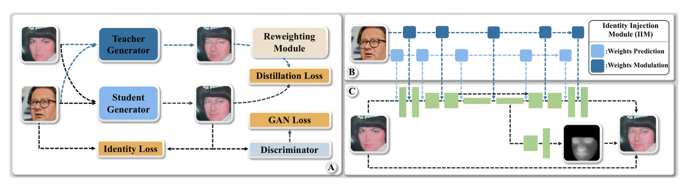
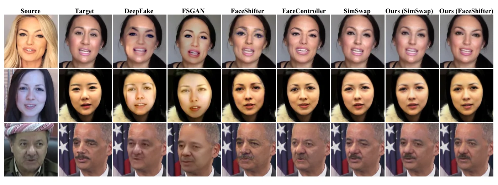

> - **논문**: MobileFaceSwap: A Lightweight Framework for Video Face Swapping
> - **저자**: Zhiliang Xu, Zhibin Hong, Changxing Ding, Zhen Zhu, Junyu Han, Jingtuo Liu, Errui Ding (Baidu Inc., South China University of Technology, University of Illinois at Urbana-Champaign)
> - **학회**: AAAI 2022 · [arXiv:2201.03808](https://arxiv.org/abs/2201.03808)
{: .prompt-tip }

> 고화질 교체기는 무겁다. 신원 네트워크까지 센 이미지 단위 기준으로 [FaceShifter]()는 1단계만 421M 파라미터·97.4 GFLOPs, [FSGAN]()은 226M·2440 GFLOPs, "효율적"이라는 [SimSwap]()도 107M·55.7 GFLOPs라 엣지 기기는커녕 영상 처리에도 시간이 오래 걸린다. **MobileFaceSwap**의 출발점은 두 관찰이다. SimSwap·FaceShifter를 채널 가지치기로 줄이면 아티팩트가 생기거나 신원이 약해지는데, 용량이 작은 네트워크로는 신원을 주입하기 어렵기 때문이다. 반면 [DeepFaceLab]()처럼 소스를 고정하고 한 신원용 경량 모델을 학습하면 결과가 좋다. 따라서 주체 비의존이면서 실시간이 되려면 **신원에 따라 네트워크 파라미터를 바꾸면** 된다. 곧 동적 네트워크이다.

## 1. IIN과 IDN

아래 Figure 2가 전체 구조이다. (a)는 교사 출력으로 학생을 학습하는 과정, (b)는 신원 주입 네트워크, (c)는 실제로 프레임마다 도는 경량 네트워크이다.


_Figure 2. (A) 교사 생성기 출력과 재가중 모듈을 쓰는 증류 학습, (B) 신원 벡터로 가중치를 예측(연한 파랑)하거나 변조(진한 파랑)하는 신원 주입 네트워크, (C) 신원 인식 동적 네트워크와 약한 의미 융합 마스크. (출처: Xu et al., 2022)_

네트워크는 둘이다. **신원 주입 네트워크(IIN)**는 ArcFace 신원 벡터 $$z_{id}$$를 받아 여러 **신원 주입 모듈(IIM)**로 파라미터를 만들고, **신원 인식 동적 네트워크(IDN)**는 그 파라미터로 구성되어 추론을 한다. 주입이 끝나면 IDN만으로 어떤 목표 이미지·영상이든 교체한다. 영상에서는 IIN이 한 번, IDN이 프레임마다 돈다.

IDN은 U-Net을 깊이별 + 점별 합성곱으로 단순화한 것이다. 두 종류의 합성곱에 서로 다른 동적 기법을 쓴다.

- **가중치 예측**(깊이별): $$W_d = F_p(z_{id}) \in \mathbb{R}^{C_{in} \times 1 \times K \times K}$$. 출력이 $$C_{in} K^2$$개라 예측이 싸다.
- **가중치 변조**(점별): $$W_p \in \mathbb{R}^{C_{in} \times C_{out}}$$를 예측하면 출력이 너무 많으므로, StyleGAN2처럼 입력 채널별 스케일 $$F_m(z_{id})$$로 변조하고 출력 필터별로 복조(정규화)한다. 실험적으로도 변조가 더 좋았다.

$$
\hat W^{(i,j,k)}_p = F_m(z_{id})^{(i)} \cdot W^{(i,j,k)}_p, \qquad
\tilde W^{(i,j,k)}_p = \frac{\hat W^{(i,j,k)}_p}{\sqrt{\sum_{i,k}(\hat W^{(i,j,k)}_p)^2 + \epsilon}}
$$

IDN은 0.413M 파라미터·0.328 GFLOPs이고, 배경·머리카락을 목표와 같게 유지하고 영상의 떨림을 막기 위해 IDN 특징을 재사용해 **약한 의미 융합 마스크**를 예측하는 모듈(0.083M, 0.005 GFLOPs)을 더해 총 0.495M·0.333 GFLOPs(224×224)이다. 양자화 없이 MediaTek Dimensity 1100에서 26 FPS이다.

## 2. 지식 증류와 손실 재가중

교체 학습은 정답이 없어 여러 손실이 경쟁하며 불안정하다. 잘 학습된 교체기(SimSwap 공식 모델, 자체 구현 FaceShifter)를 교사로 두고 학생 출력과 교사 출력 사이의 L1 + VGG 지각 손실로 쌍 데이터 학습으로 바꾸면 안정된다. 그런데 교사도 실패한다(신원이 약하거나 아티팩트). 모든 교사 출력을 같은 가중치로 배우면 학생도 그 실패를 배우므로, 샘플마다 **신원 유사도의 제곱 × 품질 점수**를 증류 손실의 가중치 $$\alpha$$로 쓴다. 품질 점수는 "교사 학습이 진행될수록 결과가 좋아진다"는 관찰에서, 교사 출력에 학습 진행률(0~1)을 라벨로 붙여 ResNet-18을 회귀시킨 모델 $$Q$$이다. 여기에 신원 손실(증류만으로는 신원이 부족), 배경만 제약하는 **약한 마스크 손실**(전체 마스크 감독보다 목표의 국소 질감을 잘 지킴), 적대 손실을 더한다. $$\lambda_{id} = 3$$, $$\lambda_{rec} = 30$$, $$\lambda_{per} = 5$$, $$\lambda_{mask} = 10$$.

$$
L = L_{adv} + \alpha(\lambda_{rec} L_{rec} + \lambda_{per} L_{per}) + \lambda_{id} L_{id} + \lambda_{mask} L_{mask}, \qquad \alpha = \cos(z_{id}, z'_{id})^2 \times Q(I'_g)
$$

재가중 계수 $$\alpha$$는 증류 손실(L1, VGG)에만 곱해지고, 신원·마스크·적대 손실에는 곱해지지 않는다.

## 3. 구현 디테일

| 항목 | 값 |
|---|---|
| 학습 데이터 | VGGFace2에서 두 눈 사이 랜드마크 거리가 70픽셀보다 큰 이미지 55만 장 |
| 교사 | SimSwap(공식 저장소 모델), FaceShifter(코드 미공개라 자체 구현) |
| 입력 크기 | SimSwap 교사 224×224, FaceShifter 교사 256×256. 얼굴 정렬은 교사와 같은 방식 |
| 신원 인코더 | ArcFace(112×112 입력, 52.2M 파라미터, 7.52 GFLOPs) |
| IDN | U-Net의 표준 합성곱을 깊이별+점별로 교체, 0.413M·0.328 GFLOPs |
| 의미 융합 모듈 | IDN 특징 재사용, 0.083M·0.005 GFLOPs. 정답 마스크는 BiSeNet 분할의 배경 라벨 |
| 품질 모델 $$Q$$ | ResNet-18, 교사 학습 진행률(0~1) 점수를 L2로 회귀 |
| 손실 가중치 | $$\lambda_{rec} = 30$$, $$\lambda_{per} = 5$$, $$\lambda_{id} = 3$$, $$\lambda_{mask} = 10$$ |
| 속도 측정 | MediaTek Dimensity 1100 폰, 양자화 등 추가 최적화 없음 |
| 평가 | 정성은 CelebA-HQ, 정량은 FF++. ID 검색은 CosFace 임베딩 코사인, 포즈는 Hopenet(Ruiz 등) 추정 벡터의 L2 거리 |

optimizer, 학습률, 배치 크기, 반복 수는 논문에 적혀 있지 않다.

## 4. 코드로 보기: 산술과 변조의 성질

56×56, 64채널 3×3 합성곱의 표준 대 깊이별+점별 파라미터·MAC을 세고, 신원 벡터에서 깊이별·점별 가중치를 예측할 때 주입 네트워크의 비용을 비교하며, 변조 합성곱이 입력 채널 스케일링과 같고 복조 후 필터 노름이 1임을 확인한 뒤, 300프레임 영상의 총 연산과 손실 재가중 계수를 계산한다.

```python
import torch, torch.nn.functional as F
torch.manual_seed(0)
# (1) parameter and FLOP accounting for one 3x3 conv layer at 56x56, C_in = C_out = 64
H = W = 56; Cin = Cout = 64; K = 3
std_p, std_f = Cin * Cout * K * K, H * W * Cin * Cout * K * K
dw_p, dw_f = Cin * K * K, H * W * Cin * K * K
pw_p, pw_f = Cin * Cout, H * W * Cin * Cout
print(f"3x3 conv 64->64 at 56x56: params {std_p:,}  MACs {std_f/1e6:.1f}M")
print(f"depthwise 3x3 + pointwise 1x1: params {dw_p + pw_p:,}  MACs {(dw_f + pw_f)/1e6:.1f}M   ({std_f/(dw_f+pw_f):.1f}x fewer)")
# (2) how identity is injected into the lightweight network: predict the depthwise weights, modulate the pointwise weights
zid = 512
print(f"\nweights prediction for the depthwise kernel: output size {Cin * K * K:,} numbers (cheap: a linear from the {zid}-d id vector costs {zid * Cin * K * K:,} params in the injection net)")
print(f"weights prediction for the pointwise kernel would output {Cin * Cout:,} numbers ({zid * Cin * Cout / 1e6:.1f}M params in the injection net) -> use modulation instead: {Cin} scales")
# modulation + demodulation (StyleGAN2): scaling input channels of W_p by s(zid), then renormalising each output filter
Wp = torch.randn(Cout, Cin, 1, 1); s = torch.rand(Cin) + 0.5
Wm = Wp * s[None, :, None, None]; Wd = Wm / (Wm.pow(2).sum((1, 2, 3), keepdim=True) + 1e-8).sqrt()
x = torch.randn(1, Cin, 8, 8)
print(f"modulated conv == conv on scaled input: {torch.allclose(F.conv2d(x, Wm), F.conv2d(x * s[None, :, None, None], Wp), atol=1e-4)}; after demodulation every output filter has unit norm: {Wd.pow(2).sum((1,2,3)).mean():.3f}")
# (3) per-frame cost for a video: the identity network runs once, the dynamic network every frame
id_net_flops, idn_flops, frames = 7.52, 0.33, 300
print(f"\n300-frame clip: identity network once {id_net_flops:.2f} GFLOPs + IDN {idn_flops:.2f} GFLOPs x {frames} = {id_net_flops + idn_flops * frames:.0f} GFLOPs;  SimSwap 48.2 x {frames} = {48.2 * frames:,.0f} GFLOPs")
# (4) distillation-loss reweighting: a teacher output with low identity similarity or low quality contributes less
for cos_id, q in ((0.9, 0.9), (0.9, 0.4), (0.5, 0.9), (0.3, 0.3)):
    print(f"teacher sample: id cosine {cos_id:.1f}, quality {q:.1f} -> distillation weight alpha = {cos_id ** 2 * q:.2f}")
```

```text
3x3 conv 64->64 at 56x56: params 36,864  MACs 115.6M
depthwise 3x3 + pointwise 1x1: params 4,672  MACs 14.7M   (7.9x fewer)

weights prediction for the depthwise kernel: output size 576 numbers (cheap: a linear from the 512-d id vector costs 294,912 params in the injection net)
weights prediction for the pointwise kernel would output 4,096 numbers (2.1M params in the injection net) -> use modulation instead: 64 scales
modulated conv == conv on scaled input: True; after demodulation every output filter has unit norm: 1.000

300-frame clip: identity network once 7.52 GFLOPs + IDN 0.33 GFLOPs x 300 = 107 GFLOPs;  SimSwap 48.2 x 300 = 14,460 GFLOPs
teacher sample: id cosine 0.9, quality 0.9 -> distillation weight alpha = 0.73
teacher sample: id cosine 0.9, quality 0.4 -> distillation weight alpha = 0.32
teacher sample: id cosine 0.5, quality 0.9 -> distillation weight alpha = 0.23
teacher sample: id cosine 0.3, quality 0.3 -> distillation weight alpha = 0.03
```

- 깊이별+점별 분해는 파라미터 36,864 → 4,672, MAC 115.6M → 14.7M으로 7.9배 줄인다. [MobileNetV2]()의 산술 그대로이고, IDN이 0.5M인 바탕이다.
- 깊이별 커널은 576개 숫자라 512차원 신원에서 선형으로 예측해도 주입 네트워크가 29만 파라미터인데, 점별 커널 4,096개를 예측하려면 210만 파라미터가 든다. 64개 스케일로 끝나는 변조를 택한 이유이다. 변조 합성곱은 입력을 채널별로 스케일한 뒤 원래 커널로 합성곱한 것과 같고, 복조는 모든 출력 필터의 노름을 1로 되돌려 활성 크기의 폭주를 막는다.
- 300프레임에서 신원 네트워크 7.5 GFLOPs는 한 번만 들고 IDN 0.33 × 300이라 총 107 GFLOPs인데, SimSwap은 48.2 × 300 = 14,460 GFLOPs이다. 영상에서 격차가 130배를 넘는 이유는 신원 처리가 프레임 밖으로 나가기 때문이다.
- 교사 샘플의 신원 코사인 0.9·품질 0.9면 가중치 0.73, 둘 중 하나만 나빠도 0.2~0.3, 둘 다 나쁘면 0.03이다. 나쁜 교사 출력은 거의 무시된다.

## 5. 실험

**정성.** SimSwap 교사보다 아티팩트가 적고(의미 융합 덕에 머리·배경이 안정, 안경 주변 깨끗), FaceShifter 교사보다 표정을 잘 지키며 가림·큰 포즈에서도 동작한다(Figure 3, 4). 아래 Figure 6처럼 FF++에서 DeepFakes·FSGAN은 부자연스러운 색이 보이고, FaceController보다 목표 표정을 잘 지키며, SimSwap·FaceShifter와는 대등하다.


_Figure 6. FaceForensics++에서 DeepFakes, FSGAN, FaceShifter, FaceController, SimSwap과 비교. 오른쪽 두 열이 SimSwap·FaceShifter를 교사로 증류한 MobileFaceSwap. (출처: Xu et al., 2022)_

**정량(Table 1, FF++).** 이미지(I) 기준은 신원 네트워크 비용을 포함하고, 영상(V) 기준은 신원 네트워크를 한 번만 돌리므로 제외한다.

| 방법 | 입력 | (I) 파라미터(M) | (I) FLOPs(G) | (V) 파라미터(M) | (V) FLOPs(G) | 폰 FPS | ID ↑ | 포즈 ↓ |
|---|---|---|---|---|---|---|---|---|
| DeepFakes | 64 | 82.1 | 1.90 | 82.1 | 1.90 | 9.5 | 81.96 | 4.14 |
| FSGAN | 256 | 226 | 2440 | 226 | 2240 | - | 57.34 | 3.81 |
| SimSwap | 224 | 107 | 55.7 | 45.6 | 48.2 | 0.64 | 92.83 | 1.53 |
| FaceShifter | 256 | 421 | 97.4 | 350 | 91.1 | - | 97.38 | 2.96 |
| FaceController | 224 | 306 | 192 | 236 | 177 | - | **98.27** | 2.65 |
| 교사(SimSwap, 공개 모델) | 224 | 107 | 55.7 | 45.6 | 48.2 | 0.64 | 95.94 | 1.39 |
| 교사(FaceShifter, 자체 구현) | 256 | 421 | 97.4 | 350 | 91.1 | - | 97.15 | 1.76 |
| Ours(SimSwap) | 224 | 72.8 | 8.07 | **0.50** | **0.33** | **25.6** | 95.98 | **1.32** |
| Ours(FaceShifter) | 256 | 72.8 | 8.18 | 0.50 | 0.44 | 19.7 | 96.10 | 1.70 |
| (신원 네트워크) | 112 | 52.2 | 7.52 | - | - | - | - | - |

FSGAN의 영상 FLOPs(2240)와 이미지 FLOPs(2440)는 논문 표에 적힌 그대로 옮겼다. DeepFakes는 연산이 적지만 신원마다 모델을 새로 학습해야 하고 입력이 64×64이다.

학생이 교사와 대등하거나(SimSwap 교사보다 ID·포즈 모두 약간 좋음) 조금 뒤지며(FaceShifter 교사 97.15 → 96.10), SimSwap보다 폰에서 40배 빠르다. 공개 SimSwap 모델은 논문 모델과 달라 교사 수치가 원 논문(92.83)과 다르다.

**Ablation(Table 2, SimSwap 교사, FF++).**

| 설정 | ID ↑ | 포즈 ↓ | FID ↓ |
|---|---|---|---|
| 가중치 예측 제거 | 16.29 | 1.40 | 16.75 |
| 가중치 변조 제거 | 86.20 | 2.12 | 9.92 |
| 의미 모듈 제거 | 96.10 | 1.69 | 12.13 |
| U-Net 대신 오토인코더 | 92.78 | 1.43 | 7.77 |
| 변조 대신 AdaIN | 18.34 | 1.30 | 12.04 |
| 지식 증류 제거 | 88.48 | 3.21 | 17.37 |
| 품질 재가중 제거 | 95.28 | 1.50 | 8.12 |
| 신원 재가중 제거 | 93.71 | 1.52 | 7.38 |
| 신원 손실 제거 | 28.13 | 0.98 | 4.76 |
| 전체 마스크 감독 | 95.46 | 1.42 | 7.44 |
| 교사(SimSwap) | 95.94 | 1.39 | 10.26 |
| **Ours** | **95.98** | 1.32 | 6.79 |

가중치 예측을 빼거나(ID 16.29) 변조를 AdaIN으로 바꾸면(ID 18.34) 학습이 불안정해져 신원이 무너진다. 이는 사실상 SimSwap을 압축한 것과 같다. 변조를 빼면 ID 86.20, 의미 모듈을 빼면 배경 차이, U-Net을 오토인코더로 바꾸면 아티팩트가 나타난다. 증류를 빼면 ID 88.48·포즈 3.21·FID 17.37로 크게 나빠지고, 신원 재가중을 넣으면 ID가 2.27%p(93.71 → 95.98), 품질 재가중은 소폭 오른다. 신원 손실을 빼면 FID(4.76)와 포즈는 오히려 좋아지지만 ID가 28.13으로 무너진다. 신원을 거의 안 바꾸고 목표를 복사하는 쪽으로 가기 때문이다. 전체 마스크 감독은 목표와의 색 차이가 커진다. 최종 FID 6.79는 교사(10.26)보다 좋다.

## 6. 해석

**1. 압축 대신 동적 네트워크를 택했다.** 가지치기·증류만으로 SimSwap을 100배 줄이면 신원 주입 용량이 부족하다는 관찰과, 고정 신원 소형 모델은 잘된다는 DFL의 경험을 잇는 다리가 **신원 조건 파라미터**이다. 추론 네트워크는 사실상 "그 신원 전용 소형 모델"이고, 그것을 매번 학습하는 대신 예측한다. [HyperNetworks]()의 발상이 얼굴 교체에서 실용화된 사례이다.

**2. 두 동적 기법의 분업이 정확하다.** 예측은 출력이 작은 깊이별 커널에, 변조는 출력이 큰 점별 커널에. 위 toy의 29만 대 210만 파라미터가 그 경계이고, StyleGAN2의 변조·복조를 생성기 밖의 경량 네트워크에 가져온 것이다.

**3. 증류의 역할은 "쌍 데이터 만들기"이다.** [KD 서베이]()의 분류로는 응답 기반 오프라인 증류이지만, 목적은 압축보다 정답 없는 과제를 지도 학습으로 바꾸는 데 있다. 교사 샘플을 신원·품질로 재가중하는 것은 "교사도 틀린다"는 [DIST]()류 문제의식의 단순한 해법이다. 다만 재가중을 하나씩 빼도 FID가 7.38~8.12로 교사(10.26)보다 좋으므로, 학생 FID가 교사를 넘은 것을 재가중만의 효과로 볼 수는 없다. 의미 융합 마스크로 배경을 목표에서 가져오는 구조도 함께 기여했다고 보는 편이 맞다.

**4. 한계는 교사 의존과 신원 네트워크이다.** 학생의 상한은 교사이고, 이미지 단위 교체에서는 ArcFace(52M, 7.5 GFLOPs)가 비용의 대부분이라 경량화의 이점이 영상에서만 드러난다. 의미 융합 마스크는 배경만 약하게 감독하므로, FaceShifter 2단계 같은 별도 가림 처리 모듈은 없다(가림 사례의 정성 결과만 제시).

**5. 평가를 읽을 때 주의할 점.** FaceShifter는 자체 재구현이라 원 모델과 다르고, 교사 SimSwap도 공개 모델이라 원 논문 수치와 다르다. FPS는 특정 폰 칩 하나에서의 측정이다. ID 검색의 CosFace, 포즈 추정기도 선행 연구와 같지만 재계산 값이다. 위 toy는 산술과 선형대수 확인이고 학습된 동적 네트워크의 품질은 보여 주지 않는다.

## 7. 정리

| 항목 | 내용 |
|---|---|
| 문제 | 교체기 100~400M 파라미터, 가지치기 압축은 신원 주입 실패 |
| IDN | 깊이별+점별 U-Net, 0.413M + 융합 마스크 0.083M = 0.50M, 0.33 GFLOPs, 폰 26 FPS |
| IIM | 신원 벡터 → 깊이별 커널 **예측**, 점별 커널 **변조·복조** |
| 학습 | 교사(SimSwap/FaceShifter) 증류(L1 + VGG) × 재가중 $$\alpha = \cos^2 \cdot Q$$ + ID 3 + 배경만 마스크 손실 10 + 적대 |
| 결과 | FF++ ID 95.98/96.10, 포즈 1.32/1.70, FID 6.79(교사 10.26), 영상 프레임당 연산 146~207배 절감 |
| 한계 | 교사 상한, 이미지 단위에서는 ArcFace 비용 지배, 별도 가림 처리 모듈 없음 |

## References

- Xu et al., "MobileFaceSwap: A Lightweight Framework for Video Face Swapping," AAAI 2022. [arXiv:2201.03808](https://arxiv.org/abs/2201.03808)
- De Brabandere, Jia, Tuytelaars, Van Gool, "Dynamic Filter Networks," NeurIPS 2016. [arXiv:1605.09673](https://arxiv.org/abs/1605.09673)
- Karras et al., "Analyzing and Improving the Image Quality of StyleGAN," CVPR 2020. [arXiv:1912.04958](https://arxiv.org/abs/1912.04958)
- Chollet, "Xception: Deep Learning with Depthwise Separable Convolutions," CVPR 2017. [arXiv:1610.02357](https://arxiv.org/abs/1610.02357)
- Hinton, Vinyals, Dean, "Distilling the Knowledge in a Neural Network," 2015. [arXiv:1503.02531](https://arxiv.org/abs/1503.02531)
- Xu et al., "FaceController: Controllable Attribute Editing for Face in the Wild," AAAI 2021. [arXiv:2102.11464](https://arxiv.org/abs/2102.11464)
