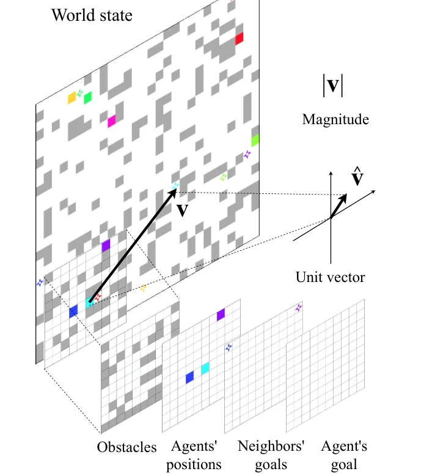
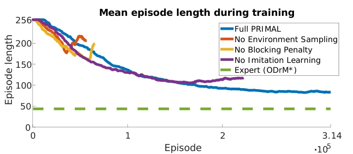
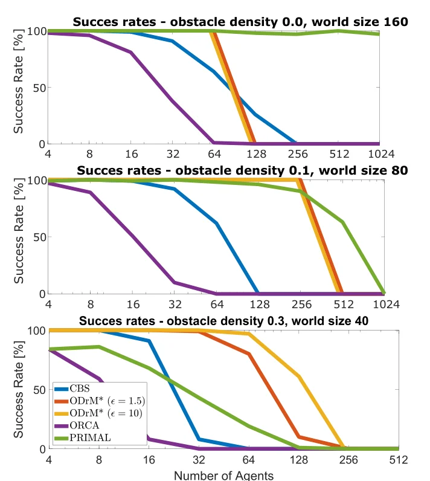

> - **논문**: PRIMAL: Pathfinding via Reinforcement and Imitation Multi-Agent Learning
> - **저자**: Guillaume Sartoretti, Justin Kerr, Yunfei Shi, Glenn Wagner, T. K. Satish Kumar, Sven Koenig, Howie Choset (Carnegie Mellon University, CSIRO, University of Southern California)
> - **학회**: IEEE RA-L 2019 · [arXiv:1809.03531](https://arxiv.org/abs/1809.03531)
{: .prompt-tip }

> 물류 창고의 로봇 수백 대가 서로 부딪히지 않고 각자 목적지로 가야 하는 문제를 **MAPF(Multi-Agent Path Finding)**라고 합니다. **PRIMAL**은 이를 중앙에서 계획하지 않고, **각 로봇이 자기 주변만 보고 스스로 판단**하는 분산 정책으로 풉니다.

## 1. 배경: 중앙집중식 계획의 한계

기존 MAPF는 대부분 **centralised planning**에 의존했습니다. 모든 로봇의 위치를 한곳에서 보고 전체 경로를 계산합니다(예: [CBS](), M*).

- 로봇 수에 비해 **처리할 수 있는 규모가 작음**. 수백~수천 대면 계산이 폭발
- 노이즈와 불확실성이 많은 **실제 배포 환경**에 적용하기 어려움
- 계획에 수 초에서 몇 분씩 걸리는 실제 환경에서는 변화가 생겼을 때 **다시 계획하기 어려움**

그래서 PRIMAL은 강화학습과 모방학습을 결합한 **분산 정책**을 제안합니다.

- 기존 계획기의 **시연(demo)**을 기준으로 학습하고
- 학습한 **하나의 정책을 모든 로봇에 복사**해서 사용

## 2. MAPF 환경 설계

구성 요소는 관측, 행동 공간, 보상 구조, 정책의 네 가지입니다.

### 관측 (Observation)

**부분 관측 이산 격자 세계**에서, 각 로봇은 자기 중심 **10×10 시야(FOV)**만 봅니다. FOV를 넓히면 전체 관측으로 바꿀 수도 있습니다. 학습을 쉽게 하려고 정보를 아래 Figure 2처럼 **채널별 이진 행렬로 분리**합니다.


_Figure 2. 하늘색 로봇의 관측. 10×10 FOV를 장애물, 주변 로봇 위치, 주변 로봇의 목표, 자기 목표의 네 채널로 나누고, 목표 방향 단위 벡터와 거리를 따로 줍니다. (출처: Sartoretti et al., 2019)_


- 장애물
- 다른 로봇의 위치
- 자기 목표 위치 (FOV 안에 있을 때)
- 시야 안의 다른 로봇들의 목표 위치 (FOV 밖이면 FOV 경계에 투영)

세계의 가장자리 근처에서는 세계 밖 칸을 모두 장애물로 채웁니다. 목표가 **FOV 밖**에 있을 수 있으므로, 목표 방향의 **단위 벡터와 거리**를 추가로 줍니다.

### 행동 (Action)

**상·하·좌·우 이동 또는 정지**, 5가지입니다. 벽으로 이동하거나 다른 로봇과 충돌하는 **유효하지 않은 행동**은 별도의 loss로 판별하고, **샘플링에서 제외**합니다. 실험적으로 음의 보상을 주는 것보다 이렇게 제외하는 편이 더 좋았습니다.

또 같은 칸을 왔다 갔다 하는 **진동(oscillating) 정책**을 막기 위해, 학습 중에는 바로 직전 위치로 되돌아가는 행동을 막습니다(제자리에 여러 step 머무는 것은 허용). 테스트 때 유효하지 않은 행동을 고르면 그 step은 제자리에 머무는데, 학습이 끝난 정책은 그런 행동을 거의 고르지 않습니다.

### 보상 (Reward)

- 이동할 때마다 작은 **음의 보상** (빨리 가도록)
- 목표가 아닌 곳에서 멈추면 더 큰 음의 보상
- **충돌**하면 큰 음의 보상
- 모든 로봇이 목표에 도착하면 **큰 양의 보상**

논문 Table I의 값은 다음과 같습니다.

| 상황 | 보상 |
|---|---|
| 이동 (상·하·좌·우) | −0.3 |
| 목표 위에서 정지 | 0.0 |
| 목표가 아닌 곳에서 정지 | −0.5 |
| 충돌 | −2.0 |
| 에피소드 완료 | +20.0 |

이동 벌점(−0.3)보다 멈춤 벌점(−0.5)을 크게 둔 것이 포인트입니다. 반대라면 로봇이 "움직이면 손해"라고 배워 제자리에 서 있는 정책으로 빠지기 쉽습니다.

## 3. Actor-Critic 네트워크

**A3C** 알고리즘을 기반으로, 관측에서 다음 행동을 결정하는 정책을 신경망으로 근사합니다(CNN + LSTM). VGG처럼 3×3 합성곱을 쌓은 구조로, 10×10×4 관측은 "합성곱 3층 + max pooling"을 두 번 거친 뒤 합성곱 한 층을 더 지나고, 목표 방향·거리는 fully connected 층 하나를 따로 지납니다. 둘을 이어 붙여 fully connected 2층을 거친 뒤 출력 512의 LSTM에 넣고, 이어 붙인 층에서 LSTM 입력으로 residual 연결을 둡니다. 출력은 세 가지입니다.

- **Policy**: 다음 행동의 확률
- **Value**: 상태 가치 추정
- **Blocking**: 지금 내가 다른 로봇을 막고 있는지 예측

정책, 가치, blocking 예측은 **256 step마다 또는 에피소드가 끝날 때** 업데이트합니다.

### Loss

**Value loss**: 예측 가치와 실제 return의 차이를 누적

$$
\mathcal{L}_V = \sum_t\big(V(o_t) - R_t\big)^2
$$

**Policy loss**: advantage $$A(o_t, a_t)$$로 행동을 평가하고, **엔트로피** 항을 더해 탐험을 장려

$$
\mathcal{L}_\pi = -\sum_t\Big[\log P(a_t \mid \pi, o_t)\,A(o_t, a_t) + \sigma_H\,H\big(\pi(o_t)\big)\Big],\qquad \sigma_H = 0.01
$$

여기에 유효하지 않은 행동을 고를 log likelihood를 줄이는 $$\mathcal{L}_{valid}$$와, blocking 예측이 틀릴 log likelihood를 줄이는 $$\mathcal{L}_{blocking}$$이 더해집니다. 가치의 목표 $$R_t$$는 할인율 $$\gamma$$로 누적한 return이고, advantage는 $$k$$ step 보상에 $$\gamma^k V(o_{t+k})$$를 더해 bootstrap한 값입니다.

## 4. 협력 학습 (Coordination Learning)

### 문제: 이기적인 로봇

각 로봇이 **자기 보상만 최대화**하면, 먼저 목표에 도착한 로봇이 **목표 칸에 가만히 서서** 다른 로봇의 길을 막는 이기적인 정책이 자주 생깁니다. 자기 보상은 최대지만 팀 전체로는 손해입니다. 그래서 **이타적인 행동**을 유도해야 합니다.

### Blocking Penalty

- 목표에 머물면서 **다른 로봇의 접근을 막으면 -2**의 벌점
- 다른 로봇이 **10 step 이상 지연**되는 경우도 막은 것으로 처리
- 막고 있는지는 **A\***로 판단: 내가 없을 때와 있을 때 다른 로봇의 최단 경로 길이를 비교

```python
def blocking_penalty(me, others, grid, astar, delay_threshold=10):
    """me가 목표 칸에 서 있어서 다른 로봇의 최단 경로가 크게 늘어나면 벌점"""
    penalty = 0.0
    for other in others:
        with_me = astar(grid, other.pos, other.goal, blocked={me.pos})
        without_me = astar(grid, other.pos, other.goal, blocked=set())
        if without_me is None:                     # 원래부터 갈 수 없으면 내 책임이 아님
            continue
        if with_me is None or len(with_me) - len(without_me) > delay_threshold:
            penalty -= 2.0
    return penalty
```

> 이 판정은 다른 로봇마다 A\*를 두 번씩 돌리므로 비쌉니다. 그래서 학습 중에만 쓰고, 실제 실행(추론) 때는 정책 신경망만 사용합니다. Blocking 여부를 별도 출력으로 **예측하게 학습**하는 것(위 네트워크의 blocking head)도, 이 정보를 정책이 스스로 알게 하려는 장치입니다.
{: .prompt-info }

### Expert Demonstration

강화학습만으로는 협력 행동을 배우기 어렵습니다. 그래서 에피소드를 시작할 때 무작위로 RL/IL을 정해, IL 에피소드에서는 **중앙집중식 MAPF 계획기(ODrM\*, $$\epsilon = 2$$)**가 그 자리에서 만든 해답을 시연으로 써서 **모방학습(behavior cloning)** $$\mathcal{L}_{bc} = -\frac{1}{T}\sum_t \log P(a_t \mid \pi, o_t)$$을 하고, 나머지 에피소드에서는 **강화학습**을 합니다. 시연 확률은 에피소드당 50%입니다. IL 비율을 10~50%로 바꿔 봐도 최종 성능 차이는 크지 않았습니다. 시연은 "어떻게 협력하는지"를, 강화학습은 "시연에 없는 상황에서 어떻게 할지"를 가르칩니다.

### Environment Sampling

에피소드를 시작할 때마다 **격자 크기와 장애물 밀도를 무작위로** 정합니다. 크기와 밀도를 균일하게 뽑으면 로봇끼리 마주칠 일이 드물어 협력이 필요한 상황에 충분히 노출되지 않으므로, 작고 장애물이 많은 환경이 더 자주 나오도록 뽑아 학습합니다.

세 장치를 하나씩 뺀 학습 곡선이 아래 Figure 5입니다. 논문은 셋 중 하나라도 빠지면 학습이 불안정하거나 더 나쁜 정책으로 수렴한다고 정리합니다.


_Figure 5. 학습 중 평균 에피소드 길이(낮을수록 좋음). 환경 샘플링이나 blocking penalty를 빼면 학습 초반에 길이가 다시 늘어나며 무너지고, 모방학습을 빼면 전체 PRIMAL(약 85)보다 긴 약 115 근처에서 멈춥니다. 점선은 ODrM\* 전문가 기준선. (출처: Sartoretti et al., 2019)_

## 5. 구현 디테일

| 항목 | 값 |
|---|---|
| 학습 환경 크기 | 10, 40, 70 중 무작위 (10이 다른 크기보다 두 배 자주) |
| 장애물 밀도 | 0~50% 삼각 분포, 최빈값 33% |
| 배치 | 장애물·로봇·목표를 균일하게 놓되, 각 로봇은 목표와 같은 연결 영역에 생성 |
| 행동 실행 | 매 step 무작위 순서로 순차 실행 (충돌 우선순위를 무작위로) |
| 할인율 $$\gamma$$ | 0.95 |
| 에피소드 길이 / 배치 | 256 step / 128 (에피소드당 로봇마다 최대 2번 업데이트) |
| 시연 확률 | 에피소드당 50% (ODrM\*, $$\epsilon = 2$$) |
| Optimizer | Nadam, lr $$2\cdot 10^{-5}$$에서 에피소드 수의 역제곱근에 비례해 감소 |
| 엔트로피 가중치 | $$\sigma_H = 0.01$$ |
| 병렬 환경 | 독립 환경 3개 × 로봇 8대 |
| 하드웨어·시간 | Pittsburgh Supercomputing Center, Intel Xeon E5-2695 7코어 + NVIDIA K80 1장, 약 20일 |
| 추론 속도 | step·로봇당 계획 시간 GPU 0.1초 미만, CPU 0.2초 미만 |

> 업데이트 주기는 본문의 "256 step마다"와 학습 설정의 "배치 128, 에피소드당 최대 2번 업데이트"가 서로 다르게 적혀 있습니다. 네트워크도 본문은 "6층 합성곱", Figure 3 캡션은 "합성곱 7층"이라고 씁니다.
{: .prompt-warning }

## 6. 실험

다양한 격자 크기와 장애물 밀도, 로봇 수에서 다른 MAPF 계획기와 성공률(주어진 시간 또는 step 안에 모든 로봇이 도착했는가)을 비교했습니다. 다른 계획기는 전체 상태를 보지만 PRIMAL은 부분 관측만 씁니다.

| 항목 | 설정 |
|---|---|
| 비교 대상 | CBS(최적, 중앙), ODrM\*($$\epsilon = 1.5$$, $$\epsilon = 10$$, 준최적, 중앙), ORCA(완전 분산 속도 계획) |
| 세계 크기 / 밀도 | {10, 20, 40, 80, 160} / {0, 0.1, 0.2, 0.3} |
| 로봇 수 | 4, 8, …, 1024 (10 크기에는 최대 32대, 20 크기 최대 128대) |
| 제한 | CBS 300초, ODrM\* 60초(C++ 구현), ORCA 60초. PRIMAL은 10~40 크기 256 step, 80 크기 384 step, 160 크기 512 step |


_Figure 6. 로봇 수에 따른 성공률. 위: 장애물 없는 160×160, 가운데: 밀도 0.1의 80×80, 아래: 밀도 0.3의 40×40. 초록색이 PRIMAL. (출처: Sartoretti et al., 2019)_

| 시나리오 | 결과 |
|---|---|
| 장애물 0, 160×160 | 중앙 계획기는 로봇 100대를 넘기면 시간이 크게 늘어나지만, PRIMAL은 1,024대까지 거의 100% 성공 |
| 밀도 0.1, 80×80 | 중앙 계획기도 수백 대는 풀지만, 512대에서는 PRIMAL만 60% 이상 성공 |
| 밀도 0.3, 40×40 | 모든 계획기가 64대 정도까지만 처리. PRIMAL은 8대를 넘으면 성공률이 떨어지고 ODrM\*는 64대까지 처리 |

- **소규모**에서는 최적 계획기가 더 짧은 경로를 찾지만, 로봇 수가 늘수록 계획기는 **시간 안에 해를 찾지 못하는** 경우가 많아졌습니다.
- **PRIMAL**은 로봇이 매우 많은 환경(최대 1,024대)에서도 동작했고, 특히 **장애물이 적고 넓은** 환경에서 성공률이 높았습니다.
- 반면 장애물이 촘촘한 좁은 환경에서는 중앙 계획기보다 성공률이 낮았습니다. 좁은 통로에서 여러 로봇이 양보해야 하는 상황은 부분 관측만으로 풀기 어렵기 때문입니다. 다만 다 풀지 못한 경우에도 대부분의 로봇은 빨리 목표에 도착하고 몇 대만 남는 경우가 많아, 남은 문제를 중앙 계획기로 마무리하는 조합을 향후 과제로 듭니다.
- ORCA는 교착(deadlock)을 막지 못해 로봇 16대를 넘고 장애물이 있는 대부분의 시나리오에서 성능이 매우 낮았습니다.
- PRIMAL의 경로는 다른 계획기보다 두 배 넘게 길 때가 있습니다. 다른 계획기는 로봇이 빈칸 없이 줄지어 따라가거나 회전하듯 자리를 바꾸는 이동을 허용하기 때문이기도 합니다.
- 학습 때 70×70보다 큰 세계를 본 적이 없어 80 이상 크기에서는 성능이 크게 떨어졌고, 관측의 목표 거리를 75로 잘라(cap) 넣어 이를 보완했습니다.
- ODrM\*의 **inflation factor**(준최적 허용 계수)를 키우면 빨라지지만 경로가 길어지는데, PRIMAL은 이런 근사 계획기와 비교해서도 큰 규모에서 경쟁력이 있었습니다.
- 실제 로봇 2대와 시뮬레이션 로봇 2대(실험 중간에 3대로 늘림)가 함께 움직이는 공장 모형 실험으로 실제 환경 적용 가능성도 보였습니다.

## 7. 정리

| 요소 | PRIMAL의 설계 |
|---|---|
| 관측 | 10×10 FOV를 채널별로 분리 + 목표 방향 벡터·거리 |
| 행동 | 5가지, 유효하지 않은 행동은 샘플링에서 제외 |
| 학습 | A3C (RL) + 중앙 계획기 시연 (IL), 에피소드마다 50% 확률로 선택. K80 1장으로 약 20일 |
| 협력 | **Blocking penalty** (A\*로 판정) |
| 일반화 | 격자 크기와 장애물 밀도를 무작위로 |
| 결과 | 장애물 없는 160×160에서 1,024대 거의 100% 성공, 밀도 0.3의 40×40에서는 8대 넘으면 ODrM\*에 뒤짐 |
| 장점 | 분산 실행, 로봇 수에 확장 가능 |

## References

- Sartoretti et al., "PRIMAL: Pathfinding via Reinforcement and Imitation Multi-Agent Learning," IEEE RA-L 2019. [arXiv:1809.03531](https://arxiv.org/abs/1809.03531)
- Damani et al., "PRIMAL2: Pathfinding via Reinforcement and Imitation Multi-Agent Learning – Lifelong," IEEE RA-L 2021.
- Wagner & Choset, "Subdimensional expansion for multirobot path planning (M\*)," AIJ 2015.
- Mnih et al., "Asynchronous Methods for Deep Reinforcement Learning (A3C)," ICML 2016.
- EAAI, Animation Program for MAPF
