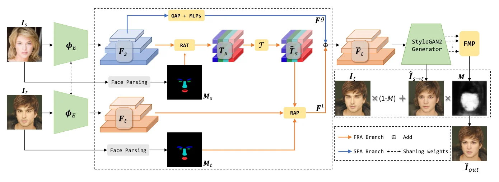
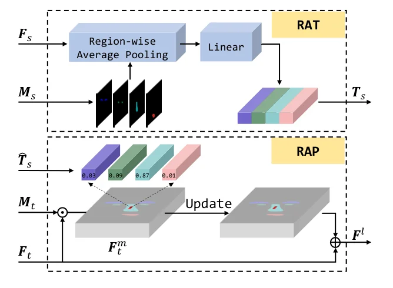
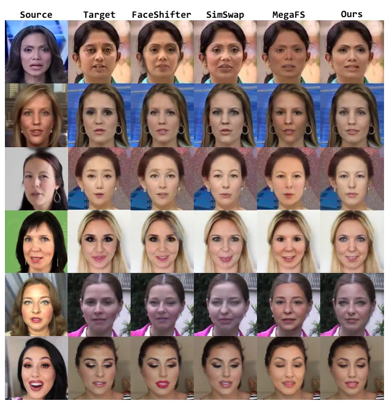

> - **논문**: Region-Aware Face Swapping
> - **저자**: Chao Xu, Jiangning Zhang, Miao Hua, Qian He, Zili Yi, Yong Liu (Zhejiang University, ByteDance)
> - **학회**: CVPR 2022 · [arXiv:2203.04564](https://arxiv.org/abs/2203.04564)
{: .prompt-tip }

> 신원 벡터를 [AdaIN]()으로 전역 주입하는 [SimSwap]()·[FaceShifter]()류에는 두 문제가 있다. 인식기의 신원 벡터는 잘 분리되어 있지 않아 소스의 배경·조명·머리 모양이 섞여 있는데, 전역 주입은 그것을 통째로 목표에 넣는다(Figure 1의 앞머리·흰머리). 그리고 입술·코·눈썹·눈 같은 국소 신원 부위를 명시적으로 다루지 않아 신원 일관성이 떨어진다. 한편 StyleGAN2를 디코더로 쓰는 [MegaFS]()류는 고해상도이지만 벡터 조건 생성이 배경·가림을 바꾸어, 사전 마스크로 후처리 블렌딩하면 윤곽 아티팩트가 남는다. **RAFSwap**은 두 문제에 국소-전역 설계로 답한다. 얼굴 **영역별 토큰**과 Transformer로 신원 세부를 옮기는 **FRA** 브랜치, 피부 주름 같은 전역 단서를 보충하는 **SFA** 브랜치, 그리고 StyleGAN2 특징에서 마스크 감독 없이 소프트 얼굴 마스크를 뽑는 **FMP**로 이루어진다. pSp 프레임워크 위에서 FF++ ID 검색 96.70으로 MegaFS를 5.87 앞선다.

## 1. 구조

소스·목표를 가중치 공유 계층 인코더 $$\phi_E$$에 넣어 세 스케일 특징 $$F_s, F_t$$(512채널)를 얻고, BiSeNet으로 입술·코·눈썹·눈의 라벨 $$M_s, M_t$$를 얻는다. FRA(국소)와 SFA(전역)가 $$F_l, F_g$$를 만들어 더한 $$\hat F_t$$를 pSp처럼 18개 매핑망으로 스타일 벡터로 바꿔 고정 StyleGAN2에 넣어 원시 결과 $$\hat I_{s \to t}$$를 만들고, FMP가 만든 마스크 $$M$$으로 목표와 섞어 $$\hat I_{out}$$을 낸다. 아래 Figure 2에서 주황색이 FRA, 파란색이 SFA 경로이다.


_Figure 2. RAFSwap 개요. 공유 인코더 $$\phi_E$$와 얼굴 파싱으로 특징·라벨을 얻고, FRA(주황)와 SFA(파랑)가 만든 특징을 더해 고정 StyleGAN2로 생성한 뒤 FMP 마스크로 목표와 섞는다. (출처: Xu et al., 2022)_

## 2. FRA: 영역 인식 브랜치

**토크나이저(RAT).** SEAN처럼 영역별 평균 풀링으로 각 스케일 $$n$$, 영역 $$M^n_s$$마다 소스 특징을 하나의 토큰으로 모은다. $$T^n_s = \text{Linear}(\Phi(F_s, M^n_s))$$, 3스케일 × 4영역 = 12개 토큰.

**Transformer 층.** 12개 토큰을 하나로 펼쳐($$T_s \in \mathbb{R}^{12 \times 512}$$) self-attention(MSA + FFN + LN + 잔차)으로 스케일과 의미를 가로지르는 상호작용을 모델링해 $$\hat T_s$$를 만든다. AdaIN류가 국소 특징 간 상호작용을 전혀 하지 않는다는 점과 다르다.

**투영기(RAP).** 토큰을 목표 특징에 **공간적으로** 되돌리되, 소스·목표의 시선·표정·포즈가 어긋나 있음을 고려한다. 마스크된 목표 특징 $$F^m_t$$(평탄화, HW×512)를 쿼리, $$\hat T_s$$를 키·값으로 attention을 계산해 픽셀마다 어느 토큰과 관련 있는지 정한다. 코 위의 픽셀은 소스 코 토큰에 0.87로 attention한다(Figure 3).


_Figure 3. 한 스케일에서의 토크나이저(RAT)와 투영기(RAP). 코 위 픽셀이 네 토큰에 준 attention이 0.03, 0.09, 0.87, 0.01로 표시돼 있다. (출처: Xu et al., 2022)_
 $$F_l = F_t + RS(A^P \hat T_s W^P)$$로 더한다. SEAN이 참조 얼굴의 스타일로 영역을 통째로 바꾸는 것과 달리 **적응적으로 더해** 목표 속성을 유지한다.

## 3. SFA와 FMP

**SFA.** 피부 주름, 부위 간 상대 거리 같은 전역 표현도 신원을 가르므로, 가장 작은 소스 특징을 전역 평균 풀링해 MLP로 재조합하고 세 스케일로 브로드캐스트해 $$F_l$$에 더한다. 공간 정렬 문제를 피하기 위한 풀링이다.

**FMP.** MegaFS는 분할 모델의 하드 마스크로 후처리하고 [HifiFace]()는 마스크를 감독 학습하는데, 둘 다 정답 마스크가 필요하고 윤곽에 아티팩트가 난다. Labels4Free에서 착안해, 사전학습 StyleGAN2의 16~256 해상도 특징 맵에 병목(32채널)과 업샘플을 거쳐 이어 붙이고 1×1 합성곱 + sigmoid로 **소프트 마스크**를 낸다. 마스크 감독은 없고, 신원 일관성 제약이 마스크를 신원 관련 영역에 집중시킨다. $$\hat I_{out} = M \odot \hat I_{s \to t} + (1 - M) \odot I_t$$.

**손실.** ArcFace 신원 손실 $$1 - \cos(R(I_s), R(\hat I_{out}))$$, 같은 신원 쌍에서만 켜지는 픽셀 L2 재구성, LPIPS 지각 손실의 가중합이다.

$$
L_{total} = \lambda_{id} L_{id} + \lambda_{rec} L_{rec} + \lambda_{p} L_{p}
$$

## 4. 구현 디테일

| 항목 | 값 |
|---|---|
| 프레임워크 | pSp(GAN inversion), 계층 인코더 3스케일 특징을 512채널로, 매핑망 18개 |
| 생성기 | 사전학습 StyleGAN2, 학습 중 고정 |
| 얼굴 파싱 | BiSeNet(13.3M), 입술·코·눈썹·눈 4영역 |
| Transformer | 1층, 8 head (토큰 3스케일 × 4영역 = 12개) |
| FMP | StyleGAN2 16~256 해상도 특징 → 병목(32채널) → 256 업샘플 → concat → 1×1 conv + sigmoid |
| 학습 데이터 | CelebA-HQ, 입력 256×256, 같은 신원 : 다른 신원 = 1 : 4 |
| 손실 가중치 | $$\lambda_{id} = 0.15$$, $$\lambda_{rec} = 1$$, $$\lambda_{p} = 0.8$$ |
| Optimizer | Adam, $$\beta_1 = 0.9$$, $$\beta_2 = 0.999$$, lr 1e-4 |
| 학습 | 5만 step, 배치 8, Tesla V100 1장 |
| 평가 | FF++: 영상마다 10프레임을 MTCNN으로 정렬(1만 장), 885 신원으로 수작업 정리. ID는 CosFace 검색, 포즈·표정은 추정기와 3D 얼굴 모델 벡터의 L2. CelebA-HQ: 테스트셋 10만 쌍 |

## 5. 코드로 보기: 토큰은 위치가 아니라 의미로 맺어진다

32×32 특징 맵에 눈썹·눈·코·입술 영역을 두되 소스 얼굴을 목표보다 6픽셀 옮겨 정렬을 깨고, 부위마다 공통 의미 서명 + 신원별 편차를 특징으로 준다. 소스 영역 평균 풀링으로 토큰 4개를 만들고 목표 픽셀의 attention 분포, 투영 후 목표 영역 평균이 소스 서명에 얼마나 가까워지는지, 그리고 전역 평균 벡터 주입과의 배경 변화를 비교한다.

```python
import torch, torch.nn.functional as F
torch.manual_seed(0)
# source and target feature maps 32x32x16 with four facial regions; the source's eyes/nose/brows/lips carry identity-specific signatures
H = W = 32; C = 16
yy, xx = torch.meshgrid(torch.arange(H), torch.arange(W), indexing="ij")
def masks(cx):            # region label map for a face centred at column cx (misaligned between source and target)
    m = torch.zeros(H, W, dtype=torch.long)
    m[(yy >= 9) & (yy < 12) & (xx > cx - 10) & (xx < cx + 10)] = 1       # brows
    m[(yy >= 13) & (yy < 16) & (((xx - cx + 5).abs() < 3) | ((xx - cx - 5).abs() < 3))] = 2   # eyes
    m[(yy >= 16) & (yy < 22) & ((xx - cx).abs() < 2)] = 3               # nose
    m[(yy >= 24) & (yy < 27) & ((xx - cx).abs() < 5)] = 4               # lips
    return m
Ms, Mt = masks(13), masks(19)                                           # source face shifted 6 px from the target face
base = torch.randn(5, C) * 1.5                                          # shared semantic signature of each facial part
sig_s = base + 0.6 * torch.randn(5, C); sig_t = base + 0.6 * torch.randn(5, C)   # identity-specific deviations of source and target
Fs = sig_s[Ms] + 0.3 * torch.randn(H, W, C); Ft = sig_t[Mt] + 0.3 * torch.randn(H, W, C)
# Region-Aware Identity Tokenizer: region-wise average pooling of the SOURCE features -> 4 tokens
tokens = torch.stack([Fs[Ms == r].mean(0) for r in range(1, 5)])      # [4, C]
# Region-Aware Identity Projector: every target pixel in the face regions attends over the 4 source tokens
q = Ft.reshape(-1, C); att = F.softmax(q @ tokens.T / C ** 0.5, dim=1)   # [HW, 4]
region_of_pixel = Mt.reshape(-1)
print("attention of target pixels to the four source tokens (rows: target region, cols: brows / eyes / nose / lips)")
for r, name in zip(range(1, 5), ("brows", "eyes", "nose", "lips")):
    print(f"  target {name:<6}", att[region_of_pixel == r].mean(0).numpy().round(2))
proj = (att @ tokens).reshape(H, W, C)
Fl = Ft + proj * (Mt > 0)[..., None]                                     # local identity-augmented target features
# did identity get transferred region-by-region despite the 6-px misalignment? compare region means with the source signatures
def region_id_score(Fm, M): return torch.stack([F.cosine_similarity(Fm[M == r].mean(0), sig_s[r], dim=0) for r in range(1, 5)]).mean().item()
print(f"\ncosine of target-region means to the SOURCE region signatures: before {region_id_score(Ft, Mt):.2f} -> after region-aware projection {region_id_score(Fl, Mt):.2f}")
# global AdaIN baseline: one vector (the mean of the whole source map) modulates everything, including the background
glob = Fs.mean((0, 1)); adain = Ft + glob
print(f"global AdaIN-style injection: region score {region_id_score(adain, Mt):.2f}, but background pixels also changed by {(adain - Ft)[Mt == 0].abs().mean():.2f} (region-aware: {(Fl - Ft)[Mt == 0].abs().mean():.2f})")
print("-> tokens are matched by semantics, not by position, so the misalignment does not matter and the background is left alone")
```

```text
attention of target pixels to the four source tokens (rows: target region, cols: brows / eyes / nose / lips)
  target brows  [1. 0. 0. 0.]
  target eyes   [0.04 0.95 0.   0.01]
  target nose   [0. 0. 1. 0.]
  target lips   [0. 0. 0. 1.]

cosine of target-region means to the SOURCE region signatures: before 0.90 -> after region-aware projection 0.97
global AdaIN-style injection: region score 0.80, but background pixels also changed by 0.86 (region-aware: 0.00)
-> tokens are matched by semantics, not by position, so the misalignment does not matter and the background is left alone
```

- 목표의 눈썹 픽셀은 소스 눈썹 토큰에 1.00, 눈은 눈 토큰에 0.95, 코·입술도 각자의 토큰에 1.00으로 attention한다. 6픽셀 어긋났는데도 그렇다. 토큰이 **의미 서명**으로 맺어지므로 공간 정렬이 필요 없다는 것이 RAP의 요점이고, 논문 Figure 3의 0.87과 같은 그림이다.
- 투영 후 목표 영역 평균과 소스 서명의 코사인이 0.90에서 0.97로 오르고 배경은 0.00 변한다. 전역 평균 벡터를 모든 위치에 더하는 AdaIN식 주입은 영역 점수가 0.80으로 오히려 낮고 배경이 0.86만큼 바뀐다. 소스의 배경 정보가 신원 벡터에 섞여 들어오는 문제의 축소판이다.
- 공정하게 말하면 이 toy는 부위 서명이 소스·목표에 공유되도록 만든 설정이라 attention이 잘 맺어지기에 유리하다. 학습된 특징에서 그 공유 구조가 얼마나 강한지는 toy로 알 수 없다.

## 6. 실험

**정성.** FF++에서 얼굴 형태·머리 모양·눈썹이 크게 다른 쌍(아래 Figure 5)에서 MegaFS와 RAFSwap만 버티지만 MegaFS는 피부색을 못 지키고, RAFSwap은 눈 색을 소스에서 가져온다. 실제 사진에서 FaceShifter·[FaceInpainter]()보다 작은 입 같은 신원, 머리 색 같은 속성, 안경 가림을 잘 다룬다(Figure 6). CelebA-HQ 1024²에서 성별·나이·피부색·포즈 격차가 큰 쌍에서 눈 색·주름을 옮기면서 목표 속성을 지키고 경계가 매끄럽다(Figure 7).


_Figure 5. FaceForensics++에서 FaceShifter, SimSwap, MegaFS와 비교. 얼굴 형태·머리 모양·눈썹이 크게 다른 쌍이고, 4~5행에서 소스의 눈 색이 옮겨진 것을 볼 수 있다. (출처: Xu et al., 2022)_

**정량.**

| FF++ | ID 검색 ↑ | 포즈 ↓ | 표정 ↓ |
|---|---|---|---|
| DeepFakes | 88.39 | 4.46 | 3.33 |
| FaceShifter | 90.68 | 2.55 | 2.82 |
| SimSwap | 89.73 | 1.94 | 2.39 |
| MegaFS | 90.83 | 2.64 | 2.96 |
| RAFSwap | **96.70** | 2.53 | 2.92 |

(MegaFS 프로토콜, 885 신원 재정리.) 신원은 큰 차이로 1위, 포즈·표정은 FaceShifter와 비슷하고 SimSwap이 더 좋다. CelebA-HQ 10만 쌍에서 MegaFS 대비 ID 유사도 0.4837 → 0.5232, 포즈 3.85 → 3.77, FID 18.81 → 13.25, 표정은 3.13 → 3.15로 약간 뒤지는데 MegaFS의 랜드마크 손실이 목표 입 모양을 충실히 따르는 대신 신원을 희생하기 때문이라고 설명한다. **사용자 연구**(50명, 20쌍)에서 신원-지각 0.49, 품질 0.57로 나머지 넷(신원-지각 0.07~0.16, 품질 0.05~0.16)을 크게 앞선다.

**Ablation(Table 4·5, FF++).**

| 설정 | ID 검색 ↑ | 포즈 ↓ | 표정 ↓ |
|---|---|---|---|
| AdaIN 기준선 | 92.48 | 2.60 | 2.98 |
| FRA만 | 96.63 | 2.58 | 2.94 |
| SFA만 | 93.68 | 2.61 | 3.06 |
| FRA + SFA | 96.69 | 2.54 | 2.94 |
| FRA + SFA + FMP (전체) | **96.70** | **2.53** | **2.92** |
| Transformer 대신 Non-Local 1층 | 96.50 | 2.63 | 3.03 |
| Transformer 0층 | 96.62 | 2.60 | 3.01 |
| Transformer 2층 | 96.71 | 2.51 | 2.94 |
| Transformer 3층 | 96.73 | 2.54 | 2.90 |

계층 특징에 AdaIN으로 신원 벡터를 주입한 기준선은 ID 검색이 4.22 낮고 신원 세부를 못 지킨다. 숫자로는 FRA가 대부분(92.48 → 96.63)을 만들고, SFA만 쓰면 신원이 부족하며, FRA만 쓰면 소스 질감 불일치가 생겨 둘을 합친다. BiSeNet(13.3M) 추가로 CelebA-HQ 학습 4시간의 비용이 든다. Transformer 층을 늘려도 거의 오르지 않아 1층을 쓴다. FMP는 정량으로는 ID 0.01 차이지만, 마스크 없이 생성하면 배경이 바뀌고 정답 하드 마스크로 블렌딩하면 앞머리 주변에 부자연스러운 경계가 남는다.

**응용.** FRA를 메이크업 전이 모델 PSGAN의 AMM 모듈 자리에 넣으면 V100 기준 GPU 9.3ms로 PSGAN(128.9ms)보다 10배 넘게 빠르고 파라미터 13.60M, 71.39 GFLOPs이다.

## 7. 해석

**1. "신원은 국소 부위에 있다"를 구조로 만들었다.** 인식 벡터 하나로 신원을 표현하는 대신 눈·코·눈썹·입술을 따로 다루는 것은 [E4S]()의 영역별 스타일 코드, [FlowFace]()의 패치 교차 attention으로 이어지며, 공통 교훈은 "전역 벡터는 소스 속성을 새게 한다"이다. FaceShifter의 AAD 마스크가 "어디에 신원을 쓸지"를 배웠다면 RAFSwap은 "어느 부위의 신원을 어디로"까지 정한다.

**2. Transformer를 특징 융합에 쓴 자연스러운 자리이다.** 토큰 수가 12개뿐이라 비용이 거의 없고, 스케일·의미 간 상호작용과 정렬 불변 투영은 [ViT]()식 attention이 잘하는 일이다. 위 toy의 "6픽셀 어긋나도 1.00"이 그 성질이다.

**3. 비지도 마스크는 StyleGAN 기반 방법의 표준 부품이 된다.** 생성기 특징에 신원 손실만으로 마스크가 떠오른다는 Labels4Free의 발견을 교체에 쓴 FMP는, [StyleSwap]()의 ToMask 브랜치와 거의 같은 역할을 하며 정답 마스크 없이 가림·배경을 지킨다.

**4. 한계는 파싱 의존과 네 부위라는 선택이다.** BiSeNet이 틀리면 토큰이 틀리고, 얼굴 형태·피부톤 같은 신원 요소는 SFA의 전역 벡터에 맡겨져 [HifiFace]()처럼 형태를 옮기지는 못한다. 표정 보존은 SimSwap에 뒤진다. 논문도 inversion 기반이라 학습 데이터 범위를 벗어난 큰 시점 변화는 다루지 못한다고 적는다.

**5. 평가를 읽을 때 주의할 점.** FF++의 FaceShifter·SimSwap 수치는 MegaFS 프로토콜의 재계산이라 원 논문(97.38, 92.83)과 다르고, MegaFS와 함께 신원을 885개로 재정리한 설정이다. FaceInpainter와는 코드가 없어 정량 비교하지 않았다. 위 toy의 유리한 설정은 위에 적었다.

## 8. 정리

| 항목 | 내용 |
|---|---|
| 문제 | 전역 AdaIN 주입이 소스의 신원 무관 정보를 넣고 국소 신원 세부를 놓침; 역변환 방법의 배경·가림·윤곽 아티팩트 |
| FRA | 파싱 영역(입술·코·눈썹·눈) × 3스케일 평균 풀링 → 12 토큰 → Transformer → 목표 픽셀이 토큰에 attention해 더함 |
| SFA | 소스 최소 스케일 특징의 GAP + MLP를 브로드캐스트해 전역 신원 단서 보충 |
| FMP | StyleGAN2 16~256 특징 → 병목·업샘플·1×1·sigmoid, 마스크 감독 없음 |
| 결과 | FF++ ID 96.70(MegaFS +5.87), CelebA-HQ 1024² ID 0.523, FID 13.25, 사용자 연구 압도 |
| 한계 | 파싱 의존, 얼굴 형태 미전이, 표정은 SimSwap 우세, 큰 시점 변화 |

## References

- Xu, Zhang, Hua, He, Yi, Liu, "Region-Aware Face Swapping," CVPR 2022. [arXiv:2203.04564](https://arxiv.org/abs/2203.04564)
- Zhu, Abdal, Qin, Wonka, "SEAN: Image Synthesis with Semantic Region-Adaptive Normalization," CVPR 2020. [arXiv:1911.12861](https://arxiv.org/abs/1911.12861)
- Abdal, Zhu, Mitra, Wonka, "Labels4Free: Unsupervised Segmentation using StyleGAN," ICCV 2021. [arXiv:2103.14968](https://arxiv.org/abs/2103.14968)
- Richardson et al., "Encoding in Style" (pSp), CVPR 2021. [arXiv:2008.00951](https://arxiv.org/abs/2008.00951)
- Yu et al., "BiSeNet: Bilateral Segmentation Network for Real-time Semantic Segmentation," ECCV 2018. [arXiv:1808.00897](https://arxiv.org/abs/1808.00897)
- Vaswani et al., "Attention Is All You Need," NeurIPS 2017. [arXiv:1706.03762](https://arxiv.org/abs/1706.03762)
