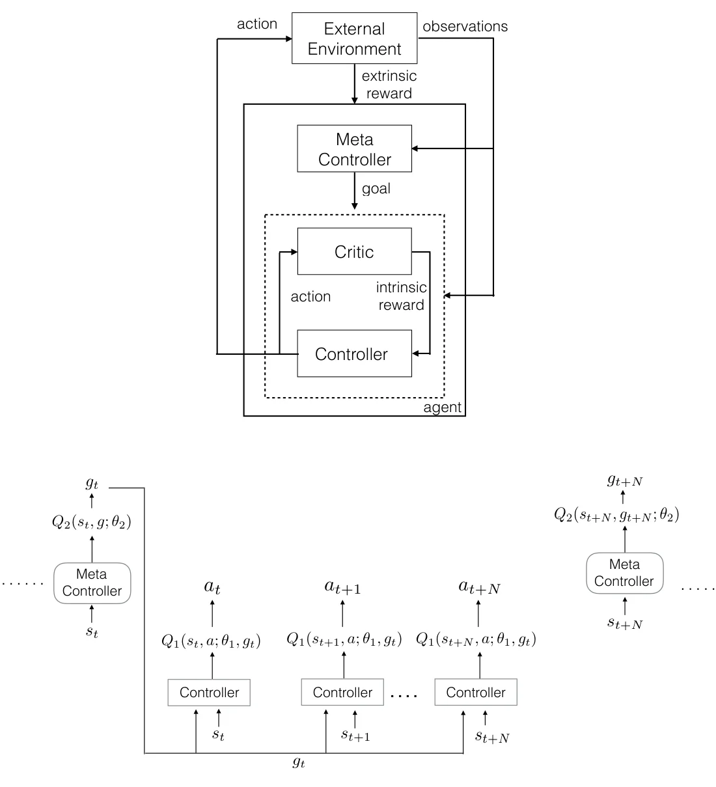
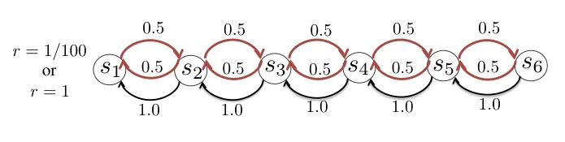
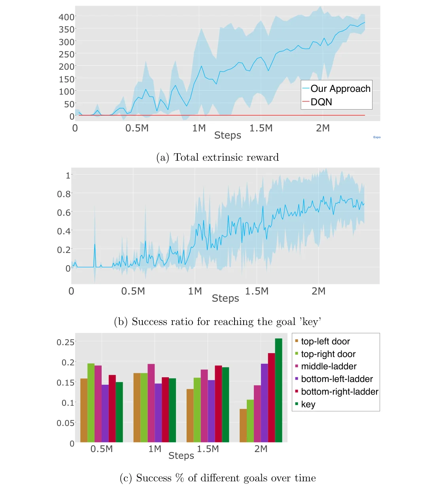

> - **논문**: Hierarchical Deep Reinforcement Learning: Integrating Temporal Abstraction and Intrinsic Motivation
> - **저자**: Tejas D. Kulkarni, Karthik R. Narasimhan, Ardavan Saeedi, Joshua B. Tenenbaum (MIT)
> - **학회**: NeurIPS 2016 · [arXiv:1604.06057](https://arxiv.org/abs/1604.06057)
{: .prompt-tip }

> Hierarchical RL 카테고리의 첫 글이다. **h-DQN**은 큰 문제를 여러 개의 하위 목표로 나누고, 목표를 정하는 DQN과 목표를 수행하는 DQN을 **두 층으로 쌓아** sparse reward 문제를 푼다.

## 1. 왜 계층적으로 나누나

### Sparse (Delayed) Reward

대부분의 강화학습은 상태마다 보상을 받으며, 상태에서 행동을 하고 보상의 총합이 커지도록 행동의 Q 값을 학습한다. 그런데 상태마다 보상이 오지 않는 환경이 있다.

- **보상이 즉각적인 환경**: 슈퍼마리오(이동 거리), Atari Breakout(벽돌 파괴). 대부분의 실험 환경이 여기에 해당한다.
- **보상이 늦거나 드문 환경**: **Montezuma's Revenge**는 열쇠를 얻거나 문을 열기 전까지 아무 보상도 없고, 해골에 부딪히면 죽는다.

### DQN과 사람의 차이

DQN은 많은 Atari 게임에서 사람을 넘었지만, 게임에 따라 성능 차이가 매우 컸다. 보상이 바로 오는 게임에서는 사람을 크게 앞섰지만, Montezuma's Revenge 같은 게임에서는 **0점**이었다.

사람은 이런 게임을 "먼저 사다리로 내려가고, 밧줄을 타고, 열쇠를 줍고, 문으로 간다"처럼 하위 목표로 나눠서 푼다. 목표를 나누는 가장 큰 이유가 sparse reward이다.

## 2. h-DQN의 구조

두 개의 DQN이 중첩된 구조이다.


_Figure 1. 위: meta-controller가 목표를 정하고, controller가 행동하며, critic이 목표 달성 여부로 intrinsic reward를 준다. 아래: meta-controller는 $$s_t$$에서 목표 $$g_t$$를 고른 뒤 $$N$$ step 동안 기다리고, 그동안 controller가 $$(s, g_t)$$로 매 step 행동을 고른다. (출처: Kulkarni et al., 2016)_

### Meta-Controller (상위)

- 현재 상태를 보고 **다음에 달성할 목표(goal)** $$g$$를 고름
- 목표 예: 왼쪽 위 문, 오른쪽 위 문, 가운데 사다리, 왼쪽 아래 사다리, 오른쪽 아래 사다리, 열쇠 같은 화면 속 물체
- **Extrinsic reward**(게임 점수)가 커지도록 목표를 선택하도록 학습
- 한 번 목표를 정하면, controller가 그 목표를 달성하거나 실패할 때까지 기다림 → **시간적 추상화(temporal abstraction)**

### Controller (하위)

- 상태와 현재 목표 $$(s, g)$$를 입력받아 실제 행동 $$a$$를 선택
- 목표를 달성하면 받는 **intrinsic reward**가 커지도록 학습
- ε-greedy로 탐험

### Internal Critic

Controller에게 보상을 주는 내부 평가자이다. 에이전트가 목표에 도달했는지 판단해서 도달하면 양의 intrinsic reward를, 아니면 0을 준다. 논문은 보상의 크기를 따로 적지 않으므로 아래 식과 코드에서는 1로 둔다.

$$
r^i_t(g) = \mathbf{1}\big[\text{목표 } g \text{ 달성}\big]
$$

게임은 점수를 주지 않아도, internal critic은 "사다리에 도착했다"에 보상을 주므로 controller는 촘촘한 보상으로 학습할 수 있다. 이것이 제목의 **intrinsic motivation**이다.

Montezuma's Revenge에서 critic은 ⟨개체1, 관계, 개체2⟩ 형태로 정의한다. 예를 들어 "에이전트(개체1)가 문(개체2)에 닿았다(관계)"면 목표 달성이다. 논문은 이런 개체·관계 기반 목표가 탐험 공간을 크게 줄여 준다고 강조한다.

## 3. 동작 흐름

1. 에이전트가 관측을 받음
2. **Meta-controller**가 Q 함수로 새 목표 $$g$$를 선택
3. **Controller**가 $$g$$를 달성하기 위해 Q 값을 최대화하는 행동을 반복
4. **Internal critic**이 목표 달성 여부를 확인하고 controller에게 intrinsic reward 제공
5. 목표를 달성하거나 에피소드가 끝나면, 그동안 받은 extrinsic reward의 합을 meta-controller의 transition 하나로 저장하고 다음 목표를 고름

## 4. 두 개의 Q 함수

둘 다 DQN과 같은 방식(replay buffer, target network)으로 학습한다.

### Controller

현재 상태에서 목표를 달성하기 위한 행동의 가치이다.

$$
Q_1^*(s, a; g) = \max_{\pi_{ag}}\mathbb{E}\Big[\sum_{t'=t}^{\infty}\gamma^{t'-t}\,r^i_{t'} \ \Big|\ s_t = s,\ a_t = a,\ g_t = g,\ \pi_{ag}\Big]
$$

### Meta-Controller

현재 상태에서 어떤 목표를 고르는 것이 extrinsic reward를 가장 크게 만드는지의 가치이다. 목표가 끝날 때까지 걸린 $$N$$ step 동안의 extrinsic reward를 합쳐 한 transition으로 본다.

$$
Q_2^*(s, g) = \max_{\pi_g}\mathbb{E}\Big[\sum_{t'=t}^{t+N}f_{t'} + \gamma\max_{g'}Q_2^*(s_{t+N}, g') \ \Big|\ s_t = s,\ g_t = g,\ \pi_g\Big]
$$

($$f_t$$: extrinsic reward)

두 층은 **서로 다른 시간 단위**로 동작한다. Controller의 transition $$(s_t, a_t, g_t, r_t, s_{t+1})$$은 매 step 생기지만, meta-controller의 transition $$(s_t, g_t, F, s_{t+N})$$은 목표 하나가 끝날 때마다 하나씩만 생긴다. 두 경험은 별도의 replay memory $$\mathcal{D}_1$$, $$\mathcal{D}_2$$에 저장하고, 파라미터 업데이트 자체는 Algorithm 1처럼 매 step 두 네트워크 모두 mini-batch로 한다(아래 코드도 같은 구조).

```python
import random

def h_dqn_episode(env, meta_q, ctrl_q, goals, reached, eps_meta, eps_ctrl, D1, D2):
    """env: Gymnasium API, meta_q/ctrl_q: argmax()와 update()를 가진 DQN이라고 가정"""
    s, _ = env.reset()
    done = False
    while not done:
        g = random.choice(goals) if random.random() < eps_meta else meta_q.argmax(s)   # 목표 선택
        s0, F = s, 0.0
        while not (done or reached(s, g)):
            a = env.action_space.sample() if random.random() < eps_ctrl else ctrl_q.argmax(s, g)
            s_next, f, terminated, truncated, _ = env.step(a)
            done = terminated or truncated
            r_int = 1.0 if reached(s_next, g) else 0.0                  # internal critic
            D1.add((s, g, a, r_int, s_next))                            # controller 경험
            ctrl_q.update(D1)
            meta_q.update(D2)
            F += f                                                       # extrinsic reward 누적
            s = s_next
        D2.add((s0, g, F, s))                                            # meta-controller 경험
```

### 학습 순서

처음에는 meta-controller가 무작위로 목표를 고르게 두고 controller가 각 목표에 도달하는 법을 먼저 충분히 익히게 한다. 그 뒤 meta-controller의 ε을 줄여 가며 어떤 목표 순서가 점수로 이어지는지 학습한다. 각 목표마다 controller의 성공률을 따로 보고 탐험률을 조절하기도 한다.

## 5. 실험 1: 확률적 의사결정 과정

Montezuma's Revenge 전에, 보상이 방문 이력에 따라 달라지는 작은 MDP로 먼저 확인한다.


_Figure 2. 상태 $$s_1$$~$$s_6$$, 시작은 $$s_2$$, 종료는 $$s_1$$. 왼쪽 이동은 항상 성공하고(1.0), 오른쪽 이동은 50%만 성공한다. $$s_6$$을 들렀다 $$s_1$$에 오면 보상 1, 아니면 1/100. (출처: Kulkarni et al., 2016)_

바로 $$s_1$$로 가면 0.01을 쉽게 받지만, 1을 받으려면 50% 확률로만 성공하는 오른쪽 이동을 네 번 해서 $$s_6$$까지 갔다가 돌아와야 한다. 여기서는 신경망 없이 Q 표로 비교했고, 상태 하나하나를 목표 후보로 둔다.

| 방법 | 평균 extrinsic reward (10회) |
|---|---|
| Q-learning (intrinsic reward 없음) | 약 0.01. 200 epoch 뒤에도 $$s_1$$으로 바로 가는 준최적 정책에 머묾 |
| **h-DQN** (Q 표) | **약 0.13**. $$s_4, s_5, s_6$$을 목표로 골라 $$s_6$$을 들르는 빈도가 늘어남 |

모든 $$\epsilon$$은 50,000 step에 걸쳐 1에서 0.1로 줄이고, learning rate는 0.00025이다. 학습이 진행될수록 $$s_3$$~$$s_6$$ 방문 횟수가 늘어나는 것도 확인한다(논문 Figure 4).

## 6. 실험 2: Montezuma's Revenge

- 플레이어가 탐험가를 조종해 방을 탐색하며 보물을 모으는 Atari 2600 게임
- 첫 방에서 보상: 사다리를 내려가 왼쪽으로 가서 **열쇠 획득 +100**, 다시 문으로 가서 **문 열기 +300**. 보상 전까지 긴 행동 열이 필요하다.
- 목표(물체) 후보는 저자들이 만든 물체 검출기가 제공한다. 영상에서 물체를 비지도로 찾는 것은 아직 풀리지 않은 문제라 이 부분은 사람이 설계했다.
- controller를 약 230만 step 사전 학습한 뒤, 약 200만 step 더 함께 학습

### 결과

| 방법 | 점수 |
|---|---|
| DQN | 0 |
| Gorila DQN | 평균 4.16 |
| **h-DQN** | 열쇠를 줍고 문을 여는 데 성공해 에피소드당 **약 400점** 수준 |


_Figure 6. 함께 학습하는 2단계의 결과. (a) 에피소드당 extrinsic reward(DQN은 계속 0), (b) '열쇠' 목표 도달 성공률, (c) 시점별로 각 목표가 차지하는 비율. (출처: Kulkarni et al., 2016)_

- Figure 6 (a)처럼 reward는 함께 학습한 지 약 200만 step 만에 400 가까이 오르고, DQN은 끝까지 0이다.
- (b) '열쇠' 목표의 도달 성공률은 0 근처에서 약 0.7까지 오른다.
- (c) 초반에는 탐험률이 높아 모든 목표를 비슷하게 고르지만, 에이전트는 먼저 오른쪽 문·가운데 사다리 같은 쉬운 목표를 익히고, 이후 열쇠와 아래쪽 사다리처럼 더 높은 보상으로 이어지는 어려운 목표를 점점 더 많이 고른다.
- 테스트 플레이 예시(논문 Figure 7, $$\epsilon = 0.1$$)에서는 meta-controller가 처음에 열쇠를 골랐다가 해골에 부딪혀 죽고, 다음 생에서는 오른쪽 아래 사다리 → 열쇠 → 오른쪽 위 문 순서로 목표를 골라 모두 달성한다.

### 구현 디테일

| 항목 | 값 |
|---|---|
| 입력 | 84×84 프레임 4장. Controller에는 목표 위치의 **binary mask**를 채널로 덧붙임 |
| 네트워크 | DQN 구조: Conv(8×8, 32, stride 4) → Conv(4×4, 64, stride 2) → Conv(3×3, 64, stride 1) → FC 512 → 출력. meta-controller도 같은 구조(목표 입력 없음), 두 네트워크는 특징을 공유하지 않음 |
| Replay memory | controller $$\mathcal{D}_1$$ 1E6, meta-controller $$\mathcal{D}_2$$ 5E4 |
| 학습 | lr 2.5E-4, 할인율 0.99, 환경은 Arcade Learning Environment |
| 탐험 | meta-controller $$\epsilon_2$$는 1에서 점차 감소, controller $$\epsilon_{1,g}$$는 목표별 성공률에 따라 조절 |
| 2단계 학습 | ① $$\epsilon_2 = 1$$로 두고 controller만 사전학습(약 2.3M step) ② 둘을 함께 학습(약 2M step) |

## 7. 의의와 한계

**의의**

- 목표를 나누는 **시간적 추상화**와, 목표 달성을 보상으로 주는 **intrinsic motivation**을 하나의 틀로 결합
- Sparse reward 문제를 촘촘한 하위 보상 문제로 바꿈

**한계**

- **목표 후보를 사람이 정의**해야 함 (물체 검출기, 목표 달성 판정 함수). 목표 자체를 스스로 발견하지 못함. 논문도 게임 전체를 풀려면 영상에서 물체를 자동으로 찾는 기능, 유연한 단기 기억, 진행 중인 option을 중간에 끊는 기능이 필요하다고 밝힌다.
- Meta-controller와 controller가 **동시에 학습**되므로, controller가 아직 서툰 시기에는 같은 목표를 골라도 결과가 매번 달라진다. Meta-controller 입장에서는 환경이 계속 바뀌는(non-stationary) 셈이라, 위의 학습 순서처럼 controller를 먼저 익히게 하는 장치가 필요하다. HIRO는 이 문제를 과거 목표를 다시 라벨링(off-policy correction)해서 다룬다.
- 이후 연구는 목표를 학습된 잠재 공간의 방향으로 정의하는 [FeUdal Networks](), 하위 목표를 자동으로 만드는 HIRO, Option-Critic 등으로 발전한다.

## 8. 정리

| 구성 요소 | 역할 | 보상 | 시간 단위 |
|---|---|---|---|
| Meta-controller | 목표 $$g$$ 선택 | Extrinsic (게임 점수) | 목표 하나 |
| Controller | 행동 $$a$$ 선택 | Intrinsic (목표 달성) | 매 step |
| Internal critic | 목표 달성 판정 | - | - |

## References

- Kulkarni, Narasimhan, Saeedi & Tenenbaum, "Hierarchical Deep Reinforcement Learning: Integrating Temporal Abstraction and Intrinsic Motivation," NeurIPS 2016. [arXiv:1604.06057](https://arxiv.org/abs/1604.06057)
- Mnih et al., "Human-level control through deep reinforcement learning," Nature 2015.
- Sutton, Precup & Singh, "Between MDPs and semi-MDPs: A framework for temporal abstraction in reinforcement learning (Options)," AIJ 1999.
- Nachum et al., "Data-Efficient Hierarchical Reinforcement Learning (HIRO)," NeurIPS 2018.
