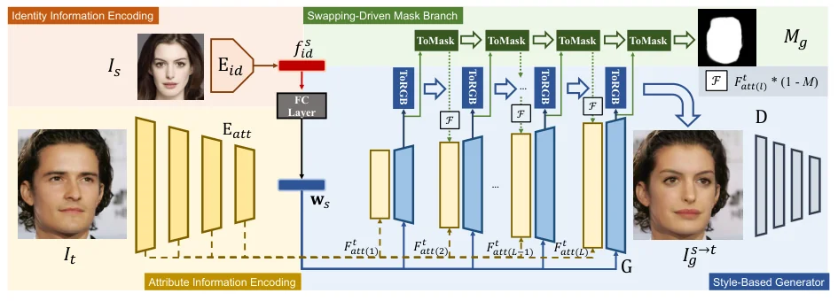
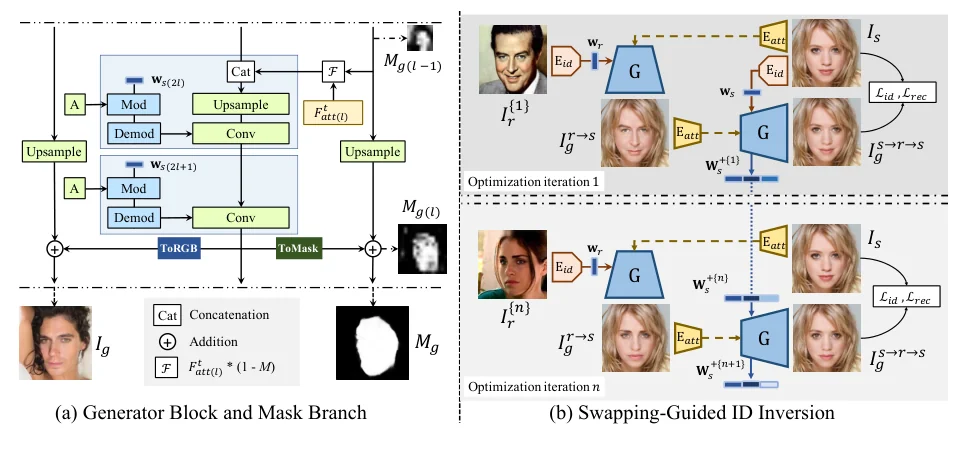
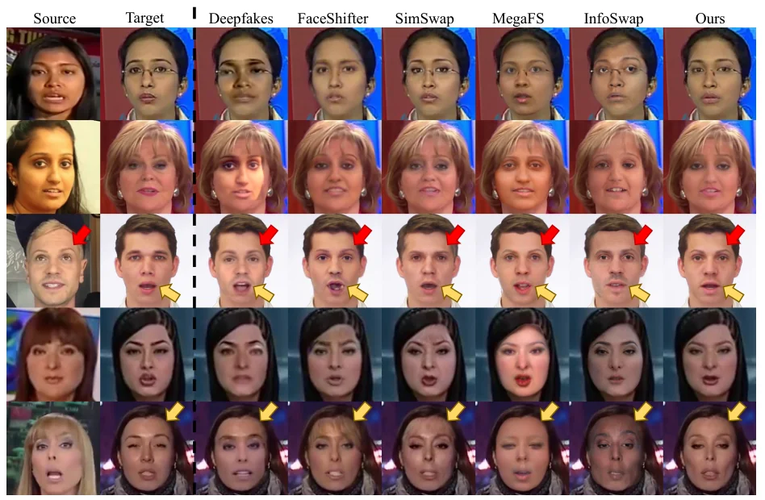

> - **논문**: StyleSwap: Style-Based Generator Empowers Robust Face Swapping
> - **저자**: Zhiliang Xu, Hang Zhou, Zhibin Hong, Ziwei Liu, Jiaming Liu, Zhizhi Guo, Junyu Han, Jingtuo Liu, Errui Ding, Jingdong Wang (Baidu Inc., Nanyang Technological University)
> - **학회**: ECCV 2022 · [arXiv:2209.13514](https://arxiv.org/abs/2209.13514) · [프로젝트·코드](https://hangz-nju-cuhk.github.io/projects/StyleSwap)
{: .prompt-tip }

> StyleGAN 기반 교체는 두 갈래였다. [MegaFS]()처럼 고정 생성기의 잠재 공간에 맞추려면 층별 융합 전략을 손으로 설계해야 하고 생성기의 분포 밖인 조명은 못 지킨다. [FSLSD]()는 인코더·디코더를 더 붙였다. 한편 순수 학습 파이프라인([FaceShifter](), [SimSwap](), [InfoSwap]())은 지루한 손실·구조 설계에도 아티팩트가 남았다. **StyleSwap**의 질문은 "범용 스타일 기반 생성기를 최소 수정으로 쓰면 층별 설계를 피할 수 있는가"이다. 답은 StyleGAN2를 다시 학습하되 두 가지만 바꾸는 것이다. 목표 속성은 특징 맵으로 각 층에 연결하고, 신원은 $$\mathcal{W}$$ 공간의 벡터로 넣어 변조 합성곱이 섞게 한다. 여기에 ToRGB를 본뜬 **마스크 브랜치**와, 신원이 $$\mathcal{W}$$에 있다는 점을 이용한 **교체 유도 ID 역변환**이 더해진다.

## 1. 스타일 기반 생성기의 적응

아래 Figure 2에서 파란 블록이 원래 StyleGAN2 구조이고, 빨강(신원 인코딩), 노랑(속성 인코딩), 초록(마스크 브랜치)이 StyleSwap이 더한 부분이다.


_Figure 2. StyleSwap 프레임워크. 소스는 ArcFace 신원 인코더와 FC 층을 거쳐 $$\mathbf{w}_s$$가 되고, 목표의 다중 스케일 특징 맵 $$F^t_{att}$$가 생성기 블록에 연결되며, ToRGB와 같은 구조의 ToMask가 마스크 $$M_g$$를 만든다. (출처: Xu et al., 2022)_

**속성 주입.** GPEN이 보인 두 성질, 즉 StyleGAN2의 각 층에 잡음 맵을 연결해도 생성 능력이 유지되고 그 잡음을 인코딩된 공간 특징으로 바꿔도 사전과 입력 구조가 함께 유지된다는 점을 쓴다. 단순 인코더 $$E_{att}$$가 목표 $$I_t$$의 다중 스케일 특징 $$F^t_{att(l)}$$을 만들어 생성기의 $$2l$$번째 층에 연결한다. 벡터가 아니라 맵이라 공간 정보가 보존된다.

**신원 주입.** ArcFace 특징 $$f^s_{id}$$를 FC로 $$w_s \in \mathcal{W}$$에 매핑한다. 속성이 이미 특징 맵에 들어 있으므로 **변조 합성곱**이 얼굴 부위의 혼합과 형태 변화에 자연스럽게 적합하다는 판단이다. 이것만으로 $$I^{s \to t}_g = G(F^t_{att}, w_s)$$가 된다.

**교체 유도 마스크 브랜치.** 거친 1채널 얼굴 마스크는 배경·머리를 그대로 두고, 저해상도의 거친 마스크부터 점진적으로 배우면 FaceShifter처럼 속성·신원 정보의 균형을 돕는다. ToRGB와 같은 구조의 ToMask 헤드를 각 해상도에 두고, $$\tilde M_{g(l)} = \text{upsample}(\tilde M_{g(l-1)}) + M'_{g(l)}$$, $$M_{g(l)} = \text{sigmoid}(\tilde M_{g(l)})$$로 누적한다. 최종 결과는 $$\hat I^{s \to t}_g = M_g I^{s \to t}_g + (1 - M_g) I_t$$. 중·저수준 층의 공간 정보가 얼굴 구조에 영향을 줄 수 있으므로, 각 해상도의 마스크로 다음 층의 속성 특징을 가린다: $$\hat F^t_{att(l+1)} = F^t_{att(l+1)} (1 - M_{g(l)})$$. 첫 번째 속성 특징 $$F^t_{att(1)}$$은 가리지 않는다. 마스크가 정답에 가까워질수록 속성 정보가 신원 유사도를 방해하지 못하게 된다. 마스크 브랜치는 학습된 모델에 붙여 미세조정하는 플러그인 모듈이다.

## 2. 학습 패러다임

소스 $$I_s$$와 목표 영상 $$\{I_T\}$$에서 세 종류를 만든다. 소스→목표 교체, 소스 자기 재구성, 그리고 같은 영상의 두 프레임 $$I_{t(a)}, I_{t(b)}$$로 $$G(F^{t(b)}_{att}, w_{t(a)})$$를 만드는 **교차 뷰 재구성**(얼굴 재연기 학습에서 흔한 방식으로, 표정이 다른 소스·목표 쌍에 강한 픽셀 감독을 준다). 손실은 ArcFace 코사인 신원(색 지터 증강으로 조명과 분리), StyleGAN2 적대, 판별기 깊은 층의 약한 특징 매칭(SimSwap), L1 + VGG19 재구성(자기·교차 뷰), 사전 마스크 예측기의 거친 마스크에 대한 BCE 마스크 손실이다.

$$
\mathcal{L}_{total} = \mathcal{L}_{adv} + \lambda_{id}\mathcal{L}_{id} + \lambda_{FM}\mathcal{L}_{FM} + \lambda_{rec}\mathcal{L}_{rec} + \lambda_{mask}\mathcal{L}_{mask}
$$

## 3. 교체 유도 ID 역변환

신원이 $$\mathcal{W}$$에 있으므로 StyleGAN 역변환처럼 특정 인물의 신원 코드를 최적화할 수 있고, $$w_s$$가 좋은 초기값이다. 그런데 자기 재구성 $$I^{s \to s}_g = G(F^s_{att}, w_s + \Delta w_s)$$로 최적화하면 속성 브랜치가 이미 소스를 담고 있어 $$w$$를 무시하는 **모드 붕괴**가 생긴다. 먼저 무작위 얼굴 $$I_r$$로 교체해 $$I^{r \to s}_g$$를 만들고 그것을 속성 입력으로 다시 소스를 복원하게 해도, 고정된 $$I_r$$ 하나로는 역시 붕괴한다. 해법은 **매 반복마다 다른 $$I^{\{n\}}_r$$을 뽑아** 네트워크가 다양한 신원을 겪게 하는 것이다. 생성기는 고정하고 $$\mathcal{W}+$$ 전체 $$[w_{s(1)}, \dots, w_{s(2L)}]$$을 재구성 손실과 ID 손실로 50회 반복 최적화하며, 이후 교체에 $$G(F^t_{att}, W^+_s)$$로 바로 쓴다. 저자들은 기존 교체 파이프라인에서는 불가능했던 연산이라고 강조한다. 아래 Figure 3 (b)가 첫 반복과 $$n$$번째 반복에서 서로 다른 무작위 얼굴 $$I^{\{n\}}_r$$을 쓰는 과정이다.


_Figure 3. (a) 생성기 블록과 마스크 브랜치. 이전 해상도 마스크를 upsample해 ToMask 출력과 더하고, 그 마스크로 다음 층 속성 특징을 가린다. (b) 교체 유도 ID 역변환. 반복마다 다른 무작위 얼굴로 교체했다가 소스를 복원하며 $$\mathbf{W}^+_s$$를 갱신한다. (출처: Xu et al., 2022)_

## 4. 구현 디테일

| 항목 | 값 |
|---|---|
| 학습 데이터 | VGGFace + VoxCeleb2 일부(256×256). 512×512 모델은 GPEN으로 향상한 데이터 |
| 생성기 층 수 | $$2L = 14$$(256²), $$2L = 16$$(512²) |
| 신원 인코더 | ArcFace의 수정 ResNet50, 학습 내내 고정 |
| 배치 / GPU | 256²는 배치 64, 512²는 배치 12, NVIDIA Tesla A100 1장 |
| Optimizer | Adam, lr $$1\times 10^{-4}$$ 고정 |
| 손실 가중치 | $$\lambda_{id} = 10$$, $$\lambda_{rec} = \lambda_{FM} = 100$$, 나머지 1 |
| ID 역변환 | 인물당 50회 반복, 생성기 고정, $$\mathbf{w}_s$$로 초기화 |
| 평가 | FF++ 1,000개 영상에서 10프레임씩 균일 추출(1만 장). ID는 별도 인식기의 코사인·검색, 포즈 추정기·표정 임베딩의 L2 |

## 5. 코드로 보기: 역변환의 붕괴와 점진 마스크

선형 toy(출력 = A·속성 인코더(이미지) + B·w, 신원은 이미지 안의 4차원 선형 특징)에서 소스 신원 코드 $$w$$를 (a) 자기 재구성으로, (b) 매 단계 다른 무작위 얼굴로 교체했다가 복원하는 방식으로 최적화한 뒤, 새 목표 200개에 교체했을 때의 신원 코사인을 비교하고, 4→32 해상도에서 upsample + 헤드 출력을 누적하는 마스크의 안팎 평균을 본다.

```python
import torch, torch.nn.functional as F
torch.manual_seed(0)
# a linear toy of StyleSwap's data flow: output = A * attribute_features(target) + B * w ; the identity is a 4-d vector hidden in the image
d_att, d_w, d_img = 8, 4, 12
A = torch.randn(d_img, d_att) * 0.5; B = torch.randn(d_img, d_w)
E_att = torch.randn(d_att, d_img) * 0.3                      # attribute encoder (sees the whole image, identity included)
E_id = torch.randn(d_w, d_img) * 0.3                         # frozen identity encoder
def G(img_for_att, w): return A @ (E_att @ img_for_att) + B @ w
src = torch.randn(d_img); id_src = E_id @ src
# Swapping-guided ID inversion: optimise w (W space) for the SOURCE identity
def invert(mode, steps=300):
    w = (E_id @ src).clone().requires_grad_(True); opt = torch.optim.Adam([w], 0.05)
    for s in range(steps):
        if mode == "self-reconstruction":          # I_g^{s->s} = G(F_att(I_s), w): the attribute branch already carries the source identity
            out = G(src, w); loss = (out - src).pow(2).mean()
        else:                                      # swapping-guided: a different random face r every iteration, I_g^{s->r->s}
            r = torch.randn(d_img); swapped_onto_r = G(r, w); out = G(swapped_onto_r, w)
            loss = (out - src).pow(2).mean() + (1 - F.cosine_similarity(E_id @ swapped_onto_r, id_src, dim=0))
        opt.zero_grad(); loss.backward(); opt.step()
    return w.detach()
for mode in ("self-reconstruction", "swapping-guided"):
    w = invert(mode)
    # test: swap the optimised identity onto 200 unseen targets and measure identity similarity of the results to the source
    tg = torch.randn(200, d_img); outs = torch.stack([G(t, w) for t in tg])
    sim = F.cosine_similarity(outs @ E_id.T, id_src[None].expand(200, -1), dim=1).mean()
    print(f"{mode:<20}: identity cosine of swaps onto new targets {sim:.3f}, |w - w_init| = {(w - E_id @ src).norm():.2f}")
print("-> optimising w through self-reconstruction lets the attribute branch do the work (mode collapse); feeding a different face each step forces w to carry the identity")
# Swapping-driven mask branch: progressive masks M(l) = sigmoid(upsample(M~(l-1)) + M'(l)), coarse first
res = [4, 8, 16, 32]; Mt = torch.zeros(1, 1, 4, 4)
for r in res:
    Mt = F.interpolate(Mt, size=(r, r), mode="bilinear", align_corners=False) if Mt.shape[-1] != r else Mt
    yy, xx = torch.meshgrid(torch.linspace(-1, 1, r), torch.linspace(-1, 1, r), indexing="ij"); face = (-(xx ** 2 + yy ** 2 / 1.5) * 3 + 1.5)   # the ToMask head's contribution
    Mt = Mt + face; M = torch.sigmoid(Mt)
    print(f"mask at {r:>2}x{r:<2}: mean inside the face {M[0, 0][(xx**2 + yy**2/1.5) < 0.5].mean():.2f}, outside {M[0, 0][(xx**2 + yy**2/1.5) >= 0.5].mean():.2f}")
```

```text
self-reconstruction : identity cosine of swaps onto new targets 0.057, |w - w_init| = 2.31
swapping-guided     : identity cosine of swaps onto new targets 0.519, |w - w_init| = 2.57
-> optimising w through self-reconstruction lets the attribute branch do the work (mode collapse); feeding a different face each step forces w to carry the identity
mask at  4x4 : mean inside the face 0.72, outside 0.16
mask at  8x8 : mean inside the face 0.72, outside 0.09
mask at 16x16: mean inside the face 0.70, outside 0.04
mask at 32x32: mean inside the face 0.71, outside 0.02
```

- 자기 재구성으로 최적화한 $$w$$는 새 목표에 교체하면 신원 코사인 0.057로 신원을 전혀 못 옮긴다. 속성 브랜치가 소스 신원을 그대로 통과시키니 $$w$$에 신원이 실릴 압력이 없고, 최적화는 $$w$$를 2.3만큼 움직였지만 그 방향은 재구성 오차만 줄이는 것이었다. 매 단계 다른 얼굴로 교체하는 방식은 0.519로, 교체 성능을 직접 최적화한 효과가 있다. 논문이 설명한 두 번의 붕괴와 그 해법의 선형판이다.
- 마스크는 4×4에서 이미 안 0.72, 밖 0.16으로 거칠게 갈리고 32×32로 가면서 바깥이 0.02로 내려간다. 거친 마스크가 먼저 생기고 해상도마다 다듬어지는 ToMask 누적의 모양이고, 저해상도 마스크가 다음 층의 속성 특징을 가리는 데 쓰일 수 있는 이유이다.

## 6. 실험

FF++ 1만 장에서 다른 인식기의 ID 코사인·ID 검색, 포즈, 표정, 그리고 FID를 재고, CelebA-HQ에서 고해상도를, 사용자 연구와 영상 데모를 보인다. 비교 대상은 DeepFakes·FaceShifter(FF++ 공식 결과), SimSwap·InfoSwap·MegaFS(공개 코드·모델).

**정량(Table 1, FF++).**

| 방법 | ID 검색 ↑ | ID 코사인 ↑ | 포즈 ↓ | 표정 ↓ | FID ↓ |
|---|---|---|---|---|---|
| Deepfakes | 86.43% | 0.438 | 3.96 | 8.98 | 4.07 |
| FaceShifter | 90.04% | 0.510 | 2.19 | 6.77 | 3.50 |
| SimSwap | 93.07% | 0.578 | **1.36** | **5.07** | 3.04 |
| MegaFS | 89.12% | 0.497 | 3.69 | 10.12 | 4.62 |
| InfoSwap | 95.82% | 0.635 | 2.54 | 6.99 | 4.74 |
| StyleSwap | 97.05% | 0.677 | 1.56 | 5.28 | 2.72 |
| StyleSwap w/ W+ | **97.87%** | **0.706** | 1.51 | 5.27 | **2.58** |

역변환 없이도 신원 지표와 FID가 가장 좋고, W+ 최적화가 ID 코사인을 0.677에서 0.706으로 더 올린다. 포즈·표정은 SimSwap이 조금 낫고 나머지보다는 StyleSwap이 낫다.

**정성.** 공정한 비교를 위해 정성 결과에는 W+ 최적화를 쓰지 않았다. 아래 Figure 4처럼 MegaFS는 조명과 질감을 잘 못 지키고, InfoSwap은 정보를 정확히 옮기지 못하며, SimSwap은 표정이 가장 좋은 경우도 있지만 아티팩트가 보인다. 512²에서도 MegaFS의 피부톤 오류, InfoSwap의 아티팩트와 대비된다(논문 Figure 1, 5).


_Figure 4. FF++ 256×256 비교. 빨간 화살표는 신원 정보, 노란 화살표는 속성 정보를 보라는 표시이다. (출처: Xu et al., 2022)_

**사용자 연구(Table 2).** 30명이 FF++ 20개 샘플의 순위를 매긴 점수(최고 5점)에서 StyleSwap이 신원 유사도 3.68, 속성 보존 3.82, 자연스러움 3.88로 모두 1위이다. 다음은 신원 FaceShifter 3.05, 속성·자연스러움 InfoSwap 3.36·3.11이다.

**Ablation(Table 3, FF++).**

| 설정 | ID 검색 ↑ | ID 코사인 ↑ | 포즈 ↓ | 표정 ↓ | FID ↓ |
|---|---|---|---|---|---|
| StyleSwap (vector): 목표도 W 벡터로 | 96.68% | 0.668 | 2.81 | 8.44 | 4.54 |
| 마스크 브랜치 없음 | 95.56% | 0.653 | 1.80 | 5.78 | 3.18 |
| StyleSwap | 97.05% | 0.677 | 1.56 | 5.28 | 2.72 |
| W 최적화 | 97.54% | 0.693 | 1.52 | 5.28 | 2.60 |
| W+ 최적화 | **97.87%** | **0.706** | **1.51** | **5.27** | **2.58** |

목표 정보를 특징 맵 대신 벡터로 넣으면 포즈·표정 오차가 크게 늘어 속성을 잃고, 마스크 브랜치를 빼면 신원·속성·FID가 모두 나빠진다. 교차 뷰 재구성 학습은 대부분의 경우 수치와 시각 결과에 영향을 주지 않았다고 적혀 있고, 속성 마스킹만 따로 뺀 실험은 없다. 그 밖에 StyleSwap 결과를 위조 탐지 학습 데이터로 더하면 FaceShifter 결과를 더한 것보다 탐지기가 좋아졌다고 보고한다(세부는 보충 자료).

## 7. 해석

**1. "생성기를 다시 학습한다"는 선택이 분기점이다.** MegaFS·FSLSD·[RAFSwap]()·[E4S]()는 FFHQ 사전학습 생성기를 고정하고 역변환으로 들어가지만, StyleSwap은 구조만 빌리고 교체 데이터로 학습한다. 사전을 잃는 대신 조명·가림 같은 분포 밖 입력에 강하고 층별 융합 설계가 필요 없다. GPEN의 복원 설계를 교체로 옮긴 것이라 볼 수 있다.

**2. 신원을 $$\mathcal{W}$$에 두면 역변환 도구가 따라온다.** 교체 유도 ID 역변환은 "한 인물의 신원 코드를 교체 성능으로 최적화"한다는 점에서 주체 비의존 모델을 특정 인물용으로 미세조정하는 것과 같은 효과를 파라미터 수천 개로 얻는다. 위 toy의 붕괴가 보여 주듯 핵심은 최적화 목표를 자기 재구성이 아니라 **무작위 교체**로 두는 것이다.

**3. 마스크 브랜치는 HifiFace·RAFSwap의 발상과 수렴한다.** 점진적 소프트 마스크로 배경을 지키고 속성 정보를 가리는 것은 [HifiFace]()의 SFF, RAFSwap의 FMP와 같은 목적이고, StyleSwap은 그것을 ToRGB와 동형인 헤드로 생성기 안에 넣었다.

**4. 영상 학습과 512²가 실용적 기여이다.** 교차 뷰 재구성은 재연기 연구의 관행을 교체에 가져온 것이고, 향상 데이터로 512²를 학습한 것은 HifiFace와 같은 전략이다. 다만 교차 뷰 학습이 수치를 바꾸지는 않았다고 논문 스스로 적고 있고, 영상의 시간 일관성은 정량 평가 없이 데모 영상으로만 보인다.

**5. 평가를 읽을 때 주의할 점.** FaceShifter·Deepfakes는 FF++ 공식 결과 이미지, 나머지는 공개 코드로 생성해 조건이 다르다. W+ 최적화의 이득(ID 코사인 +0.029)은 인물마다 추가 최적화를 한 대가이다. 512² 모델은 GPEN으로 키운 데이터를 썼으므로 진짜 고해상도 학습이 아니다. 역변환은 인물마다 50회 최적화가 필요하다. 위 toy는 선형 모델이라 비선형 생성기의 붕괴 양상과 정량적으로 같지는 않다.

## 8. 정리

| 항목 | 내용 |
|---|---|
| 입장 | 고정 StyleGAN의 잠재 공간에 맞추는 대신 StyleGAN2 구조를 교체용으로 재학습, 최소 수정 |
| 수정 1 | 목표 속성 = 인코더 특징 맵을 각 층에 연결(GPEN 방식) |
| 수정 2 | 신원 = ArcFace → FC → $$\mathcal{W}$$, 변조 합성곱이 혼합 |
| 마스크 브랜치 | ToRGB 동형 ToMask 누적(upsample + 헤드) → 소프트 마스크, 다음 층 속성 특징 마스킹 |
| 학습 | 소스→목표, 자기 재구성, 영상 교차 뷰 재구성; ID 10 + 적대 + 약한 FM 100 + L1/VGG 100 + BCE 마스크 |
| ID 역변환 | 매 반복 다른 무작위 얼굴로 교체하며 $$\mathcal{W}+$$ 50회 최적화(자기 재구성은 모드 붕괴) |
| 결과 | FF++ ID 검색 97.05%(W+ 97.87%), FID 2.72(2.58), 포즈·표정은 SimSwap 다음, 사용자 연구 세 항목 1위 |

## References

- Xu et al., "StyleSwap: Style-Based Generator Empowers Robust Face Swapping," ECCV 2022. [arXiv:2209.13514](https://arxiv.org/abs/2209.13514)
- Yang, Ren, Xie, Zhang, "GAN Prior Embedded Network for Blind Face Restoration in the Wild" (GPEN), CVPR 2021. [arXiv:2105.06070](https://arxiv.org/abs/2105.06070)
- Karras et al., "Analyzing and Improving the Image Quality of StyleGAN," CVPR 2020. [arXiv:1912.04958](https://arxiv.org/abs/1912.04958)
- Abdal, Qin, Wonka, "Image2StyleGAN++: How to Edit the Embedded Images?," CVPR 2020. [arXiv:1911.11544](https://arxiv.org/abs/1911.11544)
- Burkov, Pasechnik, Grigorev, Lempitsky, "Neural Head Reenactment with Latent Pose Descriptors," CVPR 2020. [arXiv:2004.12000](https://arxiv.org/abs/2004.12000)
- Chen, Chen, Ni, Ge, "SimSwap," ACM MM 2020. [arXiv:2106.06340](https://arxiv.org/abs/2106.06340)
