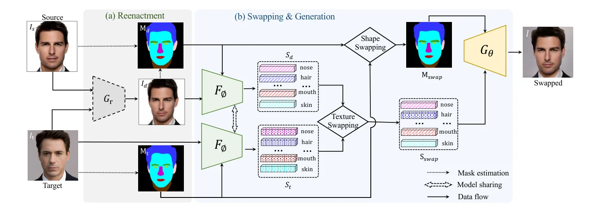
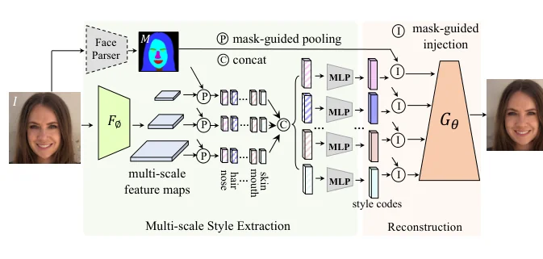
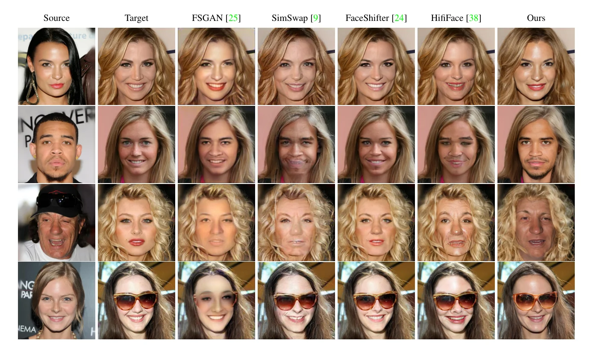

> - **논문**: Fine-Grained Face Swapping via Regional GAN Inversion
> - **저자**: Zhian Liu, Maomao Li, Yong Zhang, Cairong Wang, Qi Zhang, Jue Wang, Yongwei Nie (South China University of Technology, Tencent AI Lab, Tsinghua Shenzhen International Graduate School)
> - **학회**: CVPR 2023 · [arXiv:2211.14068](https://arxiv.org/abs/2211.14068)
{: .prompt-tip }

> 교체의 첫째 난제는 **신원 보존**인데, 기존 방법이 신원을 뽑는 도구인 2D 인식 네트워크와 3DMM은 **분류와 복원용**이지 생성용이 아니라 신원의 시각 세부를 놓치고, 결과가 소스도 목표도 아닌 **제3의 인물**처럼 보이는 "중간 효과"가 생깁니다. 피부색은 신원의 일부인데도 늘 목표의 것이 유지되어 피부톤이 다른 쌍에서 부자연스럽습니다. 둘째 난제는 **가림**으로, [FSGAN]()의 인페인팅은 흐리고 [FaceShifter]()의 정제 네트워크는 목표 신원을 되돌려 놓습니다. **E4S**(Editing for Swapping)는 교체를 **세밀한 얼굴 편집**으로 봅니다. 부위마다 형태와 질감이 신원과 관련 있으므로 둘을 **명시적으로 분리**하고, 교체는 부위별 형태(마스크)와 질감(스타일 코드)의 **교환**이 됩니다. 핵심은 StyleGAN을 부위 단위로 역변환하는 **RGI**와 새 잠재 공간 $$\mathcal{W}_r+$$입니다.

## 1. E4S 파이프라인

아래 Figure 2가 전체 흐름입니다. (a)에서 소스를 목표의 포즈·표정으로 구동하고, (b)에서 부위별 질감 코드와 마스크를 바꿔 끼운 뒤 생성합니다.


_Figure 2. E4S 개요. (a) 재연기 네트워크 $$G_r$$이 소스를 목표의 포즈·표정으로 구동해 $$I_d$$를 만들고, (b) 인코더 $$F_\phi$$가 뽑은 부위별 질감 코드와 마스크를 교환해 StyleGAN 생성기 $$G_\theta$$로 교체 얼굴을 만듭니다. (출처: Liu et al., 2023)_

**재연기.** 얼굴을 dlib으로 잘라 랜드마크를 찾고 원래 StyleGAN 방식으로 정렬해 1024×1024로 맞춥니다. 소스를 FaceVid2Vid로 목표의 포즈·표정에 맞춰 구동한 $$I_d$$를 만들고, 얼굴 파서로 $$I_t$$와 $$I_d$$의 마스크(19클래스의 대칭 부위를 합친 12개: 배경, 눈썹, 눈, 코, 입, 입술, 피부, 목, 머리카락, 귀, 안경, 귀걸이)를 얻습니다.

**교체와 생성.** 마스크 유도 인코더 $$F_\phi$$로 $$(I_t, M_t)$$와 $$(I_d, M_d)$$에서 부위별 질감 코드 $$S_t, S_d$$를 뽑고, 눈썹·눈·코·입·입술·**피부**·목·귀의 코드를 구동 얼굴의 것으로 바꿔 $$S_{swap}$$을 만듭니다. 피부가 포함된 점이 다른 방법과 다릅니다. 형태는 빈 캔버스에 목표의 목·배경 → 구동 얼굴의 안쪽 부위 → 목표의 머리카락·안경·귀·귀걸이 순으로 붙여 $$M_{swap}$$을 만듭니다. 두 마스크가 완벽히 겹치지 않아 생기는 빈 픽셀은 대개 피부와 머리카락 사이 또는 피부와 목 사이이므로 **피부로 채웁니다.** 가림을 위한 별도 네트워크가 필요 없는 이유입니다. $$\tilde I = G_\theta(M_{swap}, S_{swap})$$을 목표와 블렌딩합니다.

## 2. RGI: 영역 GAN 역변환

기존 역변환은 $$\mathcal{W}$$, $$\mathcal{W}+$$에서 **전역** 속성(나이, 포즈)만 편집하고 국소 형태·질감 편집 기제가 없습니다. 마스크 유도 편집(SEAN 등)은 신원·세부 보존이 약하고 256~512²에 머뭅니다.


_Figure 3. RGI. 다중 스케일 특징 맵을 마스크로 부위별 평균 풀링(P)하고 스케일을 이어(C) MLP로 부위별 스타일 코드를 만든 뒤, 마스크 유도 주입(I)으로 생성기에 넣어 재구성합니다. (출처: Liu et al., 2023)_

**마스크 유도 스타일 추출.** 다중 스케일 인코더의 특징 맵 $$F_i$$마다 마스크를 같은 크기로 줄여 부위 $$j$$별 평균 풀링 $$v_{ij} = \text{AVG}(F_i \odot (\lfloor M \rfloor_i = j))$$을 하고, 스케일을 이어 MLP로 스타일 코드 $$s_j$$를 만듭니다. $$s \in \mathbb{R}^{C \times 18 \times 512}$$가 $$\mathcal{W}_r+$$입니다.

**마스크 유도 스타일 주입.** StyleGAN의 스타일 블록은 코드 하나로 커널 $$W$$를 변조·복조한 뒤 합성곱합니다. E4S는 부위마다 변조·복조한 커널 $$W'_{jl} = \text{Demod}(\text{Mod}(W_l, s_{jl}))$$로 합성곱한 결과를 **마스크로 합산**합니다.

$$
F_l = \sum_{j=1}^{C} (F_{l-1} * W'_{jl}) \odot (\lfloor M \rfloor_l = j)
$$

질감은 코드가, 형태는 마스크가 정하므로 둘이 완전히 분리됩니다. 마스크 주입은 앞 $$K = 13$$층까지만 하며($$K$$ = 11, 13, 15, 18을 시험해 13보다 크면 재구성의 시각 차이가 거의 없었고, 512~1024² 층은 비용이 큼), 학습은 **재구성만**을 대리 과제로 써서 쌍 데이터가 필요 없습니다. 손실은 GAN 역변환에서 흔히 쓰는 것들이라고만 하고 세부는 보충 자료에 있습니다. 생성기의 앞 13층을 미세조정하면 머리카락 질감이 좋아집니다(FID 22.2 → 15.0, SSIM은 0.827 → 0.818로 조금 낮아짐).

## 3. 구현 디테일

| 항목 | 값 |
|---|---|
| 데이터 | CelebAMask-HQ 3만 장(학습 2.8만 / 테스트 2천, 19클래스 마스크 제공), FFHQ 7만 장(사전학습 파서로 마스크 생성) |
| 해상도 | 1024×1024 (dlib crop + StyleGAN 정렬) |
| 마스크 | 19클래스의 대칭 부위를 합친 12클래스 |
| 재연기 | 사전학습 FaceVid2Vid |
| 마스크 주입 층 | 앞 $$K = 13$$층, 이 층들은 미세조정 |
| Optimizer | Adam, lr $$10^{-4}$$, $$\beta_1 = 0.9$$, $$\beta_2 = 0.999$$, 10만·15만 iteration에서 1/10 |
| 학습 | GPU당 배치 2, NVIDIA A100 8장. CelebAMask-HQ 20만 iteration, FFHQ 30만 iteration |
| 증강 | 50% 확률 좌우 반전 |
| 교체 평가 | FFHQ로 학습한 모델, CelebAMask-HQ에서 무작위 500쌍. ID는 CosFace 임베딩으로 전체 소스 중 검색(Top-1/Top-5), 포즈는 HopeNet, 표정은 3D 얼굴 복원 모델 계수의 L2 |

## 4. 코드로 보기: 형태와 질감의 분리

48×48 합성 얼굴을 (마스크, 부위별 코드)로 정의하고 마스크 유도 평균 풀링으로 코드를 복원한 뒤, 넓은 얼굴·적은 머리카락의 소스와 좁은 얼굴·많은 머리카락의 목표에 대해 안쪽 부위의 코드와 마스크를 소스로, 머리카락·배경을 목표로 재구성해 생성합니다. 질감 거리, 형태 IoU, 빈틈·가림 픽셀 수, 눈만 바꾸는 부분 교체를 봅니다.

```python
import numpy as np
rng = np.random.default_rng(0)
# regional GAN inversion in miniature: an image is (mask, per-region style code); the generator paints each region with its code
H = W = 48; yy, xx = np.mgrid[0:H, 0:W]
REG = ["background", "skin", "eyes", "nose", "lips", "hair"]
def mask(cx, cy, wide, hair_low):
    m = np.zeros((H, W), int)
    m[((xx - cx) ** 2 / wide + (yy - cy) ** 2 / 300) < 1] = 1
    m[(((xx - cx + 6) ** 2 + (yy - cy + 5) ** 2) < 6) | (((xx - cx - 6) ** 2 + (yy - cy + 5) ** 2) < 6)] = 2
    m[((xx - cx) ** 2 / 4 + (yy - cy - 2) ** 2 / 20) < 1] = 3
    m[((xx - cx) ** 2 / 30 + (yy - cy - 10) ** 2 / 3) < 1] = 4
    m[(yy < hair_low) & (((xx - cx) ** 2 / (wide + 60) + (yy - cy) ** 2 / 400) < 1)] = 5
    return m
C = 6
def encode(img, m): return np.stack([img[m == r].mean(0) if (m == r).any() else np.zeros(C) for r in range(6)])   # mask-guided average pooling -> W_r+
def generate(m, codes): return codes[m] + 0.02 * rng.standard_normal((H, W, C))                                  # mask-guided injection
m_s, m_t = mask(24, 24, 220, 10), mask(24, 24, 120, 16)                       # source: wide face, little hair; target: narrow face, more hair
code_s, code_t = rng.standard_normal((6, C)), rng.standard_normal((6, C))
I_s, I_t = generate(m_s, code_s), generate(m_t, code_t)
S_s, S_t = encode(I_s, m_s), encode(I_t, m_t)
print(f"regional codes recovered from the images: max |S - true code| source {np.abs(S_s - code_s).max():.3f}, target {np.abs(S_t - code_t).max():.3f}")
# editing-for-swapping: texture codes of the inner face from the SOURCE, mask (shape) of the inner face from the SOURCE, hair/background from the TARGET
S_swap = S_t.copy(); S_swap[[1, 2, 3, 4]] = S_s[[1, 2, 3, 4]]
M_swap = np.where(np.isin(m_s, [1, 2, 3, 4]) & ~np.isin(m_t, [5]), m_s, np.where(m_t == 5, 5, 0))   # target hair occludes the source face
holes = np.isin(m_t, [1, 2, 3, 4]) & (M_swap == 0); M_swap[holes] = 1                                # gaps between the narrower face and the old contour -> skin
I_swap = generate(M_swap, S_swap)
def region_match(I, m, codes, regs): return np.mean([np.abs(I[m == r].mean(0) - codes[r]).mean() for r in regs if (m == r).any()])
print(f"swapped image: inner-face texture distance to the SOURCE codes {region_match(I_swap, M_swap, code_s, [1,2,3,4]):.3f}, to the target codes {region_match(I_swap, M_swap, code_t, [1,2,3,4]):.3f}")
print(f"               hair texture distance to the TARGET code {region_match(I_swap, M_swap, code_t, [5]):.3f}; face shape IoU with the source {np.logical_and(M_swap==1, m_s==1).sum()/np.logical_or(M_swap==1, m_s==1).sum():.2f}, with the target {np.logical_and(M_swap==1, m_t==1).sum()/np.logical_or(M_swap==1, m_t==1).sum():.2f}")
print(f"               {int(holes.sum())} hole pixels (old face contour minus new face) filled with skin, {int((m_t == 5).sum() - (m_s == 5).sum())} hair pixels of the target kept on top of the wider source face (occlusion handled by the mask)")
# partial swap: only the eyes
S_part = S_t.copy(); S_part[2] = S_s[2]; M_part = m_t.copy(); I_part = generate(M_part, S_part)
print(f"\neyes-only swap: eyes match the source ({region_match(I_part, M_part, code_s, [2]):.3f}) while skin stays with the target ({region_match(I_part, M_part, code_t, [1]):.3f}) -> fine-grained, user-controllable swapping")
```

```text
regional codes recovered from the images: max |S - true code| source 0.007, target 0.011
swapped image: inner-face texture distance to the SOURCE codes 0.004, to the target codes 1.136
               hair texture distance to the TARGET code 0.002; face shape IoU with the source 0.81, with the target 0.69
               0 hole pixels (old face contour minus new face) filled with skin, 112 hair pixels of the target kept on top of the wider source face (occlusion handled by the mask)

eyes-only swap: eyes match the source (0.003) while skin stays with the target (0.001) -> fine-grained, user-controllable swapping
```

- 복원된 코드는 참값과 0.01 이내이고, 교체 결과의 안쪽 질감은 소스 코드와 0.004, 목표 코드와 1.136 떨어져 있습니다. 질감 전이가 코드 교환으로 **정확히** 됩니다. 머리카락은 목표 코드와 0.002로 유지되고, 목표의 머리카락 112픽셀이 넓은 소스 얼굴 위를 덮습니다. 가림은 마스크 쌓기 순서(머리카락을 마지막에)로 처리됩니다.
- 얼굴 형태 IoU는 소스와 0.81, 목표와 0.69로 소스 쪽입니다. 이 설정은 소스가 더 넓어 빈틈이 0픽셀이지만, 소스가 목표보다 **좁을** 때는 코드의 빈틈 채우기 규칙에 따라 옛 윤곽과의 빈틈이 피부로 채워져 윤곽이 목표에 가까워집니다. E4S의 형태 전이는 마스크 합성 규칙에 따라 비대칭적입니다.
- 눈 코드만 바꾸면 눈은 소스(0.003), 피부는 목표(0.001)로 남습니다. 부위 단위 분리이므로 **부분 교체와 교체 정도 제어**가 정의상 따라옵니다.

## 5. 실험

**Ablation(Table 1, 재구성 성능).**

| 설정 | SSIM ↑ | PSNR ↑ | RMSE ↓ | FID ↓ |
|---|---|---|---|---|
| RGI 전체 | 0.818 | 19.851 | 0.105 | **15.032** |
| (A) 신원 손실 없음 | 0.819 | 19.888 | 0.105 | 15.141 |
| (B) 생성기 미세조정 없음 | **0.827** | **19.984** | **0.104** | 22.239 |

재연기를 빼면 결과가 목표 포즈와 어긋납니다(질감 코드에 포즈 정보가 남아 있음). RGI 대신 SEAN을 끼우면 보기에는 괜찮지만 눈·피부 세부가 떨어지고 256²에 그칩니다. 신원 손실은 지표에 영향이 없지만 빼면 신원 정보가 일부 사라집니다. 생성기 미세조정은 SSIM·PSNR을 조금 잃는 대신 FID를 크게 개선합니다.

**교체 비교(Table 2).** 일반 교체 모델 FSGAN·SimSwap·FaceShifter·HifiFace와 StyleGAN 기반 [MegaFS]()·StyleFusion·HiRes([FSLSD]())를 같은 500쌍에서 비교했습니다.

| 방법 | ID 검색 Top-1 ↑ | Top-5 ↑ | 포즈 ↓ | 표정 ↓ |
|---|---|---|---|---|
| FSGAN (소스 지향) | 0.17 | 0.32 | 2.33 | 2.45 |
| SimSwap (목표 지향) | 0.12 | 0.32 | 2.89 | 2.84 |
| FaceShifter (목표 지향) | 0.06 | 0.26 | **1.73** | **2.35** |
| HifiFace (목표 지향) | 0.15 | 0.37 | 2.77 | 2.82 |
| MegaFS (StyleGAN) | 0.29 | 0.45 | 3.03 | 3.05 |
| StyleFusion (StyleGAN) | 0.35 | 0.18 | 5.37 | 2.94 |
| HiRes (목표 지향, StyleGAN) | 0.05 | 0.51 | 2.71 | 2.83 |
| **E4S** (소스 지향, StyleGAN) | **0.38** | **0.54** | 3.29 | 3.05 |

ID 검색은 Top-1·Top-5 모두 1위지만, 포즈(3.29)는 StyleFusion 다음으로 나쁘고 표정(3.05)은 MegaFS와 함께 가장 나쁩니다. 논문은 "비슷한 수준"이라고 쓰면서, 목표에서 출발하는 목표 지향 방법이 포즈·표정에 유리하고 E4S는 소스에서 출발해 재연기 모델의 정확도에 좌우된다고 설명합니다. StyleFusion의 Top-5(0.18)가 Top-1(0.35)보다 낮은 것은 논문 표에 적힌 그대로이고, 오타로 보입니다.

**정성.** 아래 Figure 6에서 FSGAN은 흐리고, SimSwap·HifiFace는 2행에서 아티팩트와 왜곡이 보이며, FaceShifter는 보기 좋지만 목표 신원이 남습니다. 3행에서 E4S는 소스의 모자에 가려졌던 피부를 채우고, 4행에서는 목표의 선글라스를 유지합니다. StyleGAN 기반 1024² 비교(Figure 1, 7)에서도 MegaFS는 소스와 목표의 혼합처럼 흐리고, StyleFusion은 과도하게 매끄럽고, HiRes는 아티팩트가 남습니다. **피부색 보존**과 **가림 처리**가 다른 방법에 없는 장점입니다.


_Figure 6. FSGAN, SimSwap, FaceShifter, HifiFace와 비교. 아래 두 줄은 소스(모자)와 목표(선글라스)에 가림이 있는 경우입니다. (출처: Liu et al., 2023)_

**편집·재구성(Table 3, CelebAMask-HQ 테스트).** RGI는 마스크 유도 편집 모델보다 재구성이 좋습니다. SSIM/PSNR/FID 기준으로 SPADE 0.64/15.67/20.45, SEAN 0.71/18.57/17.74, MaskGAN 0.75/19.42/19.03, RGI 0.82/19.85/15.03이고, 코드 최적화를 더한 RGI-Optim.은 0.86/23.02/14.73으로 같은 최적화 방식의 SofGAN(0.76/14.86/26.73)보다 좋습니다. 응용으로 얼굴 미화, 머리 모양 전이, 교체 정도 제어를 보입니다(세부는 보충 자료).

## 6. 해석

**1. "교체 = 편집"은 문제의 재구성입니다.** 신원 벡터를 목표에 주입하는 틀을 버리고, 이미지를 **(형태, 질감) × 부위**로 완전히 파라미터화한 뒤 교체를 그 파라미터의 교환으로 정의합니다. 신원 손실조차 보조에 불과하고, [RAFSwap]()의 부위 토큰, [HeSer]()의 의미 영역 대응이 향하던 방향의 끝입니다. [FaceInpainter]()가 "교체는 인페인팅"이라고 했다면 E4S는 "교체는 마스크 편집"입니다.

**2. 피부색을 신원으로 다룹니다.** 논문은 기존 방법 대부분이 피부를 신원과 무관하게 다뤘고 비교한 방법 중 소스 피부색을 제대로 지키는 것은 E4S뿐이라고 씁니다. E4S는 피부 코드를 소스에서 가져옵니다. 피부톤이 크게 다른 쌍에서 더 자연스럽다는 장점과, "조명과 피부색을 구분할 수 없다"는 대가가 함께 옵니다. 응용에 따라 선택이 갈릴 문제입니다.

**3. 가림이 공짜로 풀립니다.** 파서가 머리카락·안경을 라벨로 주므로 마스크 쌓기 순서만으로 가림이 처리되고, 빈틈은 피부 라벨로 채웁니다. FSGAN의 인페인팅 생성기, FaceShifter의 HEAR-Net, [HifiFace]()의 팽창 마스크가 하던 일이 설계에 흡수됐습니다. 반대로 파서가 틀리면 모든 것이 틀립니다.

**4. 한계는 재연기 의존과 형태 규칙입니다.** 포즈·표정 정렬을 외부 재연기 모델(FaceVid2Vid)에 맡기므로 그 품질이 상한이고, 위 toy가 보여 주듯 형태 전이는 마스크 합성 규칙에 따라 비대칭입니다. 영상에서의 시간 일관성은 다루지 않습니다.

**5. 평가를 읽을 때 주의할 점.** ablation의 지표는 교체가 아니라 **재구성** 성능입니다. 교체 정량 비교는 500쌍의 ID 검색·포즈·표정뿐이고 FID나 사용자 연구는 본문에 없으며, ID 검색 Top-1이 최고 0.38로 모든 방법이 낮은 수준이라 차이를 크게 해석하기 어렵습니다. 포즈·표정은 사실상 하위권입니다. 위 toy는 생성기가 "코드를 그대로 칠하는" 이상화라 실제 RGI의 재구성 오차(SSIM 0.82)는 반영하지 않습니다.

## 7. 정리

| 항목 | 내용 |
|---|---|
| 재구성 | 교체 = 부위별 형태(마스크)와 질감(스타일 코드)의 편집·교환 |
| RGI | 마스크 유도 다중 스케일 평균 풀링 → MLP → $$\mathcal{W}_r+ \in \mathbb{R}^{C \times 18 \times 512}$$; 부위별 변조·복조 커널의 합성곱을 마스크로 합산(앞 13층) |
| 파이프라인 | FaceVid2Vid 재연기 → 파싱 → 안쪽 부위(피부 포함) 코드 교환 + 마스크 재구성(빈틈은 피부) → 생성 → 블렌딩 |
| 성질 | 가림을 마스크로 처리, 피부색을 소스에서, 부분 교체·정도 제어, 1024² |
| 결과 | ID 검색 Top-1 0.38·Top-5 0.54로 1위, 포즈 3.29·표정 3.05는 하위권, 재구성 SSIM 0.82·FID 15.03 |
| 학습 | 재구성만 대리 과제, 쌍 데이터 불필요, 생성기 앞 13층 미세조정으로 FID 22.2 → 15.0 |
| 한계 | 재연기·파서 의존, 형태 전이의 비대칭, 조명과 피부색 미구분 |

## References

- Liu et al., "Fine-Grained Face Swapping via Regional GAN Inversion," CVPR 2023. [arXiv:2211.14068](https://arxiv.org/abs/2211.14068)
- Zhu, Abdal, Qin, Wonka, "SEAN: Image Synthesis with Semantic Region-Adaptive Normalization," CVPR 2020. [arXiv:1911.12861](https://arxiv.org/abs/1911.12861)
- Wang, Mallya, Liu, "One-Shot Free-View Neural Talking-Head Synthesis for Video Conferencing" (FaceVid2Vid), CVPR 2021. [arXiv:2011.15126](https://arxiv.org/abs/2011.15126)
- Kafri, Patashnik, Alaluf, Cohen-Or, "StyleFusion: A Generative Model for Disentangling Spatial Segments," 2021. [arXiv:2107.07437](https://arxiv.org/abs/2107.07437)
- Lee, Liu, Wu, Luo, "MaskGAN: Towards Diverse and Interactive Facial Image Manipulation" (CelebAMask-HQ), CVPR 2020. [arXiv:1907.11922](https://arxiv.org/abs/1907.11922)
- Karras et al., "Analyzing and Improving the Image Quality of StyleGAN," CVPR 2020. [arXiv:1912.04958](https://arxiv.org/abs/1912.04958)
