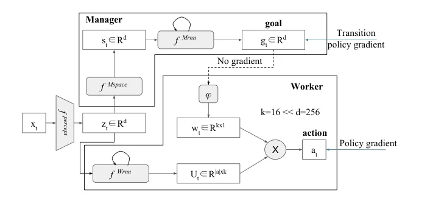
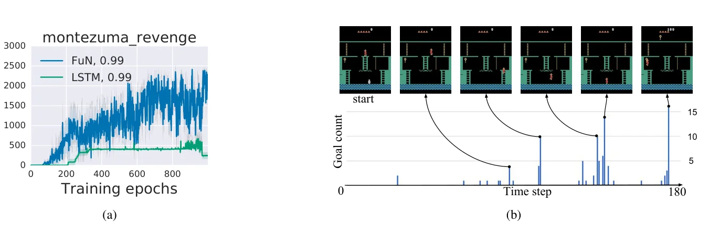
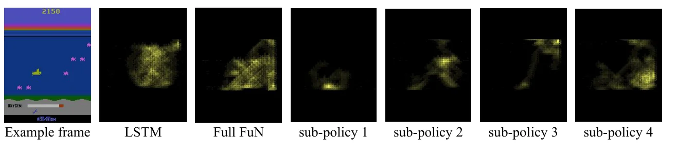

> - **논문**: FeUdal Networks for Hierarchical Reinforcement Learning
> - **저자**: Alexander Sasha Vezhnevets, Simon Osindero, Tom Schaul, Nicolas Heess, Max Jaderberg, David Silver, Koray Kavukcuoglu (DeepMind)
> - **학회**: ICML 2017 · [arXiv:1703.01161](https://arxiv.org/abs/1703.01161)
{: .prompt-tip }

> [h-DQN]()은 사람이 정한 목표(열쇠, 문 등) 중에서 고르는 계층적 구조였습니다. **FeUdal Networks(FuN)**는 목표를 사람이 정의하지 않고, **학습된 잠재 공간 안의 "방향"**으로 만듭니다. 상위 Manager는 느린 시간 단위로 방향을 정하고, 하위 Worker는 빠른 시간 단위로 그 방향을 따라 행동합니다.

## 1. 배경: Feudal Reinforcement Learning

보상이 드물고, 기억이 필요한(**non-Markovian**) 환경은 복잡도가 매우 높습니다. 이를 다루기 위해 **봉건제(feudal)**처럼 계층을 두는 **FRL**(Dayan & Hinton, 1993)이 제안됐습니다.

- 목표를 **위에서 아래로** 내려보냄
- **목표 설정과 목표 달성을 분리**: 상위는 목표를 정할 뿐, **어떻게 도달할지는 정하지 않음**
- 하위 Worker는 **높은 시간 해상도**(매 step)에서 동작

| | Manager | Worker |
|---|---|---|
| 하는 일 | 목표(방향) 설정 | 실제 행동 |
| 보상 | **Extrinsic** (환경 보상) | **Intrinsic** (목표를 따른 정도) |
| 시간 단위 | 느림 | 빠름 |

## 2. Contribution

- FRL에서 영감을 받은, **end-to-end로 미분 가능한** 일반적인 모델
- 목표의 **의미(semantic meaning)**를 이용해 Manager를 학습하는 **approximate transition policy gradient**
- 절대적인 목표 지점이 아니라 **방향성을 갖는 목표**. 예: "적을 피해라", "공기를 마시러 위로 헤엄쳐라" 같은 상태 변화의 방향
- Manager가 긴 시간 의존성을 기억하고 먼 과거까지 기울기를 전달하도록 돕는 **Dilated LSTM**

## 3. 구조

Worker와 Manager 두 모듈로 구성되고, **지각 모듈(perceptual module)**을 공유합니다. 아래 Figure 1에서 위쪽 상자가 Manager, 아래쪽 상자가 Worker입니다.


_Figure 1. FuN 구조. Manager가 만든 목표 $$g_t$$는 "No gradient" 점선을 지나 Worker로 들어가고, Manager는 transition policy gradient, Worker는 일반 policy gradient로 따로 학습합니다. 목표 임베딩 차원은 $$k=16$$, 상태 차원은 $$d=256$$입니다. (출처: Vezhnevets et al., 2017)_

### 공유 지각 모듈

환경 관측 $$x_t$$에서 패턴을 뽑아 중간 표현 $$z_t$$를 만듭니다(CNN).

$$
z_t = f^{percept}(x_t)
$$

### Manager

Manager 자신의 상태 공간에서 상태 $$s_t$$를 정의하고, 순환 신경망으로 **목표 벡터** $$g_t$$를 출력해 정규화합니다.

$$
s_t = f^{Mspace}(z_t),\qquad h^M_t, \hat{g}_t = f^{Mrnn}(s_t, h^M_{t-1}),\qquad g_t = \frac{\hat{g}_t}{\lVert\hat{g}_t\rVert}
$$

- $$h^M_t$$: Manager의 내부 상태
- $$g_t$$: 크기가 1인 **방향 벡터** (상태 공간에서 어느 쪽으로 가라)

### Worker

최근 $$c$$ step 동안의 목표를 합쳐 **선형 변환** $$\phi$$로 작은 임베딩 $$w_t$$를 만듭니다.

$$
w_t = \phi\Big(\sum_{i=t-c}^{t}g_i\Big)
$$

Worker는 자신의 RNN으로 행동별 임베딩 행렬 $$U_t$$를 출력하고, 목표 임베딩과 곱해 정책을 만듭니다.

$$
h^W_t, U_t = f^{Wrnn}(z_t, h^W_{t-1}),\qquad \pi_t = \text{SoftMax}(U_t\,w_t)
$$

목표 $$g$$가 정책에 **곱셈으로** 들어가므로, 같은 Worker가 목표에 따라 다른 행동을 하게 됩니다. $$\phi$$는 bias가 없어서 목표와 무관한 상수 벡터를 만들 수 없으므로, Manager의 목표는 항상 정책에 영향을 줍니다.

환경은 행동을 받아 다음 관측 $$x_{t+1}$$과 보상 $$r_t$$를 주고, 종료 상태까지 반복합니다.

## 4. 학습

### Manager: Transition Policy Gradient

Manager의 목표를 Worker의 행동을 통해 역전파로 학습시키면, 목표가 의미를 잃고 Worker의 내부 변수처럼 되어 버립니다. 그래서 Manager는 **따로** 학습합니다. 목표 $$g_t$$의 방향이 **$$c$$ step 뒤 실제로 일어난 상태 변화**와 같아지도록, 그 변화가 좋은 결과(advantage)를 냈다면 그 방향을 강화합니다.

$$
\nabla g_t = A^M_t\,\nabla_\theta\,d_{\cos}\big(s_{t+c} - s_t,\ g_t(\theta)\big),\qquad A^M_t = R_t - V^M_t(x_t, \theta)
$$

- $$d_{\cos}$$: 코사인 유사도
- $$R_t$$: 누적 보상, $$A^M_t$$: Manager의 advantage
- 이 기울기를 계산할 때 $$s$$가 $$\theta$$에 의존한다는 점은 무시합니다. 상태 표현 쪽을 움직여 코사인 유사도를 올리는 자명한 해를 막기 위해서입니다.

Worker가 결국 어떤 상태 변화를 만들어 낼지를 하나의 "전이 정책"으로 보고 그 정책 기울기를 근사한 것이라, **transition policy gradient**라고 부릅니다. 논문은 상태 변화 방향 $$s_{t+c}-s_t$$가 평균 방향이 $$g_t$$인 von Mises-Fisher 분포, 즉 $$p(s_{t+c}\mid s_t) \propto e^{d_{\cos}(s_{t+c}-s_t,\ g_t)}$$를 따른다고 가정하면 위 식이 정확한 transition policy gradient가 된다고 설명합니다.

### Worker: Intrinsic Reward

Worker는 **최근 목표 방향대로 상태를 움직였는지**로 intrinsic reward를 받습니다.

$$
r^I_t = \frac{1}{c}\sum_{i=1}^{c}d_{\cos}\big(s_t - s_{t-i},\ g_{t-i}\big)
$$

그리고 extrinsic과 intrinsic 보상을 섞어 일반적인 advantage actor-critic으로 학습합니다. 원래 FRL은 하위 계층에 환경 보상을 완전히 숨기자고 했지만, FuN은 환경 보상을 남겨 두고 intrinsic reward를 가중치 $$\alpha$$로 더하는 부드러운 방식을 택합니다.

$$
\nabla\pi_t = A^D_t\,\nabla_\theta\log\pi(a_t \mid x_t;\theta),\qquad A^D_t = R_t + \alpha R^I_t - V^D_t(x_t;\theta)
$$

### Dilated LSTM

Manager는 긴 시간 단위로 움직여야 합니다. **Dilated LSTM**은 내부 상태를 $$r$$개(예: 10)의 그룹으로 나눠, 매 step 그중 **하나만** 업데이트합니다. 각 그룹은 $$r$$ step마다 한 번씩 갱신되므로 긴 시간 의존성을 기억하기 쉽고, 출력은 최근 $$c$$ step의 출력을 합쳐(pooling) 만들기 때문에 매 step 목표를 낼 수 있습니다. 논문은 $$r = c = 10$$으로 두므로, 최근 10 step 출력의 합은 곧 10개 그룹 각각의 최신 출력의 합입니다.

```python
import torch
import torch.nn as nn

class DilatedLSTM(nn.Module):
    """내부 상태를 r개 묶음으로 나눠, 매 step 그중 하나만 갱신하는 LSTM"""
    def __init__(self, in_dim, hid, r=10):
        super().__init__()
        self.cell, self.r, self.t = nn.LSTMCell(in_dim, hid), r, 0
        self.states = None

    def forward(self, x):
        if self.states is None:
            zeros = torch.zeros(x.size(0), self.cell.hidden_size)
            self.states = [(zeros, zeros) for _ in range(self.r)]
        k = self.t % self.r                                   # 이번 step에 갱신할 묶음
        self.states[k] = self.cell(x, self.states[k])
        self.t += 1
        return torch.stack([h for h, _ in self.states]).sum(0)   # 출력은 모든 묶음의 합

torch.manual_seed(0)
dlstm = DilatedLSTM(in_dim=8, hid=16, r=10)
for t in range(25):
    out = dlstm(torch.randn(2, 8))
print(out.shape, dlstm.t % dlstm.r)    # torch.Size([2, 16]) 5
```

묶음 하나는 10 step에 한 번만 갱신되므로, 같은 LSTM 셀로도 10배 긴 시간 간격의 정보를 담기 쉬워집니다. 역전파 관점에서는 기울기가 10 step을 한 번에 건너뛰는 셈이라 먼 과거까지 잘 전달됩니다. (논문 구현은 묶음 사이에 파라미터를 공유하는 하나의 LSTM 셀을 쓰고, 위 코드도 같은 `self.cell`을 공유합니다.)

```python
import torch
import torch.nn as nn
import torch.nn.functional as F

class FuNHeads(nn.Module):
    def __init__(self, z_dim, d=256, k=16, n_actions=18, c=10):
        super().__init__()
        self.c, self.k, self.n_actions = c, k, n_actions
        self.m_space = nn.Linear(z_dim, d)
        self.m_rnn = nn.LSTMCell(d, d)                      # 실제로는 dilated LSTM
        self.w_rnn = nn.LSTMCell(z_dim, n_actions * k)
        self.phi = nn.Linear(d, k, bias=False)

    def forward(self, z, hm, hw, goal_hist):
        s = F.relu(self.m_space(z))
        hm = self.m_rnn(s, hm)
        g = F.normalize(hm[0], dim=-1)                      # 방향 벡터
        goal_hist = (goal_hist + [g])[-(self.c + 1):]
        w = self.phi(torch.stack(goal_hist).sum(0).detach())   # Worker로 기울기 차단
        hw = self.w_rnn(z, hw)
        U = hw[0].view(-1, self.n_actions, self.k)
        pi = F.softmax(torch.bmm(U, w.unsqueeze(-1)).squeeze(-1), dim=-1)
        return pi, s, g, hm, hw, goal_hist

def worker_intrinsic(s_hist, g_hist, c=10):
    s_t = s_hist[-1]
    return sum(F.cosine_similarity(s_t - s_hist[-1 - i], g_hist[-1 - i], dim=-1)
               for i in range(1, c + 1)) / c

torch.manual_seed(0)
B, z_dim = 2, 64
heads = FuNHeads(z_dim)
hm = (torch.zeros(B, 256), torch.zeros(B, 256))                 # Manager LSTM 상태
hw = (torch.zeros(B, 18 * 16), torch.zeros(B, 18 * 16))         # Worker LSTM 상태
goal_hist, s_hist = [], []
for t in range(12):                                             # 지각 모듈 출력 z 대신 난수 사용
    pi, s, g, hm, hw, goal_hist = heads(torch.randn(B, z_dim), hm, hw, goal_hist)
    s_hist.append(s)
print(pi.shape, pi.sum(-1))                        # torch.Size([2, 18]) tensor([1., 1.])
print(worker_intrinsic(s_hist, goal_hist).shape)   # torch.Size([2]) 배치마다 intrinsic reward 하나
```

`w`를 만들 때 `.detach()`로 목표의 기울기를 끊는 줄이 중요합니다. 이 줄이 없으면 Worker의 loss가 Manager까지 흘러가, 목표 $$g$$가 "상태 공간의 방향"이라는 의미를 잃고 Worker를 돕는 임의의 내부 변수처럼 학습됩니다. Manager는 위의 transition policy gradient로만 학습해야 합니다.

## 5. 구현 디테일

논문 4장과 5장 앞부분에 적힌 설정입니다.

| 항목 | 값 |
|---|---|
| 지각 모듈 $$f^{percept}$$ | CNN: 8×8 필터 16개(stride 4) → 4×4 필터 32개(stride 2) → FC 256, 모두 ReLU. Atari 전처리에서 색 채널은 그대로 둠 |
| Manager 상태 $$f^{Mspace}$$ | FC + ReLU, $$d = 256$$ |
| Manager RNN | Dilated LSTM, 256 hidden, dilation $$r = 10$$ |
| Worker RNN | 일반 LSTM, 256 hidden |
| 목표 임베딩 | $$k = 16$$, 최근 $$c = 10$$개 목표를 합산 |
| 목표 탐색 | 작은 확률 $$\epsilon$$으로 Gaussian에서 뽑은 임의 목표를 냄 |
| Baseline | CNN + LSTM 316 hidden (FuN과 전체 파라미터 수를 맞춤), 입력은 관측 특징 + 이전 행동 |
| 최적화 | A3C, 비동기 스레드 32개, shared RMSProp |
| BPTT 길이 | FuN $$K = 400$$, LSTM $$K = 40$$ (100도 실험) |
| 하이퍼파라미터 탐색 | 방법마다 무작위 설정 100개. LSTM lr·entropy ~ LogUniform($$10^{-4}, 10^{-3}$$), FuN lr ~ LogUniform($$10^{-4.5}, 10^{-3.5}$$), $$\alpha$$ ~ Uniform(0, 1). lr은 절반까지 선형 감소 |
| Atari 공통 | action repeat 4, 보상 [−1, +1]로 clip, 1 epoch = 관측 100만 개 |
| 할인율 | Atari: Worker 0.95 고정, Manager 0.99 또는 0.95. Montezuma: Worker 0.99, Manager 0.999 (LSTM 0.99) |
| 결과 보고 | 최종 점수 기준 상위 5개 agent의 에피소드 평균 점수 |

Worker와 Manager의 할인율을 따로 둘 수 있다는 점이 눈에 띕니다. Worker는 가까운 보상에 집중하고, Manager는 더 먼 미래를 보게 할 수 있습니다.

## 6. 실험

Atari와 DeepMind Lab(3D 미로 Labyrinth)에서 LSTM baseline(A3C)과 비교했습니다. 결과는 대부분 학습 곡선으로만 제시되어 있어, 아래 숫자는 본문에 적힌 값만 옮겼습니다.

### Montezuma's Revenge


_Figure 2. (a) Montezuma's Revenge 학습 곡선. (b) 첫 번째 방에서 FuN이 학습한 하위 목표. 막대가 높을수록 그 프레임이 여러 과거 상태의 목표 방향을 가장 잘 만족한 지점이라는 뜻이고, 높은 막대가 사다리·열쇠 같은 의미 있는 지점에 대응합니다. (출처: Vezhnevets et al., 2017)_

- LSTM은 첫 번째 방을 푸는 점수(400점, 열쇠를 집고 문을 여는 것)에 도달하는 데 **300 epoch 넘게** 걸렸고, 약 900 epoch까지 그 점수에 머물렀습니다. LSTM은 학습률 탐색 범위를 넓히는 등 하이퍼파라미터를 더 공들여 찾은 뒤에야 겨우 진전이 보였습니다.
- FuN은 **200 epoch 안에** 첫 방을 풀고 다른 방들로 나아가 최대 **약 2600점**까지 얻었습니다.
- Figure 2(b)의 하위 목표 중 두 개는 [h-DQN]()에서 사람이 직접 정한 목표(사다리, 열쇠)와 거의 같은 위치였습니다. FuN은 이것을 스스로 찾았습니다.

### Atari 게임들

| 게임 | 결과 |
|---|---|
| Ms. Pac-Man, Amidar, Gravitar | Manager 할인율 0.99인 FuN이 다른 모든 방법보다 크게 앞섬 |
| Enduro | LSTM agent는 모두 완전히 실패. 첫 보상까지 오래 가속·조향해야 하는 게임 |
| Frostbite | Manager 할인율 0.95인 FuN이 나머지보다 **7배** 높음 |
| Hero, Space Invaders | 모든 agent가 비슷 |
| Seaquest, Breakout | 할인율 0.95인 LSTM이 가장 좋음 (장기 credit assignment가 덜 중요) |
| Alien | 할인율 영향이 거의 없고 LSTM이 FuN보다 좋음 |

LSTM은 BPTT를 100으로 늘리면 오히려 성능이 크게 떨어졌지만, FuN은 dilated LSTM 덕분에 BPTT 400에서도 잘 학습됐습니다.

Option-Critic과 같은 게임에서 200 epoch 뒤를 비교하면, Seaquest는 비슷하고 Ms. Pac-Man은 2배, Zaxxon은 3배 이상, Asterix는 20배 이상 높았습니다. 다만 Option-Critic 점수(Asterix 약 8000, Zaxxon 약 6000)는 원 논문 그래프에서 읽은 근삿값이고, 그 논문의 baseline이 DQN이라 A3C 기반인 FuN과 학습 조건이 다르다는 점은 감안해야 합니다.

### Labyrinth 기억 과제

Water maze, T-maze, T-maze+, Non-match 네 과제 모두에서 FuN이 LSTM보다 빨리 배우고 최종 보상도 높았습니다. Water maze에서 FuN은 첫 시도에서 목표를 찾은 뒤 그 반지름의 원을 따라 탐색해 매번 목표를 찾았고, LSTM은 기억을 쓰지 않는 듯 거의 같은 반지름으로 원을 돌기만 했습니다.

### Ablation

Figure 8~10의 학습 곡선(Ms. Pac-Man, Amidar, Gravitar, Enduro)에서 나온 결론입니다.

| 변형 | 바꾼 점 | 결과 |
|---|---|---|
| Non-feudal FuN | 목표 $$g$$를 Worker의 기울기로 학습, intrinsic reward 없음 | 어느 정도 학습되지만 FuN보다 크게 낮음 |
| Manager via PG | Manager가 Gaussian 평균을 내는 일반 policy gradient로 목표 학습 | 크게 낮음 |
| Absolute goals | 방향 대신 절대 위치를 목표로 | 크게 낮음 |
| Pure feudal | Worker를 intrinsic reward만으로 학습 | 위 셋보다 낫지만 FuN보다 낮음 → 환경 보상도 주는 편이 좋음 |
| No dilation | Manager에 일반 LSTM | 완전히 실패 |
| $$c = 1$$ | Manager 예측 범위를 1 step으로 | 성능이 떨어지지만 다른 ablation보다는 덜함 |
| dLSTM 단독 | FuN 없이 CNN + dilated LSTM agent | LSTM과 FuN 모두보다 대체로 낮음 |

$$\alpha$$를 0~1에서 바꿔 본 실험에서는 Gravitar, Amidar에서 $$\alpha$$가 클수록 점수가 높았지만, 다른 게임에서는 최적값이 1보다 작았습니다. 또 action repeat 4로 학습한 FuN을 action repeat 없는 환경으로 옮길 때(할인율 조정, dilation과 $$c$$를 4배로) 네 게임 모두에서 긍정적 전이가 나타났고, LSTM은 Ms. Pac-Man에서만 그랬습니다.

### 하위 정책의 해석

**Seaquest**에서 Manager가 낸 목표 하나를 골라 Worker에 고정 입력으로 주고, 에피소드 동안 잠수함 위치를 평균 내 heat-map으로 그렸습니다(아래 Figure 3).


_Figure 3. Seaquest에서 잠수함 위치 heat-map. 왼쪽부터 게임 화면, LSTM baseline, FuN 전체 정책, 고정된 목표 4개에 대한 하위 정책. sub-policy 3은 산소를 보충하러 수면으로 올라가는 행동입니다. (출처: Vezhnevets et al., 2017)_

- LSTM baseline과 FuN 전체 정책은 화면의 넓은 영역을 씁니다.
- FuN의 하위 정책들은 각자 **화면의 특정 영역**이나 움직임에 집중했습니다. 그중 sub-policy 3은 **산소를 보충하러 수면으로 헤엄쳐 올라가는** 행동에 쓰였습니다.

사람이 목표를 정해 주지 않았는데도, 의미 있는 하위 행동이 스스로 생겨난 것입니다.

## 7. 정리

| | h-DQN | FeUdal Networks |
|---|---|---|
| 목표 | 사람이 정한 물체/위치 중 선택 | **학습된 상태 공간의 방향 벡터** |
| Manager 학습 | DQN (extrinsic) | **Transition policy gradient** |
| Worker 보상 | 목표 도달 여부 (0/1) | 상태 변화와 목표 방향의 **코사인 유사도** |
| 장기 기억 | - | **Dilated LSTM** |
| 대표 결과 | - | Montezuma 첫 방을 200 epoch 안에 풀고 최대 약 2600점, Frostbite에서 LSTM의 7배 |

## References

- Vezhnevets et al., "FeUdal Networks for Hierarchical Reinforcement Learning," ICML 2017. [arXiv:1703.01161](https://arxiv.org/abs/1703.01161)
- Dayan & Hinton, "Feudal Reinforcement Learning," NeurIPS 1993.
- Kulkarni et al., "Hierarchical Deep Reinforcement Learning (h-DQN)," NeurIPS 2016.
- Bacon et al., "The Option-Critic Architecture," AAAI 2017.
