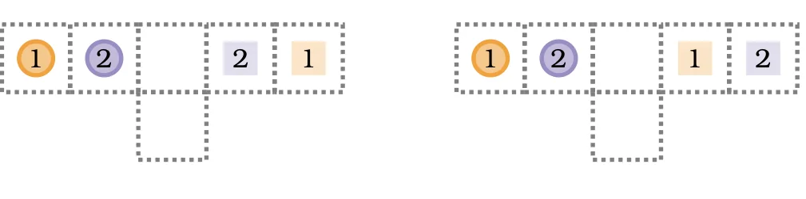
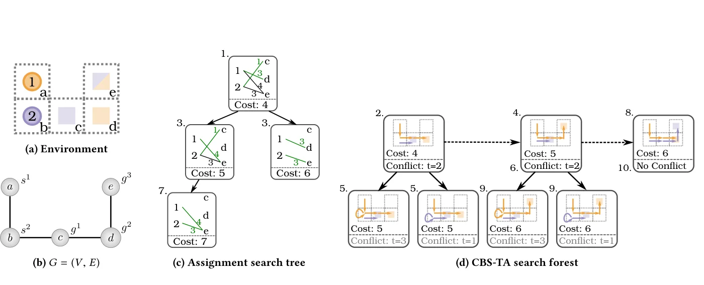
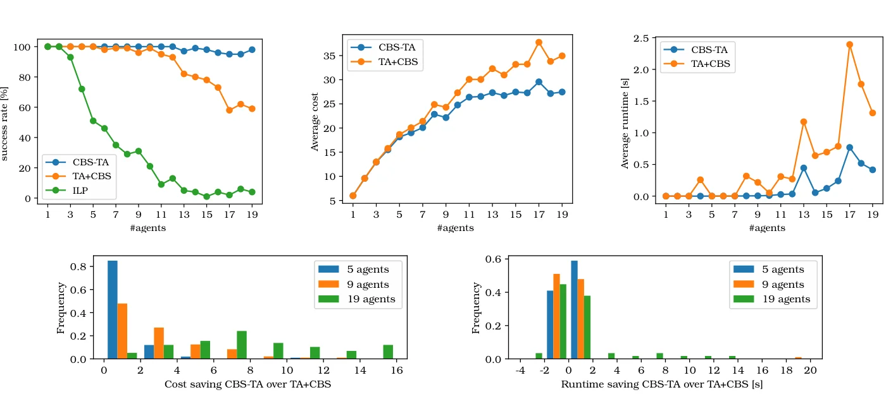

> - **논문**: Conflict-Based Search with Optimal Task Assignment
> - **저자**: Wolfgang Hönig, Scott Kiesel, Andrew Tinka, Joseph W. Durham, Nora Ayanian (University of Southern California, Amazon Robotics)
> - **학회**: AAMAS 2018
{: .prompt-tip }

> 이 글에서 다루는 것은 강화학습이 아니라 **탐색(search) 기반 계획 알고리즘**이다. 하지만 [PRIMAL]() 같은 학습 기반 MAPF가 비교 대상으로 삼는 대표적인 최적 계획기라서 Multi-Agent 카테고리에 함께 정리한다. *Conflict-Based Search with Optimal Task Assignment*는 "**누가 어느 목표로 갈지**"와 "**각자 어떤 경로로 갈지**"를 동시에 최적화한다.

## 1. 문제 정의

### MAPF

**무방향 그래프** $$G = (V, E)$$ 위에서 여러 에이전트가 이동한다.

- $$V$$: 위치(격자 칸)
- $$E$$: 단위 가중치의 간선(통로)
- 매 시점 각 에이전트는 이웃 칸으로 이동하거나 제자리에 머묾
- **충돌 금지**: 두 에이전트가 같은 시점에 같은 칸에 있으면 안 되고(vertex conflict), 같은 간선을 서로 반대로 지나가도 안 됨(edge conflict)
- 목표: 모든 에이전트의 **경로 비용 합(sum of costs)** 최소화

논문은 여기에 $$N \times M$$ 이진 **할당 가능 행렬** $$A$$를 더한다. $$a_{ij} = 1$$이면 에이전트 $$i$$가 목표 $$g_j$$로 갈 수 있다는 뜻이다. $$A$$가 순열 행렬이면 기존 labeled MAPF, 모든 원소가 1이면 누가 어디로 가도 되는 unlabeled MAPF이고, 목표가 에이전트보다 많거나 적은 경우, 일부 목표에만 갈 수 있는 경우도 같은 틀로 표현된다.

### Labeled MAPF vs TAPF

- **Labeled MAPF**: 각 에이전트의 목표가 **정해져** 있음. 기존 연구 대부분이 여기에 해당하며 CBS, M\*, ECBS 등으로 풂
- **TAPF (Target Assignment and Path Finding)**: 목표 집합만 주어지고, **어느 에이전트가 어느 목표로 갈지도 정해야** 함. 창고에서 "선반 5개를 누가 가져올지"가 정해지지 않은 상황

기존에는 TAPF를 **두 단계**로 풀었다.

1. **작업 할당**: 거리 기반으로 에이전트–목표 매칭 (헝가리안 알고리즘 등)
2. **경로 계획**: 정해진 할당으로 MAPF

하지만 거리만 보고 할당하면, 경로를 짤 때 충돌이 많아 실제로는 비싼 할당이 될 수 있다. 논문은 둘을 **동시에** 탐색해 최적해를 구한다.


_Figure 1. 원은 시작 위치, 사각형은 목표. 왼쪽 할당에서는 로봇 2가 아래 골목으로 잠시 비켜야 해서 총비용이 8이고, 오른쪽 할당에서는 두 로봇이 곧장 가도 충돌이 없어 총비용이 6이다. (출처: Hönig et al., 2018)_

## 2. CBS 복습

**CBS(Conflict-Based Search)**(Sharon et al., 2015)는 두 단계 탐색이다.

### Low-level

각 에이전트의 경로를 **혼자 있다고 가정**하고 A\*로 구한다. 단, 상위에서 받은 **제약 조건**(예: "에이전트 1은 시점 3에 칸 (2, 4)에 있으면 안 됨")을 지킨다.

### High-level: Constraint Tree

1. 루트 노드: 제약 없이 각자 최단 경로를 구함
2. 비용이 가장 작은 노드를 꺼내 경로들 사이의 **첫 충돌**을 찾음
3. 충돌이 없으면 → **해답**
4. 충돌 $$(a_i, a_j, v, t)$$가 있으면 노드를 **둘로 분기**
   - 왼쪽: $$a_i$$는 시점 $$t$$에 $$v$$에 있으면 안 됨
   - 오른쪽: $$a_j$$는 시점 $$t$$에 $$v$$에 있으면 안 됨
5. 각 자식에서 제약이 추가된 에이전트만 low-level을 다시 풀고, 2로 돌아감

비용 순서로 노드를 꺼내므로 처음 찾은 해가 **최적**이다. (low-level 탐색이 각 에이전트의 최단 경로를 정확히 구한다는 전제에서이다.)

```python
import heapq, itertools

def cbs(agents, starts, goals, low_level, find_first_conflict):
    tie = itertools.count()
    root = {"constraints": {a: set() for a in agents}}
    root["paths"] = {a: low_level(starts[a], goals[a], root["constraints"][a]) for a in agents}
    root["cost"] = sum(len(p) for p in root["paths"].values())
    open_list = [(root["cost"], next(tie), root)]
    while open_list:
        _, _, node = heapq.heappop(open_list)
        conflict = find_first_conflict(node["paths"])
        if conflict is None:
            return node["paths"]                                  # 충돌 없음 = 최적해
        a_i, a_j, v, t = conflict
        for agent in (a_i, a_j):                                  # 두 갈래로 분기
            child = {"constraints": {k: set(c) for k, c in node["constraints"].items()},
                     "paths": dict(node["paths"])}
            child["constraints"][agent].add((v, t))
            child["paths"][agent] = low_level(starts[agent], goals[agent], child["constraints"][agent])
            if child["paths"][agent] is not None:
                child["cost"] = sum(len(p) for p in child["paths"].values())
                heapq.heappush(open_list, (child["cost"], next(tie), child))
    return None
```

위 함수만으로는 실행할 수 없으므로, 3×3 격자에서 돌려 볼 수 있는 최소한의 low-level 탐색과 충돌 검사를 붙인다.

```python
from collections import deque

GRID = ["...",
        "...",
        "..."]                                            # '#'를 넣으면 장애물
H, W = len(GRID), len(GRID[0])

def neighbors(v):
    r, c = v
    for dr, dc in [(0, 0), (1, 0), (-1, 0), (0, 1), (0, -1)]:   # 제자리 포함
        nr, nc = r + dr, c + dc
        if 0 <= nr < H and 0 <= nc < W and GRID[nr][nc] != "#":
            yield (nr, nc)

def low_level(start, goal, constraints, max_t=20):
    """시간까지 포함한 BFS: constraints = {(칸, 시점)} 금지 목록"""
    queue, seen = deque([(start, 0, [start])]), {(start, 0)}
    while queue:
        v, t, path = queue.popleft()
        if v == goal and all((goal, k) not in constraints for k in range(t, max_t)):
            return path                                   # 도착 후 계속 머물러도 제약 위반이 없으면 완료
        if t >= max_t:
            continue
        for u in neighbors(v):
            if (u, t + 1) not in constraints and (u, t + 1) not in seen:
                seen.add((u, t + 1))
                queue.append((u, t + 1, path + [u]))
    return None

def find_first_conflict(paths):
    """같은 시점에 같은 칸에 있는 첫 충돌(vertex conflict)만 찾음"""
    T = max(len(p) for p in paths.values())
    at = lambda p, t: p[min(t, len(p) - 1)]               # 도착한 뒤에는 목표에 머문다고 가정
    agents = list(paths)
    for t in range(T):
        for i in range(len(agents)):
            for j in range(i + 1, len(agents)):
                a, b = agents[i], agents[j]
                if at(paths[a], t) == at(paths[b], t):
                    return a, b, at(paths[a], t), t
    return None

starts = {"A": (1, 0), "B": (0, 1)}     # A는 왼쪽→오른쪽, B는 위→아래로 가운데 칸을 지나감
goals = {"A": (1, 2), "B": (2, 1)}
independent = {a: low_level(starts[a], goals[a], set()) for a in starts}
print(find_first_conflict(independent))   # ('A', 'B', (1, 1), 1) → 시점 1에 가운데서 충돌
print(cbs(["A", "B"], starts, goals, low_level, find_first_conflict))
```

```text
('A', 'B', (1, 1), 1)
{'A': [(1, 0), (1, 0), (1, 1), (1, 2)], 'B': [(0, 1), (1, 1), (2, 1)]}
```

혼자일 때의 최단 경로는 시점 1에 가운데 칸 (1, 1)에서 부딪친다. CBS는 "A는 시점 1에 (1, 1)에 있으면 안 됨" / "B는 …" 두 갈래로 나눈 뒤, 비용 합이 더 작은 해(A가 한 칸 기다림, 총 비용 +1)를 찾는다.

> 이 예제의 `find_first_conflict`는 **같은 칸 충돌(vertex conflict)만** 검사한다. 실제 MAPF에서는 두 에이전트가 같은 간선을 반대 방향으로 지나가는 **맞바꾸기(edge conflict)**도 검사하고, 이때는 "에이전트가 시점 $$t$$에 $$u \to v$$로 이동하면 안 됨" 같은 방향이 있는 제약을 추가해야 한다.
{: .prompt-warning }

## 3. CBS-TA: Search Forest

### 아이디어

할당이 정해지지 않았으므로, **가능한 할당마다 하나의 constraint tree**를 둔다. 여러 트리의 숲, 즉 **search forest**이다.

- 각 트리의 루트 = 특정 **에이전트–목표 할당** + 그 할당에서의 제약 없는 최단 경로
- 모든 트리의 노드를 **하나의 우선순위 큐**에 넣고 비용 순서로 탐색

### 필요할 때만 트리 만들기

에이전트 $$N$$명, 목표 $$M$$개면 가능한 할당이 조합적으로 많고($$N = M$$이고 누구나 어디든 갈 수 있으면 $$N!$$개) 처음부터 모든 트리를 만들 수 없다. 그래서 루트를 **필요할 때(lazily)** 만든다.

1. 처음에는 **비용이 가장 작은 할당** 하나로 루트를 만듦. 비용 행렬 $$C$$는 각 에이전트가 다른 에이전트를 무시하고 각 목표까지 가는 최단 거리이고, 최적 할당은 헝가리안 알고리즘이나 min-cost flow로 구함
2. 어떤 트리의 루트를 꺼낼 때마다, **그다음으로 비용이 작은 할당**으로 새 루트를 만들어 큐에 추가
3. 다음 순위의 할당은 **순위 할당(ranked assignment)** 알고리즘(Murty의 방법)으로 차례대로 구함. 반드시 포함할 할당 집합 $$I$$와 금지할 할당 집합 $$O$$로 해 공간을 나누고, $$C$$에서 $$I$$의 원소는 0, $$O$$의 원소는 무한대로 바꿔 다시 최적 할당을 푼다. 헝가리안 알고리즘에 $$N = M$$이면 다음 할당 하나에 $$O(N^4)$$이다.

루트 비용(충돌을 무시한 최단 경로 합)은 그 할당에서 얻을 수 있는 실제 비용의 하한이고, 할당은 이 하한이 작은 순서로 숲에 추가된다. 그래서 어떤 할당이 최적해에 들어갈 수 있다면 그 루트는 이미 숲에 들어와 있고, 처음 찾은 충돌 없는 해가 할당과 경로를 모두 고려한 **최적해**가 된다. 논문은 CBS-TA가 complete이고 비용 합 기준 optimal임을 정리(Theorem 4.1, 4.2)로 보인다.


_Figure 2. 에이전트 2명, 목표 3개 예제. (c)는 다음 순위 할당을 만드는 할당 탐색 트리, (d)는 CBS-TA의 search forest이다. 숫자는 처리 순서이고, 비용 4·5인 루트는 t=2에 충돌하며 세 번째 루트(비용 6)가 충돌 없는 해로 반환된다. (출처: Hönig et al., 2018)_

### ECBS-TA

최적해를 구하는 대신 **최적 비용의 $$w$$배 이내**의 해를 빠르게 구하는 bounded-suboptimal 버전이다. ECBS처럼 **focal search**를 써서, 비용이 상한 이내인 노드들 중 충돌이 적은 노드를 먼저 탐색한다. $$w$$가 만드는 여유 때문에 새 루트(할당)를 언제 추가할지 고를 수 있어, 논문은 세 가지를 생각한다.

| 변형 | 새 루트 추가 시점 | 비고 |
|---|---|---|
| MaxRoot | $$w \cdot \min LB$$ 이하인 할당을 가능한 한 모두 | 할당이 너무 많아 구현하지 않음 |
| CBS-TA style | 루트를 꺼낼 때마다 하나씩 (CBS-TA와 같음) | 작은 맵에서 비용이 낮음 |
| MinRoot | OPEN의 최저 비용이 현재 한계 $$r$$을 넘을 때만 | 큰 맵·많은 에이전트에서 권장 |

ECBS-TA의 $$w$$는 **최적 할당까지 포함한** 최적 비용 대비 보장이므로, 할당을 먼저 고정한 뒤 ECBS를 돌리는 방식(고정된 할당 안에서만 $$w$$배 보장)보다 강한 보장이다.

## 4. 실험

### 실험 설정

| 항목 | 값 |
|---|---|
| 구현 | C++, boost 힙. 제약 없는 할당은 boost graph의 min-cost max-flow로 풂 |
| 하드웨어 | 노트북 한 대 (i7-4600U 2.1GHz, RAM 12GB) |
| 작은 맵 | 8×8 4-연결 격자, 장애물 20%, 에이전트 1~19명 (빈 칸 대비 밀도 약 38%) |
| 큰 맵 | 32×32 4-연결 격자, 장애물 20%, 에이전트 최대 100명 (밀도 약 12%) |
| 반복 | 에이전트 수마다 무작위 시작·목표 100개, 시간 제한 30초 |
| Low-level 휴리스틱 | 최단 거리 |
| 비교 대상 | TA+CBS(같은 구현에서 루트 1개만 펼치도록 제한), ILP(Gurobi 7.5, time-expanded flow), ECBS, CBM(makespan 최적 TAPF 해법) |

### CBS-TA vs 할당 후 CBS vs ILP


_Figure 3. 위: 8×8 격자에서 에이전트 수에 따른 성공률, 평균 비용, 평균 실행 시간. 아래: 5·9·19명일 때 TA+CBS 대비 CBS-TA의 비용·시간 절감 분포. (출처: Hönig et al., 2018)_

- **성공률**: 에이전트가 늘수록 TA+CBS는 60% 안팎까지 떨어지지만 CBS-TA는 95% 이상을 유지한다(Figure 3).
- **비용과 시간**: 둘 다 푼 문제에서 CBS-TA가 평균 비용도 낮고 평균 시간도 짧다. 할당을 바꿀 수 있으므로 충돌이 많은 할당에 갇혀 오래 헤매지 않는다.
- **밀도에 따른 차이**: 5명일 때는 80% 넘는 경우에서 비용 차이가 없고 시간도 거의 같다. 19명일 때는 비용 절감이 7에서 가장 많이 나타나고(20% 넘는 경우), 시간은 75% 넘는 경우에서 같다. 할당과 경로가 강하게 얽히는 밀집된 경우에 이득이 크고, 드문 경우에도 시간 손해가 거의 없다.
- **ILP**: 해를 찾은 경우 비용은 CBS-TA와 같았지만(둘 다 최적), 10명일 때 평균 21초가 걸렸고 에이전트가 늘면 성공률이 크게 떨어졌다.

### ECBS-TA vs 할당 후 ECBS

논문 Table 1의 일부이다(성공률 / 평균 비용 / 평균 시간[s]).

| 맵 | $$w$$ | 에이전트 | ECBS | ECBS-TA (CBS-TA style) | ECBS-TA (MinRoot) |
|---|---|---|---|---|---|
| 8×8 | 1.0 | 19 | 0.56 / 34.3 / 1.30 | 0.98 / 27.2 / 0.31 | 0.98 / 27.2 / 0.32 |
| 8×8 | 1.3 | 19 | 0.68 / 37.9 / 1.16 | 1.00 / 32.8 / 0.05 | 0.89 / 34.5 / 0.44 |
| 32×32 | 1.0 | 40 | 0.92 / 248 / 0.5 | 0.57 / 244 / 4.3 | 0.58 / 244 / 4.2 |
| 32×32 | 1.05 | 70 | 0.45 / 352 / 1.7 | 0.52 / 350 / 5.5 | 0.40 / 351 / 1.6 |
| 32×32 | 1.1 | 100 | 0.33 / 417 / 2.6 | 0.27 / 417 / 15.3 | 0.29 / 418 / 2.3 |

- **작은 맵**: 두 ECBS-TA 모두 ECBS보다 성공률이 높고 비용이 같거나 낮으며 더 빠르다. 19명, $$w = 1.0$$에서 성공률 0.56 → 0.98, 비용 34.3 → 27.2이다.
- **큰 맵**: $$w = 1$$에서는 ECBS-TA의 성공률이 ECBS보다 크게 낮고, 비용 이득은 평균 5% 미만이다. $$w$$를 1.05~1.1로 올리면 성공률과 비용이 ECBS와 비슷해지지만, CBS-TA style은 에이전트가 많을수록 시간이 급격히 늘어난다(100명, $$w=1.1$$에서 15.3초). 에이전트가 많으면 최적 비용이 같은 할당이 수백 개씩 생겨, 루트를 계속 추가해도 비용이 거의 줄지 않기 때문이다. **MinRoot**는 ECBS와 같거나 더 짧은 시간에 더 강한 보장을 준다.

### ECBS-TA vs CBM (TAPF)

에이전트를 5명씩 그룹으로 묶고 그룹 안에서는 누가 어느 목표로 가도 되는 TAPF 문제에서, makespan을 최적화하는 CBM과 비교했다(ECBS-TA는 MinRoot).

- **8×8**: 모든 $$w$$에서 비용 합은 ECBS-TA가 더 낮고, makespan은 CBM이 더 낮다. $$w = 2.0$$이면 ECBS-TA의 성공률이 더 높고 시간은 비슷하다.
- **32×32, $$w = 1.3$$**: 100명일 때 CBM의 비용 합이 ECBS-TA의 **두 배가 넘었고**, makespan은 CBM 33, ECBS-TA 47이었다. 시간은 에이전트가 많을수록 ECBS-TA가 크게 빨랐다. CBM은 1,000개 중 995개를 풀었고, ECBS-TA는 $$w \ge 1.3$$에서 모두 풀었다($$w = 1.0$$이면 100명 문제를 하나도 못 풂).
- **그룹 크기**: 100명을 그룹 크기 1(labeled)~100(unlabeled)로 바꾸면, ECBS-TA는 모든 경우를 풀고 시간이 그룹 크기에 따라 천천히 늘어난다. CBM은 그룹 크기 1에서 하나도 못 풀고, 그룹이 클수록 빨라진다. 비용 합은 모든 경우 ECBS-TA가 낮았다.

정리하면, 할당과 경로를 함께 최적화하는 이득은 **좁은 공간에 에이전트가 빽빽한 경우**에 크고, 넓은 맵에 에이전트가 많으면 기존 두 단계 방식도 쓸 만하다. 그 경우에도 ECBS-TA(MinRoot)는 같은 시간에 더 강한 준최적 보장을 준다.

## 5. 정리

| | 두 단계 방식 | CBS-TA |
|---|---|---|
| 할당 | 거리만 보고 먼저 결정 | 경로 충돌까지 고려해 **함께 탐색** |
| 구조 | 하나의 constraint tree | 할당마다 트리, **search forest** |
| 할당 열거 | 한 번 | 필요할 때 다음 순위 할당 생성 |
| 보장 | 할당이 고정되어 최적 아님 | 비용 합 기준 **최적** (ECBS-TA는 $$w$$-준최적) |
| 실험 | 밀집 시 성공률·비용 손해 | 8×8, 19명에서 성공률 95% 이상, 큰 맵은 MinRoot로 ECBS와 같은 시간에 더 강한 보장 |

학습 기반 [PRIMAL]()은 확장성을, CBS 계열은 최적성을 장점으로 가진다. 실제 시스템에서는 둘을 섞어 쓰기도 한다.

## References

- Hönig, Kiesel, Tinka, Durham, Ayanian, "Conflict-Based Search with Optimal Task Assignment," AAMAS 2018.
- Sharon et al., "Conflict-based search for optimal multi-agent pathfinding," AIJ 2015.
- Barer et al., "Suboptimal Variants of the Conflict-Based Search Algorithm for the Multi-Agent Pathfinding Problem (ECBS)," SoCS 2014.
- Ma & Koenig, "Optimal Target Assignment and Path Finding for Teams of Agents," AAMAS 2016.
- Murty, "An Algorithm for Ranking all the Assignments in Order of Increasing Cost," Operations Research 1968.
