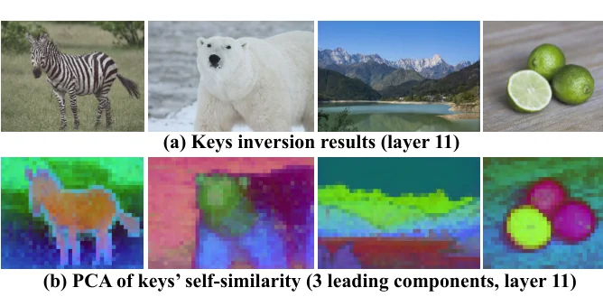
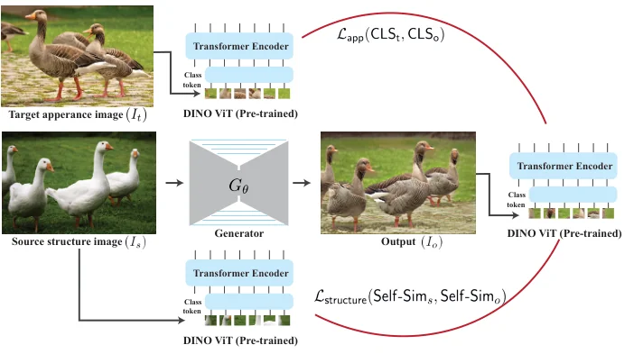
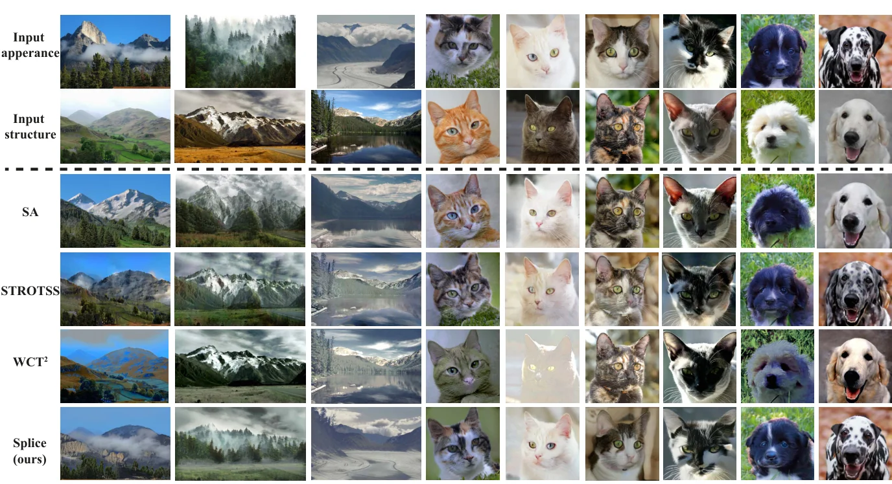

> - **논문**: Splicing ViT Features for Semantic Appearance Transfer
> - **저자**: Narek Tumanyan, Omer Bar-Tal, Shai Bagon, Tali Dekel (Weizmann Institute of Science)
> - **학회**: CVPR 2022 · [arXiv:2201.00424](https://arxiv.org/abs/2201.00424) · [프로젝트 페이지](https://splice-vit.github.io)
{: .prompt-tip }

> [Neural Style Transfer]()부터 [AdaIN](), [StyTr²]()까지 스타일 전이는 회화의 질감을 사진 전체에 입히는 일이었다. 그런데 "얼룩소 사진의 외형을 붉은 소 사진에 옮겨라"라는 요청은 다르다. 소에는 소의 무늬를, 풀밭에는 풀밭의 색을, 곧 **의미적으로 대응하는 영역끼리** 외형을 옮겨야 하고, VGG 특징의 Gram 행렬로는 이 대응을 알 수 없다. **Splice**는 라벨 없이 학습된 **DINO-ViT**가 이 의미를 이미 알고 있다는 점을 이용한다. 마지막 층 키(key)의 자기유사도 행렬을 "구조", [CLS] 토큰을 "외형"으로 정의하고, 입력 이미지 한 쌍만으로 생성기를 학습해 두 표현을 ViT 특징 공간에서 이어 붙인다(splice). 적대 학습도, 분할 마스크도, 대응점도 필요 없다.

## 1. 문제: 한 쌍의 자연 이미지 사이에서 의미를 어디서 얻는가

이미지 대 이미지 변환(CycleGAN, Swapping Autoencoder)은 두 도메인의 **이미지 컬렉션**과 GAN이 필요해 "얼룩소 컬렉션"이 없으면 쓸 수 없다. 단일 이미지 변환(SinGAN, SinCUT)은 쌍 하나로 되지만 저수준 통계만 보므로 백조의 외형을 오리에 옮기는 식의 **의미적 추론**이 안 된다. NST의 VGG 표현은 전역 스타일에는 좋지만 영역 기반 전이에는 맞지 않고, 의미 스타일 전이는 분할이나 대응점 같은 추가 입력에 의존했다. 필요한 것은 쌍 하나만으로 의미 대응을 제공하는 외부 사전이다.

## 2. 관찰: DINO-ViT 특징 반전

저자들은 CNN 특징 시각화에 쓰던 **특징 반전**(feature inversion)을 ViT에 처음 적용한다. Deep Image Prior처럼 고정 잡음을 이미지로 바꾸는 CNN $$F_\theta$$를 최적화해 $$\lVert \phi(F_\theta(z)) - \phi(I) \rVert_F$$를 최소화한다. 관찰은 둘이다.

- **[CLS] 토큰은 외형을 공간적으로 유연하게 담는다.** 얕은 층의 [CLS]를 반전하면 국소 질감이, 깊은 층(11층)에서는 물체 부위 같은 전역 정보가 나타난다. 같은 이미지를 여러 번 반전하면 부위가 늘어나고 뒤집히지만 전역 외형은 유지된다. 포즈와 배치는 버리고 "무엇이 어떻게 생겼는지"는 남기는 것이다.
- **마지막 층 키에서 원본이 복원된다.** 깊은 층 특징은 고수준 정보만 담는다고 여겨졌지만, 키 $$K^L$$를 반전하면 원본 이미지가 되살아난다. 의미적이면서 가역적인 표현이다. 외형을 버리려면 키 자체가 아니라 **키의 자기유사도**를 써야 하고, 그 PCA를 보면 얼룩말의 줄무늬는 사라지고 몸통·다리 같은 의미 부위가 남는다(아래 Figure 5).


_Figure 5. (a) 11층 키를 반전하면 원본이 거의 그대로 복원된다. (b) 같은 층 키 자기유사도의 주성분 3개. 얼룩말 줄무늬 같은 외형은 사라지고 몸통, 다리, 배경 같은 의미 부위가 구분된다. (출처: Tumanyan et al., 2022)_

## 3. 방법

### 구조와 외형의 표현

$$
S^L(I)_{ij} = \text{cos-sim}\big(k^L_i(I), k^L_j(I)\big) \in \mathbb{R}^{(n+1)\times(n+1)}, \qquad \text{appearance}(I) = t^L_{[CLS]}(I)
$$

자기유사도가 외형을 무시하고 구조를 잡는다는 것은 고전 기술자(Shechtman & Irani)와 STROTSS에서도 쓰였고, 키를 택한 것은 Amir 등의 분석에 따른다.

### 손실

생성기 $$G_\theta(I_s) = I_o$$를 쌍 $$\{I_s, I_t\}$$에 대해 학습한다. 고정된 DINO-ViT가 손실을 계산하는 외부 사전 역할만 한다(Figure 2).


_Figure 2. 생성기 $$G_\theta$$가 구조 이미지 $$I_s$$를 받아 $$I_o$$를 낸다. 고정된 DINO-ViT로 $$I_o$$와 $$I_t$$의 [CLS] 토큰을 맞추는 외형 손실, $$I_o$$와 $$I_s$$의 키 자기유사도를 맞추는 구조 손실을 계산한다. (출처: Tumanyan et al., 2022)_

$$
\mathcal{L}_{\text{splice}} = \mathcal{L}_{\text{app}} + \alpha \mathcal{L}_{\text{structure}} + \beta \mathcal{L}_{\text{id}}, \quad \alpha = \beta = 0.1
$$

- $$\mathcal{L}_{\text{app}} = \lVert t^L_{[CLS]}(I_t) - t^L_{[CLS]}(I_o) \rVert_2$$: 출력의 [CLS]가 외형 이미지의 것과 같도록. 주도 손실이다.
- $$\mathcal{L}_{\text{structure}} = \lVert S^L(I_s) - S^L(I_o) \rVert_F$$: 출력의 키 자기유사도가 구조 이미지의 것과 같도록.
- $$\mathcal{L}_{\text{id}} = \lVert K^L(I_t) - K^L(G_\theta(I_t)) \rVert_F$$: 외형 이미지를 넣으면 **키 표현이 보존**되어야 한다는 항등 정규화. RGB 공간의 항등 손실(CycleGAN류)을 의미적이고 가역적인 키 공간으로 옮긴 것이다.

쌍 하나뿐이므로 크롭과 색 지터로 내부 예시 $$\{I_s^i, I_t^i\}_{i=1}^N$$를 만들어 학습한다. 단일 인스턴스의 테스트 시 최적화가 아니라 $$N$$개 예시에 대한 **매핑 함수**를 배우는 셈이고, 이것이 일반화를 돕는다. 고해상도(HD) 출력이 가능하다.

### 구현 디테일

부록 A에 적힌 설정이다.

| 항목 | 값 |
|---|---|
| 생성기 | U-Net, 인코더 5층(채널 3→16→32→64→128→128)과 대칭 디코더, 3×3 conv + BatchNorm + LeakyReLU, 층마다 1×1 conv 스킵, 마지막 1×1 conv + Sigmoid |
| 특징 추출기 | DINO ViT-B/8 (12층, 8×8 패치), 고정 |
| 손실 계산 | 생성 이미지와 외형 이미지를 종횡비를 유지한 채 224px로 bicubic 축소한 뒤 DINO 특징 추출 |
| 가중치 | $$\alpha = \beta = 0.1$$ |
| Optimizer | Adam, 고정 lr $$2 \times 10^{-3}$$ |
| 배치 | 증강된 $$\{\tilde I_s, \tilde I_t\}$$ 한 쌍, 75 iteration마다 증강 없는 원본 쌍도 넣음 |
| 증강 | 높이의 95~100% 정사각 랜덤 크롭, 좌우 반전(p=0.5). 구조 이미지에는 색 지터(p=0.5), 3×3 Gaussian blur(p=0.5, $$\sigma$$ 0.1~2.0) 추가 |
| 학습 | 2,000 iteration, 512×512 쌍 기준 RTX 6000 한 장에서 약 20분 |

## 4. 코드로 보기: 자기유사도는 외형에, 전역 토큰은 배치에 불변

4개의 "의미 부위"에 속한 64개 패치 키를 만들고, (a) 채널별 아핀 변환과 특징 공간 회전으로 외형을 바꿨을 때, (b) 패치 배치를 섞었을 때 원시 키·자기유사도·전역(평균) 토큰이 각각 얼마나 변하는지 본다.

```python
import torch
torch.manual_seed(0)
n, d = 64, 32                                       # 64 patches, 32-d keys
# "structure": patches belong to 4 semantic parts; keys of a part share a direction, with per-patch noise
part = torch.arange(n) % 4
basis = torch.randn(4, d)
keys = basis[part] + 0.3 * torch.randn(n, d)
def self_sim(k): kn = k / k.norm(dim=1, keepdim=True); return kn @ kn.T
# an "appearance change": a channel-wise affine transform plus a global rotation of feature space
Wapp = torch.linalg.qr(torch.randn(d, d))[0]
keys2 = (keys * (0.5 + torch.rand(d)) + 0.3 * torch.randn(d)) @ Wapp
def rel(a, b): return float(((a - b) ** 2).mean() / (a ** 2).mean())
print(f"raw key distance after an appearance change:          {rel(keys, keys2):.3f}")
print(f"self-similarity-matrix distance after the same change: {rel(self_sim(keys), self_sim(keys2)):.3f}  (the structure descriptor is far more stable)")
# a structural change (shuffle which patches belong to which part) is detected by self-similarity
perm = torch.randperm(n); keys3 = keys[perm]
print(f"self-similarity distance after re-arranging the patches: {rel(self_sim(keys), self_sim(keys3)):.3f}")
# the [CLS]-style global token as appearance: mean-pooled keys ignore layout
cls = lambda k: k.mean(0)
print(f"\nglobal (mean) token: distance for the re-arranged image {rel(cls(keys), cls(keys3)):.4f}  vs. for the appearance change {rel(cls(keys), cls(keys2)):.3f}")
print("-> self-similarity of keys = structure (layout, parts); global token = appearance (what, not where)")
```

```text
raw key distance after an appearance change:          2.139
self-similarity-matrix distance after the same change: 0.064  (the structure descriptor is far more stable)
self-similarity distance after re-arranging the patches: 1.733

global (mean) token: distance for the re-arranged image 0.0000  vs. for the appearance change 2.700
-> self-similarity of keys = structure (layout, parts); global token = appearance (what, not where)
```

- 외형 변화에 원시 키는 2.1만큼 바뀌지만 자기유사도 행렬은 0.06만 바뀐다. 코사인 유사도는 회전과 전체 스케일에는 정확히 불변이고 채널별 스케일·오프셋에도 크게 흔들리지 않기 때문이고, 논문이 키 대신 키의 자기유사도를 구조로 쓴 이유도 여기에 있다. 반대로 패치를 재배치하면 자기유사도는 1.7만큼 크게 바뀐다. 구조는 "어디에 무엇이"이므로 당연하다.
- 전역(평균) 토큰은 패치를 재배치해도 정확히 0만큼 바뀌고, 외형 변화에는 2.7만큼 바뀐다. [CLS] 토큰이 공간 배치에 유연하고 외형에 민감하다는 Figure 4의 관찰을 가장 단순한 형태로 재현한 것이다. 실제 [CLS]는 평균이 아니라 attention으로 모이지만 순열 불변성은 같다.

## 5. 실험

**데이터.** AFHQ(동물 얼굴), Flickr Mountain, 그리고 직접 모은 **Wild-Pairs** 25쌍(동물·과일·물체, 512~2000px). 물체 수·포즈·외형이 쌍 안에서 크게 다르다. 결과를 보면 외형이 물체 간(오리 한 마리의 외형이 다섯 마리 모두에), 물체 안(부위별 대응)에서 의미적으로 옮겨진다.


_Figure 7. 위 두 줄이 외형·구조 입력(Flickr Mountains, AFHQ), 아래로 SA, STROTSS, WCT², Splice 결과이다. SA는 안개·나무를 놓치거나 구조 이미지를 거의 그대로 내고, WCT²는 색만 바뀐다. (출처: Tumanyan et al., 2022)_

**비교.** Swapping Autoencoder(SA)는 도메인별 GAN이라 AFHQ와 산 풍경에서만 비교 가능한데, 외형 이미지의 안개·나무 같은 요소를 놓치고 AFHQ에서는 구조 이미지와 거의 같은 출력을 내는 경우가 많다(셰퍼드에 표범 무늬는 학습 분포 밖이라 적대 손실이 "구조 이미지를 그대로 내면" 쉽게 만족되기 때문). STROTSS는 색이 번지고, WCT²는 색만 바꿔 전역 색 아티팩트가 생기며, SinCUT은 저수준 변환(풍경)은 되지만 백조의 외형은 못 옮긴다.

**사용자 연구(AMT 2AFC, 65장, 7,000 판정).** "A의 구조와 B의 외형을 가장 잘 보여 주는 것은?"에 대한 Splice 선호율이다.

| 데이터 | vs SA | vs STROTSS | vs WCT² |
|---|---|---|---|
| Wild-Pairs | - | 79.0 ± 13.0 | 83.1 ± 14.9 |
| Mountains | 56.3 ± 10.0 | 58.8 ± 14.2 | 60.3 ± 12.1 |
| AFHQ | 71.8 ± 7.7 | 59.7 ± 15.3 | 61.0 ± 18.3 |

SA는 산 이미지 50만 장으로 학습했는데도 Splice가 앞선다. **의미 배치 보존**은 구조 이미지와 출력의 분할 맵 IoU로 쟀다(Wild-Pairs는 Mask R-CNN, Mountains는 다른 분할 모델).

| 데이터 | SA | STROTSS | WCT² | Splice |
|---|---|---|---|---|
| Wild-Pairs | - | 0.83 ± 0.11 | 0.89 ± 0.06 | 0.88 ± 0.06 |
| Mountains | 0.91 ± 0.07 | 0.94 ± 0.12 | 0.96 ± 0.82 | 0.95 ± 0.10 |

색만 바꾸는 WCT²가 구조를 거의 건드리지 않으니 IoU가 가장 높은 것은 당연하고, Splice는 외형을 크게 바꾸면서도 그에 근접하며 SA·STROTSS보다 높다(WCT² Mountains의 표준편차 0.82는 논문 표 그대로이다).

**Ablation.** 외형 손실을 빼면 색만 살짝 바뀌고(항등 손실 덕에 약간의 외형 감독은 남음), 구조 손실을 빼면 외형은 맞지만 배 모양이 뒤틀리며, 항등 손실은 아보카도 질감 같은 세부를 또렷하게 한다.

**한계.** DINO-ViT가 의미 대응을 못 잡으면 실패한다. 비사실적 이미지(분포 밖)는 일부 영역만 옮겨지고 귀 같은 부위가 잘못 매핑되며, 새와 비행기처럼 무관한 범주는 연결하지 못한다.

## 6. 해석

**1. 자기지도 표현을 "생성의 손실 함수"로 쓴 전환점이다.** [Perceptual Losses]()가 분류용 VGG를 지각 측정기로 썼다면, Splice는 라벨 없이 배운 DINO-ViT를 **의미 측정기**로 쓴다. 이후 DINO 특징은 대응 찾기, 편집, 비디오 전이, 그리고 디퓨전 모델의 플러그 앤 플레이 가이던스(Plug-and-Play, Tumanyan 등의 후속)로 이어진다.

**2. ViT 특징의 분해 분석 자체가 기여이다.** 특징 반전으로 "[CLS]=외형, 키 자기유사도=구조, 키=가역적 의미 표현"을 보인 3.2절은 방법과 독립적으로 자주 인용된다. [ViT]()의 토큰이 CNN 특징과 어떻게 다른지에 대한 초기의 구체적 그림이다.

**3. 쌍 하나로 학습하는 생성기라는 중간 지점을 택했다.** 테스트 시 최적화(Gatys류)와 대규모 학습(GAN) 사이에서, 증강으로 만든 내부 데이터셋에 대해 작은 생성기를 학습한다. 적대 손실 없이도 사실적 결과가 나오는 이유는 손실 네트워크가 충분히 의미적이기 때문이며, 이는 "좋은 표현이 있으면 GAN이 필요 없다"는 이후 흐름의 한 사례이다.

**4. 한계는 사전의 한계이다.** DINO-ViT가 모르는 대응은 Splice도 모른다. 분포 밖 이미지와 무관한 범주의 실패는 방법의 결함이라기보다 외부 사전에 전적으로 의존하는 설계의 대가이고, 더 강한 자기지도 모델(DINOv2 등)로 바꾸면 그대로 개선되는 구조이기도 하다.

**5. 평가를 읽을 때 주의할 점.** 과제가 새로워서 자동 지표가 없고 주 증거는 사용자 연구이다. 표준편차가 8~18%p로 크고, SA와는 두 데이터셋에서만 비교된다. 쌍마다 생성기를 학습하므로 추론은 빠르지만 쌍당 학습 시간이 든다. 부록 기준 512×512 쌍 하나에 RTX 6000으로 약 20분(2,000 iteration)이다. 위 toy의 "키"는 무작위 부위 벡터라 DINO의 의미성을 보여 주지는 못하고 두 표현의 불변성만 확인한다.

## 7. 정리

| 항목 | 내용 |
|---|---|
| 과제 | 자연 이미지 한 쌍 사이의 의미 기반 외형 전이, 사용자 입력 없음 |
| 사전 | 고정된 자기지도 DINO-ViT |
| 표현 | 구조 = 마지막 층 키의 자기유사도 $$S^L$$, 외형 = 마지막 층 [CLS] 토큰 |
| 손실 | [CLS] L2 + 0.1 × 자기유사도 Frobenius + 0.1 × 키 공간 항등 손실 |
| 학습 | 쌍 하나를 크롭·색 지터로 증강한 내부 데이터셋, 적대 학습 없음, HD 가능, 512² 쌍당 약 20분 |
| 결과 | AMT 선호 56~83%, 의미 배치 IoU 0.88/0.95, SA·STROTSS·WCT²·SinCUT 대비 우위 |
| 한계 | DINO-ViT가 대응을 못 잡는 분포 밖 이미지·무관 범주에서 실패 |

## References

- Tumanyan, Bar-Tal, Bagon, Dekel, "Splicing ViT Features for Semantic Appearance Transfer," CVPR 2022. [arXiv:2201.00424](https://arxiv.org/abs/2201.00424)
- Caron et al., "Emerging Properties in Self-Supervised Vision Transformers" (DINO), ICCV 2021. [arXiv:2104.14294](https://arxiv.org/abs/2104.14294)
- Amir, Gandelsman, Bagon, Dekel, "Deep ViT Features as Dense Visual Descriptors," 2021. [arXiv:2112.05814](https://arxiv.org/abs/2112.05814)
- Park et al., "Swapping Autoencoder for Deep Image Manipulation," NeurIPS 2020. [arXiv:2007.00653](https://arxiv.org/abs/2007.00653)
- Kolkin, Salavon, Shakhnarovich, "Style Transfer by Relaxed Optimal Transport and Self-Similarity" (STROTSS), CVPR 2019. [arXiv:1904.12785](https://arxiv.org/abs/1904.12785)
- Ulyanov, Vedaldi, Lempitsky, "Deep Image Prior," CVPR 2018. [arXiv:1711.10925](https://arxiv.org/abs/1711.10925)
