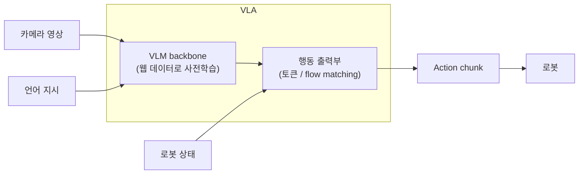

> [GPT 글]()의 Transformer는 다음 토큰을 예측하며 글을 씁니다. **VLA(Vision-Language-Action) 모델**은 이 틀을 로봇으로 가져옵니다. 카메라 영상(Vision)과 자연어 지시(Language)를 받아 로봇이 실행할 **행동(Action)**을 출력합니다. 이 글은 2022년 Gato부터 2025년 π0.6까지 15개 모델을 따라가며, VLA가 어떤 문제를 만났고 어떻게 풀어 왔는지 정리합니다.

## 0. 한눈에 보는 타임라인

| 시기 | 모델 | 기관 | 핵심 키워드 |
|---|---|---|---|
| 2022.05 | [Gato]() | DeepMind | 단일 Transformer로 다양한 작업을 수행하는 generalist agent |
| 2022.12 | [RT-1]() | Google | 대규모 실로봇 데이터 기반 Robotics Transformer |
| 2023.04 | [ACT]() | Stanford (ALOHA) | Action Chunking과 저비용 양팔 조작 |
| 2023.07 | [RT-2]() | Google DeepMind | VLM을 로봇 제어에 직접 연결한 Vision-Language-Action 모델 |
| 2024.06 | [OpenVLA]() | Stanford 외 | 오픈소스 7B VLA, Open X-Embodiment 데이터 활용 |
| 2024.10 | [π0 (Pi-0)]() | Physical Intelligence | Flow Matching 기반 연속 액션 생성 |
| 2025.02 | Helix | Figure AI | 휴머노이드를 위한 이중 시스템(System 1/2) 구조 |
| 2025.03 | [GR00T N1]() | NVIDIA | 휴머노이드 파운데이션 모델, 이중 시스템 구조 |
| 2025.03 | [Gemini Robotics 1.0]() | Google DeepMind | Gemini 2.0 기반 VLA와 Embodied Reasoning |
| 2025.04 | [π0.5]() | Physical Intelligence | 이종 데이터 co-training으로 open-world 일반화 |
| 2025.05 | [GR00T N1.5]() | NVIDIA | 합성 데이터 확장과 일반화 성능 개선 |
| 2025.06 | [SmolVLA]() | Hugging Face | 소형(450M) 오픈소스 VLA, 커뮤니티 데이터 학습 |
| 2025.09 | [WALL-OSS]() | X Square Robot | 오픈소스 VLA, embodied reasoning과 액션의 통합 |
| 2025.09 | [Gemini Robotics 1.5]() | Google DeepMind | 사고(thinking) 능력과 cross-embodiment 학습 |
| 2025.11 | [π0.6 (π\*0.6)]() | Physical Intelligence | 실사용 경험을 이용한 강화학습(RL)으로 성능 개선 |

모델 이름을 누르면 그 논문을 자세히 분석한 글로 이동합니다. Helix는 공개된 논문이 없어 이 글에서만 다루고, GR00T N1.5는 GR00T N1 글에서 함께 다룹니다.

순서는 시간을 따르되, 같은 문제를 푼 모델끼리 묶었습니다.

- **2장. 하나의 모델로 여러 작업을**: Gato, RT-1
- **3장. 행동을 묶어서 예측하기**: ACT
- **4장. VLM이 로봇의 두뇌가 되다**: RT-2, OpenVLA
- **5장. 연속적인 행동 생성**: π0
- **6장. 느린 머리와 빠른 손**: Helix, GR00T N1·N1.5, SmolVLA
- **7장. 생각하고 일반화하기**: Gemini Robotics 1.0, π0.5, WALL-OSS, Gemini Robotics 1.5
- **8장. 경험으로 더 잘하기**: π0.6

## 1. VLA란

### 입력과 출력

VLA는 관측 $$o_t$$를 받아 행동을 내는 정책 $$\pi(a_t \mid o_t)$$입니다. 관측은 보통 세 가지로 이루어집니다.

- **이미지**: 머리, 손목 등에 단 카메라 1~4대의 영상
- **언어 지시**: "컵을 싱크대에 넣어"
- **로봇 상태(proprioception)**: 현재 관절 각도, 그리퍼가 열린 정도

행동은 다음 목표 관절 각도나 손끝(end-effector)의 이동량 같은 **연속적인 실수 벡터**입니다. 최근 모델은 한 step이 아니라 앞으로 $$H$$ step의 행동 묶음 $$A_t = [a_t, a_{t+1}, \dots, a_{t+H-1}]$$을 한 번에 냅니다. 이를 **action chunk**라고 하며 3장에서 다룹니다.



### 학습: 대부분 모방학습

대부분의 VLA는 사람이 원격조작(teleoperation)으로 로봇을 움직여 모은 시연을 따라 하는 **behavior cloning**으로 학습합니다. behavior cloning에는 두 가지 한계가 있습니다. [DAgger 글]()에서 본 것처럼 작은 오차가 쌓여 학습 때 보지 못한 상태로 흘러가고(compounding error), 시연보다 잘할 수도 없습니다. 첫 번째는 3장의 ACT가, 두 번째는 8장의 π0.6이 정면으로 다룹니다.

### 모델마다 답이 다른 네 가지 질문

1. **행동을 어떻게 표현할까?** 정수 토큰으로 바꿀지, 연속값을 그대로 생성할지
2. **큰 모델로 어떻게 빠르게 제어할까?** 로봇은 초당 수십~수백 번 명령을 받아야 하지만, VLM은 클수록 느립니다.
3. **부족한 로봇 데이터를 무엇으로 채울까?** 다른 로봇, 웹 데이터, 시뮬레이션, 사람 영상
4. **시연을 넘어서려면?** 언어로 먼저 생각하기, 강화학습

---

## 2. 하나의 모델로 여러 작업을: Gato, RT-1

### Gato (DeepMind, 2022.05): 모든 것을 토큰으로

Gato(Reed et al., TMLR 2022)는 "LLM처럼 하나의 Transformer가 텍스트 밖의 일도 할 수 있을까?"라는 질문에서 출발합니다. 가중치 한 벌을 가진 1.2B decoder-only Transformer가 Atari 게임, 이미지 캡션, 대화, 실제 로봇팔로 블록 쌓기까지 **604개 작업**을 합니다. 방법은 모든 데이터를 하나의 토큰 열로 바꾸는 것입니다.

| 데이터 | 변환 방법 | 토큰 번호 |
|---|---|---|
| 텍스트 | SentencePiece(32,000개 subword) | 0 ~ 31,999 |
| 이미지 | 16×16 패치로 나눠 ResNet 블록으로 임베딩 ([ViT]()와 같은 패치 방식) | 정수 토큰 대신 임베딩 |
| 이산값(Atari 버튼) | 정수 그대로 | 0 ~ 1,023 |
| 연속값(관절 각도, 토크) | mu-law로 [-1, 1]에 압축 → 1,024개 구간 | 32,000 ~ 33,023 |

연속값은 범위가 제각각이라 먼저 **mu-law**로 [-1, 1]에 압축합니다. 원래 WaveNet이 음성 신호에 쓴 방법입니다.

$$
F(x) = \text{sgn}(x)\,\frac{\log(\lvert x\rvert\mu + 1)}{\log(M\mu + 1)},\qquad \mu = 100,\ M = 256
$$

0 근처의 작은 값은 넓게 펼치고 큰 값은 좁게 모으므로, 같은 1,024개 구간으로도 작은 움직임을 세밀하게 구분할 수 있습니다.

**결과와 한계.** 604개 작업 중 450개 이상에서 전문가 점수의 50%를 넘었습니다. 하지만 학습 데이터 대부분은 시뮬레이션에서 강화학습 에이전트가 만든 것이었고, 실제 로봇 작업은 Sawyer 로봇팔로 블록을 쌓는 것 하나였습니다.

눈여겨볼 점은 모델 크기를 정한 이유입니다. 논문은 **실제 로봇을 실시간으로 제어할 수 있는 크기**로 1.2B를 골랐다고 밝힙니다. 블록 쌓기 로봇은 20Hz(0.05초마다 한 번)로 움직입니다. 평가 때 context를 1로 줄이고 행동 토큰을 하나씩 차례로 뽑지 않고 한 번에 뽑도록 바꿨는데도, 로봇에 단 RTX 3090에서 한 번 추론하는 데 0.05초보다 약 0.01초 더 걸렸습니다. **큰 모델은 느리다**는 문제는 이후 VLA를 계속 따라다닙니다.

### RT-1 (Google, 2022.12): 실제 로봇 데이터를 대량으로

언어·비전 모델은 인터넷 규모의 데이터로 일반화 능력을 얻었지만, 로봇에는 그런 데이터가 없었습니다. RT-1(Brohan et al., 2022)은 데이터부터 만들었습니다. 이동형 매니퓰레이터 **13대**로 **17개월** 동안 **700개 이상의 작업**, **13만 개 에피소드**를 모았습니다.

모델은 로봇에서 빠르게 돌도록 작게 설계했습니다.

1. 최근 이미지 6장(300×300)을 ImageNet으로 사전학습한 **EfficientNet-B3**에 넣습니다. 지시문은 Universal Sentence Encoder로 임베딩하고, **FiLM** 층으로 CNN 중간 특징에 반영합니다. 이미지 한 장이 9×9 = 81개 토큰이 됩니다.
2. **TokenLearner**가 이미지당 81개 토큰을 8개로 줄여, 6장에서 48개 토큰이 남습니다.
3. 8층, 19M 파라미터의 decoder-only Transformer가 행동 토큰을 냅니다.

전체 35M 파라미터이고, **3Hz**로 동작합니다.

**행동은 256개 구간의 토큰으로.** 행동은 팔 7차원(x, y, z, roll, pitch, yaw, 그리퍼 열림), 이동 베이스 3차원(x, y, yaw), 모드 1차원(팔 제어 / 베이스 제어 / 종료)입니다. 각 차원의 범위를 **256개 구간(bin)**으로 균등하게 나눠 정수 토큰으로 바꾸고, 분류 문제처럼 cross entropy로 학습합니다.

**결과.** 학습한 작업 97%, 처음 보는 지시 76%, 방해물이 있을 때 83%, 배경이 바뀌었을 때 59%의 성공률로 비교 모델(Gato, BC-Z)보다 크게 높았습니다. 이 비교의 Gato는 RT-1과 비슷한 37M으로 줄인 버전입니다. 원래 크기인 1.2B는 로봇에서 추론 한 번에 1.9초가 걸렸기 때문입니다. 다른 로봇(Kuka)의 데이터를 섞자 관련 평가가 22%에서 39%로 올라, **다른 로봇의 데이터도 도움이 된다**는 것도 보였습니다.

> 연속값을 굳이 토큰으로 바꾸는 이유가 있습니다. RT-1의 ablation에서 행동을 **연속값(가우시안 출력 + MSE)**으로 바꾸자, 학습한 작업은 97%에서 68%로, 처음 보는 작업은 76%에서 43%로 떨어졌습니다. 256개 클래스의 확률은 봉우리가 여러 개인(multi-modal) 분포도 표현하지만, 가우시안은 [Diffusion-QL 글]()의 예처럼 서로 다른 시연의 **평균**으로 무너지기 때문입니다.
{: .prompt-info }

---

## 3. 행동을 묶어서 예측하기: ACT (Stanford, 2023.04)

ACT는 언어 지시를 받지 않으므로 엄밀히는 VLA가 아닙니다. 하지만 ACT의 **action chunking**은 이후 π0, GR00T, Gemini Robotics, SmolVLA가 모두 가져다 쓰는 기본 부품이 됩니다.

### ALOHA: 2만 달러로 만든 양팔 로봇

Zhao et al.(2023)은 건전지 끼우기, 반투명한 소스 컵 뚜껑 열기 같은 **정밀한 양팔 작업**을 값싼 하드웨어로 배우는 것을 목표로 합니다. 이를 위해 만든 **ALOHA**는 사람이 작은 로봇팔(leader)을 손으로 움직이면 큰 로봇팔(follower)이 관절 각도를 그대로 따라 하는 원격조작 장치로, 전체 비용이 2만 달러 이하입니다. 카메라 4대의 영상과 관절 각도를 **50Hz**로 기록합니다.

### 문제: 50Hz에서는 오차가 빨리 쌓인다

50Hz로 10초짜리 작업을 하면 행동을 500번 정해야 합니다. 한 step씩 예측하면 매번의 작은 오차가 쌓여 학습 데이터에 없던 상태로 흘러갑니다. 또 사람 시연에는 중간에 잠깐 멈추는 구간처럼 **현재 관측만으로는 설명되지 않는** 행동이 섞여 있습니다.

### Action Chunking과 Temporal Ensembling

ACT는 다음 한 step이 아니라 **다음 $$k$$ step의 목표 관절 각도**를 한 번에 예측합니다. 정책이 결정을 내리는 횟수가 $$1/k$$로 줄어 오차가 쌓일 기회도 줄어듭니다. 시뮬레이션 실험에서 성공률이 $$k = 1$$일 때 1%에서 $$k = 100$$(2초 분량)일 때 44%로 올랐고, $$k$$를 200, 400으로 더 키우면 거의 open-loop 제어가 되어 조금 떨어졌습니다.

chunk를 끝까지 실행하고 다음 chunk로 넘어가면 경계에서 행동이 툭 끊깁니다. 그래서 ACT는 **매 step 새 chunk를 예측**하고, 현재 시점 $$t$$의 행동으로 쌓여 있는 여러 예측을 가중 평균합니다.

$$
a_t = \frac{\sum_i w_i\,\hat{a}_t^{(i)}}{\sum_i w_i},\qquad w_i = \exp(-m \cdot i)
$$

$$\hat{a}_t^{(i)}$$는 이전 여러 시점에 만든 chunk들이 예측한 시점 $$t$$의 행동이고, $$i = 0$$이 가장 오래된 예측입니다. $$m$$이 작을수록 새 관측이 빨리 반영됩니다(공식 코드는 $$m = 0.01$$). 아래는 예측마다 오차가 조금씩 다른 정책으로 두 방식을 비교한 장난감 실험입니다.

```python
import numpy as np

rng = np.random.default_rng(0)
T, k, m = 300, 50, 0.01                                # 300 step 실행, chunk 길이 50, ACT 코드의 m
target = np.sin(np.linspace(0, 3 * np.pi, T + k))      # 따라가야 할 행동(예: 관절 각도)

def predict_chunk(t):
    """t 시점에서 다음 k step을 예측. 예측마다 오차가 다르고, 먼 미래일수록 커진다."""
    return target[t:t + k] + rng.normal(0, 0.03) + rng.normal(0, 0.002) * np.arange(k)

# (1) chunk를 k step 동안 그대로 실행한 뒤 다시 예측
naive = np.concatenate([predict_chunk(t) for t in range(0, T, k)])[:T]

# (2) 매 step 예측하고, 현재 시점의 여러 예측을 지수 가중 평균 (temporal ensembling)
buffer = [[] for _ in range(T + k)]
ensembled = np.zeros(T)
for t in range(T):
    for i, a in enumerate(predict_chunk(t)):
        buffer[t + i].append(a)                        # 오래된 예측부터 쌓인다
    preds = np.array(buffer[t])
    w = np.exp(-m * np.arange(len(preds)))             # w_0: 가장 오래된 예측의 가중치
    ensembled[t] = (w * preds).sum() / w.sum()

for name, a in [("chunk 그대로 실행", naive), ("temporal ensembling", ensembled)]:
    err = np.abs(a - target[:T]).mean()
    jump = np.abs(np.diff(a)).max()
    print(f"{name}: 평균 오차 {err:.4f}, 이웃한 step 사이 최대 변화 {jump:.4f}")
print(f"참고: target 자체의 최대 변화 {np.abs(np.diff(target[:T])).max():.4f}")
```

```text
chunk 그대로 실행: 평균 오차 0.0371, 이웃한 step 사이 최대 변화 0.1507
temporal ensembling: 평균 오차 0.0074, 이웃한 step 사이 최대 변화 0.0429
참고: target 자체의 최대 변화 0.0270
```

chunk를 그대로 실행하면 chunk가 바뀌는 순간 행동이 0.15만큼 튑니다. temporal ensembling은 여러 예측의 오차가 평균으로 상쇄되어 더 부드럽고 정확합니다. 대신 매 step 모델을 실행해야 하므로 추론 횟수가 $$k$$배 늘어납니다.

### CVAE: 같은 상황에서도 사람은 다르게 움직인다

사람은 같은 상황에서도 매번 조금씩 다르게 움직입니다. ACT는 이를 **CVAE(Conditional VAE)**로 다룹니다.

- **Encoder**(학습 때만 사용): 관절 각도와 정답 action chunk를 보고 그 시연의 "스타일" 변수 $$z$$를 추정합니다.
- **Decoder = 정책**: 카메라 4대의 영상(ResNet18 특징), 관절 각도, $$z$$를 Transformer encoder–decoder에 넣어 $$k \times 14$$ 크기의 목표 관절 각도(양팔 7 + 7)를 냅니다.
- **추론**: $$z$$를 사전분포의 평균인 0으로 둡니다.

CVAE를 빼고 L1 loss만으로 학습하면, 스크립트로 만든(매번 똑같은) 시연에서는 거의 차이가 없었지만 사람 시연에서는 성공률이 35.3%에서 2%로 떨어졌습니다.

### 결과

약 80M 파라미터 모델을 작업마다 처음부터 학습합니다(RTX 2080 Ti 1장으로 약 5시간). 작업당 시연 50개, 10~20분 분량의 데이터로 지퍼백 열기 88%, 건전지 끼우기 96%, 소스 컵 열기 84%의 성공률을 냈습니다. 반면 공중에서 벨크로 케이블 타이를 고리에 끼우는 작업은 단계마다 성공률이 반씩 줄어 최종 20%에 그쳤습니다.

---

## 4. VLM이 로봇의 두뇌가 되다: RT-2, OpenVLA

### RT-2 (Google DeepMind, 2023.07): 행동을 텍스트로 쓰자

RT-1의 사전학습은 ImageNet 수준이었습니다. RT-2(Brohan et al., 2023)는 웹 규모 데이터로 학습한 **VLM 자체를 로봇 정책으로** 바꿉니다. 행동을 숫자 문자열로 써서 VLM이 질문의 "답"으로 출력하게 합니다.

- 행동 8개 값: 종료 여부 1 + 위치 변화 3 + 회전 변화 3 + 그리퍼 1
- 연속값은 256개 구간으로 나눠 정수로 씁니다. 예: `1 128 91 241 5 101 127 217`
- PaLI-X는 1000 이하의 정수마다 고유 토큰이 있어 그대로 쓰고, PaLM-E는 가장 드물게 쓰이는 토큰 256개를 행동 토큰으로 덮어씁니다.
- 입력은 VQA 형식: "Q: what action should the robot take to [지시]? A:"

논문은 이런 모델을 **Vision-Language-Action(VLA) 모델**이라고 불렀고, VLA라는 이름이 여기서 자리 잡았습니다. backbone으로는 PaLI-X(5B, 55B)와 PaLM-E(12B)를 썼습니다.

**Co-fine-tuning.** 로봇 데이터로만 fine-tuning하면 VLM이 웹에서 배운 지식을 잊습니다. RT-2는 원래의 웹 데이터(VQA, 캡션)를 섞어 함께 학습하되, 배치 안에서 로봇 데이터의 비중을 높입니다. 또 로봇 행동을 물을 때는 **유효한 행동 토큰만 샘플링**하도록 출력을 제한합니다.

**결과: 웹 지식이 행동이 되다.** 약 6,000번의 실제 평가에서 처음 보는 물체·배경·환경에서의 성공률이 RT-1의 약 2배였습니다. 로봇 데이터에 없던 지시도 수행했습니다.

- "멸종된 동물을 집어" 같은 지시를 이해하고 수행
- 숫자나 아이콘 위에 물건 놓기, 가장 작은 물체나 특정 물체와 가장 가까운 물체 고르기
- Chain-of-thought를 붙이면 "즉석 망치로 쓸 물건"으로 돌을, "피곤한 사람에게 줄 음료"로 에너지 드링크를 고름

**대가는 속도.** 55B 모델은 로봇에 올릴 수 없어, 여러 TPU가 있는 클라우드에서 돌리고 네트워크로 결과를 받았습니다. 그래도 55B는 1~3Hz, 5B는 약 5Hz였습니다. 모델은 공개되지 않았습니다.

### OpenVLA (Stanford 외, 2024.06): 공개된 7B VLA

OpenVLA(Kim et al., 2024)는 RT-2 방식을 누구나 쓰고 고칠 수 있게 공개한 모델입니다.

- **구조**: Prismatic-7B VLM. SigLIP과 DINOv2 특징을 합친 비전 인코더(약 600M) → 2층 MLP projector → Llama 2 7B
- **데이터**: 여러 기관이 22종 로봇의 데이터를 모은 **Open X-Embodiment(OXE)**에서 고른 97만 개 궤적
- **학습**: A100 64장으로 14일(21,500 A100-시간), 27 epoch

**행동 토큰화.** RT-1과 RT-2는 각 차원의 범위를 균등하게 256개로 나눴습니다. OpenVLA는 데이터의 **1%~99% 분위수** 사이만 256개로 나눠, 드문 극단값 때문에 구간이 넓어지는 것을 막습니다. 행동 토큰으로는 Llama 토크나이저에서 가장 덜 쓰이는 마지막 256개 토큰을 씁니다.

```python
import numpy as np

rng = np.random.default_rng(0)
actions = rng.normal(0.0, 0.05, 10_000)          # 대부분의 행동은 작은 이동량
actions[:10] = rng.uniform(-1.0, 1.0, 10)        # 드물게 섞인 큰 값(outlier)

def make_tokenizer(lo, hi, n_bins=256):
    edges = np.linspace(lo, hi, n_bins + 1)
    centers = (edges[:-1] + edges[1:]) / 2
    encode = lambda x: np.clip(np.digitize(x, edges) - 1, 0, n_bins - 1)   # 실수 → 토큰 id(0~255)
    decode = lambda tok: centers[tok]                                       # 토큰 id → 실수
    return encode, decode

for name, (lo, hi) in {"min-max": (actions.min(), actions.max()),
                       "1~99% 분위수": tuple(np.quantile(actions, [0.01, 0.99]))}.items():
    encode, decode = make_tokenizer(lo, hi)
    tokens = encode(actions)
    err = np.abs(decode(tokens) - actions)
    print(f"{name}: bin 폭 {(hi - lo) / 256:.4f}, 사용한 bin {len(np.unique(tokens))}/256, "
          f"오차 중앙값 {np.median(err):.5f}, 최대 {err.max():.3f}")
```

```text
min-max: bin 폭 0.0069, 사용한 bin 58/256, 오차 중앙값 0.00175, 최대 0.003
1~99% 분위수: bin 폭 0.0009, 사용한 bin 256/256, 오차 중앙값 0.00023, 최대 0.880
```

전체 범위로 나누면 outlier 10개 때문에 256개 구간 중 58개만 쓰입니다. 분위수로 나누면 구간 폭이 약 1/8로 줄고 모든 구간을 씁니다. 대신 범위 밖의 드문 큰 값은 잘려(clip) 오차가 커집니다(최대 0.880). 대부분의 행동을 세밀하게 표현하는 대가로 드문 큰 움직임을 포기하는 셈입니다.

**결과.** 29개 작업에서 55B RT-2-X보다 7배 작은 크기로 성공률이 16.5%p 높았습니다. 새 로봇에 맞춰 fine-tuning한 실험에서도 처음부터 학습한 Diffusion Policy를 앞섰습니다. 실제로 쓰기 쉽게 만드는 데도 신경 썼습니다.

- **LoRA**: 파라미터의 1.4%만 학습해도 전체 fine-tuning과 비슷했습니다(68.2% vs 69.7%). A100 1장으로 10~15시간이면 됩니다.
- **[양자화]()**: 4bit로 GPU 메모리를 16.8GB에서 7.0GB로 줄여도 성공률이 유지됐습니다(71.3% → 71.9%).

**한계: 한 step씩, 한 토큰씩.** OpenVLA는 한 step의 행동(7차원 = 토큰 7개)을 토큰 하나씩 차례로 뽑습니다. RTX 4090에서 약 6Hz로, 50Hz가 필요한 정밀한 양팔 작업에는 부족합니다. 50Hz로 1초 분량(50 step)의 14차원 chunk를 같은 방식으로 내려면 토큰이 700개 필요합니다.

---

## 5. 연속적인 행동 생성: π0 (Physical Intelligence, 2024.10)

### VLM에 flow matching을 붙이다

π0(Black et al., 2024)는 빨래 개기처럼 **정밀하고 긴** 작업을 목표로 합니다. 이를 위해 행동을 토큰으로 바꾸지 않고, diffusion의 변형인 **flow matching**으로 연속적인 action chunk를 직접 생성합니다. Diffusion Policy(Chi et al., 2023)가 diffusion으로 로봇 행동을 잘 생성할 수 있음을 보였는데, π0는 이를 사전학습된 VLM과 합쳤습니다.

- **VLM**: PaliGemma(3B)가 이미지와 지시를 처리합니다.
- **Action expert**: 로봇 상태와 행동 토큰은 별도의 가중치(300M)로 처리합니다. 두 부분은 같은 Transformer의 self-attention 안에서 서로를 봅니다. 전문가가 둘인 mixture-of-experts와 비슷한 구조입니다.
- 전체 3.3B, chunk 길이 $$H = 50$$, 최대 **50Hz** 제어

Attention은 [이미지 + 지시] → [로봇 상태] → [노이즈가 섞인 행동] 세 블록으로 나뉘고, 앞 블록은 뒤 블록을 보지 않습니다. 그래서 이미지와 지시 부분은 한 번만 계산해 KV cache에 두고, 노이즈를 걷어 내는 10번의 step에서는 작은 action expert만 다시 계산합니다. RTX 4090에서 이미지 인코딩 14ms, 관측 처리 32ms, flow 10 step 27ms로 전체 73ms가 걸립니다.

### Flow matching

노이즈 $$\epsilon \sim \mathcal{N}(0, I)$$와 정답 chunk $$A$$를 직선으로 잇고, 그 위의 한 점에서 **어느 방향으로 움직여야 하는지(속도)**를 학습합니다.

$$
A^\tau = \tau\,\epsilon + (1-\tau)\,A,\qquad
\mathcal{L}(\theta) = \mathbb{E}\Big[\big\lVert v_\theta(A^\tau, o) - (\epsilon - A)\big\rVert^2\Big]
$$

$$\tau = 1$$이면 순수한 노이즈, $$\tau = 0$$이면 정답 행동입니다. 추론 때는 노이즈에서 출발해 학습한 속도를 거슬러 Euler 방법으로 10 step 이동합니다.

$$
A^{\tau - \delta} = A^\tau - \delta\, v_\theta(A^\tau, o),\qquad \delta = 0.1
$$

학습 때 $$\tau$$는 균등분포 대신 **노이즈가 많은 쪽**을 더 자주 뽑는 beta 분포에서 샘플링합니다. 이미지 생성에서는 노이즈가 아주 많을 때 "평균 이미지" 정도만 맞히면 되지만, 로봇은 관측이 행동을 강하게 제한하므로 관측이 주어졌을 때 행동의 평균을 맞히는 일 자체가 어렵다는 설명입니다.

> π0 논문 본문은 $$\tau = 0$$을 노이즈, $$\tau = 1$$을 행동으로 쓰지만, 공개 코드(openpi)는 반대로 $$\tau = 1$$의 노이즈에서 시작해 $$\tau = 0$$으로 갑니다. 이 글은 코드 쪽 표기를 따랐습니다.
{: .prompt-warning }

아래는 [Diffusion-QL 글]()의 "왼쪽 또는 오른쪽으로 피하기" 예제를 MSE 회귀와 flow matching으로 학습해 비교한 것입니다. 관측은 모두 같다고 두고 행동 분포만 학습합니다.

```python
import torch
import torch.nn as nn

torch.manual_seed(0)
N = 4096
actions = torch.cat([torch.randn(N // 2, 1) * 0.1 - 1,      # 왼쪽(-1)으로 피한 시연
                     torch.randn(N // 2, 1) * 0.1 + 1])     # 오른쪽(+1)으로 피한 시연

def mlp(n_in):
    return nn.Sequential(nn.Linear(n_in, 128), nn.SiLU(), nn.Linear(128, 128), nn.SiLU(), nn.Linear(128, 1))

# (1) MSE 회귀: 관측이 모두 같으므로 입력은 상수 하나
reg = mlp(1)
opt = torch.optim.Adam(reg.parameters(), 1e-3)
for _ in range(2000):
    loss = ((reg(torch.ones(N, 1)) - actions) ** 2).mean()
    opt.zero_grad(); loss.backward(); opt.step()

# (2) Flow matching: x_τ = τ·ε + (1-τ)·a 를 만들고, 속도 u = ε - a 를 맞히도록 학습
vel = mlp(2)
opt = torch.optim.Adam(vel.parameters(), 1e-3)
for _ in range(2000):
    eps, tau = torch.randn(N, 1), torch.rand(N, 1)
    x_tau = tau * eps + (1 - tau) * actions
    loss = ((vel(torch.cat([x_tau, tau], dim=1)) - (eps - actions)) ** 2).mean()
    opt.zero_grad(); loss.backward(); opt.step()

@torch.no_grad()
def sample(n, steps=10):
    x, dt = torch.randn(n, 1), 1.0 / steps                   # τ = 1(순수 노이즈)에서 시작
    for i in range(steps):
        tau = torch.full((n, 1), 1.0 - i * dt)
        x = x - dt * vel(torch.cat([x, tau], dim=1))          # τ = 0(행동) 쪽으로 Euler step
    return x

print(f"MSE 회귀의 출력: {reg(torch.ones(1, 1)).item():+.3f}")
s = sample(1000)
print(f"Flow matching 샘플: 왼쪽 {(s < -0.5).float().mean():.2f}, "
      f"오른쪽 {(s > 0.5).float().mean():.2f}, 가운데 {(s.abs() <= 0.5).float().mean():.2f}")
```

```text
MSE 회귀의 출력: -0.001
Flow matching 샘플: 왼쪽 0.46, 오른쪽 0.52, 가운데 0.02
```

MSE 회귀는 두 시연의 평균인 0, 즉 "정면으로 돌진"을 냅니다. flow matching은 같은 노이즈 분포에서 출발해도 왼쪽과 오른쪽 봉우리로 나뉘어 도착합니다.

### 데이터와 학습 방법

π0는 LLM처럼 **사전학습(pre-training)과 후학습(post-training)**을 나눕니다.

- **사전학습**: 직접 모은 약 10,000시간(7가지 로봇 구성, 68개 작업)의 데이터에 OXE 등 공개 데이터를 섞어 폭넓은 능력을 익힙니다.
- **후학습**: 빨래 개기처럼 어려운 작업은 고품질 데이터로 따로 fine-tuning해 정교함을 더합니다.

이렇게 건조기에서 빨래를 꺼내 개기, 식탁 치우기, 상자 조립, 달걀을 판에 담기 같은 작업을 해냈습니다. 코드와 가중치는 openpi 저장소로 공개되어 있습니다.

---

## 6. 느린 머리와 빠른 손: Helix, GR00T N1·N1.5, SmolVLA

VLM은 클수록 똑똑하지만 느립니다. 반면 휴머노이드의 손가락까지 부드럽게 움직이려면 초당 100번 이상 명령을 내야 합니다. 2025년 휴머노이드용 VLA는 이 문제를 **두 개의 시스템**으로 나눠 풉니다. 카너먼(Kahneman)이 말한 빠른 사고(System 1)와 느린 사고(System 2)에서 이름을 따왔습니다. [FeUdal Networks]()에서 Manager가 느린 주기로 방향을 정하고 Worker가 매 step 행동하던 것과 비슷한 분업입니다.

| | System 2 (느린 머리) | System 1 (빠른 손) |
|---|---|---|
| 역할 | 장면과 지시 이해 | 실시간 모터 제어 |
| Helix | 7B VLM, 7~9Hz | 80M Transformer, 200Hz |
| GR00T N1 | Eagle-2 VLM, 10Hz | DiT(flow matching), 120Hz |

### Helix (Figure AI, 2025.02)

Figure AI의 Helix는 휴머노이드 상체 전체를 하나의 VLA로 제어합니다. 손가락, 손목, 몸통, 머리 방향까지 **35자유도(DoF)**를 200Hz로 움직입니다.

- **S2**: 공개된 7B VLM이 7~9Hz로 장면과 지시를 이해하고, 그 의미를 **연속값 latent 벡터 하나**로 압축해 S1에 넘깁니다.
- **S1**: 80M 파라미터의 cross-attention encoder–decoder Transformer가 영상과 로봇 상태를 S2보다 훨씬 자주 받아, S2의 latent를 조건으로 200Hz로 행동을 냅니다.
- latent를 거쳐 기울기가 흐르므로 두 시스템을 **end-to-end**로 함께 학습합니다.

데이터는 약 500시간의 원격조작 데이터로, 회사는 기존 VLA 데이터의 5% 미만이라고 설명합니다. 영상 구간마다 VLM에게 "이 행동을 하게 하려면 어떤 지시를 했겠는가?"를 물어 **지시문을 거꾸로(hindsight) 붙였습니다**. 모델은 로봇에 달린 저전력 임베디드 GPU 2개에서 돌고, 하나의 가중치로 모든 행동을 하며, 같은 모델을 쓰는 로봇 두 대가 협업하는 모습도 보였습니다.

> Helix는 논문 없이 회사 블로그로만 공개되어 정량 평가가 거의 없습니다. 이 글의 회사 발표 수치는 서로 다른 로봇과 작업에서 잰 값이므로 모델끼리 직접 비교할 수 없습니다.
{: .prompt-warning }

### GR00T N1 (NVIDIA, 2025.03)

NVIDIA의 GR00T N1은 **누구나 받아 쓸 수 있는 휴머노이드 파운데이션 모델**입니다(GR00T-N1-2B 가중치 공개).

- **System 2**: Eagle-2 VLM. LLM의 마지막 층이 아니라 **12번째(중간) 층**의 특징을 쓰는데, 이쪽이 더 빠르고 성공률도 높았습니다.
- **System 1**: flow matching으로 학습한 DiT(Diffusion Transformer). 로봇 상태와 노이즈가 섞인 행동을 self-attention으로 처리하고, cross-attention으로 VLM 토큰을 봅니다. 16 step chunk를 L40 GPU에서 63.9ms에 만듭니다.
- **로봇마다 다른 입출력**: 로봇마다 상태·행동 차원이 다르므로 로봇별 MLP encoder와 decoder를 앞뒤에 둡니다.
- 전체 2.2B (VLM 1.34B)

GR00T N1의 핵심은 데이터를 쌓는 방식인 **데이터 피라미드**입니다.

| 층 | 데이터 | 양 | 행동 라벨 |
|---|---|---|---|
| 꼭대기 | 실제 로봇 원격조작 | 적음 | 있음 |
| 중간 | 시뮬레이션, 비디오 생성 모델로 만든 로봇 영상 | 중간 | 자동으로 생성 |
| 바닥 | 웹 데이터, 사람 1인칭 영상 | 많음 | 없음 |

- **시뮬레이션**: DexMimicGen으로 소수의 사람 시연을 불려, 사람이 9개월 동안 모아야 할 분량(78만 궤적, 6,500시간)을 11시간 만에 만들었습니다.
- **생성 영상(neural trajectory)**: 비디오 생성 모델을 fine-tuning해 실제 로봇 영상을 새로운 지시와 상황으로 늘렸습니다. 원격조작 데이터 88시간이 827시간 분량이 됐습니다.
- **행동 라벨이 없는 영상**: 연속한 두 프레임 사이의 변화를 VQ-VAE로 압축한 **latent action**을 행동 대신 학습 목표로 씁니다. 생성 영상에는 역동역학 모델(IDM)로 추정한 행동도 붙입니다.

### GR00T N1.5 (NVIDIA, 2025.05)

Computex 2025에서 발표한 개선판입니다. 큰 구조는 유지하고 VLM과 학습 방법을 고쳤습니다.

- **VLM 고정**: grounding을 강화한 Eagle 2.5 VLM을 사전학습과 fine-tuning 모두에서 얼립니다. VLM 안에서 비전 인코더와 LLM을 잇는 adapter를 단순화하고 LayerNorm을 더했습니다.
- **FLARE**(Future LAtent Representation Alignment): 미래 프레임을 생성하는 대신, 미래 장면의 **임베딩에 맞추는** 목표를 더했습니다. 행동 라벨이 없는 사람 1인칭 영상에서도 배울 수 있습니다.
- **GR00T-Dreams(DreamGen)**: 월드 모델(Cosmos)로 새로운 작업을 하는 로봇 영상을 만들고 행동을 추출합니다. NVIDIA는 사람이 모으면 3개월 가까이 걸릴 학습 데이터를 이 방식으로 36시간 만에 만들었다고 발표했습니다.

실제 GR-1 휴머노이드에서 지시를 제대로 따르는 비율이 46.6%에서 93.3%로, 전체 성공률이 43.3%에서 83.0%로 올랐습니다.

### SmolVLA (Hugging Face, 2025.06): 모델 자체를 작게

두 시스템으로 나누는 대신 **모델 전체를 작게** 만드는 방향도 있습니다. Hugging Face의 SmolVLA는 π0와 비슷한 구조(VLM + flow matching action expert)를 450M 파라미터로 줄였습니다.

- **작은 VLM**: SmolVLM-2(SigLIP + SmolLM2)에서 LLM의 **앞 16개 층만** 씁니다(layer skipping). VLM은 얼리고 action expert만 학습합니다.
- **적은 이미지 토큰**: 이미지를 여러 조각으로 나누는 tiling을 끄고, pixel shuffle로 프레임당 **64개 토큰**만 씁니다.
- **Action expert**(약 100M): VLM 특징을 보는 cross-attention 층과 행동끼리 보는 self-attention 층을 번갈아 쌓았습니다. flow matching 10 step으로 행동을 만듭니다.

**커뮤니티 데이터.** 사전학습 데이터는 연구실 데이터가 아니라 LeRobot 사용자들이 Hugging Face Hub에 올린 **481개 데이터셋(22.9K 에피소드, 10.6M 프레임)**입니다. "Hold", "Up"처럼 모호하거나 비어 있는 지시문은 Qwen2.5-VL-3B로 다시 붙였습니다. OpenVLA의 약 100만 궤적보다 훨씬 적은 양입니다.

**비동기 추론.** chunk를 다 실행한 뒤 다음 chunk를 예측하면, 예측하는 동안 로봇이 멈춥니다. SmolVLA는 행동 실행과 예측을 분리해, 남은 행동을 실행하는 동안 다음 chunk를 미리 계산합니다. 같은 작업을 평균 13.75초에서 9.7초로 약 30% 빨리 끝냈고, 정해진 시간 동안 집어 옮기기를 9번에서 19번으로 늘렸습니다.

단일 GPU로 학습하고 CPU에서도 돌릴 수 있는 크기인데도, 논문은 LIBERO·Meta-World 시뮬레이션과 저가 로봇팔(SO-100, SO-101) 실험에서 10배 큰 VLA와 비슷한 성능을 냈다고 보고합니다.

---

## 7. 생각하고 일반화하기: Gemini Robotics 1.0, π0.5, WALL-OSS, Gemini Robotics 1.5

처음 보는 집, 처음 보는 물건, 여러 단계로 이뤄진 작업은 로봇 데이터만으로 다 덮을 수 없습니다. 2025년 VLA들은 **웹 지식을 잃지 않으면서** 학습하고, **다음에 할 일을 언어로 먼저 정하는** 방향으로 갑니다.

### Gemini Robotics 1.0 (Google DeepMind, 2025.03)

Gemini 2.0 위에 두 모델을 만들었습니다.

- **Gemini Robotics-ER**(Embodied Reasoning): 로봇에 필요한 공간 이해를 강화한 VLM입니다. 2D·3D 물체 검출, 물체 위의 점 가리키기(pointing), 잡을 위치와 궤적 예측, 여러 카메라 사이의 대응점 찾기를 합니다. 이를 평가하는 ERQA 벤치마크도 공개했습니다.
- **Gemini Robotics**: Gemini Robotics-ER을 증류한 backbone 위에 만든 VLA입니다.

속도 문제는 **클라우드와 로봇으로 나눠** 풉니다. backbone은 클라우드에서 돌고(응답 160ms 미만), 로봇 컴퓨터의 **local action decoder**가 그 출력을 받아 action chunk를 만듭니다. 관측에서 행동까지 약 250ms가 걸리지만 chunk에 여러 행동이 들어 있어 실제 제어는 50Hz입니다.

ALOHA 2 로봇 여러 대로 12개월 동안 모은 수천 시간의 시연과 웹 데이터로 학습했습니다. 추가 fine-tuning으로 종이접기 여우, 도시락 싸기, 카드 게임 같은 길고 정밀한 작업을 해냈고, 새 작업은 시연 100개만으로도 배웠습니다. 양팔 Franka 로봇과 Apptronik의 휴머노이드 Apollo에도 적은 데이터로 적응했습니다.

### π0.5 (Physical Intelligence, 2025.04)

**처음 보는 집에서 청소하기.** π0.5의 목표는 학습 때 한 번도 보지 못한 집에서 부엌과 침실을 정리하는 것입니다. 그런데 실제 가정에서 이동형 로봇으로 모은 데이터는 약 100곳, 400시간뿐입니다. 그래서 π0.5는 **성격이 다른 데이터를 모두 섞어** 학습합니다(co-training). 첫 학습 단계에서는 예시의 97.6%가 가정용 이동 로봇이 아닌 다른 출처에서 왔습니다.

- **다른 로봇**: 여러 환경의 고정형 로봇팔, 실험실 데이터, OXE
- **고수준 subtask 예측**: 관측을 보고 "베개를 집어" 같은 다음 단계를 텍스트로 맞히기
- **말로 하는 지시**: 사람이 로봇에게 단계별로 말해 준 지시
- **웹 데이터**: 이미지 캡션, VQA, 물체 검출

**한 모델 안의 두 단계 추론.** 추론 때 π0.5는 같은 모델로 먼저 다음 subtask를 텍스트로 생성하고("pick up the pillow"), 그 subtask를 조건으로 action expert가 연속 행동을 생성합니다. [Thought Cloning]()의 "생각 → 행동" 구조를 VLA 하나에 넣은 셈입니다.

**학습은 토큰으로, 추론은 flow matching으로.** 사전학습에서는 행동을 FAST 토큰으로 바꿔 텍스트처럼 다음 토큰 예측으로 학습합니다(280k step). 후학습에서 flow matching action expert를 붙여 연속 행동을 생성하게 합니다. 이산 토큰은 VLM 학습 방식과 잘 맞아 학습이 빠르지만 토큰을 하나씩 뽑는 추론이 느리고, flow matching은 추론이 빠르기 때문입니다.

#### FAST: 행동 토큰을 압축하기

FAST(Pertsch et al., 2025)는 같은 회사가 π0.5 직전인 2025년 1월에 발표한 행동 토큰화 방법입니다. 50Hz처럼 빠른 제어에서 step마다 토큰을 하나씩 만들면 이웃한 토큰이 거의 같아, 앞 토큰을 베끼기만 해도 loss가 낮아집니다. 다음 토큰 예측으로 배울 것이 거의 없어지는 셈입니다. FAST는 JPEG가 이미지를 압축하듯 행동 신호를 **DCT(이산 코사인 변환)**로 주파수 성분으로 바꾸고, 반올림한 뒤 **BPE**로 묶습니다.

```python
import numpy as np
from scipy.fft import dct, idct

t = np.linspace(0, 1, 50)                                   # 50Hz로 1초 = 50 step chunk
chunk = 0.6 * np.sin(2 * np.pi * 0.7 * t) + 0.3 * t         # 부드럽게 움직이는 관절 하나

naive = np.round((chunk + 1) / 2 * 255).astype(int)         # step마다 256 bin 토큰 하나
print("step별 토큰:", naive[:10])

coef = np.round(dct(chunk, norm="ortho") * 10).astype(int)  # DCT 후 스케일·반올림
print("DCT 계수  :", coef[:10], f"→ 0이 아닌 값 {np.count_nonzero(coef)}/50개")
recon = idct(coef / 10, norm="ortho")
print(f"DCT 계수로 복원한 오차: 최대 {np.abs(recon - chunk).max():.3f}")
```

```text
step별 토큰: [128 135 143 150 158 165 171 178 184 190]
DCT 계수  : [ 23  13 -18  -4  -2  -1  -1  -1  -1   0] → 0이 아닌 값 9/50개
DCT 계수로 복원한 오차: 최대 0.046
```

step별 토큰은 앞 토큰에 7 안팎을 더한 값이 계속 이어집니다. DCT 계수는 저주파 몇 개에 정보가 몰리고 나머지는 0이 되어, BPE가 0의 반복과 자주 나오는 조합을 묶으면 토큰 수가 크게 줄어듭니다. 반올림 전에 곱하는 배율(여기서는 10)이 정밀도와 토큰 수를 함께 정합니다. FAST로 학습한 π0-FAST는 π0와 비슷한 성능을 내면서 학습은 최대 5배 빨랐습니다.

### WALL-OSS (X Square Robot, 2025.09)

중국 X Square Robot이 공개한 WALL-OSS는 문제를 이렇게 봅니다. VLM은 공간과 몸을 이해하는 능력이 약하고, 여기에 행동 head를 붙여 로봇 데이터로 학습하면 가중치가 흔들려 원래 지식이 지워집니다. 반대로 VLM을 보호하려고 느슨하게 연결하면 언어와 행동이 잘 이어지지 않습니다.

- **구조**: Qwen2.5-VL-3B가 backbone입니다. self-attention은 공유하고 FFN만 **비전-언어용과 행동용으로 나눈** mixture-of-experts(정적 라우팅) 구조입니다.
- **Uni-CoT**: 지시 → 생각(chain-of-thought) → subtask → 연속 행동을 **한 모델에서 end-to-end로** 잇습니다. 중간 추론을 조건으로 쓰거나 건너뛸 수 있게 학습해(path-drop), 상황에 따라 생각을 거치거나 바로 행동합니다.
- **2단계 학습**: 먼저 embodied VQA와 FAST 토큰 행동으로 VLM에 행동 감각을 심고(Inspiration), 그다음 flow matching head를 붙여 연속 행동을 학습합니다(Integration: VLM을 얼리고 head만 학습 → 함께 학습).
- **데이터**: 자체 수집 로봇 데이터, 공개 데이터, 멀티모달 VQA를 합쳐 1만 시간 이상

"이산 토큰으로 먼저, 연속 행동은 나중에"라는 순서는 π0.5와 같습니다. flow matching 버전(WALL-OSS-FLOW)과 FAST 버전(WALL-OSS-FAST)의 가중치를 코드와 함께 공개했습니다.

### Gemini Robotics 1.5 (Google DeepMind, 2025.09)

1.0처럼 두 모델로 이루어집니다.

- **Gemini Robotics-ER 1.5**: 전체 작업을 계획하는 VLM입니다. 작업을 단계로 나누고, 진행 상황을 판단하고, 필요하면 **웹 검색 같은 도구**를 부릅니다.
- **Gemini Robotics 1.5**: 각 단계를 실행하는 VLA입니다.

ER 1.5가 orchestrator로 사용자의 요청을 해석하고 계획을 세워 VLA에 짧은 지시를 내리는 **agentic 시스템**입니다. 예를 들어 분리수거 작업에서는 물건이 어느 통에 들어가야 하는지 웹 검색으로 확인한 뒤 퇴비·재활용·일반 쓰레기 통에 나눠 담습니다. VLA 쪽 변화는 두 가지입니다.

**Thinking VLA.** 행동하기 전에 자연어로 생각합니다. "옷을 색깔별로 분류해"를 바로 행동으로 옮기는 대신, "그리퍼를 왼쪽으로 옮겨 옷에 가까이 간다"처럼 짧은 단계로 바꾼 다음 그 문장을 행동으로 옮깁니다. 여러 단계로 된 작업에서 진행 점수가 크게 올랐고, 로봇이 무엇을 하려는지 사람이 읽을 수도 있습니다.

**Motion Transfer.** ALOHA, 양팔 Franka, Apollo 휴머노이드처럼 몸이 다른 로봇의 데이터를 한 모델로 학습해, 로봇별 후학습 없이 세 로봇을 모두 제어합니다. 한 로봇의 데이터에만 있던 작업을 다른 로봇이 **zero-shot**으로 해내는 기술 이전도 보였습니다. 1.0이 새 로봇마다 fine-tuning이 필요했던 것과 다른 점입니다.

---

## 8. 경험으로 더 잘하기: π0.6 (Physical Intelligence, 2025.11)

지금까지의 VLA는 모두 모방학습으로 학습했습니다. 모방학습은 시연보다 잘할 수 없고, 실행 중 실수에서 회복하는 법도 배우기 어렵습니다. Physical Intelligence는 로봇이 실제로 일하며 쌓은 경험으로 VLA를 강화학습하는 방법을 내놓았습니다. 기본 모델이 π0.6이고, 이 방법으로 경험을 학습한 모델을 **π\*0.6**이라고 부릅니다.

### π0.6 모델

π0.5를 키운 모델입니다. VLM backbone이 Gemma 3 4B로 바뀌고 action expert가 860M으로 커졌으며, 50Hz로 관절 각도와 그리퍼 명령을 냅니다. 학습은 **Knowledge Insulation**(KI) 방식을 따릅니다. 모델 전체를 FAST 토큰 같은 이산 출력과 연속 행동으로 함께 학습하되, flow matching action expert에서 나오는 기울기는 stop-gradient로 막아 VLM의 지식이 흔들리지 않게 합니다.

### Recap: advantage를 조건으로 주는 강화학습

Recap(RL with Experience and Corrections via Advantage-conditioned Policies)은 세 종류의 데이터를 씁니다.

1. 사람의 **시연**
2. 로봇이 스스로 수행한 **자율 실행**과 그 성공·실패
3. 실행 중 사람이 원격조작으로 끼어들어 바로잡은 **교정(intervention)**

학습은 세 단계로 이뤄집니다.

1. **가치 함수**: Gemma 3 기반의 작은 VLM(670M)이 "지금 상태에서 성공까지 몇 step 남았나"를 예측합니다. 성공한 에피소드는 남은 step 수에 음수를 붙인 값을, 실패한 에피소드는 큰 음수를 목표로 학습합니다.
2. **Advantage 표시**: 각 행동이 진행을 기대보다 얼마나 앞당겼는지(advantage)를 구하고, 작업별 기준값 $$\epsilon$$보다 크면 좋은 행동($$I_t = 1$$)으로 표시합니다. 사람의 교정은 항상 좋은 행동으로 둡니다.
3. **조건부 정책 학습**: 정책 입력에 "Advantage: positive" 또는 "Advantage: negative"라는 텍스트로 $$I_t$$를 넣고 모든 데이터로 학습합니다. 30%는 이 조건을 빼고 학습해, 조건이 있는 정책과 없는 정책을 함께 표현하게 합니다.

식으로 쓰면 다음과 같습니다. $$\ell$$은 언어 지시, $$\alpha$$는 두 항의 비중입니다.

$$
I_t = \mathbf{1}\big[A(o_t, a_t) > \epsilon\big]
$$

$$
\min_\theta\ \mathbb{E}\Big[-\log \pi_\theta(a_t \mid o_t, \ell) - \alpha \log \pi_\theta(a_t \mid I_t, o_t, \ell)\Big]
$$

로봇을 실행할 때는 항상 "Advantage: positive"를 넣습니다. 그러면 정책은 데이터 속 행동 중 **기대보다 나았던 행동**의 분포에서 샘플링합니다. diffusion의 classifier-free guidance와 같은 원리이고, [IQL]()의 AWR처럼 advantage로 좋은 행동을 골라 배우는 방법과도 닮았습니다.

왜 [PPO]() 같은 policy gradient를 쓰지 않을까요? policy gradient에는 행동의 log-likelihood가 필요한데, flow matching 모델은 이를 쉽게 계산할 수 없습니다. advantage를 조건으로 주면 지도학습과 같은 방식으로 학습하면서도 정책을 개선할 수 있습니다. 논문의 비교에서도 빨래 개기 작업의 처리량이 AWR, PPO 방식보다 훨씬 높았습니다.

### 결과

가장 어려운 작업들에서 처리량(시간당 성공 횟수)이 2배 넘게 늘고 실패율은 절반 정도로 줄었습니다. 에스프레소 음료를 13시간 연속으로 만들고, 처음 가 본 집에서 2시간 넘게 멈추지 않고 빨래를 개고, 공장에서 실제 포장에 쓰는 상자를 조립했습니다.

---

## 9. 정리

| 질문 | 처음 | 지금 |
|---|---|---|
| 행동을 어떻게 표현할까 | 차원마다 256개 구간의 토큰(RT-1, RT-2, OpenVLA) | flow matching으로 action chunk 생성(π0 이후). 학습 단계에서는 압축 토큰(FAST)도 함께 사용(π0.5, WALL-OSS, π0.6) |
| 큰 모델로 어떻게 빠르게 | 모델을 작게(RT-1) 하거나 클라우드에서 실행(RT-2) | 느린 VLM과 빠른 정책으로 분리(Helix, GR00T), 클라우드 + 로컬 decoder(Gemini Robotics), 작은 모델과 비동기 추론(SmolVLA) |
| 데이터를 어디서 | 한 회사의 로봇으로 대량 수집(RT-1) | 여러 로봇(OXE), 웹 데이터 co-training, 시뮬레이션·생성 영상, 사람 영상, 커뮤니티 데이터 |
| 어떻게 일반화할까 | 웹 지식을 암묵적으로 활용(RT-2) | 다음 할 일과 생각을 텍스트로 먼저 생성(π0.5, WALL-OSS, Gemini Robotics 1.5) |
| 시연을 넘어서려면 | 모방학습뿐 | 실제 경험과 사람의 교정으로 강화학습(π\*0.6) |

3년 반 동안 VLA는 "행동을 토큰으로 바꿔 VLM에 붙이면 된다"에서 출발해, 행동은 연속 생성 모델에 맡기고 VLM은 이해와 계획을 맡는 분업 구조로 옮겨 왔습니다. 그리고 마지막에는 모방학습의 천장을 넘기 위해 다시 강화학습을 불러왔습니다.

남은 문제도 분명합니다.

- **평가**: 대부분 각자의 로봇과 작업으로 평가해 숫자를 직접 비교하기 어렵습니다. LIBERO 같은 시뮬레이션 벤치마크는 실제 환경의 어려움을 다 담지 못합니다.
- **데이터 규모**: π0의 10,000시간도 웹 텍스트·이미지에 비하면 아주 적습니다. 합성 데이터와 사람 영상이 이 차이를 얼마나 메울지가 관건입니다.
- **안전**: 로봇은 실제 공간에서 움직이므로 작은 실수도 사고가 될 수 있습니다. Gemini Robotics 1.5처럼 생각을 언어로 드러내면, [Thought Cloning]()의 precrime intervention처럼 위험한 행동을 실행 전에 막을 여지가 생깁니다.

## References

- Reed et al., "A Generalist Agent," TMLR 2022. [arXiv:2205.06175](https://arxiv.org/abs/2205.06175)
- Brohan et al., "RT-1: Robotics Transformer for Real-World Control at Scale," 2022. [arXiv:2212.06817](https://arxiv.org/abs/2212.06817)
- Zhao et al., "Learning Fine-Grained Bimanual Manipulation with Low-Cost Hardware (ACT, ALOHA)," 2023. [arXiv:2304.13705](https://arxiv.org/abs/2304.13705)
- Brohan et al., "RT-2: Vision-Language-Action Models Transfer Web Knowledge to Robotic Control," 2023. [arXiv:2307.15818](https://arxiv.org/abs/2307.15818)
- Open X-Embodiment Collaboration, "Open X-Embodiment: Robotic Learning Datasets and RT-X Models," 2023. [arXiv:2310.08864](https://arxiv.org/abs/2310.08864)
- Kim et al., "OpenVLA: An Open-Source Vision-Language-Action Model," 2024. [arXiv:2406.09246](https://arxiv.org/abs/2406.09246)
- Chi et al., "Diffusion Policy: Visuomotor Policy Learning via Action Diffusion," 2023. [arXiv:2303.04137](https://arxiv.org/abs/2303.04137)
- Black et al., "π0: A Vision-Language-Action Flow Model for General Robot Control," 2024. [arXiv:2410.24164](https://arxiv.org/abs/2410.24164)
- Pertsch et al., "FAST: Efficient Action Tokenization for Vision-Language-Action Models," 2025. [arXiv:2501.09747](https://arxiv.org/abs/2501.09747)
- Figure AI, "Helix: A Vision-Language-Action Model for Generalist Humanoid Control," 2025. <https://www.figure.ai/news/helix>
- NVIDIA, "GR00T N1: An Open Foundation Model for Generalist Humanoid Robots," 2025. [arXiv:2503.14734](https://arxiv.org/abs/2503.14734)
- Gemini Robotics Team, "Gemini Robotics: Bringing AI into the Physical World," 2025. [arXiv:2503.20020](https://arxiv.org/abs/2503.20020)
- Physical Intelligence, "π0.5: a Vision-Language-Action Model with Open-World Generalization," 2025. [arXiv:2504.16054](https://arxiv.org/abs/2504.16054)
- Driess et al., "Knowledge Insulating Vision-Language-Action Models: Train Fast, Run Fast, Generalize Better," 2025. [arXiv:2505.23705](https://arxiv.org/abs/2505.23705)
- NVIDIA GEAR, "GR00T N1.5," 2025. <https://research.nvidia.com/labs/gear/gr00t-n1_5/>
- Shukor et al., "SmolVLA: A Vision-Language-Action Model for Affordable and Efficient Robotics," 2025. [arXiv:2506.01844](https://arxiv.org/abs/2506.01844)
- X Square Robot, "Igniting VLMs toward the Embodied Space (WALL-OSS)," 2025. [arXiv:2509.11766](https://arxiv.org/abs/2509.11766)
- Gemini Robotics Team, "Gemini Robotics 1.5: Pushing the Frontier of Generalist Robots with Advanced Embodied Reasoning, Thinking, and Motion Transfer," 2025. [arXiv:2510.03342](https://arxiv.org/abs/2510.03342)
- Physical Intelligence, "π\*0.6: a VLA That Learns From Experience," 2025. [arXiv:2511.14759](https://arxiv.org/abs/2511.14759)
- 코드: [openpi](https://github.com/Physical-Intelligence/openpi) (π0, π0.5), [ACT](https://github.com/tonyzhaozh/act), [LeRobot](https://github.com/huggingface/lerobot) (SmolVLA), [wall-x](https://github.com/X-Square-Robot/wall-x) (WALL-OSS)
