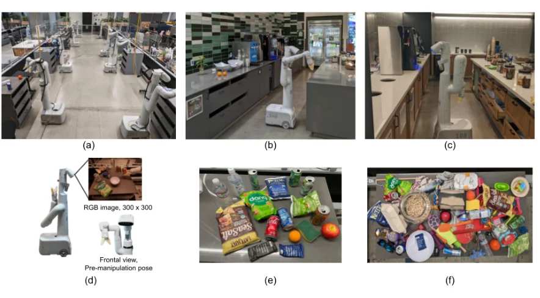
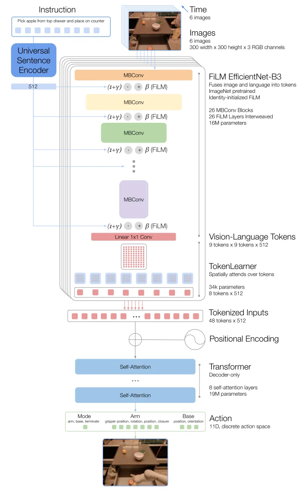

> - **논문**: RT-1: Robotics Transformer for Real-World Control at Scale
> - **저자**: Anthony Brohan, Noah Brown, Justice Carbajal, Yevgen Chebotar 외 47명, 알파벳순 (Robotics at Google, Everyday Robots, Google Research Brain Team)
> - **학회**: arXiv 2022 · [arXiv:2212.06817](https://arxiv.org/abs/2212.06817) · [프로젝트](https://robotics-transformer1.github.io) · [코드](https://github.com/google-research/robotics_transformer)
{: .prompt-tip }

> [VLA 총정리 글]()의 두 번째 모델이다. 비전과 언어 모델은 거대한 데이터로 사전학습한 뒤 작은 데이터로 새 작업을 푸는 방식으로 발전했다. **RT-1**은 로봇에서도 그게 되는지 묻는다. 그리고 답하기 위해 먼저 **실제 로봇 데이터를 대량으로** 모았다.

## 1. 문제: 로봇에는 큰 데이터도, 빠른 큰 모델도 없다

로봇 학습은 보통 해야 할 작업 몇 개에 맞춰 데이터를 모으고 그 작업만 학습한다. RT-1은 두 가지 어려움을 짚는다.

1. **데이터**: 일반화하려면 규모와 다양성을 모두 갖춘 데이터가 필요하다. 또 작업들이 서로 이어져 있어야, 모델이 비슷한 작업 사이의 패턴을 찾아 새로운 조합에 적용할 수 있다.
2. **모델**: 수백 개 작업을 언어 지시로 구분하려면 Transformer 같은 큰 모델이 필요하지만, 로봇은 실시간으로 움직여야 한다.

비교 대상인 [Gato]()는 실제 로봇 작업이 블록 쌓기 하나뿐이었고, 새로운 작업으로의 일반화도 평가하지 않았다.

## 2. 데이터: 로봇 13대, 17개월, 13만 개 시연

Everyday Robots의 이동형 매니퓰레이터(7자유도 팔, 두 손가락 그리퍼, 이동 베이스) **13대**로 **17개월** 동안 **13만 개 에피소드**를 모았다. 사람이 원격조작으로 시연하고, 에피소드마다 수행한 지시문을 텍스트로 붙였다. 수집은 실제 사무실 주방을 본뜬 "로봇 교실"에서 했고, 평가는 조명과 배경, 주방 구조가 다른 실제 사무실 주방 두 곳에서도 했다.

| 기술 | 지시 수 | 예시 |
|---|---|---|
| 물건 집기 | 130 | pick iced tea can |
| 물건을 다른 물건 근처로 옮기기 | 337 | move pepsi can near rxbar blueberry |
| 세우기 / 넘어뜨리기 | 8 / 8 | place water bottle upright |
| 서랍 열기 / 닫기 | 3 / 3 | open the top drawer |
| 그릇 등에 넣기 | 84 | place brown chip bag into white bowl |
| 꺼내서 조리대에 놓기 | 162 | pick green jalapeno chip bag from paper bowl and place on counter |
| 긴 작업용 기술 | 9 | pull napkin out of dispenser |
| **합계** | **744** | |

논문은 "작업"을 **동사 + 명사로 된 지시 하나**로 센다. 744개 지시를 동사별로 묶은 것이 "기술(skill)"이다.


_Figure 2. (a) 데이터를 모은 로봇 교실, (b)(c) 평가에 쓴 실제 사무실 주방 Kitchen1·Kitchen2, (d) 이동형 매니퓰레이터(300×300 RGB 카메라), (e) 여러 기술에 쓴 물체, (f) 집기 기술의 물체 다양성을 늘리려고 추가한 물체. (출처: Brohan et al., 2022)_

시연은 운영자가 로봇을 직접 보면서 VR 리모컨 2개로 조종했다. 리모컨의 3차원 위치·회전 변화가 그리퍼의 6자유도 변위로, 조이스틱의 x, y가 베이스의 회전각과 이동 거리로 매핑된다. 어떤 지시를 시연할지와 장면을 어떻게 섞을지는 소프트웨어가 골라 로봇이 운영자에게 알려 준다(부록 C.2).

## 3. 모델

RT-1은 최근 이미지 6장과 지시문을 받아 행동 토큰을 낸다. 설계의 중심은 **Transformer에 들어가는 토큰 수를 줄이는 것**이다.


_Figure 3. 지시문은 Universal Sentence Encoder로 512차원 임베딩이 되고, FiLM으로 EfficientNet-B3의 각 MBConv 블록을 조절한다. 이미지당 9×9 토큰을 TokenLearner가 8개로 줄이고, 6장 분량 48개 토큰이 8층 Transformer를 거쳐 11차원 이산 행동이 된다. (출처: Brohan et al., 2022)_

### FiLM EfficientNet: 지시를 보면서 이미지를 본다

1. 이미지 6장(300×300)을 ImageNet으로 사전학습한 **EfficientNet-B3**에 넣으면 장마다 9×9×512 특징 맵이 나온다. 9×9 = 81개 위치가 그대로 토큰이 된다. Gato처럼 이미지를 패치로 자르지 않는다.
2. 지시문은 **Universal Sentence Encoder**로 임베딩하고, EfficientNet 중간에 넣은 **FiLM** 층이 이 임베딩으로 특징 맵의 채널별 scale과 shift를 정한다. "사과를 집어"라는 지시를 받으면 처음부터 사과와 관련된 특징을 더 강하게 뽑는 셈이다.
3. 사전학습된 CNN 중간에 새 층을 넣으면 학습 초기에 특징이 망가진다. 그래서 FiLM을 만드는 층의 가중치를 0으로 초기화해, 처음에는 아무것도 바꾸지 않는 항등 변환으로 시작한다.

MBConv 블록 26개 사이사이에 FiLM 층 26개가 끼어 있고, 이 부분이 16M 파라미터이다.

### TokenLearner: 81개를 8개로

**TokenLearner**는 81개 위치의 특징을 학습된 가중치로 가중 평균하는 일을 8번 해서, 이미지 한 장을 토큰 8개로 줄인다. 정보가 많은 위치를 골라 담는 학습 가능한 풀링이고, 파라미터는 34k에 불과하다.

```python
import torch
import torch.nn as nn

class TokenLearner(nn.Module):
    """위치 81개의 특징을 학습된 가중치로 8번 풀링해 토큰 8개를 만든다 (Ryoo et al., 2021)."""
    def __init__(self, dim=512, num_tokens=8, hidden=64):
        super().__init__()
        self.norm = nn.LayerNorm(dim)
        self.mlp = nn.Sequential(nn.Linear(dim, hidden), nn.GELU(), nn.Linear(hidden, num_tokens))

    def forward(self, x):                                  # x: (이미지 수, 81, 512)
        weights = self.mlp(self.norm(x)).softmax(dim=1)    # (이미지 수, 81, 8): 토큰마다 81개 위치의 가중치
        return torch.einsum("bns,bnd->bsd", weights, x)    # (이미지 수, 8, 512)

torch.manual_seed(0)
history = torch.randn(6, 9 * 9, 512)                       # 최근 이미지 6장의 9x9x512 특징 맵
tokens = TokenLearner()(history)
seq = tokens.reshape(1, -1, 512)                           # 6장 x 8개 = 48개 토큰을 이어 붙임
print("특징 맵:", tuple(history.shape), "→ TokenLearner:", tuple(tokens.shape), "→ Transformer 입력:", tuple(seq.shape))
print(f"self-attention 쌍의 수: {(6 * 81) ** 2:,} → {seq.shape[1] ** 2:,} ({(6 * 81) ** 2 / seq.shape[1] ** 2:.0f}배 감소)")
```

```text
특징 맵: (6, 81, 512) → TokenLearner: (6, 8, 512) → Transformer 입력: (1, 48, 512)
self-attention 쌍의 수: 236,196 → 2,304 (103배 감소)
```

Transformer가 보는 토큰이 486개에서 48개로 줄어 attention 계산은 100배 이상 줄어든다. 다만 CNN 등 다른 계산도 있으므로, 논문이 잰 전체 추론 속도 향상은 2.4배이다. 또 이미지 6장의 토큰은 다음 시점에도 5장이 겹치므로, 한 번 계산한 토큰을 재사용해 1.7배를 더 줄였다.

### Transformer와 행동 토큰

48개 토큰(위치 인코딩 포함)이 8층, 19M 파라미터의 decoder-only Transformer로 들어가 행동 토큰을 낸다. 전체 모델은 **35M**이다.

행동은 11차원이다.

- 팔 7차원: x, y, z, roll, pitch, yaw, 그리퍼 열림
- 베이스 3차원: x, y, yaw
- 모드 1차원: 팔 제어 / 베이스 제어 / 에피소드 종료

각 차원의 범위를 **256개 구간**으로 균등하게 나누고, 차원마다 256개 클래스 분류 문제로 cross entropy를 학습한다. 정답 시연만 따라 하는 **behavior cloning**이다.

### 3Hz라는 예산

사람이 이 작업들을 하는 데 2~4초가 걸리므로, 로봇이 이보다 크게 느려서는 안 된다. 논문은 이를 **최소 3Hz**, 다른 지연을 빼면 **모델 추론 100ms 이내**라는 예산으로 바꾼다. 이 예산이 모델 크기의 상한을 정한다. 또 지연이 들쭉날쭉하면 동작이 떨리므로, 관측을 찍은 뒤 항상 280ms(관찰된 최대 지연)를 기다렸다가 행동을 적용해 주기를 일정하게 맞춘다.

### 구현 디테일

논문은 optimizer, learning rate, batch 같은 학습 하이퍼파라미터를 적지 않았다. 대신 구조와 시스템 설정은 자세하다.

| 항목 | 값 |
|---|---|
| 입력 | 최근 이미지 6장(300×300 RGB) + 지시문 |
| 이미지·언어 토크나이저 | ImageNet 사전학습 EfficientNet-B3 + FiLM 26층(0 초기화), Universal Sentence Encoder 512차원, 16M |
| TokenLearner | 이미지당 81 → 8 토큰, 34k 파라미터 |
| Transformer | decoder-only, self-attention 8층, 19M, 입력 48토큰 × 512 |
| 전체 크기 | 35M |
| 행동 | 11차원(팔 7 + 베이스 3 + 모드 1), 차원마다 256개 균등 구간 |
| Loss | categorical cross-entropy, causal masking |
| 제어 주기 | 3Hz, 모델 추론 예산 100ms, 관측 후 280ms 고정 대기 |
| 추론 가속 | TokenLearner 2.4배, 겹치는 이미지 토큰 재사용 1.7배 |
| 체크포인트 선택 | 551개 작업을 지원하는 시뮬레이터에서 RetinaGAN으로 실제처럼 바꾼 이미지로 rollout (real-to-sim) |

## 4. 실험

비교 모델인 Gato와 BC-Z도 **RT-1과 같은 데이터**로 학습했다. 원래 크기의 Gato(1.2B)는 로봇에서 추론 한 번에 1.9초가 걸려, RT-1과 비슷한 37M으로 줄였다. 실제 로봇 평가는 3,000회가 넘는다.

### 일반화와 강건성

| 모델 | 학습한 지시 | 처음 보는 지시 | 방해물 | 배경 | 추론 시간 |
|---|---|---|---|---|---|
| Gato (37M) | 65 | 52 | 43 | 35 | 129ms |
| BC-Z | 72 | 19 | 47 | 41 | 5.3ms |
| BC-Z XL | 56 | 43 | 23 | 35 | 5.9ms |
| **RT-1** | **97** | **76** | **83** | **59** | 15ms |

(성공률 %, Table 2와 부록 Table 13) "학습한 지시"는 200개가 넘는 학습 지시를 기술별로 평가한 가중 평균이다. "처음 보는 지시"는 학습에서 뺀 지시로, 동사와 물체는 각각 학습에 있었지만 그 **조합**은 처음이다. 본문은 21개, 부록 D.1은 53개라고 적어 개수가 서로 다르다. 방해물은 30개, 배경은 22개 작업으로 평가했다.

난이도별로 나눠 보면 차이가 더 분명하다(Table 13). 방해물 평가에서 easy는 방해물 0~5개, medium은 9개, hard는 9개에 목표 물체(콜라 캔)가 일부 가려진 장면이다. 학습 데이터의 방해물은 0~4개였다.

| 모델 | 방해물 easy | medium | hard |
|---|---|---|---|
| Gato | 71 | 44 | 29 |
| BC-Z | 100 | 67 | 7 |
| BC-Z XL | 57 | 33 | 0 |
| **RT-1** | **100** | **100** | **64** |

실제 사무실 주방에서 서랍 채우기, 간식 준비, 잃어버린 물건 찾기를 시킨 현실 시나리오에서도 RT-1이 가장 높았다(Table 3). L1은 새 조리대 배치와 조명, L2는 여기에 처음 보는 방해물, L3는 새 물체나 싱크대 근처 같은 새 위치까지 더한 수준이다.

| 모델 | 전체 | L1 | L2 | L3 |
|---|---|---|---|---|
| Gato | 30 | 63 | 25 | 0 |
| BC-Z | 45 | 38 | 50 | 50 |
| BC-Z XL | 55 | 63 | 75 | 38 |
| **RT-1** | **70** | **88** | **75** | **50** |

### 다른 데이터도 흡수한다

- **시뮬레이션**: 실제 데이터에 시뮬레이션 데이터를 섞자, 실제 물체 성능은 거의 그대로(92% → 90%)인데 **시뮬레이션에만 있던 물체**를 실제로 다루는 성공률이 23%에서 87%로 올랐다. 그 물체로 시뮬레이션에서도 해 본 적 없는 지시는 7%에서 33%가 됐다.
- **다른 로봇**: Kuka 로봇팔이 강화학습(QT-Opt)으로 모은 bin-picking 데이터 20만 9천 개를 섞었다. 원래 평가는 92% → 90%로 거의 그대로, bin-picking 평가는 22% → 39%로 올랐다. Kuka 데이터만으로 학습하면 0%였다. 몸이 다른 로봇의 경험만으로는 안 되지만, **섞으면 도움이 된다**는 결과이다.

### 긴 작업: SayCan과 함께

LLM이 "탁자 위의 쓰레기를 어떻게 버릴까?" 같은 요청을 짧은 지시들로 나누는 SayCan에 RT-1을 하위 정책으로 넣었다. LLM의 계획 성공률은 하위 정책과 관계없이 87%로 같았고, 실행 성공률은 RT-1이 가장 높았다. 학습 환경을 본뜬 주방에서 67%, 더 낯선 두 번째 주방에서도 67%였는데, 두 번째 주방에서 Gato는 0%, BC-Z는 13%에 그쳤다. 최대 50단계짜리 작업도 수행했다.

### 데이터: 양보다 다양성

| 작업 비율 | 데이터 비율 | 학습한 지시 | 일반화(평균) |
|---|---|---|---|
| 100% | 100% | 97 | 73 |
| 100% | 51% | 71 | 50 |
| 100% | 37% | 55 | 46 |
| 100% | 22% | 59 | 29 |
| **75%** | **97%** | 86 | **54** |

데이터가 많은 작업부터 개수를 줄이면(작업 수는 유지) 성능이 서서히 떨어진다. 반면 데이터가 적은 작업 25%를 빼면 데이터는 97%나 남는데도 일반화가 54로 떨어져, 데이터를 절반(51%)으로 줄인 것과 비슷해졌다. 논문의 결론은 **데이터 다양성이 양보다 중요하다**는 것이다.

### 무엇이 중요했나: 모델 ablation

| 변경 | 학습한 지시 | 처음 보는 지시 | 방해물 | 배경 | 추론 시간 |
|---|---|---|---|---|---|
| RT-1 | 97 | 76 | 83 | 59 | 15ms |
| 모델 축소 (35M → 21M) | 89 | 62 | 77 | 53 | 13.5ms |
| ImageNet 사전학습 제거 | 84 | **43** | 60 | 41 | 15ms |
| **연속 행동**(가우시안 + MSE) | **68** | **43** | **37** | **35** | 16ms |
| 행동 차원을 autoregressive로 | 85 | 71 | 67 | 65 | 36ms |
| 이미지 기록 제거 (1장만) | 82 | 62 | 50 | 59 | 15ms |
| Transformer 제거 | 86 | 62 | 67 | 59 | 26ms |

(부록 Table 13) 모델 축소 크기는 논문 안에서도 "35M → 21M"과 "31M → 25M"이 함께 나온다. 연속 행동으로 바꾸면 방해물 hard 장면 성공률은 64%에서 0%가 된다. 이미지 기록을 빼면 주로 방해물 성능(83 → 50)이 떨어지고 배경 성능은 그대로였다.

## 5. 해석

**1. 이산화는 multi-modal 문제의 해결책이었다.** 가장 큰 하락은 행동을 연속값으로 바꿨을 때 나왔다. 가우시안 출력은 봉우리가 하나뿐이라, 같은 상황에서 여러 방식으로 움직인 사람 시연을 평균 내 버린다([Diffusion-QL 글]()의 예). 차원마다 256개 클래스 분포를 내면 봉우리가 여러 개여도 표현된다. 이 결과가 RT-2와 OpenVLA가 행동 토큰을 쓰는 근거가 됐고, 나중에 π0는 같은 문제를 flow matching이라는 다른 방법으로 푼다.

**2. 언어 이해는 아직 "조합"까지였다.** 논문 스스로 한계를 이렇게 적는다. 처음 보는 지시는 이미 본 개념의 새로운 조합까지만 되고, 한 번도 본 적 없는 동작은 하지 못한다. ImageNet 사전학습을 빼면 처음 보는 지시가 76%에서 43%로 떨어진 것을 보면, 일반화의 상당 부분이 사전학습된 지식에서 나온다. 그렇다면 ImageNet과 문장 임베딩보다 훨씬 큰 사전학습, 즉 VLM 전체를 쓰면 어떨까? 이 질문에서 나온 것이 [RT-2]()이다.

**3. 실시간 예산이 설계를 정했다.** RT-1의 거의 모든 선택(TokenLearner, 토큰 재사용, 35M 크기, 행동 차원을 한 번에 내기)은 3Hz 예산에서 나왔다. 행동 차원을 하나씩 autoregressive로 뽑으면 성능도 떨어지고 추론은 36ms로 두 배 넘게 느려졌다. 논문은 이 분야에서는 모델 크기보다 지연 시간이 상한이라고 말한다.

**4. 3Hz의 한계.** 서랍 열기, 물건 옮기기 같은 작업에는 충분하지만, 빨래 개기 같은 정밀한 양팔 작업에는 부족하다. 논문도 데이터의 작업들이 "크지만 그리 정교하지 않다"고 인정한다. 50Hz 정밀 조작은 바로 다음 [ACT]()가 다룬다.

**5. 데이터 흡수와 Open X-Embodiment.** 시뮬레이션과 다른 로봇 데이터를 섞어도 원래 성능을 잃지 않았다는 결과는, 이후 여러 기관이 22종 로봇의 데이터를 모은 Open X-Embodiment와 RT-1-X, RT-2-X로 이어진다.

## 6. 정리

| 항목 | 내용 |
|---|---|
| 데이터 | 로봇 13대, 17개월, 13만 개 시연, 744개 지시 |
| 구조 | FiLM EfficientNet-B3(16M) → TokenLearner(81 → 8 토큰) → Transformer(8층, 19M), 전체 35M |
| 행동 | 11차원, 차원마다 256개 구간 토큰, 3Hz |
| 결과 | 학습한 지시 97%, 처음 보는 지시 76%, 방해물 83%, 배경 59% |
| 발견 | 데이터 다양성 > 양, 이산 행동 >> 가우시안 연속 행동, 다른 로봇·시뮬레이션 데이터 흡수 |
| 한계 | 본 적 없는 동작은 못 함, 정밀하지 않은 작업 위주, 모방학습이라 시연을 넘지 못함 |

## References

- Brohan et al., "RT-1: Robotics Transformer for Real-World Control at Scale," 2022. [arXiv:2212.06817](https://arxiv.org/abs/2212.06817)
- Ryoo et al., "TokenLearner: What Can 8 Learned Tokens Do for Images and Videos?," NeurIPS 2021.
- Perez et al., "FiLM: Visual Reasoning with a General Conditioning Layer," AAAI 2018.
- Jang et al., "BC-Z: Zero-Shot Task Generalization with Robotic Imitation Learning," CoRL 2021.
- Ahn et al., "Do As I Can, Not As I Say: Grounding Language in Robotic Affordances (SayCan)," 2022.
- 코드: <https://github.com/google-research/robotics_transformer>
