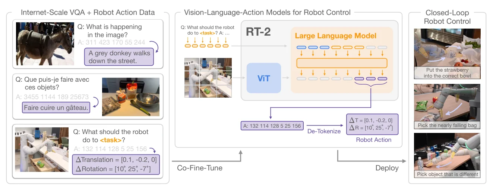
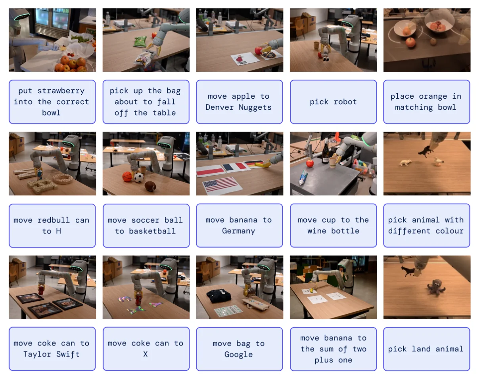

> - **논문**: RT-2: Vision-Language-Action Models Transfer Web Knowledge to Robotic Control
> - **저자**: Anthony Brohan, Noah Brown, Justice Carbajal, Yevgen Chebotar, Xi Chen 외 49명, 알파벳순 (Google DeepMind)
> - **학회**: CoRL 2023 · [arXiv:2307.15818](https://arxiv.org/abs/2307.15818) · [프로젝트](https://robotics-transformer2.github.io)
{: .prompt-tip }

> [VLA 총정리 글]()의 네 번째 모델이다. **RT-2**는 **Vision-Language-Action(VLA) 모델**이라는 이름을 처음 붙인 논문이다. 아이디어는 한 문장으로 요약된다. 행동을 숫자 문자열로 쓰면, 웹 데이터로 학습한 VLM이 질문에 답하듯 행동을 출력할 수 있다.

## 1. 문제: VLM은 계획만 하고, 제어는 따로

웹 규모의 텍스트와 이미지로 학습한 VLM은 물체를 알아보고, 관계를 이해하고, 간단한 추론도 한다. 로봇 데이터로는 이 규모를 따라갈 수 없다. 그래서 로봇에 LLM과 VLM을 붙이는 연구가 많았지만, 대부분 **고수준 계획**에만 썼다. SayCan이나 PaLM-E처럼 "사과를 집어 → 서랍을 열어" 같은 단계로 나누는 상태 기계 역할을 하고, 실제 움직임은 따로 학습한 제어기가 맡았다. 이 제어기는 웹 지식을 전혀 활용하지 못한다.

RT-2가 묻는 것은 다음과 같다. **사전학습된 VLM을 저수준 closed-loop 제어에 직접 넣으면** 일반화가 좋아지고, 웹에서 배운 의미 이해와 추론이 행동으로 이어질까?

## 2. 방법: 행동도 하나의 언어로


_Figure 1. 웹 VQA 데이터와 로봇 데이터를 같은 "질문 → 답" 형식으로 섞어 VLM을 co-fine-tuning한다. 로봇 행동은 숫자 토큰 문자열로 답하고, 추론 때 이를 다시 위치·회전 변화로 바꿔 closed-loop 제어를 한다. (출처: Brohan et al., 2023)_

### 행동을 문자열로

[RT-1]()의 이산화 방식을 그대로 가져온다. 행동은 8개 값이다.

- 에피소드 종료 여부 1개
- 손끝의 위치 변화 3개, 회전 변화 3개
- 그리퍼가 벌어진 정도 1개

종료 여부를 뺀 7개 연속값은 각각 256개 구간으로 나눠 정수로 바꾸고, 공백으로 이어 붙여 문자열을 만든다. 논문의 예시는 `1 128 124 136 121 158 111 255` 같은 꼴이다. 이 문자열을 VLM의 토큰으로 바꾸는 방법은 모델마다 다르다.

- **PaLI-X**: 1000 이하의 정수마다 고유 토큰이 있어, bin 번호를 그 숫자 토큰에 그대로 대응시킨다.
- **PaLM-E**: 숫자 토큰이 편하게 나뉘어 있지 않아, **가장 드물게 쓰이는 토큰 256개**를 행동 토큰으로 덮어쓴다. 기존 토큰에 새 의미를 학습시키는 symbol tuning의 한 형태이다.

입력은 평범한 VQA 형식이다. 로봇 카메라 이미지와 함께 "Q: what action should the robot take to [지시]? A:"를 주면, 답으로 행동 문자열이 나온다. **새로운 층이나 파라미터를 하나도 추가하지 않는다**는 점이 중요하다. Gato처럼 처음부터 새 구조를 학습하는 것도, 기존 연구처럼 VLM 위에 행동 전용 모듈을 붙이는 것도 아니다.

```python
import numpy as np

rng = np.random.default_rng(0)
N_BINS = 256
lo = np.array([-0.1, -0.1, -0.1, -0.5, -0.5, -0.5, 0.0])   # Δx, Δy, Δz, Δroll, Δpitch, Δyaw, 그리퍼 (예시 범위)
hi = np.array([0.1, 0.1, 0.1, 0.5, 0.5, 0.5, 1.0])

def action_to_text(terminate, a):                     # 행동 → "종료 + 256 bin 정수 7개" 문자열
    bins = np.clip(((a - lo) / (hi - lo) * N_BINS).astype(int), 0, N_BINS - 1)
    return " ".join(str(v) for v in [terminate, *bins])

def text_to_action(text):                             # 문자열 → 행동 (bin의 중심값)
    terminate, *bins = map(int, text.split())
    return terminate, lo + (np.array(bins) + 0.5) / N_BINS * (hi - lo)

target = action_to_text(0, np.array([0.02, -0.05, 0.0, 0.1, 0.0, -0.2, 1.0]))
print("학습 목표 문자열:", target)
print("다시 행동으로:", text_to_action(target)[1].round(3))

# 출력 제한: 로봇 행동을 물을 때는 0~255 숫자 토큰만 고르게 한다
vocab = ["apple", "the", "pick", *map(str, range(1000))]    # PaLI-X처럼 1000 이하 정수는 각자 토큰이 있다고 가정
logits = rng.normal(size=len(vocab))
logits[0] = 5.0                                              # 모델이 텍스트 'apple'을 가장 원하는 상황
allowed = np.array([t.isdigit() and int(t) < N_BINS for t in vocab])
print("제한 없음:", vocab[int(np.argmax(logits))], "| 행동 토큰으로 제한:", vocab[int(np.argmax(np.where(allowed, logits, -np.inf)))])
```

```text
학습 목표 문자열: 0 153 64 128 153 128 76 255
다시 행동으로: [ 0.02  -0.05   0.     0.1    0.002 -0.201  0.998]
제한 없음: apple | 행동 토큰으로 제한: 216
```

마지막 줄이 논문의 **출력 제한(output constraint)**이다. VLM은 원래 아무 텍스트나 낼 수 있으므로, 로봇 행동을 물을 때는 유효한 행동 토큰 안에서만 샘플링하게 막는다. 일반 VQA 질문에는 제한을 두지 않는다.

### Co-fine-tuning

로봇 데이터로만 fine-tuning하면 VLM이 웹에서 배운 개념을 잊어버린다. RT-2는 원래 VLM 학습에 쓴 웹 데이터(VQA, 캡션, 이미지와 텍스트가 섞인 문서)를 계속 섞어 **함께 학습**한다. 배치 안에서는 로봇 데이터의 샘플링 비중을 높여 균형을 맞추는데, 로봇 데이터 비중이 RT-2-PaLI-X는 약 50%, RT-2-PaLM-E는 약 66%이다. 웹 데이터의 대부분은 109개 언어, 약 100억 쌍의 이미지–텍스트 데이터셋 WebLI에서 이미지–텍스트 유사도 상위 10%만 남긴 10억 개 예시이다. 로봇 데이터는 RT-1과 같은 것(로봇 13대, 17개월, 13만 개 시연)이라, 차이는 오직 VLM 사전학습에서 나온다.

### 55B 모델을 로봇에서 돌리기

가장 큰 RT-2는 55B로, 당시 closed-loop 로봇 제어에 쓰인 어떤 모델보다도 10배 이상 큰 모델이었다. 로봇의 GPU로는 돌릴 수 없어서, 여러 TPU로 된 클라우드 서비스에 모델을 올리고 로봇이 네트워크로 질의한다. 그래도 55B는 **1~3Hz**, 5B는 **약 5Hz**였다.

### 구현 디테일

학습 하이퍼파라미터는 lr 스케줄과 정규화를 포함해 원래 PaLI-X, PaLM-E 논문의 설정을 그대로 따른다. 부록 D·E에 적힌 값은 다음과 같다.

| 모델 | 구조 | lr | batch | co-fine-tuning step |
|---|---|---|---|---|
| RT-2-PaLI-X-55B | ViT-22B 이미지 인코더 + 32B, 50층 encoder-decoder(UL2 계열) | 1e-3 | 2048 | 80K |
| RT-2-PaLI-X-5B | PaLI-X 5B | 1e-3 | 2048 | 270K |
| RT-2-PaLM-E-12B | ViT-4B + decoder-only LLM | 4e-4 | 512 | 1M |
| RT-2-PaLI-3B (Language-Table) | ViT-G/14(2B) + UL2-3B | 1e-3 | 128 | 300K |

목표는 모두 next-token prediction이고, 로봇 데이터에서는 그대로 behavior cloning loss가 된다. 로봇은 7자유도 이동형 매니퓰레이터이고, 로봇 데이터는 RT-1과 같다.

## 3. 실험

PaLI-X(5B, 55B) 기반의 RT-2-PaLI-X와 PaLM-E(12B) 기반의 RT-2-PaLM-E를, 같은 로봇 데이터로 학습한 비교 모델과 약 6,000번의 실제 평가로 비교했다. 비교 모델은 RT-1, 사전학습된 시각 표현을 쓰는 VC-1과 R3M(RT-1 구조에 연결), VLM으로 의미 지도를 만들어 RT-1에 넣는 MOO이다.

### 일반화

| 모델 | 학습한 작업 | 새 물체 | 새 배경 | 새 환경 | 새 상황 평균 |
|---|---|---|---|---|---|
| R3M | 45 | 32 / 14 | 13 / 9 | 0 / 2 | 12 |
| VC-1 | 63 | 34 / 10 | 13 / 3 | 0 / 0 | 10 |
| RT-1 | 92 | 31 / 43 | 71 / 9 | 26 / 14 | 32 |
| MOO | 75 | 58 / 48 | 38 / 41 | 19 / 3 | 35 |
| **RT-2-PaLI-X-55B** | 91 | 70 / 62 | 96 / 48 | 63 / 35 | **62** |
| **RT-2-PaLM-E-12B** | 93 | 84 / 76 | 75 / 71 | 36 / 33 | **62** |

(성공률 %, 쉬움 / 어려움, 부록 Table 4) 학습한 작업은 RT-1과 같은 200개 이상의 지시, 새 상황 평가는 집기·놓기 위주의 280개 이상 작업이다. 학습한 작업에서는 RT-1과 비슷하지만, 처음 보는 물체·배경·환경에서는 **RT-1과 MOO의 약 2배**, 나머지 비교 모델의 약 6배이다. 새 환경의 쉬운 경우는 주방 싱크대, 어려운 경우는 모니터와 소품이 있는 사무실 책상처럼 학습 장면과 완전히 다른 곳이다. PaLM-E 버전은 어려운 경우에, PaLI-X 버전은 쉬운 경우에 강해 평균은 같아졌다.

오픈소스 시뮬레이션인 Language-Table에서도 작은 PaLI 3B 기반 모델이 90%로, 기존 방법보다 높았다(Table 1). 여기서는 행동을 2차원 위치 변화 "X Y"(각각 -10~+10 정수)로 쓰고, 5Hz로 돌았다.

| 모델 | Language-Table 성공률 |
|---|---|
| BC-Zero | 72 ± 3 |
| RT-1 | 74 ± 13 |
| LAVA | 77 ± 4 |
| **RT-2-PaLI-3B** | **90 ± 10** |

### Emergent 능력: 로봇 데이터에 없던 것

로봇 데이터에는 없지만 웹 데이터에는 있는 개념이 필요한 지시를 세 종류로 나눠 평가했다. 아래 Figure 2가 그런 지시의 예이다.


_Figure 2. 추론("맞는 그릇에 딸기 넣기", "2 더하기 1의 위치로"), 기호 이해("H로", "Google로"), 사람 인식("Taylor Swift에게") 같은 지시를 로봇 데이터에 없던 대상에 수행한다. (출처: Brohan et al., 2023)_

네 모델을 같은 조건에서 차례로 돌리는 A/B 방식으로 평가했고, 지시마다 5번씩 실행했다(부록 Table 5).

| 종류 | 지시 예시 | VC-1 | RT-1 | RT-2-PaLI-X | RT-2-PaLM-E |
|---|---|---|---|---|---|
| 기호 이해 | "move apple to 3", "push coke can on top of heart" | 11 | 16 | **82** | 36 |
| 추론 | 같은 색 컵으로, "2 더하기 1"의 위치로, 스페인어 지시 | 10 | 16 | **46** | 43 |
| 사람 인식 | "move the coke can to the person with glasses" | 13 | 20 | **53** | 43 |
| **평균** | | 11 | 17 | **60** | 40 |

RT-2-PaLI-X는 RT-1의 3배 넘는 성공률을 냈다. 세부 항목을 보면 기호 이해 중 "move apple to tree"류(Symbol 2)는 60%, 로고(Google, Android 등)로 옮기기는 52%, 다국어·색 지시는 58%였다. 수학 문제가 섞인 지시는 PaLM-E 쪽이 더 잘했다(35% vs 25%). 논문은 PaLM-E의 사전학습 데이터에 언어 비중이 커서 계산을 더 잘하기 때문으로 본다. 영상 예시에는 "테이블에서 떨어지려는 봉지를 집어", "딸기를 맞는 그릇에 넣어"(다른 과일이 담긴 그릇) 같은 지시도 있다.

### 크기와 학습 방식

| 크기 | 학습 방식 | 새 물체 | 새 배경 | 새 환경 | 새 상황 평균 |
|---|---|---|---|---|---|
| 5B | 처음부터 학습 | 0 / 10 | 46 / 0 | 0 / 0 | 9 |
| 5B | 로봇 데이터로만 fine-tuning | 24 / 38 | 79 / 50 | 36 / 23 | 42 |
| 5B | co-fine-tuning | 60 / 38 | 67 / 29 | 44 / 24 | 44 |
| 55B | 로봇 데이터로만 fine-tuning | 60 / 62 | 75 / 38 | 57 / 19 | 52 |
| 55B | co-fine-tuning | 70 / 62 | 96 / 48 | 63 / 35 | **63** |

(RT-2-PaLI-X, 성공률 %, 쉬움 / 어려움, 부록 Table 6) PaLM-E는 정해진 PaLM·ViT 크기 조합만 있어서 크기 비교는 PaLI-X로만 했다.

사전학습 없이 5B를 처음부터 학습하면 거의 일반화하지 못했다(9%). 같은 크기에서는 co-fine-tuning이 fine-tuning보다, 같은 방식에서는 55B가 5B보다 좋았다.

### Chain-of-thought

RT-2-PaLM-E를 몇백 step 더 학습시켜, 행동 앞에 **자연어 계획**을 쓰게 했다.

```text
Instruction: I'm hungry.
Plan: pick rxbar chocolate.
Action: 1 128 124 136 121 158 111 255
```

이렇게 하면 "못을 박아야 하는데 쓸 만한 물건은?"에 돌을, "졸린데 마실 것"에 에너지 드링크를 고르는 식의 여러 단계 추론을 했다. 다만 이 부분은 정량 평가 없이 정성적인 예시로만 보였다.

## 4. 논문이 밝힌 한계

1. **새로운 동작은 배우지 못한다.** 로봇이 할 수 있는 움직임은 여전히 로봇 데이터에 있던 기술(집기, 옮기기, 놓기 등)의 범위이다. 웹 지식은 그 기술을 새로운 대상과 상황에 쓰는 법을 알려 줄 뿐이다. 부록 G의 실패 사례로는 손잡이처럼 특정 부위를 잡기, 수건으로 닦기나 도구 사용 같은 새 동작, 수건 접기 같은 정밀 동작, 여러 단계를 건너야 하는 추론이 꼽힌다. Language-Table에서도 지시는 이해하지만 굴러가는 펜이나 무게중심이 먼 바나나처럼 처음 보는 물체의 밀기 역학은 다루지 못했다.
2. **계산 비용**: 고주파 제어가 필요한 곳에서는 실시간 추론이 병목이 된다. 논문은 양자화와 증류를 향후 과제로 꼽는다.
3. **쓸 수 있는 VLM이 적다**: RT-2를 만들려면 VLM을 fine-tuning할 수 있어야 하는데, 공개 모델이 드물었다.

## 5. 해석

**1. "무엇을, 어디로"는 웹에서, "어떻게"는 로봇에서.** RT-2의 결과는 역할이 깔끔하게 나뉜다. 처음 보는 물체를 알아보고, 기호와 사람을 구분하고, 지시를 해석하는 능력은 웹 사전학습에서 왔다. 반면 손을 어떻게 움직이는지는 로봇 데이터를 벗어나지 못했다. 같은 데이터로 학습한 RT-1과의 차이가 전부 VLM 사전학습에서 나왔다는 점에서, 웹 지식이 무엇을 줄 수 있고 무엇을 못 주는지 보여 준 통제된 실험이기도 하다.

**2. 출력 공간을 공유하는 것이 핵심이었다.** 행동 전용 층을 붙이지 않고 기존 어휘로 행동을 썼기 때문에, VLM의 모든 가중치가 언어 과제와 행동 과제에 똑같이 쓰인다. co-fine-tuning이 가능한 것도 이 덕분이다. 이 레시피(VLM + 행동 토큰 + 웹 데이터 공동 학습)는 [OpenVLA]()가 공개 모델로 그대로 재현한다.

**3. 그러나 토큰은 느리고 거칠다.** 행동 하나에 토큰 8개를 차례로 생성해야 하고, 55B 모델이 1~3Hz로 돈다. [ACT]()가 보인 50Hz 정밀 조작과는 거리가 멀다. 256개 구간의 정밀도, 한 step씩만 예측하는 구조, 클라우드 의존도 모두 숙제로 남았다. 이를 연속 행동 생성으로 푼 것이 [π0]()이다.

**4. Plan 한 줄의 의미.** 행동 앞에 계획을 쓰게 한 chain-of-thought 실험은 짧았지만, 이후의 흐름을 미리 보여 준다. [π0.5]()는 다음 subtask를 텍스트로 먼저 예측하고, [Gemini Robotics 1.5]()는 행동 사이사이에 생각을 쓴다.

## 6. 정리

| 항목 | 내용 |
|---|---|
| 핵심 아이디어 | 행동을 숫자 문자열로 쓰고, VLM이 VQA 답처럼 출력 |
| 모델 | PaLI-X(5B, 55B), PaLM-E(12B). 새 파라미터 없음 |
| 학습 | 로봇 데이터 + 원래 웹 데이터 co-fine-tuning, 행동 질의 시 출력 제한 |
| 결과 | 새 상황 성공률 RT-1의 약 2배, 웹 개념이 필요한 지시는 3배 이상 |
| 한계 | 새 동작은 못 배움, 55B는 클라우드에서 1~3Hz, 모델 비공개 |
| 의의 | VLA라는 이름과 "VLM + 행동 토큰" 레시피의 시작 |

## References

- Brohan et al., "RT-2: Vision-Language-Action Models Transfer Web Knowledge to Robotic Control," CoRL 2023. [arXiv:2307.15818](https://arxiv.org/abs/2307.15818)
- 프로젝트 페이지: <https://robotics-transformer2.github.io/>
- Chen et al., "PaLI-X: On Scaling up a Multilingual Vision and Language Model," 2023.
- Driess et al., "PaLM-E: An Embodied Multimodal Language Model," ICML 2023.
- Wei et al., "Symbol Tuning Improves In-Context Learning in Language Models," 2023.
- Stone et al., "Open-World Object Manipulation using Pre-trained Vision-Language Models (MOO)," CoRL 2023.
- Lynch et al., "Interactive Language: Talking to Robots in Real Time (Language-Table)," 2022.
