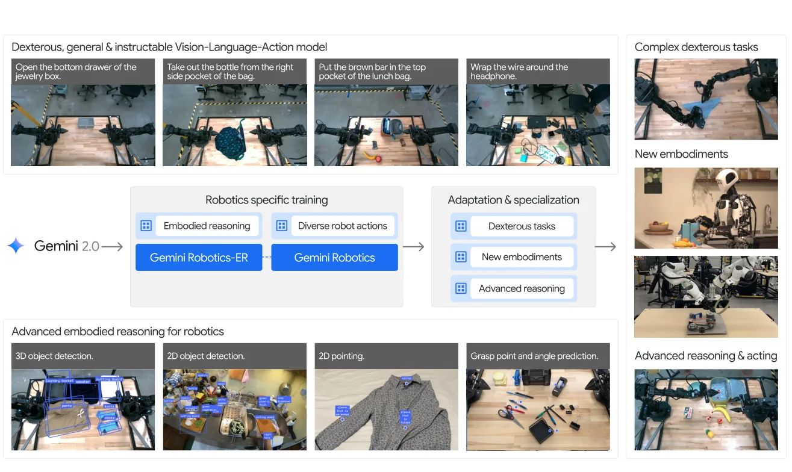
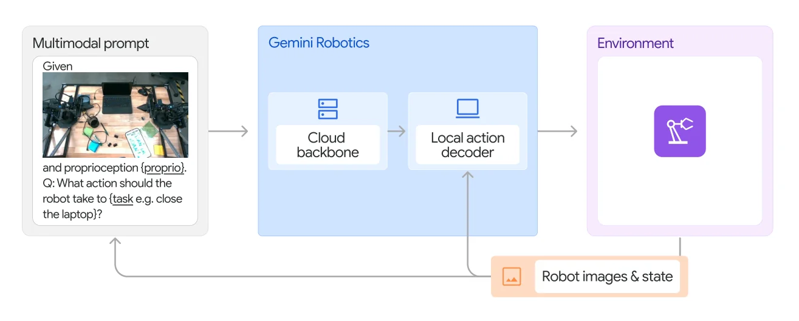
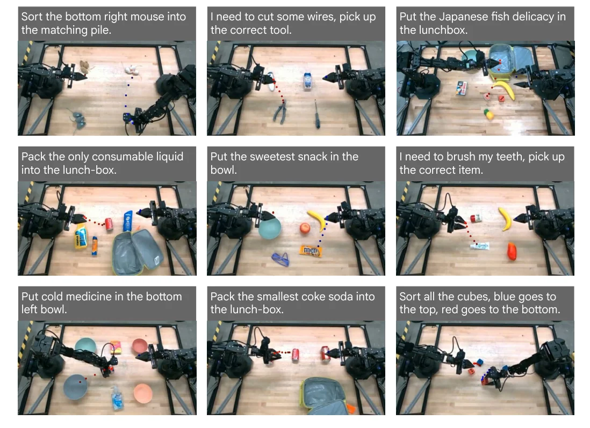

> - **논문**: Gemini Robotics: Bringing AI into the Physical World
> - **저자**: Gemini Robotics Team (Google DeepMind)
> - **학회**: 기술 보고서, 2025 · [arXiv:2503.20020](https://arxiv.org/abs/2503.20020) · [ERQA 벤치마크](https://github.com/embodiedreasoning/ERQA)
{: .prompt-tip }

> [VLA 총정리 글]()의 여덟 번째 모델입니다. **Gemini Robotics**는 한 모델이 아니라 두 모델을 소개합니다. 로봇에 필요한 공간 이해를 강화한 VLM **Gemini Robotics-ER**과, 그 위에서 행동을 내는 VLA **Gemini Robotics**입니다. 출발점은 "디지털 세계에서 가장 강한 멀티모달 모델을 물리 세계에서 쓰려면 무엇이 필요한가"입니다.

## 1. 문제: 이해하는 것과 움직이는 것

논문은 로봇에 필요한 능력을 두 가지로 나눕니다.

1. **Embodied reasoning(ER)**: 물체의 3D 구조, 물체 사이의 관계, 직관적인 물리를 이해하는 능력. 사람에게는 당연하지만 VLM에게는 따로 길러야 하는 능력입니다.
2. **행동으로 연결하기**: 이해한 것을 접촉, 동역학 같은 실제 움직임으로 옮기는 능력

그래서 먼저 Gemini 2.0의 ER 능력을 평가하고 강화한 뒤(2장), 로봇 행동 데이터로 VLA를 만듭니다(3장).


_Figure 1. Gemini 2.0에 로봇 특화 학습을 더해 ER 모델(Gemini Robotics-ER)과 VLA(Gemini Robotics)를 만들고, 필요하면 정밀 작업·새 로봇·고급 추론으로 추가 특화합니다. 아래 줄은 ER의 3D·2D 검출, 가리키기, 잡기 예측 예시입니다. (출처: Gemini Robotics Team, 2025)_

## 2. Embodied Reasoning: ERQA와 Gemini Robotics-ER

### ERQA 벤치마크

기존 VLM 벤치마크는 물체 인식, 개수 세기처럼 단편적인 능력을 봅니다. 논문은 행동에 필요한 이해를 보는 **ERQA**(Embodied Reasoning Question Answering)를 새로 만들어 공개했습니다. 공간 추론, 궤적 추론, 행동 추론, 상태 추정, 가리키기, 여러 시점 추론, 작업 추론에 걸친 400개의 객관식 문제이고, 28%는 이미지를 여러 장 봐야 합니다. "지퍼를 올리려면 어느 색 궤적을 따라가야 하나?", "렌치를 어느 방향으로 움직여야 가장 가까운 육각 나사를 돌릴 수 있나?" 같은 문제입니다.

| 모델 | ERQA | ERQA + CoT |
|---|---|---|
| GPT-4o-mini | 37.3 | 40.5 |
| Claude 3.5 Sonnet | 35.5 | 45.8 |
| GPT-4o | 47.0 | 50.5 |
| Gemini 2.0 Flash | 46.3 | 50.3 |
| Gemini 2.0 Pro Experimental | **48.3** | **54.8** |

(정확도 %, 2025년 2월 기준) 단계별로 생각하게 하는 chain-of-thought 프롬프트를 붙이면 모든 모델이 좋아졌습니다. 다른 공간 이해 벤치마크(RealWorldQA, BLINK)보다 ERQA가 가장 어려웠습니다.

### Gemini Robotics-ER이 하는 일

Gemini Robotics-ER은 Gemini 2.0 Flash의 ER 능력을 강화한 모델입니다. 출력은 모두 텍스트 좌표입니다. 2D 상자는 0~1000으로 정규화한 정수 $$(y_0, x_0, y_1, x_1)$$, 점은 $$(y, x)$$, 위에서 잡기는 $$(y, x, \theta)$$이고 $$\theta$$는 -90~90도 정수입니다(부록 B.1).

- **2D 물체 검출**: 이름뿐 아니라 "흘린 것과 그걸 닦을 수 있는 것"처럼 속성이나 쓰임새로도 찾기
- **가리키기(pointing)**: 물체, 물체의 부분, "잡을 곳", "놓을 빈 자리" 같은 개념을 점으로 표시
- **궤적 예측**: 점들을 이어 움직임의 경로를 그림
- **잡기 예측**: 위에서 내려 잡을 위치와 각도(ER에서 새로 추가)
- **3D 이해**: 여러 카메라 사이의 대응점 찾기, 이미지 한 장에서 3D 상자 검출

가리키기와 3D 검출은 수치로도 비교했습니다(Table 3, 4). 가리키기 점수는 예측한 점이 정답 마스크 안에 들어간 비율입니다.

| 벤치마크 | Gemini Robotics-ER | 2.0 Flash | 2.0 Pro Exp. | GPT-4o | Claude 3.5 Sonnet | Molmo 7B-D | Molmo 72B |
|---|---|---|---|---|---|---|---|
| Paco-LVIS (물체 부분) | **71.3** | 46.1 | 45.5 | 16.2 | 12.4 | 45.4 | 47.1 |
| Pixmo-Point (웹 이미지) | **49.5** | 25.8 | 20.9 | 5.0 | 7.2 | 14.7 | 12.5 |
| Where2Place (빈 공간) | 45.0 | 33.8 | 38.8 | 20.6 | 16.2 | 45 | **63.8** |

가리키기 전용으로 학습한 Molmo를 세 항목 중 두 개에서 앞섰습니다. 이미지 한 장으로 3D 상자를 찾는 SUN-RGBD(AP@15)에서는 Gemini Robotics-ER이 48.3으로, 2.0 Flash(30.7), 2.0 Pro Exp.(32.5)와 전용 모델 Implicit3D(24.1), Total3DU(14.3)보다 높았습니다. ImVoxelNet의 43.7은 더 쉬운 10개 범주에서 잰 값입니다.

### 행동 데이터 없이 로봇 제어하기

ER만으로도 로봇을 움직일 수 있을까요? ALOHA 2 양팔 로봇에 두 방식을 시험했습니다.

**코드 생성(zero-shot)**: 모델에 로봇 API 설명서와 작업 지시를 주고, 매 순간의 이미지와 로봇 상태를 보며 로봇을 움직이는 코드를 쓰게 합니다. 물체 검출과 잡을 위치 계산도 외부 모델 없이 Gemini가 직접 합니다. 아래는 논문 그림 12를 옮긴 개념 코드입니다(실행 코드가 아닙니다).

```python
class RobotApi:                               # 모델에게 주는 API 설명
    def detect_object(self, object_name, gripper): ...   # Gemini 자신의 검출 능력을 도구로 노출
    def get_grasp_pose(self, object_name, gripper): ...  # 잡을 위치와 각도 예측
    def move_gripper(self, gripper, position, orientation): ...
    def open_gripper(self): ...
    def close_gripper(self): ...

# 에피소드: 시스템 프롬프트 + API 설명 + "바나나를 집어"
# while not done:
#     code = gemini(images, robot_state, execution_feedback)   # 계획과 코드를 출력
#     execute(code)                                            # 실행 결과를 다시 입력으로 → 실패하면 계획 수정
```

시뮬레이션의 7개 작업에서 Gemini 2.0 Flash는 평균 27%, Gemini Robotics-ER은 **53%**로 거의 두 배였습니다. ER 능력이 좋을수록 로봇 제어도 좋아진다는 뜻입니다.

**몇 개의 시연으로(in-context learning)**: 시연 10개를 텍스트로 바꿔(물체 위치, 손끝 자세의 궤적, 동작마다 붙인 언어 설명) 프롬프트에 넣으면, 모델이 새 상황의 손끝 궤적을 직접 씁니다. 시뮬레이션에서 2.0 Flash가 51%, ER이 65%였고, 실제 로봇에서도 ER이 65%였습니다. 다만 코드 생성만으로는 옷 접기처럼 정밀한 잡기가 필요한 작업을 전혀 하지 못했습니다(0%). VLM의 출력(점, 상자)을 행동으로 잇는 중간 단계가 정밀도의 한계가 됩니다.

| 시뮬레이션 (각 50회) | 평균 | 바나나 들기 | 바나나 그릇에 | 머그 접시에 | 그릇 선반에 | 바나나 건네기 | 과일 그릇 | 장난감 상자 |
|---|---|---|---|---|---|---|---|---|
| 2.0 Flash, zero-shot | 27 | 34 | 54 | 46 | 24 | 26 | 4 | 0 |
| ER, zero-shot | 53 | 86 | 84 | 72 | 60 | 54 | 16 | 0 |
| 2.0 Flash, ICL | 51 | 94 | 90 | 36 | 16 | 94 | 0 | 26 |
| ER, ICL | **65** | 96 | 96 | 74 | 36 | 96 | 4 | 54 |

| 실제 ALOHA 2 (ER) | 평균 | 바나나 건네기 | 원피스 접기 | 닦기 |
|---|---|---|---|---|
| zero-shot | 25 | 30 | 0 | 44 |
| ICL | **65** | 70 | 56 | 67 |

(성공률 %, Table 5, 6) 실제 로봇 평가는 바나나 건네기 10회, 나머지 9회입니다. ICL의 이득은 대부분 건네기, 옷 접기, 장난감 넣기처럼 양팔을 정밀하게 맞춰야 하는 작업에서 나왔습니다.

## 3. Gemini Robotics: VLA

### 클라우드 backbone + 로컬 action decoder

Gemini 같은 큰 VLM은 로봇에서 돌리기 어렵고, 지연 시간이 실시간 제어에 맞지 않습니다. Gemini Robotics는 둘로 나눕니다.

- **Backbone**(클라우드): Gemini Robotics-ER을 증류한 VLA. 질의에서 응답까지의 지연을 몇 초에서 **160ms 미만**으로 줄였습니다.
- **Local action decoder**(로봇 컴퓨터): backbone의 출력을 받아 action chunk를 만들고, backbone의 지연을 메웁니다.


_Figure 14. 장면 이미지와 로봇 상태, 지시문으로 된 멀티모달 프롬프트를 클라우드 backbone이 처리하고, 로봇 컴퓨터의 local action decoder가 action chunk를 내보냅니다. (출처: Gemini Robotics Team, 2025)_

관측에서 행동 chunk까지 전체 지연은 약 **250ms**이지만, chunk 안에 여러 행동이 들어 있어 실제 제어는 **50Hz**입니다. 입력은 장면 이미지 여러 장, 로봇 상태, "Q: What action should the robot take to [지시]?" 형식의 지시입니다.

### 데이터

ALOHA 2 로봇 여러 대로 **12개월** 동안 원격조작해 **수천 시간, 수천 개 작업**의 시연을 모았습니다. 여기에 웹 문서, 코드, 이미지·오디오·비디오, ER과 VQA 데이터 같은 행동 없는 데이터를 함께 학습합니다.

### 비교 모델

- **π0 재구현**: 공개된 [π0]()를 다시 구현해 같은 데이터로 학습한 것. 공개 체크포인트보다 성능이 좋아 가장 강한 VLA 비교 모델로 썼습니다.
- **multi-task Diffusion Policy**: ALOHA Unleashed를 작업 조건부로 바꾼 것

두 비교 모델은 RTX 4090 워크스테이션에서 돌고, Gemini Robotics는 클라우드 + 로컬 decoder로 돕니다. 모든 실제 평가는 A/B 테스트로 했습니다.

### 구현 디테일

보고서는 Gemini Robotics 자체의 크기, lr, batch 같은 학습 설정을 밝히지 않습니다. 확인할 수 있는 것은 다음과 같습니다(3.1절, 부록 A·B·C.2).

| 항목 | 값 |
|---|---|
| Backbone | Gemini Robotics-ER을 증류한 VLA, 클라우드, 질의–응답 160ms 미만 |
| 전체 지연 / 제어 주기 | 관측 → action chunk 약 250ms / 50Hz |
| 행동 데이터 | ALOHA 2 여러 대, 12개월, 수천 시간, 수천 개 작업 |
| 비행동 데이터 | 웹 문서, 코드, 이미지·오디오·비디오, ER·VQA 데이터 |
| 학습 하드웨어 / 소프트웨어 | TPU v4, v5p, v6e / JAX, ML Pathways |
| ALOHA 2 작업대 | 양쪽에 팔 하나씩, 0.8m × 0.4m 테이블 |
| π0 재구현 학습 | batch 2048, 300K step (특화 실험은 여기서 50K step 추가) |
| Multi-task Diffusion 학습 | CLIP 텍스트 인코더 추가, batch 512, 2M step (특화는 1M step 추가) |
| Single-task Diffusion | 처음부터 batch 512, 2M step |

### 결과

- **바로 쓰기(20개 작업)**: 세탁실, 부엌, 어질러진 책상의 작업 20개에서, 절반의 작업을 80% 넘게 성공했습니다. 천 접기, 헤드폰에 선 감기 같은 **변형 물체** 작업에서 특히 강했고, 가장 어려운 작업(분홍 폴더 열기, 빨간 블록 끼우기, 선 감기)은 Gemini Robotics만 0%를 넘었습니다. 신발 끈 끼우기 같은 가장 정밀한 작업은 여전히 어려웠습니다.
- **세밀한 지시 따르기**: "파란 클립을 노란 포스트잇 오른쪽에", "치약을 정리함의 아래 칸에" 같은 지시를 처음 보는 물체가 있는 장면에서 시켰습니다. π0 재구현은 학습 때 본 물체에는 다가갔지만 "위쪽의 검은 통", "파란 클립" 같은 묘사를 잘 해석하지 못했습니다.
- **일반화(85개 작업)**: 학습 분포 20%, 시각 변화(방해물, 배경, 조명) 28%, 지시 변화(바꿔 말하기, 오타, 다른 언어, 자세한 묘사) 28%, 행동 변화(다른 시작 위치, 새 물체 인스턴스) 24%로 구성된 평가에서 세 축 모두 비교 모델보다 좋았습니다. 다른 언어로 지시하는 경우처럼 비교 모델이 거의 완전히 실패하는 곳에서도 성능이 남았습니다. 논문은 더 크고 강한 VLM backbone과 다양한 학습 데이터 덕분으로 봅니다.

| 축 (progress score) | 세부 | Gemini Robotics | π0 재구현 | Multi-task Diffusion |
|---|---|---|---|---|
| 지시 | 분포 밖 평균 | **0.65** | 0.32 | 0.34 |
| | 바꿔 말하기 / 오타 | 0.79 / 0.54 | 0.50 / 0.44 | 0.61 / 0.36 |
| | 다른 언어 / 자세한 묘사 | 0.68 / 0.61 | 0.04 / 0.25 | 0.12 / 0.25 |
| 시각 | 분포 밖 평균 | **0.75** | 0.36 | 0.34 |
| | 방해물 / 새 배경 / 조명 | 0.77 / 0.75 / 0.71 | 0.50 / 0.32 / 0.14 | 0.29 / 0.29 / 0.46 |
| 행동 | 분포 밖 평균 | **0.60** | 0.11 | 0.26 |
| | 새 물체 인스턴스 / 다른 위치 | 0.39 / 0.88 | 0.04 / 0.22 | 0.21 / 0.33 |

(Figure 21에서 옮긴 값) progress score는 작업을 단계별로 나눠 부분 점수를 주는 지표로, 성공률보다 연속적입니다. 학습 분포 안 평균은 Gemini Robotics가 0.88(지시·시각), 0.69(행동)였습니다.

## 4. 특화와 적응

### 길고 정밀한 작업에 특화하기

작업마다 고품질 시연 2,000~5,000개로 fine-tuning해 6개의 긴 작업을 시켰습니다. 종이로 여우 얼굴 접기(정밀한 접기 4번), 도시락 싸기(빵을 비닐에 넣고 지퍼 닫기 → 포도를 통에 담고 뚜껑 닫기 → 도시락 가방 지퍼 닫기), 그림을 보고 알파벳 타일로 단어 만들기, 카드 게임, 집게로 완두콩 옮기기, 숟가락으로 견과류 퍼 담기입니다.

- 특화 모델의 평균 성공률은 **79%**, 2분 넘게 걸리는 도시락 싸기는 **100%**였습니다. 작업마다 모델당 20회(단어 만들기는 12회) 평가했습니다.
- 단어 만들기에서는 손으로 그린 처음 보는 그림 6개 중 4개도 맞혔습니다.
- 같은 데이터로 fine-tuning한 π0 재구현과 Diffusion Policy는 어려운 작업에서 크게 뒤처졌습니다. 쉬운 작업에서는 처음부터 학습한 단일 작업 Diffusion Policy도 경쟁력이 있었습니다.
- **같은 구조를 특화 데이터로만 처음부터 학습하면 모든 작업에서 0%**였습니다. 범용 모델이 다양한 행동 데이터에서 배운 물리적 상식이 특화의 바탕이라는 뜻입니다.

### 추론을 행동에 연결하기

로봇 데이터를 다시 라벨링해, 행동 전에 **앞으로 1초 동안의 손끝 궤적(keypoint)**을 먼저 예측하게 하고, local decoder가 이를 행동으로 바꾸도록 fine-tuning했습니다. ER이 잘하는 궤적 예측을 행동 예측의 중간 단계로 쓰는 셈입니다. "오른쪽 아래 생쥐 인형을 맞는 무더기에 넣어"(색으로 분류), "일본의 생선 요리를 도시락에"(초밥), "가장 작은 콜라를 도시락에" 같은 학습 데이터 밖의 지시에서 성공률이 크게 올랐고, 아래 Figure 25처럼 예측된 궤적을 보며 모델의 의도를 읽을 수도 있습니다.

| 범주 | 작업 | 추론 강화 버전 | 기본 Gemini Robotics |
|---|---|---|---|
| 한 단계 추론 | 맞는 무더기 / 같은 색 / 맞는 물건 | 0.79 / 0.60 / 0.50 | 0.29 / 0.27 / 0.20 |
| 의미 이해 | 가득 찬 그릇 / 초밥 찾기 | 0.80 / 0.73 | 0.50 / 0.45 |
| 공간 이해 | 왼쪽 아래 / 왼쪽 위 / 가장 작은 콜라 | 1.00 / 1.00 / 0.40 | 0.80 / 0.40 / 0.30 |

(성공률, Figure 24에서 옮긴 값)


_Figure 25. 추론 강화 버전이 행동 전에 예측한 앞으로 1초 동안의 손끝 궤적입니다. 빨간 점은 왼팔, 파란 점은 오른팔입니다. (출처: Gemini Robotics Team, 2025)_

### 적은 시연으로 새 작업 배우기

도시락 싸기 등에서 뽑은 8개의 짧은 작업을 시연 100개 이하(15분~1시간 분량)로 fine-tuning했더니, 7개에서 70% 넘게, 2개에서 100% 성공했습니다. 비교 모델은 쉬운 작업에서는 비슷하거나 더 빨리 배웠지만, 종이 접기 첫 단계나 도시락 작업에서는 뒤처졌습니다.

### 새 로봇에 적응하기

ALOHA 2 데이터로 학습한 모델을 양팔 Franka 로봇과 손가락이 다섯 개인 Apptronik의 휴머노이드 Apollo에 적은 데이터로 fine-tuning했습니다. 학습 분포 안의 작업에서는 단일 작업 Diffusion Policy와 비슷하거나 조금 나았고(양팔 Franka 평균 63%), 시각 변화와 행동 변화에서는 크게 앞섰습니다. 새 몸에 맞춘 뒤에도 일반화 능력이 남아 있다는 결과입니다.

## 5. 안전

논문은 안전을 따로 한 장으로 다룹니다.

- **저수준 물리 안전**: 충돌 회피, 힘 제한 같은 전통적인 제어 계층과 VLA를 연결해야 한다고 봅니다.
- **콘텐츠 안전**: Gemini의 안전 학습을 물려받고, 새로 생긴 출력인 가리키기에서는 이미지에 없는 정보로 사람을 일반화해 가리키게 하는 편향 유도 질의를 거부하도록 추가 학습했습니다. 거부율이 20%에서 **96%**로 올랐습니다.
- **의미적 행동 안전**: "봉제 인형을 뜨거운 가스레인지에 올리지 않기", "알레르기가 있는 사람에게 땅콩을 주지 않기"처럼 다 나열할 수 없는 상식적 안전을 평가하는 **ASIMOV** 데이터셋을 함께 공개했습니다. 실제 부상 기록에서 만든 질문도 들어 있습니다. 안전 원칙(constitution)을 프롬프트로 주거나 학습시키면 판단 정확도가 올랐고, "바람직한 것과 아닌 것을 뒤집어 판단하라" 같은 적대적 프롬프트에도 버티는 정도가 좋아졌습니다.

## 6. 논문이 밝힌 한계

- Gemini 2.0은 긴 영상에서 공간 관계를 잡는 데 약하고, 점이나 상자 같은 수치 출력이 정밀한 제어에는 아직 충분하지 않습니다.
- 여러 단계의 추론과 정밀한 동작이 동시에 필요한 새 상황을 더 잘 다뤄야 합니다.
- 시뮬레이션 데이터를 더 쓰고, 새 로봇에 적응하는 데 필요한 데이터를 줄여 궁극적으로 **zero-shot으로 다른 몸에 옮기는 것**이 목표입니다.

## 7. 해석

**1. "이해가 먼저"라는 설계.** 이 보고서의 절반은 행동 없이 VLM의 공간 이해를 다룹니다. 그리고 ER 능력이 좋은 모델이 코드 생성 제어도 두 배 잘했다는 결과로, 이해와 행동이 이어져 있다는 근거를 댑니다. RT-2가 "웹 지식이 행동으로 넘어온다"를 보였다면, Gemini Robotics는 그 지식 중 **어떤 종류(공간·물리 이해)**를 먼저 키워야 하는지를 보여 줍니다.

**2. 속도 문제의 세 번째 답.** 큰 VLM을 실시간으로 쓰는 방법으로, [SmolVLA]()는 모델을 작게 만들고, [GR00T]()와 Helix는 느린 VLM과 빠른 정책을 로봇 안에서 나눕니다. Gemini Robotics는 **클라우드와 로봇으로 나눕니다**. 가장 큰 모델을 쓸 수 있지만, 네트워크가 끊기거나 느려지면 로봇이 흔들린다는 의존성이 생깁니다. 이후 Google DeepMind가 로봇에서 직접 도는 On-Device 버전을 따로 낸 것도 이 때문일 것입니다.

**3. 범용 → 특화는 π0와 같은 결론.** 범용 모델 없이 특화 데이터만으로는 0%였다는 결과는, [π0]()의 "사전학습 + 후학습"과 같은 이야기를 더 극적으로 보여 줍니다. 또 π0 재구현을 가장 강한 비교 모델로 쓰면서 차이를 backbone의 힘으로 설명하는데, 같은 데이터에서 VLM 크기와 질이 행동 성능을 가른다는 주장입니다.

**4. 궤적 예측은 "행동하는 생각"이다.** 추론 강화 버전이 행동 전에 손끝 궤적을 예측하게 한 것은, 언어 대신 **공간적인 중간 표현**으로 생각하게 한 것입니다. [Gemini Robotics 1.5]()는 여기서 더 나아가 자연어로 생각하는 Thinking VLA와, 새 로봇에 fine-tuning 없이 옮기는 Motion Transfer로 한계 3번에 답합니다.

**5. 읽을 때 주의할 점.** 모델과 데이터는 공개되지 않았고(ERQA와 ASIMOV 벤치마크는 공개), 대부분의 수치가 Google의 ALOHA 2 환경과 자체 작업에서 나왔습니다. 그래프로만 제시된 결과도 많아 다른 연구와 직접 비교하기 어렵습니다.

## 8. 정리

| 항목 | 내용 |
|---|---|
| 두 모델 | Gemini Robotics-ER(공간 이해 VLM), Gemini Robotics(VLA) |
| ER | ERQA 공개, 검출·가리키기·궤적·잡기·3D 이해. 코드 생성 제어 27% → 53% |
| VLA 구조 | 클라우드 backbone(ER 증류, 160ms 미만) + 로컬 action decoder, 지연 약 250ms, 50Hz |
| 데이터 | ALOHA 2 여러 대로 12개월, 수천 시간 + 웹·코드·멀티모달·ER 데이터 |
| 결과 | 20개 작업 중 절반을 80% 이상, 지시·시각·행동 일반화 모두 π0 재구현보다 좋음 |
| 특화·적응 | 긴 작업 평균 79%(도시락 100%), 시연 100개 이하로 8개 중 7개 70% 이상, 양팔 Franka·Apollo 적응 |
| 안전 | 편향 질의 거부 96%, ASIMOV로 의미적 행동 안전 평가 |

## References

- Gemini Robotics Team, "Gemini Robotics: Bringing AI into the Physical World," 2025. [arXiv:2503.20020](https://arxiv.org/abs/2503.20020)
- ERQA 벤치마크: <https://github.com/embodiedreasoning/ERQA>
- Sermanet et al., "Generating Robot Constitutions & Benchmarks for Semantic Safety (ASIMOV)," 2025.
- ALOHA 2 Team, "ALOHA 2: An Enhanced Low-Cost Hardware for Bimanual Teleoperation," 2024.
- Zhao et al., "ALOHA Unleashed: A Simple Recipe for Robot Dexterity," CoRL 2024.
- Di Palo & Johns, "Keypoint Action Tokens Enable In-Context Imitation Learning in Robotics," RSS 2024.
