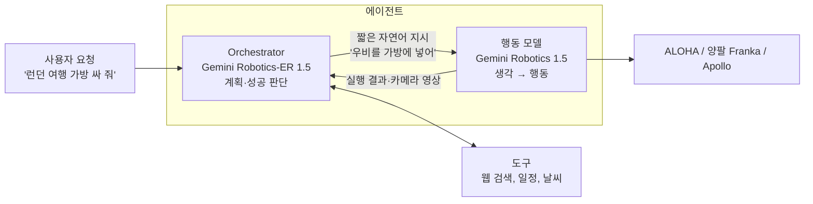

> [VLA 총정리 글]()의 열두 번째 모델입니다. [Gemini Robotics 1.0]()은 공간 이해를 강화한 VLM 위에 VLA를 만들었지만, 새 로봇마다 fine-tuning이 필요했고 긴 작업은 따로 특화해야 했습니다. **Gemini Robotics 1.5**(*Pushing the Frontier of Generalist Robots with Advanced Embodied Reasoning, Thinking, and Motion Transfer*, Google DeepMind, 2025)는 세 가지로 답합니다. **행동하기 전에 생각하는 VLA**, **여러 로봇을 하나의 체크포인트로 제어하는 Motion Transfer**, 그리고 계획을 맡는 ER 모델과 VLA를 묶은 **에이전트 시스템**입니다.

## 1. 두 모델과 에이전트 시스템

| 모델 | 역할 |
|---|---|
| **Gemini Robotics-ER 1.5** (VLM) | Gemini의 추론과 도구 사용 능력을 유지하면서 공간 이해, 작업 계획, 진행 상황 판단을 강화한 모델. 에이전트의 **orchestrator** |
| **Gemini Robotics 1.5** (VLA) | 중·단기 지시를 로봇 행동으로 옮기는 모델. 행동 전에 생각할 수 있고, 여러 로봇을 직접 제어. 에이전트의 **행동 모델** |

둘을 묶으면 이런 구조가 됩니다.



orchestrator는 사용자와 대화하고, 작업을 VLA가 실행할 수 있는 짧은 단계로 나누고, 각 단계가 끝났는지 판단해 다음 단계로 넘어갑니다. 필요하면 웹 검색 같은 도구로 정보를 찾습니다. VLA는 orchestrator가 부르는 하나의 "도구"처럼 자연어 지시를 받아 실행합니다.

논문의 예를 따라가 보면 생각이 여러 층으로 나뉩니다.

```text
사용자      : 런던 여행 가방을 싸 줘
ER 1.5      : (사용자 허락을 받아 일정과 날씨 확인) → "우비를 가방에 넣어"
VLA (생각)  : 몇 초 단위로 나누기 → "옷장에서 우비를 집는다"
VLA (생각)  : 기본 동작으로 → "그리퍼를 왼쪽으로 옮긴다", "그리퍼를 닫는다"
VLA (행동)  : action chunk
```

## 2. Thinking VLA: 행동하기 전에 생각한다

GR 1.5는 지시와 현재 장면을 보고 **자연어로 생각(thinking trace)을 먼저 생성해 문맥에 붙인 뒤** 행동을 냅니다. 생각과 행동이 번갈아 나옵니다(interleaving).

논문은 이것이 효과적인 이유를 이렇게 설명합니다. "옷을 색깔별로 분류해"에서 바로 관절 행동으로 가는 것은 어려운 번역입니다. 생각 단계는 이를 두 개의 쉬운 번역으로 나눕니다.

1. 복잡한 지시 → "그리퍼를 왼쪽으로 옮겨 옷에 가까이 간다" 같은 짧고 구체적인 문장. VLM backbone의 시각·언어 능력이 잘하는 일입니다.
2. 짧은 문장 → 행동. 더 단순한 대응만 배우면 됩니다.

여러 단계로 된 작업(옷 색깔별 분류 등)에서 생각을 켜면 세 로봇 모두에서 진행 점수가 크게 올랐습니다. 정량적인 이득 말고도 세 가지 장점이 관찰됐습니다.

- **해석 가능성**: 생각을 화면에 띄우면 로봇이 다음에 무엇을 하려는지 미리 알 수 있습니다.
- **성공 감지**: 노란 테니스공을 잡고 나면 생각이 "공을 집는다"에서 "공을 흰 가방에 넣는다"로 스스로 바뀝니다. 별도의 성공 판단기 없이도 앞 단계가 끝났음을 압니다.
- **실수 복구**: 오른손에서 물병이 미끄러져 왼손 근처에 떨어지자, 다음 생각이 곧바로 "왼손으로 물병을 집는다"가 됐습니다.

## 3. Motion Transfer: 몸이 달라도 하나의 모델로

GR 1.5는 ALOHA(양팔), 양팔 Franka, Apptronik의 휴머노이드 Apollo 데이터를 함께 학습하고, **로봇별 후학습 없이 하나의 체크포인트로 세 로봇을 제어**합니다. 이를 가능하게 한 새 구조와 학습 방법을 논문은 **Motion Transfer(MT)**라고 부릅니다. 여러 로봇의 데이터에서 움직임과 물리적 상호작용의 공통된 이해를 만들어 기술이 몸을 넘어 옮겨 가게 한다는 것인데, 구체적인 구조는 공개하지 않았습니다.

### 일반화

230개 작업으로 된 벤치마크로 시각·지시·행동 변화와 함께, 새 환경에서 새 작업을 하는 **작업 일반화**까지 평가했습니다. ALOHA에서 GR 1.5는 이전 Gemini Robotics와 로봇에서 직접 도는 Gemini Robotics On-Device(GRoD)보다 모든 축에서 좋았고, 특히 지시·행동·작업 일반화에서 크게 앞섰습니다. 양팔 Franka와 Apollo에서도 GRoD보다 크게 좋았습니다(GRoD는 데이터가 더 적고 로봇마다 체크포인트가 따로라 완전히 같은 조건의 비교는 아닙니다).

### MT의 효과

| 비교 | 결과 |
|---|---|
| 한 로봇 데이터만, MT 없음 | 기준 |
| 여러 로봇 데이터, MT 없음 | 대체로 좋아짐 |
| **여러 로봇 데이터 + MT** | 다른 로봇 데이터의 이득을 **더 키움** |

효과는 로봇이 가진 데이터 양에 따라 달랐습니다.

- **ALOHA**(데이터 많음): 다른 로봇 데이터를 그냥 넣는 것만으로는 효과가 작았고, MT가 로봇들을 정렬해 공통점을 뽑아내며 이득을 만들었습니다.
- **양팔 Franka**(데이터 중간): 다른 로봇 데이터도, MT도 모두 도움이 됐습니다.
- **Apollo 휴머노이드**(데이터 적음): 다른 로봇 데이터를 넣는 것 자체가 가장 큰 이득이었고, MT의 추가 효과는 작았습니다. 휴머노이드와 다른 로봇의 차이가 너무 커서 정렬이 덜 효과적이라는 해석입니다.

### Zero-shot 기술 이전

다른 로봇의 데이터에만 있던 작업을 시키는 교차 벤치마크도 만들었습니다("테이프 떼어 내기", "옷장 문 밀어 열기" 같은 작업). ALOHA는 양팔 Franka 데이터에만 있던 작업을, 양팔 Franka는 ALOHA 데이터에만 있던 작업을 해냈고, 휴머노이드도 ALOHA 데이터에만 있던 기술을 수행했습니다. 한 로봇의 데이터로만 학습한 모델(이전 Gemini Robotics, GRoD, 단일 로봇 GR 1.5)은 이 벤치마크에서 거의 하지 못했습니다. 부분 진행이 아니라 성공률로도 효과가 확인됐습니다.

### 시뮬레이션으로 평가 늘리기

수많은 구조와 설정을 비교하려고, MuJoCo로 실제 작업 공간을 시각·물리적으로 맞춘 평가 장면을 만들었습니다. 시뮬레이션과 실제 로봇의 모델 순위가 잘 일치해, 개발 중 평가 에피소드의 **90% 이상을 시뮬레이션에서** 했습니다. 최종 비교는 같은 작업 공간에서 여러 모델을 번갈아 실행하는 A/B/n 실제 평가로 했습니다.

## 4. Gemini Robotics-ER 1.5

ER 1.5는 공간 이해를 크게 높이면서도 범용 모델의 능력을 유지합니다. 15개 학술 벤치마크(BLINK, CV-Bench, ERQA, RoboSpatial, Where2Place, RefSpatial 등)로 잰 embodied reasoning 점수와, MMMU·GPQA·Aider Polyglot으로 잰 범용 점수를 함께 놓고 보면, 다른 최신 모델보다 둘 다 좋은 쪽으로 경계를 밀어냈습니다.

- **복잡한 가리키기**: "그릇의 테두리", "멀티탭의 콘센트 구멍", "10파운드보다 가벼운 물건", "같은 무늬의 양말끼리" 같은 물리·공간·의미 조건을 만족하는 점을 찍고, 충돌을 피하는 궤적으로 이을 수 있습니다. 가리키기 벤치마크에서 이전 ER, Gemini 2.5, GPT-5보다 좋았습니다.
- **진행 상황 이해**: 작업이 몇 % 진행됐는지 추정하고, 여러 카메라를 함께 봐야만 알 수 있는 성공 여부를 판단하고, 섞인 영상 프레임의 순서를 맞춥니다. 추론 지연까지 고려한 실시간 성공 판단에서도 좋았습니다.
- **생각할수록 좋아진다**: 생각 토큰 예산을 늘릴수록 embodied reasoning 성능이 올랐고, 작업에 따라 생각의 양을 스스로 조절했습니다(가리키기는 적게, 영상 질의응답은 많이). 범용 Gemini 2.5 Flash는 생각을 늘려도 embodied reasoning이 거의 오르지 않았습니다. 생각을 잘하는 모델이라고 물리 세계를 잘 추론하는 것은 아니라는 뜻입니다.

발표(2025년 9월) 당시 ER 1.5는 Gemini API(preview)로 개발자에게 공개되었고, VLA인 GR 1.5는 일부 파트너에게만 제공되었습니다.

## 5. 에이전트로 긴 작업 풀기

ALOHA와 양팔 Franka에서 8개의 긴 작업을 세 가지 방식으로 비교했습니다.

- "분리수거", "견과류 알레르기", "버섯 리소토": 웹 검색으로 지역 분리수거 규칙, 알레르기 성분, 요리 재료를 확인해야 함
- "책상 정리", "자리 바꾸기": 처음 상태를 기억했다가 되돌려야 함
- "여행 가방 싸기", "위 선반에서 탁자로": 옷걸이나 선반의 부드러운 물체를 다루는 3D 추론과 정밀 조작
- "블록을 서랍에": 9단계 계획

| 방식 | 결과 |
|---|---|
| Thinking VLA 혼자 | 진행 점수 최대 44% 정도 |
| Gemini 2.5 Flash(orchestrator) + GR 1.5 | 중간 |
| **ER 1.5 + GR 1.5** | 자주 80% 가까이, 복잡한 작업에서 Flash 조합의 약 2배 |

실패 원인을 나눠 보면 차이가 어디서 나는지 보입니다.

| 실패 원인 | Flash + GR 1.5 | ER 1.5 + GR 1.5 |
|---|---|---|
| 계획 실패(잘못된 계획·지시) | 25.5% | **9%** |
| 성공 판단 실패(단계를 너무 일찍·늦게 끝냄) | 6% | **4%** |
| 행동 실패(VLA가 단계를 못 끝냄) | 13% | **9%** |
| 전체 | 44.5% | **22%** |

가장 큰 차이는 **계획**에서 났습니다. 논문의 결론은 분명합니다. VLA가 좋아지면 실행은 튼튼해지지만 그것만으로는 긴 작업을 풀 수 없고, 범용 VLM을 VLA에 붙이는 것만으로도 부족하며, 물리 세계를 잘 이해하는 계획 모델이 필요하다는 것입니다.

## 6. 안전

- **여러 층의 안전**: 사람과의 대화 안전(Gemini의 안전 정책 상속), 행동 전에 안전을 생각하기, 필요할 때 충돌 회피 같은 저수준 안전 장치를 부르기, ISO 표준에 따른 운영 안전
- **ASIMOV-2.0**: 1.0 때 공개한 의미적 안전 벤치마크를 개선했습니다. 실제 부상 기록의 드문 사례를 더 담고, 생성 영상으로 "부상을 막을 수 있었던 마지막 순간"을 묻는 문제와, 로봇별 안전 지시를 지키며 가리키는 문제를 추가했습니다. ER 1.5는 위험 인식, 행동의 안전 결과 이해, 개입 시점 판단에서 이전 ER보다 좋았고, 안전을 따져 보도록 fine-tuning하면 안전 제약이 있는 가리키기에서 최고 수준이었습니다.
- **자동 레드티밍**: 공격 모델이 평범한 작업을 악의적 지시, 조작된 이미지, 실행 중 방해물 같은 공격으로 바꾸고, 평가 모델이 대상 모델의 응답을 채점합니다. 예를 들어 장면에 없는 물체를 가리키라는 요청으로 환각을 찾아냈고, 이렇게 만든 데이터로 학습해 취약점을 줄였습니다.

## 7. 논문이 밝힌 한계와 다음 단계

- 사람 영상과 합성 영상처럼 행동 라벨이 없는 데이터를 더 쓰는 것이 다음 과제입니다. GR 1.5의 구조는 이미 행동 주석 없이 이런 데이터로 배울 수 있게 되어 있다고 합니다.
- **정밀함(dexterity)은 이전 세대와 비슷한 수준**에 머물렀습니다. 일반성을 해치지 않으면서 정밀함을 높이기 위해 강화학습 같은 방법을 탐색하겠다고 밝힙니다.

## 8. 해석

**1. 생각의 층위가 하나 더 내려왔다.** [RT-2]()의 "Plan:"은 무엇을 집을지 정하는 의미 수준의 계획이었고, [π0.5]()의 subtask도 "베개를 집어" 수준이었습니다. GR 1.5의 생각은 "그리퍼를 왼쪽으로" 같은 **동작 수준**까지 내려옵니다. 언어를 행동의 중간 표현으로 쓰는 범위가 계획에서 동작으로 넓어진 셈이고, 1.0에서 손끝 궤적을 중간 표현으로 쓴 것과도 이어집니다. 생각이 바뀌는 순간이 곧 단계의 완료라는 관찰은, 생각이 성공 판단기 역할까지 한다는 점에서 흥미롭습니다.

**2. Motion Transfer는 데이터의 섬을 잇는 다리다.** [GR00T N1]()이 몸별 encoder/decoder로 여러 로봇을 한 모델에 넣었다면, GR 1.5는 **한 로봇에서만 배운 기술을 다른 로봇이 바로 하는** zero-shot 이전을 정량적으로 보였습니다. 데이터가 적은 로봇일수록 다른 로봇 데이터의 이득이 크고, 몸의 차이가 클수록 정렬이 어렵다는 결과는 앞으로 이 방향의 한계와 가능성을 함께 보여 줍니다. 다만 구조가 공개되지 않아 무엇이 정렬을 만드는지는 알 수 없습니다.

**3. 계획과 실행의 분업이 다시 돌아왔다.** VLA 연구는 SayCan 같은 "LLM 계획 + 저수준 정책" 파이프라인에서 벗어나 end-to-end로 왔습니다. 그런데 GR 1.5는 큰 ER 모델이 계획하고 작은 VLA가 실행하는 분업으로 긴 작업을 풉니다. 차이는 두 모델 모두 물리 세계에 맞춰 학습되었고 자연어로 유연하게 이어진다는 점입니다. 실패 분석에서 범용 VLM(Flash)을 orchestrator로 쓰면 계획 실패가 세 배 가까이 많았다는 결과가 이를 뒷받침합니다. [WALL-OSS]()가 계획까지 한 모델에 넣는 쪽을 택한 것과 대비됩니다.

**4. 정밀함의 숙제는 강화학습으로.** 논문은 정밀함이 제자리라고 스스로 인정하고 강화학습을 다음 방향으로 꼽습니다. 같은 시기 PI는 실제 경험으로 VLA를 강화학습하는 [π\*0.6]()을 내놓습니다.

**5. 읽을 때 주의할 점.** 모델 구조(특히 MT)와 학습 데이터의 세부가 공개되지 않았고, 결과는 대부분 자체 벤치마크의 진행 점수 그래프입니다. 시뮬레이션으로 평가를 늘린 방법과 A/B/n 실제 평가는 신뢰도를 높이지만, 외부에서 재현하기는 어렵습니다.

## 9. 정리

| 항목 | 내용 |
|---|---|
| 구성 | ER 1.5(계획·도구·성공 판단 orchestrator) + GR 1.5(Thinking VLA) |
| Thinking VLA | 생각과 행동을 번갈아 생성, 동작 수준까지 언어로 분해, 다단계 작업 진행 점수 크게 향상, 성공 감지·복구 |
| Motion Transfer | ALOHA·양팔 Franka·Apollo를 한 체크포인트로 제어, 다른 로봇에만 있던 기술 zero-shot 수행 |
| ER 1.5 | 복잡한 가리키기·진행 이해에서 GPT-5·Gemini 2.5보다 좋음, 생각할수록 embodied reasoning 향상 |
| 에이전트 | 긴 작업 진행 점수 80% 가까이, 실패율 44.5% → 22%(주로 계획 실패 감소) |
| 한계 | 정밀함은 이전 세대 수준, 구조 비공개 |

## References

- Gemini Robotics Team, "Gemini Robotics 1.5: Pushing the Frontier of Generalist Robots with Advanced Embodied Reasoning, Thinking, and Motion Transfer," 2025. [arXiv:2510.03342](https://arxiv.org/abs/2510.03342)
- Gemini Robotics Team, "Gemini Robotics: Bringing AI into the Physical World," 2025. [arXiv:2503.20020](https://arxiv.org/abs/2503.20020)
- Jindal et al., "Can AI Perceive Physical Danger and Intervene? (ASIMOV-2.0)," 2025. [arXiv:2509.21651](https://arxiv.org/abs/2509.21651)
- Sermanet et al., "Generating Robot Constitutions & Benchmarks for Semantic Safety," CoRL 2025.
- Zawalski et al., "Robotic Control via Embodied Chain-of-Thought Reasoning," CoRL 2024.
- Huang et al., "Inner Monologue: Embodied Reasoning through Planning with Language Models," CoRL 2022.
