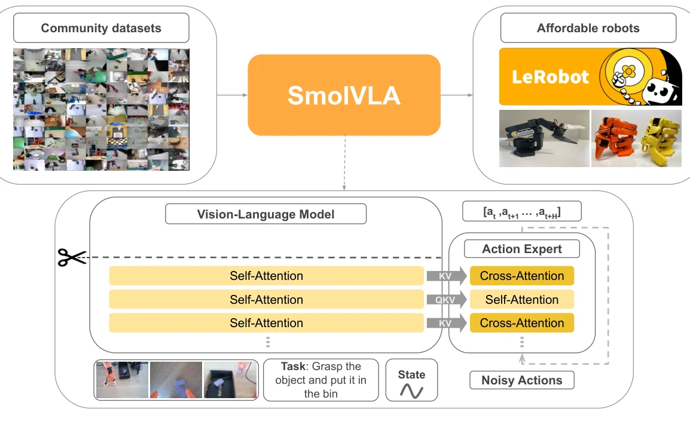
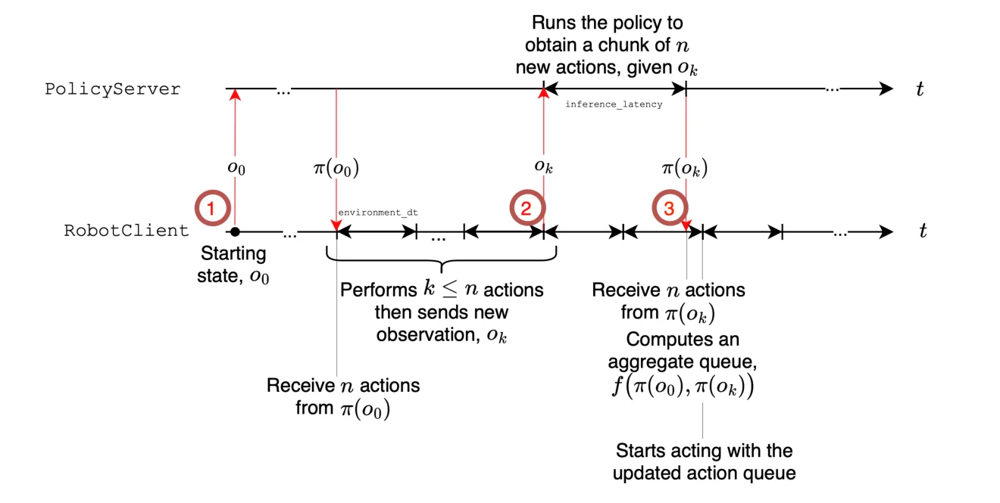
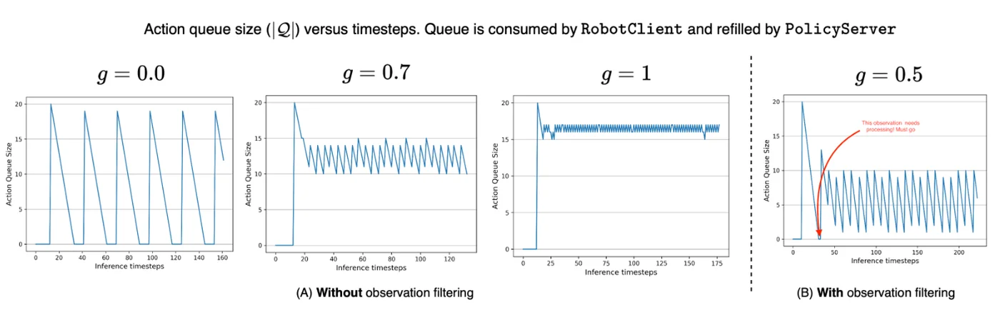

> - **논문**: SmolVLA: A Vision-Language-Action Model for Affordable and Efficient Robotics
> - **저자**: Mustafa Shukor, Dana Aubakirova, Francesco Capuano, Pepijn Kooijmans, Steven Palma, Adil Zouitine, Michel Aractingi, Caroline Pascal, Martino Russi, Andres Marafioti, Simon Alibert, Matthieu Cord, Thomas Wolf, Remi Cadene (Hugging Face, Sorbonne University, valeo.ai, ENS Paris-Saclay)
> - **학회**: arXiv 2025 · [arXiv:2506.01844](https://arxiv.org/abs/2506.01844)
{: .prompt-tip }

> [VLA 총정리 글]()의 열 번째 모델이다. 지금까지의 VLA는 수십억 파라미터에, 기업과 연구실이 모은 대규모 데이터로 학습했다. **SmolVLA**는 반대 방향으로 간다. GPU 한 장으로 학습하고 CPU에서도 돌아가는 450M 모델을, **취미로 로봇을 만드는 사람들이 올린 데이터**로 학습한다.

## 1. 문제: VLA는 크고, 데이터는 일부 기관에 몰려 있다

논문이 짚는 문제는 둘이다.

1. **비용**: 기존 VLA는 수십억 파라미터라 학습과 배포가 비싸다. 실제 로봇에 올리기도 어렵다.
2. **데이터 편중**: 학습 데이터가 학계와 기업의 대형 데이터셋에 의존한다. 그사이 SO-100 같은 저가 로봇팔과 LeRobot 라이브러리로 개인들이 모은 데이터가 Hugging Face Hub에 쌓이고 있지만 거의 쓰이지 않는다.

## 2. 구조


_Figure 1. 커뮤니티 데이터로 사전학습하고 저가 로봇에서 평가한다. 아래: VLM의 위쪽 층을 잘라 내고(가위), 남은 층의 특징을 action expert가 받는다. action expert는 VLM의 key·value를 보는 cross-attention과 행동 토큰끼리 보는 self-attention을 번갈아 쌓는다. (출처: Shukor et al., 2025)_

| 구성 | 내용 |
|---|---|
| VLM | SmolVLM-2(SigLIP 비전 인코더 + SmolLM2 언어 모델, 약 500M). **얼려 둠** |
| 층 줄이기 | LLM의 **앞 16개 층만** 쓰고 위쪽 층은 버림 |
| 이미지 토큰 | 이미지를 여러 조각으로 나누는 tiling을 끄고, pixel shuffle로 프레임당 **64개 토큰** |
| 로봇 상태 | 선형 층으로 토큰 하나로 만들어 VLM 입력(prefix)에 넣음 |
| Action expert | 약 100M, flow matching으로 50 step chunk를 10번의 노이즈 제거로 생성 |
| 전체 | **450M** |

[π0]()와 같은 "VLM + flow matching action expert" 구조를 작게 줄인 것이다. 한 가지 다른 점은 action expert 안의 층 구성이다. VLM 특징을 key·value로 보는 **cross-attention 층**과, 행동 토큰끼리 보는 **causal self-attention 층**을 번갈아 쌓는다. 이 선택의 근거는 6장의 ablation에 있다.

## 3. 데이터: 커뮤니티가 올린 481개 데이터셋

| 데이터셋 수 | 에피소드 | 프레임 |
|---|---|---|
| 481 | 22.9K | 10.6M |

Hugging Face Hub에서 로봇 종류, 에피소드 수, 품질, 프레임 수를 기준으로 고른 데이터셋이다. OpenVLA가 쓴 약 100만 궤적보다 한 자릿수 이상 작다. 사람마다 다르게 기록한 데이터라 정리가 필요했다.

- **지시문 다시 쓰기**: "task desc" 같은 자리표시자, "Hold", "Up"처럼 모호한 지시, 아예 빈 지시가 많았다. 대표 프레임과 원래 지시를 Qwen2.5-VL-3B에 주고, 행동을 요약하는 짧은 문장을 새로 쓰게 했다.
- **카메라 이름 통일**: 같은 `images.laptop`이 어떤 데이터에서는 위에서, 어떤 데이터에서는 손목에서 찍은 영상이었다. 카메라를 위·손목·옆 순서로 직접 대응시켜 `OBS_IMAGE_1~3`으로 이름을 바꿨다. 순서를 맞추는 것이 학습에 도움이 됐다고 한다.

사전학습은 200k step, 배치 256으로 GPU 4장에서 했고(작아서 1장으로도 가능), 프로젝트 전체에 약 3만 GPU-시간이 들었다. π0와 비교하면 학습이 약 40% 빠르고 메모리는 6배 적게 쓴다.

구현 설정(4.3절)을 모으면 다음과 같다.

| 항목 | 값 |
|---|---|
| 프레임워크 | LeRobot(PyTorch), Hugging Face accelerate, bfloat16, `torch.compile()` |
| 학습 대상 | VLM은 얼리고 action expert만 학습 |
| Action expert | hidden 크기 = VLM hidden의 0.75배, 약 100M |
| 입력 이미지 | 512×512로 resize, tiling 없이 전체 이미지 + pixel shuffle로 프레임당 64 토큰 |
| 사전학습 | 200k step, global batch 256, GPU 4장 |
| Optimizer | AdamW($$\beta_1 = 0.9, \beta_2 = 0.95$$), 100 step warmup 후 cosine lr 1e-4 → 2.5e-6 |
| 시뮬레이션 fine-tuning | 100k step, batch 64 |
| 실제 로봇 fine-tuning | 200k step (더 짧게 학습해도 성능 차이가 크지 않았다고 함) |
| Flow matching | chunk $$n = 50$$, 추론 10 step, $$\tau$$는 π0처럼 Beta 분포에서 샘플링 |
| 평가 시 추론 | 실제 로봇 메인 결과는 chunk를 다 실행하는 동기 방식, 시뮬레이션은 행동 하나마다 새 관측으로 다시 예측 |

## 4. 비동기 추론

### 동기 방식의 문제

action chunk를 내는 정책은 보통 chunk를 다 실행한 뒤 새 관측으로 다음 chunk를 예측한다(동기 방식). 그런데 예측하는 동안 로봇은 할 일이 없어 멈춘다. 반대로 [ACT]()의 temporal ensembling처럼 매 step 예측하면 반응은 빠르지만 계산이 매우 많다.

### 실행과 예측을 분리하기

SmolVLA는 로봇 쪽(RobotClient)과 정책 쪽(PolicyServer)을 분리한다. 로봇은 큐에 남은 행동을 계속 실행하다가, 남은 행동이 chunk 길이의 **$$g$$ 비율 아래로 떨어지면** 새 관측을 서버에 보낸다. 서버가 계산하는 동안에도 로봇은 남은 행동을 실행하고, 새 chunk가 오면 겹치는 부분을 합쳐 큐를 갱신한다. 관절 상태가 직전에 보낸 관측과 거의 같으면 서버에 보내지 않아, 같은 chunk가 반복해서 들어오는 것도 막는다. 정책 서버는 원격 GPU에 둘 수 있어, 계산 자원이 부족한 로봇에도 유리하다.


_Figure 2. RobotClient는 받은 chunk에서 $$k \le n$$개 행동을 실행한 뒤 새 관측 $$o_k$$를 보내고, PolicyServer가 계산하는 동안에도 계속 움직인다. 새 chunk가 오면 남은 큐와 합쳐 $$f(\pi(o_0), \pi(o_k))$$로 갱신한다. (출처: Shukor et al., 2025)_

논문은 이 과정을 간단히 분석한다. 추론 지연이 $$\ell$$, 제어 주기가 $$\Delta t$$, chunk 길이가 $$n$$이면, 큐가 비지 않으려면 대략 $$g \ge \mathbb{E}[\ell] / (n\,\Delta t)$$이어야 한다. 아래는 이를 확인하는 단순한 시뮬레이션이다.

```python
def run(g, n=50, dt=1 / 30, latency=0.3, total=600):
    """남은 행동이 chunk의 g 비율 아래로 떨어지면 다음 chunk를 미리 요청한다. g = 0이면 다 쓰고 나서 요청(동기 방식)."""
    t, queue, arrival, done, idle, calls = 0.0, n, None, 0, 0.0, 1
    while done < total:
        if arrival is not None and t >= arrival:          # 새 chunk 도착 → 큐 교체(겹치는 부분 합치기는 생략)
            queue, arrival = n, None
        if queue > 0:
            queue, done, t = queue - 1, done + 1, t + dt   # 행동 하나 실행
            if arrival is None and queue < g * n:         # 비동기: 큐가 줄면 실행을 멈추지 않고 요청
                arrival, calls = t + latency, calls + 1
        else:
            if arrival is None:                           # 동기: 큐가 비면 그제서야 요청
                arrival, calls = t + latency, calls + 1
            idle, t = idle + (arrival - t), arrival       # 새 chunk가 올 때까지 로봇이 멈춤
    return t, idle, calls

print("추론 지연 0.3초, chunk 50개, 30Hz로 행동 600개(20초 분량) 실행")
for g in [0.0, 0.3, 0.7, 1.0]:
    t, idle, calls = run(g)
    print(f"g = {g:.1f}: 총 {t:5.1f}초, 멈춘 시간 {idle:3.1f}초, 추론 {calls:2d}번")
print(f"멈추지 않으려면 g ≥ 지연 / (chunk 길이 x 주기) = {0.3 / (50 / 30):.2f}")
```

```text
추론 지연 0.3초, chunk 50개, 30Hz로 행동 600개(20초 분량) 실행
g = 0.0: 총  23.3초, 멈춘 시간 3.3초, 추론 12번
g = 0.3: 총  20.0초, 멈춘 시간 0.0초, 추론 14번
g = 0.7: 총  20.0초, 멈춘 시간 0.0초, 추론 24번
g = 1.0: 총  20.0초, 멈춘 시간 0.0초, 추론 58번
멈추지 않으려면 g ≥ 지연 / (chunk 길이 x 주기) = 0.18
```

동기 방식($$g = 0$$)은 chunk마다 0.3초씩 멈춰 3.3초를 잃는다. 임계값 0.18보다 큰 $$g$$에서는 멈춤이 사라진다. $$g$$가 클수록 새 관측을 더 자주 반영해 반응이 빨라지지만, 추론 횟수가 늘어 계산 비용이 커진다. 논문은 0과 1 사이의 값(그림의 예는 0.7)으로 둘의 균형을 맞추라고 한다.


_Figure 3. (A) 관측 필터 없이 $$g = 0, 0.7, 1$$일 때의 큐 크기 변화. $$g = 0$$은 큐가 0으로 떨어져 로봇이 멈추는 구간이 생기고, $$g = 1$$은 큐가 거의 늘 차 있다. (B) 관절 공간에서 거의 같은 관측을 걸러 내는 필터를 켠 $$g = 0.5$$. 큐가 비면 필터를 무시하고 관측을 처리한다(빨간 화살표). (출처: Shukor et al., 2025)_

실제 SO-100 로봇에서 두 방식은 성공률이 비슷했지만(78.3% vs 73.3%), 비동기 방식이 작업을 **평균 13.75초에서 9.7초로 약 30% 빨리** 끝냈고, 정해진 시간 동안 큐브를 옮긴 횟수는 9번에서 19번으로 늘었다. 물체 위치가 바뀌거나 방해를 받을 때도 더 빨리 반응했다.

| 추론 방식 | 집어 넣기 | 쌓기 | 나누기 | 평균 성공률 | 작업 시간 (평균 ± 표준편차) | 고정 시간 내 큐브 수 (합계) |
|---|---|---|---|---|---|---|
| 동기 | 75 | 90 | **70** | **78.3** | 13.75 ± 2.42초 | 9 |
| **비동기** | **80** | 90 | 50 | 73.3 | **9.70 ± 2.95초** | **19** |

(Figure 5. 시간 측정은 집어 넣기 작업, 큐브 위치 5곳 × 10회. 하이퍼파라미터는 집어 넣기에 맞춰 다른 작업에 그대로 썼다.) 평균 성공률이 비슷한 것은 맞지만, 나누기 작업만 보면 비동기 쪽이 20%p 낮다.

## 5. 실험

### 시뮬레이션

| 모델 | 크기 | 로봇 데이터 사전학습 | LIBERO 평균 | Meta-World 평균 |
|---|---|---|---|---|
| Diffusion Policy | | 없음 | 72.4 | 10.5 |
| Octo | 0.09B | 있음 | 75.1 | |
| OpenVLA | 7B | 있음 | 76.5 | |
| TinyVLA | | 없음 | | 31.6 |
| π0 (PaliGemma에서 시작) | 3.3B | 없음 | 71.8 | 50.5 |
| π0 | 3.3B | 있음 | 86.0 | 47.9 |
| SmolVLA | 0.24B | 없음 | 82.75 | 56.95 |
| **SmolVLA** | **0.45B** | 없음 | **87.3** | **57.3** |
| SmolVLA | 2.25B | 없음 | 88.75 | 68.24 |

(성공률 %, Diffusion Policy·Octo·OpenVLA·TinyVLA 점수는 기존 논문에서 인용. Meta-World 표에서는 π0 크기를 3.5B로 적었다) LIBERO는 Spatial·Object·Goal·Long 4종 × 10개 작업을 작업당 10번, Meta-World는 50개 작업을 작업당 10번 평가했다. LIBERO에서 가장 어려운 Long은 π0 73, SmolVLA(0.45B) 71로 비슷하다. 시뮬레이션 실험의 SmolVLA는 로봇 데이터로 사전학습하지 않고 VLM에서 바로 학습했는데도, 로봇 데이터로 사전학습한 π0와 비슷했다.

### 실제 로봇

SO-100에서 큐브 집어 상자에 넣기, 빨간 큐브를 파란 큐브 위에 쌓기, 색깔별로 상자에 나누기를 시켰다(작업당 시연 50개 = 시작 위치 5곳 × 10개). 점수는 부분 점수이다. 집어 넣기와 쌓기는 잡기 0.5 + 놓기 0.5, 나누기는 큐브 잡기와 맞는 상자에 넣기가 각 0.25이다.

| 모델 | 집어 넣기 | 쌓기 | 나누기 | 평균 |
|---|---|---|---|---|
| ACT (작업별로 학습) | 70 | 50 | 25 | 48.3 |
| π0 (3.3B, 함께 fine-tuning) | 100 | 40 | 45 | 61.7 |
| **SmolVLA** (0.45B, 함께 fine-tuning) | 75 | 90 | 70 | **78.3** |

사전학습에 쓰이지 않은 SO-101 로봇에서 작은 레고 블록을 투명한 상자에 넣는 작업도, 학습 분포 안(90% vs ACT 70%)과 처음 보는 위치(50% vs 40%) 모두에서 ACT보다 좋았다. 이 실험은 둘 다 단일 작업으로 학습했다.

### 사전학습과 여러 작업 함께 학습의 효과

| 설정 | 집어 넣기 | 쌓기 | 나누기 | 평균 |
|---|---|---|---|---|
| 사전학습 없음, 작업별 학습 | 55 | 45 | 20 | 40.0 |
| 사전학습 없음, 세 작업 함께 학습 | **80** | 40 | 35 | 51.7 |
| **커뮤니티 데이터 사전학습**, 세 작업 함께 학습 | 75 | **90** | **70** | **78.3** |

커뮤니티 데이터 사전학습이 51.7%를 78.3%로 끌어올렸다.

## 6. Ablation: 무엇이 성능을 만들었나

로봇 데이터 사전학습 없이 VLM을 얼리고 action expert만 학습해 LIBERO에서 비교했다.

| 질문 | 결과 (LIBERO 평균) |
|---|---|
| VLM과 action expert를 어떻게 이을까 | cross-attention만 79.0, self-attention만 74.5, **번갈아 쌓기 85.5** |
| 행동 토큰끼리 어떻게 볼까 | 양방향 67.5, **causal 74.5** |
| VLM 층을 얼마나 쓸까 | 8층 75.0, 16층 78.5, 24층 79.5, 32층 80.3. 한 층씩 건너뛰기 75.5, 더 작은 VLM(256M) 75.8 |
| action expert 폭 (VLM 대비) | ×1.00 82.3, ×0.75 77.5, ×0.50 80.3, ×0.25 73.8 |
| 학습 목표 | **flow matching 80.25**, L1 회귀 75.25 |
| 로봇 상태를 어디에 넣을까 (cross-attention 기준) | **VLM 입력 80.3**, action expert 입력 73.3 |
| chunk 길이 | 1개 50.0, **10개 84.0**, 30개 78.5, 50개 80.3, 100개 74.5 |
| 새 관측까지 실행할 행동 수 | 1개 80.3, **10개 82.8**, 30개 70.8, 50개 51.8 |

- 큰 VLM의 앞 절반 층을 쓰는 것이 작은 VLM 전체를 쓰는 것보다 낫다. 16층은 32층과 크게 차이 나지 않으면서 계산이 절반이다.
- 작은 모델에서도 flow matching이 회귀보다 좋았다. 여러 갈래의 행동 분포를 표현하는 능력의 차이이다.
- action expert 폭은 최종 모델이 쓴 0.75배가 이 표에서는 0.5배보다 낮게 나온다. 논문은 0.75배가 성능과 효율의 균형이 좋다고만 설명해, 표와 선택 사이의 근거가 약하다.
- 로봇 상태 위치도 표를 자세히 보면 self-attention 변형에서는 반대로 action expert 입력(74.8)이 VLM 입력(53.3)보다 높다. 본문은 "두 변형 모두 VLM 입력이 낫다"고 쓰지만 표와 맞지 않으니, cross-attention 기준 결과로 읽는 편이 안전하다.
- chunk가 너무 짧거나(1개) 너무 길면(100개) 모두 나빠지고, 한 chunk를 너무 오래 실행해도(50개) 반응이 늦어 크게 떨어진다. ACT에서 본 균형과 같다.

## 7. 논문이 밝힌 한계

- 사전학습 데이터가 거의 한 종류의 로봇(SO-100)에서 나왔다. 여러 로봇의 데이터가 필요하다.
- 약 2만 3천 궤적으로, 일반적인 VLA 데이터보다 훨씬 작다.
- VLM이 주로 문서 읽기와 OCR로 학습된 모델이라 로봇에 최적인지 알 수 없다.
- 웹 데이터와의 공동 학습을 하지 않았고, 짧은 작업 위주이며, 모방학습만 쓴다.

## 8. 해석

**1. 작게 만드는 법의 교과서.** SmolVLA의 효율화는 네 가지이다. 작은 VLM, 그 VLM의 앞 절반 층만 쓰기, 이미지 토큰 64개, VLM 고정. 특히 "큰 모델의 중간 층 > 작은 모델 전체"라는 결과는 [GR00T N1]()이 LLM의 12번째 층 특징을 쓴 것과 같은 이야기이다. LLM의 위쪽 층은 다음 단어를 고르는 데 특화되어 있고, 행동에 필요한 시각·의미 정보는 중간 층에 이미 충분하다는 해석이 가능하다.

**2. 커뮤니티 데이터의 가능성.** 사람마다 다른 카메라, 엉망인 지시문, 단일 종류의 저가 로봇이라는 약점에도, 2만 3천 개 에피소드의 사전학습이 실제 성능을 크게 올렸다. VLM으로 지시문을 다시 쓰고 카메라 순서를 맞추는 정리가 이를 가능하게 했다. VLA 데이터를 기업만 모으는 것이 아니라, LLM의 웹 데이터처럼 여러 사람이 함께 쌓는 방향을 처음으로 보여 준 셈이다.

**3. 비동기 추론은 모델과 무관한 도구다.** action chunk를 내는 정책이라면 어디에나 붙일 수 있다. $$g = 0$$은 chunk를 끝까지 실행하는 방식, $$g = 1$$은 ACT처럼 매 step 예측하는 방식이고, 그 사이에서 계산 비용과 반응성을 조절한다. [Gemini Robotics]()의 클라우드 backbone + 로컬 decoder나 이중 시스템 구조와 같은 문제, 즉 "느린 추론으로 어떻게 끊김 없이 움직일까"에 가장 가볍게 답하는 방법이다.

**4. 양방향 attention이 해로웠다는 결과.** π0는 행동 토큰끼리 양방향으로 보게 했지만, SmolVLA의 ablation에서는 causal이 더 좋았다. 모델 크기, 데이터, 다른 설계와 얽힌 결과라 일반화하기는 어렵지만, "행동 토큰끼리 어떻게 볼까"가 아직 정답이 없는 설계 질문이라는 것을 보여 준다.

**5. 읽을 때 주의할 점.** LIBERO는 이미 90%에 가까운 점수가 나오는 벤치마크이고, 실제 로봇 작업도 큐브를 옮기고 쌓는 짧은 작업이다. 시뮬레이션 비교 모델의 점수는 기존 논문에서 가져온 것이라 학습 조건이 완전히 같지는 않다. 대신 모델, 코드, 데이터, 로봇 하드웨어 설계까지 모두 공개해 누구나 재현할 수 있게 했다는 점이 이 논문의 가장 큰 장점이다.

## 9. 정리

| 항목 | 내용 |
|---|---|
| 구조 | SmolVLM-2(얼림, 앞 16층, 프레임당 64 토큰) + flow matching action expert(약 100M, cross·causal self-attention 교대), 전체 450M |
| 데이터 | 커뮤니티 데이터셋 481개(22.9K 에피소드), VLM으로 지시문 재작성, 카메라 순서 통일 |
| 추론 | 비동기 추론: 큐가 $$g$$ 비율 아래면 미리 요청, 작업 시간 약 30% 단축 |
| 결과 | LIBERO 87.3%(π0 86.0%), SO-100 평균 78.3%(π0 61.7%, ACT 48.3%) |
| 비용 | GPU 1장으로 학습 가능, π0보다 학습 40% 빠르고 메모리 6배 적음, CPU 실행 가능 |
| 한계 | 사실상 한 종류 로봇의 데이터, 짧은 작업, 웹 데이터 공동 학습 없음 |

## References

- Shukor et al., "SmolVLA: A Vision-Language-Action Model for Affordable and Efficient Robotics," 2025. [arXiv:2506.01844](https://arxiv.org/abs/2506.01844)
- 블로그: <https://huggingface.co/blog/smolvla>, 코드: [LeRobot](https://github.com/huggingface/lerobot)
- Marafioti et al., "SmolVLM: Redefining Small and Efficient Multimodal Models," 2025.
- Liu et al., "LIBERO: Benchmarking Knowledge Transfer for Lifelong Robot Learning," NeurIPS 2023.
- Yu et al., "Meta-World: A Benchmark and Evaluation for Multi-Task and Meta Reinforcement Learning," CoRL 2019.
