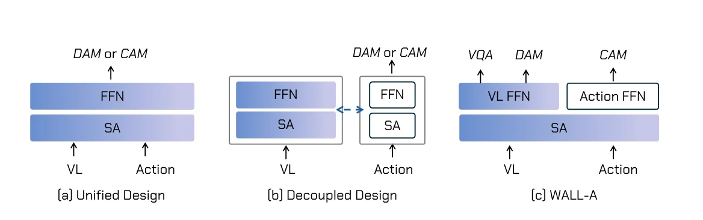
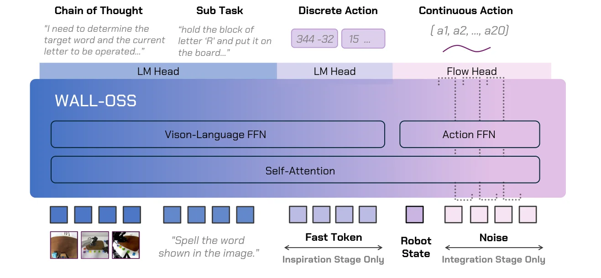
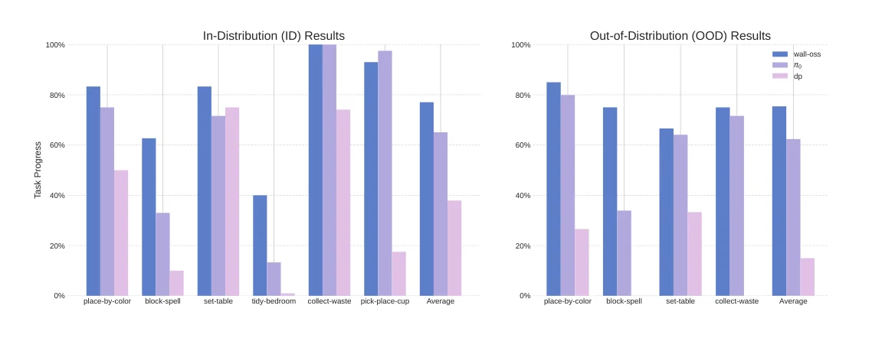

> - **논문**: Igniting VLMs toward the Embodied Space
> - **저자**: Andy Zhai, Brae Liu, Bruno Fang, Hao Wang, Lucy Liang 등 20명 (X Square Robot)
> - **학회**: arXiv 2025 · [arXiv:2509.11766](https://arxiv.org/abs/2509.11766) · [코드](https://github.com/X-Square-Robot/wall-x)
{: .prompt-tip }

> [VLA 총정리 글]()의 열한 번째 모델이다. **WALL-OSS**는 중국 선전의 로봇 회사 X Square Robot이 공개한 VLA이다. 출발점은 "지금의 VLM은 로봇의 세계를 잘 모른다"는 진단이고, 해법은 VLM과 행동 부분을 느슨하게 붙이지도, 한 덩어리로 섞지도 않는 **"단단하게 결합된"** 구조이다.

## 1. 문제: VLM을 행동으로 옮길 때의 세 가지 간극

논문은 VLM에서 VLA로 넘어갈 때의 간극을 셋으로 나눈다.

1. **모달리티의 간극**: 텍스트와 이미지는 오랜 연구와 거대한 웹 데이터로 함께 정렬되었지만, 3D 공간과 시간에 걸친 연속적인 행동은 그런 정렬이 없다. 게다가 "식탁을 차려"라는 지시 하나에 여러 subtask와 구체적인 동작이 숨어 있다.
2. **사전학습 분포의 간극**: 로봇 카메라는 1인칭 시점, 어안 렌즈, 로봇 팔이 시야를 가리는 장면이 많아 인터넷 이미지와 다르다. 논문 그림의 예처럼 일반 VLM은 겹쳐 쌓인 카드를 가리켜 세지 못하고, 알파벳 블록으로 단어를 만드는 계획도 세우지 못한다.
3. **학습 목표의 간극**: VLM은 이산 토큰의 next-token prediction으로 학습하지만, 행동은 diffusion이나 flow matching 같은 연속 생성 목표가 자연스럽다. 이를 그대로 붙이면 VLM의 지식이 크게 망가진다.

기존 구조도 각각 한계가 있다고 본다.

| 구조 | 예 | 한계 |
|---|---|---|
| 하나로 섞기 | RT-2, OpenVLA | 행동 학습이 VLM 가중치를 크게 흔들어 지시 따르기와 일반화가 떨어지고 행동에 과적합 |
| 따로 붙이기 | π0 | 비전과 언어가 행동 생성의 보조 신호에 그쳐 지시 따르기가 약함. VLM을 보호하는 Knowledge Insulation도 결합이 느슨하다는 한계는 같음 |
| **단단하게 결합** | WALL-OSS | self-attention은 공유, FFN은 분리 |


_Figure 2. (a) 하나로 섞기, (b) 따로 붙이기, (c) WALL-OSS(그림에서는 WALL-A). 파란 부분이 사전학습 VLM에서 물려받은 가중치이다. DAM은 이산 행동, CAM은 연속 행동 모델링이다. (출처: Zhai et al., 2025)_

## 2. 구조: 정적 라우팅 MoE

WALL-OSS는 **Qwen2.5-VL-3B**를 backbone으로 쓴다. Transformer의 각 층에서

- **self-attention은 모든 토큰이 공유**하고,
- **FFN은 둘로 나눈다**. 이미지·언어 토큰은 원래 VLM의 FFN(비전-언어 FFN)으로, 행동 토큰은 새로 붙인 행동 FFN으로 간다.

어느 FFN으로 갈지는 학습된 router가 아니라 토큰 종류로 정해 둔다(정적 라우팅). 출력은 두 가지이다. 텍스트와 FAST 행동 토큰을 내는 LM head, 연속 action chunk를 내는 flow head이다. 입력은 1인칭·손목 카메라 영상과 지시문이다.


_Figure 3. 이미지와 지시 토큰은 비전-언어 FFN, 로봇 상태와 노이즈 행동 토큰은 행동 FFN을 지나고 self-attention은 함께 쓴다. LM head가 생각·subtask·FAST 토큰을, flow head가 연속 행동을 낸다. FAST 토큰은 Inspiration 단계에만, 노이즈 입력은 Integration 단계에만 쓰인다. (출처: Zhai et al., 2025)_

아래 코드는 이런 층을 두 개 쌓고, 행동 토큰에만 loss를 줬을 때 기울기가 어디로 흐르는지 확인한다.

```python
import torch
import torch.nn as nn

torch.manual_seed(0)
d = 64

def ffn():
    return nn.Sequential(nn.Linear(d, 4 * d), nn.GELU(), nn.Linear(4 * d, d))

class StaticMoEBlock(nn.Module):
    """self-attention은 모든 토큰이 공유하고, FFN은 토큰 종류에 따라 정해진 쪽을 쓴다(정적 라우팅)."""
    def __init__(self):
        super().__init__()
        self.attn = nn.MultiheadAttention(d, 4, batch_first=True)
        self.ffn = nn.ModuleDict({"vl": ffn(), "action": ffn()})

    def forward(self, x, is_action):
        x = x + self.attn(x, x, x)[0]
        out = torch.zeros_like(x)
        out[~is_action] = self.ffn["vl"](x[~is_action])
        out[is_action] = self.ffn["action"](x[is_action])
        return x + out

blocks = nn.ModuleList([StaticMoEBlock(), StaticMoEBlock()])
x = torch.randn(1, 12, d)
is_action = torch.tensor([[False] * 8 + [True] * 4])        # 이미지·지시 토큰 8개 + 행동 토큰 4개
h = x
for blk in blocks:
    h = blk(h, is_action)
h[is_action].pow(2).mean().backward()                       # 행동 토큰에만 loss를 준다

grad = lambda m: sum(p.grad.abs().sum().item() for p in m.parameters() if p.grad is not None)
for i, blk in enumerate(blocks, 1):
    print(f"{i}층 | attention {grad(blk.attn):7.3f} | 비전-언어 FFN {grad(blk.ffn['vl']):7.3f} | 행동 FFN {grad(blk.ffn['action']):7.3f}")
```

```text
1층 | attention  32.286 | 비전-언어 FFN  14.978 | 행동 FFN 111.223
2층 | attention  34.289 | 비전-언어 FFN   0.000 | 행동 FFN 114.451
```

마지막 층의 비전-언어 FFN에는 행동 loss의 기울기가 가지 않지만, 아래층의 비전-언어 FFN에는 위층의 공유 attention을 거쳐 기울기가 흘러간다. 행동 학습이 VLM의 표현을 완전히 차단하지 않고 함께 바꾼다는 뜻이다. 이것이 논문이 말하는 "단단한 결합"의 실체이고, 기울기를 막아 VLM을 보호하는 Knowledge Insulation과 반대 방향의 선택이다.

## 3. 학습: Inspiration → Integration

학습은 "이산 행동으로 감을 심고, 연속 행동으로 다듬는" 순서이다.

**Inspiration 단계**: 원래 VLM의 FFN을 그대로 쓰면서 두 가지를 학습한다.

- **Embodied VQA**: 로봇 장면에서 물체 찾기, 진행 상황 판단, 다음 행동 계획 같은 질문으로 공간 추론을 키운다.
- **FAST 이산 행동**: 행동 궤적을 FAST 토큰(DCT → 반올림 → BPE)으로 바꿔 텍스트처럼 예측한다.

$$
\mathcal{L}_{\text{Inspiration}} = \lambda_{\text{VQA}}\sum_t -\log p(\ell_t \mid \ell_{<t}, c) + \lambda_{D}\sum_k -\log p(z_k \mid z_{<k}, c),\qquad z_{1:K} = \text{FAST}(a)
$$

($$c$$는 영상과 지시, $$\ell_t$$는 텍스트 토큰) 이 단계의 출력에는 생각(chain-of-thought), subtask, FAST 행동 토큰이 모두 들어 있다.

**Integration 단계**: 이산 행동 대신 flow matching으로 연속 행동을 학습한다. 두 phase로 나눈다.

1. VLM을 얼리고 행동 FFN 아래의 flow head만 학습
2. VLM까지 풀어 함께 학습

1단계의 loss는 노이즈 섞은 행동 $$x_t = (1-\rho(t))\,x_0 + \rho(t)\,\epsilon$$에서 속도장 $$\epsilon - x_0$$를 맞히는 가중 MSE $$\lambda_C\,\mathbb{E}\big[w(t)\,\lVert v_\phi(x_t, h, t) - (\epsilon - x_0)\rVert_2^2\big]$$이고, 2단계도 같은 loss를 VLM 파라미터까지 흘려 보낸다.

[π0.5]()의 "사전학습은 토큰으로, 후학습에 flow matching" 순서와 같다. 논문은 앞 단계의 이산 행동 감독이 뒤 단계의 cross-modal attention을 안정시키고 VLM 지식을 지켜 준다고 설명한다.

## 4. Uni-CoT: 생각부터 행동까지 한 모델로

보통 "생각(chain-of-thought)"이라고 하면 LLM이 답 전에 쓰는 단계별 텍스트를 말한다. WALL-OSS는 이를 넓혀, **지시 → 생각 → subtask → 연속 행동**까지를 하나의 사슬로 본다. 논문은 이를 Unified Cross-Level CoT(Uni-CoT)라고 부른다.

$$
\min_\theta\ \mathbb{E}_{(v, x, c, a)}\Big[\ell_{\text{act}}\big(F_\theta(v, x, c), a_{1:T}\big) + \lambda\,\ell_{\text{VQA}}\big(H_\theta(v, x), y\big)\Big]
$$

($$v$$: 영상, $$x$$: 지시, $$c$$: 선택적인 생각, $$a$$: 행동, $$H$$: embodied VQA head) 학습 때 중간 단계를 조건으로 쓰기도 하고 건너뛰기도 하는 **path-drop** 방식을 써서, 하나의 모델이 생각과 subtask를 거쳐 행동할 수도, 지시에서 바로 행동할 수도 있게 한다. 추론 때는 작업의 복잡도에 따라 생각을 할지 정하고, 끝난 subtask의 행동을 내보내면서 다음 생각을 이어 가는 식으로 추론과 실행을 섞을 수도 있다.

SayCan이나 Hi Robot처럼 계획 모델과 제어 모델을 따로 두는 방식은 학습은 쉽지만, 둘 사이의 인터페이스가 미분 불가능하고 단계마다 오류가 쌓인다는 것이 논문의 비판이다. 아래는 논문 그림에 나온 글자 블록 작업의 생각 예시를 우리말로 옮긴 것이다.

```text
<Thought> 목표 단어와 지금 놓을 글자를 정해야 한다. 목표 단어: FIVE, 글자 순서: ['F', 'I', 'V', 'E'],
          이미 놓은 글자: ['F'], 놓을 글자: I
<Subtask> 글자 I를 나무판 위에 놓는다
```

## 5. 데이터: 1만 시간 이상

| 출처 (비율) | 내용 |
|---|---|
| 자체 수집 로봇 데이터 (33.1%) | 탁상형 팔, 이동형 스탠드, 바퀴 달린 양팔 로봇, 바퀴 달린 휴머노이드로 부엌 청소, 옷 정리, 이동하며 집어 놓기, 조립. 정밀함이 필요한 짧은 작업과 단계를 스스로 나눠야 하는 긴 작업 |
| 공개 로봇 데이터 (57.5%) | AgiBot World, DROID, BC-Z, RH20T, Bridge v2 등 24종 |
| 멀티모달 VQA (9.4%) | 일반 VQA(CapsFusion, Cambrian, PixMo, RoboPoint, Robo2VLM, COCO, VQAv2 등)와 공간 추론 데이터(SpaceLLaVA, SpaceThinker, OpenSpaces 등), 자체 궤적에서 자동 생성한 embodied VQA(다음 행동 계획, 위치·순서·진행 상황, 물체 속성, 상호작용 가능성) |

자체 데이터는 여러 모델로 단계별 주석을 만들고 사람이 표본 검사해, 궤적에 바로 생각·subtask 감독을 붙였다. 공개 데이터는 단위(미터, 라디안), 가장 큰 자유도에 맞춘 행동 템플릿과 빈 관절 마스킹, 카메라 파라미터와 시간축, 제어 주파수를 통일했다. 위치 정보는 `<box>[x1,y1,x2,y2]</box>`, `<point>[x,y]</point>` 같은 하나의 형식으로 맞췄다. 비율은 Figure 5의 세 출처 구성비이다. 긴 작업과 드문 기술은 temperature 기반 재샘플링으로 더 자주 뽑고, 두 학습 단계 모두에서 출처별 할당량을 정해 섞어 VLM 능력이 무너지지 않게 했다.

> 데이터 규모는 4장 첫머리에서 "1만 시간 이상", 4.4절에서 "수만 시간 이상"으로 서로 다르게 적혀 있다. 모델 크기 외의 학습 하이퍼파라미터(learning rate, batch, step 수, 하드웨어)는 논문에 나오지 않는다.
{: .prompt-warning }

## 6. 실험

평가는 개발에 참여하지 않은 제3자가 어떤 모델인지 모르는 상태로, 미리 정한 문서와 채점 기준에 따라 진행했다. 비교 모델은 π0와 Diffusion Policy이고, 각각 전체 지시만 주는 버전(flat)과, 사람이 단 subtask로 학습한 뒤 추론 때 GPT-4가 subtask를 만들어 주는 버전을 만들었다. WALL-OSS와 π0는 사전학습 가중치에서, Diffusion Policy는 처음부터 학습한다.

fine-tuning에 쓴 작업과 데이터는 다음과 같다.

| 작업 | 보는 능력 | fine-tuning 에피소드 |
|---|---|---|
| 지시대로 집어 옮기기 | zero-shot 지시 따르기 | 0 (fine-tuning에서 제외) |
| 색깔대로 놓기 (사전학습에 없음) | 추론 | 500 |
| 글자 블록으로 단어 만들기 | 추론 | 1,600 |
| 식탁 차리기 (사전학습에 없음) | 긴 작업 | 1,500 |
| 침실 정리 (사전학습에 없음) | 긴 작업 | 1,000 |
| 쓰레기 모으기 | 정확도·강건성 | 900 |
| 컵을 접시에 놓기 | 정확도·강건성 | 500 |

WALL-OSS는 fine-tuning 때도 행동과 VQA를 섞어 학습한다. 섞는 비율은 subtask가 없는 VQA 1:15, subtask 샘플 1:100이다.

### 로봇 장면 이해

| 평가 | Qwen2.5-VL-3B | WALL-OSS |
|---|---|---|
| 물체 위치 찾기 | 46.1% | **91.6%** |
| 장면 설명 | 57.7% | **87.6%** |
| 다음 행동 계획 | 59.8% | **69.0%** |

원래 VLM은 로봇 팔 같은 요소에 속아 물체 위치를 잘못 찾거나, 장면과 상관없는 내용을 지어내는 경우가 많았다. 자체 수집 영상에서 뽑은 프레임으로 만든 벤치마크이고, 사람이 직접 채점했다. 다음 행동 계획은 두 모델 모두 현재 단계를 자주 잘못 판단해 차이가 가장 작다.

### 바로 지시 따르기

fine-tuning 없이 집어 옮기기 지시를 주었을 때, 사전학습에서 본 물체는 평균 진행률 85%, 처음 보는 물체는 61%였다. 실패는 대부분 지시를 잘못 이해해서가 아니라 낯선 물체의 잡는 자세가 조금 어긋나서였다.

### 행동의 정확도와 일반화


_Figure 7. 작업별 진행률. 왼쪽은 학습 분포 안(ID), 오른쪽은 분포 밖(OOD). 파랑이 WALL-OSS, 보라가 π0, 분홍이 Diffusion Policy이다. 글자 블록 작업의 비교 모델은 GPT-4 subtask 버전이다. (출처: Zhai et al., 2025)_

논문은 이 결과를 그래프로만 제시한다. 그래프로 보면 ID 평균은 WALL-OSS 약 77%, π0 약 65%, Diffusion Policy 약 38%이고, 컵 놓기에서는 π0가 WALL-OSS보다 약간 높다.

- 쓰레기 모으기(본문은 시연 1,000개, 작업 소개에는 900 에피소드로 적혀 있음): 사전학습한 WALL-OSS와 π0는 100%, 사전학습 없는 Diffusion Policy는 80%. 처음 보는 환경에서는 Diffusion Policy가 0%로 떨어졌고, 두 VLA는 80% 이상을 유지했다고 본문은 쓴다. 다만 Figure 7의 OOD 진행률은 두 VLA 모두 70%대로 그려져 있어, 본문의 성공률 수치와 그래프가 정확히 맞지는 않는다.
- 컵을 접시에 놓기(시연 500개, 컵이 뒤집혀 있거나 손잡이 방향이 다른 상황): 두 VLA는 90% 이상, Diffusion Policy는 20% 미만이었다.

### 긴 작업과 생각

- **식탁 차리기**(3분 이상), **침실 정리**(5분 이상)는 사전학습에 없던 작업이다. 학습 데이터의 1%에만 subtask 라벨이 있었는데도 WALL-OSS는 좋은 subtask를 생성했고, π0와 Diffusion Policy보다 앞섰다. 그래프에서 침실 정리는 약 40% 대 13%, 1%로 차이가 크지만, 식탁 차리기는 약 83% 대 72%, 75%로 차이가 작다. 비교 모델은 같은 자리에 식기를 반복해 놓거나, 시야 밖의 빨래를 놓쳐 같은 행동을 되풀이하는 등 지금 몇 번째 단계인지 헷갈렸다.
- **색깔대로 놓기**: 빨간 실타래를 빨간 종이에 놓는 것처럼 보이는 대로 맞추면 생각의 효과가 거의 없었지만, "red"라고 글자가 인쇄된 흰 종이에 놓아야 하는 경우에는 WALL-OSS가 크게 앞섰다.
- **글자 블록으로 단어 만들기**(그림 속 물체 이름, 간단한 계산 결과): 전체 지시만 받은 비교 모델은 거의 0이었고, GPT-4가 subtask를 만들어 줘도 WALL-OSS보다 낮았다. GPT-4의 subtask는 대체로 맞았지만, 팔에 가려진 시야 같은 상황에 맞춰 제때 바뀌지 못했고 저수준 정책과 잘 맞물리지 않았다.

### 멀티모달 공동 학습의 효과

글자 블록 작업에서 "A를 집어"처럼 정확한 블록을 고르는 정확도이다.

| 블록 | WALL-OSS (행동 + 생각·subtask + 위치 찾기 공동 학습) | WALL-OSS (subtask 지시로 행동만) | π0 (행동만) |
|---|---|---|---|
| 글자 | **87%** | 26% | 9% |
| 숫자 | **95%** | 80% | 35% |

π0는 무작위에 가까웠고, 같은 WALL-OSS라도 fine-tuning 때 VQA와 생각을 함께 학습해야 세밀한 지시를 잘 따랐다.

논문은 스스로 **정밀한 조작에서는 여전히 π0가 더 낫다**고 인정한다. WALL-OSS의 강점은 지시 따르기, 추론, 긴 작업, 그리고 Diffusion Policy보다 좋은 일반화이다.

## 7. 해석

**1. "섞기"와 "떼기" 사이의 세 번째 길.** RT-2와 OpenVLA는 VLM 자체가 행동을 내고, π0는 별도의 action expert가 낸다. WALL-OSS는 attention은 공유하고 FFN만 나눠, 위 코드처럼 행동 학습이 VLM 표현을 함께 바꾸도록 둔다. 같은 시기 PI는 Knowledge Insulation으로 행동의 기울기를 막아 VLM을 보호하는 쪽으로 갔다. 논문은 비전-언어 능력과 행동 능력이 꼭 서로 빼앗는 관계(zero-sum)는 아니라고 주장하고, embodied VQA 점수가 오히려 크게 오른 결과를 근거로 든다. 어느 쪽이 맞는지는 아직 열린 질문이다.

**2. 수렴하는 레시피.** "이산 토큰(FAST)으로 먼저, 연속 행동(flow matching)은 나중에"는 [π0.5]()와 같고, "subtask를 텍스트로 먼저 생성"도 π0.5의 고수준 추론과 같다. 서로 다른 회사가 비슷한 시기에 같은 방향에 도달했다는 점도 눈여겨볼 만하다. WALL-OSS는 여기에 생각(CoT) 단계를 하나 더 두고, 그것을 1%의 라벨만으로 학습시켰다.

**3. VLM의 "로봇 맹점"을 데이터로 메우기.** 물체 위치 찾기 정확도가 46%에서 92%로 오른 결과는, 웹에서 학습한 VLM이 로봇 시점의 장면을 얼마나 낯설어하는지 보여 준다. [Gemini Robotics]()가 ER 모델로 공간 이해를 먼저 키운 것과 같은 문제의식이다.

**4. 생각이 필요한 곳과 필요 없는 곳.** 색깔을 눈으로 맞출 때는 생각이 소용없고, 인쇄된 글자를 읽어 해석해야 할 때만 효과가 컸다는 결과는 깔끔하다. 생각(CoT)은 지각이 바로 행동으로 이어지지 않고 중간 해석이 필요할 때 가치가 있다.

**5. 읽을 때 주의할 점.** 제3자 블라인드 평가는 장점이지만, 작업과 데이터가 대부분 회사 자체의 것이고 결과도 주로 그래프로 제시된다. 비교 모델에 GPT-4 subtask를 붙인 설정은 공정한 비교를 위한 시도이지만, 학습 방식이 다른 모델을 맞추기는 원래 어렵다. 대신 코드와 flow matching·FAST 두 버전의 가중치를 공개해 검증할 길을 열었다.

## 8. 정리

| 항목 | 내용 |
|---|---|
| 문제 | 모달리티, 사전학습 분포, 학습 목표의 간극 |
| 구조 | Qwen2.5-VL-3B, 공유 self-attention + 비전-언어 FFN / 행동 FFN 정적 라우팅, LM head + flow head |
| 학습 | Inspiration(embodied VQA + FAST 토큰) → Integration(flow matching: VLM 고정 → 함께 학습) |
| Uni-CoT | 지시 → 생각 → subtask → 행동을 한 모델로, path-drop으로 중간 단계를 거치거나 건너뜀 |
| 데이터 | 1만 시간 이상: 자체 로봇 데이터, 공개 데이터 24종, 일반·embodied VQA |
| 결과 | 물체 찾기 46% → 92%, 긴 작업과 추론 작업에서 π0·DP보다 좋음, 정밀 조작은 π0가 우세 |

## References

- X Square Robot, "Igniting VLMs toward the Embodied Space (WALL-OSS)," 2025. [arXiv:2509.11766](https://arxiv.org/abs/2509.11766)
- 코드와 모델: <https://github.com/X-Square-Robot/wall-x>
- Bai et al., "Qwen2.5-VL Technical Report," 2025.
- Pertsch et al., "FAST: Efficient Action Tokenization for Vision-Language-Action Models," 2025. [arXiv:2501.09747](https://arxiv.org/abs/2501.09747)
- Driess et al., "Knowledge Insulating Vision-Language-Action Models: Train Fast, Run Fast, Generalize Better," 2025. [arXiv:2505.23705](https://arxiv.org/abs/2505.23705)
- Shi et al., "Hi Robot: Open-Ended Instruction Following with Hierarchical Vision-Language-Action Models," 2025.
