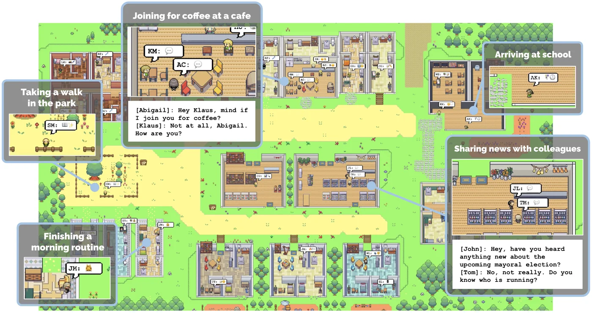
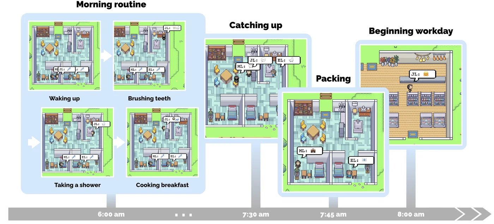
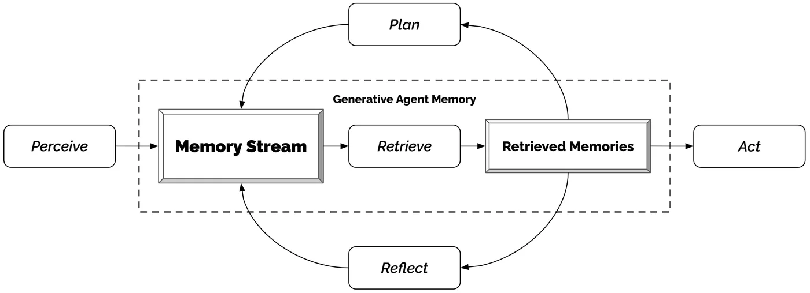
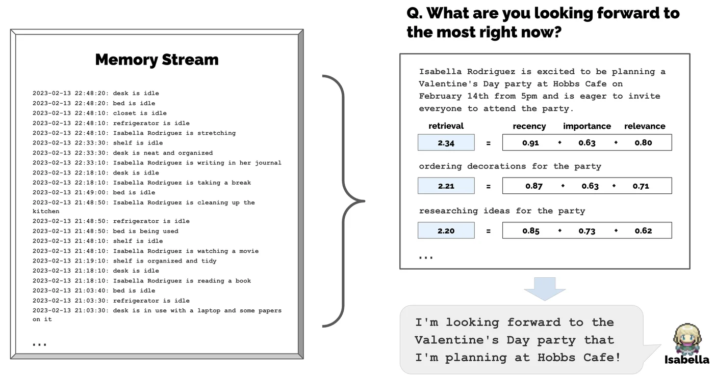
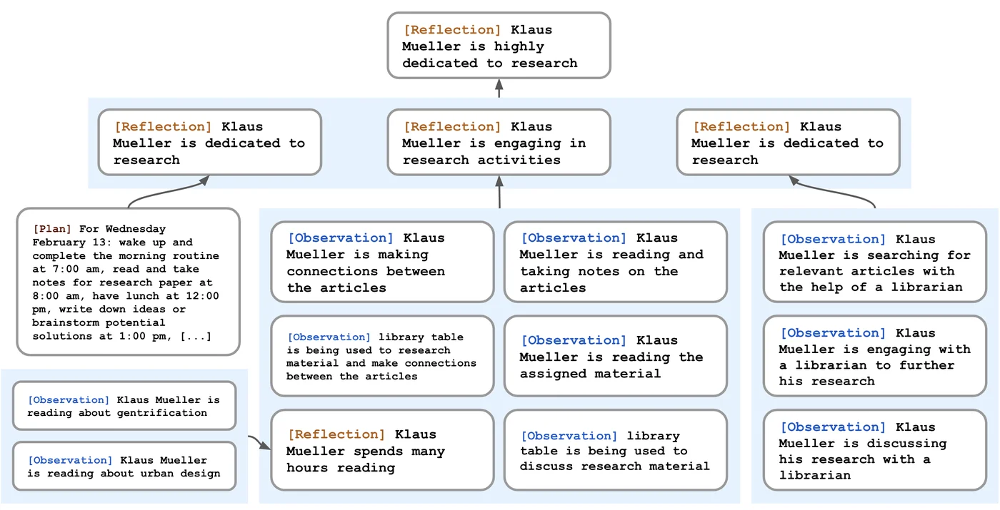
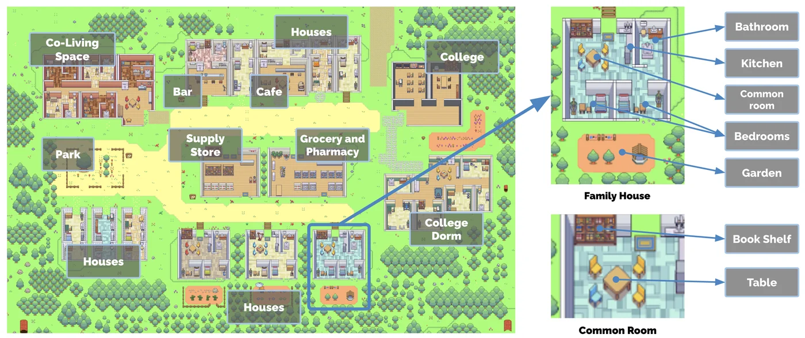
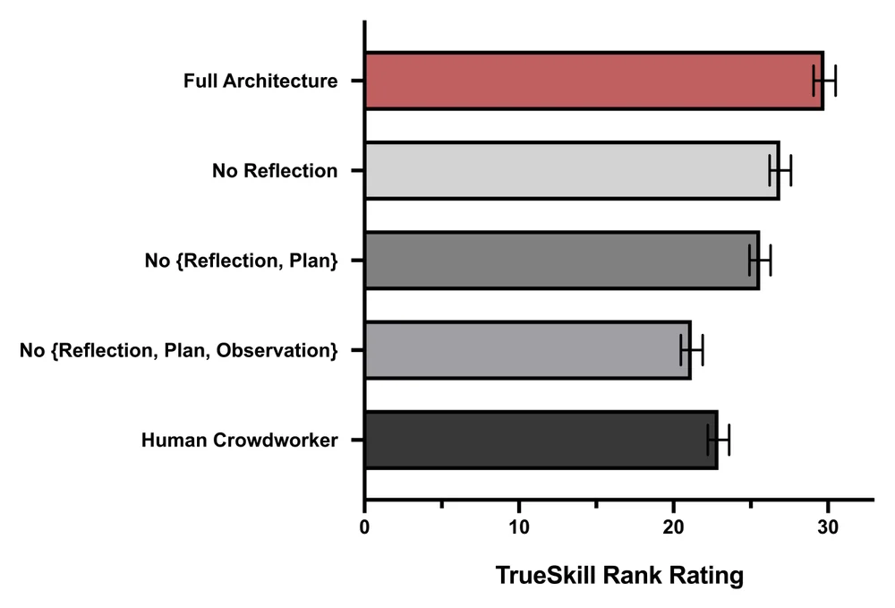
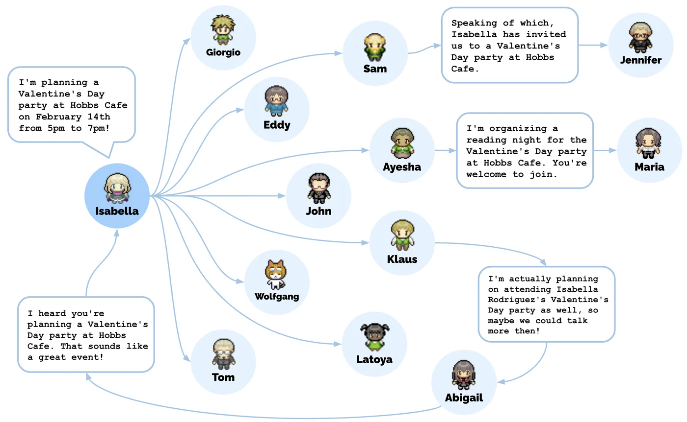
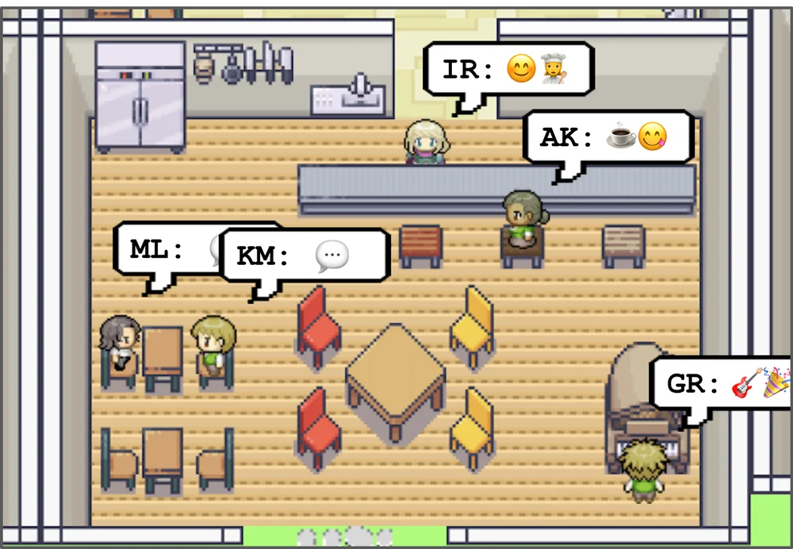

> - **논문**: Generative Agents: Interactive Simulacra of Human Behavior
> - **저자**: Joon Sung Park, Joseph C. O'Brien, Carrie J. Cai, Meredith Ringel Morris, Percy Liang, Michael S. Bernstein (Stanford University, Google)
> - **학회**: UIST 2023 · [arXiv:2304.03442](https://arxiv.org/abs/2304.03442) · [Code](https://github.com/joonspk-research/generative_agents)
{: .prompt-tip }

> [GPT]() 같은 LLM은 한 번의 질문에는 그럴듯하게 답한다. 하지만 "며칠 동안 한 사람으로 살아가기"는 다른 문제이다. 어제 한 약속을 기억하고, 겪은 일에서 생각을 정리하고, 하루를 계획해야 한다. **Generative Agents**는 LLM 바깥에 **기억 구조**를 붙여 이것을 해낸다. 25명의 에이전트가 작은 마을에서 이틀을 사는 동안, 한 명에게 넣어 준 "파티를 열고 싶다"는 생각 하나가 손님 초대, 데이트 신청, 실제 파티 참석으로 번져 나간다.

## 1. 문제: LLM만으로는 "사람처럼 오래" 행동할 수 없다

사람 행동을 흉내 내는 에이전트(believable agent)는 게임 NPC, 사회 시뮬레이션, 인터페이스 프로토타이핑에 오래전부터 쓰였다. 예전에는 규칙 기반 상태 기계나 행동 트리처럼 사람이 직접 짜 넣는 방식을 썼고, 그래서 짜 넣지 않은 상황에는 대응하지 못했다.

LLM은 사람 행동에 관한 지식을 이미 많이 갖고 있다. 인물 설명을 프롬프트에 넣으면 그 인물처럼 한 번 답하는 것은 쉽다. 문제는 시간이 길어질 때이다.

- **경험이 context에 다 들어가지 않는다.** 하루만 살아도 관찰이 수백 개 쌓인다.
- **경험을 그대로 넣으면 판단이 얕다.** 가장 자주 본 사람을 친한 사람으로 착각하는 식이다.
- **순간마다 그럴듯한 행동이 하루 전체로 보면 이상하다.** 12시에 점심을 먹고, 12시 반에 또 먹고, 1시에 또 먹을 수 있다.

논문의 답은 LLM을 바꾸지 않고, 그 바깥에 세 가지를 붙이는 것이다. **기억(memory stream + retrieval)**, **돌아보기(reflection)**, **계획(planning)**이다.

## 2. Smallville: 25명이 사는 샌드박스


_Figure 1. Smallville의 하루. 에이전트들은 아침 일과를 마치고, 공원을 산책하고, 카페에서 같이 커피를 마시고, 동료와 선거 소식을 나눈다. 말풍선의 이모지는 지금 하는 행동을 요약한 것이다. (출처: Park et al., 2023)_

Smallville은 Phaser 게임 엔진으로 만든 2D 마을이다. 집, 대학, 카페(Hobbs Cafe), 바, 공원, 약국 겸 마트, 기숙사가 있고, 각 장소 안에는 부엌, 침대, 책상, 커피 머신 같은 물건이 있다.

에이전트 25명은 각자 **한 문단의 자연어 설명**으로 시작한다. 예를 들어 약국 주인 John Lin은 "Willow Market and Pharmacy를 운영하고, 사람 돕기를 좋아하며, 대학 교수인 아내 Mei와 음악을 공부하는 아들 Eddy와 함께 산다" 같은 식이다. 이 문단을 세미콜론 단위로 잘라 각각을 초기 기억으로 넣는다. 그 뒤로는 사람이 짜 넣은 각본이 없다.

에이전트는 time step마다 자연어로 행동을 낸다("Isabella Rodriguez is writing in her journal"). 시스템은 이 문장을 이모지로 요약해 말풍선에 띄우고, 어느 장소로 움직일지 정한다. 다른 에이전트를 만나면 대화를 할지 정하고, 대화도 자연어로 주고받는다.


_Figure 3. John Lin의 아침. 6시쯤 일어나 이 닦기, 샤워, 아침 식사를 마치고, 아내 Mei, 아들 Eddy와 잠깐 이야기한 뒤 일하러 나간다. (출처: Park et al., 2023)_

사람도 개입할 수 있다. 특정 인물(예: 기자)로서 에이전트와 대화할 수도 있고, 에이전트의 **내면의 목소리**로 말할 수도 있다. John에게 내면의 목소리로 "너는 다가오는 선거에서 Sam과 맞붙을 것이다"라고 하면, John은 출마를 결심하고 아내와 아들에게 그 사실을 알린다. 물건 상태를 바꿀 수도 있다. Isabella의 가스레인지를 "타는 중"으로 바꾸면 그녀는 부엌으로 가서 불을 끈다.

## 3. 구조: 기억, 돌아보기, 계획

전체 흐름은 다음과 같다.

1. **지각**: 주변에서 본 것을 관찰(observation)로 memory stream에 쌓는다.
2. **검색**: 지금 상황에 필요한 기억을 골라 꺼낸다.
3. **행동**: 꺼낸 기억과 계획을 프롬프트에 넣어 LLM이 다음 행동을 정한다.
4. 주기적으로 **reflection**과 **planning**을 하고, 그 결과도 memory stream에 다시 넣는다.


_Figure 5. Generative agent 구조. 에이전트가 지각한 모든 것은 memory stream에 저장된다. 지각에 따라 관련 기억을 꺼내 행동을 정하고, 꺼낸 기억으로 장기 계획과 상위 수준의 reflection을 만들어 다시 memory stream에 넣는다. (출처: Park et al., 2023)_

LLM은 gpt-3.5-turbo(ChatGPT)를 그대로 쓴다. 학습은 전혀 없다. 모든 능력은 무엇을 어떤 순서로 프롬프트에 넣느냐에서 나온다.

### Memory stream

memory stream은 에이전트가 겪은 모든 것을 시간순으로 담는 목록이다. 각 기억은 **자연어 설명, 만든 시각, 마지막으로 꺼낸 시각**을 가진다. 가장 기본적인 기억은 관찰이다.

- "Isabella Rodriguez is setting out the pastries"
- "Maria Lopez is studying for a Chemistry test while drinking coffee"
- "The refrigerator is empty"

자기 행동, 남의 행동, 물건 상태가 모두 같은 형식으로 들어간다. reflection과 계획도 결국 이 목록에 들어가는 기억의 한 종류이다.

### Retrieval: 무엇을 꺼낼 것인가

모든 기억을 프롬프트에 넣을 수는 없으니, 현재 상황(질의)에 맞는 기억을 점수로 골라 높은 것부터 context에 들어가는 만큼 넣는다. 점수는 세 가지의 가중합이다.

$$
\text{score} = \alpha_{\text{recency}} \cdot \text{recency} + \alpha_{\text{importance}} \cdot \text{importance} + \alpha_{\text{relevance}} \cdot \text{relevance}
$$

| 점수 | 계산 방법 |
|---|---|
| Recency | 마지막으로 꺼낸 뒤 지난 게임 시간(시간 단위)에 대해 지수 감쇠, 감쇠율 0.995 |
| Importance | 기억이 만들어질 때 LLM에게 1~10점을 매기게 함 |
| Relevance | 기억과 질의의 임베딩 cosine 유사도 |

세 점수는 각각 min-max로 [0, 1]에 맞춘 뒤 더하고, 구현에서는 $$\alpha$$를 모두 1로 둔다.

Importance 프롬프트는 단순하다. "1은 이 닦기, 침대 정리처럼 아주 평범한 일, 10은 이별이나 대학 합격처럼 아주 가슴 아프거나 벅찬 일이다. 다음 기억의 점수를 매겨라." 논문 예시로 "방 청소"는 2점, "짝사랑에게 데이트 신청"은 8점이 나온다.


_Figure 6. memory stream에는 현재 상황과 관련 있는 관찰과 관련 없는 관찰이 많이 섞여 있다. retrieval은 그중 LLM에 넘길 일부를 고른다. 오른쪽은 "지금 가장 기대되는 일은?"이라는 질문에 Isabella의 기억마다 매긴 점수(recency + importance + relevance)이다. (출처: Park et al., 2023)_

```python
import numpy as np

DECAY = 0.995   # 게임 시간 1시간마다 recency에 곱하는 값

# 질의: "발렌타인데이 파티"
# (기억, 마지막으로 꺼낸 뒤 지난 게임 시간[h], LLM이 매긴 중요도 1~10, 질의와의 임베딩 cosine 유사도)
memories = [
    ("Isabella가 2월 14일 Hobbs Cafe에서 발렌타인데이 파티를 연다", 30, 6, 0.82),
    ("책상이 지저분하다",                                          1, 1, 0.10),
    ("Klaus가 젠트리피케이션을 연구한다",                            5, 3, 0.20),
    ("아침으로 토스트를 먹었다",                                    2, 1, 0.05),
    ("Maria가 파티 장식을 도와 달라고 했다",                        10, 4, 0.71),
]
text, hours, imp, rel = zip(*memories)

def minmax(v):                                   # 세 점수를 [0, 1]로 맞춤
    v = np.asarray(v, dtype=float)
    return (v - v.min()) / (v.max() - v.min())

recency = minmax(DECAY ** np.array(hours))
importance = minmax(imp)
relevance = minmax(rel)
score = recency + importance + relevance         # 논문 구현: 세 가중치 모두 1

for i in np.argsort(-score):
    print(f"{score[i]:.2f} = {recency[i]:.2f} + {importance[i]:.2f} + {relevance[i]:.2f}  {text[i]}")
```

```text
2.13 = 0.67 + 0.60 + 0.86  Maria가 파티 장식을 도와 달라고 했다
2.00 = 0.00 + 1.00 + 1.00  Isabella가 2월 14일 Hobbs Cafe에서 발렌타인데이 파티를 연다
1.45 = 0.85 + 0.40 + 0.19  Klaus가 젠트리피케이션을 연구한다
1.06 = 1.00 + 0.00 + 0.06  책상이 지저분하다
0.96 = 0.96 + 0.00 + 0.00  아침으로 토스트를 먹었다
```

recency만 보면 "책상이 지저분하다", "토스트를 먹었다"가 맨 위에 온다. 세 점수를 더하면 30시간 전에 들은 파티 소식처럼 **오래됐어도 중요하고 관련 있는 기억**이 올라온다. 한편 0.995라는 감쇠율은 게임 시간 하루(24시간)가 지나도 recency가 약 0.89로만 줄어드는 완만한 값이다. 그래서 실제로는 min-max 정규화 뒤의 상대적인 순서가 더 중요하게 작동한다.

### Reflection: 관찰에서 생각으로

관찰만 있으면 판단이 얕다. 논문의 예시가 이것을 잘 보여 준다. 대학생 Klaus Mueller에게 "아는 사람 중 한 명과 한 시간을 보낸다면 누구와 보내겠냐"고 물으면, 관찰만 가진 Klaus는 **가장 자주 마주친** 이웃 Wolfgang을 고른다. 하지만 둘은 지나가며 인사만 하는 사이이다. reflection이 있는 Klaus는 연구에 대한 열정을 나누는 Maria Lopez를 고른다.

reflection은 다음과 같이 만든다.

1. **언제**: 최근 관찰들의 importance 합이 임계값(구현에서 150)을 넘으면 실행한다. 대략 하루에 두세 번이다.
2. **질문 만들기**: 최근 기억 100개를 LLM에 주고 "위 정보만으로 답할 수 있는, 가장 두드러진 상위 수준의 질문 3개는?"을 묻는다. 예: "Klaus Mueller가 열정을 가진 주제는?", "Klaus Mueller와 Maria Lopez는 어떤 관계인가?"
3. **답 만들기**: 각 질문을 질의로 retrieval을 하고, 꺼낸 기억에 번호를 붙여 "여기서 추론할 수 있는 상위 수준 통찰 5개는? (형식: 통찰 (근거 1, 5, 3))"을 묻는다. 예: "Klaus Mueller는 젠트리피케이션 연구에 몰두하고 있다 (근거 1, 2, 8, 15)"
4. **저장**: 통찰을 근거 기억에 대한 포인터와 함께 memory stream에 넣는다.

reflection도 기억이므로 다음 reflection의 재료가 된다. 그래서 잎(leaf)은 관찰이고 위로 갈수록 추상적인 생각이 쌓이는 **reflection tree**가 생긴다. "Klaus는 젠트리피케이션에 관한 글을 읽는다" → "Klaus는 많은 시간을 독서에 쓴다" → "Klaus는 연구 활동을 한다" → "Klaus는 연구에 매우 헌신적이다" 같은 식이다.


_Figure 7. Klaus Mueller의 reflection tree. 잎 노드인 관찰들이 재귀적으로 종합되어, 맨 위에서 "Klaus는 연구에 매우 헌신적이다"라는 생각이 만들어진다. (출처: Park et al., 2023)_

### Planning: 하루를 위에서 아래로 쪼개기

순간마다 그럴듯한 행동만 고르면 점심을 세 번 먹는 문제가 생긴다. 그래서 하루 계획을 **위에서 아래로 재귀적으로** 세운다.

1. 에이전트 요약 설명과 전날 요약을 주고, 하루를 큰 덩어리 몇 개로 대략 계획한다. Eddy Lin의 예: "1) 8시에 일어나 아침 일과, 2) 10시부터 Oak Hill College에서 수업, …, 5) 1시부터 5시까지 새 곡 작업, 6) 5시 반 저녁, 7) 과제를 마치고 11시에 취침"
2. 이를 한 시간 단위로 쪼갠다.
3. 다시 5~15분 단위로 쪼갠다. "4:00 pm: 과일이나 그래놀라 바로 간단히 간식, 4:05 pm: 작업 공간 주변을 잠깐 산책, …, 4:50 pm: 작업 공간 정리"

계획은 위치, 시작 시각, 길이를 가진 기억으로 memory stream에 저장되고, retrieval 대상이 된다. 그래서 에이전트는 남과 대화할 때 자기 계획을 떠올리고, 계획을 바꿀 수도 있다.

### Reacting과 대화

time step마다 에이전트는 주변을 지각해 memory stream에 넣고, LLM에게 **"계획대로 계속할지, 반응할지"**를 묻는다. 프롬프트에는 에이전트 요약 설명, 현재 시각과 상태, 관찰, 관련 기억 요약이 들어간다. 관련 기억 요약은 "[관찰자]와 [대상]의 관계는?", "[대상]은 지금 [행동] 중이다"를 질의로 retrieval한 뒤 LLM으로 요약해 만든다.

> It is February 13, 2023, 4:56 pm. John Lin's status: John is back home early from work.
> Observation: John saw Eddy taking a short walk around his workplace.
> Summary of relevant context from John's memory: Eddy Lin is John's Lin's son. Eddy Lin has been working on a music composition for his class. Eddy Lin likes to walk around the garden when he is thinking about or listening to music.
> Should John react to the observation, and if so, what would be an appropriate reaction?

LLM은 "John은 Eddy에게 작곡 과제가 어떻게 되어 가는지 물어볼 수 있다"고 답하고, 그 지점부터 계획을 다시 세운다. 대화도 같은 방식이다. 상대에 대한 기억을 바탕으로 첫 마디를 만들고, 상대는 대화 내역과 자기 기억으로 답한다.

> **John**: Hey Eddy, how's the music composition project for your class coming along?
> **Eddy**: Hey Dad, it's going well. I've been taking walks around the garden to clear my head and get some inspiration.

여기서 쓰이는 **에이전트 요약 설명**은 매번 새로 만들지 않고 캐시해 둔다. "[이름]의 핵심 성격", "[이름]의 현재 일과", "[이름]이 최근 삶에서 이룬 진전에 대한 느낌"을 질의로 retrieval해 요약한 것이다.

### 환경을 자연어로

Smallville은 공간을 **트리**로 표현한다. "Smallville > Lin 가족 집 > 부엌 > 가스레인지"처럼 포함 관계가 간선이다. 각 에이전트는 자기가 가 본 곳만 담은 부분 트리를 따로 갖는다. 행동할 장소를 정할 때는 이 트리를 자연어로 바꿔 루트부터 한 단계씩 내려가며 "다음 중 적절한 장소를 고르라"고 묻는다. 행동이 물건 상태를 바꾸면(예: "손님에게 에스프레소를 만든다") LLM에게 물건의 새 상태를 물어 반영한다(커피 머신: off → brewing coffee).


_Figure 2. 구역 이름을 붙인 Smallville. 루트 노드는 세계 전체, 자식 노드는 집·카페·가게 같은 구역, 잎 노드는 테이블·책장 같은 물건이다. 에이전트는 자기가 본 부분만 담은 부분 그래프를, 본 시점의 상태 그대로 기억한다. (출처: Park et al., 2023)_

## 4. 평가 1: 에이전트 인터뷰

### 설정

25명의 에이전트를 게임 시간으로 이틀 동안 돌린 뒤, 각자를 **인터뷰**했다. 질문은 다섯 범주, 범주마다 5개이다.

| 범주 | 예시 질문 |
|---|---|
| Self-knowledge | "자기소개를 해 주세요", "평일 일과를 대략 설명해 주세요" |
| Memory | "[이름]은 누구인가요?", "시장 선거에 누가 나오나요?" |
| Plans | "내일 오전 10시에 무엇을 할 건가요?" |
| Reactions | "아침밥이 타고 있어요! 어떻게 할 건가요?" |
| Reflections | "최근 만난 사람 중 한 명과 시간을 보낸다면 누구이고, 왜인가요?" |

다섯 조건의 답을 비교했다.

- **Full architecture**: 관찰 + reflection + planning
- **No reflection**: reflection만 끔
- **No reflection, no planning**: 관찰만 있음
- **No observation, no reflection, no planning**: 기억 없이 LLM만. 이전 연구들의 방식에 해당
- **Human crowdworker**: 사람이 에이전트의 하루 리플레이를 보고 그 인물이 되어 직접 쓴 답

평가자 100명이 각자 한 에이전트의 리플레이와 memory stream을 보고, 질문마다 다섯 조건의 답이 얼마나 믿을 만한지 순위를 매겼다. 순위는 TrueSkill 점수로 바꿨다.

### 결과

| 조건 | TrueSkill $$\mu$$ | $$\sigma$$ |
|---|---|---|
| Full architecture | **29.89** | 0.72 |
| No reflection | 26.88 | 0.69 |
| No reflection, no planning | 25.64 | 0.68 |
| Human crowdworker | 22.95 | 0.69 |
| No observation, no reflection, no planning | 21.21 | 0.70 |


_Figure 8. full architecture가 ablation 조건들과 크라우드워커보다 믿을 만한 행동을 만든다. 구성 요소를 하나 뺄 때마다 성능이 떨어진다. (출처: Park et al., 2023)_

구성 요소를 하나씩 뺄 때마다 점수가 떨어졌다. 기억이 전혀 없는 조건과 full architecture의 차이는 Cohen's $$d$$ = 8.16, 즉 표준편차의 약 8배이다. Kruskal-Wallis 검정과 Dunn 사후검정(Holm-Bonferroni 보정) 결과, Human crowdworker와 기억 없는 조건 사이를 빼면 모든 쌍의 차이가 유의했다.

full architecture가 사람이 쓴 답보다 높은 점수를 받았다는 점은 조심해서 읽어야 한다. 크라우드워커는 전문 작가가 아니고, 리플레이를 보고 답을 쓴 기본 수준의 비교 대상이다. 논문도 이것을 "사람 상한"이 아니라 "사람 기준선"으로 다룬다.

### 실패 유형

- **기억을 못 꺼냄**: Tom은 파티에 대해 "파티가 있는지 잘 모르겠다"면서도 "파티가 열린다면 거기서 Isabella와 선거 이야기를 해야 한다"고 답했다. 기억 일부만 꺼낸 것이다.
- **덧붙임(embellishment)**: Isabella는 Sam의 출마를 정확히 알았지만, "내일 발표를 할 것"이라는 없는 사실을 덧붙였다.
- **LLM 지식의 유입**: Yuriko는 이웃 Adam Smith를 "『국부론』을 쓴 경제학자"라고 설명했다. 이름이 같은 역사 인물의 지식이 섞였다.

없는 사실을 통째로 지어내는 경우는 드물었다. 대부분은 기억을 덜 꺼내거나, 있는 기억에 살을 붙이는 쪽이었다.

## 5. 평가 2: 마을 전체의 창발 행동

통제된 인터뷰와 별도로, 25명 전체를 게임 시간 이틀 동안 돌리며 세 가지를 측정했다. 시작할 때 사람이 넣은 설정은 딱 두 개이다. Sam은 시장 선거에 출마할 생각이 있고, Isabella는 2월 14일 오후 5~7시에 Hobbs Cafe에서 발렌타인데이 파티를 열고 싶어 한다.

| 측정 | 시작 | 이틀 뒤 |
|---|---|---|
| Sam의 출마를 아는 에이전트 | 1명 (4%) | 8명 (32%) |
| Isabella의 파티를 아는 에이전트 | 1명 (4%) | 13명 (52%) |
| 관계망 밀도 (서로 아는 쌍의 비율) | 0.167 | 0.74 |

**정보 확산.** 두 소식은 대화를 타고 퍼졌다. 논문은 소식을 안다고 답한 에이전트마다 memory stream에서 그 소식을 들은 대화를 실제로 찾아, 지어낸 답이 아님을 확인했다.


_Figure 9. Isabella의 발렌타인데이 파티 초대가 퍼진 경로. 시뮬레이션이 끝날 때까지 Isabella 말고도 12명이 Hobbs Cafe 파티 소식을 들었다. (출처: Park et al., 2023)_

**관계 기억.** 에이전트들은 처음 만난 사람을 기억하고 다음에 만났을 때 그때 이야기를 이어 갔다. Sam은 공원에서 만난 Latoya가 사진 프로젝트를 하고 있다는 것을 기억했다가 나중에 "프로젝트는 어떻게 되어 가냐"고 물었다. 서로를 안다고 답한 내용 453개 중 지어낸 것은 1.3%(6개)였다.

**협력.** Isabella는 손님과 친구들을 초대하고, 카페를 꾸몄다. 초대받은 Maria는 짝사랑하는 Klaus를 파티에 불렀다. 결국 초대받은 12명 중 5명이 2월 14일 5시에 Hobbs Cafe에 나타났다. 오지 않은 7명 중 3명은 다른 일정이 있다고 했고, 4명은 관심은 보였지만 당일 계획에 넣지 않았다. 사람이 짜 넣은 것은 "파티를 열고 싶다"는 한 문장뿐이었다.


_Figure 4. 시뮬레이션을 시작할 때 한 에이전트에게만 발렌타인데이 파티를 열겠다는 의도를 넣었다. 의도를 행동으로 옮기지 않거나, 남에게 알리는 것을 잊거나, 참석을 잊는 등 실패할 지점이 많았지만, 파티는 실제로 열렸고 여러 에이전트가 모여 어울렸다. (출처: Park et al., 2023)_

### 마을에서 보인 이상한 행동

- **장소 고르기가 갈수록 어려워진다.** 알게 된 장소가 많아질수록 엉뚱한 곳을 고른다. 원래 저녁 모임 장소로 의도한 바(bar)에 여러 에이전트가 점심을 먹으러 갔다.
- **물리적 규칙을 모른다.** 기숙사 화장실은 한 명만 쓰는 곳이지만, "기숙사 화장실"이라는 이름 때문에 여럿이 동시에 들어갔다. 5시에 문을 닫는 가게에 그 뒤에 들어가기도 했다.
- **지나치게 공손하고 협조적이다.** instruction tuning 때문으로 보인다. 대화가 너무 격식을 차린 인사로 시작하고, Isabella는 남들이 제안한 셰익스피어 낭독회, 네트워킹 행사 같은 아이디어를 거의 다 받아들여 파티 주제가 흐려졌다.

## 6. 해석: Generative Agents가 남긴 것과 남긴 숙제

**남긴 것: "LLM 에이전트 = LLM + 기억 구조"라는 틀.** memory stream, recency·importance·relevance 점수로 꺼내기, 주기적인 reflection, 위에서 아래로 쪼개는 계획은 이후 LLM 에이전트 프레임워크의 기본 부품이 됐다. 특히 "경험 전체를 context에 넣지 않고, 필요한 것을 점수로 골라 넣는다"는 생각은 지금의 장기 기억, RAG 기반 에이전트 메모리와 그대로 이어진다. 가중치를 하나도 바꾸지 않고 프롬프트 구성만으로 행동의 질을 크게 높였다는 점도 중요하다.

**남긴 것: 생각을 기억으로 저장하기.** reflection은 LLM이 만든 추상적인 생각을 관찰과 같은 자격으로 기억에 넣는다. [Thought Cloning]()이 행동 뒤의 생각을 모방 대상으로 삼은 것처럼, 이 논문은 생각을 "검색할 수 있는 기억"으로 다룬다. 단순 관찰 빈도가 아니라 해석된 관계로 판단하게 만든 것이 Klaus 예시의 핵심이다.

**숙제 1: 비용과 속도.** 25명을 이틀 돌리는 데 토큰 비용만 수천 달러가 들었고 실제 시간으로 며칠이 걸렸다. 에이전트 한 명이 time step마다 지각, 반응 판단, 계획 수정, 대화를 위해 LLM을 여러 번 부르기 때문이다. 수백, 수천 명 규모의 사회 시뮬레이션이나 실시간 게임에 그대로 쓰기는 어렵다.

**숙제 2: 평가의 한계.** 인터뷰 평가는 "믿을 만한가"를 사람이 순위로 매긴 것이고, 시뮬레이션 기간은 이틀이다. 몇 주, 몇 달 동안 memory stream이 커질 때 retrieval이 계속 잘 작동하는지, 성격이 일관되게 유지되는지는 확인하지 않았다. 장소 고르기가 갈수록 어려워진다는 관찰이 그 신호이다.

**숙제 3: 정렬된 LLM의 성격.** 지나친 공손함과 협조는 사람 사회를 흉내 내는 데 오히려 방해가 된다. 갈등, 거절, 무관심이 빠진 사회는 실제 사회와 다르다. 시뮬레이션을 사회과학 실험 도구로 쓰려면 이 편향을 어떻게 다룰지가 큰 문제이다.

**숙제 4: 윤리.** 논문은 사람들이 에이전트와 유사 사회적 관계(parasocial relationship)를 맺을 위험, 에이전트가 계산 시스템임을 밝혀야 할 필요, 딥페이크·맞춤형 설득에 쓰일 위험을 스스로 짚는다. 또 디자인 과정에서 실제 사람의 의견을 대체하는 용도로 쓰면 안 된다고 강조한다.

## 7. 정리

| 항목 | 내용 |
|---|---|
| 핵심 아이디어 | 고정된 LLM에 기억, reflection, planning 구조를 붙여 오래 일관되게 행동하는 에이전트 |
| 기억 | 모든 경험을 자연어로 쌓는 memory stream, recency + importance + relevance로 검색 |
| Reflection | importance 합이 150을 넘으면 질문 3개 → 통찰 5개를 만들어 다시 기억으로 저장 |
| Planning | 하루 → 1시간 → 5~15분으로 재귀적으로 쪼갠 계획, 관찰에 따라 수정 |
| 결과 | 인터뷰 평가에서 full architecture가 최고(TrueSkill 29.89), 구성 요소를 뺄수록 하락 |
| 창발 행동 | 파티 소식이 1명 → 13명으로 퍼지고, 5명이 실제로 모임 |
| 한계 | 높은 비용, 짧은 평가 기간, 장소·규칙 오류, 지나치게 공손한 성격 |

## References

- Park et al., "Generative Agents: Interactive Simulacra of Human Behavior," UIST 2023. [arXiv:2304.03442](https://arxiv.org/abs/2304.03442)
- Herbrich et al., "TrueSkill: A Bayesian Skill Rating System," NeurIPS 2006.
- Park et al., "Social Simulacra: Creating Populated Prototypes for Social Computing Systems," UIST 2022.
- Ouyang et al., "Training Language Models to Follow Instructions with Human Feedback," NeurIPS 2022.
