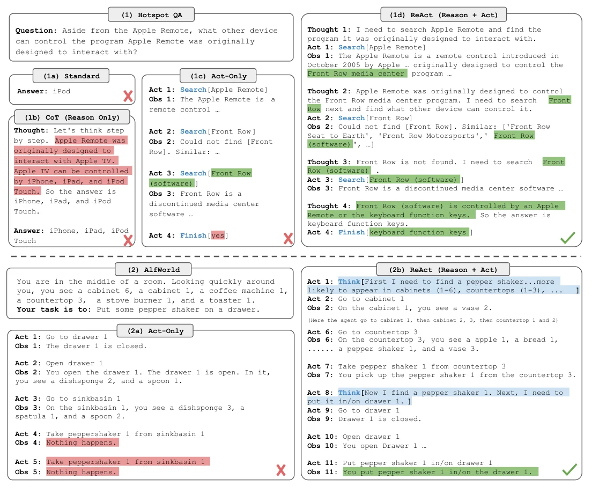
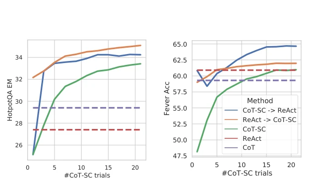
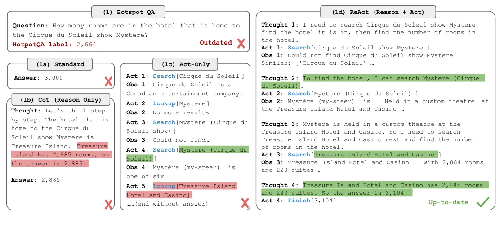
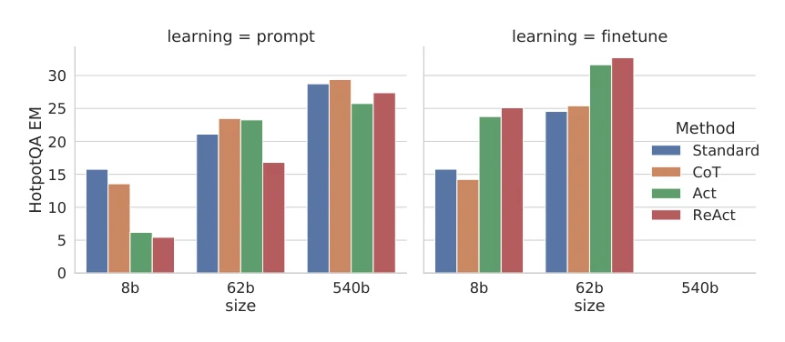
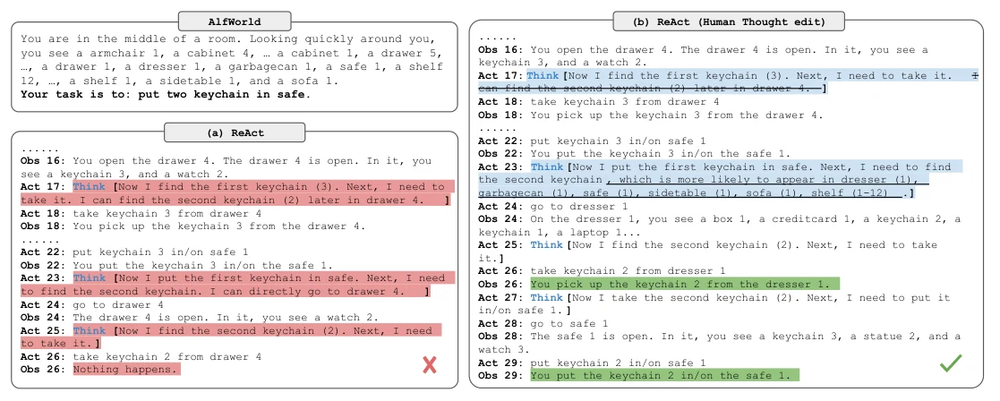

> - **논문**: ReAct: Synergizing Reasoning and Acting in Language Models
> - **저자**: Shunyu Yao, Jeffrey Zhao, Dian Yu, Nan Du, Izhak Shafran, Karthik Narasimhan, Yuan Cao (Princeton University, Google Research)
> - **학회**: ICLR 2023 · [arXiv:2210.03629](https://arxiv.org/abs/2210.03629) · [Code](https://react-lm.github.io)
{: .prompt-tip }

> [GPT]() 계열 LLM은 "단계별로 생각해 보자"는 한마디로 여러 단계의 추론을 해낸다. 하지만 그 추론은 모델 머릿속에서만 돈다. 모르는 사실이 나오면 그럴듯하게 지어내고, 틀린 한 단계가 끝까지 이어진다. **ReAct**는 LLM이 생각과 행동을 번갈아 내게 한다. 생각으로 무엇을 찾을지 정하고, 행동으로 Wikipedia를 검색하고, 관찰한 결과로 다시 생각한다. 이 단순한 프롬프트 형식 하나로, 예시 한두 개만 본 PaLM-540B가 텍스트 가사 게임 ALFWorld에서 10만 개 단위의 전문가 궤적으로 학습한 모방학습 에이전트를 성공률 34%p 앞선다.

## 1. 문제: 생각만 하는 LLM, 행동만 하는 LLM

사람은 행동 사이사이에 말로 생각한다. 논문이 드는 요리 예가 그렇다. "다 썰었으니 이제 물을 끓여야겠다"로 진행 상황을 챙기고, "소금이 없으니 간장과 후추를 쓰자"로 계획을 바꾸고, "반죽은 어떻게 하지? 인터넷에서 찾아보자"로 바깥 정보가 필요한 순간을 알아챈다. 반대로 요리책을 펴고 냉장고를 여는 행동은 생각에 필요한 정보를 가져온다.

2022년의 LLM 연구는 이 두 가지를 따로 다뤘다.

- **추론만 하는 쪽(Chain-of-Thought).** 중간 추론을 글로 쓰게 하면 산수, 상식, 기호 추론이 좋아진다. 하지만 논문은 이것을 "static black box"라고 부른다. 모델이 자기 내부 표현으로만 생각하고 바깥 세계에 닿지 않는다. 그래서 사실을 지어내고(hallucination), 앞 단계의 오류가 뒤로 번진다(error propagation). Apple TV가 Apple Remote의 원래 제어 대상이라고 지어내고, 그 위에서 "iPhone, iPad, iPod Touch"라는 틀린 답을 쌓는 식이다.
- **행동만 하는 쪽(SayCan, WebGPT 등).** LLM에 관찰을 텍스트로 넣고 다음 행동이나 계획을 고르게 한다. 하지만 고수준 목표를 놓고 추상적으로 추론하거나, 지금까지 무엇을 했는지 정리하는 working memory 역할을 하지 않는다. ALFWorld에서 행동만 내는 에이전트는 개수대(sinkbasin)에 후추통이 없다는 관찰을 받고도 "개수대에서 후추통을 집는다"를 되풀이한다.

논문의 답은 두 쪽을 한 궤적 안에서 엮는 것이다. 생각이 행동을 이끌고(reason to act), 행동이 생각에 정보를 대 준다(act to reason). 이 형식을 **ReAct**(Reason + Act)라고 부른다.

## 2. 과제: 지식 추론 두 개, 의사결정 두 개

ReAct는 성격이 다른 네 벤치마크에서 평가한다.

| 벤치마크 | 종류 | 입력과 목표 | 평가 지표 |
|---|---|---|---|
| HotpotQA | 다중 홉 질의응답 | Wikipedia 문단 두 개 이상을 엮어야 답할 수 있는 질문 | EM |
| FEVER | 사실 검증 | 주장(claim)을 SUPPORTS, REFUTES, NOT ENOUGH INFO 중 하나로 판정 | 정확도 |
| ALFWorld | 텍스트 게임 | "책상 램프 아래에서 종이를 살펴봐라" 같은 가사 목표를 텍스트 행동으로 달성 | 성공률 |
| WebShop | 웹 쇼핑 | 사용자 지시에 맞는 상품을 실제 상품 페이지를 돌아다니며 구매 | 점수, 성공률 |

HotpotQA와 FEVER는 질문(주장)만 주고 근거 문단은 주지 않는다(question-only setup). 모델은 자기 내부 지식에 기대거나, 아래의 Wikipedia API로 직접 찾아야 한다.

| 행동 | 동작 |
|---|---|
| `search[entity]` | 해당 Wikipedia 문서의 처음 5문장을 돌려준다. 문서가 없으면 검색 엔진의 비슷한 항목 5개를 제안한다. |
| `lookup[string]` | 현재 문서에서 그 문자열이 들어간 다음 문장을 돌려준다. 브라우저의 Ctrl+F와 같다. |
| `finish[answer]` | 답을 내고 끝낸다. |

이 API는 문서 이름을 정확히 알아야 하고 문단의 일부만 보여 준다. 저자들도 최신 lexical·neural retriever보다 훨씬 약하다고 밝힌다. 일부러 약하게 만든 것이다. 사람이 Wikipedia를 뒤지는 방식을 흉내 내고, 모델이 무엇을 찾을지 말로 추론하게 만들려는 의도이다.

ALFWorld는 ALFRED 로봇 벤치마크를 텍스트로 옮긴 게임이다. 과제 유형이 6가지이고, 한 판에 위치가 50곳 넘게 있을 수 있으며 전문가 정책도 50스텝 넘게 걸리는 경우가 있다. 책상 램프는 책상, 선반, 서랍장에 있을 가능성이 높다는 식의 상식이 필요해서 LLM의 사전 지식을 시험하기 좋다. WebShop은 Amazon에서 긁어 온 상품 118만 개와 사람이 쓴 지시 1만 2천 개로 만든 쇼핑 환경이다. 지시는 "서랍이 있는 협탁을 찾는다. 니켈 마감이고 140달러보다 싸야 한다" 같은 식이다.

## 3. 방법: 행동 공간에 "생각"을 더한다

전체 흐름은 다음과 같다.

1. 사람이 과제 몇 개를 직접 풀며 생각, 행동, 관찰을 적은 궤적을 만든다.
2. 이 궤적을 few-shot 예시로 프롬프트에 넣는다.
3. LLM이 다음 생각이나 행동을 생성한다. 행동이면 환경에 보내 관찰을 받아 프롬프트 뒤에 붙인다.
4. `finish`나 과제 성공까지 3을 반복한다.


_Figure 1. 위는 HotpotQA 질문 하나를 네 방식으로 푼 결과이다. Standard는 iPod, CoT는 Apple TV를 지어내 틀리고, Act는 검색은 했지만 마지막에 "yes"라는 엉뚱한 답을 낸다. ReAct만 Front Row 소프트웨어를 거쳐 "keyboard function keys"에 닿는다. 아래는 ALFWorld에서 Act가 같은 행동을 되풀이하는 동안 ReAct는 생각으로 찾을 곳과 다음 할 일을 정리해 성공하는 모습이다. (출처: Yao et al., 2022)_

LLM은 PaLM-540B를 그대로 쓴다. 기본 설정에서는 학습이 없고, 예시 궤적 1~6개를 넣은 프롬프트만 바꾼다.

### 정의: 환경을 건드리지 않는 행동

시각 $$t$$에서 에이전트는 관찰 $$o_t \in \mathcal{O}$$를 받고 정책 $$\pi(a_t \mid c_t)$$에 따라 행동 $$a_t \in \mathcal{A}$$를 고른다. context는 지금까지의 관찰과 행동이다.

$$
c_t = (o_1, a_1, \cdots, o_{t-1}, a_{t-1}, o_t)
$$

$$c_t$$에서 $$a_t$$로 가는 대응이 복잡한 추론을 요구하면 정책을 배우기 어렵다. ReAct는 행동 공간에 언어 공간 $$\mathcal{L}$$을 더한다.

$$
\hat{\mathcal{A}} = \mathcal{A} \cup \mathcal{L}
$$

$$\mathcal{L}$$에 속한 행동 $$\hat{a}_t$$를 **thought**(reasoning trace)라고 부른다. thought는 환경을 바꾸지 않으니 관찰도 돌아오지 않는다. 대신 context에 붙어 다음 판단의 재료가 된다: $$c_{t+1} = (c_t, \hat{a}_t)$$. 수식으로는 행동 하나를 추가한 것뿐이다. 그러나 $$\mathcal{L}$$은 무한하므로 이 공간에서 학습하려면 강한 언어 사전 지식이 필요하고, 그래서 대형 LLM을 프롬프팅으로 쓴다.

논문은 Figure 1에서 쓸모 있는 thought를 다섯 종류로 꼽는다.

| thought 종류 | Figure 1 예 |
|---|---|
| 목표 분해, 행동 계획 | "I need to search Apple Remote and find the program it was originally designed to interact with." |
| 과제 관련 상식 주입 | 후추통은 찬장(1-6)이나 조리대(1-3)에 있을 가능성이 높다 |
| 관찰에서 핵심 뽑기 | Apple Remote가 원래 Front Row media center를 제어하도록 만들어졌다는 문장을 짚는다 |
| 진행 추적, 계획 전환 | "Now I find a pepper shaker 1. Next, I need to put it in/on drawer 1." |
| 예외 처리, 계획 수정 | "Front Row is not found. I need to search Front Row (software)." |

루프를 코드로 쓰면 다음과 같다. 개념을 보이기 위한 의사 코드이다.

```python
def react(llm, env, prompt, question, max_steps=7):
    context = prompt + f"Question: {question}\n"
    for t in range(1, max_steps + 1):
        step = llm(context, stop=["\nObservation"])   # "Thought t: ...\nAction t: ..." 생성
        context += step
        action = parse_action(step)                   # search[...], lookup[...], finish[...]
        if action.kind == "finish":
            return action.arg
        obs = env.step(action)                        # thought는 env에 가지 않는다
        context += f"\nObservation {t}: {obs}\n"
    return None                                       # 스텝 안에 답 없음
```

### Dense thought와 sparse thought

과제 성격에 따라 thought가 나오는 빈도를 다르게 한다.

- **지식 추론(HotpotQA, FEVER)**: 생각-행동-관찰을 매 스텝 번갈아 낸다(dense thought). 추론이 핵심인 과제이기 때문이다.
- **의사결정(ALFWorld, WebShop)**: 행동이 수십 개 필요하므로 thought는 필요한 곳에만 띄엄띄엄 넣는다(sparse thought). 언제 생각할지는 LLM이 정한다. ALFWorld에서는 `think: ...`를 행동의 한 종류로 두고, 환경은 여기에 "OK."라고만 답한다.

### 프롬프트 만들기: 사람이 생각을 받아 적는다

예시 궤적은 학습 세트에서 무작위로 고른 과제를 사람이 직접 풀며 적었다. HotpotQA는 6개, FEVER는 3개이다. 저자들은 예시를 더 늘려도 성능이 오르지 않았다고 쓴다. thought 형식을 따로 설계하거나 예시를 골라내지도 않았다고 밝힌다. HotpotQA 예시에 들어간 생각은 다음 같은 종류이다.

- 질문 분해: "I need to search x, find y, then find z"
- 관찰에서 정보 뽑기: "x was started in 1844", "The paragraph does not tell x"
- 상식·산술 추론: "x is not y, so z must instead be...", "1844 < 1989"
- 검색어 바꾸기: "maybe I can search/look up x instead"
- 답 정리: "...so the answer is x"

부록의 HotpotQA 예시 한 개를 옮기면 다음과 같다(관찰은 줄였다).

> **Question**: Which magazine was started first Arthur's Magazine or First for Women?
>
> **Thought 1**: I need to search Arthur's Magazine and First for Women, and find which was started first.
>
> **Action 1**: Search[Arthur's Magazine]
>
> **Observation 1**: Arthur's Magazine (1844-1846) was an American literary periodical published in Philadelphia in the 19th century.
>
> **Thought 2**: Arthur's Magazine was started in 1844. I need to search First for Women next.
>
> **Action 2**: Search[First for Women]
>
> **Observation 2**: First for Women is a woman's magazine published by Bauer Media Group in the USA. The magazine was started in 1989.
>
> **Thought 3**: First for Women was started in 1989. 1844 (Arthur's Magazine) < 1989 (First for Women), so Arthur's Magazine was started first.
>
> **Action 3**: Finish[Arthur's Magazine]

비교 대상 프롬프트는 이 궤적을 깎아서 만든다. thought, 행동, 관찰을 모두 지우면 Standard, 행동과 관찰을 지우면 CoT, thought만 지우면 Act이다. 같은 과제, 같은 예시에서 무엇을 뺐는지만 다르므로 비교가 통제된다.

ALFWorld는 과제 유형마다 궤적 3개를 적고, 그중 2개를 고르는 순열로 프롬프트 6개를 만든다. thought는 (1) 목표 분해, (2) 하위 목표 완료 추적, (3) 다음 하위 목표 결정, (4) 물건이 어디 있을지와 무엇을 할지에 관한 상식 추론, 네 가지를 담는다. WebShop은 예시 하나(one-shot)이고, Act 프롬프트의 검색·상품 선택·옵션 선택·구매 행동에 무엇을 더 볼지, 언제 살지, 어떤 옵션이 지시와 맞는지에 관한 생각을 더한다.

### 내부 지식과 외부 지식 섞기

4장에서 보겠지만 ReAct는 사실에 충실한 대신 추론 구조가 경직되고, CoT는 추론 구조는 유연한 대신 사실을 지어낸다. 그래서 저자들은 둘을 오가는 규칙 두 개를 더한다.

| 방법 | 규칙 |
|---|---|
| ReAct → CoT-SC | ReAct가 정해진 스텝(HotpotQA 7, FEVER 5) 안에 답을 못 내면 CoT-SC로 넘어간다 |
| CoT-SC → ReAct | CoT-SC 샘플 $$n$$개 중 다수결 답이 $$n/2$$번 미만이면(내부 지식에 확신이 없으면) ReAct로 넘어간다 |

CoT-SC(self-consistency)는 CoT 궤적을 온도 0.7로 21개 뽑아 다수결로 답을 고르는 방법이다. 스텝 한도를 7과 5로 둔 이유도 적혀 있다. 정답을 낸 궤적 중 7스텝(HotpotQA)과 5스텝(FEVER)까지 간 것이 각각 0.84%, 1.33%뿐이라 스텝을 더 줘도 이득이 없었다.

### 파인튜닝: ReAct 궤적으로 작은 모델 가르치기

사람이 궤적을 대량으로 적기는 어렵다. 그래서 STaR와 비슷한 bootstrapping을 쓴다. PaLM-540B ReAct가 만든 궤적 중 정답을 낸 3,000개로 PaLM-8B와 62B를 파인튜닝해, 질문을 받으면 생각·행동·관찰 전체를 생성하게 한다. 다른 방법(Standard, CoT, Act)도 같은 방식으로 각자의 궤적으로 학습한다.

| 항목 | 값 |
|---|---|
| 기본 모델 | PaLM-540B (고정, few-shot 프롬프팅) |
| 디코딩 | greedy (CoT-SC만 온도 0.7, 21샘플) |
| 예시 수 | HotpotQA 6, FEVER 3, ALFWorld 유형별 2(3개 중 순열), WebShop 1 |
| 파인튜닝 데이터 | 정답 궤적 3,000개 |
| 파인튜닝 설정 | batch 64. ReAct·Act 4,000 step, Standard·CoT 2,000 step(8B), 1,000 step(62B) |
| 추가 모델 | GPT-3 text-davinci-002 (부록) |

Standard와 CoT의 스텝 수가 더 적은 것은 이 둘이 파인튜닝 직후 금방 성능이 떨어졌기 때문이다. 반면 ReAct와 Act는 스텝과 데이터를 늘릴수록 대체로 좋아졌다.

## 4. 평가 1: HotpotQA와 FEVER

### 결과

PaLM-540B 프롬프팅 결과이다(논문 Table 1).

| 방법 | HotpotQA (EM) | FEVER (정확도) |
|---|---|---|
| Standard | 28.7 | 57.1 |
| CoT | 29.4 | 56.3 |
| CoT-SC | 33.4 | 60.4 |
| Act | 25.7 | 58.9 |
| ReAct | 27.4 | 60.9 |
| CoT-SC → ReAct | 34.2 | **64.6** |
| ReAct → CoT-SC | **35.1** | 62.0 |
| 지도학습 SoTA | 67.5 | 89.5 |

세 가지가 보인다.

- **ReAct는 Act보다 낫다.** HotpotQA 27.4 대 25.7, FEVER 60.9 대 58.9이다. 같은 검색 행동을 해도 생각이 있어야 관찰을 모아 답으로 엮는다. Figure 1의 Act는 Front Row (software)를 찾고도 "yes"로 끝냈다.
- **ReAct와 CoT는 과제마다 갈린다.** FEVER에서는 ReAct가 앞서고(60.9 대 56.3), HotpotQA에서는 조금 뒤진다(27.4 대 29.4). FEVER의 SUPPORTS와 REFUTES는 연도 하나로 갈리는 경우가 많아 검색으로 정확한 사실을 확인하는 것이 중요하다. "Reign Over Me is an American film made in 2010"이라는 주장에 CoT와 Act는 SUPPORTS라고 답했고, ReAct는 검색해서 2007년 영화임을 확인하고 REFUTES라고 답했다.
- **둘을 섞으면 가장 좋다.** HotpotQA는 ReAct → CoT-SC(35.1), FEVER는 CoT-SC → ReAct(64.6)가 최고이다.


_Figure 2. CoT-SC 샘플 수에 따른 성능. 점선은 샘플링이 없는 ReAct와 CoT이다. 두 결합 방법은 샘플 3~5개만으로 CoT-SC 21개의 성능에 닿는다. (출처: Yao et al., 2022)_

Figure 2는 결합의 효율을 보여 준다. 두 결합 방법은 샘플 수와 관계없이 CoT-SC보다 높고, CoT-SC가 21개 샘플로 내는 성능을 3~5개로 낸다. LLM 호출 수로 따지면 같은 성능을 훨씬 싸게 얻는 셈이다.

### 성공과 실패를 손으로 세기

숫자만으로는 ReAct와 CoT가 왜 다른지 알 수 없다. 저자들은 HotpotQA에서 ReAct와 CoT 각각 정답 궤적 50개, 오답 궤적 50개, 모두 200개를 뽑아 사람이 유형을 분류했다(논문 Table 2).

| 구분 | 유형 | 정의 | ReAct | CoT |
|---|---|---|---|---|
| 성공 | True positive | 추론과 사실이 모두 맞음 | **94%** | 86% |
| 성공 | False positive | 추론이나 사실을 지어냈는데 답은 맞음 | 6% | 14% |
| 실패 | Reasoning error | 추론이 틀림(반복 루프에서 못 빠져나오는 경우 포함) | 47% | 16% |
| 실패 | Search result error | 검색 결과가 비었거나 쓸모없음 | 23% | - |
| 실패 | Hallucination | 추론이나 사실을 지어냄 | **0%** | 56% |
| 실패 | Label ambiguity | 예측은 맞는데 라벨 표기와 정확히 일치하지 않음 | 29% | 28% |

- **CoT의 주된 실패는 환각이다.** 오답의 56%가 사실을 지어낸 경우이다. "Bronx에 있는 기관이 낸 과학 저널의 첫 해"를 묻자 CoT는 근거 없이 1916년이라고 답했다(라벨은 1909년). 정답을 맞힌 경우에도 14%는 과정이 틀렸다. "Vanderbilt는 1873년, Emory는 1836년 설립이므로 Vanderbilt가 먼저"라고 틀리게 추론하고는 답은 Emory라고 냈다.
- **ReAct의 실패는 환각이 0%이다.** 대신 추론 오류가 47%이다. 생각-행동-관찰을 번갈아야 하는 구조가 추론을 경직되게 만든다. ReAct에만 있는 오류도 있다. 앞의 생각과 행동을 그대로 되풀이하며 루프에서 빠져나오지 못하는 것이다. 저자들은 greedy decoding 탓일 수 있다고 추측한다.
- **ReAct는 검색에 달려 있다.** 오답의 23%가 검색이 쓸모없는 결과를 돌려준 경우이다. 엉뚱한 검색 결과가 한 번 나오면 추론이 흐트러지고 다시 계획을 세우기 어려워한다. 사실성과 유연성을 맞바꾼 결과이고, 3장의 결합 규칙이 나온 이유이다.

ReAct의 false positive 사례도 볼 만하다. "보드게임 San Marco와 About Time 중 무엇이 먼저 나왔나"라는 질문에, ReAct는 San Marco를 베네치아의 구역으로, About Time을 2013년 영화로 잘못 찾고 "그러니 San Marco가 먼저"라고 답해 우연히 맞혔다.

### 라벨이 낡은 경우

Label ambiguity가 두 방법 모두 30% 가까이 된다는 점은 EM 점수만 믿으면 안 된다는 뜻이다. 부록에는 데이터셋 라벨 자체가 낡은 사례가 있다.


_Figure 4. "Cirque du Soleil 쇼 Mystere가 열리는 호텔의 객실 수"를 묻는 질문. HotpotQA 라벨은 2,664이지만 호텔이 그 뒤 커졌다. Standard(3,000)와 CoT(2,885)는 지어낸 숫자를 내고, Act는 검색을 하고도 답을 못 낸다. ReAct는 Treasure Island Hotel and Casino 문서에서 객실 2,884개와 스위트 220개를 찾아 3,104라고 답한다. (출처: Yao et al., 2022)_

ReAct는 현재의 Wikipedia를 보므로 라벨과 다른 최신 답을 낸다. EM으로는 틀린 답이 된다.

### 파인튜닝하면 순위가 뒤집힌다


_Figure 3. HotpotQA에서 모델 크기와 학습 방식에 따른 네 방법의 EM. 왼쪽은 프롬프팅, 오른쪽은 정답 궤적 3,000개로 파인튜닝한 결과이다. (출처: Yao et al., 2022)_

PaLM-8B와 62B에서 프롬프팅만 하면 ReAct가 네 방법 중 가장 나쁘다. 예시 몇 개만 보고 생각과 행동을 동시에 익히기는 작은 모델에게 어렵다. 그런데 3,000개로 파인튜닝하면 ReAct가 가장 좋아진다. 파인튜닝한 8B ReAct가 62B의 모든 프롬프팅 방법을 넘고, 파인튜닝한 62B ReAct가 540B의 모든 프롬프팅 방법을 넘는다. 저자들의 해석은 이렇다. Standard와 CoT를 파인튜닝하면 (지어냈을 수도 있는) 지식을 외우게 되고, ReAct와 Act를 파인튜닝하면 Wikipedia에서 정보를 찾는 방법을 배운다. 후자가 더 일반화되는 기술이다.

### 비판적으로 읽기

ReAct 단독의 HotpotQA 성능(27.4)은 Standard(28.7)보다도 낮다. 이 과제에서 ReAct 혼자만으로 이긴 것은 Act뿐이다. 논문의 결론인 "ReAct + CoT-SC가 최고"도 CoT-SC의 21샘플 위에 ReAct를 얹은 결과이다. 비교 대상도 확인해야 한다. 모든 프롬프팅 결과는 지도학습 SoTA(67.5, 89.5)와 거리가 멀다. 또 일부러 약하게 만든 검색 API를 쓰므로, ReAct의 23% 검색 실패는 이 API의 한계가 섞인 숫자이다. 강한 retriever를 쓰는 RAG와 정면으로 비교한 결과로 읽으면 안 된다. 실패 유형 분석도 200개를 한 차례 손으로 분류한 것이라 비율의 오차가 작지 않다.

## 5. 평가 2: ALFWorld와 WebShop

### 설정

- **ALFWorld**: 보지 않은 게임 134개에서 과제 유형별 성공률을 잰다. 비교 대상은 BUTLER로, 과제 유형마다 전문가 궤적 $$10^5$$개로 학습한 모방학습 에이전트이다(모방학습의 기본 문제는 [DAgger]() 글에서 다뤘다). Act는 ReAct와 같은 궤적에서 thought만 지운 프롬프트이다.
- **ReAct-IM**: Inner Monologue(IM)처럼 생각을 바꾼 ablation이다. 같은 궤적을 다시 주석하되 thought를 (1) 현재 목표 분해, (2) 지금 해야 할 하위 목표로만 제한했다. 하위 목표를 끝냈는지 판단하기, 다음 하위 목표 정하기, 물건이 어디 있을지 상식으로 추론하기는 빠진다.
- **WebShop**: 테스트 지시 500개에서 점수(선택한 상품이 원하는 속성을 얼마나 갖췄는지의 평균)와 성공률(모든 조건을 갖춘 상품을 고른 비율)을 잰다. 비교 대상은 사람 시연 궤적 1,012개로 학습한 IL과, 지시 10,587개로 강화학습을 더한 IL+RL이다.

### 결과

ALFWorld 과제 유형별 성공률(%)이다(논문 Table 3). 모든 방법이 greedy decoding을 쓰고, BUTLER만 beam search를 쓴다.

| 방법 | Pick | Clean | Heat | Cool | Look | Pick 2 | 전체 |
|---|---|---|---|---|---|---|---|
| Act (best of 6) | 88 | 42 | 74 | 67 | 72 | **41** | 45 |
| ReAct (avg) | 65 | 39 | 83 | 76 | 55 | 24 | 57 |
| ReAct (best of 6) | **92** | 58 | **96** | 86 | **78** | **41** | **71** |
| ReAct-IM (avg) | 55 | 59 | 60 | 55 | 23 | 24 | 48 |
| ReAct-IM (best of 6) | 62 | **68** | 87 | 57 | 39 | 33 | 53 |
| BUTLER$$_g$$ (best of 8) | 33 | 26 | 70 | 76 | 17 | 12 | 22 |
| BUTLER (best of 8) | 46 | 39 | 74 | **100** | 22 | 24 | 37 |

가장 좋은 ReAct 프롬프트는 전체 71%로 가장 좋은 Act(45%)와 BUTLER(37%)를 넘는다. 가장 나쁜 ReAct 프롬프트(48%)도 두 방법의 최고 기록보다 높다. 프롬프트 6개 각각에서 ReAct는 짝이 되는 Act보다 나았고, 상대 향상은 33%에서 90%, 평균 62%였다. 서론의 "34%p 향상"은 ReAct 최고(71)와 BUTLER 최고(37)의 차이이다.

WebShop 결과이다(논문 Table 4).

| 방법 | 점수 | 성공률 |
|---|---|---|
| Act | 62.3 | 30.1 |
| ReAct | **66.6** | **40.0** |
| IL | 59.9 | 29.1 |
| IL+RL | 62.4 | 28.7 |
| 사람 전문가 | 82.1 | 59.6 |

예시 하나만 본 Act가 이미 IL, IL+RL과 비슷하고, 생각을 더한 ReAct는 이전 최고 성공률보다 10%p 높다. ReAct가 내는 생각은 지시와 상품 사이의 간극을 메운다. "'거실용 공간 절약형 오토만 벤치'라는 지시에 이 상품은 '39x18x18inch'와 'blue' 옵션이 있으니 살 만하다" 같은 식이다. 그래도 사람 전문가(성공률 59.6%)와는 차이가 크다. 사람은 상품을 훨씬 많이 둘러보고 검색어도 여러 번 고친다.

### 생각의 종류가 중요하다: ReAct 대 ReAct-IM

Inner Monologue는 환경 피드백을 언어로 넣어 주는 닫힌 루프 시스템으로, ReAct가 가장 가까운 선행 연구로 꼽는다. 저자들은 IM의 "내적 독백"이 환경 상태와 남은 목표를 되뇌는 수준이라 진짜 내적 사고가 아니라고 주장한다. 실험 결과도 이 주장과 맞는다. ReAct는 ReAct-IM보다 전체 71 대 53으로 높고, 6개 유형 중 5개에서 앞선다. ReAct-IM은 하위 목표를 언제 끝냈는지, 다음에 무엇을 할지를 자주 틀렸고, 물건이 어디 있을지 짐작하지 못해 헤맸다. 생각을 넣는 것 자체보다 무엇을 생각하게 하느냐가 성능을 가른다.

### 실패 유형

- **상태를 놓친다(Act).** 같은 게임에서 Act는 칼을 집은 뒤 개수대로 가지 않은 채 "clean knife 1 with sinkbasin 1"을 실행해 "Nothing happens"를 받고, 그 뒤로 같은 명령 묶음을 계속 되풀이했다. ReAct라면 "칼을 집었으니 다음은 개수대로 가서 씻는다"는 생각이 이 상태를 붙잡아 둔다.
- **틀린 생각이 행동을 오도한다(ReAct-IM).** ReAct-IM은 칼을 찾고 나서 "I need to find a clean knife."라고 생각했다. 이 문장 때문에 칼이 이미 깨끗하다고 믿은 듯 씻지 않고 조리대에 놓으려다 막혔다.
- **환각 생각(ReAct).** ReAct도 생각에서 사실을 지어낼 수 있다. 아래 Figure 5가 그 예이다.

### 사람이 생각을 고치면 행동이 바뀐다


_Figure 5. "열쇠고리 두 개를 금고에 넣어라" 과제. (a) ReAct는 Act 17에서 "두 번째 열쇠고리는 나중에 서랍 4에서 찾을 수 있다"는 근거 없는 생각을 하고, 서랍 4로 돌아갔다가 실패한다. (b) 사람이 Act 17의 그 문장을 지우고 Act 23에 "서랍장, 쓰레기통, 금고, 협탁, 소파, 선반(1-12)에 있을 가능성이 높다"는 힌트를 더하자 서랍장에서 두 번째 열쇠고리를 찾아 성공한다. (출처: Yao et al., 2022)_

생각 두 줄만 고쳤는데 뒤의 행동이 모두 바뀌었다. 사람 입장에서는 행동 수십 개를 직접 입력하던 일이 생각 몇 개를 고치는 일로 바뀐다. Act나 강화학습 정책에서는 이렇게 할 수 없다. 사람이 모델 파라미터를 바꿀 수 없고, 행동 몇 개를 고쳐도 나머지 행동은 그대로이기 때문이다. 저자들은 이것을 사람과 기계가 협업하는 새 방식으로 보지만, 체계적인 연구는 이후 과제로 남겼다.

### 다른 LLM에서도 되는가

PaLM은 공개 모델이 아니어서, 저자들은 GPT-3(text-davinci-002, greedy)로도 ReAct를 돌렸다. HotpotQA(검증 질문 500개 subset)에서 PaLM-540B 29.4 대 GPT-3 30.8, ALFWorld(134개 전부, PaLM 기준 최고 프롬프트)에서 70.9 대 78.4로 GPT-3가 더 높았다. 저자들은 GPT-3가 사람 지시를 따르도록 파인튜닝된 덕으로 추측한다. 다만 이 표의 PaLM-540B HotpotQA 값(29.4)은 Table 1의 ReAct(27.4)와 다르다. 검증 질문 500개 subset에서 잰 값이라 평가 집합이 다르다. 두 표의 숫자를 바로 이어 읽으면 안 된다.

## 6. 해석: ReAct가 남긴 것과 남긴 숙제

**남긴 것: Thought, Action, Observation이라는 형식.** 생각, 도구 호출, 결과를 한 텍스트 궤적에 번갈아 쌓는 형식은 이후 LLM 에이전트와 도구 사용 프레임워크가 기본으로 쓰는 루프가 됐다. ReAct는 이것을 학습 없이 예시 몇 개로 만들 수 있다는 것을 보였다. 같은 해 나온 SayCan이나 Inner Monologue는 로봇 계획에 LLM을 썼지만([RT-1]() 글의 SayCan 실험 참고), ReAct는 행동 사이에 자유로운 생각을 끼워 넣는 것을 질의응답부터 웹 쇼핑까지 한 형식으로 묶었다. [Generative Agents]()의 "계획대로 할지, 반응할지"를 묻는 단계도 같은 생각-행동 루프 위에 기억 구조를 얹은 것으로 읽을 수 있다.

**남긴 것: 생각을 사람이 읽고 고칠 수 있는 인터페이스로.** CoT의 생각은 답을 잘 내기 위한 중간 산물이었다. ReAct에서는 생각이 행동을 정하므로, 생각을 읽으면 에이전트가 왜 그렇게 움직였는지 보이고, 생각을 고치면 행동이 바뀐다(Figure 5). 정보가 모델 내부 지식에서 왔는지 관찰에서 왔는지도 구분된다. [Thought Cloning]()이 사람의 생각을 모방 대상으로 삼아 해석 가능성과 안전성을 얻으려 한 것과 같은 방향이다. ReAct는 학습 없이 프롬프트만으로 이 성질을 얻었다.

**숙제 1: 경직된 추론과 루프.** HotpotQA 실패의 47%가 추론 오류였고, 같은 생각과 행동을 반복하는 루프가 ReAct만의 대표 오류였다. 생각-행동-관찰을 한 번씩 번갈아야 한다는 구조가 추론의 유연성을 떨어뜨린다. 저자들은 greedy decoding을 의심하지만 검증하지 않았다. 실패한 시도에서 배우는 장치가 없다는 점도 남는다. 같은 과제를 다시 풀어도 같은 실수를 반복한다.

**숙제 2: 검색 품질에 대한 의존.** ReAct는 검색 결과가 나쁘면 회복하지 못한다(실패의 23%). 사실성을 얻은 대가이다. 단독 ReAct가 HotpotQA에서 Standard보다도 낮았고, 최고 성능은 결국 CoT-SC와 섞을 때 나왔다. 언제 내부 지식을 믿고 언제 바깥을 찾을지를 휴리스틱(스텝 한도, 다수결 비율)이 아니라 모델이 스스로 판단하게 하는 것이 남은 문제이다.

**숙제 3: 예시 길이와 데이터.** 결론에서 저자들은 행동 공간이 큰 복잡한 과제일수록 예시가 더 필요하고, 이것이 in-context 길이 한계를 쉽게 넘는다고 쓴다. 작은 모델은 프롬프팅으로는 ReAct를 거의 못 하고(Figure 3 왼쪽), 파인튜닝하려면 정답 궤적이 필요하다. 3,000개 bootstrapping은 첫 시도일 뿐이고, 사람이 쓴 고품질 궤적을 더 모으거나 강화학습과 결합하는 것은 과제로 남았다.

**숙제 4: 바깥 세계에 손을 대는 위험.** 윤리 절에서 저자들은 LLM을 웹이나 물리 환경과 연결하면 부적절하거나 사적인 정보를 찾거나 해로운 행동을 할 수 있다고 짚는다. 실험은 Wikipedia와 WebShop으로 제한했고, WebShop에서 실제로 결제하거나 Wikipedia를 편집하는 행동은 없었다. 실제 서비스에 붙일 때는 행동 공간 설계 자체가 안전 장치라는 뜻이다.

## 7. 정리

| 항목 | 내용 |
|---|---|
| 핵심 아이디어 | 행동 공간에 언어(thought)를 더해 $$\hat{\mathcal{A}} = \mathcal{A} \cup \mathcal{L}$$, 생각과 행동을 번갈아 생성 |
| 방법 | PaLM-540B 고정, 사람이 쓴 궤적 1~6개로 few-shot 프롬프팅. 추론 과제는 dense, 의사결정 과제는 sparse thought |
| 지식 추론 | HotpotQA 27.4 / FEVER 60.9로 Act보다 높음. CoT-SC와 결합하면 35.1 / 64.6 |
| 실패 분석 | ReAct 환각 0%(CoT 56%), 대신 추론 오류 47%, 검색 실패 23% |
| 파인튜닝 | 정답 궤적 3,000개로 학습하면 8B·62B 모두에서 네 방법 중 최고 |
| 의사결정 | ALFWorld 71%(BUTLER 37%, Act 45%), WebShop 성공률 40.0%(IL 29.1%) |
| 한계 | 반복 루프와 경직된 추론, 검색 품질 의존, 예시 길이 한계, 실제 행동의 위험 |

## References

- Yao et al., "ReAct: Synergizing Reasoning and Acting in Language Models," ICLR 2023. [arXiv:2210.03629](https://arxiv.org/abs/2210.03629)
- Wei et al., "Chain of Thought Prompting Elicits Reasoning in Large Language Models," NeurIPS 2022.
- Wang et al., "Self-Consistency Improves Chain of Thought Reasoning in Language Models," ICLR 2023.
- Chowdhery et al., "PaLM: Scaling Language Modeling with Pathways," 2022.
- Yang et al., "HotpotQA: A Dataset for Diverse, Explainable Multi-hop Question Answering," EMNLP 2018.
- Thorne et al., "FEVER: a Large-scale Dataset for Fact Extraction and VERification," NAACL 2018.
- Shridhar et al., "ALFWorld: Aligning Text and Embodied Environments for Interactive Learning," ICLR 2021.
- Yao et al., "WebShop: Towards Scalable Real-World Web Interaction with Grounded Language Agents," NeurIPS 2022.
- Ahn et al., "Do As I Can, Not As I Say: Grounding Language in Robotic Affordances," 2022.
- Huang et al., "Inner Monologue: Embodied Reasoning through Planning with Language Models," CoRL 2022.
- Nakano et al., "WebGPT: Browser-assisted Question-answering with Human Feedback," 2021.
- Zelikman et al., "STaR: Bootstrapping Reasoning With Reasoning," NeurIPS 2022.
