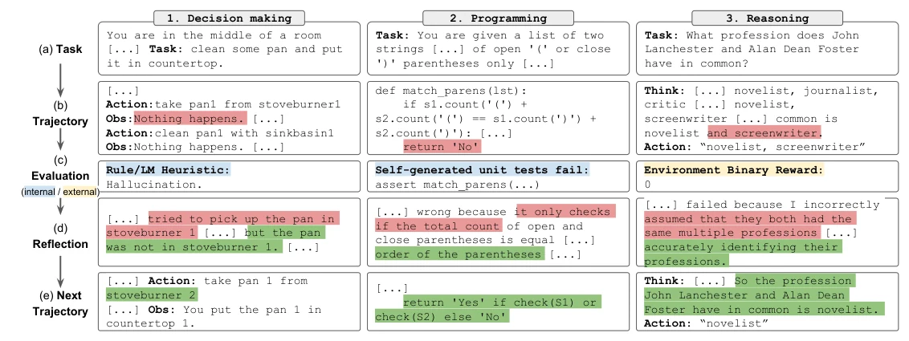
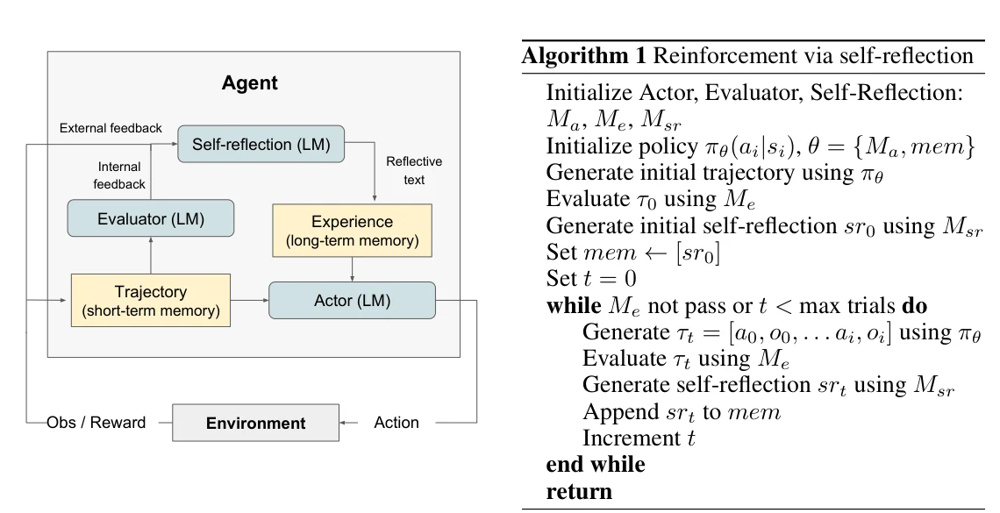
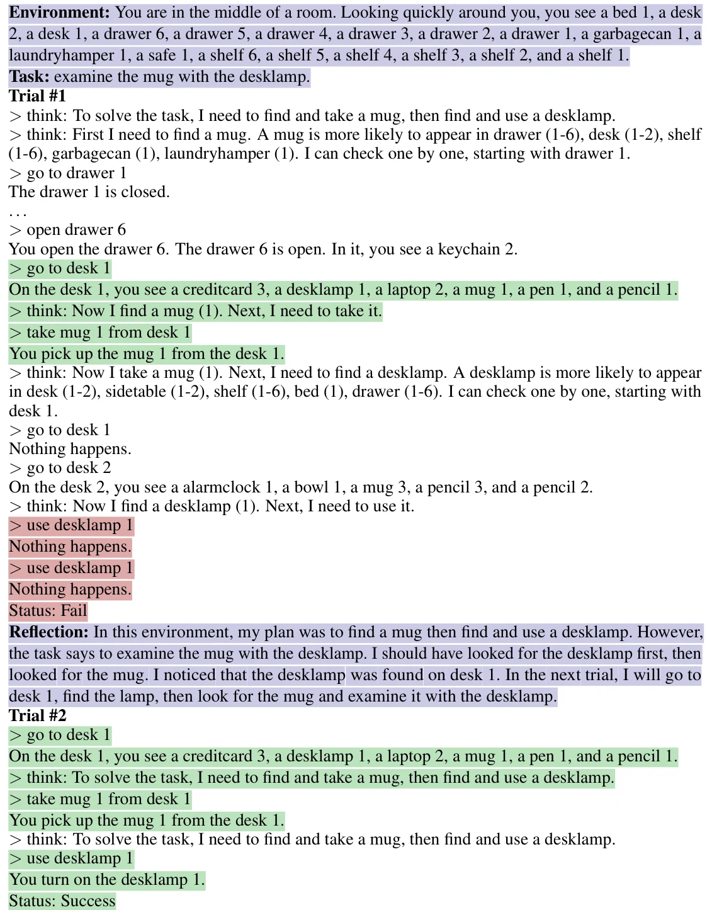
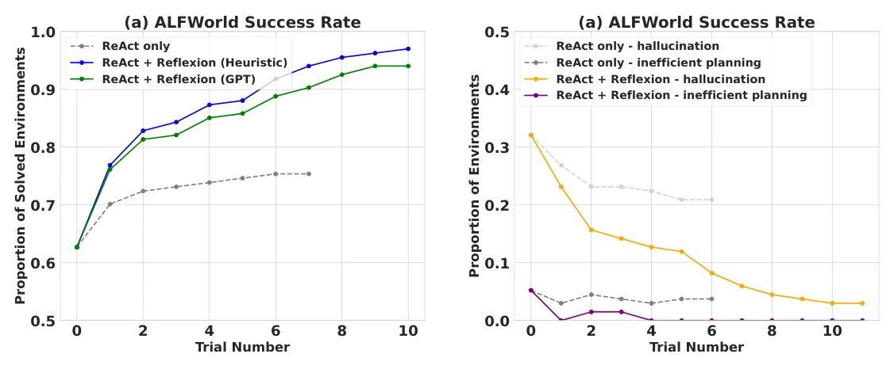
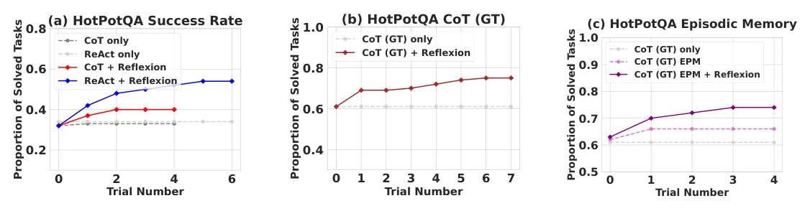
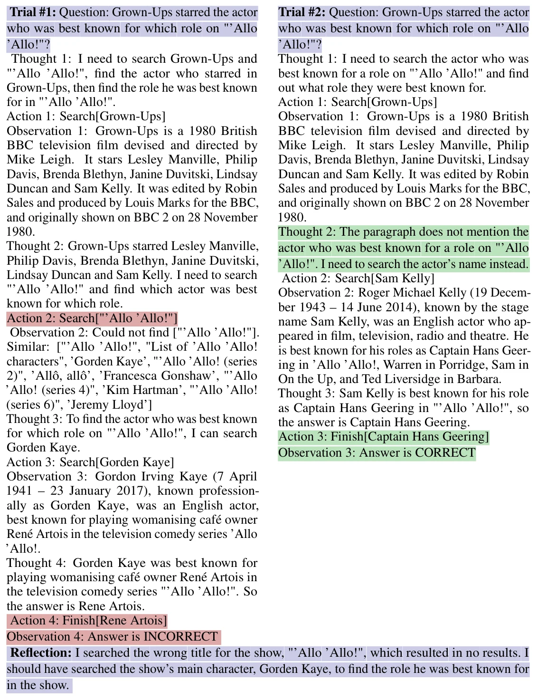
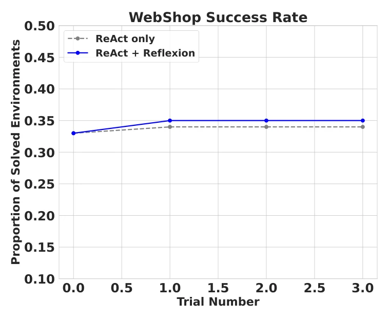

> - **논문**: Reflexion: Language Agents with Verbal Reinforcement Learning
> - **저자**: Noah Shinn, Federico Cassano, Edward Berman, Ashwin Gopinath, Karthik Narasimhan, Shunyu Yao (Northeastern University, MIT, Princeton University)
> - **학회**: NeurIPS 2023 · [arXiv:2303.11366](https://arxiv.org/abs/2303.11366) · [Code](https://github.com/noahshinn/reflexion)
{: .prompt-tip }

> [GPT]() 계열 LLM으로 만든 에이전트는 한 번 실패하면 다음 시도에서도 같은 실수를 되풀이한다. 강화학습처럼 시행착오에서 배우게 하려면 수많은 샘플과 비싼 파인튜닝이 필요하다. **Reflexion**은 가중치를 건드리지 않는다. 실패한 시도를 LLM이 스스로 돌아보고 "무엇을 잘못했고 다음엔 어떻게 할지"를 글로 써서, 다음 시도의 프롬프트에 붙인다. 이 반성문 몇 줄로 GPT-4의 HumanEval pass@1이 80.1%에서 91.0%로 오르고, ALFWorld에서는 134개 환경 중 130개를 푼다.

## 1. 문제: LLM 에이전트는 시행착오에서 배우지 못한다

ReAct, Toolformer, [Generative Agents]() 같은 연구는 LLM을 핵심에 둔 에이전트가 API를 부르고 환경에서 행동할 수 있음을 보였다. 이 에이전트들은 모델이 너무 커서 가중치를 업데이트하기 어렵고, 그래서 in-context 예시로만 가르쳐 왔다.

- **전통적인 RL은 너무 비싸다.** [PPO]() 같은 정책 최적화를 LLM에 쓰려면 "extensive training samples and expensive model fine-tuning"이 필요하다고 논문은 지적한다.
- **스칼라 보상은 너무 적은 정보를 준다.** 30단계짜리 행동 끝에 "실패(0)"만 받으면, 어느 행동이 문제였는지 알 수 없다. 논문은 이것을 credit assignment 문제라고 부른다.
- **같은 프롬프트로 다시 시도해도 나아지지 않는다.** HotPotQA에서 temperature 0.7로 재시도한 베이스라인은 첫 시도에서 틀린 문제를 단 하나도 더 풀지 못했다.

논문의 답은 보상을 **말로 증폭**하는 것이다. 이진·스칼라 보상과 궤적을 LLM에게 주어 반성문을 쓰게 하고, 그 반성문을 기억에 쌓아 다음 시도에 넣는다. 구성요소는 **Actor**, **Evaluator**, **Self-Reflection**, 그리고 **Memory**이다.

_Figure 1. 의사결정(ALFWorld), 프로그래밍, 추론(HotPotQA) 세 과제에서의 Reflexion. (a) 과제, (b) 궤적, (c) 평가(내부·외부), (d) 반성, (e) 다음 궤적 순서이다. 빨간색은 잘못된 부분, 초록색은 반성으로 고친 부분이다. (출처: Shinn et al., 2023)_

## 2. 방법: 세 개의 LLM과 반성문 버퍼

전체 흐름은 다음과 같다.

1. **Actor**가 환경과 상호작용해 궤적 $$\tau_t$$를 만든다.
2. **Evaluator**가 궤적을 채점해 보상 $$r_t$$를 낸다.
3. 실패면 **Self-Reflection** 모델이 $$\{\tau_t, r_t\}$$를 보고 반성문 $$sr_t$$를 쓴다.
4. $$sr_t$$를 **장기 기억** mem에 붙이고, 환경을 초기화한 뒤 다시 시도한다.
5. Evaluator가 통과를 주거나 최대 시도 횟수에 이르면 멈춘다.

_Figure 2. (a) Reflexion 구조. 궤적은 단기 기억, 반성문은 장기 기억(Experience)으로 Actor에 들어간다. Evaluator가 내부 피드백을, 환경이 외부 피드백을 준다. (b) Reflexion 강화 알고리즘이다. (출처: Shinn et al., 2023)_

학습되는 파라미터는 없다. 논문은 정책을 $$\pi_\theta(a_i \mid s_i)$$, $$\theta = \{M_a, mem\}$$로 쓴다. 고정된 LLM $$M_a$$와 반성문 묶음 mem을 합친 것이 정책이고, 업데이트되는 것은 mem뿐이다. 그래서 논문은 반성문을 "semantic gradient signal"이라고 부른다.

### Actor: 행동을 만드는 LLM

Actor는 상태 관찰을 조건으로 텍스트와 행동을 생성하는 LLM이다. 논문은 두 가지를 쓴다.

| Actor | 쓰인 곳 | few-shot |
|---|---|---|
| ReAct (생각 + 행동 교차) | ALFWorld, HotPotQA | 2-shot |
| Chain-of-Thought | HotPotQA 추론 전용 | 6-shot |
| 함수 본문 생성 | HumanEval, MBPP, LeetcodeHard | 지시문 + 예시 |

Actor의 프롬프트에는 과제 설명, 지금까지의 궤적(단기 기억)과 함께 mem(장기 기억)이 들어간다. 이 아이디어는 in-context learning으로 policy iteration을 하는 Brooks et al.(2022)에서 왔다고 밝힌다.

### Evaluator: 무엇을 실패로 볼 것인가

의미 공간에서 쓸 보상 함수를 정의하기 어려워서, 과제마다 다른 Evaluator를 쓴다.

| 과제 | Evaluator | 외부·내부 |
|---|---|---|
| HotPotQA | 정답과의 exact match(EM), 이진 | 외부 |
| ALFWorld | 손으로 쓴 휴리스틱 또는 LLM 이진 분류 | 내부 |
| 프로그래밍 | LLM이 직접 쓴 단위 테스트 실행 결과 | 내부 |

ALFWorld 휴리스틱은 단순하다. **같은 행동을 해서 같은 응답을 받는 일이 3번을 넘게 반복되면(환각), 또는 현재 환경에서 행동이 30개를 넘으면(비효율적 계획)** 반성을 시킨다.

프로그래밍에서는 정답 테스트를 쓰지 않는다. 이것이 pass@1로 보고할 수 있는 근거이다. 테스트는 다음 순서로 만든다.

1. Chain-of-Thought 프롬프트로 자연어 설명이 붙은 다양한 테스트를 생성한다.
2. 각 테스트가 유효한 추상 구문 트리(AST)가 되는지 확인해 문법이 틀린 것을 걸러 낸다.
3. 남은 테스트에서 최대 $$n = 6$$개를 뽑아 테스트 묶음 $$T = \{t_0, \dots, t_n\}$$을 만든다.

### Self-Reflection: 실패를 반성문으로

Self-Reflection 모델도 LLM이다. 성공·실패 같은 희소한 보상과 현재 궤적, 지금까지의 mem을 받아 구체적인 피드백을 쓴다. 논문의 설명은 이렇다. 여러 단계짜리 과제에서 실패 신호를 받으면, 에이전트는 어떤 행동 $$a_i$$ 때문에 $$a_{i+1}, a_{i+2}$$가 잘못됐는지 추론하고, 대신 $$a'_i$$를 했어야 한다고 말로 적는다. 다음 시도에서는 그 시점에 $$a'_i$$를 고른다.

ALFWorld의 실제 예시가 이 과정을 보여 준다. 과제는 "examine the mug with the desklamp"이다. 첫 시도에서 에이전트는 머그를 먼저 집고 나서 스탠드를 찾다가, 엉뚱한 곳에서 `use desklamp 1`을 두 번 반복하고 실패한다. 반성문은 다음과 같다.

> In this environment, my plan was to find a mug then find and use a desklamp. However, the task says to examine the mug with the desklamp. I should have looked for the desklamp first, then looked for the mug. I noticed that the desklamp was found on desk 1. In the next trial, I will go to desk 1, find the lamp, then look for the mug and examine it with the desklamp.

계획 순서가 틀렸다는 진단과 함께 "스탠드는 desk 1에 있었다"는 관찰까지 적었다. 두 번째 시도에서 에이전트는 곧장 desk 1로 가서 머그를 집고 스탠드를 켜 성공한다.

_Figure 5. 위: 비효율적 계획으로 실패한 ALFWorld 궤적과 반성문. 에이전트는 머그보다 스탠드를 먼저 찾았어야 했다고 적는다. 아래: 다음 시도에서 짧은 행동열로 과제를 마친다. (출처: Shinn et al., 2023)_

### Memory: 단기 궤적과 장기 반성문

| 기억 | 내용 | 크기 |
|---|---|---|
| 단기 기억 | 현재 시도의 궤적 $$[a_0, o_0, \dots, a_i, o_i]$$ | 한 시도 |
| 장기 기억(mem) | 지난 시도들의 반성문 $$sr_0, sr_1, \dots$$ | 최대 $$\Omega$$개, 보통 1~3 |

$$\Omega$$는 LLM의 context 한계 때문에 둔다. ALFWorld와 HotPotQA는 최근 반성문 3개, 프로그래밍은 1개만 남긴다. 오래된 반성문은 sliding window 밖으로 밀려난다. 검색이나 점수 매기기 없이, 남아 있는 반성문을 통째로 프롬프트에 넣는다.

## 3. 평가 1: ALFWorld 의사결정

### 설정

- **환경**: TextWorld 기반 텍스트 가정 환경 ALFWorld의 134개 환경, 6종 과제(서랍에서 주걱 찾기, 칼을 도마로 옮기기, 냉장고로 토마토 식히기 등)
- **Actor**: ReAct, ReAct 논문과 같은 2-shot 궤적 예시, LLM은 GPT-3
- **비교**: ReAct only(반성이 필요한 순간에 반성 없이 환경만 초기화), ReAct + Reflexion(Evaluator가 휴리스틱인 경우와 GPT 이진 분류인 경우)
- **기억**: 최근 반성문 3개

### 결과

ReAct + Reflexion(휴리스틱)은 12번의 연속 시도 끝에 134개 중 **130개**를 풀었다. ReAct only는 시도 6~7회 사이에서 더 오르지 않았다. 논문은 이 차이를 절대값 22%p로 요약한다.

_Figure 3. 왼쪽: 134개 ALFWorld 과제에서 해결한 환경의 누적 비율. 오른쪽: 실패 원인별 환경 비율. ReAct only는 환각 비율이 22% 근처에서 멈추고, Reflexion은 환각과 비효율적 계획을 모두 줄인다. (출처: Shinn et al., 2023)_

실패 원인을 나눠 보면 차이가 어디서 나는지 보인다. 베이스라인에서 흔한 실패는 **물건을 갖고 있지 않은데 갖고 있다고 착각하는 환각**이다. 에이전트는 그 상태로 긴 행동을 이어 가고, 어디서 틀렸는지 되짚지 못한다. ReAct only의 환각 비율은 22%에서 수렴하고 회복할 기미가 없다. 논문은 반성문이 두 경우에 특히 도움이 된다고 본다.

- **긴 궤적의 초반 실수를 짚는다.** 반성문이 새 행동이나 새 장기 계획을 제안한다.
- **살펴볼 곳이 너무 많다.** 여러 시도에 걸친 반성문으로 방을 빠짐없이 뒤진다.

첫 두 시도 사이의 급상승은 앞의 경우, 그 뒤의 완만한 상승은 뒤의 경우로 해석한다.

**비판적으로 읽기.** 휴리스틱 Evaluator는 "같은 행동 3번 초과, 행동 30개 초과"라는 ALFWorld 전용 규칙이다. 다른 환경에서 이 규칙이 그대로 통할지는 알 수 없다. GPT 이진 분류 Evaluator도 휴리스틱보다 약간 낮을 뿐 비슷하게 오르는데(그래프상 약 0.94), 이쪽이 일반화 가능성을 판단하는 데 더 의미 있는 숫자로 보인다. 또 본문은 12번 시도라고 쓰지만 Figure 3 왼쪽의 Reflexion 곡선은 시도 10까지만 그려져 있다.

## 4. 평가 2: HotPotQA 추론

### 설정

- **데이터**: 위키피디아 기반 다중 문서 QA인 HotPotQA(113k 쌍) 중 100문항
- **Actor 세 가지**
  - **CoT**: 질문만 보고 단계별 추론(6-shot)
  - **CoT (GT)**: 정답 근거 문단 $$C_{gt}$$를 함께 받아 추론. 검색을 빼고 추론 능력만 본다
  - **ReAct**: 위키피디아 API로 검색하며 추론(2-shot)
- **Evaluator**: exact match로 이진 보상
- **Self-Reflection**: 2-shot, 기억은 3개
- **종료**: 베이스라인은 temperature 0.7로 재시도, Reflexion은 한 문제에서 3번 연속 실패할 때까지 재시도

### 결과

_Figure 4. HotPotQA 100문항 결과. (a) ReAct·CoT에 Reflexion을 붙인 경우, (b) 근거 문단을 준 CoT (GT)에 Reflexion을 붙인 경우, (c) 직전 궤적만 넣는 episodic memory(EPM)와 Reflexion의 비교이다. (출처: Shinn et al., 2023)_

세 베이스라인(CoT only, ReAct only, CoT (GT) only)은 재시도해도 처음 틀린 문제를 하나도 더 풀지 못해 곡선이 평평하다. ReAct + Reflexion은 그래프상 약 0.34에서 0.54까지 오르고, 논문은 이것을 20%p 향상으로 요약한다. CoT (GT)는 근거 문단을 받고도 39%의 문제를 틀리는데, Reflexion을 붙이면 정답을 보지 않고도 정확도가 14%p 오른다(그래프상 0.61 → 0.75).

Figure 4 (c)는 "정말 반성문 덕분인가"를 따지는 ablation이다. 직전 궤적을 그대로 넣어 주는 EPM만으로도 CoT (GT)는 조금 오른다. 여기에 1인칭 반성문을 더하면 EPM 대비 8%p가 더 오른다(그래프상 0.66 → 0.74). 논문은 이것을 "수정만 하는 방법보다 반성이 이끄는 수정이 낫다"는 근거로 쓴다.

HotPotQA 반성문의 실제 예는 다음과 같다. 질문은 "Grown-Ups에 출연한 배우 중 'Allo 'Allo!에서 어떤 역할로 가장 유명한 사람은?"이다. 첫 시도에서 에이전트는 드라마 제목 검색에 실패하자 주연 Gorden Kaye를 찾아 "Rene Artois"라고 답해 틀린다.

> I searched the wrong title for the show, "'Allo 'Allo!", which resulted in no results. I should have searched the show's main character, Gorden Kaye, to find the role he was best known for in the show.

두 번째 시도에서 에이전트는 Grown-Ups 출연진 중 Sam Kelly를 검색해 "Captain Hans Geering"으로 맞힌다.

_Figure 7. 같은 HotPotQA 문제에서의 두 시도. 왼쪽 첫 시도는 드라마 제목 검색에 실패하고 엉뚱한 배우의 역할을 답한다. 반성 뒤 오른쪽 두 번째 시도는 배우 이름으로 검색 방법을 바꿔 맞힌다. (출처: Shinn et al., 2023)_

**비판적으로 읽기.** 이 예시는 반성문이 정확히 맞는 처방을 준 경우가 아니다. 반성문은 "Gorden Kaye를 검색했어야 했다"고 적지만, Gorden Kaye는 첫 시도에서 이미 검색했고 오답의 원인이었다. 두 번째 시도의 Actor는 반성문의 처방과 다른 길(Sam Kelly 검색)로 정답에 닿았다. 반성문의 내용이 맞았는지보다 "같은 길을 다시 가지 마라"는 신호가 효과를 냈을 수 있다. 또 EM 이진 보상은 정답을 알아야 줄 수 있는 신호이다. 프로그래밍처럼 스스로 채점하는 설정과 달리, HotPotQA 결과는 정답 여부를 외부에서 알려 준 조건의 숫자이다.

### 모델 크기에 따른 차이

부록은 같은 실험을 여러 모델로 반복했다(논문 Table 5, HotPotQA 100문항).

| 모델 | 베이스라인 | Reflexion |
|---|---|---|
| CoT (GT) + text-davinci-003 | 0.60 | 0.77 |
| CoT (GT) + gpt-3.5-turbo | 0.57 | 0.71 |
| CoT (GT) + gpt-4 | 0.68 | **0.80** |
| ReAct + text-davinci-003 | 0.30 | **0.55** |
| ReAct + gpt-3.5-turbo | 0.26 | 0.38 |
| ReAct + gpt-4 | 0.39 | 0.51 |

반면 HumanEval Python에서 starchat-beta는 8번 평균 pass@1이 베이스라인과 Reflexion 모두 0.26으로 같았다(논문 Table 4). 저자들은 스스로 고칠 점을 짚어 내는 능력이 "더 강하고 큰 모델의 창발적 성질"이라고 결론짓는다.

## 5. 평가 3: 프로그래밍

### 설정

- **벤치마크**: HumanEval, MBPP(Python), MultiPL-E로 옮긴 Rust 버전, 새로 만든 LeetcodeHardGym
- **LeetcodeHardGym**: GPT-4 사전학습 기준일(2022년 10월 8일) 이후 공개된 LeetCode hard 문제 40개, 19개 언어 지원
- **Evaluator**: 자기 생성 테스트 최대 6개, 기억은 반성문 1개
- **비교**: 이전 SOTA(CodeT + GPT-3.5/Codex), 단일 샘플 GPT-4

### 결과

논문 Table 1의 pass@1(%)이다.

| 벤치마크 + 언어 | 이전 SOTA | GPT-4 | Reflexion |
|---|---|---|---|
| HumanEval (PY) | 65.8 (CodeT + GPT-3.5) | 80.1 | **91.0** |
| HumanEval (RS) | – | 60.0 | **68.0** |
| MBPP (PY) | 67.7 (CodeT + Codex) | **80.1** | 77.1 |
| MBPP (RS) | – | 70.9 | **75.4** |
| Leetcode Hard (PY) | – | 7.5 | **15.0** |

MBPP Python만 Reflexion이 GPT-4보다 낮다. 저자들은 그 이유를 자기 생성 테스트의 품질에서 찾는다. 논문 Table 2는 테스트 결과와 실제 정답 여부를 교차해 보여 준다.

| 벤치마크 + 언어 | Base | Reflexion | TP | FN | FP | TN |
|---|---|---|---|---|---|---|
| HumanEval (PY) | 0.80 | **0.91** | 0.99 | 0.40 | 0.01 | 0.60 |
| MBPP (PY) | **0.80** | 0.77 | 0.84 | 0.59 | 0.16 | 0.41 |
| HumanEval (RS) | 0.60 | **0.68** | 0.87 | 0.37 | 0.13 | 0.63 |
| MBPP (RS) | 0.71 | **0.75** | 0.84 | 0.51 | 0.16 | 0.49 |

여기서 TP는 테스트 통과·실제 정답, FN은 테스트 실패·실제 정답, FP는 테스트 통과·실제 오답, TN은 테스트 실패·실제 오답이다. 위험한 쪽은 **FP**이다. 틀린 코드가 자기 테스트를 모두 통과하면, 에이전트는 반성할 기회 없이 바로 제출한다. 반대로 FN은 반성 과정에서 "테스트가 틀렸다"고 판단하고 원래 코드를 유지할 여지가 있다. MBPP Python의 FP 비율은 16.3%, HumanEval Python은 1.4%이다. 이 차이가 두 벤치마크의 결과를 갈랐다고 논문은 설명한다.

### Ablation: 테스트와 반성은 둘 다 필요하다

HumanEval Rust에서 가장 어려운 50문제로, GPT-4 기준 ablation을 했다(논문 Table 3).

| 조건 | 테스트 생성 | 반성 | pass@1 |
|---|---|---|---|
| Base model | X | X | 0.60 |
| 테스트 생성 제거 | X | O | 0.52 |
| 반성 제거 | O | X | 0.60 |
| Reflexion | O | O | **0.68** |

테스트 없이 반성만 하면 오히려 베이스라인보다 떨어진다(0.52). 지금 코드가 맞는지 판단할 수 없어 매 시도마다 고치고, 그 수정이 맞는 코드를 망가뜨린다. 반성 없이 테스트 결과만 주면 베이스라인과 같다(0.60). 테스트와 컴파일이 오류를 잡아도, 그 신호가 구현 수정으로 이어지지 않았다. 둘을 합쳐야 0.68이 나온다.

**비판적으로 읽기.** 표와 본문의 숫자가 어긋난다. 본문은 HumanEval과 MBPP Python의 베이스라인을 82%, 80%라고 쓰지만 Table 1과 Table 2는 둘 다 0.80(80.1)이다. MBPP Python에서 GPT-4가 HumanEval과 똑같은 80.1이라는 점도 따로 설명이 없다. 또 GPT-4 베이스라인 숫자는 저자들이 직접 잰 것인지 보고된 값을 옮긴 것인지 분명하지 않다. Reflexion은 한 문제에 여러 번 생성하므로 같은 pass@1이라도 계산량이 단일 샘플과 다르고, 논문은 시도 횟수별 비용을 보고하지 않는다.

### 실패 유형

- **탐색이 필요한 과제에서는 반성이 쓸모없다.** WebShop의 100개 쇼핑 요청에서 2-shot ReAct + Reflexion은 4번 시도 뒤에도 나아지지 않아 실험을 중단했다. 성공률은 0.33에서 0.35로, ReAct only(0.34)와 거의 같다. 에이전트는 도움이 되는 반성문 자체를 만들지 못했다. ALFWorld는 관찰에 가능한 행동이 드러나고, HotPotQA는 검색어가 덜 정확해도 되지만, WebShop은 모호한 자연어를 정확한 검색어로 바꾸는 다양한 행동이 필요하다는 것이 저자들의 설명이다.
- **자기 테스트의 거짓 통과.** MBPP Python에서 FP 16.3%가 성능을 GPT-4 단독보다 낮췄다.
- **작은 모델.** starchat-beta에서는 효과가 없었다.

_Figure 6. WebShop 100개 쇼핑 요청에서의 ReAct와 ReAct + Reflexion. Reflexion을 붙여도 의미 있게 나아지지 않는다. (출처: Shinn et al., 2023)_

## 6. 해석: Reflexion이 남긴 것과 남긴 숙제

**남긴 것: "실패 → 말로 된 교훈 → 다음 시도"라는 학습 루프.** Reflexion은 가중치 업데이트 없이, 보상을 자연어 피드백으로 바꿔 정책(프롬프트)을 고치는 틀을 실험으로 보였다. 정책을 "고정된 LLM + 반성문 묶음"으로 정의한 것이 이 논문의 기여이다. 반성문은 사람이 읽을 수 있어서, 논문의 Broader impact 절도 도구를 쓰기 전에 반성문을 감시해 의도를 확인할 수 있다고 쓴다. 보통 RL 정책이 블랙박스인 것과 대비된다.

**남긴 것: Generative Agents의 reflection과 다른 축의 반성.** 같은 해 나온 [Generative Agents]()도 reflection을 쓴다. 이름은 같지만 목적과 작동 방식이 다르다.

| 항목 | Generative Agents의 reflection | Reflexion의 self-reflection |
|---|---|---|
| 목적 | 사람다운 판단(누가 친한지, 무엇에 열정이 있는지) | 과제 성공(다음 시도에서 실수 안 하기) |
| 계기 | 최근 관찰의 importance 합이 150을 넘을 때 | Evaluator가 실패를 줄 때 |
| 재료 | 최근 기억 100개 → 질문 3개 → 통찰 5개 | 실패한 궤적 하나와 보상 |
| 내용 | "Klaus는 연구에 매우 헌신적이다" 같은 일반화 | "스탠드를 먼저 찾았어야 했다" 같은 행동 처방 |
| 저장 | memory stream에 관찰과 함께 쌓고 retrieval로 꺼냄 | 최대 1~3개 sliding window, 통째로 프롬프트에 넣음 |
| 보상 | 없음 | 이진·스칼라 보상 |

Generative Agents의 reflection은 경험을 **추상화**해 기억을 정리하는 장치이고, Reflexion의 반성은 실패를 **원인과 처방**으로 바꾸는 학습 신호이다. 앞의 것은 여러 기억을 묶어 위로 쌓아 올리고(reflection tree), 뒤의 것은 한 시도를 다음 시도로 넘기는 짧은 메모이다. 그래서 Reflexion에는 retrieval이 필요 없고, 대신 Evaluator가 있어야 한다. 두 방식은 겹치지 않으니 합칠 수 있다. 장기적으로 쌓인 반성문을 Generative Agents처럼 점수로 검색하는 구조가 그 방향이고, 논문도 한계 절에서 sliding window 대신 벡터 DB 같은 기억 구조를 제안한다. 행동 뒤의 생각을 학습 신호로 쓴다는 점에서는 [Thought Cloning]()과도 통한다. Thought Cloning은 사람의 생각을 모방해 가중치를 학습하고, Reflexion은 자기 생각을 고쳐 프롬프트를 바꾼다.

**숙제 1: Evaluator가 전부를 결정한다.** 결과의 질은 반성문이 아니라 실패를 정확히 알아차리는 능력에 먼저 묶여 있다. HotPotQA는 정답으로 채점했고, ALFWorld는 환경 전용 휴리스틱을 썼고, 프로그래밍은 자기 테스트의 FP가 16.3%까지 갔다. 테스트 생성을 뺀 ablation이 0.52로 베이스라인보다 낮다는 사실은, 믿을 만한 평가 없이 반성만 하면 해가 된다는 것을 보여 준다. 정답 신호가 없는 열린 과제에서 Evaluator를 어떻게 만들지가 남는다.

**숙제 2: 반성문이 맞는지 아무도 확인하지 않는다.** Figure 7의 반성문은 이미 검색한 Gorden Kaye를 다시 검색하라고 처방했다. 그래도 정답이 나왔으니 이 예시는 성공으로 집계된다. 반성문의 정확도, 반성문을 따랐는지 여부를 따로 측정하지 않았기 때문에, 효과가 "올바른 교훈"에서 오는지 "같은 답을 피하라는 신호"에서 오는지 구분할 수 없다.

**숙제 3: 탐색과 강한 모델 의존.** WebShop에서 4번 시도 동안 개선이 없었고, starchat-beta에서는 효과가 0이었다. 반성은 이미 가능한 행동 안에서 고르는 순서를 고치는 데는 강하지만, 새로운 행동을 찾아내는 탐색을 대신하지 못한다. 논문 스스로 국소 최적에 빠질 수 있다고 인정한다.

**숙제 4: 비용과 안전.** ALFWorld에서는 같은 환경을 12번까지 다시 시도하고, 시도마다 Actor·Evaluator·Self-Reflection을 부른다. 논문은 토큰 비용이나 시도 횟수별 계산량을 보고하지 않는다. 또 생성한 코드를 검증 없이 실행하므로, 저자들은 격리된 실행 환경을 쓰라고 권한다.

## 7. 정리

| 항목 | 내용 |
|---|---|
| 핵심 아이디어 | 가중치 대신 실패를 돌아본 반성문을 기억에 쌓아 다음 시도의 정책을 바꾸는 verbal reinforcement |
| 구조 | Actor(ReAct·CoT) + Evaluator(EM·휴리스틱·LLM·자기 테스트) + Self-Reflection(LLM) |
| 기억 | 단기 = 현재 궤적, 장기 = 최근 반성문 1~3개(sliding window) |
| ALFWorld | 134개 중 130개 해결, ReAct only 대비 22%p 향상, 환각 실패 거의 제거 |
| HotPotQA | ReAct 기준 20%p 향상, EPM 대비 반성문 효과 8%p |
| 프로그래밍 | HumanEval Python pass@1 80.1 → 91.0, Leetcode Hard 7.5 → 15.0, 테스트·반성 중 하나라도 빼면 효과 없음 |
| 한계 | Evaluator 품질 의존(MBPP FP 16.3%), WebShop 같은 탐색 과제 실패, 작은 모델에서 효과 없음, 비용 미보고 |

## References

- Shinn et al., "Reflexion: Language Agents with Verbal Reinforcement Learning," NeurIPS 2023. [arXiv:2303.11366](https://arxiv.org/abs/2303.11366)
- Yao et al., "ReAct: Synergizing Reasoning and Acting in Language Models," ICLR 2023. [arXiv:2210.03629](https://arxiv.org/abs/2210.03629)
- Wei et al., "Chain-of-Thought Prompting Elicits Reasoning in Large Language Models," NeurIPS 2022. [arXiv:2201.11903](https://arxiv.org/abs/2201.11903)
- Park et al., "Generative Agents: Interactive Simulacra of Human Behavior," UIST 2023. [arXiv:2304.03442](https://arxiv.org/abs/2304.03442)
- Schick et al., "Toolformer: Language Models Can Teach Themselves to Use Tools," NeurIPS 2023. [arXiv:2302.04761](https://arxiv.org/abs/2302.04761)
- Brooks et al., "In-Context Policy Iteration," arXiv 2022. [arXiv:2210.03821](https://arxiv.org/abs/2210.03821)
- Shridhar et al., "ALFWorld: Aligning Text and Embodied Environments for Interactive Learning," ICLR 2021. [arXiv:2010.03768](https://arxiv.org/abs/2010.03768)
- Yang et al., "HotpotQA: A Dataset for Diverse, Explainable Multi-hop Question Answering," EMNLP 2018. [arXiv:1809.09600](https://arxiv.org/abs/1809.09600)
- Chen et al., "Evaluating Large Language Models Trained on Code," arXiv 2021. [arXiv:2107.03374](https://arxiv.org/abs/2107.03374)
- Austin et al., "Program Synthesis with Large Language Models," arXiv 2021. [arXiv:2108.07732](https://arxiv.org/abs/2108.07732)
- Chen et al., "CodeT: Code Generation with Generated Tests," ICLR 2023. [arXiv:2207.10397](https://arxiv.org/abs/2207.10397)
- Cassano et al., "MultiPL-E: A Scalable and Extensible Approach to Benchmarking Neural Code Generation," arXiv 2022. [arXiv:2208.08227](https://arxiv.org/abs/2208.08227)
- Yao et al., "WebShop: Towards Scalable Real-World Web Interaction with Grounded Language Agents," NeurIPS 2022. [arXiv:2207.01206](https://arxiv.org/abs/2207.01206)
