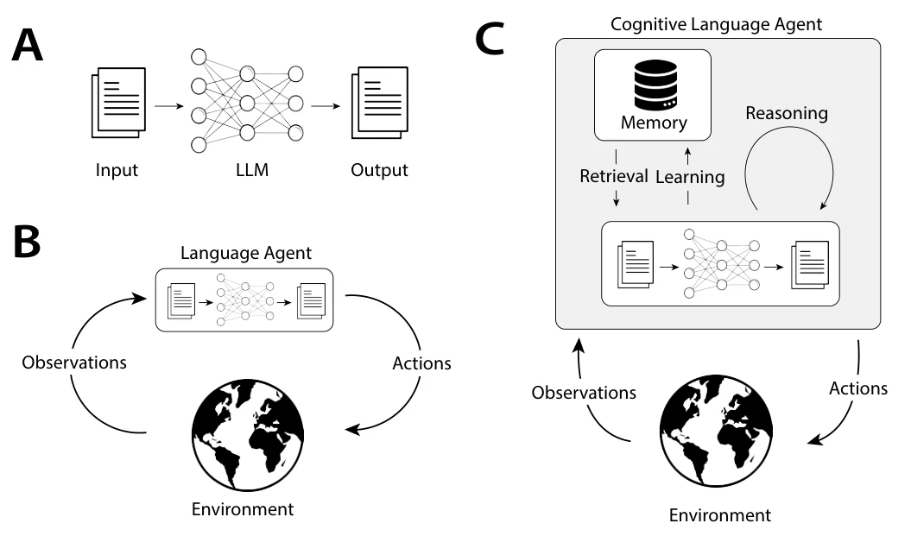
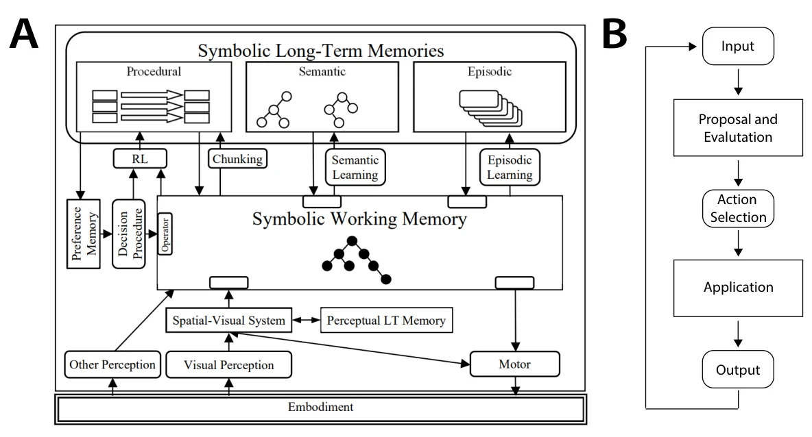
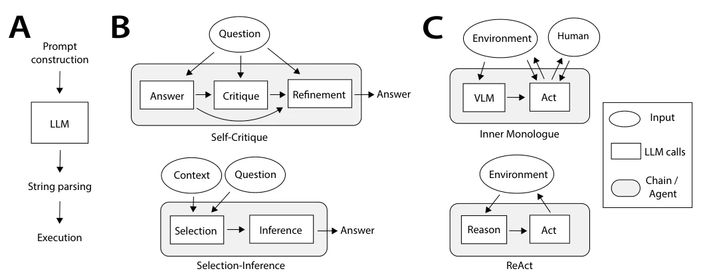
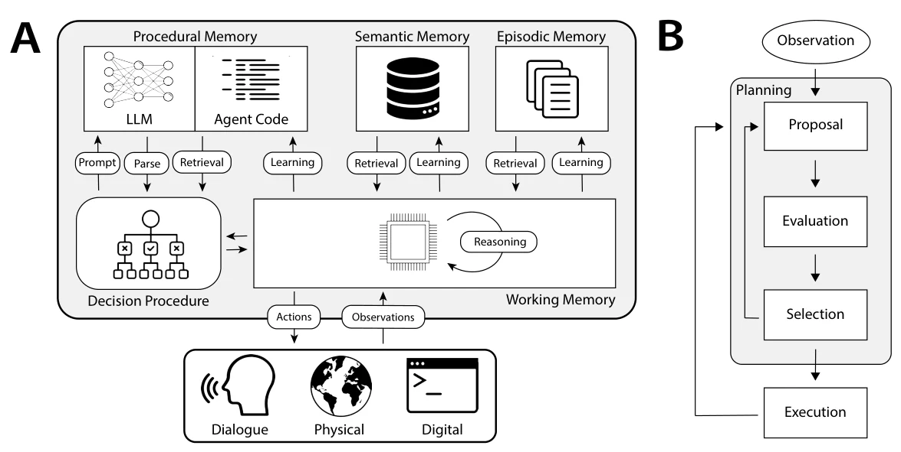
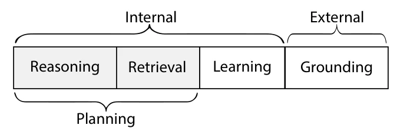

> - **논문**: Cognitive Architectures for Language Agents
> - **저자**: Theodore R. Sumers, Shunyu Yao, Karthik Narasimhan, Thomas L. Griffiths (Princeton University)
> - **학회**: TMLR 2024 · [arXiv:2309.02427](https://arxiv.org/abs/2309.02427) · [Code](https://github.com/ysymyth/awesome-language-agents)
{: .prompt-tip }

> [Generative Agents]()는 memory stream, reflection, planning을 붙였고, 같은 해에 나온 다른 에이전트들은 tool use, grounding, skill library 같은 이름으로 저마다 다른 부품을 붙였다. 부품 이름이 논문마다 달라서 두 에이전트가 무엇이 같고 무엇이 다른지 말하기 어렵다. **CoALA**는 1970~80년대 인지 아키텍처, 특히 Soar의 개념을 빌려 언어 에이전트를 기억 모듈, 내부·외부 행동 공간, 결정 주기라는 세 축으로 다시 쓴다. 이 틀에 넣으면 Generative Agents와 Voyager는 "검색·추론·학습을 모두 쓰지만 결정은 제안 하나로 끝내는 에이전트"로, Tree of Thoughts는 "기억은 없지만 제안·평가·선택을 모두 하는 에이전트"로 한 줄에 정리된다.

## 1. 문제: 언어 에이전트마다 용어가 다르다

언어 에이전트(language agent)는 LLM을 외부 세계와 상호작용하는 데 쓰는 시스템이다. 초기 에이전트는 LLM으로 행동을 바로 고르거나 만들었다. 이후 에이전트는 LLM을 추론(ReAct), 계획(Tree of Thoughts, RAP), 장기 기억 관리(Generative Agents, Voyager)에도 쓴다. 논문은 이렇게 내부 과정이 복잡해진 에이전트를 인지 언어 에이전트(cognitive language agent)라고 부른다.

_Figure 1. LLM의 세 가지 쓰임이다. A는 텍스트를 받아 텍스트를 내는 NLP용 LLM, B는 관찰을 텍스트로 바꾸고 LLM으로 행동을 고르는 언어 에이전트, C는 여기에 더해 retrieval, learning, reasoning으로 내부 상태를 관리하는 인지 언어 에이전트이다. (출처: Sumers et al., 2023)_

논문이 꼽는 문제는 다음과 같다.

- **용어가 제각각이다.** 같은 과정을 연구마다 "tool use", "grounding", "actions"처럼 다른 이름으로 부른다.
- **비교와 추적이 어렵다.** 두 에이전트의 차이가 기억에 있는지, 행동 종류에 있는지, 결정 방식에 있는지 따지기 어렵고, 분야가 어디로 가는지도 보기 어렵다.
- **새 에이전트를 만들 공통 추상화가 없다.** 강화학습에는 MDP와 OpenAI Gym이 있지만, 언어 에이전트에는 `Memory`, `Action`, `Agent`에 해당하는 합의된 단위가 없다.

논문의 답은 인지 과학과 기호 AI의 역사에서 두 개념을 가져오는 것이다. 문자열을 고쳐 쓰는 규칙인 **production system**, 그리고 그 규칙의 실행 순서를 정하는 **인지 아키텍처(cognitive architecture)**이다. 이를 바탕으로 에이전트를 기억(memory), 행동 공간(action space), 의사결정(decision making)의 세 축으로 기술한다.

## 2. 배경: production system에서 Soar, 그리고 LLM까지

### Production system과 제어 흐름

production은 "이 조건이면 이렇게 고쳐 쓴다"는 규칙이다. Post(1943)는 논리 체계를 문자열 규칙으로 표현했다.

$$
X\,Y\,Z \rightarrow X\,W\,Z
$$

문자열 $$XYZ$$를 $$XWZ$$로 고쳐 쓸 수 있다는 뜻이다. 규칙만으로는 만들 수 있는 문자열의 집합만 정해진다. 여기에 "어떤 규칙을 먼저 적용하는가"라는 제어 흐름을 붙이면 알고리즘이 된다. 논문이 드는 Markov algorithm 예시는 획(|)으로 쓴 수를 5로 나눠 몫과 나머지를 $$Q * R$$ 꼴로 바꾼다. 규칙에 위에서 아래로 우선순위가 있어서, 입력 11은 "몫 2, 나머지 1"이 된다. 단순한 규칙과 우선순위만으로도 Markov algorithm은 튜링 완전하다.

Newell과 Simon(1972)은 production을 문자열 밖으로 넓혀, 조건을 에이전트의 목표와 세계 상태에 대한 논리식으로 바꿨다. 논문이 옮긴 온도조절기 에이전트는 규칙 네 개로 이루어진다.

| 조건 | 행동 |
|---|---|
| 70° < 온도 < 72° | 멈춤 |
| 온도 < 32° | 수리 요청, 전기 히터 켜기 |
| 온도 < 70°, 보일러 꺼짐 | 보일러 켜기 |
| 온도 > 72°, 보일러 켜짐 | 보일러 끄기 |

### 인지 아키텍처와 Soar

규칙이 수천 개로 늘고 센서, 구동기, 지식 베이스가 붙자 더 정교한 제어 흐름이 필요해졌다. 연구자들은 지각, 기억, 계획을 명시적으로 나눈 인지 아키텍처를 만들었다. 논문은 수백 개 아키텍처와 수천 편 논문이 있다고 쓰고, 대표로 Soar를 든다.

_Figure 2. A는 Soar 구조, B는 Soar의 결정 절차이다. production으로 행동을 제안·평가하고, 하나를 골라 적용한다. 행동은 기억을 고치는 내부 행동일 수도, 모터 명령 같은 외부 행동일 수도 있다. (출처: Sumers et al., 2023; A는 Laird, 2022)_

| 구성요소 | Soar에서의 역할 |
|---|---|
| Working memory | 최근 지각 입력, 목표, 중간 추론 결과 |
| Procedural memory | production 규칙 자체 |
| Semantic memory | 세계에 대한 사실 |
| Episodic memory | 과거 행동의 순서 |
| 결정 절차 | 규칙의 조건을 working memory와 맞춰 행동 후보를 제안·평가하고, 가장 좋은 것을 골라 적용 |
| 학습 | 사실·경험을 장기 기억에 쓰기, RL로 좋은 규칙의 가중치 높이기, 새 규칙 쓰기 |

후보가 하나도 없거나 동률이면 impasse가 생기고, Soar는 이를 풀기 위한 하위 목표를 만든다. 이것이 계층적인 과제 분해가 된다.

인지 아키텍처는 로봇, 군사 시뮬레이션, 지능형 튜터에 쓰였지만 AI 분야에서 점점 덜 쓰이게 됐다. 논문이 꼽는 이유는 두 가지이다. 논리 술어로 기술할 수 있는 도메인에만 쓸 수 있고, 미리 정해 둔 규칙이 많이 필요하다. 논문은 LLM이 두 문제를 모두 푼다고 본다. LLM은 임의의 텍스트를 다루고, 규칙을 사람이 쓰는 대신 사전학습으로 규칙의 분포를 배운다.

### LLM은 확률적 production system이다

프롬프트 $$X$$ 뒤에 이어 쓸 $$Y$$를 만드는 일은 production $$X \rightarrow X\,Y$$로 쓸 수 있다. LLM은 가능한 이어 쓰기 $$Y_i$$마다 확률을 매긴다.

$$
X \;\rightsquigarrow\; X\,Y, \qquad Y \sim P(Y_i \mid X)
$$

그래서 LLM은 호출할 때마다 규칙 하나를 확률적으로 골라 적용하는 production system으로 볼 수 있다. 단점은 불투명성이다. 사람이 읽을 수 있는 규칙 대신 수십억 개의 파라미터가 있고, 확률적이라 행동을 분석하고 통제하기 어렵다. 장점은 대규모 사전학습으로 얻은 prior이다.

이 관점에서 프롬프트 기법은 LLM 호출 앞뒤에 production을 덧붙이는 제어 흐름이다. 논문 Table 1은 대표 기법을 production 순서로 다시 쓴다($$Q$$ 질문, $$A$$ 답, $$O$$ 관찰, $$C$$ 비판, $$\rightsquigarrow$$는 확률적 production).

| 프롬프트 기법 | production 순서 |
|---|---|
| Zero-shot | $$Q \overset{\text{LLM}}{\rightsquigarrow} Q\,A$$ |
| Few-shot | $$Q \rightarrow Q_1 A_1 Q_2 A_2 Q \overset{\text{LLM}}{\rightsquigarrow} Q_1 A_1 Q_2 A_2 Q\,A$$ |
| Retrieval Augmented Generation | $$Q \overset{\text{Wiki}}{\rightarrow} Q\,O \overset{\text{LLM}}{\rightsquigarrow} Q\,O\,A$$ |
| Socratic Models | $$Q \overset{\text{VLM}}{\rightsquigarrow} Q\,O \overset{\text{LLM}}{\rightsquigarrow} Q\,O\,A$$ |
| Self-Critique | $$Q \overset{\text{LLM}}{\rightsquigarrow} Q\,A \overset{\text{LLM}}{\rightsquigarrow} Q\,A\,C \overset{\text{LLM}}{\rightsquigarrow} Q\,A\,C\,A$$ |

Self-Critique나 Selection-Inference처럼 LLM 호출을 미리 정한 순서로 잇는 것이 체인이고, Inner Monologue나 ReAct처럼 외부 환경과 피드백 루프를 도는 것이 에이전트이다. 이 차이가 CoALA의 출발점이다.

_Figure 3. A는 LLM 호출 하나의 구조이다. working memory의 변수로 프롬프트를 만들고, 출력 문자열을 파싱해 행동으로 실행한다. B는 미리 정한 순서로 LLM을 여러 번 부르는 프롬프트 체인, C는 외부 환경과 피드백 루프를 도는 언어 에이전트이다. (출처: Sumers et al., 2023)_

## 3. CoALA: 기억, 행동, 결정

CoALA는 LLM을 더 큰 인지 아키텍처의 핵심 부품으로 놓는다. 전체 흐름은 다음과 같다.

1. 에이전트는 정보를 여러 **기억 모듈**에 나눠 저장한다.
2. 행동은 외부 환경과 상호작용하는 **외부 행동**과 기억에 접근하는 **내부 행동**으로 나뉜다.
3. **결정 주기**마다 내부 행동으로 계획을 세워 행동 하나를 고르고 실행한다. 관찰이 들어오면 다시 주기를 돈다.

_Figure 4. CoALA 구조이다. A에서 결정 절차는 에이전트의 소스 코드를 실행한다. 이 코드는 LLM과 상호작용하는 절차(프롬프트 템플릿, 파서), 기억에 접근하는 절차(retrieval, learning), 외부 환경과 상호작용하는 절차(grounding)로 이루어진다. B는 시간 축으로 본 결정 주기이다. retrieval과 reasoning으로 후보 행동을 제안·평가·선택하고, 고른 행동을 실행한다. (출처: Sumers et al., 2023)_

새로 학습하는 것은 없다. CoALA는 모델이나 알고리즘이 아니라 기존 에이전트를 기술하고 새 에이전트를 설계하는 개념 틀이다. Soar와 비교하면 LLM이 들어오면서 세 가지가 달라진다. 손으로 쓴 규칙 대신 LLM이 유연하게 새 지식을 만드는 reasoning 행동이 생기고, 텍스트가 사실상 내부 표현이 되어 기억 모듈이 단순해지고, VLM이 지각 정보를 텍스트로 바꿔 grounding이 쉬워진다.

### 기억: working memory와 세 가지 장기 기억

LLM은 상태가 없다. 호출 사이에 아무것도 유지하지 않는다. CoALA의 에이전트는 정보를 기억 모듈에 명시적으로 나눠 둔다.

| 기억 | 담는 것 | 예 |
|---|---|---|
| Working memory | 현재 결정 주기의 활성 정보: 지각 입력, 추론·검색으로 얻은 지식, 이전 주기에서 넘어온 목표 | 프롬프트 변수, 파싱한 행동 이름과 인자 |
| Episodic memory | 이전 결정 주기의 경험 | 학습용 입출력 쌍, 이벤트 흐름(Generative Agents), 이전 에피소드의 게임 궤적 |
| Semantic memory | 세계와 자기 자신에 대한 지식 | RAG의 Wikipedia, RL "reading to learn"의 게임 매뉴얼, Reflexion의 반성 결과 |
| Procedural memory | LLM 가중치(암묵적), 에이전트 코드(명시적) | 행동 절차, 결정 절차 |

working memory는 LLM의 context와 같지 않다. Chain-of-Thought는 LLM 자신의 context를 working memory처럼 쓰지만, CoALA의 working memory는 **LLM 호출 사이에 유지되는 자료구조**이다. 호출할 때마다 그 일부로 입력을 만들고, 출력을 파싱해 다시 변수로 저장한다. 장기 기억, grounding 인터페이스와도 연결되어 있어 논문은 이를 에이전트의 "central hub"라고 부른다.

procedural memory는 다른 기억과 성격이 다르다. episodic·semantic memory는 처음에 비어 있을 수 있지만, procedural memory는 설계자가 코드로 채워야 에이전트가 시작된다. 이 기억에 쓰는 학습은 버그를 만들거나 설계자의 의도를 우회할 수 있어서 다른 기억에 쓰는 것보다 훨씬 위험하다고 논문은 경고한다.

### 행동 공간: grounding, retrieval, reasoning, learning

행동 공간은 기억에 접근하는지, 읽는지 쓰는지로 나뉜다.

_Figure 5. 에이전트의 행동 공간은 내부 기억 접근과 외부 세계와의 상호작용으로 나뉜다. reasoning과 retrieval은 planning을 돕는 데 쓴다. (출처: Sumers et al., 2023)_

| 행동 | 종류 | 읽기·쓰기 |
|---|---|---|
| Grounding | 외부 | 외부 행동을 실행하고, 환경 피드백을 텍스트로 working memory에 넣음 |
| Retrieval | 내부 | 장기 기억 → working memory 읽기 |
| Reasoning | 내부 | working memory를 LLM으로 읽고 다시 씀 |
| Learning | 내부 | 장기 기억에 쓰기 |

**Grounding**은 외부 세계와의 상호작용을 텍스트 관찰과 텍스트 행동의 "text game"으로 단순화한다. 환경은 세 가지이다.

- **Physical**: 로봇. 지각 입력은 VLM이나 캡션 모델로 텍스트가 되고, 행동은 언어 명령을 받는 로봇 planner가 실행한다.
- **Dialogue**: 사람이나 다른 에이전트와의 대화. 지시 받기, 도움·명확화 요청, 사회 시뮬레이션(Generative Agents), 토론, 협업 과제 해결이 있다.
- **Digital**: 게임, API, 웹사이트, 코드 실행. 물리·사람 상호작용보다 싸고 빨라 언어 에이전트의 실험장이 됐다. 검색, 계산기, 번역기 같은 tool은 "한 번 쓰고 끝나는" 디지털 환경으로 본다.

**Retrieval**은 규칙 기반, sparse, dense 검색 어느 것이든 될 수 있다. Voyager는 skill library에서 코드 스킬을 dense retrieval로 꺼낸다. 이는 procedural memory에서 grounding 절차를 꺼내는 것이다. Generative Agents는 episodic memory에서 recency(규칙 기반), importance(reasoning 기반), relevance(임베딩 기반)를 더한 점수로 사건을 꺼낸다. 논문은 상황에 맞춰 무엇을 떠올릴지 정하는 적응적 검색이 언어 에이전트에서 아직 연구가 덜 됐다고 지적한다.

**Reasoning**은 working memory만 읽고 쓴다는 점에서 retrieval과 다르다. 최근 관찰(ReAct), 최근 궤적(Reflexion), 장기 기억에서 꺼낸 정보(Generative Agents)를 요약하거나 통찰을 뽑는다. 그 결과를 장기 기억에 쓰면 learning을, 다음 LLM 호출의 context로 쓰면 결정을 돕는다.

**Learning**은 어느 기억에 쓰느냐에 따라 나뉜다.

| 대상 기억 | 방법 | 예 |
|---|---|---|
| Episodic | 경험을 저장해 나중에 예시·근거로 검색 | Generative Agents의 사건 목록 |
| Semantic | 경험에서 추론한 지식을 저장 | Reflexion이 실패 에피소드에서 뽑은 "there is no dishwasher in kitchen" |
| Procedural (LLM 가중치) | SFT, 모방학습, RL, RLHF, RLAIF로 fine-tuning | XTX: episodic memory의 고득점 궤적으로 작은 LM을 주기적으로 fine-tuning |
| Procedural (reasoning 코드) | 프롬프트 템플릿 갱신 | APE: 입출력 예시에서 지시문을 추론해 프롬프트에 넣음 |
| Procedural (grounding 코드) | 코드 스킬 추가 | Voyager의 skill library |
| Procedural (retrieval 코드) | 검색 절차 갱신 | 논문이 아는 한 연구 없음 |
| Procedural (learning·결정 코드) | 학습·결정 절차 자체 갱신 | 구현한 언어 에이전트 없음 |

RL 에이전트는 Q-learning이나 PPO처럼 학습 방식 하나를 정해 두고 파라미터를 갱신한다. 언어 에이전트는 여러 학습 절차 가운데 고를 수 있고, 텍스트를 저장하는 학습은 파라미터 갱신보다 싸고 빠르다. 반면 기억을 고치거나 지우는 "unlearning"은 거의 연구되지 않았다.

### 의사결정: planning과 execution

행동이 네 종류이면 그중 무엇을 할지 정하는 절차가 필요하다. CoALA는 이 최상위 프로그램을 결정 주기(decision cycle)로 구성한다. 논문은 이를 반환값 없이 계속 도는 프로그램의 "main" 함수에 비유한다. 한 주기는 외부 grounding 행동이나 내부 learning 행동 하나로 끝난다.

1. **Proposal**: 행동 후보를 하나 이상 만든다. 보통 reasoning(과 retrieval)으로 LLM에서 하나(Inner Monologue)나 여럿을 샘플링한다. 행동이 적은 도메인이면 전부를 후보로 둔다(SayCan). Voyager와 Generative Agents는 if-else, while-if 같은 코드 구조로 후보를 만든다.
2. **Evaluation**: 후보가 여럿이면 각각에 값을 매긴다. 휴리스틱 규칙, LLM perplexity(SayCan), 학습된 가치 함수, LLM 추론(Tree of Thoughts, RAP)을 쓴다. LLM 추론으로 행동의 결과를 머릿속에서 시뮬레이션해 평가할 수도 있다.
3. **Selection**: argmax, softmax, 다수결로 하나를 고르거나, 모두 기각하고 proposal로 돌아간다.
4. **Execution**: 고른 행동을 실행한다. API 호출 같은 grounding일 수도, episodic memory 쓰기 같은 learning일 수도 있다. 관찰이 들어오고 주기가 다시 돈다.

이 기준으로 보면 연구는 세 단계를 거쳤다. 초기 에이전트는 중간 추론 없이 LLM으로 행동 하나나 행동 열을 제안하거나(Toolformer, Huang et al., 2022), 정해진 행동 집합을 평가했다(SayCan). 다음 세대는 추론과 검색으로 상황을 분석하고 계획을 유지하지만, 결국 행동 하나를 제안하는 데서 끝난다(ReAct, Reflexion, Voyager, Generative Agents). 최근에야 제안과 평가를 반복해 여러 행동을 비교하는 연구가 나왔다. Tree of Thoughts는 BFS/DFS를, RAP는 MCTS를 LLM으로 구현했다.

## 4. 사례 대입: 다섯 에이전트를 CoALA로 다시 쓰기

논문 Table 2는 로봇부터 순수 추론, 사회 시뮬레이션까지 성격이 다른 에이전트 다섯 개를 CoALA의 네 칸에 넣는다. 모든 에이전트는 코드와 LLM 가중치라는 procedural memory를 가지므로, 장기 기억 칸에는 쓰기가 가능한 procedural memory만 적는다.

| 에이전트 | 장기 기억 | 외부 grounding | 내부 행동 | 의사결정 |
|---|---|---|---|---|
| SayCan | - | physical | - | evaluate |
| ReAct | - | digital | reason | propose |
| Voyager | procedural | digital | reason / retrieve / learn | propose |
| Generative Agents | episodic / semantic | digital / agent | reason / retrieve / learn | propose |
| Tree of Thoughts | - | digital(최종 답 제출만) | reason | propose, evaluate, select |

**SayCan**은 부엌 로봇이 "I just worked out, can you bring me a drink and a snack to recover?" 같은 명령을 수행하게 한다. 장기 기억은 procedural(LLM과 학습된 가치 함수)뿐이고, 행동 공간은 "find the apple", "go to the table" 같은 외부 grounding 스킬 551개로 고정된다. 내부 행동은 없다. 결정할 때는 551개 스킬을 모두 후보로 두고, LLM 값과 학습된 가치를 합쳐 각 스킬의 유용성과 실행 가능성(groundedness)을 함께 따져 평가한다. CoALA로 보면 LLM을 한 단계짜리 planner로 쓴 에이전트이다.

**ReAct**는 Wikipedia API, 텍스트 게임, 웹사이트 같은 디지털 환경에 grounding된다. semantic·episodic memory가 없어서 retrieval과 learning도 없다. 결정 주기는 reasoning 한 번으로 상황을 분석하고 계획을 세운 뒤, 평가·선택 없이 grounding 행동을 하나 만드는 것으로 고정되어 있다. 논문은 ReAct를 내부·외부 행동을 함께 쓰는 가장 단순한 언어 에이전트로, 추론이 행동을 이끌고 행동이 추론에 피드백을 주는 시너지를 처음 보인 연구로 본다.

**Voyager**는 Minecraft API에 텍스트만으로 grounding된다. 장기 procedural memory에 "combatZombie", "craftStoneSword" 같은 코드 스킬을 쌓는다. 이 라이브러리는 계층적이어서, 인벤토리에 칼이 없으면 "combatZombie"가 "craftStoneSword"를 부를 수 있다. 네 종류 행동을 모두 쓴다. 결정 주기는 다음과 같다.

1. working memory에 과제가 없으면 reasoning으로 새 과제를 제안한다.
2. reasoning으로 그 과제를 풀 코드(grounding 절차)를 제안하고 실행한다.
3. 다음 주기에 환경 피드백을 추론해 과제 완료를 판단한다.
4. 성공이면 그 코드를 procedural memory에 추가하는 learning 행동을 고르고, 실패면 reasoning으로 코드를 고쳐 다시 실행한다.

**Generative Agents**는 다른 에이전트와 상호작용할 수 있는 샌드박스 게임에 grounding된다. 역시 네 종류 행동을 모두 쓴다. 사건을 목록으로 쌓는 episodic memory가 있고, retrieval과 reasoning으로 이 기억에서 reflection("I like to ski now.")을 만들어 semantic memory에 쓴다. 결정할 때는 semantic memory에서 관련 reflection을 꺼내 하루 계획을 세우고, 계획을 실행하며 들어오는 관찰을 추론해 계획을 유지하거나 고친다. Generative Agents 글에서 memory stream 하나로 다룬 관찰과 reflection이 CoALA에서는 episodic과 semantic으로 나뉜다.

**Tree of Thoughts**는 외부 행동이 최종 답 제출 하나뿐인 특수한 에이전트이다. game of 24, creative writing, 십자말풀이를 푼다. 장기 기억이 없고 내부 행동도 reasoning뿐이지만, 의사결정에서는 다섯 에이전트 가운데 유일하게 제안·평가·선택을 모두 한다. "thought"를 반복해 제안하고 LLM으로 평가해 고르며, 트리 탐색으로 전역 탐색과 되돌아가기를 한다.

### 표에서 읽히는 것

표를 세로로 읽으면 두 가지가 보인다. 첫째, 기억과 내부 행동이 풍부한 에이전트(Voyager, Generative Agents)일수록 의사결정 칸은 "propose" 하나이다. 둘째, 의사결정이 가장 정교한 에이전트(Tree of Thoughts)는 기억이 없다. 기억·학습을 갖추는 방향과 숙고하는 결정을 갖추는 방향이 아직 한 에이전트 안에서 만나지 않았다. 논문이 6절에서 "대부분의 연구가 아직 행동 하나를 제안하는 데 머물러 있다"고 쓴 진단이 이 표에서도 그대로 보인다.

### 비판적으로 읽기

이 표는 실험 결과가 아니라 저자들의 분류이다. 다섯 에이전트만 넣었고, 그중 ReAct와 Tree of Thoughts는 공동 1저자 Shunyu Yao의 연구이다. 분류 자체도 해석에 따라 달라진다. 논문 7절은 그 경계를 스스로 문제로 꺼낸다.

- **Wikipedia는 semantic memory인가, 외부 환경인가?** 논문은 통제 가능성으로 답한다. 다른 사용자가 고칠 수 있는 Wikipedia는 외부 환경이고, 에이전트만 쓸 수 있는 오프라인 사본은 내부 기억이다. 같은 ReAct라도 어떤 Wikipedia를 쓰느냐에 따라 표의 칸이 바뀐다.
- **코드 실행은 reasoning인가, grounding인가?** 내부 가상 환경에서의 실행은 내부 reasoning, 보안 취약점이 있을 수 있는 외부 머신에서의 실행은 외부 grounding이라고 본다.
- **제안 프롬프트와 평가 프롬프트는 한 에이전트인가, 두 에이전트인가?** 서로에 맞춰 설계되어 결합이 강하면 한 에이전트의 부품, 각각 독립적으로 쓸모가 있으면 다중 에이전트로 본다.

논문은 결국 "실무자는 일관되고 쓸모만 있다면 원하는 프레이밍을 고르면 된다"고 정리한다. 즉 CoALA 표의 칸은 객관적인 측정값이 아니라 설계자가 정하는 기술 방식이다. 두 사람이 같은 에이전트를 다르게 분류할 수 있다는 점을 염두에 두고 표를 읽어야 한다.

## 5. 설계 지침과 열린 질문

### 논문이 제안하는 설계 방향

논문 6절은 CoALA에서 나오는 실천적 제안을 낸다. 주요한 것은 다음과 같다.

- **모듈화**: MDP가 state, action, reward, transition이라는 용어를, OpenAI Gym이 `obs, reward, done, info = env.step(action)`이라는 인터페이스를 표준화했듯, 언어 에이전트에도 Memory, Action, Agent 같은 추상화가 필요하다. 회사 안에서는 공통 "language agent library"를 두면 기술 부채가 줄어든다.
- **LLM과 코드의 역할 분담**: 에이전트 코드는 해석과 확장이 쉽지만 확률적 상황에 부서지기 쉽고, LLM은 해석이 어렵지만 새 상황에 유연하다. 코드는 아껴 써서 트리 탐색처럼 LLM의 약점(자기회귀 생성의 근시안)을 보완하는 일반 알고리즘에 쓴다.
- **구조화된 추론**: 문자열을 직접 다루는 프롬프트 엔지니어링 대신 LangChain, LlamaIndex 같은 프레임워크로 추론 단계를 정의하고, Guidance나 OpenAI function calling 같은 구조화된 출력 파싱으로 working memory 변수를 갱신한다.
- **장기 기억**: RAG는 사람이 쓴 코퍼스를 읽기만 하지만, 기억을 가진 에이전트는 자기가 만든 내용을 읽고 쓴다. 매뉴얼(semantic)로 시작해 경험(episodic)을 쌓고, 경험을 돌아보며 지식(semantic)을 만들고, 쓸모 있는 함수를 코드 라이브러리(procedural)로 만드는 코드 작성 에이전트를 예로 든다.
- **행동 공간의 크기와 안전**: Voyager와 Generative Agents처럼 행동 공간이 크면 결정 문제도 복잡해져 결정 절차를 손으로 짜게 된다. 그래서 과제에 필요한 최소 행동 공간을 고르라고 권한다. 안전 면에서는 learning(특히 절차 삭제·수정)은 내부 해를, grounding(bash의 `rm`, 해로운 발언, 칼 들기)은 외부 해를 낼 수 있다.
- **숙고하는 결정**: 언어 추론과 코드 기반 계획을 섞고, game of 24나 블록 쌓기 같은 장난감 과제에 머문 트리 탐색을 실제 과제로 넓히고, 탐색 깊이를 고정하는 대신 계획의 효용을 추정해 계산을 적응적으로 배분하는 메타추론(metareasoning)이 필요하다.

설계 절차는 세 단계로 정리된다. 논문의 예는 사용자의 검색어와 구매 기록으로 상품을 찾아 주는 쇼핑 도우미이다.

1. **필요한 기억 정하기**: 판매 상품 목록(semantic), 고객별 구매·대화 기록(episodic), 이 저장소들을 조회하는 함수(procedural), 대화 상태(working)
2. **내부 행동 정하기**: episodic memory는 읽기·쓰기를 모두 열어 새 대화를 저장하고, semantic·procedural memory는 읽기 전용으로 둔다. 상품 목록이나 자기 코드를 고치면 안 되기 때문이다.
3. **결정 절차 정하기**: 사용자의 과거 대화를 검색해 검색 의도의 prior로 쓰고, 검색 결과가 그 의도를 만족하는지 따지는 평가 단계를 둔다. 학습은 대화가 끝날 때로 미뤄 에피소드를 요약해 episodic memory에 넣는다.

### 열린 질문

7절은 답을 내지 않고 질문을 남긴다. 위에서 다룬 내부·외부 경계 외에 세 가지가 이 글의 관심사와 가깝다.

- **Learning과 acting의 균형**: CoALA에서 learning은 grounding과 마찬가지로 결정 주기가 고르는 행동이다. 대부분의 에이전트는 학습 일정을 고정하고 결정은 외부 행동에만 쓴다. 논문은 Voyager와 Generative Agents 같은 유연한 에이전트처럼 학습도 외부 행동과 같은 자격으로 결정하게 하자고 제안한다.
- **Physical과 digital의 차이**: 동물은 물리 세계를 한 번만 살지만, 디지털 에이전트는 리셋으로 다시 시도하고 수백만 개의 복제본으로 병렬 시도할 수 있다. 사람의 인지를 본뜬 결정 절차가 맞지 않을 수 있다.
- **GPT-4에서 GPT-N으로**: GPT-2 시절에는 행동 생성에 RL을 붙여야 했고, GPT-3는 few-shot·zero-shot 추론을 열었고, GPT-4에 와서야 자기평가와 자기수정이 어느 정도 믿을 만해졌다. 더 강한 LLM이 나오면 CoALA의 부품 중요도가 바뀔 수 있다. 예를 들어 context window가 길어지면 장기 기억의 중요도가 줄 수 있다.

## 6. 해석: CoALA가 남긴 것과 남긴 숙제

**남긴 것: 에이전트를 비교하는 공통 언어.** CoALA 이전에는 "Voyager의 skill library"와 "Generative Agents의 reflection"이 서로 다른 발명처럼 보였다. CoALA로 쓰면 앞의 것은 procedural memory에 grounding 절차를 쓰는 learning이고, 뒤의 것은 episodic memory를 reasoning해 semantic memory에 쓰는 learning이다. 같은 칸의 다른 구현이 되는 것이다. 논문과 함께 공개한 awesome-language-agents 저장소도 CoALA 분류로 논문을 정리한다.

**남긴 것: 학습을 행동으로 보는 관점.** RL에서 학습은 에이전트 바깥에서 일어나는 파라미터 갱신이다. CoALA는 학습을 "장기 기억에 쓰는 내부 행동"으로 정의하고, 무엇을 언제 어디에 쓸지를 결정 주기의 선택지로 둔다. [Thought Cloning]()처럼 생각을 학습 대상으로 삼는 연구와 Reflexion처럼 반성 결과를 기억에 쓰는 연구를 같은 틀에서 비교할 수 있다. 다만 Thought Cloning은 생각하는 법을 모델 가중치(procedural memory)에, Reflexion은 텍스트(semantic memory)에 쓴다는 차이가 있다.

**숙제 1: 검증이 없다.** 논문에는 실험이 하나도 없다. 같은 과제에서 CoALA의 지침대로 설계한 에이전트가 그렇지 않은 에이전트보다 나은지, "최소 행동 공간을 고르라"는 권고가 실제로 성능이나 안전을 높이는지는 확인하지 않았다. 쇼핑 도우미 설계도 구현 없이 말로만 보여 준다. 개념 틀의 가치는 그것으로 무엇을 새로 발견했는가로 판단해야 하는데, 이 논문 안에서 그 증거는 Table 2의 빈칸을 가리키는 것에 머문다.

**숙제 2: 경계가 흐리다.** 4장에서 본 것처럼 Wikipedia, 코드 실행, 다중 프롬프트의 분류는 설계자 선택에 달려 있다. 논문 스스로 "원하는 프레이밍을 고르면 된다"고 한 만큼, CoALA 칸은 같은 에이전트에 대해서도 사람마다 다르게 채워질 수 있다. 공통 언어를 표방하는 틀로서는 약점이다.

**숙제 3: 숙고하는 결정의 비용.** 논문은 제안·평가·선택을 반복하는 결정을 가장 유망한 방향으로 꼽지만, 그 사례는 game of 24와 블록 쌓기 같은 장난감 과제이다. Generative Agents가 25명을 이틀 돌리는 데 이미 큰 비용을 썼다는 점을 생각하면, 기억과 학습을 갖춘 에이전트가 행동마다 트리 탐색까지 하면 LLM 호출 수가 크게 늘어난다. 논문이 메타추론을 따로 제안하는 이유이지만, 구체적인 방법은 남겨 두었다.

**숙제 4: procedural memory 쓰기의 위험.** CoALA는 에이전트가 자기 코드, 나아가 학습·결정 절차까지 고칠 수 있다고 열어 둔다. 동시에 그것이 버그와 설계 의도 우회를 부를 수 있다고 경고한다. 어떤 조건에서 어떤 절차의 수정을 허용할지에 대한 기준은 제시하지 않았다.

## 7. 정리

| 항목 | 내용 |
|---|---|
| 핵심 아이디어 | LLM을 확률적 production system으로 보고, Soar 같은 인지 아키텍처의 틀로 언어 에이전트를 기술 |
| 기억 | working memory(호출 사이에 유지되는 hub) + episodic / semantic / procedural 장기 기억 |
| 행동 공간 | 외부 grounding(physical, dialogue, digital) + 내부 retrieval(읽기), reasoning(working memory 갱신), learning(쓰기) |
| 의사결정 | 결정 주기마다 proposal → evaluation → selection으로 계획하고 grounding이나 learning 하나를 실행 |
| 사례 대입 | SayCan, ReAct, Voyager, Generative Agents, Tree of Thoughts를 네 칸으로 정리. 기억이 풍부한 에이전트는 결정이 "propose" 하나에 머묾 |
| 설계 지침 | 모듈화, 코드는 일반 알고리즘에만, 최소 행동 공간, 숙고하는 결정과 메타추론 |
| 한계 | 실험 없음, 내부·외부 경계가 설계자 선택에 달림, 숙고하는 결정의 비용 문제는 남김 |

## References

- Sumers, Yao et al., "Cognitive Architectures for Language Agents," TMLR 2024. [arXiv:2309.02427](https://arxiv.org/abs/2309.02427)
- Newell and Simon, "Human Problem Solving," Prentice-Hall, 1972.
- Laird, "Introduction to the Soar Cognitive Architecture," arXiv 2022.
- Ahn et al., "Do As I Can, Not As I Say: Grounding Language in Robotic Affordances," arXiv 2022.
- Huang et al., "Inner Monologue: Embodied Reasoning through Planning with Language Models," CoRL 2022.
- Yao et al., "ReAct: Synergizing Reasoning and Acting in Language Models," ICLR 2023.
- Shinn et al., "Reflexion: Language Agents with Verbal Reinforcement Learning," NeurIPS 2023.
- Wang et al., "Voyager: An Open-Ended Embodied Agent with Large Language Models," arXiv 2023.
- Park et al., "Generative Agents: Interactive Simulacra of Human Behavior," UIST 2023.
- Yao et al., "Tree of Thoughts: Deliberate Problem Solving with Large Language Models," NeurIPS 2023.
- Hao et al., "Reasoning with Language Model is Planning with World Model," EMNLP 2023.
- Schick et al., "Toolformer: Language Models Can Teach Themselves to Use Tools," NeurIPS 2023.
- Zhou et al., "Large Language Models Are Human-Level Prompt Engineers," ICLR 2023.
- Tuyls et al., "Multi-Stage Episodic Control for Strategic Exploration in Text Games," ICLR 2022.
