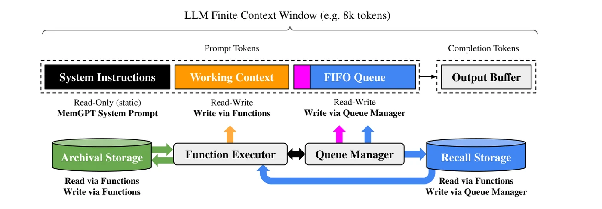
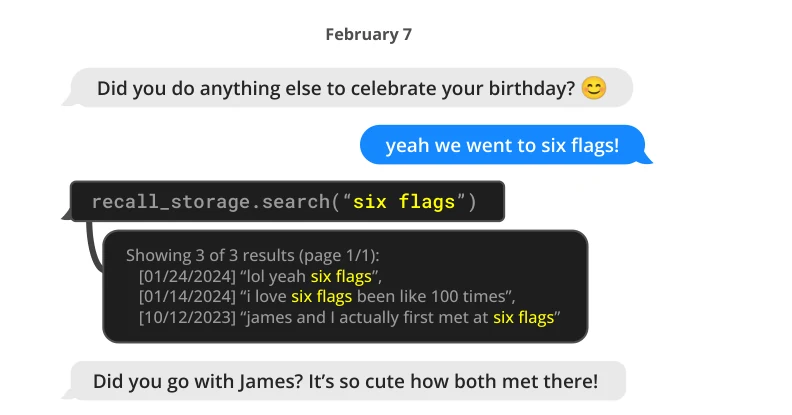
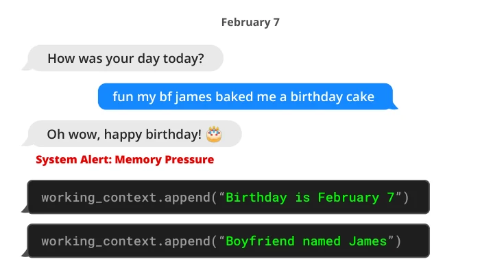
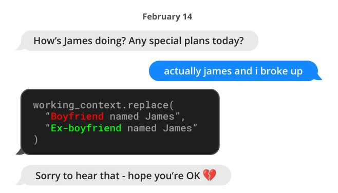
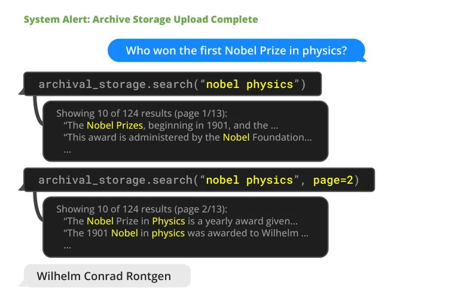
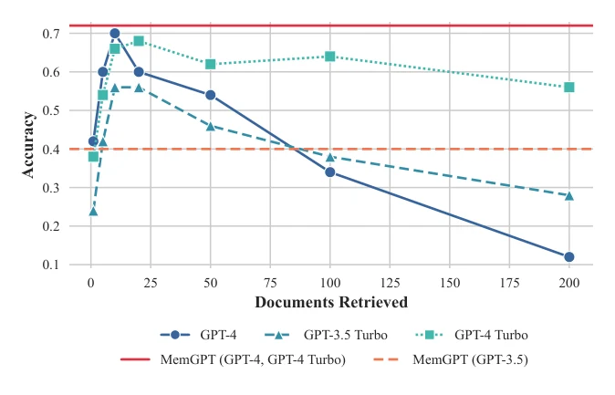
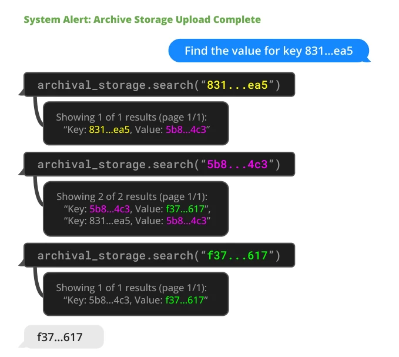
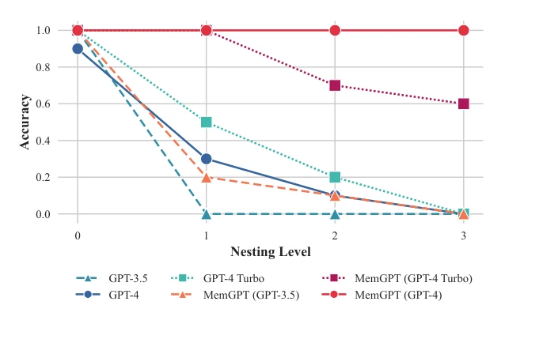

> - **논문**: MemGPT: Towards LLMs as Operating Systems
> - **저자**: Charles Packer, Sarah Wooders, Kevin Lin, Vivian Fang, Shishir G. Patil, Ion Stoica, Joseph E. Gonzalez (UC Berkeley)
> - **공개**: arXiv 2023 · [arXiv:2310.08560](https://arxiv.org/abs/2310.08560) · [Code](https://research.memgpt.ai)
{: .prompt-tip }

> [GPT]() 계열 LLM은 context window 안에 있는 것만 볼 수 있다. 8k 토큰짜리 GPT-4라면 대화 메시지 140개 정도가 한계이고, 그보다 오래 이야기하면 앞부분은 잊힌다. **MemGPT**는 운영체제가 작은 RAM과 큰 디스크를 오가며 "메모리가 무한한 것 같은 착각"을 주는 방식을 LLM에 옮긴다. context window를 RAM으로, 데이터베이스를 디스크로 두고, 무엇을 넣고 뺄지는 LLM이 함수 호출로 직접 정한다. 지난 대화 내용을 묻는 질문에서 GPT-4 혼자서는 32.1%를 맞혔지만, 같은 GPT-4를 MemGPT 안에서 돌리면 92.5%를 맞힌다.

## 1. 문제: context window는 늘려도 모자라고, 늘린 만큼 잘 쓰지도 못한다

LLM 대화 서비스와 문서 분석 도구는 지금까지 두 가지 방법으로 긴 입력을 다뤘다. context window 자체를 늘리거나, 넘치는 부분을 잘라 내고 요약해서 넣는 것이다. 논문은 둘 다 한계가 분명하다고 본다.

- **context를 늘리는 비용이 크다.** self-attention 계산량은 길이의 제곱으로 늘어난다. 2024년 1월 기준으로 가장 긴 GPT-4 Turbo도 128k 토큰이고, 메시지로 치면 약 2,600개이다. 연간 보고서(SEC Form 10-K) 같은 법률·재무 문서는 백만 토큰을 쉽게 넘는다.
- **늘린 context를 잘 쓰지 못한다.** "lost in the middle" 연구(Liu et al., 2023a)에 따르면 긴 context 모델은 처음과 끝에 있는 정보는 잘 꺼내지만 가운데 있는 정보는 놓친다.
- **요약은 정보를 잃는다.** 오래된 대화를 요약해 넣으면 "남자 친구 이름이 James이다" 같은 세부 사항이 빠진다. 무엇이 나중에 필요할지 요약하는 시점에는 알 수 없다.

논문의 답은 운영체제의 가상 메모리이다. LLM의 고정된 context window를 **main context**(RAM), 바깥 데이터베이스를 **external context**(디스크)로 두고, 그 사이 데이터 이동을 **함수 호출**로 LLM에게 맡긴다. 이 구조를 **virtual context management**라 부르고, 이를 구현한 시스템이 MemGPT(MemoryGPT)이다.

모델 종류별 context window 크기는 다음과 같다. 메시지 수는 시스템 프롬프트 1k 토큰, 메시지 하나당 약 50토큰(약 250자)으로 가정한 값이다.

| 모델 / API | 공개 가중치 | 토큰 | 메시지 수 |
|---|---|---|---|
| Llama (1) | ✓ | 2k | 20 |
| Llama 2 | ✓ | 4k | 60 |
| GPT-3.5 Turbo (출시 당시) | ✗ | 4k | 60 |
| Mistral 7B | ✓ | 8k | 140 |
| GPT-4 (출시 당시) | ✗ | 8k | 140 |
| GPT-3.5 Turbo | ✗ | 16k | 300 |
| GPT-4 | ✗ | 32k | 약 600 |
| Claude 2 | ✗ | 100k | 약 2,000 |
| GPT-4 Turbo | ✗ | 128k | 약 2,600 |
| Yi-34B-200k | ✓ | 200k | 약 4,000 |

몇 주, 몇 달씩 이어지는 개인 비서나 가상 친구 대화를 생각하면 수천 개도 넉넉하지 않다.

## 2. 구조: RAM과 디스크로 나눈 LLM의 기억

전체 흐름은 다음과 같다.

1. 사용자 메시지, 시스템 경고, 타이머 같은 **이벤트**가 들어오면 텍스트로 바꿔 main context의 FIFO queue에 붙인다.
2. LLM이 main context 전체를 보고 출력을 낸다. 출력은 일반 답변이 아니라 **함수 호출**로 해석된다.
3. function executor가 함수를 실행한다. 기억을 쓰거나, 검색해서 결과를 main context로 가져오거나, 사용자에게 메시지를 보낸다.
4. context가 차면 queue manager가 경고를 띄우고, 더 차면 오래된 메시지를 내보내고 요약한다.

_Figure 3. MemGPT 구조. 고정 크기 context의 LLM에 계층형 메모리와 기억을 관리하는 함수를 붙였다. prompt 토큰(main context)은 system instructions, working context, FIFO queue로 나뉘고, LLM 출력은 function executor가 함수 호출로 해석한다. 함수는 main context와 external context(archival storage, recall storage) 사이에 데이터를 옮긴다. (출처: Packer et al., 2023)_

학습은 없다. LLM은 GPT-4, GPT-4 Turbo, GPT-3.5 Turbo를 API로 그대로 쓰고, 모든 기능은 시스템 프롬프트와 함수 스키마에서 나온다.

### Main context: prompt를 세 구역으로 나누기

LLM이 추론할 때 볼 수 있는 것은 main context뿐이다. MemGPT는 prompt 토큰을 연속된 세 구역으로 나눈다.

| 구역 | 권한 | 내용 |
|---|---|---|
| System instructions | 읽기 전용 | MemGPT 제어 흐름, 메모리 계층별 용도, 함수 사용법 |
| Working context | 읽기·쓰기 (함수로만 씀) | 고정 크기 비정형 텍스트. 사용자에 대한 핵심 사실, 선호, 에이전트 페르소나 |
| FIFO queue | 읽기·쓰기 (queue manager가 씀) | 최근 메시지, 시스템 메시지, 함수 입출력. 첫 칸은 내보낸 메시지의 recursive summary |

working context는 사람이 메모장에 적어 두는 것과 비슷하다. 대화 중에 알게 된 "생일은 2월 7일" 같은 사실을 LLM이 직접 적고 고친다. FIFO queue는 그냥 최근 대화이다. 넘치면 앞쪽부터 밀려나고, 밀려난 내용은 첫 칸의 요약에 흡수된다.

### External context: recall storage와 archival storage

main context 밖에는 두 개의 데이터베이스가 있다. LLM은 이 안의 내용을 직접 볼 수 없고, 함수를 불러 main context로 가져와야 한다.

| 저장소 | 쓰기 | 읽기 | 용도 |
|---|---|---|---|
| Recall storage | queue manager가 모든 메시지를 자동 기록 | 함수로 검색 | 지금까지 오간 대화 원문 전체 |
| Archival storage | LLM이 함수로 기록 | 함수로 검색 | 길이 제한 없는 텍스트. 문서, LLM이 남긴 메모 |

검색 결과는 **페이지 단위**로 돌아온다. 한 번에 10개씩 보여 주고 "page 1/13"처럼 전체 쪽수를 알려 준다. 검색 결과가 context를 넘치게 만들지 않기 위해서이다.

_Figure 2. MemGPT(왼쪽)는 context 밖의 데이터를 검색해 관련 정보를 현재 context로 가져온다. 사용자가 "six flags"를 언급하자 recall storage를 검색해, 예전 대화에서 James와 처음 만난 곳이 Six Flags라는 사실을 찾아낸다. (출처: Packer et al., 2023)_

이 예에서 사용자는 "yeah we went to six flags!"라고만 했다. MemGPT는 `recall_storage.search("six flags")`를 불러 2023년 10월 12일 메시지 "james and I actually first met at six flags"를 찾고, "Did you go with James? It's so cute how both met there!"라고 답한다. 몇 달 전 대화가 FIFO queue에서 이미 밀려났어도 recall storage에는 원문이 남아 있다.

### Queue manager: 메모리 압박과 내보내기

queue manager는 운영체제의 메모리 관리자 역할을 한다. 새 메시지가 오면 FIFO queue에 붙이고, LLM 추론을 시작하고, 입력과 출력을 모두 recall storage에 기록한다. context가 차는 것도 여기서 관리한다.

| 단계 | 기준 (논문 예시) | 동작 |
|---|---|---|
| 경고 | prompt 토큰이 context window의 70%를 넘음 | "memory pressure" 시스템 메시지를 queue에 넣음 |
| 비우기 | prompt 토큰이 context window의 100%를 넘음 | context window의 50%에 해당하는 메시지를 내보내고, 기존 요약과 내보낸 메시지로 새 recursive summary를 만듦 |

경고 단계가 중요하다. 내보내기 전에 LLM에게 한 번 기회를 준다. LLM은 FIFO queue에 있는 내용 중 지켜야 할 것을 working context나 archival storage로 옮긴다. 내보낸 메시지도 recall storage에는 계속 남으므로, 나중에 검색하면 다시 꺼낼 수 있다.

_Figure 1. MemGPT(왼쪽)는 context 공간이 부족하다는 시스템 경고를 받은 뒤 영구 메모리에 데이터를 쓴다. "fun my bf james baked me a birthday cake"에서 생일과 남자 친구 이름을 뽑아 working context에 적는다. (출처: Packer et al., 2023)_

working context는 덮어쓸 수도 있다. 일주일 뒤 2월 14일에 사용자가 "actually james and i broke up"이라고 하면, MemGPT는 `working_context.replace("Boyfriend named James", "Ex-boyfriend named James")`를 부르고 "Sorry to hear that - hope you're OK"라고 답한다.

_Figure 4. MemGPT(왼쪽)가 저장해 둔 정보를 고치는 대화 예시이다. 이 정보는 prompt 토큰 안에 있는 working context에 저장된다. (출처: Packer et al., 2023)_

### Function executor와 function chaining

LLM 출력은 파서가 함수 호출로 읽는다. 인자가 맞으면 함수를 실행하고, 결과를 다시 main context에 넣는다. 실행 중 생긴 런타임 에러(예: 이미 꽉 찬 main context에 더 넣으려 함)도 그대로 돌려준다. LLM은 이 피드백을 보고 다음 행동을 고친다.

한 번의 질문에 함수 여러 개를 이어 불러야 할 때가 많다. 검색 결과 2쪽을 넘기거나, 여러 문서를 차례로 찾아야 하는 경우이다. 이를 위해 함수 호출에 특별한 인자를 붙인다.

| 함수 호출 | 다음 동작 |
|---|---|
| `request_heartbeat=true` 있음 | 함수 결과를 main context에 넣고 곧바로 LLM을 다시 부른다 |
| 없음 (yield) | 다음 외부 이벤트(사용자 메시지, 예약된 인터럽트)가 올 때까지 LLM을 부르지 않는다 |

이벤트는 사용자 메시지만이 아니다. context 용량 경고 같은 시스템 메시지, "사용자가 방금 로그인했다", "문서 업로드가 끝났다" 같은 사용자 상호작용, 정해진 주기로 도는 timed event도 이벤트이다. timed event가 있으면 사용자가 말을 걸지 않아도 MemGPT가 스스로 움직일 수 있다.

이 모든 동작은 시스템 프롬프트로 가르친다. 시스템 프롬프트에는 (1) 메모리 계층과 각 계층의 용도 설명, (2) 자연어 설명이 붙은 함수 스키마가 들어간다. 대화 실험에서 쓴 페르소나 지시문 일부는 다음과 같다.

> The following is information about myself. My task is to completely immerse myself in this role (I should never say that I am an AI, and should reply as if I am playing this role). If the user asks me a question, I should reply with a best guess using the information in core memory and conversation search.

### 구현 디테일

| 항목 | 값 |
|---|---|
| GPT-4 Turbo | gpt-4-1106-preview, context 128,000 토큰 |
| GPT-4 | gpt-4-0613, context 8,192 토큰 |
| GPT-3.5 Turbo | gpt-3.5-turbo-1106, context 16,385 토큰 |
| Archival storage | PostgreSQL + pgvector, HNSW 인덱스 |
| 임베딩 | OpenAI text-embedding-ada-002, cosine 유사도 |
| 학습 | 없음 (프롬프트와 함수 스키마만) |

## 3. 평가 1: 여러 세션에 걸친 대화

### 설정

데이터는 Multi-Session Chat(MSC, Xu et al., 2021)이다. 사람 두 명이 각자 정해진 페르소나를 유지하며 세션 5개를 대화한 기록이고, 세션마다 메시지가 십여 개이다. 논문은 여기에 질문-답 한 쌍만 있는 6번째 세션을 새로 만들었다. 장기 대화 에이전트가 갖춰야 할 성질로 두 가지를 본다.

- **일관성(consistency)**: 예전에 나온 사실, 선호, 사건과 어긋나지 않게 말한다.
- **참여도(engagement)**: 사용자에 관한 장기 기억을 써서 대화를 개인화한다.

비교 대상은 같은 LLM을 MemGPT 없이 쓴 경우이다. 베이스라인은 지난 5개 세션을 요약한 내용(정보 손실이 있는 요약)을 본다. MemGPT는 대화 기록 전체를 갖지만, 페이지 단위 검색으로 직접 꺼내 와야 한다.

### Deep memory retrieval (일관성)

**Deep memory retrieval(DMR)**은 지난 대화를 직접 가리키며 아주 좁은 답을 요구하는 질문이다. 질문은 별도 LLM으로 만들었다. 이때 "페르소나 요약만 보고는 답할 수 없고, 실제 대화 기록을 봐야만 답할 수 있는 질문"을 쓰게 했다. 생성 프롬프트에 들어간 예시는 다음과 같다.

> B: Remember that one time we went surfing? What was that one place we went to for lunch called?
> A: Taco Bell!

채점은 두 가지이다. GPT-4 기반 LLM judge가 정답과 같은 내용인지 CORRECT/WRONG을 매기고, ROUGE-L recall도 잰다. 생성 답이 정답보다 대체로 장황해서 precision 대신 recall을 썼다.

| 모델 | 정확도 | ROUGE-L (R) |
|---|---|---|
| GPT-3.5 Turbo | 38.7% | 0.394 |
| + MemGPT | 66.9% | 0.629 |
| GPT-4 | 32.1% | 0.296 |
| + MemGPT | 92.5% | 0.814 |
| GPT-4 Turbo | 35.3% | 0.359 |
| + MemGPT | **93.4%** | **0.827** |

세 모델 모두 MemGPT를 붙이면 크게 오른다. GPT-4는 32.1%에서 92.5%로 60.4%p, GPT-4 Turbo는 35.3%에서 93.4%로 58.1%p 오른다. GPT-3.5 Turbo는 28.2%p 올라 폭이 가장 작다. 베이스라인끼리는 GPT-3.5 Turbo가 38.7%로 오히려 가장 높은데, 요약만 보고 답하는 조건에서는 모델 크기가 큰 차이를 만들지 못한다는 뜻으로 읽힌다.

이 표는 조심해서 읽어야 한다. 베이스라인이 받은 것은 "정보를 잃은 요약"이고, MemGPT는 원문 전체를 검색할 수 있다. 질문을 만들 때 "요약에 없는 세부 사항을 물어라"라고 지시했으니, 요약만 받은 베이스라인이 낮은 것은 실험 설계에서 이미 예상되는 결과이다. 원문 전체를 단순 RAG로 검색해 넣는 베이스라인이나, 대화 전체를 context에 그대로 넣는 방식(세션 5개는 메시지 60개 남짓이라, Table 1 기준으로 GPT-4의 8k context에도 들어간다)과는 비교하지 않았다. 따라서 이 표가 보여 주는 것은 "요약보다 원문 검색이 낫다"까지이고, MemGPT의 자기 주도 메모리 관리가 다른 검색 방식보다 낫다는 것은 아니다.

### Conversation opener (참여도)

두 번째 과제는 새 세션의 첫 마디를 만드는 것이다. 좋은 첫 마디는 지난 대화에서 쌓인 사용자 정보를 끌어와야 한다. MSC의 페르소나 정보가 지난 세션들의 지식을 요약하고 있으므로, 생성한 첫 마디와 페르소나 문장의 유사도(SIM-1, SIM-3), 그리고 사람이 쓴 첫 마디와의 유사도(SIM-H)를 잰다.

| 방법 | SIM-1 | SIM-3 | SIM-H |
|---|---|---|---|
| Human | 0.800 | 0.800 | 1.000 |
| MemGPT (GPT-3.5 Turbo) | 0.830 | 0.812 | **0.817** |
| MemGPT (GPT-4) | **0.868** | **0.843** | 0.773 |
| MemGPT (GPT-4 Turbo) | 0.857 | 0.828 | 0.767 |

세 모델 모두 페르소나 유사도(SIM-1, SIM-3)에서 사람이 쓴 첫 마디(0.800)보다 높다. 논문은 MemGPT의 첫 마디가 사람보다 길고 페르소나의 여러 측면을 담는 경향이 있다고 설명한다. 같은 이유로 이 지표는 해석에 주의가 필요하다. 페르소나 문장을 많이 담을수록 유사도가 오르므로, 길고 정보를 많이 나열한 첫 마디가 유리하다. 실제로 자연스럽고 매력적인 첫 마디인지는 사람 평가 없이 판단할 수 없다. 이 과제에는 MemGPT 없는 베이스라인 행도 없다.

## 4. 평가 2: context보다 긴 문서 분석

### Multi-document QA

설정은 "lost in the middle" 연구(Liu et al., 2023a)의 retriever-reader 문서 QA이다. NaturalQuestions-Open에서 질문을 고르고, retriever가 2018년 말 Wikipedia에서 관련 문서를 찾고, LLM이 그 문서를 읽고 답한다. 평가에는 50문항을 샘플링했다.

- **베이스라인**: retriever가 cosine 유사도로 고른 상위 K개 문서를 context에 넣는다. K가 커서 context를 넘으면 문서를 잘라(truncate) 개수를 맞춘다.
- **MemGPT**: 임베딩된 문서 전체를 archival storage에 넣고, `archival_storage.search`로 필요한 만큼 검색하고 페이지를 넘긴다.
- **채점**: LLM judge. 답과 함께 근거 문서 문장을 내야 정답으로 인정한다. 모델이 가중치에 있는 지식으로 답하는 것을 막기 위해서이다.

_Figure 6. MemGPT(왼쪽)가 문서 QA를 푸는 예시이다. Wikipedia 문서 데이터베이스를 archival storage에 올리고, MemGPT는 함수 호출로 archival storage를 검색해 페이지 단위 결과를 main context로 가져온다. (출처: Packer et al., 2023)_

"Who won the first Nobel Prize in physics?"라는 질문에 MemGPT는 `archival_storage.search("nobel physics")`를 부른다. 결과는 124개, 13쪽이다. 1쪽에는 노벨상 일반 설명만 있어서 `page=2`로 넘기고, 2쪽에서 "The 1901 Nobel in physics was awarded to Wilhelm …"을 찾아 Wilhelm Conrad Rontgen이라고 답한다.

_Figure 5. 문서 QA 성능. MemGPT의 성능은 context 길이가 늘어도 변하지 않는다. truncation으로 GPT-4 같은 고정 context 모델이 볼 수 있는 문서 수를 늘릴 수는 있지만, 압축이 커질수록 성능이 떨어진다. GPT-4와 GPT-4 Turbo로 돌린 MemGPT는 결과가 같다. (출처: Packer et al., 2023)_

논문은 이 결과를 표로 주지 않아서 아래 값은 그래프에서 읽은 근삿값이다.

| 방법 | 정점 (그때의 K) | K = 200 |
|---|---|---|
| GPT-4 | 약 0.70 (K = 10) | 약 0.12 |
| GPT-4 Turbo | 약 0.68 (K = 20) | 약 0.56 |
| GPT-3.5 Turbo | 약 0.56 (K = 10~20) | 약 0.28 |
| MemGPT (GPT-4, GPT-4 Turbo) | 약 0.72 (K와 무관) | 약 0.72 |
| MemGPT (GPT-3.5 Turbo) | 약 0.40 (K와 무관) | 약 0.40 |

베이스라인은 retriever 성능에 묶인다. retriever가 정답 문서를 상위 K개에 넣지 못하면 LLM은 그 문서를 볼 기회가 없다. 논문에 따르면 NaturalQuestions-Open이 지정한 정답 문서는 검색 결과 상위 십여 개 밖에 있는 경우가 많다. 그래서 GPT-4는 K를 늘리면 처음에는 오르지만, 8k context에 맞추려고 문서를 자르기 시작하면 정답 문장이 잘려 나가 떨어진다. MemGPT는 검색을 여러 번 할 수 있어서 볼 수 있는 문서 수가 context 크기에 묶이지 않는다.

그래프를 비판적으로 보면 두 가지가 눈에 띈다. 첫째, MemGPT(GPT-4)의 약 0.72는 GPT-4 베이스라인의 최고점(약 0.70)과 거의 같다. 문서를 10개만 넣어도 비슷한 성능이 나오므로, 이 과제에서 MemGPT의 이점은 "더 잘 푼다"보다 "K를 잘못 골라도 무너지지 않는다"에 가깝다. 둘째, 128k context의 GPT-4 Turbo는 K = 200에서도 약 0.56을 유지한다. context를 늘리는 방법이 생각보다 덜 무너진다.

### Nested key-value retrieval

두 번째 문서 과제는 논문이 새로 만든 **nested KV retrieval**이다. 원래 KV 과제(Liu et al., 2023a)는 128비트 UUID로 된 키-값 쌍 목록에서 주어진 키의 값을 찾는 것이다. nested 버전에서는 값이 다시 키일 수 있어서, 값이 더 이상 키가 아닐 때까지 여러 번 찾아 들어가야 한다(multi-hop). UUID 쌍은 140개로 고정했고, 이는 약 8k 토큰으로 GPT-4 베이스라인의 context 크기에 맞춘 것이다. 순서 구성은 초기 키 위치와 중첩 키 위치를 바꿔 30가지를 샘플링했다.

MemGPT에게 준 페르소나는 반복 검색을 강하게 지시한다.

> DO NOT STOP SEARCHING UNTIL YOU VERIFY THAT THE VALUE IS NOT A KEY. Do not stop making nested lookups until this condition is met.

_Figure 8. MemGPT(왼쪽)가 nested KV 과제를 푸는 예시이다(UUID는 읽기 쉽게 줄였다). 이 예에서는 중첩이 두 단계이다(831..ea5 → 5b8..4c3 → f37...617). 마지막 값(f37...617)을 검색했을 때 결과가 하나만 나오면, 그 값이 다른 키가 아니라는 뜻이므로 최종 답으로 낸다. (출처: Packer et al., 2023)_

_Figure 7. Nested KV retrieval 성능. 중첩 2단계를 넘어서도 과제를 꾸준히 푸는 방법은 MemGPT뿐이다. 베이스라인으로는 GPT-4 Turbo가 낫지만, MemGPT 안에서는 GPT-4 Turbo가 GPT-4보다 못하다. (출처: Packer et al., 2023)_

그래프에서 읽은 정확도는 다음과 같다.

| 방법 | 중첩 0 | 1 | 2 | 3 |
|---|---|---|---|---|
| GPT-3.5 | 약 1.0 | 0 | 0 | 0 |
| GPT-4 | 약 0.9 | 약 0.3 | 약 0.1 | 0 |
| GPT-4 Turbo | 약 1.0 | 약 0.5 | 약 0.2 | 0 |
| MemGPT (GPT-3.5) | 약 1.0 | 약 0.2 | 약 0.1 | 0 |
| MemGPT (GPT-4 Turbo) | 약 1.0 | 약 1.0 | 약 0.7 | 약 0.6 |
| MemGPT (GPT-4) | **1.0** | **1.0** | **1.0** | **1.0** |

GPT-3.5는 중첩이 한 단계만 있어도 0%가 된다. 주된 실패는 첫 번째 값을 그대로 돌려주는 것이다. GPT-4와 GPT-4 Turbo도 중첩 3단계에서 0%가 된다. 반면 MemGPT(GPT-4)는 중첩 단계와 관계없이 모두 맞힌다. 키를 검색하고, 값을 다시 검색하는 일을 함수 호출로 반복하기 때문이다.

이 실험도 한계가 있다. 본문은 중첩을 0~4단계로 바꿨다고 쓰지만 그래프는 3단계까지만 보여 준다. 그리고 MemGPT에게만 "값이 키가 아님을 확인할 때까지 멈추지 마라"는 절차를 알려 주었다. 베이스라인 프롬프트에도 중첩 조회를 하라는 지시는 있지만, 한 번의 생성 안에서 여러 단계를 머릿속으로 따라가야 한다. 이 차이는 메모리 계층보다 "여러 번 생각할 기회"에서 나온다고 보는 편이 정확하다. 한 번에 한 단계씩 확인하는 chain-of-thought나 ReAct식 도구 호출 베이스라인과의 비교가 없다.

### 실패 유형

- **함수 호출이 약한 모델에서는 오히려 손해다.** 문서 QA에서 MemGPT(GPT-3.5 Turbo)는 약 0.40으로, GPT-3.5 Turbo 베이스라인의 정점(약 0.56)보다 낮다. 논문은 GPT-3.5의 함수 호출 능력이 부족하기 때문이라고 설명한다.
- **검색을 너무 일찍 멈춘다.** 이론상 MemGPT는 페이지를 계속 넘기면 정답 문서를 언젠가 찾는다. 하지만 실제로는 retriever 데이터베이스를 다 보기 전에 페이지 넘기기를 멈추는 경우가 많았다.
- **조회 횟수가 모자란다.** nested KV에서 MemGPT(GPT-4 Turbo)와 MemGPT(GPT-3.5)는 중첩 2단계부터 떨어진다. 필요한 만큼 조회를 반복하지 않고 중간 값을 답으로 냈기 때문이다. 베이스라인으로는 GPT-4 Turbo가 GPT-4보다 나았는데, MemGPT 안에서는 순서가 뒤집힌다. 시스템 성능이 기반 모델의 "긴 context 능력"보다 "지시대로 도구를 반복해 부르는 습관"에 더 크게 좌우된다는 뜻이다.

## 5. 해석: MemGPT가 남긴 것과 남긴 숙제

**남긴 것: 기억을 LLM이 직접 관리한다는 설계.** [Generative Agents]()와 비교하면 차이가 분명하다. 두 시스템 모두 LLM 바깥에 기억을 두지만, 누가 기억을 다루는지가 다르다.

| 항목 | Generative Agents | MemGPT |
|---|---|---|
| 저장 | 모든 관찰을 memory stream에 시간순으로 추가 | 모든 메시지는 recall storage에 자동 기록, 중요한 것은 LLM이 골라 working context·archival storage에 씀 |
| 꺼내기 | 매 step마다 시스템이 recency + importance + relevance 점수로 자동 retrieval | LLM이 필요하다고 판단할 때 검색 함수를 부름 |
| 수정 | 추가만 함. 예전 기억은 지우거나 고치지 않음 | working context를 `replace`로 덮어씀 (남자 친구 → 전 남자 친구) |
| 압축 | reflection: importance 합이 150을 넘으면 상위 수준 통찰을 새 기억으로 추가 | 토큰 70%에서 경고, 100%에서 내보내고 recursive summary로 압축 |
| 기억 정리의 계기 | 의미 (중요도 누적) | 용량 (토큰 수) |

Generative Agents에서 LLM은 기억의 소비자이다. 무엇을 꺼낼지는 사람이 정한 점수 공식이 정한다. MemGPT에서 LLM은 기억의 관리자이기도 하다. 이 차이는 두 가지 결과를 낳는다. 하나는 사실이 바뀌었을 때의 대응이다. Generative Agents는 "James와 사귄다"와 "James와 헤어졌다"가 둘 다 memory stream에 남고, retrieval 점수가 어느 쪽을 위로 올릴지에 맡긴다. MemGPT는 working context의 해당 줄을 고쳐 최신 사실 하나만 남긴다. 다른 하나는 검색의 반복이다. Generative Agents의 retrieval은 질의 한 번에 상위 기억을 한 번 꺼내는 구조이다. MemGPT는 nested KV처럼 검색 결과를 보고 다음 검색어를 정하는 multi-hop 검색이 가능하다.

**남긴 것: "context window는 자원"이라는 관점.** MemGPT는 context window를 모델의 고정된 한계가 아니라 운영체제가 나눠 쓰는 자원으로 본다. 읽기 전용 구역, 쓰기 가능한 메모장, 자동으로 밀려나는 대화 queue로 나누고, 용량 경고와 인터럽트 같은 이벤트로 제어 흐름을 짠다. 긴 context 모델이 나와도 이 관점은 그대로 쓸 수 있다. 논문도 긴 context 모델은 main memory를 키워 줄 뿐이고, 계층형 메모리는 그 위에 얹는 구조라고 말한다. 이 시스템은 이후 Letta라는 이름의 오픈소스 에이전트 프레임워크로 이어졌다.

**숙제 1: 기억 관리를 LLM에게 맡긴 만큼 LLM의 실수가 그대로 기억의 실수가 된다.** 경고를 받고도 중요한 정보를 옮기지 않으면, 그 정보는 요약으로만 남는다. 검색을 일찍 멈추면 있는 기억도 못 찾는다. 실험에서 GPT-3.5로는 오히려 성능이 떨어졌고, GPT-4 Turbo도 중첩 조회에서 자주 멈췄다. Generative Agents의 retrieval은 점수 공식이 고정이라 적어도 매번 같은 방식으로 꺼낸다. 어느 쪽이 나은지는 모델의 도구 사용 능력에 달려 있고, 논문은 이 둘을 직접 비교하지 않았다.

**숙제 2: 평가 설계가 MemGPT에 유리하다.** DMR은 요약만 받은 베이스라인과 비교했고, 질문은 요약에 없는 세부 사항을 묻도록 만들었다. 문서 QA는 50문항이다. Conversation opener에는 MemGPT 없는 베이스라인이 없고, 페르소나 문장을 많이 담을수록 점수가 오르는 지표를 썼다. 단순 RAG, 긴 context 모델에 전체 기록을 넣는 방식, ReAct식 반복 검색과 비교했다면 계층형 메모리 자체의 효과를 더 분명하게 가를 수 있었을 것이다.

**숙제 3: 비용과 지연.** 논문은 API 비용이나 응답 시간을 보고하지 않는다. 그러나 구조상 사용자 메시지 하나에 LLM 호출이 여러 번 일어난다. 경고에 대응해 기억을 옮기고, 검색하고, 페이지를 넘기고, 마지막에 답한다. 매번 system instructions와 working context를 포함한 main context 전체를 다시 넣어야 한다. Generative Agents가 25명을 이틀 돌리는 데 수천 달러가 든 것처럼, 장기간 쓰는 에이전트에서 이 비용은 실제 문제가 된다.

**숙제 4: 기억의 정확성과 사생활.** working context에 적힌 사실은 LLM이 대화에서 추출한 것이다. 잘못 추출하거나 엉뚱한 줄을 `replace`하면 틀린 사실이 계속 prompt에 남는다. 사용자가 이를 확인하거나 고칠 방법은 논문에서 다루지 않는다. 몇 달, 몇 년의 대화 원문을 모두 recall storage에 보관하는 구조라서, 무엇을 얼마나 오래 남길지도 정해야 한다.

## 6. 정리

| 항목 | 내용 |
|---|---|
| 핵심 아이디어 | 운영체제의 가상 메모리처럼 context window(main context)와 데이터베이스(external context) 사이를 LLM이 함수 호출로 직접 오가게 함 |
| Main context | system instructions(읽기 전용) + working context(LLM이 쓰는 메모장) + FIFO queue(최근 대화, 첫 칸은 recursive summary) |
| External context | recall storage(대화 원문 전체 자동 기록), archival storage(LLM이 쓰는 문서·메모), 페이지 단위 검색 |
| Queue manager | context 70%에서 memory pressure 경고, 100%에서 50% 분량을 내보내고 요약 |
| 제어 흐름 | 이벤트가 추론을 깨우고, `request_heartbeat=true`로 함수 호출을 이어 붙임 |
| 대화 결과 | DMR 정확도 GPT-4 32.1% → 92.5%, GPT-4 Turbo 35.3% → 93.4% |
| 문서 결과 | 문서 QA에서 K와 무관하게 약 0.72, nested KV에서 MemGPT(GPT-4)만 3단계까지 100% |
| 한계 | 함수 호출이 약한 모델에서는 역효과, 검색 조기 중단, 요약 베이스라인 위주의 비교, 비용 미보고 |

## References

- Packer et al., "MemGPT: Towards LLMs as Operating Systems," arXiv 2023. [arXiv:2310.08560](https://arxiv.org/abs/2310.08560)
- Park et al., "Generative Agents: Interactive Simulacra of Human Behavior," UIST 2023. [arXiv:2304.03442](https://arxiv.org/abs/2304.03442)
- Liu et al., "Lost in the Middle: How Language Models Use Long Contexts," arXiv 2023. [arXiv:2307.03172](https://arxiv.org/abs/2307.03172)
- Xu et al., "Beyond Goldfish Memory: Long-Term Open-Domain Conversation," arXiv 2021. [arXiv:2107.07567](https://arxiv.org/abs/2107.07567)
- Yao et al., "ReAct: Synergizing Reasoning and Acting in Language Models," arXiv 2022. [arXiv:2210.03629](https://arxiv.org/abs/2210.03629)
- Lin, "ROUGE: A Package for Automatic Evaluation of Summaries," Text Summarization Branches Out, 2004.
- Zheng et al., "Judging LLM-as-a-Judge with MT-Bench and Chatbot Arena," arXiv 2023. [arXiv:2306.05685](https://arxiv.org/abs/2306.05685)
