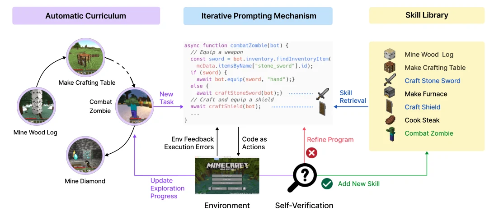
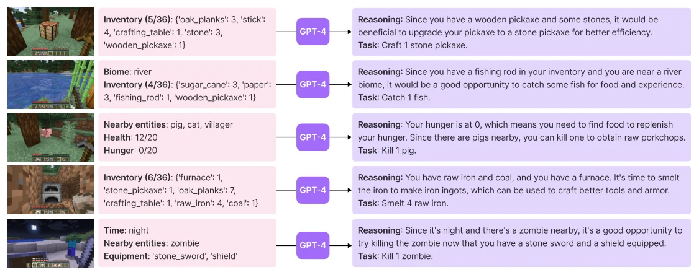
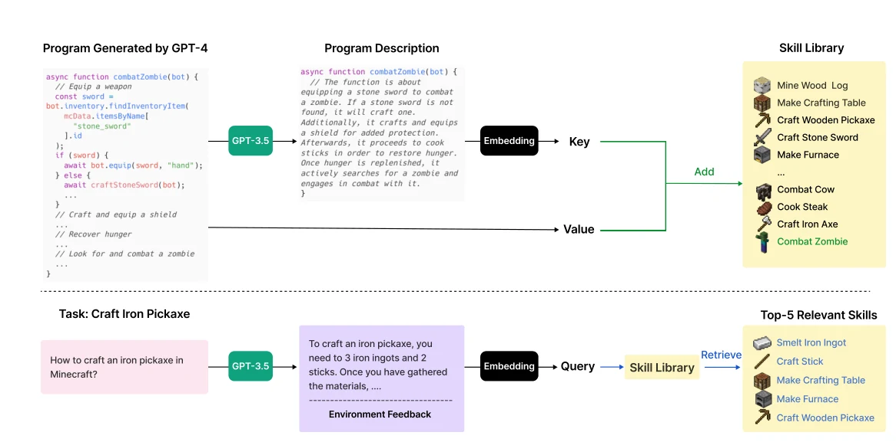
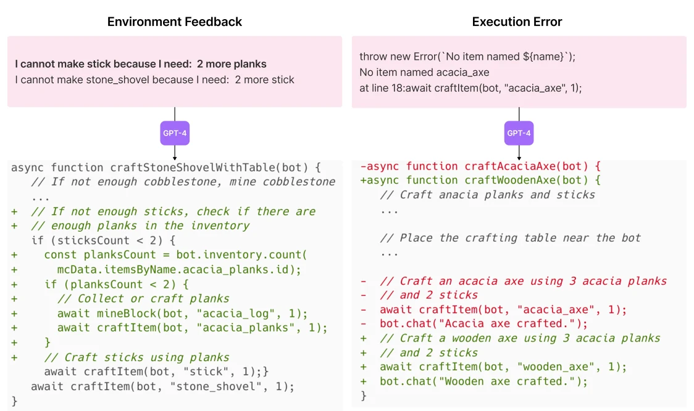
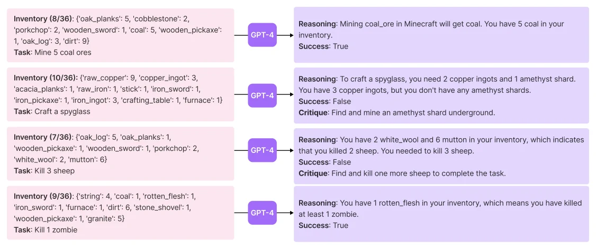
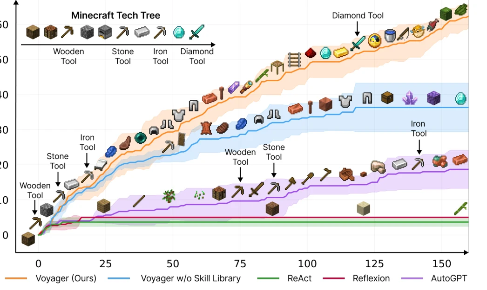
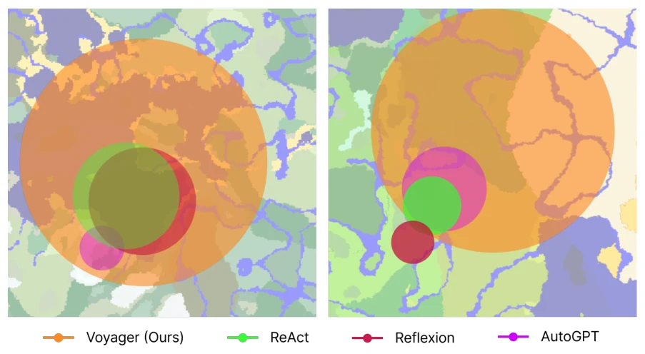
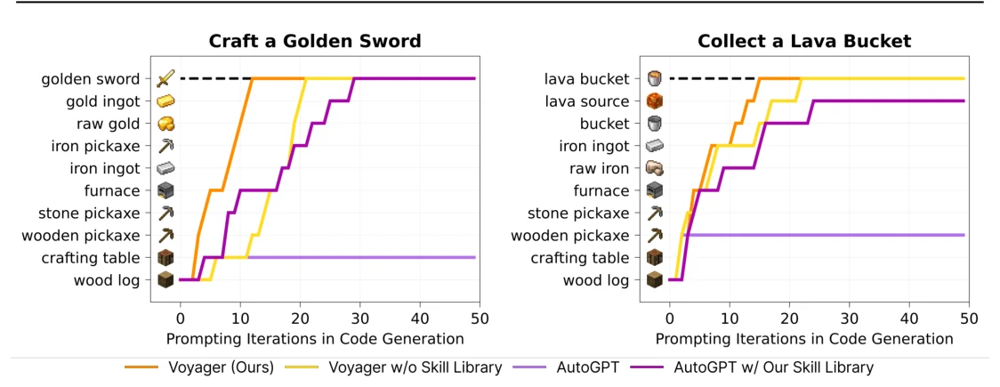
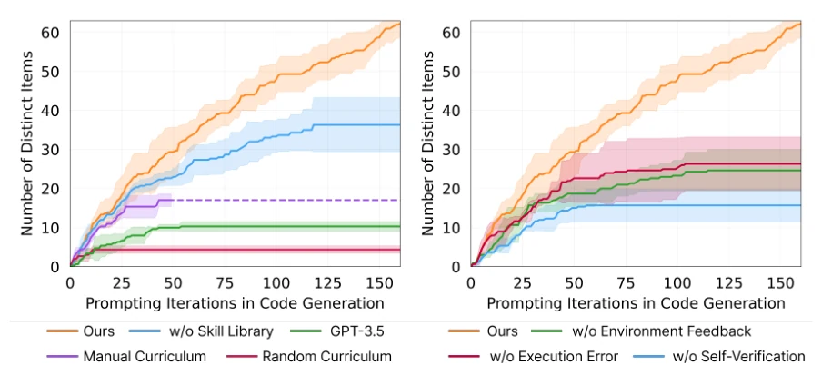
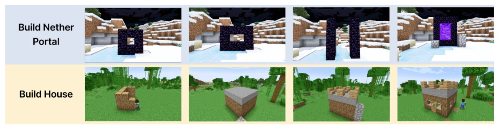

> - **논문**: Voyager: An Open-Ended Embodied Agent with Large Language Models
> - **저자**: Guanzhi Wang, Yuqi Xie, Yunfan Jiang, Ajay Mandlekar, Chaowei Xiao, Yuke Zhu, Linxi "Jim" Fan, Anima Anandkumar (NVIDIA, Caltech, UT Austin, Stanford, UW Madison)
> - **공개**: arXiv 2023 · [arXiv:2305.16291](https://arxiv.org/abs/2305.16291) · [Code](https://github.com/MineDojo/Voyager)
{: .prompt-tip }

> [GPT]() 계열 LLM은 마인크래프트에서 곡괭이를 만드는 순서를 이미 안다. 하지만 아는 것과 끝없는 세계에서 스스로 할 일을 정하고, 실패에서 배우고, 배운 것을 쌓아 가는 것은 다른 문제이다. **Voyager**는 GPT-4가 다음 과제를 직접 고르고, 그 과제를 푸는 JavaScript 함수를 써서 실행하고, 성공한 함수를 스킬로 저장해 다음 함수의 부품으로 쓰게 한다. 가중치는 하나도 바꾸지 않는다. 그렇게 160번의 프롬프팅 동안 고유 아이템 63개를 모으고, 비교한 방법 가운데 유일하게 다이아몬드 도구까지 도달한다.

## 1. 문제: LLM 에이전트는 배운 것을 쌓지 못한다

열린 세계에서 계속 탐험하고 새 기술을 익히는 에이전트는 오래된 목표이다. 고전적인 방법은 강화학습(RL)과 모방학습으로, 키보드·마우스 같은 primitive action 위에서 정책을 학습했다. 최근에는 사전학습된 LLM의 세계 지식으로 행동 계획이나 실행 가능한 정책을 만드는 LLM 에이전트가 늘었다.

논문은 두 흐름의 한계를 이렇게 정리한다.

- **Primitive action 위의 RL은 탐험·해석·일반화가 어렵다.** 다이아몬드 곡괭이 하나를 얻으려면 나무 → 작업대 → 나무 곡괭이 → 돌 → 화로 → 철 순서의 긴 계획이 필요한데, 이를 키 입력 단위로 탐험하기는 매우 어렵다.
- **LLM 에이전트는 평생 학습자(lifelong learner)가 아니다.** 원문 표현으로 지식을 "progressively acquire, update, accumulate, and transfer"하지 못한다. 매번 같은 문제를 처음부터 다시 푼다.
- **LLM은 한 번에 맞는 행동 코드를 꾸준히 만들지 못한다.** 존재하지 않는 아이템을 만들려 하거나, 재료가 모자란 상태로 제작을 시도한다.

저자들은 사람 플레이어처럼 행동하는 에이전트에게 필요한 능력을 세 가지로 꼽는다. 지금 상태에 맞는 과제를 스스로 고르는 것(숲이 아니라 사막에 있다면 철보다 모래와 선인장을 먼저 모은다), 피드백으로 스킬을 다듬고 익힌 스킬을 기억해 비슷한 상황에 다시 쓰는 것(좀비와 싸우는 법은 거미와 싸우는 법과 비슷하다), 그리고 스스로 계속 탐험하는 것이다. 논문의 답은 이 셋에 하나씩 대응하는 **automatic curriculum**, **skill library**, **iterative prompting mechanism**이다.

## 2. 환경: MineDojo 위의 마인크래프트, 행동은 코드로

마인크래프트에는 정해진 끝이나 줄거리가 없다. 절차적으로 생성되는 3D 지형을 돌아다니며 자원을 모으고, 그 자원으로 tech tree를 연다. tech tree는 나무 도구 → 돌 도구 → 철 도구 → 다이아몬드 도구 순서이다.

Voyager는 오픈소스 마인크래프트 AI 프레임워크인 MineDojo 위에서 돈다. 화면 픽셀을 보지 않고, 상태를 텍스트로 받는다. 인벤토리, 장비, 32블록 이내의 블록과 개체, biome, 시간, 체력·허기(최대 20), 좌표, 본 적 있는 상자 내용이 들어간다. 행동은 키 입력이 아니라 **Mineflayer JavaScript API를 부르는 코드**이다. 저자들은 코드가 시간적으로 긴 행동과 조합 가능한 행동을 자연스럽게 표현한다는 이유로 code as action space를 택했다.

Mineflayer 위에 저자들이 직접 만든 control primitive가 8개 있다. 탐험하기(`exploreUntil`), 블록 캐기(`mineBlock`), 제작하기(`craftItem`), 놓기(`placeItem`), 제련하기(`smeltItem`), 몹 잡기(`killMob`), 상자에서 꺼내고 넣기이다. GPT-4는 이것과 Mineflayer 기본 API(`bot.pathfinder.goto`, `bot.equip`, `bot.fish` 등)를 조합해 함수를 쓴다.

환경 쪽 편의도 몇 가지 있다. 봇이 죽으면 가까운 지면에서 인벤토리를 유지한 채 부활하고, 프로그램 실행이 끝나면 놓았던 작업대와 화로를 회수한다. 이 설정은 5장의 비교를 읽을 때 다시 중요해진다.

## 3. 구조: 과제를 고르고, 코드를 쓰고, 스킬로 저장한다

한 번의 반복은 다음과 같다.

1. **Automatic curriculum**이 지금 상태와 지금까지 완료·실패한 과제를 보고 다음 과제를 하나 낸다("Craft 1 stone pickaxe").
2. **Skill library**에서 이 과제와 관련 있는 스킬 5개를 꺼낸다.
3. GPT-4가 스킬을 참고해 JavaScript 함수를 쓰고, 마인크래프트에서 실행한다.
4. 실행 중 나온 environment feedback, execution error, 그리고 별도 GPT-4의 self-verification 결과를 다시 프롬프트에 넣어 코드를 고친다. 이것이 **iterative prompting**이다. 최대 4라운드까지 한다.
5. self-verification이 성공이라고 하면 코드를 새 스킬로 저장하고 1로 돌아간다. 4라운드 안에 실패하면 실패 목록에 넣고 다른 과제를 받는다.


_Figure 2. Voyager의 세 구성요소이다. automatic curriculum이 탐험 진행 상황에 맞춰 새 과제를 내고, iterative prompting이 환경 피드백·실행 오류·self-verification으로 코드를 다듬으며, 검증을 통과한 코드는 skill library에 새 스킬로 들어간다. (출처: Wang et al., 2023)_

모델은 OpenAI API를 그대로 쓴다. 코드 생성·curriculum·self-verification은 gpt-4-0314, 질문 생성·스킬 설명 같은 일반 NLP 작업은 비용 때문에 gpt-3.5-turbo-0301, 임베딩은 text-embedding-ada-002이다. temperature는 curriculum만 0.1(과제 다양성용)이고 나머지는 0이다. **학습은 전혀 없다.** 모든 능력은 프롬프트 구성과 스킬 축적에서 나온다. 토큰을 아끼려고 여러 턴 대화 대신 system 프롬프트와 user 프롬프트를 이어 붙여 매번 한 번만 응답을 받는다.

부록의 의사 코드를 조금 줄이면 전체 루프는 다음과 같다.

```python
agent_state = environment.reset()
while True:
    progress = curriculum_agent.get_exploration_progress(
        curriculum_agent.get_completed_tasks(), curriculum_agent.get_failed_tasks())
    task = curriculum_agent.propose_next_task(agent_state, progress)
    code = environment_feedback = execution_errors = critique = None
    success = False
    for i in range(4):  # 4라운드 안에 못 풀면 다음 과제로
        skills = skill_manager.retrieve_skills(task, environment_feedback)
        code = action_agent.generate_code(
            task, code, environment_feedback, execution_errors, critique, skills)
        agent_state, environment_feedback, execution_errors = environment.step(code)
        success, critique = critic_agent.check_task_success(task, agent_state)
        if success:
            break
    if success:
        skill_manager.add_skill(code)
        curriculum_agent.add_completed_task(task)
    else:
        curriculum_agent.add_failed_task(task)
```

### Automatic curriculum: "다음에 무엇을 할까"를 GPT-4에게 묻기

열린 세계에는 난이도가 제각각인 목표가 널려 있다. 아무 목표나 고르면 재료나 선행 스킬이 없어 실패하고, 쉬운 것만 고르면 같은 일을 반복한다. 논문은 GPT-4가 가진 인터넷 규모의 마인크래프트 지식으로 "지금 할 만한데 새로운 과제"를 계속 내게 한다. 저자들은 이것을 **in-context 형태의 novelty search**로 본다. [ICM]() 같은 RL 탐험 방법이 새로움을 보상으로 계산한다면, Voyager는 "새로운 것을 최대한 많이 발견하라"는 목표를 프롬프트에 문장으로 쓴다.

curriculum 프롬프트는 다섯 부분으로 되어 있다.

| 구성 | 내용 |
|---|---|
| Directive | 다양한 행동을 장려하고 제약을 거는 지시문 |
| 에이전트 상태 | 인벤토리, 장비, 근처 블록·개체, biome, 시간, 체력·허기, 좌표, 상자 |
| 탐험 진행 | 지금까지 완료한 과제, 너무 어려워 실패한 과제 |
| 추가 context | GPT-3.5가 스스로 질문 5~10개를 만들고 스스로 답한 것 |
| Chain-of-thought | 먼저 현재 진행을 추론한 뒤 다음 과제를 제안 |

system 프롬프트의 핵심 문장은 최종 목표와 난이도 조건이다.

> My ultimate goal is to discover as many diverse things as possible, accomplish as many diverse tasks as possible and become the best Minecraft player in the world.
> ...
> 4) The next task should not be too hard since I may not have the necessary resources or have learned enough skills to complete it yet.
> 5) The next task should be novel and interesting. I should look for rare resources, upgrade my equipment and tools using better materials, and discover new things. I should not be doing the same thing over and over again.

나머지 조건은 실행과 검증을 쉽게 만들기 위한 것이다. 과제는 "Mine [quantity] [block]", "Craft [quantity] [item]", "Kill [quantity] [mob]" 같은 한 구절 형식으로만 낸다. 밤이어도 피난처를 짓게 하지 말라고 하고(한곳에 머물지 않게 하려는 것), 놓기·건축·심기·거래처럼 화면을 봐야 성공을 확인할 수 있는 과제는 아예 금지한다. 출력 예시는 "Reasoning: The inventory is empty now, chop down a tree to get some wood. Task: Obtain a wood log."이다.

추가 context는 GPT-3.5가 만든다. "How to make a wooden pickaxe? Concept: wooden pickaxe"처럼 질문마다 개념을 붙이고, 그 개념으로 마인크래프트 위키 문서를 찾아 답을 만든다. 프롬프트에는 나쁜 예도 들어 있다. "What is the best way to play Minecraft?"는 너무 일반적이고, "What are the blocks that I can find in my current biome?"는 현재 상태를 알아야 답할 수 있으니 안 된다는 식이다. 논문은 GPT-3.5가 이미 마인크래프트를 잘 알아 위키 검색은 선택 사항이라고 덧붙인다.

정보를 처음부터 다 넣지도 않는다. 완료한 과제 수에 따라 프롬프트에 넣는 정보를 늘리는 warm-up 일정이 있다.

| 완료한 과제 수 | 프롬프트에 추가되는 정보 |
|---|---|
| 0 | 핵심 인벤토리(통나무, 판자, 막대, 작업대, 화로, 흙, 석탄, 곡괭이, 검, 도끼), 장비, 근처 블록, 좌표 |
| 5 | 근처 개체 |
| 7 | 전체 인벤토리 |
| 10 | 최근 본 다른 블록, biome |
| 15 | 체력, 허기, 시간, 추가 context |

처음에는 정보를 적게 줘서 기본 스킬부터 익히게 하고, 진행할수록 다양한 과제로 넓히려는 장치이다.


_Figure 3. automatic curriculum이 낸 과제 예시이다. 나무 곡괭이와 돌이 있으면 돌 곡괭이를, 강가에서 낚싯대가 있으면 낚시를, 허기가 0이고 돼지가 근처에 있으면 돼지 사냥을, 밤에 돌 검과 방패를 들고 좀비를 만나면 좀비 사냥을 낸다. (출처: Wang et al., 2023)_

이 과제들은 위에서 아래로 정한 계획이 아니라, 그때그때의 상태에서 아래에서 위로(bottom-up) 나온다. 논문이 "Mine a diamond" 같은 최종 목표를 주지 않았는데도 에이전트는 더 나은 도구를 찾아 tech tree를 올라간다.

### Skill library: 성공한 코드를 스킬로 저장하기

curriculum이 점점 어려운 과제를 내면, 이전에 푼 것을 다시 쓸 수 있어야 한다. Voyager는 각 스킬을 **실행 가능한 함수**로 저장한다. 저장소는 벡터 데이터베이스이다.

| 항목 | 내용 |
|---|---|
| Value | GPT-4가 쓰고 self-verification을 통과한 JavaScript 함수 |
| Key | GPT-3.5가 그 함수를 6문장 이내로 설명한 글의 임베딩 |
| Query | GPT-3.5가 과제 해결 방법을 제안한 글 + environment feedback의 임베딩 |
| 검색 | 임베딩 유사도 상위 5개 스킬을 코드 생성 프롬프트에 넣음 |

검색을 식으로 쓰면 다음과 같다. $$e(\cdot)$$는 text-embedding-ada-002이다.

$$
\text{Top5}\Big(\, \operatorname{sim}\big(e(\text{plan}(\text{task}) \oplus \text{feedback}),\; e(\text{desc}(\text{skill}_i))\big) \,\Big)
$$


_Figure 4. 위: 새 스킬 추가. GPT-4가 만든 combatZombie 함수를 GPT-3.5가 설명문으로 바꾸고, 그 임베딩을 key, 함수를 value로 저장한다. 아래: 스킬 검색. "Craft Iron Pickaxe" 과제에 대해 GPT-3.5가 "철 주괴 3개와 막대 2개가 필요하다"는 제안을 만들고, 이를 environment feedback과 합친 쿼리로 Smelt Iron Ingot, Craft Stick, Make Crafting Table, Make Furnace, Craft Wooden Pickaxe를 꺼낸다. (출처: Wang et al., 2023)_

설명문을 key로 쓰는 이유는 코드 자체보다 자연어 설명이 과제 문장과 같은 공간에 있기 때문이다. 설명 프롬프트는 함수 이름을 언급하지 말고, `bot.chat`이나 helper 함수 이야기는 빼고, 한 줄로 쓰라고 한다. 부록의 one-shot 예시는 `mineCobblestone`에 대해 "The function is about mining 8 cobblestones using a wooden pickaxe. First check if a wooden pickaxe is in the inventory. If not, craft one. …"이라는 설명을 단다.

코드를 쓰는 GPT-4에게는 다음과 같은 규칙을 준다. 스킬이 재사용되려면 인벤토리를 가정하지 말고 먼저 확인하라는 3번 규칙이 가장 중요하다.

> 3) Your function will be reused for building more complex functions. Therefore, you should make it generic and reusable. You should not make strong assumption about the inventory (as it may be changed at a later time), and therefore you should always check whether you have the required items before using them.
> ...
> 8) `maxDistance` should always be 32 for `bot.findBlocks` and `bot.findBlock`. Do not cheat.
> 9) Do not write infinite loops or recursive functions.

이 밖에도 `bot.dig`, `bot.craft`를 직접 쓰지 말고 primitive를 쓸 것, 진행 상황을 `bot.chat`으로 말할 것, 못 찾으면 `exploreUntil`로 방향을 무작위로 골라 탐험할 것, 이벤트 리스너를 등록하지 말 것, 함수 이름만 보고 과제를 알 수 있게 지을 것을 요구한다. 응답은 "Explain(지난 코드가 왜 실패했나) → Plan(단계별 계획) → Code" 순서의 chain-of-thought 형식이다.

실제로 쌓인 스킬은 이렇게 생겼다. 부록의 `craftWoodenPlanks`는 어떤 종류의 통나무든 있는 것으로 판자를 만들고, 없으면 다른 스킬 `mineWoodLog`를 불러 먼저 캔다.

```javascript
async function craftWoodenPlanks(bot) {
  const logNames = ["oak_log", "birch_log", "spruce_log", "jungle_log",
                    "acacia_log", "dark_oak_log", "mangrove_log"];
  const plankNames = ["oak_planks", "birch_planks", "spruce_planks", "jungle_planks",
                      "acacia_planks", "dark_oak_planks", "mangrove_planks"];
  const logInInventory = logNames.find(
    logName => bot.inventory.count(mcData.itemsByName[logName].id) > 0);
  if (!logInInventory) {
    bot.chat("No wooden log in inventory. Mining a wooden log...");
    await mineWoodLog(bot);
  }
  const logIndex = logNames.indexOf(logInInventory);
  const plankName = plankNames[logIndex];
  bot.chat(`Crafting 4 ${plankName}...`);
  await craftItem(bot, plankName, 1);
  bot.chat(`4 ${plankName} crafted.`);
}
```

`smeltFiveRawIron`은 화로가 없으면 이전 스킬 `craftFurnace`로 만들고, 주변의 빈자리를 찾는 helper를 따로 정의한 뒤 화로를 놓고 제련한다. 스킬이 스킬을 부르는 이 구조 덕분에 복잡한 행동이 빠르게 조합된다.

```javascript
async function smeltFiveRawIron(bot) {
  // 인벤토리에 화로가 있는지 확인
  const furnaceItem = bot.inventory.findInventoryItem(mcData.itemsByName.furnace.id);
  // 없으면 기존 스킬로 화로를 만든다
  if (!furnaceItem) {
    await craftFurnace(bot);
  }
  // 화로를 놓을 빈자리 찾기 (helper 함수)
  const furnacePosition = await findSuitablePosition(bot);
  if (!furnacePosition) {
    bot.chat("Could not find a suitable position to place the furnace.");
    return;
  }
  await placeItem(bot, "furnace", furnacePosition);
  // 석탄을 연료로 철 원석 5개 제련
  await smeltItem(bot, "raw_iron", "coal", 5);
  bot.chat("5 raw iron smelted.");
}
```

부록에는 이 밖에도 Y=0 아래에서 심층암 조약돌 10개 캐기, 양동이에 물 채우기, 낚시가 취소되면 같은 회차를 다시 시도하는 `catchFiveFishSafely`가 실려 있다. 스킬 검색 정확도는 309개 샘플에서 top-1 80.2%, top-5 96.5%이다. 프롬프트에 5개를 넣으니 실제로 중요한 것은 top-5 정확도이다.

| | Top-1 | Top-2 | Top-3 | Top-4 | Top-5 |
|---|---|---|---|---|---|
| 정확도(%) | 80.2 ± 3.0 | 89.3 ± 1.8 | 93.2 ± 0.7 | 95.2 ± 1.8 | **96.5 ± 0.3** |

### Iterative prompting: 세 가지 피드백으로 코드 고치기

LLM은 한 번에 맞는 코드를 꾸준히 쓰지 못한다. Voyager는 코드를 실행하고 얻은 신호 세 가지를 다음 라운드 프롬프트에 넣는다.

| 피드백 | 출처 | 알려 주는 것 |
|---|---|---|
| Environment feedback | primitive 안의 `bot.chat()` 출력 | 실행 중간 진행과 실패 원인("I cannot make an iron chestplate because I need: 7 more iron ingots") |
| Execution error | JavaScript 인터프리터 | 잘못된 연산, 문법 오류 |
| Self-verification | 별도의 GPT-4 critic | 과제 성공 여부, 실패하면 무엇을 더 해야 하는지(critique) |

environment feedback은 저자들이 primitive 안에 `bot.chat()`을 많이 심어 둔 덕분에 나온다. 코드 생성 프롬프트도 GPT-4에게 `bot.chat`으로 중간 진행을 말하라고 하므로, GPT-4가 쓴 코드도 피드백을 남긴다.


_Figure 5. 왼쪽: environment feedback. "막대를 만들려면 판자 2개가 더 필요하다"는 메시지를 보고 GPT-4가 막대가 모자라면 판자를 먼저 확인하고 만드는 코드를 넣는다. 오른쪽: execution error. "acacia_axe라는 아이템이 없다"는 오류를 보고, 마인크래프트에 아카시아 도끼는 없으니 아카시아 판자로 나무 도끼를 만들도록 함수를 고친다. (출처: Wang et al., 2023)_

self-verification은 과제마다 성공 판정 코드를 사람이 짜는 대신, GPT-4에게 critic 역할을 맡긴다. 입력은 실행 뒤 상태와 과제이고(성공 판정에 쓸모없는 최근 본 블록과 근처 개체는 뺀다), 출력은 `{"reasoning", "success", "critique"}` JSON이다. 프롬프트에는 few-shot 예시 7개가 들어 있다. 판자와 막대가 있지만 곡괭이를 안 만든 경우, 철 원석을 캐라고 했을 때 인벤토리에 raw_iron 5개가 있는 경우, 심기 과제는 인벤토리가 아니라 근처 블록(farmland, wheat)을 봐야 하는 경우 등이다.


_Figure 6. self-verification 예시이다. "석탄 광석 5개 캐기"는 인벤토리에 석탄 5개가 있으니 성공, "망원경 만들기"는 구리 주괴는 3개 있지만 자수정 조각이 없으니 실패하고 "지하에서 자수정 조각을 찾아 캐라"는 critique를 낸다. "양 3마리 잡기"는 흰 양털 2개와 양고기 6개로 2마리만 잡았다고 추론한다. (출처: Wang et al., 2023)_

논문은 이것이 Reflexion의 self-reflection보다 포괄적이라고 주장한다. 실수를 돌아보는 데서 그치지 않고, 성공 여부를 판정해 언제 다음 과제로 넘어갈지까지 정하기 때문이다. 5장의 ablation에서 이 모듈을 빼면 성능이 가장 크게 떨어진다.

## 4. 평가 1: 탐험, tech tree, 지도 범위

### 설정

마인크래프트용으로 바로 쓸 수 있는 LLM 에이전트가 없어서, 저자들은 NLP용 방법 세 개를 MineDojo에서 돌도록 다시 구현했다. 모든 베이스라인의 목표는 "explore the world and get as many items as possible"이다.

- **ReAct**: chain-of-thought로 추론과 행동 계획을 함께 생성한다. environment feedback과 상태를 관찰로 준다. 처음부터 코드를 한 번 쓰고 세 번 고치는 것을 반복한다.
- **Reflexion**: ReAct에 self-reflection을 더한다. execution error와 Voyager의 self-verification 모듈까지 준다.
- **AutoGPT**: GPT-4로 큰 목표를 subgoal로 나누고 ReAct 방식으로 실행한다. 상태, environment feedback, execution error를 준다. subgoal마다 최대 세 번 고치고, subgoal 3개를 연속으로 해도 새 아이템이 없으면 다시 계획한다. Voyager와 비교하면 skill library, self-verification, automatic curriculum이 없다.

VPT처럼 화면 픽셀을 받아 저수준 제어를 내는 방법과는 직접 비교하지 않는다. Voyager는 고수준 Mineflayer API를 쓰므로 같은 조건이 아니기 때문이다. 방법마다 3번 시행하고, 지표는 prompting iteration(코드 생성 횟수) 기준이다.

### 결과


_Figure 1. prompting iteration에 따른 고유 아이템 수이다. Voyager는 160번 동안 꾸준히 새 아이템을 찾고 tech tree를 다이아몬드 도구까지 올라간다. skill library를 뺀 Voyager는 후반에 정체되고, AutoGPT는 철 도구에서 멈추며, ReAct와 Reflexion은 거의 진전이 없다. (출처: Wang et al., 2023)_

**탐험.** Voyager는 160번의 프롬프팅 동안 고유 아이템 63개를 찾았다. 베이스라인보다 3.3배 많다. 부록의 아이템 목록을 보면 차이가 더 구체적이다. ReAct는 시행 3에서 흙과 뾰족한 점적석 2개만 얻었고, Reflexion은 시행마다 5개였다. AutoGPT는 11개, 22개, 25개를 얻었다.

**Tech tree.** 각 단계를 처음 연 prompting iteration 수(3회 평균)와 성공 횟수이다(논문 Table 1, 최대 160회).

| 방법 | 나무 도구 | 돌 도구 | 철 도구 | 다이아몬드 도구 |
|---|---|---|---|---|
| ReAct | N/A (0/3) | N/A (0/3) | N/A (0/3) | N/A (0/3) |
| Reflexion | N/A (0/3) | N/A (0/3) | N/A (0/3) | N/A (0/3) |
| AutoGPT | 92 ± 72 (3/3) | 94 ± 72 (3/3) | 135 ± 103 (3/3) | N/A (0/3) |
| Voyager w/o Skill Library | 7 ± 2 (3/3) | **9 ± 4** (3/3) | 29 ± 11 (3/3) | N/A (0/3) |
| Voyager | **6 ± 2** (3/3) | 11 ± 2 (3/3) | **21 ± 7** (3/3) | **102 (1/3)** |

AutoGPT와 비교하면 나무 단계는 15.3배(92 대 6), 돌 단계는 8.5배(94 대 11), 철 단계는 6.4배(135 대 21) 빠르다. 다이아몬드 도구는 Voyager만 열었다. 논문은 이것을 curriculum이 알맞은 난이도의 과제를 계속 낸 결과로 해석한다.

**지도 범위.** Voyager는 베이스라인보다 2.3배 먼 거리를 이동했다. 시행 3에서는 꽃숲, 초원, 자작나무 고목 숲, 눈 덮인 비탈, 얼어붙은 봉우리, 바다 등 biome 12곳을 지났다. 베이스라인은 대부분 처음 지역 근처에 머물렀다.


_Figure 7. 두 마인크래프트 지도에서 각 에이전트의 궤적을 감싸는 가장 작은 원이다. Voyager(주황)는 다양한 지형을 가로질러 베이스라인보다 2.3배 먼 거리를 이동한다. (출처: Wang et al., 2023)_

### 비판적으로 읽기

숫자를 그대로 믿기 전에 확인할 지점이 있다.

- **베이스라인이 이 문제를 위해 만든 방법이 아니다.** ReAct, Reflexion, AutoGPT는 NLP 작업용이다. 저자들도 "re-interpret"했다고 쓴다. ReAct와 Reflexion은 나무 도구조차 만들지 못했는데, 이것은 방법 자체의 한계라기보다 열린 목표("가능한 많이 얻어라")를 구체 과제로 바꿀 장치가 없어서로 읽는 것이 맞다. 논문도 그렇게 설명한다. 그래서 4장의 격차는 상당 부분 "curriculum이 있느냐"의 차이이다.
- **배속 숫자는 분산이 큰 AutoGPT를 기준으로 한다.** 15.3배는 AutoGPT의 92 ± 72와 비교한 값이다. 3회 시행에서 표준편차가 평균에 가깝다. 다이아몬드 도구도 3회 중 1회 성공이다.
- **스킬이 늘 빠른 것은 아니다.** 돌 도구 단계에서는 skill library를 뺀 쪽(9 ± 4)이 Voyager(11 ± 2)보다 빠르다. 스킬의 효과는 초반보다 후반, 그리고 6장의 새 과제에서 드러난다.
- **환경이 너그럽다.** 고수준 API로 "32블록 안의 철 원석을 캐라"를 한 줄에 처리하고, 죽어도 인벤토리를 잃지 않는다. 이 조건에서의 결과를 픽셀 기반 에이전트의 결과와 나란히 놓으면 안 된다. 저자들이 VPT와 직접 비교하지 않은 이유이기도 하다.

## 5. 평가 2: 새 세계에서의 zero-shot 일반화와 ablation

### Zero-shot 일반화

평생 학습으로 쌓은 skill library가 정말 쓸모 있는지 보려고, 인벤토리를 비우고 새로 생성한 세계에서 처음 보는 과제 4개를 냈다. Voyager와 AutoGPT 모두 GPT-4로 과제를 subgoal로 나누게 한다. 최대 50회이다(논문 Table 2).

| 방법 | 다이아몬드 곡괭이 | 금 검 | 용암 양동이 | 나침반 |
|---|---|---|---|---|
| ReAct | N/A (0/3) | N/A (0/3) | N/A (0/3) | N/A (0/3) |
| Reflexion | N/A (0/3) | N/A (0/3) | N/A (0/3) | N/A (0/3) |
| AutoGPT | N/A (0/3) | N/A (0/3) | N/A (0/3) | N/A (0/3) |
| AutoGPT w/ Our Skill Library | 39 (1/3) | 30 (1/3) | N/A (0/3) | 30 (2/3) |
| Voyager w/o Skill Library | 36 (2/3) | 30 ± 9 (3/3) | 27 ± 9 (3/3) | 26 ± 3 (3/3) |
| Voyager | **19 ± 3** (3/3) | **18 ± 7** (3/3) | **21 ± 5** (3/3) | **18 ± 2** (3/3) |

Voyager만 네 과제를 모두 3번 다 풀었다. 4장과 달리 여기서는 skill library의 효과가 분명하다. skill library를 빼면 다이아몬드 곡괭이 성공이 3회에서 2회로 줄고, 걸리는 횟수도 늘어난다. 더 눈에 띄는 것은 AutoGPT이다. 혼자서는 하나도 못 풀었지만, Voyager의 skill library를 붙이자 다이아몬드 곡괭이, 금 검, 나침반에서 성공이 나왔다. 저자들은 이것을 skill library가 다른 방법에도 꽂아 쓸 수 있는 plug-and-play 자산이라는 근거로 든다.


_Figure 8. 새 세계에서 "금 검 만들기"와 "용암 양동이 모으기"를 할 때 각 방법이 거친 중간 아이템이다. Voyager(주황)가 가장 빨리 목표에 닿고, AutoGPT(연보라)는 작업대나 나무 곡괭이에서 멈추지만 Voyager의 skill library를 붙이면(진보라) 목표까지 간다. ReAct와 Reflexion은 의미 있는 진전이 없어 그리지 않았다. (출처: Wang et al., 2023)_

### Ablation

여섯 가지 설계를 하나씩 바꿨다.

- **Manual curriculum**: 사람이 짠 다이아몬드 채굴 순서 10단계("Mine 3 wood log", "Craft 1 crafting table", … "Mine 1 diamond")로 바꿈
- **Random curriculum**: Voyager가 얻은 아이템 101개 중 하나를 무작위로 다음 과제로 냄
- **w/o Skill Library**: 스킬 검색을 뺌
- **w/o Environment Feedback / w/o Execution Errors**: 코드 생성 프롬프트에서 해당 피드백을 뺌
- **w/o Self-Verification**: 성공 판정 없이 과제마다 세 번 고침(코드 생성 4회)
- **GPT-3.5**: 코드 생성만 GPT-3.5로 바꿈. curriculum과 self-verification은 GPT-4 유지


_Figure 9. 왼쪽: automatic curriculum, skill library, GPT-4에 대한 ablation. 오른쪽: iterative prompting의 피드백 종류에 대한 ablation. 어느 것을 빼도 Voyager보다 낮다. (출처: Wang et al., 2023)_

논문이 숫자로 밝힌 결과는 다음과 같다.

| 바꾼 것 | 고유 아이템 수 변화 |
|---|---|
| Random curriculum | −93% |
| w/o Self-Verification | −73% |
| GPT-4 → GPT-3.5 (코드 생성) | GPT-4가 5.7배 많음 |

curriculum을 무작위로 바꾸면 순서가 맞지 않는 과제가 너무 어려워져 거의 진전이 없다. 사람이 짠 curriculum은 마인크래프트 전문 지식이 필요하고 에이전트의 실제 상황을 반영하지 못해 automatic curriculum보다 낮다. 그림에서 manual curriculum(보라색)은 50회 근처에서 실선이 끝나고 점선으로 이어지는데, 10단계짜리 목록이 끝난 뒤로 보인다. skill library가 없으면 후반에 정체한다. 피드백 가운데서는 self-verification이 가장 중요하다. 다음 과제로 넘어갈지, 실패한 과제를 다시 할지를 이 모듈이 정하기 때문이다. GPT-3.5로 코드를 쓰면 고유 아이템이 GPT-4의 5.7분의 1로 줄어든다. 부록에서는 gpt-4-0314 대신 gpt-4-0613을 써도 성능이 비슷했다고 보고한다.

random curriculum의 101개 아이템이 Voyager 자신이 찾은 목록이라는 점은 짚어 둘 만하다. 무작위 순서라도 최소한 얻을 수 있는 아이템만 고르게 한 것이니, −93%는 "순서가 없을 때" 생기는 손실로 읽어야 한다.

### 사람 피드백으로 3D 구조물 짓기

Voyager는 화면을 보지 못한다. 논문을 쓸 당시 GPT-4 API가 텍스트만 받았기 때문이다. 그래서 3D 구조물을 짓는 과제는 curriculum에서 아예 금지했다. 대신 사람이 두 가지 방식으로 도우면 Nether Portal과 집을 지을 수 있음을 보였다.

1. **Human as a critic**: self-verification 대신 사람이 화면을 보고 공간 배치의 오류를 지적한다.
2. **Human as a curriculum**: 사람이 복잡한 건축을 작은 단계로 나눠 차례로 준다.


_Figure 10. 사람의 피드백을 받아 Nether Portal(위)과 집(아래)을 짓는 과정이다. 왼쪽에서 오른쪽으로 진행된다. (출처: Wang et al., 2023)_

### 실패 유형

논문이 한계 절에서 직접 밝힌 실패는 다음과 같다.

- **막힘**: iterative prompting을 해도 맞는 스킬을 만들지 못하고 4라운드를 다 쓰는 경우가 있다. curriculum이 나중에 이 과제를 다시 낼 수 있다는 것이 논문의 대응이다.
- **Self-verification 오판**: 거미를 잡은 뒤 인벤토리에 생긴 거미줄(string)을 성공 신호로 알아보지 못한 경우가 있다. 좀비에서 썩은 살점을 보고 성공을 판단하는 few-shot 예시는 있지만, 모든 몹과 드롭 아이템을 다 덮지는 못한다.
- **Curriculum의 환각**: 게임에 없는 "copper sword", "copper chestplate"를 만들라고 한다. 구리 주괴가 있으니 구리 도구도 있을 것이라는 그럴듯한 추론이다.
- **코드의 환각**: 연료가 될 수 없는 조약돌(cobblestone)을 화로 연료로 넣거나, primitive 목록에 없는 함수를 불러 실행 오류를 낸다. 그림 5의 acacia_axe도 같은 종류이다.

## 6. 해석: Voyager가 남긴 것과 숙제

**남긴 것: 스킬을 코드로 저장하는 평생 학습.** Voyager의 skill library는 경험을 자연어 기억이 아니라 실행 가능한 함수로 남긴다. 함수는 이름과 인자가 있고, 다른 함수를 부를 수 있고, 다시 실행하면 같은 일을 한다. 그래서 "철 곡괭이 만들기"가 "철 주괴 제련", "막대 만들기", "작업대 놓기"를 부르는 식으로 스킬이 위로 쌓인다. 계층적 RL이 [h-DQN]()처럼 하위 정책을 학습해 시간적으로 긴 행동(temporal abstraction)을 만들려 했다면, Voyager는 같은 일을 GPT-4가 쓴 코드로 한다. 가중치를 바꾸지 않으니 예전 스킬을 잊는 catastrophic forgetting도 없다. zero-shot 실험에서 AutoGPT에 이 라이브러리를 붙이자 성과가 생긴 것은, 스킬이 특정 에이전트에 묶이지 않은 자산이라는 근거이다.

**남긴 것: 생성-실행-검증 루프.** 코드를 쓰고, 실행하고, 환경과 critic의 말을 듣고 고친다. 이 구조는 이후 코드 에이전트와 도구 사용 에이전트에서 흔한 패턴이 됐다. ablation에서 self-verification을 빼면 −73%였다는 결과는, 성공 판정이 생성보다 덜 주목받지만 실제로는 루프 전체를 지탱한다는 것을 숫자로 보여 준다.

**Generative Agents와 비교하면.** 같은 해에 나온 [Generative Agents]()도 LLM을 고치지 않고 바깥에 기억 구조를 붙였다. 하지만 무엇을 기억하고 어떻게 꺼내는지가 다르다. Voyager 논문도 관련 연구에서 Generative Agents의 행동은 "not executable"이라고 짚는다.

| 항목 | Generative Agents | Voyager |
|---|---|---|
| 목표 | 사람처럼 믿을 만한 행동 | 열린 세계에서 계속 탐험하고 스킬 습득 |
| 기억 단위 | 자연어 관찰·reflection | 실행 가능한 JavaScript 함수 |
| 검색 | recency + importance + relevance 점수 | 함수 설명 임베딩과 과제 제안의 유사도, top-5 |
| 계획 방향 | 하루 → 1시간 → 5~15분으로 위에서 아래로 | 상태를 보고 다음 과제를 하나씩, 아래에서 위로 |
| 돌아보기 | reflection으로 관찰을 상위 생각으로 묶음 | self-verification이 성공 판정과 critique |
| 행동 | 자연어 문장, 엔진이 이모지·이동으로 해석 | 코드를 실제로 실행, 환경이 결과를 돌려줌 |
| 검증 | 없음(믿을 만한지는 사람이 사후 평가) | 매 과제마다 critic이 상태로 판정 |
| 평가 | 사람의 순위 평가(TrueSkill), 정보 확산 | 고유 아이템 수, tech tree, 새 과제 성공률 |
| 모델 | gpt-3.5-turbo | GPT-4(코드·curriculum·critic) + GPT-3.5 |

정리하면 Generative Agents는 "무엇을 기억하고 어떤 생각을 쌓을 것인가"를, Voyager는 "무엇을 할 줄 알게 되었고 그것을 어떻게 다시 쓸 것인가"를 다룬다. 앞의 것이 일화 기억(episodic memory)에 가깝고, 뒤의 것은 절차 기억(procedural memory)에 가깝다. 두 구조는 서로 대신하는 관계가 아니다. 사회적 맥락을 기억하면서 일도 할 줄 아는 게임 NPC라면 둘 다 필요하다. 다만 검증 측면에서 차이가 크다. Generative Agents의 행동은 그럴듯하기만 하면 되므로 틀려도 드러나지 않는다(점심을 세 번 먹는 문제를 계획으로 막았을 뿐이다). Voyager는 코드가 실행되고 인벤토리가 바뀌어야 성공이므로, 환경이 LLM의 환각을 직접 걸러 낸다.

**숙제 1: 비용과 모델 의존.** 논문은 GPT-4가 GPT-3.5보다 15배 비싸다고 밝히고, 그런데도 GPT-3.5로는 아이템이 5.7분의 1로 줄어 GPT-4가 꼭 필요하다고 쓴다. 한 반복에 curriculum, 질문 생성과 답변, 코드 생성, critic, 스킬 설명까지 여러 번 LLM을 부른다. 전체 실험의 API 비용은 논문에 나오지 않는다. 성능이 특정 상용 모델의 코드 능력에 크게 묶여 있다는 점도 재현성과 확장에 걸림돌이다.

**숙제 2: 텍스트 상태와 고수준 API에 기댄 결과.** Voyager는 화면을 보지 않고, 32블록 안 블록 목록과 인벤토리를 텍스트로 받으며, `mineBlock` 한 줄로 길 찾기와 채굴을 끝낸다. 그래서 건축처럼 공간을 봐야 하는 과제는 아예 금지했고, 사람이 critic이 되어야 지을 수 있었다. 저자들은 VPT 같은 저수준 제어기와 결합할 수 있다고 하지만, 그 결합은 이 논문에서 보이지 않았다. 로봇처럼 좋은 코드 API가 없는 환경으로 옮길 때 가장 먼저 부딪힐 문제이다.

**숙제 3: 평가 규모와 지표.** 방법마다 3번 시행했고, 표준편차가 큰 칸이 많다. 주 지표인 고유 아이템 수는 curriculum 프롬프트의 최종 목표("discover as many diverse things as possible")와 사실상 같다. 베이스라인에게도 같은 목표를 줬지만, 이 지표를 직접 겨냥한 장치가 있는 쪽이 유리한 것은 당연하다. 탐험의 질이나 스킬 라이브러리가 수천 개로 커질 때 검색이 계속 정확한지는 다루지 않았다.

**숙제 4: 자동 판정의 신뢰성.** self-verification은 성공 판정과 스킬 저장의 관문이다. 그런데 이 critic도 GPT-4이고, 거미줄을 알아보지 못한 것처럼 틀릴 수 있다. 잘못 성공으로 판정된 코드는 그대로 스킬이 되어 이후 스킬의 부품이 된다. 논문은 이런 오염이 얼마나 생기는지, 라이브러리에서 잘못된 스킬을 지우거나 고치는 장치가 필요한지는 측정하지 않았다.

## 7. 정리

| 항목 | 내용 |
|---|---|
| 핵심 아이디어 | GPT-4가 과제를 고르고, 코드로 풀고, 검증된 코드를 스킬로 쌓는 학습 없는 평생 학습 에이전트 |
| Automatic curriculum | "가능한 많이 발견하라"는 목표 아래 상태·완료/실패 과제를 보고 다음 과제 하나를 제안(temperature 0.1, warm-up 일정) |
| Skill library | key = 함수 설명 임베딩, value = JavaScript 함수, top-5 검색(정확도 96.5%) |
| Iterative prompting | environment feedback, execution error, self-verification으로 최대 4라운드 수정 |
| 탐험 결과 | 160회 동안 고유 아이템 63개(3.3배), 이동 거리 2.3배, 다이아몬드 도구는 Voyager만(1/3) |
| 일반화 | 새 세계의 4개 과제 모두 3/3 성공, skill library를 붙인 AutoGPT도 일부 성공 |
| Ablation | random curriculum −93%, self-verification 제거 −73%, GPT-3.5 코드 생성은 5.7배 적음 |
| 한계 | GPT-4 비용, 시각 인식 없음, 고수준 API 의존, 3회 시행, curriculum·코드의 환각 |

## References

- Wang et al., "Voyager: An Open-Ended Embodied Agent with Large Language Models," arXiv 2023. [arXiv:2305.16291](https://arxiv.org/abs/2305.16291)
- Park et al., "Generative Agents: Interactive Simulacra of Human Behavior," UIST 2023.
- Yao et al., "ReAct: Synergizing Reasoning and Acting in Language Models," ICLR 2023.
- Shinn et al., "Reflexion: Language Agents with Verbal Reinforcement Learning," NeurIPS 2023.
- Fan et al., "MineDojo: Building Open-Ended Embodied Agents with Internet-Scale Knowledge," NeurIPS 2022.
- Baker et al., "Video PreTraining (VPT): Learning to Act by Watching Unlabeled Online Videos," NeurIPS 2022.
- Wei et al., "Chain-of-Thought Prompting Elicits Reasoning in Large Language Models," NeurIPS 2022.
- Significant Gravitas, "AutoGPT," GitHub 2023.
- Pathak et al., "Curiosity-driven Exploration by Self-supervised Prediction," ICML 2017.
- Kulkarni et al., "Hierarchical Deep Reinforcement Learning: Integrating Temporal Abstraction and Intrinsic Motivation," NeurIPS 2016.
